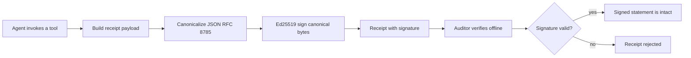
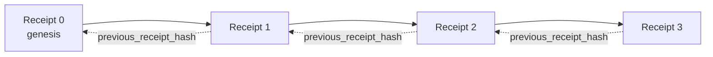

[Katso oppitunnin video: AI-agenttien suojaaminen kryptografisilla kuitilla](https://youtu.be/PLACEHOLDER_VIDEO_ID)

> _(Oppitunnin video ja pikkukuva lisätään Microsoftin sisältötiimin toimesta yhdistämisen jälkeen, noudattaen oppituntien 14 / 15 mallia.)_

# AI-agenttien suojaaminen kryptografisilla kuiteilla

## Johdanto

Tässä oppitunnissa käsitellään:

- Miksi AI-agenttien auditointijäljet ovat tärkeitä vaatimustenmukaisuuden, virheenkorjauksen ja luottamuksen kannalta.
- Mikä on kryptografinen kuitti ja miten se eroaa allekirjoittamattomasta lokirivistä.
- Kuinka tuottaa allekirjoitettu kuitti agentin työkalukutsusta tavallisessa Pythonissa.
- Kuinka varmistaa kuitti offline-tilassa ja havaita manipulointi.
- Kuinka ketjuttaa kuitteja niin, että yhden poisto tai uudelleenjärjestely rikkoo ketjun.
- Mitä kuitit todistavat ja mitä ne eksplisiittisesti eivät todista.

## Oppimistavoitteet

Oppitunnin jälkeen osaat:

- Tunnistaa epäonnistumismallit, jotka motivoivat kryptografista alkuperää agenttitoiminnoille.
- Tuottaa Ed25519-allekirjoituksella allekirjoitetun kuitin kanonisesta JSON-payloadista.
- Varmistaa kuitin itsenäisesti käyttäen vain allekirjoittajan julkista avainta.
- Havaita manipulointi tarkistamalla kuitti uudelleen muokatun version kanssa.
- Rakentaa hajautusketjutettu kuitujono ja selittää, miksi ketju on tärkeä.
- Tunnistaa rajapinta, mitä kuitit todistavat (vastaavuus, eheys, järjestys) ja mitä eivät (toiminnon oikeellisuus, politiikan pätevyys).

## Ongelma: Agenttisi auditointijälki

Kuvittele, että olet ottanut käyttöön AI-agentin Contoso Travelille. Agentti lukee asiakaspyyntöjä, kutsuu lentojen API:a etsiäkseen vaihtoehtoja ja varaa istuimet asiakkaan puolesta. Viime neljänneksellä agentti käsitteli 50 000 varausta.

Tänään saapuu tarkastaja. Hän kysyy yksinkertaisen kysymyksen: "Näytä minulle, mitä agenttisi teki."

Luovutat lokitiedostosi. Tarkastaja katsoo niitä ja esittää vaikeamman kysymyksen: "Miten tiedän, ettei näitä lokitiedostoja ole muokattu?"

Tämä on auditointijälkien ongelma. Useimmat agenttien käyttöönotot nykyään luottavat:

- **Sovelluslokeihin**: jotka agentti itse kirjoittaa ja joita voi muokata kuka tahansa tiedostojärjestelmän käyttöoikeuksilla.
- **Pilvilokointipalveluihin**: jotka ovat alustatasolla manipulointia kestäviä, mutta vain jos tarkastaja luottaa alustan ylläpitäjään.
- **Tietokantatapahtumalokeihin**: sopivat hyvin tietokantamuutoksiin, mutta eivät satunnaisiin työkalukutsuihin.

Mikään näistä ei voi vastata tarkastajan kysymykseen ilman, että tarkastaja joutuu luottamaan johonkuhun (sinä, pilvipalveluntarjoajasi, tietokantatoimittajasi). Sisäisessä käytössä se luottamus on usein hyväksyttävää. Säädellyissä työkuormissa (rahoitus, terveydenhuolto, mitä tahansa EU:n AI-lain alaisia) se ei ole.

Kryptografiset kuitit kaventavat ongelmaa tekemällä allekirjoitetun lausuman itsenäisesti
varmennettavaksi. Tarkastajan täytyy edelleen olla ulkopuolinen syy luottaa allekirjoitusavaimeen ja
komponenttiin, joka lausuman tuotti. Upotettu avain todistaa itsejohdonmukaisuuden,
ei julkaisijan identiteettiä tai toimeenpanon paikkaa.

## Mikä on kryptografinen kuitti?

Kuitti on JSON-objekti, joka tallentaa, mitä agentti teki, ja on allekirjoitettu digitaalisella allekirjoituksella.



Minimikuitti näyttää tältä:

```json
{
  "type": "agent.tool_call.v1",
  "agent_id": "contoso-travel-bot",
  "tool_name": "lookup_flights",
  "tool_args_hash": "sha256:a3f9c1...",
  "result_hash": "sha256:7b2e1d...",
  "policy_id": "contoso-travel-policy-v3",
  "timestamp": "2026-04-25T14:30:00Z",
  "sequence": 47,
  "previous_receipt_hash": "sha256:9d4e6a...",
  "signature": {
    "alg": "EdDSA",
    "sig": "c5af83...",
    "public_key": "8f3b2c..."
  }
}
```

Kolme ominaisuutta tekevät työn:

1. **Allekirjoitus**. Kuitti on allekirjoitettu agentin portin toimesta Ed25519-privaatilla avaimella. Kuka tahansa, jolla on vastaava julkinen avain, voi vahvistaa allekirjoituksen offline-tilassa. Luottava osapuoli täytyy lukita avain tai hakea se luotetusta rekisteristä kuitin ulkopuolelta. Minkä tahansa allekirjoitetun kentän manipulointi mitätöi allekirjoituksen.

2. **Kanoninen koodaus**. Ennen allekirjoitusta kuitti sarjoitetaan JSON Kanonisointikuvion (JCS, RFC 8785) avulla. Tämä varmistaa, että kaksi toteutusta, jotka tuottavat loogisesti saman kuitin, luovat tavuidenttisen tuloksen. Ilman kanonisointia eri JSON-sarjoittajat tuottaisivat erilaiset allekirjoitukset samasta sisällöstä.

3. **Hajautusketju**. `previous_receipt_hash`-kenttä linkittää jokaisen kuitin sitä edeltävään. Yhden kuitin poistaminen tai uudelleenjärjestely rikkoo esitetyn sekvenssin. Leikkausten tai allekirjoittajan hallitsemien uudelleenkirjoitusten havaitsemiseen tarvitaan lisäksi lukittu ketjun nykyinen kärki, itsenäisesti todistettu tarkistuspiste tai todennettu suljettu populaatiokirjaus.

Nämä ominaisuudet yhdessä tarjoavat kolme takuuta:

- **Avainnimeäminen**: tämä avain allekirjoitti tämän sisällön. Organisaatio- tai ihmisen identiteetti vaatii luotetun avainsidoksen.
- **Eheys**: sisältö ei ole muuttunut allekirjoittamisen jälkeen.
- **Järjestys varmennetussa sekvenssissä**: tämä kuitti linkittyy siihen edeltäjään.

## Kuittien tuottaminen Pythonissa

Et tarvitse erityistä kirjastoa kuitin tuottamiseen. Kryptografiset primitiivit ovat laajalti saatavilla ja logiikka on muutamia kymmeniä rivejä Python-koodia.

Käytännön harjoitukset `code_samples/18-signed-receipts.ipynb` käyvät läpi koko prosessin. Lähdeohjattu `code_samples/18-signed-receipts.execution-receipt.json` tallentaa tarkan muistikirjan hajautuksen, Python-ympäristön, solumäärän ja viimeisimmän puhtaan suorituksen tarkistukset muuttamatta oppitunnin tallennettuja tuloksia. Yhteenvetoversio:

```python
import json
import hashlib
import base64
from nacl import signing
from jcs import canonicalize  # RFC 8785 canonical JSON

def b64url_nopad(data: bytes) -> str:
    return base64.urlsafe_b64encode(data).decode("ascii").rstrip("=")

def sha256_canonical(obj) -> str:
    """SHA-256 of a Python object's JCS-canonical JSON form."""
    return f"sha256:{hashlib.sha256(canonicalize(obj)).hexdigest()}"

# Generate or load a signing key (in production, store in a key vault)
signing_key = signing.SigningKey.generate()
verify_key = signing_key.verify_key
TRUSTED_PUBLIC_KEYS = {b64url_nopad(bytes(verify_key))}  # pinned out of band by the verifier

# Build the receipt payload (no signature yet)
tool_args = {"origin": "SYD", "destination": "LAX"}
tool_result = [{"flight": "QF11", "price": 1850, "stops": 0}]

payload = {
    "type": "agent.tool_call.v1",
    "agent_id": "contoso-travel-bot",
    "tool_name": "lookup_flights",
    "tool_args_hash": sha256_canonical(tool_args),
    "result_hash": sha256_canonical(tool_result),
    "policy_id": "contoso-travel-policy-v3",
    "timestamp": "2026-04-25T14:30:00Z",
    "sequence": 0,
    "previous_receipt_hash": None,
}

# Canonicalize and sign the JCS bytes directly. PureEdDSA hashes internally.
canonical_bytes = canonicalize(payload)
signature_bytes = signing_key.sign(canonical_bytes).signature

# Attach a structured signature object.
receipt = {
    **payload,
    "signature": {
        "alg": "EdDSA",
        "sig": b64url_nopad(signature_bytes),
        "public_key": b64url_nopad(bytes(verify_key)),
    },
}
```

Tämä on koko allekirjoitusputki. Harjoitukset muistikirjassa käyvät läpi jokaisen vaiheen.

## Kuitin tarkistaminen ja manipuloinnin havaitseminen

Tarkistaminen on käänteinen operaatio:

```python
import base64
import hashlib
from nacl import signing
from nacl.exceptions import CryptoError
from jcs import canonicalize

def b64url_decode(s: str) -> bytes:
    # Strict: Python's decoder skips characters outside the alphabet and also
    # accepts padding, the standard +/ alphabet and non-zero spare bits.
    # Re-encoding and comparing accepts only the one unpadded base64url form.
    padding = "=" * ((4 - len(s) % 4) % 4)
    data = base64.urlsafe_b64decode(s + padding)
    if base64.urlsafe_b64encode(data).decode("ascii").rstrip("=") != s:
        raise ValueError("not canonical unpadded base64url")
    return data

def verify_receipt(receipt: dict, trusted_public_key: str) -> bool:
    # trusted_public_key is the issuer's key, obtained from somewhere other
    # than this receipt. Never use receipt["signature"]["public_key"] here:
    # see "What Receipts Prove (and What They Do Not)" below.
    # Fails closed: anything malformed returns False instead of raising.
    if not isinstance(receipt, dict) or not isinstance(trusted_public_key, str):
        return False
    sig_obj = receipt.get("signature")
    if not isinstance(sig_obj, dict) or sig_obj.get("alg") != "EdDSA":
        return False
    sig_b64 = sig_obj.get("sig")
    if not isinstance(sig_b64, str):
        return False

    try:
        # Reconstruct the payload that was actually signed (everything except signature).
        payload = {k: v for k, v in receipt.items() if k != "signature"}
        canonical_bytes = canonicalize(payload)
        verify_key = signing.VerifyKey(b64url_decode(trusted_public_key))
        verify_key.verify(canonical_bytes, b64url_decode(sig_b64))
        return True
    except (CryptoError, TypeError, ValueError, KeyError, OverflowError):
        return False
    except Exception:
        # An undecodable key or signature, or a payload that cannot be
        # canonicalized: fail closed rather than raise.
        return False
```

Tämä funktio ottaa kuitin ja julkisen avaimen ja palauttaa `True`, jos allekirjoitus on voimassa, ja `False` muuten, mukaan lukien väärin muodostettu syöte. Ei verkkokutsua eikä vahvistuspalvelua: kun pidät julkista avainta, varmistus tapahtuu täysin paikallisesti offline-tilassa. Tarvittava avain on kuitenkin saatava jostain muualta kuin kuitista itsestään.

Näyttääksesi manipuloinnin havaitsemisen toiminnan, muistikirja käy läpi:

1. Voimassa olevan kuitin tuottamisen ja sen vahvistamisen.
2. Yhden tavun muokkaamisen `tool_args_hash`-kentässä.
3. Varmistuksen uudelleensuorittamisen ja epäonnistumisen havaitsemisen.
4. Uudelleen manipuloinnin, mutta tällä kertaa uudelleenkirjoituksen hyökkääjän luomalla avaimella ja sen upottamisen kuittiin.

Kohta 4 on se, johon kannattaa pysähtyä. Se kuitti on sisäisesti johdonmukainen: sen allekirjoitus on aito sekä sisällölle että siinä olevalle avaimelle, joten se vahvistuu avaimella sen sisällä. Se epäonnistuu vain, kun sitä verrataan julkaisijan oikeaan avaimeen. Vaiheet 2 ja 3 pysäyttävät hyökkääjän, joka ei vaivautunut uudelleenkirjoittamaan; vaihe 4 pysäyttää hyökkääjän, joka sen teki.

Tämä on käytännön osoitus siitä, että kuitit ovat manipulointia kestäviä: mikä tahansa muutos allekirjoitettuun kenttään rikkoo allekirjoituksen, edellyttäen että varmistat avaimella, jota hyökkääjä ei toimittanut. `signature`-objekti on allekirjoitettujen tavujen ulkopuolella, siksi varmistettava avain täytyy tulla muualta kuin kuitista.

## Kuittien ketjuttaminen monivaiheisten agenttien suojaksi

Yksi allekirjoitettu kuitti suojaa yhtä toimintoa. Ketju kuittien suojaa kokonaisen sekvenssin.



Jokainen kuitti sisältää sitä edeltävän kuitin hajautuksen. Poistaakseen kuitin 2 hiljaa, hyökkääjän pitäisi joko:

- Muokata kuitin 3 `previous_receipt_hash`-kenttää (rikkoo kuitin 3 allekirjoituksen), TAI
- Väärennellä uusi allekirjoitus muutetulle kuitille 3 (vaatii agentin yksityisavaimen).

Jos yksityinen avain on turvallisesti laiteavainten hallinnassa ja varmistajat tarkistavat jokaisen kuitin julkista avainta vastaan, jonka saavat itsenäisesti (julkaistu JWK-setti tai lukittu konfiguraatioarvo), kumpikaan hyökkäys ei ole toteuttamiskelpoinen ilman havaitsemista. Avain kuitin sisällä julkaiseminen ei riitä: hyökkääjä voi allekirjoittaa uudelleen omalla avaimellaan ja upottaa sen sijaan sen, mikä on `04_resigned_receipt.json`-ongelma.

Muistikirja käy läpi:

1. Kolmen kuitin ketjun rakentamisen.
2. Varmistuksen, että jokaisen kuitin `previous_receipt_hash` vastaa edellisen kuitin todellista hajautusta.
3. Yhden keskellä olevan kuitin manipuloinnin ja ketjun katkeamisen havaitsemisen juuri siinä kohtaa.

Näin tuot auditointijäljen, jonka ulkopuolinen tarkastaja voi vahvistaa omien lukittujen julkaisijavaimiensa ja ketjuntarkistuspisteiden avulla ilman, että hänen tarvitsee luottaa muuttuvaan lokivarastoosi.


## Mitä kuitit todistavat (ja mitä ne eivät todista)

Tämä on oppitunnin tärkein osio. Kuitit ovat tehokkaita, mutta niiden voima on rajallinen.

**Kuitit todistavat kolme asiaa:**

1. **Vastaavuus**: tietty avain allekirjoitti tietyn payloadin.
2. **Eheys**: payload ei ole muuttunut allekirjoittamisen jälkeen.
3. **Järjestys esitetyn, varmennetun sekvenssin sisällä**: tämä kuitti linkittyy siihen edeltäjään.

**Kuitit EIVÄT todista:**

1. **Oikeellisuus**: että agentin toiminta oli oikea teko. Kuitti voidaan allekirjoittaa väärälle vastaukselle yhtä siististi kuin oikeallekin.
2. **Politiikan noudattaminen**: että `policy_id`-kentässä mainittu politiikka todella arvioitiin tai että se olisi sallinut tämän toiminnon, jos sitä olisi tarkastettu. Kuitti tallentaa, mitä väitettiin, ei mitä toimeenpantiin.
3. **Identiteetti avaimen lisäksi**: kuitti sanoo "tämä avain allekirjoitti tämän sisällön." Se ei sano "tämä ihminen valtuutti tämän." Avain on liitettävä henkilöön tai organisaatioon erillisellä identiteettijärjestelmällä (hakemisto, julkinen avainrekisteri jne.).
4. **Syötteiden todenperäisyys**: jos agentti saa muokatun kehotteen ja toimii sen perusteella, kuitti tallentaa toiminnon uskollisesti. Kuitit ovat syötteen validoinnin jälkeisiä, eivät korvaavia.
5. **Suoritus tai todellinen vaikutus**: jälkikäteen annettu kuitti tallentaa, mitä sen julkaisija väittää tapahtuneen. Pääsyn todistaminen tai ulkoisen vaikutuksen sovittaminen vaatii todisteita varsinaiselta suorittajalta tai tarjoajan rajapinnalta.
6. **Täydellisyys**: puuttuva kuitti voi tarkoittaa estettyä, jätettyä pois, kadonnutta tai ilman instrumentointia. Poissaolo on todiste vain todistetussa suljetussa populaatiossa.
7. **Luotettu aika**: allekirjoitettu aikaleima todistaa, että allekirjoittajalla oli tuo arvo, ei että arvo olisi ollut oikea. Luotettu aika vaatii erillisen aika-asianomistajan tai todistetun tarkistuspisteen.

**Kuittiin upotettu avain ei ole se avain, jolla varmistat.** Tämä seuraa kohdasta 3, ja se on se kohta, jossa erotus täytyy muuttaa koodissasi, ei vain ymmärryksessäsi. Yllä olevassa esimerkissä `public_key` on siellä, jotta esimerkki on itseensä sulkeutuva. Tarkastajan ei koskaan pidä luottaa siihen. Kuka tahansa voi ottaa kuitin, muuttaa sitä, allekirjoittaa uudella itse luodulla avaimella ja upottaa sen; tulos varmistuu täydellisesti itseään vastaan. Tämä on `04_resigned_receipt.json` kohtaus `sample_receipts/`, ja siksi `verify_receipt` yllä ottaa avaimen argumenttina sen sijaan että lukisi sen kuitista. Hanki julkaisijan avain itsenäisesti, esimerkiksi alla olevan tuotantotarkistuslistan JWK-setistä tai muusta valmiiksi lukitusta ankkurista, ja varmista sillä. Samaankuuluva allekirjoitus, joka tarkistetaan avaimella, joka tuli samassa kuoressa, todistaa vain kuoressa olevan itsensä johdonmukaisuuden.

Tämä raja on tärkeä kahdesta syystä:

- Se kertoo, mihin kuitit ovat hyödyllisiä: tekemään agenttikäyttäytymisestä auditointikelpoista ja manipulointia kestävää, myös organisaatiorajojen yli.
- Se kertoo, mitä lisäkerroksia vielä tarvitset: syötteen validointi (oppitunti 6), politiikan toimeenpano (lyhyesti alla), ja identiteettijärjestelmät (ei tämän oppitunnin aihe).

Yleinen virhe on olettaa, että "meillä on kuitit" tarkoittaa "meillä on hallinto." Ei tarkoita. Kuitit ovat perusta. Hallinto on järjestelmä, jonka rakennat niiden päälle.

## Hyväksyjän allekirjoituksen sitominen tarkkaan toimintaan

Kohta 3 aiemmin ansaitsee oman osionsa: toimintakuitti sanoo "tämä avain allekirjoitti tämän sisällön," ei koskaan "ihminen valtuutti tämän." Korkean riskin toimille (hyvitykset, poistot, tilisiirrot) erillinen hyväksyjän allekirjoitus voi sitoa tarkan toiminnon. Tämän avaimen liittäminen ihmiseen ja ihmisen läsnäolon tarkistaminen ovat erillisiä vastuita.

Seuraava muistikirja `code_samples/human-authorization-receipts.ipynb` lisää toisen kuittilajin, `human.approval.v1`, samassa kuoressa kuin oppitunnin kuitit (tyypitetty payload allekirjoitettuna Ed25519:llä sen kanonisista JCS-tavuista, `signature`-objekti allekirjoitettujen tavujen ulkopuolella). Hyväksyjän avain allekirjoittaa **kokonaisen kanonisen toiminnon ja sen hajautuksen**; agentin avain allekirjoittaa väitteen, joka kantaa **saman toimintohajautuksen** ja `parent_approval_ref`, hyväksynnän `receipt_hash`, sama käytäntö kuin `previous_receipt_hash` ketjussa, jonka rakensit aiemmin. Yksi `verify_chain` käy läpi molemmat artefaktit **eri lukituissa avainrekistereissä** (hyväksyjän avaimet vs agentin avaimet), joten koodipolku on yhteinen, mutta toimivaltuudet eivät koskaan.

Tämän ominaisuuden muotoilu tarkasti: *lukittu hyväksyjän avain allekirjoitti tämän tarkan
toiminnon, ja agentin avain allekirjoitti myöhemmin lausuman, joka kantaa samaa toimintohajautusta.*
Se on hyödyllinen todiste, mutta ei itsessään todiste toiminnon toteutumisesta. Toteutuksen hallinta vaatii,
että tarkka hyväksyntä myös varataan ja kulutetaan kerran
varsinaisella suorittajan rajalla; tuntemattomien tarjoajan tulosten täytyy pysyä tuntemattomina eikä niitä saa hölmösti yrittää uudelleen. Muistikirjan kieltäytymisen testit kattavat kuittiketjutasoa:


- manipulointi, hämmentynyt edustaja, väärennetyt avaimet kummallakin puolella ja väärin muodostettu syöte;
- **vanhentunut valtuutus**: allekirjoitus, joka yhä vahvistaa, mutta hylätään silti, koska käytäntöversio vaihtui, hyväksyjän avain poistettiin kiinnitetystä rekisteristä tai hyväksyntä vanheni ennen toimitettua vahvistusaikaa;
- **tiivisteen vaihto**: kelvollisesti allekirjoitettu toimintakuitti, joka osoittaa *todelliseen* hyväksyntään, joka sitoo *eri* kanoniseen toimintaan.

Jokainen virhe hylkää eri syystä, joten tarkastaja, joka lukee hylkäyksen, voi päätellä, menikö valtuutus vanhaksi vai muuttuiko väitetty toiminto. Vahvistus on vain luku -toiminto ja toistettavissa: se ei kuluta hyväksyntää eikä kutsu tarjoajaa. Erillinen suoritin tarvitsee kestävää, atomista uudelleentoiston suojaa ja eksplisiittiset onnistumis-, epäonnistumis- ja epävarmat tulokset. Ihmisen hyväksyntäkuitti on tämän oppitunnin määrittelemä opettavainen koostumus, ei `draft-farley-acta-signed-receipts`-määritelty kuittityyppi.

## Tuotantoviitteet

Tässä oppitunnissa esitetty Python-koodi on tarkoituksella minimaalista, jotta voit lukea jokaisen rivin ja ymmärtää tarkalleen, mitä tapahtuu. Tuotantokäytössä sinulla on kaksi vaihtoehtoa:

1. **Rakenna suoraan kryptografisten primitiivien päälle.** Yllä näkemäsi 50 riviä riittää moniin käyttötapauksiin. PyNaCl (Ed25519) ja `jcs`-paketti (kannonaalinen JSON) ovat hyvin ylläpidettyjä ja tarkastettuja kirjastoja.

2. **Käytä tuotantokelpoista kuittikirjastoa.** Useat avoimen lähdekoodin projektit toteuttavat saman mallin lisäominaisuuksilla (avainten kierto, erävarmennus, JWK Set -jakelu, integraatio politiikkamoottoreihin):
   - Allekirjoitusputki käyttää JCS- ja allekirjoitusalueen käytäntöjä itsenäisessä IETF Internet-Draftissa ([`draft-farley-acta-signed-receipts`](https://datatracker.ietf.org/doc/draft-farley-acta-signed-receipts/), revisio 02). Tämän oppitunnin yksinkertainen opetuskuitti eroaa luonnoksen `{payload, signature}`-kontekstista eikä sitä esitellä yhteensopivana toteutuksena. Luonnos julkaisee jaetun yhteensopivuustestipaketin ([agent-governance-testvectors](https://github.com/ScopeBlind/agent-governance-testvectors)) toteutuksille, jotka kohdistuvat sen tiedonsiirtomuotoon.
   - Microsoft Agent Governance Toolkit koostaa kuitit Cedar-pohjaisten politiikkapäätösten avulla; katso opas 33 kyseisestä arkistosta päästäksesi läpivientiesimerkkiin.
   - `protect-mcp` (npm) ja `@veritasacta/verify` (npm) paketit tarjoavat Node-pohjaisen toteutuksen kuittien allekirjoittamiseen ja offline-varmennukseen, tarkoituksena kääriä mikä tahansa MCP-palvelin tahrojen havaitsevalla tarkastushistorialla, sisältäen yhdessä allekirjoitukseen pidettävän prosessin, jossa keskeytetyssä toimessa annetaan hyväksymiskuitti, joka on sidottu toiminnan tiivisteeseen (WebAuthn-pohjainen työpöytävirrassa), sama hyväksymiskuittimalli kuin yllä ihmisen valtuutusmuistikirjassa.
   - **[nobulex](https://github.com/arian-gogani/nobulex)** Python SDK (`pip install nobulex`) toteuttaa saman Ed25519 + JCS -allekirjoitusmallin Pythonissa LangChain- ja CrewAI-integraatioiden kanssa, julkaisten myös ristiin validoidut testivektorit ja yhteensopivuuskartoituksen, joka on kontribuoitu [OWASP PR #2210](https://github.com/OWASP/CheatSheetSeries/pull/2210) kautta.
   - **[EMILIA Protocol](https://github.com/emiliaprotocol/emilia-protocol)** tarjoaa täydentävän tarkan-toiminnon sanktiointikerroksen: offline-varmennettavat hyväksymiskuitit, pinnoitettu WebAuthn tai ääntenemmistövaltuus, kertakäyttö rajapinnalla, ja eksplisiittinen epämääräisen lopputuloksen polku. Sen kehysadapterit käsittelevät kuittia tarvittavana todisteena pikemminkin kuin todisteena ulkoisen vaikutuksen tapahtumisesta.

Päätös oman toteutuksen ja kirjaston käytön välillä vastaa päätöstä oman JWT-kirjaston kirjoittamisen ja testatun käyttämisen välillä: molemmat ovat järkeviä; kirjasto säästää aikaa ja vähentää tarkastusalaa; alusta alkaen -lähestymistapa pakottaa ymmärtämään jokaisen primitiivin. Tämä oppitunti opettaa alusta alkaen polun, joten sinulla on perusta kumpaankin valintaan.

## Tietotarkistus

Testaa ymmärrystäsi ennen kuin siirryt käytännön harjoitukseen.

**1. Kuitti allekirjoitetaan agentin yksityisellä Ed25519-avaimella. Tarkastajalla on vain julkinen avain. Voiko tarkastaja varmentaa kuitin offline-tilassa?**

<details>
<summary>Vastaus</summary>

Kyllä, kryptografinen varmenne vaatii vain julkisen avaimen ja allekirjoitetut tavut.  
Tarkastajan on silti hankittava ja pinnoitava hyväksytty julkinen avain erillään kuitista.  
Tämän luottamusasetuksen jälkeen verkkoyhteyttä ei tarvita.  
</details>

**2. Hyökkääjä muokkaa kuittiin `policy_id`-kenttää väittääkseen, että se oli hallinnoitu löyhemmän politiikan mukaan. Allekirjoitus tehtiin alkuperäisen datan päälle. Mitä tapahtuu tarkistuksen aikana?**

<details>
<summary>Vastaus</summary>

Tarkistus epäonnistuu. Allekirjoitus laskettiin alkuperäisen datan kanonisista tavuista; minkä tahansa kentän muokkaaminen vaihtaa näitä tavuja ja tekee allekirjoituksesta voimattoman. Hyökkääjä tarvitsee yksityisen avaimen tehdäkseen uuden validin allekirjoituksen, jota heillä ei ole.
</details>

**3. Miksi kuitti sisältää `tool_args_hash` ja `result_hash` raakadatan ja tuloksen sijaan?**

<details>
<summary>Vastaus</summary>

Kaksi syytä. Ensinnäkin, kuitti voi tarvita arkistointia tai siirtoa ympäristöissä, joissa raakadatan vuotaminen (henkilötiedot, liiketoimintadata) on ongelma. Hashaus pitää kuitin pienenä ja sisällön yksityisenä; tarkastaja varmistaa, että hash vastaa erillään tallennettua kopiota todellisesta sisällöstä. Toiseksi, hashit ovat kiinteän kokoisia; kuitti, jossa on hasheja, on koon osalta rajattu riippumatta syötteiden tai tulosten koosta.
</details>

**4. `previous_receipt_hash`-kenttä linkittää jokaisen kuitin edeltäjäänsä. Jos hyökkääjä poistaa hiljaisesti yhden kuitin ketjun keskeltä, mikä muuttuu pätemättömäksi?**

<details>
<summary>Vastaus</summary>

Jokainen kuitti, joka tuli poistetun jälkeen. Niiden `previous_receipt_hash`-kentät eivät enää vastaa ketjua (koska viitattu kuitti ei enää ole olemassa, tai ketju osoittaa nyt eri edeltäjään). Poiston salaamiseksi hyökkääjän pitäisi allekirjoittaa uudelleen kaikki myöhemmät kuitit, mikä vaatii myöntäjän yksityisen avaimen. Millä tahansa muulla avaimella uudelleenkirjoitus epäonnistuu tarkistuksessa myöntäjän avainta vastaan.
</details>

**5. Kuitti tarkistetaan onnistuneesti. Todistaako se, että agentin toiminta oli oikea, pätevä tai sääntöjenmukainen?**

<details>
<summary>Vastaus</summary>

Ei. Lukittuun avaimeen ja ketjukontekstiin perustuva validi kuitti todistaa allekirjoituksen omistajuuden,
sisällön eheyden ja linkin esitettyyn edeltäjään. Se EI todista,
että toiminto oli oikea tai suoritettu, että politiikka on arvioitu, että aikaleima on
luotettava tai että tietuejoukko on täydellinen. Tämä on tärkein rajapinta tässä oppitunnissa.
</details>

## Harjoitustehtävä

Avaa `code_samples/18-signed-receipts.ipynb` ja suorita kaikki neljä osaa:

1. **Osa 1**: Allekirjoita ensimmäinen kuittisi ja tarkista se.
2. **Osa 2**: Muokkaa kuittia ja katso tarkistuksen epäonnistuminen.
3. **Osa 3**: Rakenna kolmen kuitin ketju ja tarkista ketjun eheys.
4. **Osa 4**: Käytä mallia agentissa, joka on rakennettu Microsoft Agent Frameworkilla: kiedo työkalukutsu kuittien allekirjoitukseen ja tarkista kuitti itsenäisesti.

**Haaste 1:** laajenna kuittikaavaa lisäämällä oma lisäkenttä (esimerkiksi pyyntö-ID jäljitykseen), päivitä kanoninen allekirjoituslogiikka sisällyttämään se ja varmista, että kuitti käy läpi tarkistuksen. Muokkaa kenttää allekirjoituksen jälkeen ja varmista, että tarkistus epäonnistuu. Tämä pakottaa ymmärtämään, miten jokainen kanonisen koodauksen tavu vaikuttaa allekirjoitukseen.

**Haastetehtävä 2:** SHA-256-hashaa kaksi kuittiasi yhteen (ketjuta niiden kanoniset tavut deterministisessä järjestyksessä) ja upota tuloksena oleva tiiviste uutena kenttänä kolmannen kuitin sisään ennen sen allekirjoittamista. Varmista, että kaikki kolme kuittia käyvät läpi pyörähdyskierroksen oikein. Olet juuri rakentanut yhden askeleen sisällytystodistuksen: kuka tahansa, jolla on kolmas kuitti, voi todistaa, että kaksi ensimmäistä oli olemassa kuittia allekirjoitettaessa, paljastamatta sen sisältöä. Tätä mallia valikoivasti paljastavat kuitit käyttävät laajassa mittakaavassa (Merkle-sitoumukset, RFC 6962).

## Yhteenveto

Kryptografiset kuitit antavat tekoälyagenteille tarkastusketjun, joka on:

- **Riippumattomasti varmennettavissa kiinnitetyn luottamuksen alaisena**: osapuoli, jolla on hyväksytyt julkiset avaimet ja allekirjoitetut tavut, voi vahvistaa ilman palveluriippuvuutta.
- **Muokkauspaljastava**: mikä tahansa muutos mitätöi allekirjoituksen.
- **Siirrettävä**: kuitti on pieni JSON-tiedosto; se voidaan arkistoida, siirtää ja varmentaa missä tahansa.
- **Standardien mukainen**: pohjautuu Ed25519:ään (RFC 8032), JCS:ään (RFC 8785) ja SHA-256:een, kaikki laajasti otettuja primitiivejä.

Ne eivät korvaa syötteen validointia, politiikan valvontaa, suorittajan hyväksyntää,
tuloksen todistamista, täydellisyysvalvontaa tai identiteettien infrastruktuuria. Ne ovat
perusta näille kerroksille. Säädellyissä tai moniorganisaatioisissa työnkuluissa kuitit tekevät
tiettyjen myöntäjien lausunnoista tarkastajan oman luottamuskonfiguraation alaisina riippumattomasti tarkistettavia.

Tärkein opetus: kuitit todistavat, että tietty avain allekirjoitti tietyn
sisällön. Mukana oleva aikaleima on allekirjoittajan väittämä, ellei sitä ole erikseen vahvistettu ajallisesti.
Kuitti ei osoita, että sen sisältö olisi totta, että jokin toimenpide olisi suoritettu tai että
tietuejoukko on täydellinen. Säilytä nämä erot tiukasti mielessä.

## Tuotannon tarkistuslista

Kun olet valmis siirtymään tältä oppitunnilta käyttämään kuitin allekirjoittavia agentteja oikeassa ympäristössä:

- [ ] **Siirrä allekirjoitusavain pois kehittäjän kannettavalta.** Käytä Azure Key Vaultia, AWS KMS:ää tai laitteistoturvayksikköä. Yksityisen avaimen, joka allekirjoittaa kuitit, ei koskaan saa olla lähdekoodin hallinnassa tai selväkielisenä sovelluslaitteissa.
- [ ] **Perusta varmennusavaimen luottamus.** Julkaise avaimet JWK-joukkoina tai rekisterinä, ja anna käyttäjien sitoa hyväksytty myöntäjän identiteetti, avainjoukko ja kiertopolitiikka yksittäisten kuittien ulkopuolella. Pelkkä sisäinen avain ei ole luottamuksen ankkuri.
- [ ] **Ankkuroi ketju ulkoisesti.** Kirjoita säännöllisin väliajoin ketjun viimeisin juuritunniste läpinäkyvyyspäiväkirjaan (Sigstore Rekor, RFC 3161-aikaleima-viranomainen tai toinen sisäinen järjestelmä), jotta ulkopuolinen osapuoli voi varmistaa ”tämä ketju oli olemassa tuolloin.”
- [ ] **Tallenna kuitit muuttumattomasti.** Liitosvain tulostettava tallennustila (Azure Storage immuuttisuuskäytännöillä, AWS S3 Object Lock) estää sisäpiiriläisen historian uudelleenkirjoituksen tallennuskerroksessa.
- [ ] **Päätä säilytyksestä.** Monet vaatimustenmukaisuussäännökset edellyttävät monen vuoden säilytystä. Suunnittele kuitin kasvua varten (kuitin koko on noin 500 tavua; agentti, joka tekee 10 000 kutsua päivässä, tuottaa noin 1,8 Gt vuodessa).
- [ ] **Dokumentoi, mitä kuitit eivät kata.** Kuitit todistavat attribuution, eheyden ja järjestyksen. Käyttöohjeesi tulisi selkeästi luetella, mitä lisävalvontoja (syötteen validointi, politiikan valvonta, nopeusrajoitus, identiteettien infrastruktuuri) on kuitin rinnalla hallintapolitiikassasi.

### Lisää kysymyksiä tekoälyagenttien suojaamisesta?

Liity [Microsoft Foundry Discord](https://aka.ms/ai-agents/discord) -kanavalle tavata muita oppijoita, osallistua aukioloaikoihin ja saada vastauksia tekoälyagenttikysymyksiisi.

## Oppitunnin jälkeen

Tämä oppitunti kattaa yksittäisen kuitin allekirjoituksen ja hash-ketjutetut sekvenssit. Samat primitiivit muodostavat useita kehittyneempiä malleja, joihin saatat törmätä hallintapolitiikkasi kehittyessä:

- **Valikoiva paljastaminen.** Kun kuitin kentät on sitoutettu itsenäisesti (RFC 6962-tyylinen Merkle-puu), voit paljastaa tietyt kentät tietyille tarkastajille ja todistaa, että loput ovat muuttumattomia paljastamatta niitä. Hyödyllistä, kun sama kuitti täytyy täyttää sekä kattava auditointi (joka haluaa täydellisyyden) että tietosuojasäädökset kuten GDPR (jotka haluavat tarkastajan näkevän mahdollisimman vähän).
- **Kuitin mitätöinti.** Jos allekirjoitusavain vaarantuu, sinun pitää voida merkitä kaikki kyseisellä avaimella allekirjoitetut kuitit epäluotettaviksi tietystä ajankohdasta eteenpäin. Tavallisia malleja: lyhytikäiset allekirjoitusavaimet ja julkaistu mitätöintilista tai läpinäkyvyysloki mitätöintimerkinnöillä.
- **Kaksisuuntaiset / jaetun allekirjoituksen kuitit.** Joissakin toteutuksissa allekirjoitettu sisältö jaetaan esi- (`authorization_*`) ja jälkisuoritus (`result_*`) puoliskoihin itsenäisillä allekirjoituksilla, hyödyllistä kun valtuutuspäätös ja havaittu tulos tehdään eri toimijoiden tai eri aikoina. Tämä rakentuu tämän oppitunnin kuittimuodon päälle.
- **Sisällön koostaminen.** Kuitti sulkee mitä tahansa tavujoukkoa, jonka laitat `result_hash` sisään. Todelliset sisällöt ovat usein runsaampia kuin yhden työkalukutsun tulos: päätöksen ennakkoajatukset (mallin ennuste, harkitut vaihtoehdot, todisteet ja niiden täydellisyys, riskipositio, vastuuketju, portin lopputulos) voivat kaikki olla sisällössä, suljettuina yhdellä kuitilla. Tämä pitää kuittimuodon minimaalisena mahdollistamalla sisältörakenteiden kehittyminen toimialakohtaisesti.
- **Ristikkäinen toteutusyhteensopivuus.** Useat riippumattomat toteutukset samasta kuittimuodosta (Python, TypeScript, Rust, Go) varmentavat keskenään jakamilla testivektoreilla. Jos rakennat oman toteutuksen, julkaistuihin vektoreihin verrattuna validointi varmistaa yhteensopivuuden.
- **Jälki-kvanttitietokoneen aikakauteen siirtyminen.** Ed25519 on nykyään laajasti käytössä, mutta ei kestä kvanttitietokoneita. Pelkkä `alg` -merkintä ei riitä siirtymäksi: profiilin täytyy määritellä ML-DSA-avainenkoodaus, kanoniset allekirjoitetut tavut, varmennus, luottavaisen osapuolen politiikka, alasvientiesteisyys sekä siirtymäsemantiikka. Suunnittele ja testaa kaksinkertaisen allekirjoituksen siirtymä yhteisillä vektoreilla ennen yhteensopivuusväitteitä.

## Lisäresurssit

- <a href="https://datatracker.ietf.org/doc/draft-farley-acta-signed-receipts/" target="_blank">IETF Internet-Draft: Koneiden välisen pääsynhallinnan allekirjoitetut päätöskuittit</a>
- <a href="https://learn.microsoft.com/azure/ai-studio/responsible-use-of-ai-overview" target="_blank">Vastuullisen tekoälyn yleiskatsaus (Azure AI)</a>
- <a href="https://datatracker.ietf.org/doc/html/rfc8032" target="_blank">RFC 8032: Edwards-käyrän digitaalinen allekirjoitusalgoritmi (EdDSA)</a>
- <a href="https://datatracker.ietf.org/doc/html/rfc8785" target="_blank">RFC 8785: JSON:n kanonisaatiokaava (JCS)</a>
- <a href="https://datatracker.ietf.org/doc/html/rfc6962" target="_blank">RFC 6962: Sertifikaattien läpinäkyvyys</a> (Merkle-puurakenteen käyttö valikoitavan paljastuksen kuiteissa)
- <a href="https://github.com/microsoft/agent-governance-toolkit/blob/main/docs/tutorials/33-offline-verifiable-receipts.md" target="_blank">Microsoft Agent Governance Toolkit, opas 33: Offline-varmennettavat päätöskuittit</a>
- <a href="https://github.com/ScopeBlind/agent-governance-testvectors" target="_blank">Ristitoiminnalliset soveltuvuustestivektorit</a> tämän oppitunnin käyttämälle kuittimuodolle (Apache-2.0)
- <a href="https://pynacl.readthedocs.io/" target="_blank">PyNaCl-dokumentaatio</a> (Ed25519 Pythonissa)

## Edellinen oppitunti

[Paikallisten tekoälyagenttien luominen](../17-creating-local-ai-agents/README.md)

---

<!-- CO-OP TRANSLATOR DISCLAIMER START -->
**Vastuuvapauslauseke**:
Tämä asiakirja on käännetty käyttämällä tekoälypohjaista käännöspalvelua [Co-op Translator](https://github.com/Azure/co-op-translator). Vaikka pyrimme tarkkuuteen, otathan huomioon, että automaattiset käännökset saattavat sisältää virheitä tai epätarkkuuksia. Alkuperäinen asiakirja sen alkuperäiskielellä on virallinen lähde. Tärkeissä asioissa suositellaan ammattimaista ihmiskäännöstä. Emme ole vastuussa tämän käännöksen käytöstä aiheutuvista väärinymmärryksistä tai tulkinnoista.
<!-- CO-OP TRANSLATOR DISCLAIMER END -->