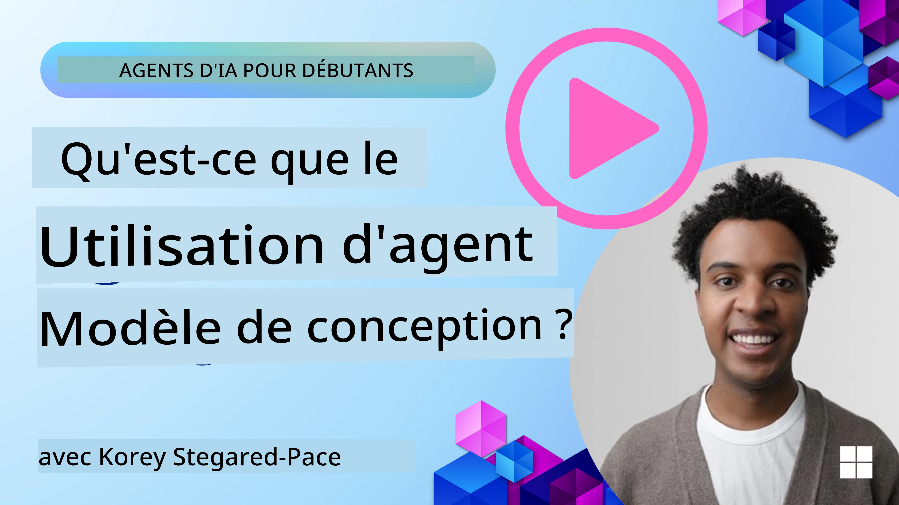
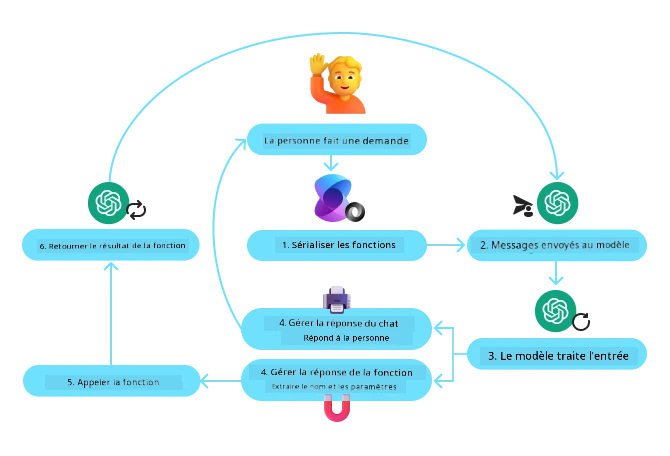
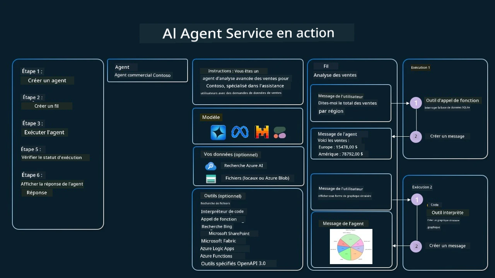

[](https://youtu.be/vieRiPRx-gI?si=cEZ8ApnT6Sus9rhn)

> _(Cliquez sur l'image ci-dessus pour voir la vidéo de cette leçon)_

# Modèle de conception d'utilisation d'outil

Les outils sont intéressants car ils permettent aux agents IA d'avoir un éventail plus large de capacités. Au lieu que l'agent ait un ensemble limité d'actions qu'il peut effectuer, en ajoutant un outil, l'agent peut désormais accomplir une large gamme d'actions. Dans ce chapitre, nous examinerons le modèle de conception d'utilisation d'outil, qui décrit comment les agents IA peuvent utiliser des outils spécifiques pour atteindre leurs objectifs.

## Introduction

Dans cette leçon, nous cherchons à répondre aux questions suivantes :

- Qu'est-ce que le modèle de conception d'utilisation d'outil ?
- Quels sont les cas d'utilisation auxquels il peut être appliqué ?
- Quels sont les éléments/blocs constitutifs nécessaires pour mettre en œuvre ce modèle de conception ?
- Quelles sont les considérations particulières pour utiliser le modèle de conception d'utilisation d'outil afin de construire des agents IA fiables ?

## Objectifs d'apprentissage

Après avoir terminé cette leçon, vous serez capable de :

- Définir le modèle de conception d'utilisation d'outil et son objectif.
- Identifier les cas d'utilisation où ce modèle est applicable.
- Comprendre les éléments clés nécessaires pour mettre en œuvre ce modèle.
- Reconnaître les considérations pour garantir la fiabilité des agents IA utilisant ce modèle de conception.

## Qu'est-ce que le modèle de conception d'utilisation d'outil ?

Le **modèle de conception d'utilisation d'outil** met l'accent sur la capacité des grands modèles de langage (LLM) à interagir avec des outils externes pour atteindre des objectifs spécifiques. Les outils sont des codes pouvant être exécutés par un agent pour effectuer des actions. Un outil peut être une fonction simple comme une calculatrice, ou un appel API à un service tiers comme la consultation du prix des actions ou la prévision météo. Dans le contexte des agents IA, les outils sont conçus pour être exécutés par les agents en réponse à des **appels de fonction générés par le modèle**.

## Quels sont les cas d'utilisation auxquels il peut être appliqué ?

Les agents IA peuvent tirer parti des outils pour accomplir des tâches complexes, récupérer des informations ou prendre des décisions. Le modèle de conception d'utilisation d'outil est souvent utilisé dans des scénarios nécessitant une interaction dynamique avec des systèmes externes, comme des bases de données, des services web ou des interprètes de code. Cette capacité est utile pour un certain nombre de cas d'utilisation différents, notamment :

- **Récupération dynamique d'informations :** Les agents peuvent interroger des API externes ou des bases de données pour obtenir des données à jour (par exemple, interrogation d'une base SQLite pour analyse de données, récupération des prix des actions ou des informations météorologiques).
- **Exécution et interprétation de code :** Les agents peuvent exécuter du code ou des scripts pour résoudre des problèmes mathématiques, générer des rapports ou effectuer des simulations.
- **Automatisation du flux de travail :** Automatisation de flux de travail répétitifs ou à plusieurs étapes en intégrant des outils comme des planificateurs de tâches, des services de messagerie ou des pipelines de données.
- **Support client :** Les agents peuvent interagir avec des systèmes CRM, des plateformes de ticketing ou des bases de connaissances pour résoudre les requêtes des utilisateurs.
- **Génération et édition de contenu :** Les agents peuvent utiliser des outils tels que les correcteurs grammaticaux, les résumeurs de texte ou les évaluateurs de sécurité de contenu pour assister dans les tâches de création de contenu.

## Quels sont les éléments/blocs constitutifs nécessaires pour mettre en œuvre le modèle de conception d'utilisation d'outil ?

Ces blocs constitutifs permettent à l'agent IA d'accomplir un large éventail de tâches. Regardons les éléments clés nécessaires pour implémenter le modèle de conception d'utilisation d'outil :

- **Schémas de fonction/outil** : Définitions détaillées des outils disponibles, incluant le nom de la fonction, son but, les paramètres requis et les résultats attendus. Ces schémas permettent au LLM de comprendre quels outils sont disponibles et comment construire des requêtes valides.

- **Logique d'exécution des fonctions** : Régit comment et quand les outils sont invoqués en fonction de l'intention de l'utilisateur et du contexte de la conversation. Cela peut inclure des modules de planification, des mécanismes de routage ou des flux conditionnels qui déterminent l'utilisation d'outils de manière dynamique.

- **Système de gestion des messages** : Composants qui gèrent le flux conversationnel entre les entrées utilisateur, les réponses du LLM, les appels aux outils et les résultats produits par les outils.

- **Cadre d'intégration des outils** : Infrastructure qui connecte l'agent à divers outils, qu'il s'agisse de fonctions simples ou de services externes complexes.

- **Gestion des erreurs & validation** : Mécanismes pour gérer les échecs d'exécution des outils, valider les paramètres et gérer les réponses inattendues.

- **Gestion d'état** : Suit le contexte de la conversation, les interactions précédentes avec les outils et les données persistantes afin d'assurer la cohérence lors d'interactions multi-tours.

Ensuite, examinons plus en détail l'appel de fonction/outils.
 
### Appel de fonction/outil

L'appel de fonction est le principal moyen par lequel nous permettons aux grands modèles de langage (LLM) d'interagir avec des outils. Vous verrez souvent les termes 'Fonction' et 'Outil' utilisés de manière interchangeable car les 'fonctions' (blocs de code réutilisables) sont les 'outils' que les agents utilisent pour effectuer des tâches. Pour qu'un code de fonction soit invoqué, un LLM doit comparer la requête de l'utilisateur avec la description des fonctions. Pour cela, un schéma contenant les descriptions de toutes les fonctions disponibles est envoyé au LLM. Le LLM sélectionne ensuite la fonction la plus appropriée pour la tâche et retourne son nom et ses arguments. La fonction sélectionnée est invoquée, sa réponse est renvoyée au LLM, qui utilise ces informations pour répondre à la requête de l'utilisateur.

Pour que les développeurs implémentent l'appel de fonction pour des agents, vous aurez besoin :

1. D'un modèle LLM qui prend en charge l'appel de fonction
2. D'un schéma contenant les descriptions des fonctions
3. Du code pour chaque fonction décrite

Utilisons l'exemple de l'obtention de l'heure actuelle dans une ville pour illustrer :

1. **Initialisez un LLM qui supporte l'appel de fonction :**

    Tous les modèles ne supportent pas l'appel de fonction, il est donc important de vérifier que le LLM que vous utilisez le fait.     <a href="https://learn.microsoft.com/azure/ai-services/openai/how-to/function-calling" target="_blank">Azure OpenAI</a> supporte l'appel de fonction. Nous pouvons commencer par initier le client OpenAI contre l'**API Responses** Azure OpenAI (le point de terminaison stable `/openai/v1/` — aucun `api_version` nécessaire). 

    ```python
    # Initialiser le client OpenAI pour Azure OpenAI (API de réponses, point de terminaison v1)
    client = OpenAI(
        base_url=f"{os.environ['AZURE_OPENAI_ENDPOINT'].rstrip('/')}/openai/v1/",
        api_key=os.environ["AZURE_OPENAI_API_KEY"],
    )
    deployment_name = os.environ["AZURE_OPENAI_DEPLOYMENT"]
    ```

1. **Créez un schéma de fonction** :

    Ensuite, nous définirons un schéma JSON contenant le nom de la fonction, la description de ce que fait la fonction, ainsi que les noms et descriptions des paramètres de la fonction.
    Nous prendrons ensuite ce schéma et le transmettrons au client créé précédemment, ainsi que la requête de l'utilisateur pour trouver l'heure à San Francisco. Ce qui est important à noter, c’est qu’un **appel d’outil** est ce qui est renvoyé, **pas** la réponse finale à la question. Comme mentionné précédemment, le LLM renvoie le nom de la fonction qu’il a sélectionnée pour la tâche, ainsi que les arguments qui lui seront passés.

    ```python
    # Description de la fonction pour que le modèle puisse lire (format plat de l'API de réponses)
    tools = [
        {
            "type": "function",
            "name": "get_current_time",
            "description": "Get the current time in a given location",
            "parameters": {
                "type": "object",
                "properties": {
                    "location": {
                        "type": "string",
                        "description": "The city name, e.g. San Francisco",
                    },
                },
                "required": ["location"],
            },
        }
    ]
    ```
   
    ```python
  
    # Message initial de l'utilisateur
    messages = [{"role": "user", "content": "What's the current time in San Francisco"}]

    # Premier appel API : Demander au modèle d'utiliser la fonction
    response = client.responses.create(
        model=deployment_name,
        input=messages,
        tools=tools,
        tool_choice="auto",
        store=False,
    )

    # L'API Responses renvoie les appels d'outil sous forme d'éléments function_call dans response.output.
    # Ajoutez-les à la conversation afin que le modèle ait le contexte complet lors du tour suivant.
    messages += response.output

    print("Model's response:")
    print(response.output)
  
    ```

    ```bash
    Model's response:
    [ResponseFunctionToolCall(arguments='{"location":"San Francisco"}', call_id='call_pOsKdUlqvdyttYB67MOj434b', name='get_current_time', type='function_call')]
    ```
  
1. **Le code de la fonction nécessaire pour réaliser la tâche :**

    Maintenant que le LLM a choisi quelle fonction doit être exécutée, le code qui réalise la tâche doit être implémenté et exécuté.
    Nous pouvons implémenter le code pour obtenir l’heure actuelle en Python. Nous devrons également écrire le code pour extraire le nom et les arguments depuis la response_message afin d’obtenir le résultat final.

    ```python
      def get_current_time(location):
        """Get the current time for a given location"""
        print(f"get_current_time called with location: {location}")  
        location_lower = location.lower()
        
        for key, timezone in TIMEZONE_DATA.items():
            if key in location_lower:
                print(f"Timezone found for {key}")  
                current_time = datetime.now(ZoneInfo(timezone)).strftime("%I:%M %p")
                return json.dumps({
                    "location": location,
                    "current_time": current_time
                })
      
        print(f"No timezone data found for {location_lower}")  
        return json.dumps({"location": location, "current_time": "unknown"})
    ```

     ```python
    # Gérer les appels de fonction
    tool_calls = [item for item in response.output if item.type == "function_call"]
    if tool_calls:
        for tool_call in tool_calls:
            if tool_call.name == "get_current_time":

                function_args = json.loads(tool_call.arguments)

                time_response = get_current_time(
                    location=function_args.get("location")
                )

                # Retourner le résultat de l'outil en tant qu’élément function_call_output
                messages.append({
                    "type": "function_call_output",
                    "call_id": tool_call.call_id,
                    "output": time_response,
                })
    else:
        print("No tool calls were made by the model.")

    # Deuxième appel API : Obtenir la réponse finale du modèle
    final_response = client.responses.create(
        model=deployment_name,
        input=messages,
        tools=tools,
        store=False,
    )

    return final_response.output_text
     ```

     ```bash
      get_current_time called with location: San Francisco
      Timezone found for san francisco
      The current time in San Francisco is 09:24 AM.
     ```

L'appel de fonction est au cœur de la plupart, voire de tous, les designs d'utilisation d'outil pour agents, cependant l'implémenter de zéro peut parfois être un défi.
Comme nous l'avons appris dans [Leçon 2](../../../02-explore-agentic-frameworks), les frameworks agentiques nous fournissent des blocs de construction préconstruits pour implémenter l'utilisation d'outil.
 
## Exemples d'utilisation d'outil avec des frameworks agentiques

Voici quelques exemples de la façon dont vous pouvez implémenter le modèle de conception d'utilisation d'outil en utilisant différents frameworks agentiques :

### Microsoft Agent Framework

<a href="https://learn.microsoft.com/azure/ai-services/agents/overview" target="_blank">Microsoft Agent Framework</a> est un framework IA open source pour la création d'agents IA. Il simplifie le processus d'appel de fonction en vous permettant de définir des outils comme des fonctions Python avec le décorateur `@tool`. Le framework gère la communication aller-retour entre le modèle et votre code. Il offre également l'accès à des outils préconstruits comme la recherche de fichiers et l'interprète de code via `FoundryChatClient`.

Le diagramme suivant illustre le processus d'appel de fonction avec Microsoft Agent Framework :



Dans Microsoft Agent Framework, les outils sont définis comme des fonctions décorées. Nous pouvons convertir la fonction `get_current_time` que nous avons vue plus tôt en un outil en utilisant le décorateur `@tool`. Le framework sérialisera automatiquement la fonction et ses paramètres, créant le schéma à envoyer au LLM.

```python
import os
from agent_framework import tool
from agent_framework.foundry import FoundryChatClient
from azure.identity import AzureCliCredential

@tool(approval_mode="never_require")
def get_current_time(location: str) -> str:
    """Get the current time for a given location"""
    ...

# Créer le client
provider = FoundryChatClient(
    project_endpoint=os.environ["AZURE_AI_PROJECT_ENDPOINT"],
    model=os.environ["AZURE_AI_MODEL_DEPLOYMENT_NAME"],
    credential=AzureCliCredential(),
)

# Créer un agent et exécuter avec l'outil
agent = provider.as_agent(name="TimeAgent", instructions="Use available tools to answer questions.", tools=get_current_time)
response = await agent.run("What time is it?")
```

#### Outils depuis un serveur MCP

Les outils n'ont pas besoin d'être des fonctions dans votre propre code. Un serveur qui parle le protocole Model Context Protocol (MCP, abordé dans [Leçon 11](../11-agentic-protocols/README.md)) publie ses outils avec leurs schémas, et le framework peut les charger de la même manière qu’il sérialise une fonction décorée. `MCPStreamableHTTPTool` se connecte à un tel serveur via HTTP, lit les schémas d’outil et les propose au modèle à côté des outils locaux.

L'exemple ci-dessous utilise le serveur de recherche web hébergé par <a href="https://keenable.ai" target="_blank">Keenable</a>. Il est gratuit à utiliser sans compte ni clé API (les requêtes sont limitées en taux par IP), donc les seules informations d’identification dont vous avez besoin sont celles de votre modèle. Comme pour tout outil distant, les requêtes que le modèle écrit sont envoyées à ce serveur.

```python
from agent_framework import MCPStreamableHTTPTool

web_search = MCPStreamableHTTPTool(
    name="Keenable web search",
    url="https://api.keenable.ai/mcp",
)

# La connexion charge les schémas d'outils du serveur ; l'agent décide quand les appeler
async with web_search:
    agent = provider.as_agent(
        name="ResearchAgent",
        instructions="Use available tools to answer questions.",
        tools=[web_search],
    )
    response = await agent.run("What is new in the latest Python release?")
    print(response.text)
```

Le serveur publie deux outils, `search_web_pages` et `fetch_page_content`. Lorsqu'une question nécessite des informations actuelles, le modèle appelle `search_web_pages`, reçoit en retour les titres, URL et extraits de texte, et rédige sa réponse à partir de ces données, le même cycle que dans l'exemple `get_current_time` ci-dessus.
  
### Microsoft Foundry Agent Service

<a href="https://learn.microsoft.com/azure/ai-services/agents/overview" target="_blank">Microsoft Foundry Agent Service</a> est un framework agentique plus récent conçu pour permettre aux développeurs de créer, déployer et faire évoluer de manière sécurisée des agents IA de haute qualité et extensibles sans avoir besoin de gérer les ressources de calcul et de stockage sous-jacentes. Il est particulièrement utile pour les applications d'entreprise car il s'agit d'un service entièrement géré avec une sécurité de niveau entreprise.

Comparé au développement direct avec l'API LLM, Microsoft Foundry Agent Service offre plusieurs avantages, notamment :

- Appel automatique des outils – pas besoin d'analyser un appel d'outil, d'invoquer l'outil et de gérer la réponse ; tout cela est désormais fait côté serveur
- Données gérées de manière sécurisée – au lieu de gérer votre propre état de conversation, vous pouvez vous appuyer sur les `threads` pour stocker toutes les informations nécessaires
- Outils prêts à l'emploi – Des outils que vous pouvez utiliser pour interagir avec vos sources de données, comme Bing, Azure AI Search et Azure Functions.

Les outils disponibles dans Microsoft Foundry Agent Service peuvent être divisés en deux catégories :

1. Outils de connaissance :
    - <a href="https://learn.microsoft.com/azure/ai-services/agents/how-to/tools/bing-grounding?tabs=python&pivots=overview" target="_blank">Intégration avec Bing Search</a>
    - <a href="https://learn.microsoft.com/azure/ai-services/agents/how-to/tools/file-search?tabs=python&pivots=overview" target="_blank">Recherche de fichiers</a>
    - <a href="https://learn.microsoft.com/azure/ai-services/agents/how-to/tools/azure-ai-search?tabs=azurecli%2Cpython&pivots=overview-azure-ai-search" target="_blank">Azure AI Search</a>

2. Outils d'action :
    - <a href="https://learn.microsoft.com/azure/ai-services/agents/how-to/tools/function-calling?tabs=python&pivots=overview" target="_blank">Appel de fonction</a>
    - <a href="https://learn.microsoft.com/azure/ai-services/agents/how-to/tools/code-interpreter?tabs=python&pivots=overview" target="_blank">Interprète de code</a>
    - <a href="https://learn.microsoft.com/azure/ai-services/agents/how-to/tools/openapi-spec?tabs=python&pivots=overview" target="_blank">Outils définis par OpenAPI</a>
    - <a href="https://learn.microsoft.com/azure/ai-services/agents/how-to/tools/azure-functions?pivots=overview" target="_blank">Azure Functions</a>

Le service Agent nous permet d’utiliser ces outils ensemble en tant que `toolset`. Il utilise aussi les `threads` qui suivent l’historique des messages d’une conversation particulière.

Imaginez que vous êtes un agent commercial dans une entreprise appelée Contoso. Vous souhaitez développer un agent conversationnel capable de répondre aux questions sur vos données de vente.

L'image suivante illustre comment vous pourriez utiliser Microsoft Foundry Agent Service pour analyser vos données de vente :



Pour utiliser n’importe lequel de ces outils avec le service, nous pouvons créer un client et définir un outil ou un ensemble d'outils. Pour mettre cela en œuvre pratiquement, nous pouvons utiliser le code Python suivant. Le LLM pourra examiner l'ensemble d'outils et décider d'utiliser la fonction utilisateur créée, `fetch_sales_data_using_sqlite_query`, ou l'Interprète de code préconstruit selon la demande de l'utilisateur.

```python 
import os
from azure.ai.projects import AIProjectClient
from azure.identity import DefaultAzureCredential
from fetch_sales_data_functions import fetch_sales_data_using_sqlite_query # fonction fetch_sales_data_using_sqlite_query que l'on trouve dans un fichier fetch_sales_data_functions.py.
from azure.ai.projects.models import ToolSet, FunctionTool, CodeInterpreterTool

project_client = AIProjectClient.from_connection_string(
    credential=DefaultAzureCredential(),
    conn_str=os.environ["PROJECT_CONNECTION_STRING"],
)

# Initialiser l'ensemble d'outils
toolset = ToolSet()

# Initialiser l'agent d'appel de fonction avec la fonction fetch_sales_data_using_sqlite_query et l'ajouter à l'ensemble d'outils
fetch_data_function = FunctionTool(fetch_sales_data_using_sqlite_query)
toolset.add(fetch_data_function)

# Initialiser l'outil d'interprète de code et l'ajouter à l'ensemble d'outils.
code_interpreter = CodeInterpreterTool()toolset.add(code_interpreter)

agent = project_client.agents.create_agent(
    model="gpt-5-mini", name="my-agent", instructions="You are helpful agent", 
    toolset=toolset
)
```

## Quelles sont les considérations particulières pour utiliser le modèle de conception d'utilisation d'outil afin de construire des agents IA fiables ?

Une préoccupation courante avec le SQL généré dynamiquement par les LLM est la sécurité, en particulier le risque d'injection SQL ou d'actions malveillantes, telles que la suppression ou la falsification de la base de données. Bien que ces préoccupations soient valides, elles peuvent être efficacement atténuées en configurant correctement les permissions d'accès à la base de données. Pour la plupart des bases de données, cela implique de configurer la base en lecture seule. Pour des services de bases de données comme PostgreSQL ou Azure SQL, l'application doit se voir attribuer un rôle en lecture seule (SELECT).

Exécuter l'application dans un environnement sécurisé renforce davantage la protection. Dans les scénarios d'entreprise, les données sont généralement extraites et transformées à partir des systèmes opérationnels vers une base de données ou un entrepôt de données en lecture seule avec un schéma convivial. Cette approche garantit que les données sont sécurisées, optimisées pour les performances et l'accessibilité, et que l'application dispose d'un accès restreint en lecture seule.

## Codes d'exemple

- Python : [Agent Framework](./code_samples/04-python-agent-framework.ipynb)
- .NET : [Agent Framework](./code_samples/04-dotnet-agent-framework.md)

## Vous avez d'autres questions sur les modèles de conception d'utilisation d'outil ?

Rejoignez le [Microsoft Foundry Discord](https://discord.com/invite/ATgtXmAS5D) pour rencontrer d'autres apprenants, assister aux heures de bureau et obtenir des réponses à vos questions sur les agents IA.

## Ressources supplémentaires

- <a href="https://microsoft.github.io/build-your-first-agent-with-azure-ai-agent-service-workshop/" target="_blank">Atelier Azure AI Agents Service</a>
- <a href="https://github.com/Azure-Samples/contoso-creative-writer/tree/main/docs/workshop" target="_blank">Atelier Multi-Agents Contoso Creative Writer</a>
- <a href="https://learn.microsoft.com/azure/ai-services/agents/overview" target="_blank">Présentation du Framework Agent Microsoft</a>

## Test rapide de cet agent (optionnel)

Après avoir appris à déployer des agents dans [Leçon 16](../16-deploying-scalable-agents/README.md), vous pouvez effectuer un test rapide du `TravelToolAgent` de cette leçon (appelle-t-il toujours ses outils et répond-il ?) avec [`tests/lesson-04-smoke-tests.json`](../../../tests/lesson-04-smoke-tests.json). Voir [`tests/README.md`](../tests/README.md) pour savoir comment l’exécuter.

## Leçon précédente

[Comprendre les motifs de conception agentique](../03-agentic-design-patterns/README.md)

## Leçon suivante

[RAG agentique](../05-agentic-rag/README.md)

---

<!-- CO-OP TRANSLATOR DISCLAIMER START -->
**Avertissement** :
Ce document a été traduit à l'aide du service de traduction automatique [Co-op Translator](https://github.com/Azure/co-op-translator). Bien que nous nous efforçions d'assurer l'exactitude, veuillez noter que les traductions automatisées peuvent contenir des erreurs ou des inexactitudes. Le document original dans sa langue native doit être considéré comme la source faisant autorité. Pour les informations critiques, il est recommandé de recourir à une traduction professionnelle réalisée par un humain. Nous ne saurions être tenus responsables des malentendus ou erreurs d'interprétation découlant de l'utilisation de cette traduction.
<!-- CO-OP TRANSLATOR DISCLAIMER END -->