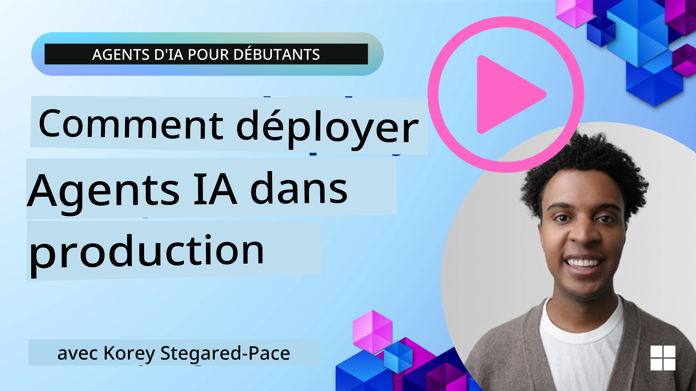

# Agents IA en Production : Observabilité & Évaluation

[](https://youtu.be/l4TP6IyJxmQ?si=reGOyeqjxFevyDq9)

À mesure que les agents IA passent de prototypes expérimentaux à des applications réelles, la capacité à comprendre leur comportement, surveiller leur performance et évaluer systématiquement leurs résultats devient importante.

## Objectifs d'apprentissage

Après avoir complété cette leçon, vous saurez/comment comprendre :
- Concepts de base de l’observabilité et de l’évaluation des agents
- Techniques pour améliorer la performance, les coûts et l’efficacité des agents
- Ce qu’il faut évaluer et comment évaluer systématiquement vos agents IA
- Comment contrôler les coûts lors du déploiement des agents IA en production
- Comment instrumenter les agents construits avec Microsoft Agent Framework

L’objectif est de vous doter des connaissances pour transformer vos agents "boîte noire" en systèmes transparents, gérables et fiables.

_**Note :** Il est important de déployer des agents IA sûrs et dignes de confiance. Consultez également la leçon [Construire des agents IA dignes de confiance](../06-building-trustworthy-agents/README.md)._

## Traces et Spans

Les outils d’observabilité comme [Langfuse](https://langfuse.com/) ou [Microsoft Foundry](https://learn.microsoft.com/en-us/azure/ai-foundry/what-is-azure-ai-foundry) représentent généralement les exécutions d’agents sous forme de traces et de spans.

- **Trace** représente une tâche complète de l’agent du début à la fin (par exemple, traiter une requête utilisateur).
- **Spans** sont les étapes individuelles à l’intérieur de la trace (par exemple, appeler un modèle de langage ou récupérer des données).


<!-- Image URL retained for illustration purposes -->

Sans observabilité, un agent IA peut sembler être une "boîte noire" — son état interne et sa logique sont opaques, rendant difficile le diagnostic des problèmes ou l’optimisation de la performance. Avec l’observabilité, les agents deviennent des "boîtes en verre", offrant une transparence essentielle pour instaurer la confiance et garantir qu’ils fonctionnent comme prévu. 

## Pourquoi l’observabilité compte en environnement de production

Le passage des agents IA en environnement de production introduit un nouvel ensemble de défis et d’exigences. L’observabilité n’est plus un "plus agréable" mais une capacité critique :

*   **Débogage et analyse des causes** : Lorsqu’un agent échoue ou produit un résultat inattendu, les outils d’observabilité fournissent les traces nécessaires pour identifier la source de l’erreur. Ceci est particulièrement important dans les agents complexes impliquant plusieurs appels LLM, interactions avec des outils et logique conditionnelle.
*   **Gestion de la latence et des coûts** : Les agents IA reposent souvent sur des LLM et d’autres API externes facturées par token ou par appel. L’observabilité permet un suivi précis de ces appels, aidant à identifier les opérations excessivement lentes ou coûteuses. Cela permet aux équipes d’optimiser les prompts, de choisir des modèles plus efficaces ou de repenser les workflows afin de gérer les coûts opérationnels et garantir une bonne expérience utilisateur.
*   **Confiance, sécurité et conformité** : Dans de nombreuses applications, il est important de garantir que les agents agissent de manière sûre et éthique. L’observabilité fournit une piste d’audit des actions et décisions de l’agent. Cela peut être utilisé pour détecter et atténuer des problèmes tels que l’injection de prompt, la génération de contenu nuisible ou la gestion incorrecte des informations personnellement identifiables (PII). Par exemple, vous pouvez revoir les traces pour comprendre pourquoi un agent a fourni une certaine réponse ou utilisé un outil spécifique.
*   **Boucles d’amélioration continue** : Les données d’observabilité sont la base d’un processus de développement itératif. En surveillant la performance des agents dans le monde réel, les équipes peuvent identifier des axes d’amélioration, collecter des données pour le réglage des modèles et valider l’impact des modifications. Cela crée une boucle de rétroaction où les informations de production issues de l’évaluation en ligne alimentent l’expérimentation et le raffinement hors ligne, menant à des performances d’agent progressivement meilleures.

## Principaux indicateurs à suivre

Pour surveiller et comprendre le comportement des agents, une gamme de métriques et de signaux doit être suivie. Bien que les métriques spécifiques puissent varier selon l’objectif de l’agent, certaines sont universellement importantes.

Voici quelques-unes des métriques les plus courantes que les outils d’observabilité suivent :

**Latence :** À quelle vitesse l’agent répond-il ? Des temps d’attente longs impactent négativement l’expérience utilisateur. Vous devriez mesurer la latence pour les tâches et les étapes individuelles en traçant les exécutions de l’agent. Par exemple, un agent qui met 20 secondes pour tous les appels de modèle pourrait être accéléré en utilisant un modèle plus rapide ou en exécutant les appels en parallèle.

**Coûts :** Quel est le coût par exécution d’agent ? Les agents IA s’appuient sur des appels LLM facturés par token ou des API externes. L’usage fréquent d’outils ou des prompts multiples peut rapidement faire grimper les coûts. Par exemple, si un agent appelle un LLM cinq fois pour une amélioration marginale de qualité, il faut évaluer si le coût est justifié ou s’il est possible de réduire le nombre d’appels ou d’utiliser un modèle moins cher. La surveillance en temps réel peut aussi aider à détecter des pics inattendus (par exemple, des bugs causant des boucles API excessives).

**Erreurs de requête :** Combien de requêtes l’agent a-t-il échoué ? Cela peut inclure des erreurs API ou des appels d’outil ratés. Pour rendre votre agent plus robuste en production, vous pouvez alors mettre en place des solutions de repli ou des tentatives répétées. Par exemple, si le fournisseur LLM A est indisponible, vous basculez sur le fournisseur LLM B en secours.

**Retour d’utilisateur :** La mise en place d’évaluations utilisateur directes fournit des informations précieuses. Cela peut inclure des notes explicites (👍pouce levé/👎pouce baissé, ⭐1-5 étoiles) ou des commentaires textuels. Un retour négatif constant doit vous alerter, car c’est un signe que l’agent ne fonctionne pas comme attendu. 

**Retour implicite de l’utilisateur :** Les comportements utilisateurs fournissent un retour indirect même sans notes explicites. Cela peut inclure la reformulation immédiate d’une question, des requêtes répétées ou le clic sur un bouton de réessai. Par exemple, si vous voyez que les utilisateurs posent plusieurs fois la même question, c’est un signe que l’agent ne fonctionne pas comme prévu.

**Précision :** À quelle fréquence l’agent produit-il des résultats corrects ou souhaitables ? Les définitions de précision varient (par exemple, exactitude à résoudre un problème, exactitude de récupération d’information, satisfaction utilisateur). La première étape est de définir ce qu’est le succès pour votre agent. Vous pouvez suivre la précision via des contrôles automatisés, des scores d’évaluation ou des étiquettes de réalisation de tâche. Par exemple, marquer les traces comme "réussies" ou "échouées". 

**Métriques d’évaluation automatisées :** Vous pouvez aussi mettre en place des évaluations automatiques. Par exemple, vous pouvez utiliser un LLM pour noter la sortie de l’agent, par exemple si elle est utile, précise ou non. Il existe également plusieurs bibliothèques open source qui aident à évaluer différents aspects de l’agent. Par exemple [RAGAS](https://docs.ragas.io/) pour les agents RAG ou [LLM Guard](https://github.com/protectai/llm-guard) pour détecter le langage nuisible ou l’injection de prompt. 

En pratique, une combinaison de ces métriques offre la meilleure couverture de la santé d’un agent IA. Dans ce chapitre [notebook d’exemple](./code_samples/10-expense_claim-demo.ipynb), nous vous montrerons à quoi ressemblent ces métriques dans des cas réels mais d’abord, nous apprendrons à quoi ressemble un workflow d’évaluation type.

## Instrumenter votre agent

Pour collecter des données de traçage, vous devrez instrumenter votre code. L’objectif est d’instrumenter le code de l’agent pour émettre des traces et des métriques pouvant être capturées, traitées et visualisées par une plateforme d’observabilité.

**OpenTelemetry (OTel) :** [OpenTelemetry](https://opentelemetry.io/) est devenu un standard industriel pour l’observabilité des LLM. Il fournit un ensemble d’APIs, SDKs et outils pour générer, collecter et exporter des données télémétriques.

Il existe de nombreuses bibliothèques d’instrumentation qui enveloppent les frameworks d’agents existants et facilitent l’exportation des spans OpenTelemetry vers un outil d’observabilité. Microsoft Agent Framework s’intègre nativement à OpenTelemetry. Ci-dessous un exemple d’instrumentation d’un agent MAF :

```python
from agent_framework.observability import get_tracer, get_meter

tracer = get_tracer()
meter = get_meter()

with tracer.start_as_current_span("agent_run"):
    # L'exécution de l'agent est tracée automatiquement
    pass
```

Le [notebook d’exemple](./code_samples/10-expense_claim-demo.ipynb) de ce chapitre montrera comment instrumenter votre agent MAF.

**Création manuelle de spans :** Bien que les bibliothèques d’instrumentation fournissent une bonne base, il existe souvent des cas où des informations plus détaillées ou personnalisées sont nécessaires. Vous pouvez créer manuellement des spans pour ajouter une logique applicative personnalisée. Plus important encore, ils peuvent enrichir les spans créés automatiquement ou manuellement avec des attributs personnalisés (également appelés tags ou métadonnées). Ces attributs peuvent inclure des données spécifiques au métier, des calculs intermédiaires ou tout contexte utile pour le débogage ou l’analyse, tels que `user_id`, `session_id`, ou `model_version`.

Exemple de création manuelle de traces et spans avec le [SDK Langfuse Python](https://langfuse.com/docs/sdk/python/sdk-v3) : 

```python
from langfuse import get_client
 
langfuse = get_client()
 
span = langfuse.start_span(name="my-span")
 
span.end()
```

## Évaluation de l’agent

L’observabilité nous donne des métriques, mais l’évaluation est le processus d’analyse de ces données (et la réalisation de tests) pour déterminer la performance d’un agent IA et comment l’améliorer. En d’autres termes, une fois que vous avez ces traces et métriques, comment les utilisez-vous pour juger l’agent et prendre des décisions ? 

Une évaluation régulière est importante car les agents IA sont souvent non déterministes et peuvent évoluer (via des mises à jour ou un dérive du comportement du modèle) – sans évaluation, vous ne sauriez pas si votre « agent intelligent » fait bien son travail ou s’il régresse.

Il existe deux catégories d’évaluations pour les agents IA : **évaluation en ligne** et **évaluation hors ligne**. Les deux sont précieuses et se complètent. Nous commençons généralement par l’évaluation hors ligne, car c’est la démarche minimale nécessaire avant de déployer un agent.

### Évaluation hors ligne


Cela consiste à évaluer l’agent dans un environnement contrôlé, typiquement en utilisant des jeux de données tests, pas des requêtes d’utilisateurs en direct. Vous utilisez des datasets choisis où vous connaissez la sortie attendue ou le comportement correct, puis exécutez votre agent sur ceux-ci.

Par exemple, si vous avez construit un agent de résolution de problèmes mathématiques, vous pourriez avoir un [jeu de données test](https://huggingface.co/datasets/openai/gsm8k) de 100 problèmes avec des réponses connues. L’évaluation hors ligne est souvent effectuée durant le développement (et peut faire partie de pipelines CI/CD) pour vérifier des améliorations ou éviter des régressions. L’avantage est que c’est **répétable et vous pouvez obtenir des métriques claires de précision puisque vous avez la vérité terrain**. Vous pouvez aussi simuler des requêtes utilisateurs et mesurer les réponses de l’agent par rapport aux réponses idéales ou utiliser des métriques automatisées comme décrit plus haut.

Le principal défi avec l’éval hors ligne est de s’assurer que votre dataset test est complet et reste pertinent — l’agent peut bien performer sur un jeu de test fixe mais rencontrer des requêtes très différentes en production. Vous devez donc maintenir vos jeux test à jour avec de nouveaux cas extrêmes et exemples reflétant des scénarios réels​. Un mélange de petits cas "smoke test" et de plus grands jeux d’évaluation est utile : petits ensembles pour des vérifications rapides et plus grands pour des métriques globales​.

### Évaluation en ligne 


Cela fait référence à l’évaluation de l’agent dans un environnement réel et vivant, c’est-à-dire pendant une utilisation effective en production. L’évaluation en ligne implique la surveillance de la performance de l’agent sur les interactions utilisateur réelles et l’analyse continue des résultats.

Par exemple, vous pouvez suivre les taux de succès, les scores de satisfaction utilisateur ou d’autres métriques sur le trafic en direct. L’avantage de l’évaluation en ligne est qu’elle **capture des éléments que vous ne pourriez pas anticiper en laboratoire** — vous pouvez observer la dérive du modèle au fil du temps (si l’efficacité de l’agent diminue à mesure que les patterns d’entrée changent) et détecter les requêtes ou situations inattendues absentes de vos données de test​. Elle donne une image réelle du comportement de l’agent dans son environnement naturel. 

L’évaluation en ligne implique souvent la collecte de retours utilisateurs implicites et explicites, comme discuté précédemment, et éventuellement la réalisation de tests shadow ou tests A/B (où une nouvelle version de l’agent est exécutée en parallèle pour comparaison avec l’ancienne). Le défi est qu’il peut être difficile d’obtenir des étiquettes ou scores fiables pour les interactions en direct — vous pouvez vous baser sur les retours utilisateurs ou les métriques en aval (par exemple, si l’utilisateur a cliqué sur le résultat).

### Combinaison des deux

Les évaluations en ligne et hors ligne ne sont pas exclusives ; elles se complètent fortement. Les insights tirés de la surveillance en ligne (par exemple, nouveaux types de requêtes utilisateurs où l’agent performe mal) peuvent être utilisés pour augmenter et améliorer les datasets tests hors ligne. Inversement, les agents qui réussissent bien les tests hors ligne peuvent ensuite être déployés et surveillés en ligne avec plus de confiance.

En fait, de nombreuses équipes adoptent une boucle :

_évaluer hors ligne -> déployer -> surveiller en ligne -> collecter nouveaux cas d’échec -> ajouter au dataset hors ligne -> affiner l’agent -> répéter_.

## Problèmes courants

En déployant des agents IA en production, vous pouvez rencontrer divers défis. Voici quelques problèmes courants avec leurs solutions potentielles :

| **Problème**    | **Solution potentielle**   |
| ------------- | ------------------ |
| Agent IA ne réalise pas les tâches de manière cohérente | - Affiner le prompt donné à l’agent IA ; être clair sur les objectifs.<br>- Identifier où diviser les tâches en sous-tâches et les traiter par plusieurs agents peut aider. |
| Agent IA bloqué dans des boucles continues  | - Assurer des conditions claires de terminaison pour que l’agent sache quand arrêter le processus.<br>- Pour les tâches complexes nécessitant raisonnement et planification, utiliser un modèle plus large spécialisé dans ces tâches. |
| Les appels d’outils par l’agent IA ne fonctionnent pas bien   | - Tester et valider la sortie de l’outil hors système agent.<br>- Affiner les paramètres définis, les prompts et la nomination des outils.  |
| Système multi-agents non constant dans sa performance | - Affiner les prompts donnés à chaque agent pour s’assurer qu’ils sont spécifiques et distincts les uns des autres.<br>- Construire un système hiérarchique avec un agent "routeur" ou contrôleur pour déterminer quel agent est approprié. |

Beaucoup de ces problèmes peuvent être identifiés plus efficacement grâce à l’observabilité. Les traces et métriques dont nous avons parlé précédemment aident à localiser précisément où dans le workflow de l’agent les problèmes surviennent, rendant le débogage et l’optimisation beaucoup plus efficaces.

## Gestion des coûts

Voici quelques stratégies pour gérer les coûts du déploiement des agents IA en production :

**Utilisation de modèles plus petits :** Les petits modèles de langage (SLM) peuvent bien fonctionner sur certains cas d’usage agentiques et réduiront considérablement les coûts. Comme mentionné précédemment, construire un système d’évaluation pour déterminer et comparer la performance par rapport aux modèles plus grands est la meilleure façon de comprendre à quel point un SLM fonctionnera pour votre cas d’usage. Envisagez d’utiliser des SLM pour des tâches plus simples comme la classification d’intention ou l’extraction de paramètres, tout en réservant les grands modèles pour le raisonnement complexe.

**Utilisation d’un modèle routeur :** Une stratégie similaire consiste à utiliser une diversité de modèles et de tailles. Vous pouvez utiliser un LLM/SLM ou une fonction serverless pour router les requêtes en fonction de leur complexité vers les modèles les mieux adaptés. Cela aidera également à réduire les coûts tout en garantissant la performance sur les bonnes tâches. Par exemple, dirigez les requêtes simples vers des modèles plus petits et plus rapides, et n’utilisez les modèles coûteux et volumineux que pour les tâches de raisonnement complexes.

**Mise en cache des réponses :** Identifier les requêtes et tâches courantes et fournir les réponses avant qu’elles ne passent par votre système agentique est un bon moyen de réduire le volume de requêtes similaires. Vous pouvez même implémenter un flux pour identifier la similarité d’une requête avec vos requêtes mises en cache en utilisant des modèles d’IA plus basiques. Cette stratégie peut réduire significativement les coûts pour les questions fréquemment posées ou les flux de travail courants.

## Voyons comment cela fonctionne en pratique

Dans le [cahier d’exemples de cette section](./code_samples/10-expense_claim-demo.ipynb), nous verrons des exemples de la façon dont nous pouvons utiliser des outils d’observabilité pour surveiller et évaluer notre agent.


### Vous avez plus de questions sur les agents IA en production ?

Rejoignez le [Microsoft Foundry Discord](https://discord.com/invite/ATgtXmAS5D) pour rencontrer d’autres apprenants, participer aux heures de permanence et obtenir des réponses à vos questions sur les agents IA.

## Leçon précédente

[Modèle de conception de la métacognition](../09-metacognition/README.md)

## Leçon suivante

[Protocoles agentiques](../11-agentic-protocols/README.md)

---

<!-- CO-OP TRANSLATOR DISCLAIMER START -->
**Avertissement** :
Ce document a été traduit à l'aide du service de traduction automatique [Co-op Translator](https://github.com/Azure/co-op-translator). Bien que nous nous efforçions d'assurer l'exactitude, veuillez noter que les traductions automatisées peuvent contenir des erreurs ou des inexactitudes. Le document original dans sa langue native doit être considéré comme la source faisant autorité. Pour les informations critiques, il est recommandé de recourir à une traduction professionnelle réalisée par un humain. Nous ne saurions être tenus responsables des malentendus ou erreurs d'interprétation découlant de l'utilisation de cette traduction.
<!-- CO-OP TRANSLATOR DISCLAIMER END -->