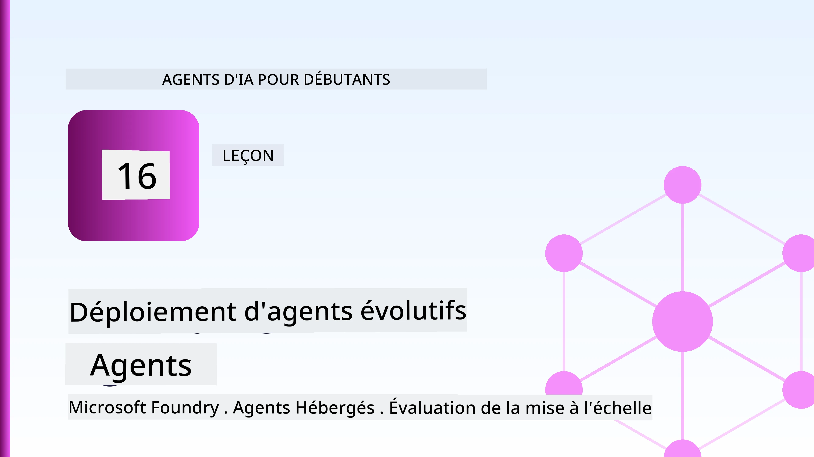
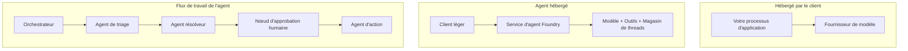
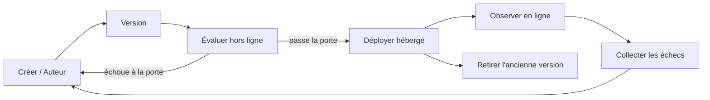
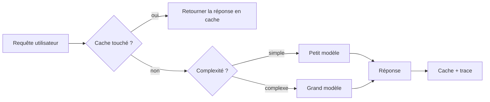
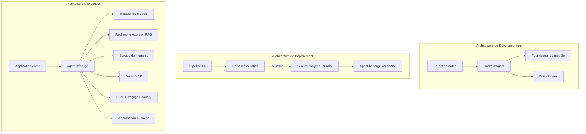

# Déploiement d'agents évolutifs avec Microsoft Foundry



Jusqu'à présent dans ce cours, vous avez construit des agents qui fonctionnent sur votre ordinateur portable, dans un carnet, pilotés par `az login` et une poignée de variables d'environnement. C'est exactement la bonne façon d'apprendre. Ce n'est pas la bonne façon de faire fonctionner un agent dont des milliers de clients dépendent à 3 heures du matin.

Cette leçon porte sur l'écart entre « ça marche sur ma machine » et « ça fonctionne, de manière fiable et abordable, en production ». Nous comblons cet écart en utilisant **Microsoft Foundry** et le **Microsoft Foundry Agent Service**, et nous le faisons en construisant un agent de support client réel disposant d'outils, de récupération, de mémoire, d'évaluation et de surveillance.

## Introduction

Cette leçon couvrira :

- La différence entre un **agent prototype** et un **agent déployé**, et pourquoi la transition concerne surtout tout ce qui entoure* le modèle.
- Les **modèles de déploiement** pour les agents : hébergé côté client, hébergé en service (Agents hébergés), et orchestré par un workflow.
- Le **cycle de vie de l'agent** sur Microsoft Foundry — création, versionnement, déploiement, évaluation, observation, retrait.
- Les **stratégies d'évolutivité** : routage du modèle, mise en cache, concurrence, et conception sans état.
- **Observabilité** avec OpenTelemetry et traçage Foundry.
- **Optimisation des coûts** via la sélection du modèle, le routage et les portes d'évaluation.
- **Considérations en entreprise** : gouvernance, approbation humaine, et fonctionnement sécurisé des serveurs MCP en production.

## Objectifs d'apprentissage

Après avoir terminé cette leçon, vous saurez comment :

- Choisir le modèle de déploiement approprié pour une charge de travail donnée d'agents.
- Déployer un agent sur le Microsoft Foundry Agent Service afin qu'il soit versionné, gouverné et observable.
- Instrumenter un agent pour le traçage et connecter une pipeline d'évaluation qui s'exécute avant chaque publication.
- Appliquer le routage et la mise en cache des modèles pour garder la latence et le coût sous contrôle à grande échelle.
- Ajouter une porte d'approbation humaine pour les actions à haut risque et intégrer un serveur MCP de manière sécurisée en production.

## Prérequis

Cette leçon suppose que vous avez terminé les leçons précédentes et que vous êtes à l'aise avec :

- La construction d'agents avec le [Microsoft Agent Framework](../14-microsoft-agent-framework/README.md) (Leçon 14).
- [Utilisation d'outils](../04-tool-use/README.md) (Leçon 4) et [Agentic RAG](../05-agentic-rag/README.md) (Leçon 5).
- [Mémoire d'agent](../13-agent-memory/README.md) (Leçon 13) et [Protocoles agentiques / MCP](../11-agentic-protocols/README.md) (Leçon 11).
- [Observabilité et évaluation](../10-ai-agents-production/README.md) (Leçon 10) — cette leçon s'appuie directement dessus.

Vous aurez également besoin de :

- Une **abonnement Azure** et un **projet Microsoft Foundry** avec au moins un modèle de chat déployé.
- L'**Azure CLI** authentifiée (`az login`).
- Python 3.12+ et les paquets dans le fichier [`requirements.txt`](../../../requirements.txt) du dépôt.

## Du prototype à la production : ce qui change réellement

Un agent prototype et un agent en production partagent la même boucle principale — raisonner, appeler les outils, répondre. Ce qui change, c'est tout ce qui entoure cette boucle. Le modèle représente peut-être 20 % d'un agent de production ; les 80 % restants constituent le squelette opérationnel.

| Préoccupation | Prototype | Production |
| --- | --- | --- |
| **Hébergement** | Fonctionne dans votre carnet | Fonctionne comme un service hébergé, versionné et déployé progressivement |
| **Identité** | Votre jeton `az login` | Identité gérée avec RBAC limité |
| **État** | En mémoire, perdu à chaque redémarrage | Externalisé (stockage de threads, service de mémoire) |
| **Défaillance** | Vous voyez la trace d'erreur | Tentatives répétées, recours, dead-letter, alertes |
| **Coût** | "C'est quelques centimes" | Suivi par requête, routé, mis en cache, budgété |
| **Qualité** | Vous évaluez la sortie visuellement | Évalué automatiquement avant chaque publication |
| **Confiance** | Vous approuvez chaque action | Politique + intervention humaine pour les actions risquées |

Gardez ce tableau à l'esprit. Chaque section ci-dessous correspond à l'une de ces lignes.

## Modèles de déploiement des agents

Il existe trois modèles que vous utiliserez, souvent en combinaison.

### 1. Agents hébergés côté client

L'objet agent vit à l'intérieur du processus *de votre* application. Votre code appelle directement le fournisseur de modèle ; la boucle de raisonnement s'exécute dans votre service. C'est ce que chaque leçon précédente a fait.

- **Utilisez-le lorsque** vous avez besoin d'un contrôle total sur la boucle, d'un middleware personnalisé, ou que vous intégrez l'agent à un backend existant.
- **Compromis** : vous gérez l'évolutivité, l'état et la résilience vous-même.

### 2. Agents hébergés (Foundry Agent Service)

L'agent est *enregistré comme ressource* dans Microsoft Foundry. Foundry héberge la boucle de raisonnement, stocke les threads, applique la sécurité de contenu et le RBAC, et rend l'agent visible dans le portail Foundry. Votre application devient un client léger qui crée des threads et lit les réponses.

- **Utilisez-le lorsque** vous voulez de la durabilité, une observabilité intégrée, de la gouvernance, et moins de surface opérationnelle.
- **Compromis** : moins de contrôle bas-niveau en échange d'un environnement d'exécution géré.

### 3. Workflows d'agents

Plusieurs agents (et outils) sont composés en un graphe avec un flux de contrôle explicite — étapes séquentielles, embranchements, nœuds d'approbation humaine, et points de contrôle durables pouvant être mis en pause et repris. C'est la capacité **Workflows** du Microsoft Agent Framework appliquée à l'échelle du déploiement.

- **Utilisez-le lorsque** une tâche unique s'étend sur plusieurs agents spécialisés ou nécessite une étape d'approbation intermédiaire.
- **Compromis** : plus de composants mobiles ; nécessite une observabilité au niveau de l'orchestration.



## Cycle de vie de l'agent sur Microsoft Foundry

Déployer un agent n'est pas un `push` ponctuel. C'est une boucle, et elle ressemble beaucoup à un cycle de publication logiciel parce que c'est exactement cela.



L'idée clé, reprise de la [Leçon 10](../10-ai-agents-production/README.md) : **l'évaluation hors ligne est une porte, pas une idée secondaire.** Une nouvelle version de l'agent n'est pas publiée à moins de franchir vos seuils d'évaluation. L'observabilité en ligne alimente ensuite les échecs réels dans votre ensemble de tests hors ligne. C'est toute la boucle.

## Stratégies d'évolutivité

Faire évoluer un agent est différent de faire évoluer une API web sans état, car chaque requête peut déclencher plusieurs appels coûteux aux modèles et outils. Quatre techniques supportent la majeure partie de la charge.

**Gestion des requêtes sans état.** Ne conservez aucun état par utilisateur dans la mémoire de votre processus. Persistez les fils de conversation dans la boutique de threads Foundry ou un service de mémoire pour que toute instance puisse traiter toute requête. C'est ce qui permet l'évolutivité horizontale — ajoutez des instances, pas de sessions collantes.

**Routage du modèle.** Toutes les requêtes n'ont pas besoin de votre modèle le plus performant (et le plus coûteux). Orientez les requêtes simples — classification d'intention, réponses factuelles courtes — vers un petit modèle rapide, et réservez le grand modèle au raisonnement authentique. Le **Model Router** de Foundry peut faire cela pour vous, ou vous pouvez implémenter vous-même un classificateur léger. Vous construirez la version DIY dans le laboratoire.

**Mise en cache des réponses.** De nombreuses questions de support sont presque des doublons ("comment réinitialiser mon mot de passe ?"). Mettez en cache les réponses aux questions fréquentes et servez-les sans interroger le modèle du tout. Même un taux de cache modeste réduit sensiblement le coût et la latence.

**Concurrence et rétropression.** Les fournisseurs de modèles ont des limites de débit. Limitez votre concurrence, utilisez des retentatives avec temporisation exponentielle, et échouez gracieusement (une réponse en file d'attente "on s'en occupe" vaut mieux qu'une erreur 500).



## Observabilité en production

Vous ne pouvez pas opérer ce que vous ne pouvez pas voir. Comme abordé dans la Leçon 10, le Microsoft Agent Framework émet nativement des traces **OpenTelemetry** — chaque appel au modèle, invocation d'outil, et étape d'orchestration devient un span. En production, vous exportez ces spans vers Microsoft Foundry (ou tout backend compatible OTel) pour pouvoir :

- Tracer une seule plainte client de bout en bout à travers chaque appel de modèle et d'outil.
- Surveiller la latence p50/p95 et le coût par requête dans le temps.
- Alerter en cas de pics de taux d'erreur et anomalies de coût avant que vos utilisateurs (ou votre équipe financière) ne les remarquent.

```python
from agent_framework.observability import get_tracer

tracer = get_tracer()

with tracer.start_as_current_span("support_request") as span:
    span.set_attribute("customer.tier", "enterprise")
    span.set_attribute("routed.model", "gpt-5-nano")
    # l'exécution de l'agent est tracée automatiquement à l'intérieur de cette plage
```

Des attributs comme `customer.tier` et `routed.model` transforment un mur de traces en questions auxquelles on peut répondre ("les clients entreprise sont-ils trop souvent dirigés vers le petit modèle ?").

## Optimisation des coûts

Le coût dans les agents de production est dominé par les jetons. Trois leviers, par ordre d'impact :

1. **Adapter la taille du modèle.** Un petit modèle qui passe votre porte d'évaluation est presque toujours moins cher qu'un gros modèle qui passe aussi. Utilisez l'évaluation pour *prouver* que le petit modèle est suffisant plutôt que de choisir le plus grand modèle par précaution.
2. **Routage par complexité.** Comme ci-dessus — ne payez le prix du grand modèle que pour les requêtes nécessitant un raisonnement à grande échelle.
3. **Mise en cache agressive.** L'appel au modèle le moins cher est celui que vous ne faites jamais.

Les portes d'évaluation et le contrôle des coûts sont la même discipline vue sous deux angles : l'évaluation vous donne le *plancher de qualité*, le routage et la mise en cache vous maintiennent aussi près que possible du *coût* de ce plancher.

## Considérations pour le déploiement en entreprise

**Gouvernance.** Les Agents Hébergés héritent du RBAC, de la sécurité de contenu et de la journalisation d'audit de Foundry. Donnez à chaque agent une identité gérée avec les privilèges minimaux nécessaires — accès en lecture seule à la base de connaissances, accès limité à l'API de ticketing, rien de plus.

**Human-in-the-loop.** Certaines actions sont trop importantes pour être automatisées intégralement — émettre un remboursement, supprimer un compte, escalader auprès d'une équipe juridique. Le Microsoft Agent Framework supporte les outils **nécessitant une approbation** : l'agent propose l'action, l'exécution est suspendue, un humain approuve ou rejette, et le workflow reprend. Vous avez vu le primitif dans la [Leçon 6](../06-building-trustworthy-agents/README.md) ; ici vous le déployez.

**MCP en production.** [MCP](../11-agentic-protocols/README.md) permet à votre agent de consommer des outils externes via une interface standard. En production, considérez chaque serveur MCP comme une frontière non fiable : fixez la version du serveur, exécutez-le avec une identité limitée, validez ses sorties, et ne lui exposez jamais de secrets. Un serveur MCP est une dépendance, et les dépendances sont patchées, auditées et soumises à un contrôle de débit.



Ces trois diagrammes — développement, déploiement, exécution — représentent le même agent à trois étapes de sa vie. Le laboratoire qui suit vous guide pour le construire.

## Laboratoire pratique : un agent de support client prêt pour la production

Ouvrez [`code_samples/16-python-agent-framework.ipynb`](./code_samples/16-python-agent-framework.ipynb) et travaillez-le de bout en bout. Vous assemblerez un **agent de support client Contoso** avec chaque préoccupation de production câblée :

1. **Appel d'outils** — consulter le statut de commande et ouvrir des tickets de support.
2. **RAG** — répondre aux questions de politique à partir d'une base de connaissances (Azure AI Search, avec un repli en mémoire pour que le carnet fonctionne sans ressource Search).
3. **Mémoire** — se souvenir du client au fil des tours de conversation.
4. **Routage de modèle** — un classificateur de complexité oriente chaque requête vers un modèle petit ou grand.
5. **Mise en cache des réponses** — les questions répétées sont servies depuis le cache.
6. **Approbation humaine** — les remboursements au-dessus d'un seuil attendent la validation humaine.
7. **Pipeline d'évaluation** — un petit ensemble de tests hors ligne évalue l'agent et sert de porte de publication.
8. **Observabilité** — traçage OpenTelemetry autour de chaque requête.

### Parcours guidé

Le carnet est organisé de sorte que chaque aspect de la production soit une section autonome et exécutable. Le cœur est le gestionnaire de requêtes associant routage et mise en cache :

```python
async def handle_support_request(query: str, customer_id: str) -> str:
    # 1. Servir depuis le cache quand c'est possible.
    cached = response_cache.get(normalize(query))
    if cached:
        return cached

    # 2. Router selon la complexité pour contrôler les coûts.
    model = "gpt-5-nano" if is_simple(query) else "gpt-5-mini"

    # 3. Exécuter l'agent à l'intérieur d'une plage de trace pour l'observabilité.
    with tracer.start_as_current_span("support_request") as span:
        span.set_attribute("routed.model", model)
        span.set_attribute("customer.id", customer_id)
        response = await support_agent.run(query, model=model)

    # 4. Mettre en cache et retourner.
    response_cache.set(normalize(query), response.text)
    return response.text
```

La porte d'évaluation qui protège une publication ressemble à ceci :

```python
async def evaluation_gate(agent, test_cases, threshold: float = 0.8) -> bool:
    passed = 0
    for case in test_cases:
        result = await agent.run(case["input"])
        if score_response(result.text, case["expected"]) >= 0.8:
            passed += 1
    pass_rate = passed / len(test_cases)
    print(f"Evaluation pass rate: {pass_rate:.0%} (gate: {threshold:.0%})")
    return pass_rate >= threshold  # ne déployer que si la porte passe
```

Lisez chaque ligne — le carnet garde les primitives volontairement petites pour que rien ne soit caché derrière un appel de framework.

## Validation d'un agent déployé avec des tests simples (smoke tests)

La porte d'évaluation ci-dessus s'exécute *hors ligne* contre votre objet agent. Une fois l'agent déployé en tant qu'Agent hébergé, vous avez besoin d'une vérification supplémentaire, encore moins coûteuse : **l'endpoint déployé répond-il réellement ?**

Un déploiement « réussi » ne prouve que que le plan de contrôle a accepté la définition — cela ne prouve pas que l'agent répond. Une dépendance manquante, un routage de modèle erroné, ou une connexion expirée peuvent laisser un déploiement vert qui ne retourne rien. Un **smoke test** détecte cela en quelques secondes, à chaque déploiement, sans le coût d'une évaluation complète.

Ce dépôt fournit un pipeline de tests simples prêt à l'emploi basé sur l'action GitHub [AI Smoke Test](https://github.com/marketplace/actions/ai-smoke-test) :

- **Catalogue** — [`tests/lesson-16-smoke-tests.json`](../../../tests/lesson-16-smoke-tests.json) contient des prompts et assertions pour l'agent support Contoso (réponses de politique fondées, recherche de commande, maintien du sujet, continuité multi-tours). Des catalogues pour les agents des autres leçons vivent à côté — voir [`tests/README.md`](../tests/README.md).
- **Workflow** — [`.github/workflows/smoke-test.yml`](../../../.github/workflows/smoke-test.yml) se connecte avec Azure OIDC et POST chaque prompt au point de terminaison Responses de l'agent, échouant la tâche au moindre échec d'assertion.

```yaml
- name: Smoke-test hosted agent
  uses: JFolberth/ai-smoketest@v1
  with:
    project_endpoint: ${{ inputs.project_endpoint }}
    agent_name: ContosoSupportAgent
    tests_file: tests/lesson-16-smoke-tests.json
```

Exécutez-le depuis l’onglet **Actions** une fois que votre agent est déployé, en fournissant le point de terminaison de votre projet Foundry et le nom de l’agent. L’identité fédérée doit disposer du rôle **Azure AI User** au niveau du projet Foundry. Pensez aux couches comme à une pyramide : les tests de fumée (accessible et répond ?) s’exécutent à chaque déploiement, l’évaluation hors ligne (suffisamment bonne pour être mise en production ?) s’exécute avant la promotion, et l’évaluation en ligne (comment cela fonctionne-t-il en conditions réelles ?) s’exécute en continu.

## Vérification des connaissances

Testez votre compréhension avant de passer à l’affectation.

**1. Environ quelle part d’un agent en production est « le modèle », et qu’est-ce que le reste ?**

<details>
<summary>Réponse</summary>

Le modèle constitue une minorité du système — souvent cité comme environ 20 %. Le reste est le squelette opérationnel : hébergement et gestion des versions, identité et RBAC, état externalisé, gestion des pannes, suivi des coûts, évaluation et contrôles humains dans la boucle. Passer en production consiste principalement à construire tout l’*entourage* de la boucle de raisonnement.
</details>

**2. Quand choisiriez-vous un agent hébergé plutôt qu’un agent hébergé côté client ?**

<details>
<summary>Réponse</summary>

Lorsque vous souhaitez un environnement d’exécution géré avec durabilité intégrée (threads qui persistent et peuvent reprendre), observabilité, sécurité du contenu et RBAC, et que vous êtes prêt à échanger un certain contrôle bas niveau de la boucle de raisonnement contre une moindre surface opérationnelle. L’hébergement côté client est préférable lorsque vous avez besoin d’un contrôle total sur la boucle ou que vous intégrez l’agent dans un backend existant.
</details>

**3. Pourquoi un agent évolutif doit-il être sans état dans sa propre mémoire de processus ?**

<details>
<summary>Réponse</summary>

Ainsi, n’importe quelle instance peut gérer n’importe quelle requête, ce qui permet une montée en charge horizontale sans sessions collantes. L’état de conversation par utilisateur est externalisé à un magasin de threads ou un service de mémoire. Si l’état vivait dans la mémoire du processus, vous le perdriez au redémarrage et ne pourriez pas distribuer la charge librement.
</details>

**4. Quel problème la routage du modèle résout-il, et comment cela se rapporte-t-il à l’évaluation ?**

<details>
<summary>Réponse</summary>

Le routage envoie les requêtes simples à un petit modèle peu coûteux et rapide et réserve le grand modèle pour le vrai raisonnement, contrôlant à la fois la latence et le coût. Cela se rapporte à l’évaluation parce que c’est l’évaluation qui *prouve* que le petit modèle est suffisamment bon pour une catégorie de requêtes — le routage sans évaluation est une supposition.
</details>

**5. Qu’est-ce qu’une « porte d’évaluation » et où se situe-t-elle dans le cycle de vie ?**

<details>
<summary>Réponse</summary>

Une porte d’évaluation exécute un ensemble de tests hors ligne contre une nouvelle version de l’agent et bloque le déploiement à moins que le taux de réussite ne franchisse un seuil. Elle se situe entre « version » et « déploiement » dans le cycle de vie, faisant de la qualité une condition préalable à la publication plutôt que quelque chose que vous vérifiez après la mise en production.
</details>

**6. Pourquoi un serveur MCP doit-il être traité comme une frontière non fiable en production ?**

<details>
<summary>Réponse</summary>

Parce qu’il s’agit d’une dépendance externe que votre agent appelle. Vous devez pinner sa version, l’exécuter avec une identité limitée, valider ses sorties, limiter son débit, et ne jamais lui exposer de secrets — la même discipline que celle appliquée à toute dépendance tierce. Ses sorties alimentent le raisonnement de votre agent, donc une confiance non validée est un risque de sécurité.
</details>

**7. Quel changement unique a généralement le plus grand impact sur le coût d’un agent en production, et pourquoi ?**

<details>
<summary>Réponse</summary>

Ajuster la taille du modèle — utiliser le plus petit modèle qui passe toujours votre porte d’évaluation. Le coût est dominé par les tokens, et un modèle plus petit qui atteint la barre de qualité est presque toujours moins cher qu’un plus grand. La mise en cache et le routage réduisent ensuite encore les coûts, mais choisir le bon modèle de base a l’effet le plus important de premier ordre.
</details>

**8. Quel rôle jouent les attributs de span comme `customer.tier` et `routed.model` dans l’observabilité ?**

<details>
<summary>Réponse</summary>

Ils transforment les traces brutes en questions métier auxquelles on peut répondre. Sans attributs, vous avez un mur de spans ; avec eux, vous pouvez demander « les clients entreprise sont-ils trop souvent routés vers le petit modèle ? » ou « quel modèle traite nos requêtes les plus lentes ? » Les attributs sont la manière de segmenter la télémétrie selon les dimensions qui comptent pour votre exploitation.
</details>

## Affectation

Prenez l’agent de support client du laboratoire et renforcez-le pour un scénario spécifique : **un agent de support facturation d’abonnement pour une entreprise SaaS.**

Votre soumission doit :

1. **Remplacer les outils** par ceux pertinents à la facturation : `get_subscription_status`, `get_invoice`, et `issue_credit` (les crédits supérieurs à 50 $ requièrent une approbation humaine).
2. **Ajouter trois documents RAG** couvrant la politique de remboursement, le cycle de facturation, et la politique d’annulation de l’entreprise.
3. **Étendre le jeu d’évaluation** à au moins huit cas, incluant au moins deux qui *devraient* déclencher la voie d’approbation humaine, et confirmer que votre porte d’évaluation passe ou échoue correctement.
4. **Ajouter un rapport de coûts** : après avoir exécuté dix requêtes mixtes via l’agent, imprimer combien sont allées au petit modèle, combien au grand modèle, et combien ont été servies depuis le cache.

Rédigez un court paragraphe (dans une cellule markdown) expliquant quelle règle de routage de modèle vous avez choisie et comment vous la valideriez avec un trafic réel. Il n’y a pas de réponse unique correcte — vous serez évalué sur la cohérence avec les préoccupations de production.

## Résumé

Dans cette leçon, vous avez déplacé un agent du prototype à la production avec Microsoft Foundry :

- Le passage à la production concerne principalement le **squelette opérationnel** autour du modèle — hébergement, identité, état, gestion des pannes, coûts, qualité et confiance.
- Vous avez appris les trois **patterns de déploiement** — hébergement côté client, agents hébergés, et workflows d’agents — et quand chacun est approprié.
- Vous avez parcouru le **cycle de vie de l’agent**, où l’**évaluation hors ligne agit comme une porte de publication** et l’observabilité en ligne alimente les échecs dans le jeu de tests.
- Vous avez appliqué des **stratégies de mise à l’échelle** — conception sans état, routage de modèle, mise en cache et concurrence bornée — et les avez reliées à **l’optimisation des coûts**.
- Vous avez intégré des **contrôles entreprise** : RBAC, approbation humaine dans la boucle, et intégration MCP sécurisée pour la production.
- Vous avez construit un **agent de support client prêt pour la production** qui relie toutes ces préoccupations ensemble dans du code exécutable.

La leçon suivante emprunte le chemin inverse : au lieu de faire monter les agents dans le cloud, vous les ferez *descendre* sur une seule machine de développeur et les exécuterez entièrement localement.

## Ressources complémentaires

- <a href="https://learn.microsoft.com/azure/ai-foundry/what-is-azure-ai-foundry" target="_blank">Documentation Microsoft Foundry</a>
- <a href="https://learn.microsoft.com/azure/ai-foundry/agents/overview" target="_blank">Présentation du service Microsoft Foundry Agent</a>
- <a href="https://learn.microsoft.com/en-us/agent-framework/overview/?wt.mc_id=youtube_26688_organicsocial_reactor&pivots=programming-language-python" target="_blank">Microsoft Agent Framework</a>
- <a href="https://learn.microsoft.com/en-us/azure/ai-foundry/openai/concepts/model-router" target="_blank">Model Router dans Microsoft Foundry</a>
- <a href="https://learn.microsoft.com/azure/search/search-what-is-azure-search" target="_blank">Azure AI Search</a>
- <a href="https://opentelemetry.io/" target="_blank">OpenTelemetry</a>
- <a href="https://github.com/marketplace/actions/ai-smoke-test" target="_blank">Action GitHub de test de fumée AI</a>
- <a href="https://modelcontextprotocol.io/" target="_blank">Protocole de contexte de modèle (MCP)</a>

## Leçon précédente

[Création d'agents d'utilisation informatique (CUA)](../15-browser-use/README.md)

## Leçon suivante

[Création d’agents d’IA locaux](../17-creating-local-ai-agents/README.md)

---

<!-- CO-OP TRANSLATOR DISCLAIMER START -->
**Avertissement** :
Ce document a été traduit à l'aide du service de traduction automatique [Co-op Translator](https://github.com/Azure/co-op-translator). Bien que nous nous efforçions d'assurer l'exactitude, veuillez noter que les traductions automatisées peuvent contenir des erreurs ou des inexactitudes. Le document original dans sa langue native doit être considéré comme la source faisant autorité. Pour les informations critiques, il est recommandé de recourir à une traduction professionnelle réalisée par un humain. Nous ne saurions être tenus responsables des malentendus ou erreurs d'interprétation découlant de l'utilisation de cette traduction.
<!-- CO-OP TRANSLATOR DISCLAIMER END -->