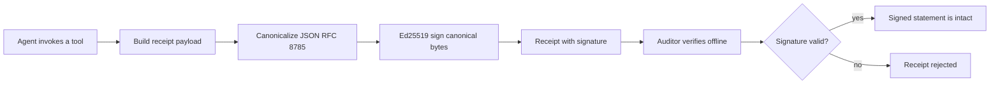
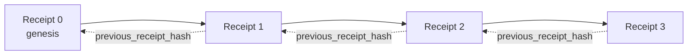

[Regarder la vidéo de la leçon : Sécuriser les agents IA avec des reçus cryptographiques](https://youtu.be/PLACEHOLDER_VIDEO_ID)

> _(Vidéo de la leçon et miniature à ajouter par l'équipe de contenu Microsoft après fusion, en suivant le modèle des leçons 14 / 15.)_

# Sécuriser les agents IA avec des reçus cryptographiques

## Introduction

Cette leçon couvrira :

- Pourquoi les pistes d'audit pour les agents IA sont importantes pour la conformité, le débogage et la confiance.
- Qu'est-ce qu'un reçu cryptographique et en quoi il diffère d'une ligne de journal non signée.
- Comment produire un reçu signé pour un appel d'outil d'un agent en Python simple.
- Comment vérifier un reçu hors ligne et détecter les falsifications.
- Comment chaîner les reçus pour que la suppression ou le réarrangement d'un reçu casse la chaîne.
- Ce que les reçus prouvent et ce qu'ils ne prouvent explicitement pas.

## Objectifs d'apprentissage

Après avoir terminé cette leçon, vous saurez :

- Identifier les modes de défaillance qui motivent la provenance cryptographique des actions des agents.
- Produire un reçu signé Ed25519 sur une charge utile JSON canonique.
- Vérifier un reçu de manière indépendante en utilisant uniquement la clé publique du signataire.
- Détecter une falsification en relançant la vérification sur un reçu modifié.
- Construire une séquence de reçus chaînés par hachage et expliquer pourquoi la chaîne est importante.
- Reconnaître la limite entre ce que les reçus prouvent (attribution, intégrité, ordre) et ce qu'ils ne prouvent pas (exactitude de l'action, validité de la politique).

## Le problème : la piste d'audit de votre agent

Imaginez que vous avez déployé un agent IA pour Contoso Travel. L'agent lit les demandes des clients, appelle une API de vols pour rechercher des options et réserve des sièges au nom du client. Le trimestre dernier, l'agent a traité 50 000 réservations.

Aujourd'hui, un auditeur arrive. Il pose une question simple : « Montrez-moi ce que votre agent a fait. »

Vous lui remettez vos fichiers de journalisation. L'auditeur les consulte et pose la question plus difficile : « Comment puis-je savoir que ces journaux n'ont pas été modifiés ? »

C'est le problème de la piste d'audit. La plupart des déploiements d'agents aujourd'hui reposent sur :

- **Journaux d'application** : écrits par l'agent lui-même, modifiables par toute personne ayant accès au système de fichiers.
- **Services de journalisation cloud** : évidents en cas de falsification au niveau de la plateforme mais seulement si l'auditeur fait confiance à l'opérateur de la plateforme.
- **Journaux de transactions de base de données** : bien adaptés aux modifications de base de données mais pas aux appels d'outils arbitraires.

Aucun de ces éléments ne peut répondre à la question de l'auditeur sans que celui-ci ait à faire confiance à quelqu'un (vous, votre fournisseur de cloud, votre fournisseur de base de données). Pour un usage interne, cette confiance est souvent acceptable. Pour des charges de travail réglementées (finance, santé, tout ce qui est soumis à la loi européenne sur l'IA), ce n'est pas le cas.

Les reçus cryptographiques réduisent ce problème en rendant une déclaration signée vérifiable de manière indépendante. L'auditeur a toujours besoin d'une raison externe pour faire confiance à la clé de signature et au composant qui a produit la déclaration. Une clé intégrée prouve la cohérence interne, pas l'identité de l'émetteur ni la mise en application.


## Qu'est-ce qu'un reçu cryptographique ?

Un reçu est un objet JSON qui enregistre ce qu'un agent a fait, signé avec une signature numérique.



Un reçu minimal ressemble à ceci :

```json
{
  "type": "agent.tool_call.v1",
  "agent_id": "contoso-travel-bot",
  "tool_name": "lookup_flights",
  "tool_args_hash": "sha256:a3f9c1...",
  "result_hash": "sha256:7b2e1d...",
  "policy_id": "contoso-travel-policy-v3",
  "timestamp": "2026-04-25T14:30:00Z",
  "sequence": 47,
  "previous_receipt_hash": "sha256:9d4e6a...",
  "signature": {
    "alg": "EdDSA",
    "sig": "c5af83...",
    "public_key": "8f3b2c..."
  }
}
```

Trois propriétés font le travail :

1. **La signature**. Le reçu est signé par la passerelle de l'agent utilisant une clé privée Ed25519. Toute personne ayant la clé publique correspondante peut vérifier la signature hors ligne. Une partie qui se fie doit ancrer cette clé ou la résoudre depuis un registre de confiance en dehors du reçu. Toute falsification d'un champ signé invalide la signature.

2. **Encodage canonique**. Avant la signature, le reçu est sérialisé en utilisant le schéma de canonicalisation JSON (JCS, RFC 8785). Cela garantit que deux implémentations produisant le même reçu logique produisent une sortie binaire identique. Sans canonicalisation, différents sérialiseurs JSON produiraient des signatures différentes pour le même contenu.

3. **Chaînage par hachage**. Le champ `previous_receipt_hash` relie chaque reçu à celui qui le précède. Supprimer ou réordonner un reçu casse la séquence présentée. Détecter une troncature ou une réécriture contrôlée par le signataire nécessite aussi une tête de chaîne actuelle ancrée, un point de contrôle témoin indépendant ou un engagement authentifié dans une population fermée.

Ensemble, ces propriétés fournissent trois garanties :

- **Attribution à une clé** : cette clé a signé ce contenu. L'identité organisationnelle ou humaine nécessite un lien de confiance avec la clé.
- **Intégrité** : le contenu n'a pas changé depuis la signature.
- **Ordre dans la séquence vérifiée** : ce reçu est lié à ce prédécesseur.

## Produire un reçu en Python

Vous n'avez pas besoin d'une bibliothèque spéciale pour produire un reçu. Les primitives cryptographiques sont largement disponibles et la logique tient en quelques dizaines de lignes de Python.

Les exercices pratiques dans `code_samples/18-signed-receipts.ipynb` parcourent tout le flux. Le fichier contrôlé en source `code_samples/18-signed-receipts.execution-receipt.json` enregistre le hachage exact du notebook, l'environnement Python, le nombre de cellules et les vérifications de la dernière exécution propre sans changer les sorties sauvegardées de la leçon. La version synthétique :

```python
import json
import hashlib
import base64
from nacl import signing
from jcs import canonicalize  # RFC 8785 canonical JSON

def b64url_nopad(data: bytes) -> str:
    return base64.urlsafe_b64encode(data).decode("ascii").rstrip("=")

def sha256_canonical(obj) -> str:
    """SHA-256 of a Python object's JCS-canonical JSON form."""
    return f"sha256:{hashlib.sha256(canonicalize(obj)).hexdigest()}"

# Generate or load a signing key (in production, store in a key vault)
signing_key = signing.SigningKey.generate()
verify_key = signing_key.verify_key
TRUSTED_PUBLIC_KEYS = {b64url_nopad(bytes(verify_key))}  # pinned out of band by the verifier

# Build the receipt payload (no signature yet)
tool_args = {"origin": "SYD", "destination": "LAX"}
tool_result = [{"flight": "QF11", "price": 1850, "stops": 0}]

payload = {
    "type": "agent.tool_call.v1",
    "agent_id": "contoso-travel-bot",
    "tool_name": "lookup_flights",
    "tool_args_hash": sha256_canonical(tool_args),
    "result_hash": sha256_canonical(tool_result),
    "policy_id": "contoso-travel-policy-v3",
    "timestamp": "2026-04-25T14:30:00Z",
    "sequence": 0,
    "previous_receipt_hash": None,
}

# Canonicalize and sign the JCS bytes directly. PureEdDSA hashes internally.
canonical_bytes = canonicalize(payload)
signature_bytes = signing_key.sign(canonical_bytes).signature

# Attach a structured signature object.
receipt = {
    **payload,
    "signature": {
        "alg": "EdDSA",
        "sig": b64url_nopad(signature_bytes),
        "public_key": b64url_nopad(bytes(verify_key)),
    },
}
```

C’est toute la chaîne de signature. Les exercices dans le notebook expliquent chaque étape.

## Vérifier un reçu et détecter la falsification

La vérification est l'opération inverse :

```python
import base64
import hashlib
from nacl import signing
from nacl.exceptions import CryptoError
from jcs import canonicalize

def b64url_decode(s: str) -> bytes:
    # Strict: Python's decoder skips characters outside the alphabet and also
    # accepts padding, the standard +/ alphabet and non-zero spare bits.
    # Re-encoding and comparing accepts only the one unpadded base64url form.
    padding = "=" * ((4 - len(s) % 4) % 4)
    data = base64.urlsafe_b64decode(s + padding)
    if base64.urlsafe_b64encode(data).decode("ascii").rstrip("=") != s:
        raise ValueError("not canonical unpadded base64url")
    return data

def verify_receipt(receipt: dict, trusted_public_key: str) -> bool:
    # trusted_public_key is the issuer's key, obtained from somewhere other
    # than this receipt. Never use receipt["signature"]["public_key"] here:
    # see "What Receipts Prove (and What They Do Not)" below.
    # Fails closed: anything malformed returns False instead of raising.
    if not isinstance(receipt, dict) or not isinstance(trusted_public_key, str):
        return False
    sig_obj = receipt.get("signature")
    if not isinstance(sig_obj, dict) or sig_obj.get("alg") != "EdDSA":
        return False
    sig_b64 = sig_obj.get("sig")
    if not isinstance(sig_b64, str):
        return False

    try:
        # Reconstruct the payload that was actually signed (everything except signature).
        payload = {k: v for k, v in receipt.items() if k != "signature"}
        canonical_bytes = canonicalize(payload)
        verify_key = signing.VerifyKey(b64url_decode(trusted_public_key))
        verify_key.verify(canonical_bytes, b64url_decode(sig_b64))
        return True
    except (CryptoError, TypeError, ValueError, KeyError, OverflowError):
        return False
    except Exception:
        # An undecodable key or signature, or a payload that cannot be
        # canonicalized: fail closed rather than raise.
        return False
```

Cette fonction prend un reçu et la clé publique de l'émetteur, et renvoie `True` si la signature est valide et `False` sinon, y compris lorsque l’entrée est malformée. Pas d’appel réseau, pas de service de vérification : une fois que vous détenez la clé de l’émetteur, la vérification est entièrement locale et hors ligne. Ce dont elle a encore besoin, c’est de cette clé, obtenue en dehors du reçu lui-même.

Pour voir la détection de falsification en action, le notebook déroule :

1. Produire un reçu valide et confirmer qu'il passe la vérification.
2. Modifier un octet du champ `tool_args_hash`.
3. Relancer la vérification et constater l’échec.
4. Falsifier à nouveau, mais cette fois en re-signant avec une clé générée par l’attaquant et en intégrant cette clé dans le reçu.

L’étape 4 mérite qu’on s’y attarde. Ce reçu est cohérent en interne : sa signature est authentique pour son contenu et pour la clé qu'il porte, donc il vérifie avec la clé interne. Il échoue seulement quand on le vérifie avec la vraie clé de l’émetteur. Les étapes 2 et 3 attrapent un attaquant qui n’a pas pris la peine de re-signer ; l'étape 4 attrape celui qui l’a fait.

C’est la démonstration pratique que les reçus sont évidents en cas de falsification : toute modification d’un champ signé casse la signature, à condition que vous vérifiiez avec une clé que l’attaquant n’a pas fournie. L'objet `signature` lui-même est hors des octets signés, c’est pourquoi la clé avec laquelle vous vérifiez doit venir d’ailleurs que du reçu.

## Chaîner les reçus pour les agents à plusieurs étapes

Un seul reçu signé protège une action. Une chaîne de reçus protège une séquence.



Chaque reçu enregistre le hachage du reçu précédent. Pour supprimer silencieusement le reçu 2, un attaquant devrait soit :

- Modifier le champ `previous_receipt_hash` du reçu 3 (ce qui casse la signature du reçu 3), ou
- Forger une nouvelle signature sur un reçu 3 modifié (ce qui nécessite la clé privée de l’agent).

Si la clé privée est dans un coffre matériel et que les vérificateurs contrôlent chaque reçu par rapport à la clé publique de l’émetteur, obtenue indépendamment (un ensemble JWK publié ou une valeur de configuration ancrée), aucune des attaques n'est faisable sans détection. Publier la clé dans chaque reçu ne suffit pas : un attaquant peut re-signer avec sa propre clé et l’intégrer à la place, ce qui est le cas de base `04_resigned_receipt.json`.

Le notebook parcourt :

1. La construction d’une chaîne de trois reçus.
2. La vérification que le champ `previous_receipt_hash` de chaque reçu correspond bien au hachage réel du reçu précédent.
3. La falsification d’un reçu au milieu et la constatation que la chaîne se casse précisément à ce point.

C’est ainsi que vous produisez une piste d'audit qu’un auditeur externe peut vérifier sous ses propres clés ancrées d’émetteur et points de contrôle de chaîne, sans faire confiance à votre magasin de journal mutable.


## Ce que les reçus prouvent (et ce qu'ils ne prouvent pas)

C’est la section la plus importante de cette leçon. Les reçus sont puissants mais leur portée est limitée.

**Les reçus prouvent trois choses :**

1. **Attribution** : une clé spécifique a signé une charge utile spécifique.
2. **Intégrité** : la charge utile n’a pas changé depuis la signature.
3. **Ordre dans une séquence présentée et vérifiée** : ce reçu est lié à ce prédécesseur.

**Les reçus ne prouvent PAS :**

1. **Exactitude** : que l’action de l’agent était la bonne action. Un reçu peut être signé pour une mauvaise réponse aussi bien que pour une bonne.
2. **Conformité à la politique** : que la politique référencée dans `policy_id` ait été effectivement évaluée, ou qu’elle aurait permis cette action si elle avait été vérifiée. Le reçu enregistre ce qui est revendiqué, pas ce qui a été appliqué.
3. **Identité au-delà de la clé** : le reçu dit « cette clé a signé ce contenu », pas « ce humain a autorisé cela ». Relier une clé à une personne ou organisation nécessite une infrastructure d’identité séparée (un annuaire, un registre de clés publiques, etc.).
4. **Véracité des entrées** : si l’agent reçoit un prompt manipulé et agit en conséquence, le reçu enregistre fidèlement l’action. Les reçus sont en aval de la validation des entrées, pas un substitut.
5. **Exécution ou effet réel** : un reçu post-appel enregistre ce que son émetteur affirme s’être produit. Prouver l’admission ou concilier un effet externe nécessite des preuves venant de l’exécuteur réel ou de la frontière du fournisseur.
6. **Exhaustivité** : un reçu absent peut signifier bloqué, omis, perdu, ou non instrumenté. L’absence devient preuve seulement dans une population fermée authentifiée.
7. **Temps de confiance** : un horodatage signé prouve que le signataire a porté cette valeur, pas que la valeur était correcte. Le temps de confiance nécessite une autorité temporelle séparée ou un point de contrôle témoin.

**La clé dans le reçu n’est pas la clé avec laquelle vous vérifiez.** Cela découle du point 3, et c’est le seul endroit où la distinction doit modifier votre code plutôt que votre compréhension. Le `public_key` dans l’exemple ci-dessus est là pour que l’exemple soit autonome. Un vérificateur ne doit jamais lui faire confiance. N’importe qui peut prendre un reçu, le modifier, le signer avec une clé générée par lui et intégrer cette clé ; le résultat vérifie parfaitement contre lui-même. C’est le cas de base `04_resigned_receipt.json` dans `sample_receipts/`, et c’est pourquoi `verify_receipt` ci-dessus prend la clé en argument au lieu de la lire dans le reçu. Obtenez la clé de l’émetteur indépendamment, via l’ensemble JWK dans la Check-list de production ci-dessous ou un autre ancrage que vous avez préalablement fixé, et vérifiez avec celle-ci. Une signature vérifiée avec une clé arrivée dans la même enveloppe ne prouve que la cohérence interne de cette enveloppe.

Cette limite est importante pour deux raisons :

- Elle indique à quoi servent les reçus : rendre le comportement de l’agent auditable et évident en cas de falsification, même à travers les frontières organisationnelles.
- Elle indique quelles couches supplémentaires vous devez encore avoir : validation des entrées (leçon 6), application de la politique (abordée brièvement ci-dessous), et infrastructure d’identité (hors du champ de cette leçon).

Une erreur courante est de supposer que « nous avons des reçus » signifie « nous sommes régulés ». Ce n’est pas le cas. Les reçus sont une fondation. La gouvernance est le système que vous construisez par-dessus.

## Lier la signature d’un approbateur à l’action exacte

Le point 3 ci-dessus mérite sa propre section : un reçu d’action dit « cette clé a signé ce contenu », jamais « un humain a autorisé cela ». Pour les actions à haut risque (remboursements, suppressions, virements bancaires), une signature d’approbateur séparée peut lier l’action exacte. Relier cette clé à un humain et vérifier la présence humaine restent des responsabilités distinctes.

Le notebook suivant `code_samples/human-authorization-receipts.ipynb` ajoute un second type de reçu, `human.approval.v1`, sous la même forme d’enveloppe que les reçus de la leçon (une charge utile typée signée par Ed25519 sur ses octets JCS canoniques, avec l’objet `signature` hors des octets signés). Une clé d’approbateur signe **l’action canonique complète et son digest** ; une clé d’agent signe une déclaration portant **le même digest d’action** et un `parent_approval_ref`, le `receipt_hash` de l’approbation, la même convention que `previous_receipt_hash` dans la chaîne que vous avez construite plus haut. Un `verify_chain` parcourt les deux artefacts sous **des registres de clés ancrés séparés** (clés d’approbateurs vs clés d’agents), ainsi la voie code est partagée mais les autorités ne le sont jamais.

La propriété achetée, formulée soigneusement : *la clé d’approbateur ancrée a signé cette
action exacte, et la clé d’agent a ensuite signé une déclaration portant le même digest d’action.*
C’est une preuve utile, mais ce n’est pas à elle seule la preuve que l’action a été exécutée. Pour
contrôler l’exécution, l’approbation exacte doit aussi être réservée et consommée une fois à la
frontière réelle de l’exécutant ; les résultats inconnus du fournisseur doivent rester inconnus plutôt que
aveuglément réessayés. Les établis de refus du notebook testent la couche chaîne de reçus :

- manipulation, délégué confus, clés falsifiées de chaque côté, et entrée mal formée ;
- **autorité périmée** : une signature qui se vérifie encore, refusée malgré tout parce que la version de la politique a changé, que la clé d'approbation a été retirée du registre épinglé, ou que l'approbation a expiré avant l'heure de vérification fournie ;
- **substitution du digest** : un reçu d'action signé valablement pointant vers une *réelle* approbation qui lie une *action canonique différente*.

Chaque échec est refusé pour une raison distincte, donc un auditeur lisant un refus peut dire si l'autorité est périmée ou si l'action revendiquée a changé. La vérification est en lecture seule et répétable : elle ne consomme pas l'approbation ni n'invoque un fournisseur. Un exécuteur séparé a besoin d'une protection durable et atomique contre la relecture et d'issues explicites de succès, d'échec et d'indétermination. Le reçu d'approbation humaine est une composition pédagogique définie par cette leçon, pas un type de reçu défini par `draft-farley-acta-signed-receipts`.

## Références de Production

Le code Python de cette leçon est intentionnellement minimal afin que vous puissiez lire chaque ligne et comprendre exactement ce qui se passe. En production, vous avez deux options :

1. **Construire directement sur les primitives cryptographiques.** Les 50 lignes que vous avez vues ci-dessus suffisent pour de nombreux cas d'utilisation. PyNaCl (Ed25519) et le package `jcs` (JSON canonique) sont des bibliothèques bien maintenues et auditées.

2. **Utiliser une bibliothèque de reçus en production.** Plusieurs projets open source mettent en œuvre le même modèle avec des fonctionnalités supplémentaires (rotation des clés, vérification en lot, distribution de JWK Set, intégration avec des moteurs de politiques) :
   - Le pipeline de signature utilise les conventions JCS et de portée de signature dans un Internet-Draft indépendant de l'IETF ([`draft-farley-acta-signed-receipts`](https://datatracker.ietf.org/doc/draft-farley-acta-signed-receipts/), révision 02). Le reçu éducatif plat de cette leçon diffère de l'enveloppe `{payload, signature}` du draft et n'est pas présenté comme une implémentation conforme. Le draft publie une suite de conformité partagée ([agent-governance-testvectors](https://github.com/ScopeBlind/agent-governance-testvectors)) pour les implémentations visant son format sur le fil.
   - Le Microsoft Agent Governance Toolkit compose des reçus avec des décisions politiques basées sur Cedar ; voir le Tutoriel 33 dans ce dépôt pour un exemple complet.
   - Les packages `protect-mcp` (npm) et `@veritasacta/verify` (npm) fournissent une implémentation Node de la signature de reçus et de la vérification hors ligne, destinée à envelopper tout serveur MCP avec une piste d'audit évidente, incluant un flux de tenue pour co-signature où une action mise en pause émet un reçu d'approbation lié au condensé de l'action (appuyé par WebAuthn dans le flux desktop), le même modèle de reçu d'approbation que le notebook d'autorisation humaine ci-dessus.
   - Le **[nobulex](https://github.com/arian-gogani/nobulex)** SDK Python (`pip install nobulex`) fournit le même modèle de signature Ed25519 + JCS en Python avec des intégrations LangChain et CrewAI, incluant des vecteurs de test de validation croisée publiés et une cartographie de conformité contributive via [OWASP PR #2210](https://github.com/OWASP/CheatSheetSeries/pull/2210).
   - **[EMILIA Protocol](https://github.com/emiliaprotocol/emilia-protocol)** offre une couche d'application d'actions exactes complémentaire : reçus d'approbation vérifiables hors ligne, authentification WebAuthn épinglée ou autorité de quorum, consommation unique à la frontière de l'exécuteur, et un chemin explicite à issue indéterminée. Ses adaptateurs de cadre traitent un reçu comme une preuve nécessaire plutôt qu'une preuve qu'un effet externe s'est produit.

La décision entre créer votre propre solution et utiliser une bibliothèque reflète la décision entre écrire votre propre bibliothèque JWT ou utiliser une bibliothèque éprouvée : les deux sont raisonnables ; la bibliothèque fait gagner du temps et réduit la surface d'audit ; l'approche from-scratch vous force à comprendre chaque primitif. Cette leçon enseigne la voie from-scratch afin que vous ayez la base pour l'une ou l'autre option.

## Vérification des connaissances

Testez votre compréhension avant de passer à l'exercice pratique.

**1. Un reçu est signé avec la clé privée Ed25519 de l'agent. L'auditeur ne dispose que de la clé publique. L'auditeur peut-il vérifier le reçu hors ligne ?**

<details>
<summary>Réponse</summary>

Oui, la vérification cryptographique nécessite uniquement la clé publique et les octets signés. L'
auditeur doit tout de même obtenir et épingler la clé publique acceptée indépendamment du reçu.
Aucun appel réseau n'est nécessaire une fois cette configuration de confiance établie.
</details>

**2. Un attaquant modifie le champ `policy_id` d'un reçu pour prétendre qu'il était régi par une politique plus permissive. La signature portait sur la charge utile originale. Que se passe-t-il lors de la vérification ?**

<details>
<summary>Réponse</summary>

La vérification échoue. La signature a été calculée sur les octets canoniques de la charge utile originale ; modifier n'importe quel champ de la charge utile modifie ces octets, ce qui rend la signature invalide. L'attaquant aurait besoin de la clé privée pour produire une nouvelle signature valide, ce qu'il n'a pas.
</details>

**3. Pourquoi le reçu comprend-il un `tool_args_hash` et un `result_hash` plutôt que les arguments bruts et le résultat ?**

<details>
<summary>Réponse</summary>

Deux raisons. Premièrement, le reçu peut devoir être archivé ou transmis dans des environnements où divulguer le contenu brut (DCP, données commerciales) pose problème. Le hachage garde le reçu petit et le contenu privé ; l'auditeur vérifie que le hachage correspond à une copie stockée séparément du contenu réel. Deuxièmement, les hachages ont une taille fixe ; un reçu avec des hachages a une taille limitée quelle que soit la taille des entrées et sorties.
</details>

**4. Le champ `previous_receipt_hash` relie chaque reçu à son prédécesseur. Si un attaquant supprime silencieusement un reçu au milieu d'une chaîne, qu'est-ce qui devient invalide ?**

<details>
<summary>Réponse</summary>

Chaque reçu qui est venu après celui supprimé. Leur champ `previous_receipt_hash` ne correspond plus à la chaîne réelle (puisque le reçu auquel ils faisaient référence n'existe plus, ou que la chaîne pointe maintenant vers un prédécesseur différent). Pour camoufler la suppression, l'attaquant devrait refaire la signature de chaque reçu ultérieur, ce qui nécessite la clé privée de l'émetteur. Une resc signature avec une autre clé échoue lors de la vérification contre la clé de l'émetteur.
</details>

**5. Un reçu se vérifie proprement. Cela prouve-t-il que l'action de l'agent était correcte, solide, ou conforme à la politique ?**

<details>
<summary>Réponse</summary>

Non. Sous une clé épinglée et un contexte de chaîne, un reçu valide prouve l'attribution de la signature,
l'intégrité du contenu, et un lien vers le prédécesseur présenté. Il ne prouve PAS que
l'action était correcte ou exécutée, que la politique a été évaluée, que l'horodatage est
digne de confiance, ou que l'ensemble des enregistrements est complet. C'est la limite la plus importante de la leçon.
</details>

## Exercice pratique

Ouvrez `code_samples/18-signed-receipts.ipynb` et complétez les quatre sections :

1. **Section 1** : Signez votre premier reçu et vérifiez-le.
2. **Section 2** : Altérez le reçu et observez l’échec de la vérification.
3. **Section 3** : Construisez une chaîne de trois reçus et vérifiez l’intégrité de la chaîne.
4. **Section 4** : Appliquez le modèle à un agent construit avec le Microsoft Agent Framework : enveloppez un appel d’outil dans une signature de reçu, puis vérifiez le reçu indépendamment.

**Défi supplémentaire 1 :** étendez le schéma de reçu avec un champ supplémentaire de votre choix (par exemple, un ID de requête pour le traçage), mettez à jour la logique de signature canonique pour l’inclure, et confirmez que le reçu passe toujours la vérification. Ensuite modifiez le champ après la signature et confirmez l’échec de la vérification. Cela vous force à comprendre comment chaque octet de l'encodage canonique contribue à la signature.

**Défi supplémentaire 2 :** Hachez ensemble deux de vos reçus avec SHA-256 (concaténez leurs octets canoniques dans un ordre déterministe) et intégrez le digest résultant comme un nouveau champ sur un troisième reçu avant de le signer. Vérifiez que les trois reçus passent toujours la vérification. Vous venez de construire une preuve d'inclusion en une étape : quiconque détient le troisième reçu peut prouver que les deux premiers existaient au moment de la signature, sans révéler leur contenu. C’est le modèle utilisé à grande échelle par les reçus à divulgation sélective (engagements Merkle, RFC 6962).

## Conclusion

Les reçus cryptographiques fournissent aux agents IA une piste d’audit qui est :

- **Indépendamment vérifiable sous confiance épinglée** : une partie disposant des clés publiques acceptées et des octets signés peut vérifier sans dépendre d’un service.
- **Évidente en cas d'altération** : toute modification invalide la signature.
- **Portable** : un reçu est un petit fichier JSON ; il peut être archivé, transmis et vérifié partout.
- **Aligné avec les standards** : basé sur Ed25519 (RFC 8032), JCS (RFC 8785) et SHA-256, tous des primitives largement déployées.

Ils ne remplacent pas la validation des entrées, l'application des politiques, l’admission des exécuteurs,
les preuves de résultat, les contrôles de complétude ou l’infrastructure d’identité. Ils sont une base
pour ces couches. Dans des environnements réglementés ou multi-organisations, les reçus rendent des
déclarations spécifiques d’émetteurs vérifiables indépendamment sous la propre configuration de confiance de l’auditeur.

L'enseignement le plus important : les reçus prouvent qu’une clé particulière a signé un contenu particulier.
Un horodatage porté est une assertion du signataire sauf s’il est attesté séparément dans le temps.
Un reçu ne prouve pas que son contenu était vrai, qu’une action a été exécutée, ou que
l’ensemble des enregistrements est complet. Gardez ces distinctions fermement en tête.

## Liste de contrôle pour la production

Quand vous êtes prêts à passer de cette leçon à déployer des agents signés par reçus en environnement réel :

- [ ] **Déplacez la clé de signature hors de l’ordinateur portable du développeur.** Utilisez Azure Key Vault, AWS KMS, ou un module de sécurité matériel. La clé privée signant vos reçus ne doit jamais se trouver dans un contrôle de source ou en clair sur les machines d’application.
- [ ] **Établissez la confiance dans la clé de vérification.** Publiez les clés via un ensemble JWK ou un registre, puis faites en sorte que les parties prenantes épinglent l’identité d’émetteur acceptée, l’ensemble de clés, et la politique de rotation en dehors des reçus individuels. Une clé en ligne seule n’est pas une ancre de confiance.
- [ ] **Ancrez la chaîne en externe.** Écrivez périodiquement le hash de la tête de chaîne la plus récente dans un journal de transparence (Sigstore Rekor, autorité d’horodatage RFC 3161, ou un second système interne) pour qu’une partie externe puisse confirmer "cette chaîne existait à ce moment."
- [ ] **Stockez les reçus de façon immuable.** Un stockage blob en mode ajout seul (Azure Storage avec politiques d’immuabilité, verrouillage d’objet AWS S3) empêche un initié de réécrire l’historique au niveau du stockage.
- [ ] **Décidez de la conservation.** De nombreux régimes de conformité exigent une conservation multi-annuelle. Planifiez la croissance des reçus (chaque reçu fait ~500 octets ; un agent effectuant 10K appels par jour produit ~1,8 Go par an).
- [ ] **Documentez ce que les reçus ne couvrent pas.** Les reçus prouvent l’attribution, l’intégrité et l’ordre. Votre runbook doit lister explicitement quels contrôles supplémentaires (validation des entrées, application de politiques, limitation de débit, infrastructure d’identité) accompagnent les reçus dans votre posture de gouvernance.

### Vous avez d'autres questions sur la sécurisation des agents IA ?

Rejoignez le [Microsoft Foundry Discord](https://aka.ms/ai-agents/discord) pour rencontrer d’autres apprenants, assister aux heures de bureau, et obtenir vos réponses sur les agents IA.

## Au-delà de cette leçon

Cette leçon couvre la signature d’un seul reçu et les séquences chaînées par hachage. Les mêmes primitives composent plusieurs modèles plus avancés que vous pourriez rencontrer à mesure que votre posture de gouvernance mûrit :

- **Divulgation sélective.** Quand les champs d’un reçu sont engagés indépendamment (arbre Merkle de type RFC 6962), vous pouvez révéler des champs spécifiques à des auditeurs spécifiques et prouver que les autres n’ont pas changé sans les exposer. Utile quand le même reçu doit satisfaire à la fois un audit complet (qui veut la complétude) et des régulations de minimisation des données comme le RGPD (qui veulent que l’auditeur voie le moins possible).
- **Révocation des reçus.** Si une clé de signature est compromise, vous devez pouvoir marquer tous les reçus signés par cette clé comme non fiables à partir d’un certain point dans le temps. Modèles standards : clés de signature à courte durée de vie plus une liste de révocation publiée, ou un journal de transparence avec entrées de révocation.
- **Reçus à signature bilatérale / partagée.** Certaines implémentations divisent la charge utile signée en deux moitiés, pré-exécution (`authorization_*`) et post-exécution (`result_*`), avec des signatures indépendantes, utiles quand la décision d’autorisation et le résultat observé sont produits par des acteurs différents ou à des moments différents. Cela se compose de manière additive sur le format de reçu enseigné dans cette leçon.
- **Composition de la charge utile.** Un reçu scelle quels que soient les octets placés dans `result_hash`. Les charges utiles réelles sont souvent plus riches qu’un simple résultat d’appel d’outil : raisonnements pré-décision (prédiction de modèle, options considérées, preuves et leur complétude, posture de risque, chaîne de responsabilité, résultat de la porte) peuvent tous vivre dans la charge utile, scellés par un seul reçu. Cela garde le format minimal tout en permettant l’évolution des schémas domaine par domaine.
- **Conformité inter-implémentations.** Plusieurs implémentations indépendantes du même format de reçu (Python, TypeScript, Rust, Go) se vérifient mutuellement avec des vecteurs de test partagés. Si vous construisez votre propre implémentation, valider contre des vecteurs publiés confirme la compatibilité du protocole.
- **Migration post-quantique.** Ed25519 est largement déployé aujourd’hui mais n’est pas résistant au quantique. Une simple étiquette `alg` n’est pas une migration : un profil doit définir l’encodage de clé ML-DSA, les octets signés canoniques, la vérification, la politique de la partie dépendante, la résistance à la rétrogradation et la sémantique de transition. Planifiez et testez une transition à double signature contre des vecteurs partagés avant de faire des affirmations de compatibilité.

## Ressources supplémentaires

- <a href="https://datatracker.ietf.org/doc/draft-farley-acta-signed-receipts/" target="_blank">IETF Internet-Draft : Reçus de décision signés pour le contrôle d'accès machine-à-machine</a>
- <a href="https://learn.microsoft.com/azure/ai-studio/responsible-use-of-ai-overview" target="_blank">Vue d'ensemble IA responsable (Azure AI)</a>
- <a href="https://datatracker.ietf.org/doc/html/rfc8032" target="_blank">RFC 8032 : Algorithme de signature numérique sur courbe Edwards (EdDSA)</a>
- <a href="https://datatracker.ietf.org/doc/html/rfc8785" target="_blank">RFC 8785 : Schéma de canonicalisation JSON (JCS)</a>
- <a href="https://datatracker.ietf.org/doc/html/rfc6962" target="_blank">RFC 6962 : Transparence des certificats</a> (construction d’arbre Merkle utilisée par les reçus à divulgation sélective)
- <a href="https://github.com/microsoft/agent-governance-toolkit/blob/main/docs/tutorials/33-offline-verifiable-receipts.md" target="_blank">Kit de gouvernance Microsoft Agent, Tutoriel 33 : Reçus de décision vérifiables hors ligne</a>
- <a href="https://github.com/ScopeBlind/agent-governance-testvectors" target="_blank">Vecteurs de test de conformité inter-implémentation</a> pour le format de reçu utilisé dans cette leçon (Apache-2.0)
- <a href="https://pynacl.readthedocs.io/" target="_blank">Documentation PyNaCl</a> (Ed25519 en Python)

## Leçon précédente

[Création d'agents d'IA locaux](../17-creating-local-ai-agents/README.md)

---

<!-- CO-OP TRANSLATOR DISCLAIMER START -->
**Avertissement** :
Ce document a été traduit à l'aide du service de traduction automatique [Co-op Translator](https://github.com/Azure/co-op-translator). Bien que nous nous efforçions d'assurer l'exactitude, veuillez noter que les traductions automatisées peuvent contenir des erreurs ou des inexactitudes. Le document original dans sa langue native doit être considéré comme la source faisant autorité. Pour les informations critiques, il est recommandé de recourir à une traduction professionnelle réalisée par un humain. Nous ne saurions être tenus responsables des malentendus ou erreurs d'interprétation découlant de l'utilisation de cette traduction.
<!-- CO-OP TRANSLATOR DISCLAIMER END -->