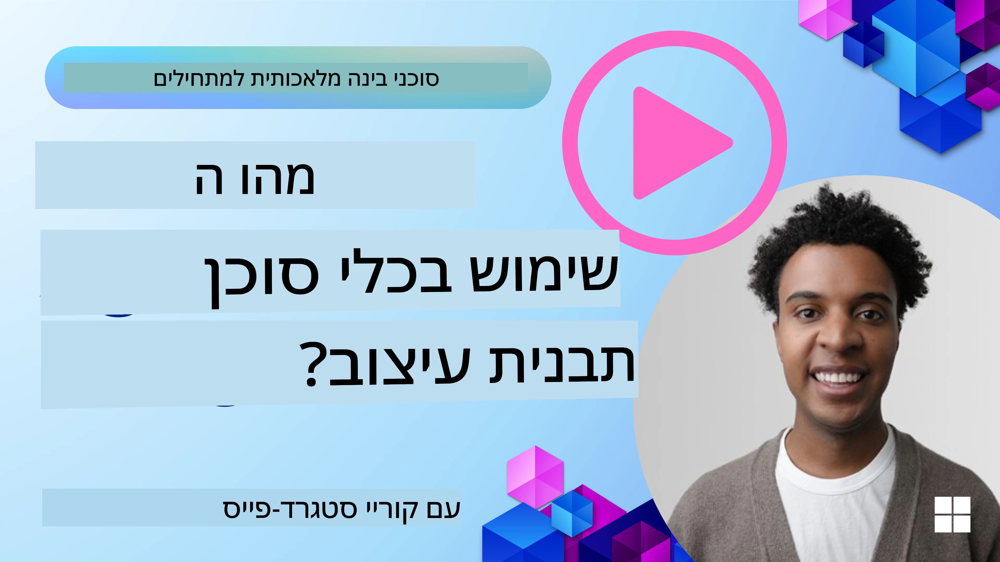
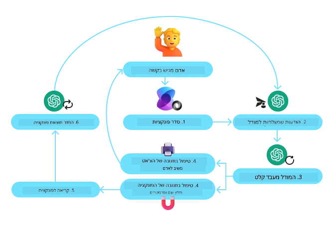
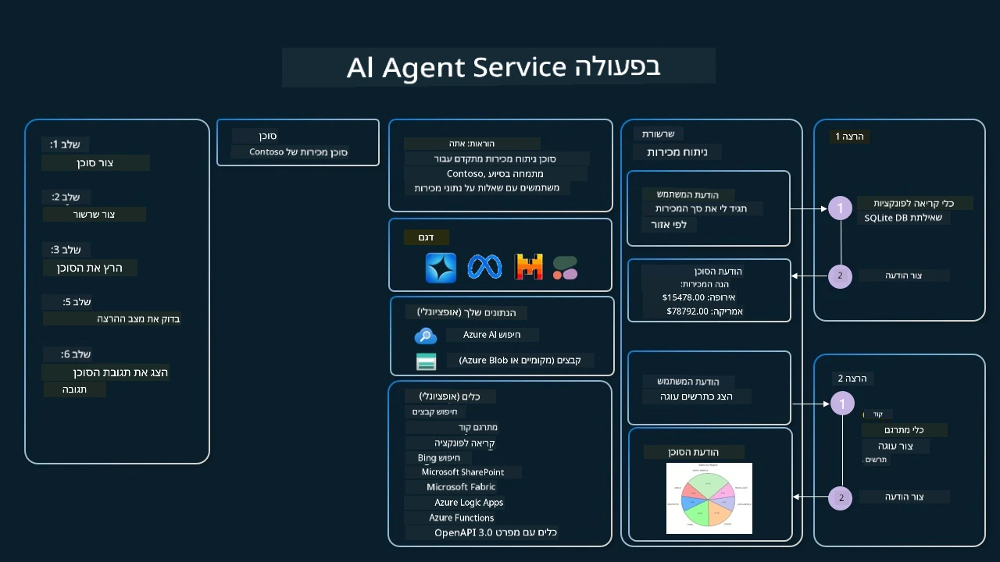

[](https://youtu.be/vieRiPRx-gI?si=cEZ8ApnT6Sus9rhn)

> _(לחץ על התמונה למעלה לצפייה בסרטון של השיעור הזה)_

# תבנית עיצוב לשימוש בכלים

כלים הם מעניינים מכיוון שהם מאפשרים לסוכני AI מגוון רחב יותר של יכולות. במקום שלסוכן יהיה סט מצומצם של פעולות שהוא יכול לבצע, על ידי הוספת כלי, הסוכן יכול כעת לבצע מגוון רחב של פעולות. בפרק זה נבחן את תבנית העיצוב לשימוש בכלים, שמתארת כיצד סוכני AI יכולים להשתמש בכלים ספציפיים כדי להשיג את המטרות שלהם.

## מבוא

בשיעור זה, אנו שואפים לענות על השאלות הבאות:

- מהי תבנית העיצוב לשימוש בכלים?
- מהם המקרים בהם ניתן להשתמש בה?
- מהם האלמנטים/בלוקים הבנויים הדרושים ליישום תבנית העיצוב?
- מהם השיקולים המיוחדים לשימוש בתבנית העיצוב לשימוש בכלים לבניית סוכני AI אמינים?

## מטרות הלמידה

לאחר סיום השיעור תוכלו:

- להגדיר את תבנית העיצוב לשימוש בכלים ואת מטרתה.
- לזהות מקרים בהם ניתן ליישם את תבנית העיצוב לשימוש בכלים.
- להבין את האלמנטים המרכזיים הדרושים ליישום תבנית העיצוב.
- להכיר שיקולים להבטחת אמינות של סוכני AI המשתמשים בתבנית עיצוב זו.

## מהי תבנית העיצוב לשימוש בכלים?

**תבנית העיצוב לשימוש בכלים** מתמקדת בכך לתת למודלים שפתיים גדולים (LLMs) את היכולת לאינטראקציה עם כלים חיצוניים להשגת מטרות ספציפיות. כלים הם קוד שניתן להריץ על ידי סוכן לביצוע פעולות. כלי יכול להיות פונקציה פשוטה כגון מחשבון, או קריאת API לשירות צד שלישי כמו חיפוש מחירי מניות או תחזית מזג אוויר. בהקשר של סוכני AI, כלים מעוצבים לריצה על ידי סוכנים בתגובה ל**קריאות פונקציה שנוצרו על ידי המודל**.

## מהם המקרים בהם ניתן להשתמש בה?

סוכני AI יכולים להשתמש בכלים לביצוע משימות מורכבות, לאחזור מידע, או לקבלת החלטות. תבנית העיצוב לשימוש בכלים משמשת לעיתים קרובות בתרחישים הדורשים אינטראקציה דינמית עם מערכות חיצוניות, כגון בסיסי נתונים, שירותי רשת, או מפרשים של קוד. יכולת זו שימושית למספר מקרים שונים הכוללים:

- **אחזור מידע דינמי:** סוכנים יכולים לשאול APIs חיצוניים או בסיסי נתונים כדי לקבל נתונים מעודכנים (למשל, שאילתא למסד נתונים SQLite לצורך ניתוח נתונים, קבלת מחירי מניות או מידע על מזג האוויר).
- **הרצת ופירוש קוד:** סוכנים יכולים להריץ קוד או סקריפטים לפתרון בעיות מתמטיות, יצירת דוחות או ביצוע סימולציות.
- **אוטומציה של זרימות עבודה:** אוטומציה של תהליכים חוזרים או מרובי שלבים על ידי שילוב כלים כמו מתזמנים למשימות, שירותי דואר אלקטרוני, או צינורות נתונים.
- **תמיכת לקוחות:** סוכנים יכולים לתקשר עם מערכות CRM, פלטפורמות כרטיסים, או מאגרי ידע לפתרון שאלות משתמשים.
- **יצירה ועריכת תוכן:** סוכנים יכולים להשתמש בכלים כמו בודקי דקדוק, מסכמי טקסט, או מעריכים לבטיחות תוכן כדי לסייע במשימות יצירת תוכן.

## מהם האלמנטים/בלוקים הבנויים הנדרשים ליישום תבנית העיצוב לשימוש בכלים?

בלוקים אלו מאפשרים לסוכן ה-AI לבצע מגוון רחב של משימות. נבחן את האלמנטים המרכזיים הנדרשים ליישום תבנית העיצוב לשימוש בכלים:

- **סכמות פונקציה/כלי**: הגדרות מפורטות של הכלים הזמינים, הכוללות שם פונקציה, מטרתה, הפרמטרים הנדרשים, והפלטים הצפויים. סכמות אלו מאפשרות ל-LLM להבין אילו כלים זמינים וכיצד לבנות בקשות תקינות.

- **לוגיקת הרצת הפונקציה**: מגדירה כיצד ומתי נקראים כלים בהתבסס על כוונת המשתמש והקשר השיחה. זה עשוי לכלול מודולי תכנון, מנגנוני ניתוב, או זרימות מותנות שקובעות שימוש דינמי בכלים.

- **מערכת ניהול הודעות**: רכיבים שמנהלים את זרימת השיחה בין קלטים מהמשתמש, תגובות LLM, קריאות לכלים, ופלטים מכלים.

- **מסגרת שילוב כלים**: תשתית שמחברת את הסוכן לכלים שונים, בין אם פונקציות פשוטות או שירותים חיצוניים מורכבים.

- **טיפול בשגיאות ואימות**: מנגנונים לטיפול בכשלים בהרצת כלים, אימות פרמטרים וניהול תגובות בלתי צפויות.

- **ניהול מצב**: עוקב אחרי הקשר השיחה, אינטראקציות קודמות עם כלים ונתונים מתמשכים כדי להבטיח עקביות לאורך אינטראקציות מרובות סבבים.

לאחר מכן, נבחן את קריאת פונקציה/כלי ביתר פירוט.
 
### קריאת פונקציה/כלי

קריאת פונקציה היא הדרך העיקרית בה אנו מאפשרים למודלים שפתיים גדולים (LLMs) לאינטראקציה עם כלים. לעיתים תראו 'פונקציה' ו'כלי' משמשים להחלפה זה את זה מכיוון ש'פונקציות' (בלוקים של קוד שניתן להשתמש בהם מחדש) הן ה'כלים' שהסוכנים משתמשים בהם לביצוע משימות. כדי שקוד הפונקציה יופעל, יש ש-LLM ישווה את בקשת המשתמש לתיאור הפונקציות. לשם כך, סכימה הכוללת את תיאורי כל הפונקציות הזמינות נשלחת ל-LLM. ה-LLM לאחר מכן בוחר את הפונקציה המתאימה ביותר למשימה ומחזיר את שם הפונקציה והארגומנטים. הפונקציה שנבחרה מופעלת, תגובתה נשלחת חזרה ל-LLM, שמשתמש במידע זה כדי להגיב לבקשת המשתמש.

למפתחים המעוניינים ליישם קריאת פונקציה עבור סוכנים דרושים:

1. מודל LLM שתומך בקריאת פונקציה
2. סכימה המכילה תיאורים של פונקציות
3. הקוד עבור כל פונקציה שמתואר

נשתמש בדוגמה של קבלת הזמן הנוכחי בעיר להמחשה:

1. **הפעל מודל LLM שתומך בקריאת פונקציה:**

    לא כל הדגמים תומכים בקריאת פונקציה, לכן חשוב לבדוק שה-LLM בו אתה משתמש תומך בכך. <a href="https://learn.microsoft.com/azure/ai-services/openai/how-to/function-calling" target="_blank">Azure OpenAI</a> תומך בקריאת פונקציה. נוכל להתחיל בהפעלת לקוח OpenAI מול <b>API לתגובות</b> של Azure OpenAI (נקודת הקצה היציבה `/openai/v1/` — ללא צורך ב-`api_version`).

    ```python
    # Initialize the OpenAI client for Azure OpenAI (Responses API, v1 endpoint)
    client = OpenAI(
        base_url=f"{os.environ['AZURE_OPENAI_ENDPOINT'].rstrip('/')}/openai/v1/",
        api_key=os.environ["AZURE_OPENAI_API_KEY"],
    )
    deployment_name = os.environ["AZURE_OPENAI_DEPLOYMENT"]
    ```

1. **צור סכמת פונקציה**:

    לאחר מכן נגדיר סכמת JSON הכוללת את שם הפונקציה, תיאור מה הפונקציה עושה, ואת שמות ותיאורי הפרמטרים של הפונקציה.
    לאחר מכן נעביר סכימה זו ללקוח שיצרנו קודם, יחד עם בקשת המשתמש לקבל את הזמן בסן פרנסיסקו. חשוב לציין שמה שמוחזר הוא **קריאת כלי**, **ולא** התשובה הסופית לשאלה. כמו שהוזכר קודם, ה-LLM מחזיר את שם הפונקציה שנבחרה ואת הארגומנטים שייעברו אליה.

    ```python
    # Function description for the model to read (Responses API flat tool format)
    tools = [
        {
            "type": "function",
            "name": "get_current_time",
            "description": "Get the current time in a given location",
            "parameters": {
                "type": "object",
                "properties": {
                    "location": {
                        "type": "string",
                        "description": "The city name, e.g. San Francisco",
                    },
                },
                "required": ["location"],
            },
        }
    ]
    ```
   
    ```python
  
    # Initial user message
    messages = [{"role": "user", "content": "What's the current time in San Francisco"}]

    # First API call: Ask the model to use the function
    response = client.responses.create(
        model=deployment_name,
        input=messages,
        tools=tools,
        tool_choice="auto",
        store=False,
    )

    # The Responses API returns tool calls as function_call items in response.output.
    # Append them to the conversation so the model has full context on the next turn.
    messages += response.output

    print("Model's response:")
    print(response.output)
  
    ```

    ```bash
    Model's response:
    [ResponseFunctionToolCall(arguments='{"location":"San Francisco"}', call_id='call_pOsKdUlqvdyttYB67MOj434b', name='get_current_time', type='function_call')]
    ```
  
1. **קוד הפונקציה הנדרש לביצוע המשימה:**

    עכשיו כש-LLM בחר איזו פונקציה יש להפעיל, יש ליישם ולבצע את הקוד שמבצע את המשימה.
    נוכל ליישם את הקוד לקבלת הזמן הנוכחי בפייתון. כמו כן, נצטרך לכתוב קוד שיחלץ את השם והארגומנטים מתוך ה-response_message כדי לקבל את התוצאה הסופית.

    ```python
      def get_current_time(location):
        """Get the current time for a given location"""
        print(f"get_current_time called with location: {location}")  
        location_lower = location.lower()
        
        for key, timezone in TIMEZONE_DATA.items():
            if key in location_lower:
                print(f"Timezone found for {key}")  
                current_time = datetime.now(ZoneInfo(timezone)).strftime("%I:%M %p")
                return json.dumps({
                    "location": location,
                    "current_time": current_time
                })
      
        print(f"No timezone data found for {location_lower}")  
        return json.dumps({"location": location, "current_time": "unknown"})
    ```

     ```python
    # Handle function calls
    tool_calls = [item for item in response.output if item.type == "function_call"]
    if tool_calls:
        for tool_call in tool_calls:
            if tool_call.name == "get_current_time":

                function_args = json.loads(tool_call.arguments)

                time_response = get_current_time(
                    location=function_args.get("location")
                )

                # Return the tool result as a function_call_output item
                messages.append({
                    "type": "function_call_output",
                    "call_id": tool_call.call_id,
                    "output": time_response,
                })
    else:
        print("No tool calls were made by the model.")

    # Second API call: Get the final response from the model
    final_response = client.responses.create(
        model=deployment_name,
        input=messages,
        tools=tools,
        store=False,
    )

    return final_response.output_text
     ```

     ```bash
      get_current_time called with location: San Francisco
      Timezone found for san francisco
      The current time in San Francisco is 09:24 AM.
     ```

קריאת פונקציה היא לב רוב תבניות העיצוב לשימוש בכלים לסוכנים, אך יישום שלה מאפס עלול להיות מאתגר לפעמים.
כפי שלמדנו ב-[שיעור 2](../../../02-explore-agentic-frameworks), מסגרות agentic מספקות לנו בלוקים בנויים מראש ליישום שימוש בכלים.
 
## דוגמאות לשימוש בכלים עם מסגרות agentic

הנה כמה דוגמאות כיצד ניתן ליישם את תבנית העיצוב לשימוש בכלים באמצעות מסגרות agentic שונות:

### Microsoft Agent Framework

<a href="https://learn.microsoft.com/azure/ai-services/agents/overview" target="_blank">Microsoft Agent Framework</a> היא מסגרת AI בקוד פתוח לבניית סוכני AI. היא מפשטת את התהליך של שימוש בקריאת פונקציות על ידי הגדרת כלים כפונקציות פייתון עם הדקורטור `@tool`. המסגרת מנהלת את התקשורת הלוך וחזור בין המודל לבין הקוד שלך. היא גם מספקת גישה לכלים שבנויים מראש כמו חיפוש בקבצים ומפרש קוד באמצעות `FoundryChatClient`.

התרשים הבא ממחיש את תהליך קריאת הפונקציה במסגרת Microsoft Agent Framework:



במסגרת Microsoft Agent Framework הכלים מוגדרים כפונקציות עם דקורטורים. נוכל להמיר את הפונקציה `get_current_time` שראינו קודם לכלי על ידי שימוש בדקורטור `@tool`. המסגרת תסדר אוטומטית את הפונקציה ופרמטריה, ותיצור את הסכמה לשליחה ל-LLM.

```python
import os
from agent_framework import tool
from agent_framework.foundry import FoundryChatClient
from azure.identity import AzureCliCredential

@tool(approval_mode="never_require")
def get_current_time(location: str) -> str:
    """Get the current time for a given location"""
    ...

# Create the client
provider = FoundryChatClient(
    project_endpoint=os.environ["AZURE_AI_PROJECT_ENDPOINT"],
    model=os.environ["AZURE_AI_MODEL_DEPLOYMENT_NAME"],
    credential=AzureCliCredential(),
)

# Create an agent and run with the tool
agent = provider.as_agent(name="TimeAgent", instructions="Use available tools to answer questions.", tools=get_current_time)
response = await agent.run("What time is it?")
```

#### כלים משרת MCP

כלים לא חייבים להיות פונקציות בקוד שלך. שרת שמדבר את פרוטוקול הקשר של הדגם (Model Context Protocol - MCP, שנלמד ב[שיעור 11](../11-agentic-protocols/README.md)) מפרסם את הכלים שלו יחד עם הסכמות שלהם, והמסגרת יכולה לטעון אותם באותה הדרך שהיא מסדרת פונקציה עם דקורטור. `MCPStreamableHTTPTool` מתחבר לשרת כזה דרך HTTP, קורא את סכמות הכלים, ומציע אותם למודל יחד עם כלים מקומיים.

הדוגמה הבאה משתמשת בשרת חיפוש באינטרנט המתארח על ידי <a href="https://keenable.ai" target="_blank">Keenable</a>. זה בחינם לשימוש ללא חשבון או מפתח API (הבקשות מוגבלות לפי כתובת IP), כך שהאישורים היחידים שתצטרך הם לאלה של המודל שלך. כמו בכל כלי מרוחק, השאילתות שהמודל כותב נשלחות לאותו שרת.

```python
from agent_framework import MCPStreamableHTTPTool

web_search = MCPStreamableHTTPTool(
    name="Keenable web search",
    url="https://api.keenable.ai/mcp",
)

# Connecting loads the server's tool schemas; the agent decides when to call them
async with web_search:
    agent = provider.as_agent(
        name="ResearchAgent",
        instructions="Use available tools to answer questions.",
        tools=[web_search],
    )
    response = await agent.run("What is new in the latest Python release?")
    print(response.text)
```

השרת מפרסם שני כלים, `search_web_pages` ו-`fetch_page_content`. כשהשאלה דורשת מידע עדכני, המודל קורא ל-`search_web_pages`, מקבל כותרות, כתובות URL וקטעי טקסט, וכותב את התשובה שלו מהם, בלופ זהה לדוגמה `get_current_time` למעלה.
  
### Microsoft Foundry Agent Service

<a href="https://learn.microsoft.com/azure/ai-services/agents/overview" target="_blank">Microsoft Foundry Agent Service</a> היא מסגרת Agentic חדשה שנועדה להעצים מפתחים לבנות, לפרוס ולהרחיב סוכני AI איכותיים ובטוחים ללא צורך לנהל את המשאבים הבסיסיים של מחשוב ואחסון. היא שימושית במיוחד לאפליקציות ארגוניות מכיוון שהיא שירות מנוהל מלא עם אבטחה ברמה ארגונית.

בהשוואה לפיתוח ישיר עם ה-API של LLM, Microsoft Foundry Agent Service מספקת מספר יתרונות, ביניהם:

- קריאה אוטומטית לכלי – אין צורך לנתח קריאת כלי, להפעיל את הכלי ולטפל בתגובה; כל זה נעשה כעת בצד השרת
- נתונים מנוהלים בבטחה – במקום לנהל מצב שיחה בעצמך, תוכל להסתמך על threads לאחסון כל המידע הנדרש
- כלים מוכנים לשימוש – כלים שניתן להשתמש בהם לאינטראקציה עם מקורות הנתונים שלך, כגון Bing, Azure AI Search ו-Azure Functions.

הכלים הזמינים בשירות Microsoft Foundry Agent ניתן לחלק לשתי קטגוריות:

1. כלים לידע:
    - <a href="https://learn.microsoft.com/azure/ai-services/agents/how-to/tools/bing-grounding?tabs=python&pivots=overview" target="_blank">עיגון עם חיפוש Bing</a>
    - <a href="https://learn.microsoft.com/azure/ai-services/agents/how-to/tools/file-search?tabs=python&pivots=overview" target="_blank">חיפוש קבצים</a>
    - <a href="https://learn.microsoft.com/azure/ai-services/agents/how-to/tools/azure-ai-search?tabs=azurecli%2Cpython&pivots=overview-azure-ai-search" target="_blank">Azure AI Search</a>

2. כלים לפעולה:
    - <a href="https://learn.microsoft.com/azure/ai-services/agents/how-to/tools/function-calling?tabs=python&pivots=overview" target="_blank">קריאת פונקציות</a>
    - <a href="https://learn.microsoft.com/azure/ai-services/agents/how-to/tools/code-interpreter?tabs=python&pivots=overview" target="_blank">מפרש קוד</a>
    - <a href="https://learn.microsoft.com/azure/ai-services/agents/how-to/tools/openapi-spec?tabs=python&pivots=overview" target="_blank">כלים המוגדרים על ידי OpenAPI</a>
    - <a href="https://learn.microsoft.com/azure/ai-services/agents/how-to/tools/azure-functions?pivots=overview" target="_blank">Azure Functions</a>

שירות הסוכנים מאפשר לנו להשתמש בכלים אלה יחד כ-`toolset`. הוא גם מנצל `threads` שעוקבים אחרי היסטוריית ההודעות משיחה מסוימת.

דמיינו שאתם סוכן מכירות בחברה בשם Contoso. אתם רוצים לפתח סוכן שיחה שיכול לענות על שאלות בנוגע לנתוני המכירות שלכם.

התמונה הבאה מדגימה כיצד ניתן להשתמש בשירות Microsoft Foundry Agent לניתוח נתוני המכירות:



לשימוש בכל אחד מהכלים הללו עם השירות נוכל ליצור לקוח ולהגדיר כלי או קבוצת כלים. ליישום מעשי נשתמש בקוד הפייתון הבא. ה-LLM יוכל להסתכל על קבוצת הכלים ולהחליט האם להשתמש בפונקציה שיצר המשתמש, `fetch_sales_data_using_sqlite_query`, או במפרש הקוד הבנוי מראש לפי בקשת המשתמש.

```python 
import os
from azure.ai.projects import AIProjectClient
from azure.identity import DefaultAzureCredential
from fetch_sales_data_functions import fetch_sales_data_using_sqlite_query # fetch_sales_data_using_sqlite_query function which can be found in a fetch_sales_data_functions.py file.
from azure.ai.projects.models import ToolSet, FunctionTool, CodeInterpreterTool

project_client = AIProjectClient.from_connection_string(
    credential=DefaultAzureCredential(),
    conn_str=os.environ["PROJECT_CONNECTION_STRING"],
)

# Initialize toolset
toolset = ToolSet()

# Initialize function calling agent with the fetch_sales_data_using_sqlite_query function and adding it to the toolset
fetch_data_function = FunctionTool(fetch_sales_data_using_sqlite_query)
toolset.add(fetch_data_function)

# Initialize Code Interpreter tool and adding it to the toolset. 
code_interpreter = CodeInterpreterTool()toolset.add(code_interpreter)

agent = project_client.agents.create_agent(
    model="gpt-5-mini", name="my-agent", instructions="You are helpful agent", 
    toolset=toolset
)
```

## מהם השיקולים המיוחדים לשימוש בתבנית העיצוב לשימוש בכלים לבניית סוכני AI אמינים?

חשש נפוץ עם SQL שנוצר דינמית על ידי LLM הוא אבטחה, במיוחד הסיכון להזרקת SQL או פעולות זדוניות כמו מחיקה או שינוי מסד הנתונים. אמנם חששות אלו נכונים, ניתן למנוע אותן ביעילות על ידי קביעת הרשאות גישה למסד הנתונים באופן נכון. ברוב בסיסי הנתונים זה כולל קביעת מסד הנתונים כקריאה בלבד. עבור שירותי מסד נתונים כגון PostgreSQL או Azure SQL, יש להקצות לאפליקציה תפקיד קריאה בלבד (SELECT).

הפעלת האפליקציה בסביבה מאובטחת מחזקת עוד יותר את ההגנה. בתרחישים ארגוניים, המידע בדרך כלל מיוצא ומועבר ממערכות מבצעיות למסד נתונים או מחסן נתונים בקריאה בלבד עם סכימה ידידותית למשתמש. גישה זו מבטיחה שהמידע מאובטח, מותאם לביצועים ונגישות, והאפליקציה מקבלת גישה מוגבלת לקריאה בלבד.

## דוגמאות קוד

- פייתון: [Agent Framework](./code_samples/04-python-agent-framework.ipynb)
- .NET: [Agent Framework](./code_samples/04-dotnet-agent-framework.md)

## יש לכם עוד שאלות לגבי תבניות עיצוב לשימוש בכלים?

הצטרפו ל-[Microsoft Foundry Discord](https://discord.com/invite/ATgtXmAS5D) כדי להיפגש עם לומדים אחרים, להשתתף בשעות הפעילות ולקבל תשובות לשאלות על סוכני ה-AI שלכם.

## משאבים נוספים

- <a href="https://microsoft.github.io/build-your-first-agent-with-azure-ai-agent-service-workshop/" target="_blank">סדנת שירות סוכני ה-AI של Azure</a>
- <a href="https://github.com/Azure-Samples/contoso-creative-writer/tree/main/docs/workshop" target="_blank">סדנת סוכנים מרובים של סופר יצירתי Contoso</a>
- <a href="https://learn.microsoft.com/azure/ai-services/agents/overview" target="_blank">סקירת מסגרת הסוכן של מיקרוסופט</a>

## בדיקת עשן לסוכן זה (אופציונלי)

לאחר שלמדתם לפרוס סוכנים ב[שיעור 16](../16-deploying-scalable-agents/README.md), תוכלו לבצע בדיקת עשן ל`TravelToolAgent` של השיעור הזה (האם הוא עדיין קורא לכלים שלו ועונה?) עם [`tests/lesson-04-smoke-tests.json`](../../../tests/lesson-04-smoke-tests.json). ראו [`tests/README.md`](../tests/README.md) כיצד להפעיל אותו.

## שיעור קודם

[הבנת דפוסי עיצוב סוכני](../03-agentic-design-patterns/README.md)

## השיעור הבא

[Agentic RAG](../05-agentic-rag/README.md)

---

<!-- CO-OP TRANSLATOR DISCLAIMER START -->
**כתב ויתור**:
מסמך זה תורגם באמצעות שירות תרגום אוטומטי [Co-op Translator](https://github.com/Azure/co-op-translator). למרות שאנו שואפים לדיוק, יש לקחת בחשבון שתרגומים אוטומטיים עלולים להכיל שגיאות או אי-דיוקים. יש להחשיב את המסמך המקורי בשפתו הטבעית כמקור הסמכות. למידע קריטי מומלץ להשתמש בתרגום מקצועי על ידי מתרגם אדם. אנו לא אחראים לכל אי-הבנה או פירוש שגוי הנובע מהשימוש בתרגום זה.
<!-- CO-OP TRANSLATOR DISCLAIMER END -->