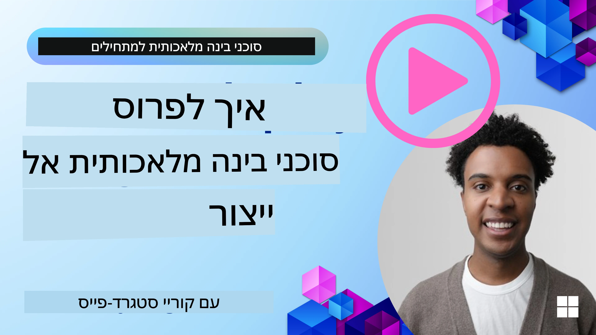

# סוכני בינה מלאכותית בפרודקשן: נראות והערכה

[](https://youtu.be/l4TP6IyJxmQ?si=reGOyeqjxFevyDq9)

ככל שסוכני בינה מלאכותית עוברים מפרוטוטיפים ניסיוניים ליישומים בעולם האמיתי, היכולת להבין את התנהגותם, לעקוב אחרי ביצועיהם ולהעריך את הפלטים שלהם בצורה שיטתית הופכת להיות חשובה.

## יעדי למידה

לאחר סיום השיעור תדעו/תבינו כיצד:
- מושגי יסוד בנראות והערכת סוכנים
- טכניקות לשיפור ביצועים, עלויות ויעילות הסוכנים
- מה וכיצד להעריך את סוכני הבינה שלכם בצורה שיטתית
- כיצד לשלוט בעלויות בעת פריסת סוכני בינה מלאכותית בפרודקשן
- כיצד לנטר סוכנים שנבנו עם Microsoft Agent Framework

המטרה היא לצייד אתכם בידע לשנות את הסוכנים ה"Black box" שלכם למערכות שקופות, ניתנות לניהול ואמינות.

_**הערה:** חשוב לפרוס סוכני בינה מלאכותית בטוחים ואמינים. מומלץ לבדוק גם את השיעור [בניית סוכני בינה אמינים](../06-building-trustworthy-agents/README.md)._

## מעקבים וטווחים

כלי נראות כמו [Langfuse](https://langfuse.com/) או [Microsoft Foundry](https://learn.microsoft.com/en-us/azure/ai-foundry/what-is-azure-ai-foundry) בדרך כלל מייצגים ריצות סוכן כמעקבים (traces) וטווחים (spans).

- **מעקב** מייצג משימה מלאה של הסוכן מההתחלה ועד הסוף (כמו טיפול בשאילתת משתמש).
- **טווחים** הם שלבים בודדים בתוך המעקב (כמו קריאה למודל שפה או שליפת מידע).


<!-- Image URL retained for illustration purposes -->

ללא נראות, סוכן בינה מלאכותית יכול להרגיש כמו "קופסה שחורה" - המצב הפנימי וההגיון שלו עכורים, מה שקשה לאבחן בעיות או לאופטימיזציה של ביצועים. עם נראות, הסוכנים הופכים ל"קופסאות זכוכית", ומציעים שקיפות שמעורבת באמון ובוודאות שהם פועלים כשורה.

## מדוע נראות חשובה בסביבות פרודקשן

המעבר של סוכני בינה מלאכותית לסביבות פרודקשן מציב סט חדש של אתגרים ודרישות. נראות אינה רק "משהו נחמד שיש" אלא יכולת קריטית:

*   **איתור שגיאות וניתוח סיבת שורש**: כאשר סוכן נכשל או מפיק פלט בלתי צפוי, כלי הנראות מספקים את המעקבים הדרושים כדי לזהות את מקור השגיאה. זה חשוב במיוחד בסוכנים מורכבים שיכולים לכלול קריאות מרובות ל-LLM, אינטראקציות עם כלים והיגיון מותנה.
*   **ניהול השהיות ועלויות**: סוכני בינה מלאכותית לרוב מסתמכים על LLM ועל API חיצוניים שמחויבים לפי טוקן או לפי קריאה. הנראות מאפשרת מעקב מדויק אחר קריאות אלו, מסייעת לזהות פעולות איטיות או יקרות מדי. כך צוותים יכולים לאופטימיזציה של הפרומפטים, לבחור מודלים יעילים יותר, או לעצב מחדש תהליכים לניהול עלויות תפעוליות ולקידום חוויית משתמש טובה.
*   **אמון, בטיחות וציות**: באפליקציות רבות חשוב לוודא שהסוכנים מתנהגים בצורה בטוחה ואתית. הנראות מספקת מסלול ביקורת של פעולות והחלטות הסוכן. ניתן להשתמש בכך לזיהוי והפחתת בעיות כמו הזרקת פרומפט, יצירת תוכן מזיק או טיפול לא נכון במידע אישי (PII). לדוגמה, אפשר לבדוק מעקבים כדי להבין מדוע סוכן נתן תשובה מסוימת או השתמש בכלי מסוים.
*   **מעגלי שיפור מתמשך**: נתוני נראות מהווים את היסוד לתהליך פיתוח איטרטיבי. בעזרת ניטור ביצועי הסוכן בעולם האמיתי, צוותים יכולים לזהות נקודות לשיפור, לאסוף נתונים לכוונון מודלים ולאמת השפעת שינויים. זה יוצר מעגל משוב שבו תובנות פרודקשן מהערכת זמן אמת מנחות ניסויים ושיפורים לא מקוונים, המובילים לביצועים טובים יותר עם הזמן.

## מדדים מרכזיים שיש לעקוב אחריהם

כדי לנטר ולהבין את התנהגות הסוכן, יש לעקוב אחרי מגוון מדדים ואותות. המדדים הספציפיים עשויים להשתנות לפי מטרה, אך כמה מהם חשובים באופן אוניברסלי.

להלן כמה מהמדדים הנפוצים שכלי נראות עוקבים אחריהם:

**השהיה:** כמה מהר הסוכן מגיב? זמני המתנה ארוכים פוגעים בחוויית המשתמש. יש למדוד השהיה למשימות ולשלבים בודדים באמצעות מעקב ריצות הסוכן. למשל, סוכן שדורש 20 שניות לכל קריאות המודל יכול להאיץ על ידי שימוש במודל מהיר יותר או הרצת קריאות במקביל.

**עלויות:** מהו ההוצאה לכל ריצת סוכן? סוכני בינה מלאכותית מסתמכים על קריאות LLM שמחויבות לפי טוקן או API חיצוניים. שימוש תכוף בכלים או פרומפטים מרובים יכול להעלות עלויות במהירות. לדוגמה, אם סוכן קורא ל-LLM חמש פעמים לשיפור איכות שולית, כדאי לבדוק האם העלות מוצדקת או אם אפשר להקטין את מספר הקריאות או להשתמש במודל זול יותר. ניטור בזמן אמת עוזר גם לזהות קפיצות לא צפויות (למשל באגים שגורמים ללולאות API מיותרות).

**שגיאות בבקשות:** כמה בקשות נכשלו לסוכן? זה יכול לכלול שגיאות API או כישלונות בקריאת כלים. כדי לחזק את הסוכן בפרודקשן, ניתן להגדיר מנגנוני גיבוי או ניסיונות חוזרים. לדוגמה, אם ספק LLM א' לא פעיל, עוברים לספק LLM ב' כגיבוי.

**משוב משתמש:** הערכות ישירות ממשתמשים מספקות תובנות חשובות. זה יכול לכלול דירוגים מפורשים (👍כפתור לייק/👎דיסלייק, ⭐1-5 כוכבים) או תגובות טקסטואליות. משוב שלילי עקבי צריך להדליק נורה כי זה סימן שהסוכן לא מתפקד כמצופה.

**משוב משתמש עקיף:** התנהגויות משתמשים מספקות משוב עקיף גם ללא דירוגים מפורשים. זה יכול לכלול ניסוח מחדש מיידי של שאלות, שאלות חוזרות או לחיצה על כפתור נסיון חוזר. לדוגמה, אם רואים שמשתמשים שואלים שוב ושוב את אותה שאלה, זה סימן שהסוכן לא מתפקד כמצופה.

**דיוק:** כמה לעיתים הסוכן מפיק פלטים נכונים או רצויים? הגדרות דיוק משתנות (למשל, נכונות פתרון בעיות, דיוק שליפת מידע, שביעות רצון משתמש). הצעד הראשון הוא להגדיר מהי הצלחה עבור הסוכן שלכם. ניתן לעקוב אחרי דיוק באמצעות בדיקות אוטומטיות, ציוני הערכה או תוויות השלמת משימות. למשל, לסמן מעקבים כ"הצליח" או "נכשל".

**מדדי הערכה אוטומטיים:** ניתן גם להגדיר הערכות אוטומטיות. לדוגמה, אפשר להשתמש ב-LLM שיתן ציון לפלט הסוכן, למשל אם הוא מועיל, מדויק או לא. ישנם מספר ספריות קוד פתוח שעוזרות לציון היבטים שונים של הסוכן. לדוגמה, [RAGAS](https://docs.ragas.io/) לסוכני RAG או [LLM Guard](https://github.com/protectai/llm-guard) לזיהוי שפה מזיקה או הזרקת פרומפט.

בפועל, שילוב של מדדים אלו נותן את הכיסוי הטוב ביותר לבריאות סוכן בינה מלאכותית. במחברת [הדוגמא בפרק](./code_samples/10-expense_claim-demo.ipynb) נראה כיצד מדדים אלו נראים בדוגמאות אמיתיות, אך תחילה נלמד כיצד נראה תהליך הערכה טיפוסי.

## נתן כלי ניטור לסוכן שלך

כדי לאסוף נתוני מעקב, תצטרכו לנתב את הקוד שלכם. המטרה היא לנתב את קוד הסוכן כך שיפיק מעקבים ומדדים שניתן ללכוד, לעבד ולהציג בפלטפורמת נראות.

**OpenTelemetry (OTel):** [OpenTelemetry](https://opentelemetry.io/) הפך לסטנדרט תעשייתי לנראות LLM. הוא מספק API, SDK וכלים ליצירה, איסוף וייצוא נתוני טלמטריה.

קיימות ספריות ניתוב רבות שעוטפות מסגרות סוכן קיימות ומאפשרות ייצוא טווחי OpenTelemetry בקלות לכלי נראות. Microsoft Agent Framework משתלב באופן טבעי עם OpenTelemetry. להלן דוגמה לניתוב סוכן MAF:

```python
from agent_framework.observability import get_tracer, get_meter

tracer = get_tracer()
meter = get_meter()

with tracer.start_as_current_span("agent_run"):
    # Agent execution is traced automatically
    pass
```

המחברת [הדוגמא](./code_samples/10-expense_claim-demo.ipynb) בפרק זה תדגים כיצד לנתב את סוכן MAF שלך.

**יצירת טווחים ידנית:** למרות שספריות ניתוב מספקות בסיס טוב, יש מקרים בהם נדרשת מידע מפורט או מותאם יותר. ניתן ליצור טווחים ידנית בכדי להוסיף לוגיקה מותאמת. חשוב מכך, ניתן להעשיר טווחים שנוצרו אוטומטית או ידנית בתכונות מותאמות (המכונות גם תגיות או מטא-דאטה). תכונות אלה עשויות לכלול נתונים עסקיים ספציפיים, חישובים ביניים או כל הקשר שיכול להיות שימושי לאבחון או ניתוח, כמו `user_id`, `session_id`, או `model_version`.

דוגמה ליצירת מעקבים וטווחים ידנית עם ה-[Langfuse Python SDK](https://langfuse.com/docs/sdk/python/sdk-v3):

```python
from langfuse import get_client
 
langfuse = get_client()
 
span = langfuse.start_span(name="my-span")
 
span.end()
```

## הערכת סוכן

נראות נותנת לנו מדדים, אך הערכה היא תהליך ניתוח הנתונים (וביצוע בדיקות) כדי לקבוע עד כמה סוכן הבינה מלאכותית מתפקד וכיצד ניתן לשפר אותו. במילים אחרות, כאשר יש לכם את המעקבים והמדדים, כיצד להשתמש בהם כדי לשפוט את הסוכן ולקבל החלטות?

הערכה סדירה חשובה כי סוכני בינה מלאכותית לעיתים אינם דטרמיניסטיים ויכולים להתפתח (דרך עדכונים או שינויי התנהגות מודל) – ללא הערכה, לא תדעו אם "הסוכן החכם" שלכם עושה את עבודתו היטב או שחלה הידרדרות.

קיימות שתי קטגוריות הערכה לסוכני AI: **הערכה מקוונת** ו-**הערכה לא מקוונת**. שתיהן חשובות ומשלימות זו את זו. בדרך כלל מתחילים עם הערכה לא מקוונת, שכן זו הצעד המינימלי הדרוש לפני פריסה לפרודקשן.

### הערכה לא מקוונת


הערכה בסביבה מבוקרת, בדרך כלל עם מערכי נתונים לקסמים, לא עם שאילתות משתמש בזמן אמת. משתמשים במערכי נתונים מסוננים שבהם ידוע מה הפלט הצפוי או ההתנהגות הנכונה, ומריצים את הסוכן עליהם.

לדוגמה, אם בניתם סוכן לפתירת בעיות מתמטיות מילוליות, ייתכן שיש לכם [מערך נתונים לבדיקה](https://huggingface.co/datasets/openai/gsm8k) של 100 בעיות עם תשובות ידועות. הערכה לא מקוונת נעשית לעיתים קרובות בשלב הפיתוח (ויכולה להיות חלק מ-CI/CD) כדי לבדוק שיפורים או למנוע הידרדרות. היתרון הוא שזו הערכה **חוזרת שניתן לקבל בה מדדי דיוק ברורים כי יש אמת קרקעית**. ניתן גם לסמל שאלות משתמש ולמדוד את התגובות של הסוכן מול תשובות אידיאליות או להשתמש במדדים אוטומטיים כמתואר למעלה.

האתגר המרכזי בהערכה לא מקוונת הוא להבטיח שמערך הנתונים מקיף ועדכני – ייתכן שהסוכן יתפקד טוב על מערך קבוע אך יתקל בשאילתות שונות בפרודקשן. לכן כדאי לעדכן מערכי בדיקה עם מקרים חדשים ודוגמאות המשקפות תרחישים אמיתיים. תערובת של מקרים קטנים "לבדיקות מהירות" ומערכים גדולים יותר להערכת ביצועים רחבה שימושית: מערכים קטנים לבדיקה מהירה ומערכים גדולים למדדים כללים.

### הערכה מקוונת


מתייחסת להערכת הסוכן בסביבה חיה, בעולם האמיתי, כלומר במהלך שימוש אמיתי בפרודקשן. הערכה מקוונת כוללת ניטור ביצועי הסוכן באינטראקציות משתמש חיים וניתוח רציף של התוצאות.

לדוגמה, ניתן לעקוב אחרי שיעורי הצלחה, ציוני שביעות רצון משתמשים או מדדים אחרים בתנועה חיה. היתרון של הערכה מקוונת הוא שהיא **תופסת דברים שאולי לא צפית בסביבה מבוקרת** – ניתן לצפות בהזנחת מודל לאורך זמן (אם יעילות הסוכן פוחתת כשהדפוסים משתנים) ולזהות שאילתות או מצבים לא צפויים שאינם בנתוני הבדיקה. היא מספקת תמונת אמת של התנהגות הסוכן בשטח.

הערכה מקוונת לרוב כוללת איסוף משוב משתמש מפורש ועקיף, כפי שנדון, ואולי הפעלת מבחני צל או מבחני A/B (כאשר גרסה חדשה של הסוכן רצה במקביל להשוואה לגרסה הישנה). האתגר הוא שקשה להשיג תוויות או ציונים אמינים לאינטראקציות בזמן אמת – ייתכן שתסתמכו על משוב משתמש או מדדים משניים (כמו האם המשתמש לחץ על התוצאה).

### שילוב השניים

הערכות מקוונות ולא מקוונות אינן סותרות זו את זו; הן משלימות מאוד. תובנות מניטור מקוון (למשל, סוגי שאילתות משתמש חדשים שבהן הסוכן מתפקד גרוע) יכולות לשמש לשיפור מערכי נתונים לא מקוונים. לעומת זאת, סוכנים המצליחים במבדקים לא מקוונים ניתן לפרוס בביטחון רב ואז לנטר אותם בזמן אמת.

למעשה, צוותים רבים מאמצים את המעגל:

_הערכה לא מקוונת -> פריסה -> ניטור מקוון -> איסוף מקרים של כשל -> הוספה למערך לא מקוון -> שיפור הסוכן -> חזרה על התהליך_.

## בעיות שכיחות

בעת פריסת סוכני בינה מלאכותית בפרודקשן, עשויים להתרחש אתגרים שונים. להלן כמה בעיות שכיחות ופתרונות אפשריים:

| **בעיה**    | **פתרון אפשרי**   |
| ------------- | ------------------ |
| סוכן הבינה לא מבצע משימות בעקביות | - שפר את הפרומפט שניתן לסוכן; היה ברור ביעדים.<br>- זיהוי מקרים בהם חלוקת המשימות לתת משימות וטיפול על ידי סוכנים מרובים יכולה לעזור. |
| סוכן הבינה נכנס ללולאות רצופות  | - ודא שיש תנאי יציאה ברורים כך שהסוכן יודע מתי לסיים את התהליך.<br>- למשימות מורכבות שדורשות היגיון ותכנון, השתמש במודל גדול המתמחה במשימות היגיון. |
| קריאות כלים של סוכן הבינה לא מתפקדות טוב   | - בדוק ואמת את הפלט של הכלי מחוץ למערכת הסוכן.<br>- שפר את הפרמטרים, הפרומפטים ושמות הכלים שהוגדרו.  |
| מערכת רב-סוכנים לא מתפקדת בעקביות | - שפר את הפרומפטים שניתנו לכל סוכן כדי לוודא שהם ספציפיים ומובחנים זה מזה.<br>- בנה מערכת היררכית באמצעות סוכן "נתב" או מנהל לקבוע איזה סוכן הוא הנכון. |

רבות מן הבעיות האלה ניתן לזהות בצורה יעילה יותר עם נראות פעילה. המעקבים והמדדים שנדונו קודם עוזרים לזהות בדיוק איפה בתהליך הסוכן הבעיות מתרחשות, מה שמאפשר איתור ותיקון באגים ואופטימיזציה בצורה יעילה הרבה יותר.

## ניהול עלויות

להלן כמה אסטרטגיות לניהול עלויות הפריסה של סוכני AI בפרודקשן:

**שימוש במודלים קטנים יותר:** מודלים שפתיים קטנים (SLMs) יכולים להציג ביצועים טובים במקרי שימוש סוכניים מסוימים ויקטינו משמעותית את העלויות. כפי שנאמר קודם, בניית מערכת הערכה כדי לקבוע ולהשוות ביצועים מול מודלים גדולים יותר היא הדרך הטובה ביותר להבין עד כמה מודל SLM יתאים למקרה השימוש שלך. שקול להשתמש ב-SLM למשימות פשוטות יותר כמו סיווג כוונות או חילוץ פרמטרים, תוך שמירת מודלים גדולים יותר למשימות חשיבה מורכבות.

**שימוש במודל נתב:** אסטרטגיה דומה היא להשתמש במגוון מודלים וגדלים. אתה יכול להשתמש ב-LLM/SLM או בפונקציה ללא שרת כדי לנתב בקשות על פי מורכבות למודלים המתאימים ביותר. זאת גם עוזרת להפחית עלויות וגם מבטיחה ביצועים במשימות הנכונות. למשל, לנתב שאילתות פשוטות למודלים קטנים ומהירים יותר, ולהשתמש במודלים גדולים ויקרים רק למשימות חשיבה מורכבות.

**שמירת תגובות במטמון:** זיהוי בקשות ומשימות נפוצות ומתן תגובות מראש לפני שהן עוברות דרך המערכת הסוכנית שלך היא דרך טובה להפחית את נפח הבקשות הדומות. אתה יכול אפילו ליישם תהליך לזיהוי כמה בקשה דומה לבקשות שלך במטמון תוך שימוש במודלים בסיסיים יותר של בינה מלאכותית. אסטרטגיה זו יכולה להפחית משמעותית עלויות עבור שאלות נפוצות או זרמי עבודה שכיחים.

## בוא נבדוק איך זה עובד בפועל

ב-[מחברת הדוגמה של סעיף זה](./code_samples/10-expense_claim-demo.ipynb), נראה דוגמאות לאופן שבו ניתן להשתמש בכלי ניתוח תצפית כדי לעקוב ולהעריך את הסוכן שלנו.


### יש לך עוד שאלות על סוכנים מבוססי AI בפרודקשן?

הצטרף אל [Microsoft Foundry Discord](https://discord.com/invite/ATgtXmAS5D) כדי לפגוש לומדים אחרים, להשתתף בשעות משרדיות ולקבל מענה על שאלותיך בנוגע לסוכני AI.

## השיעור הקודם

[תבנית עיצוב מטה-קוגניציה](../09-metacognition/README.md)

## השיעור הבא

[פרוטוקולים סוכניים](../11-agentic-protocols/README.md)

---

<!-- CO-OP TRANSLATOR DISCLAIMER START -->
**כתב ויתור**:
מסמך זה תורגם באמצעות שירות תרגום אוטומטי [Co-op Translator](https://github.com/Azure/co-op-translator). למרות שאנו שואפים לדיוק, יש לקחת בחשבון שתרגומים אוטומטיים עלולים להכיל שגיאות או אי-דיוקים. יש להחשיב את המסמך המקורי בשפתו הטבעית כמקור הסמכות. למידע קריטי מומלץ להשתמש בתרגום מקצועי על ידי מתרגם אדם. אנו לא אחראים לכל אי-הבנה או פירוש שגוי הנובע מהשימוש בתרגום זה.
<!-- CO-OP TRANSLATOR DISCLAIMER END -->