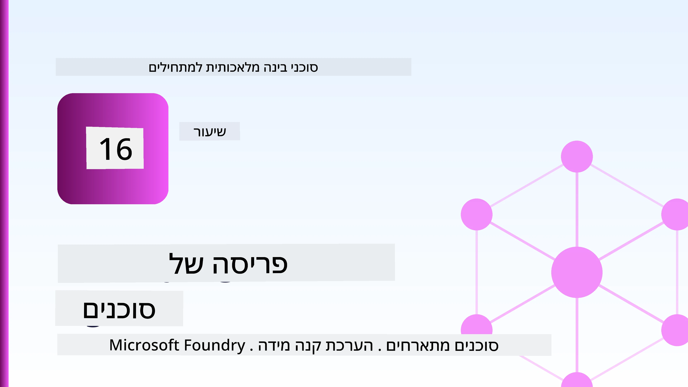
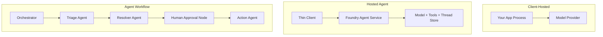
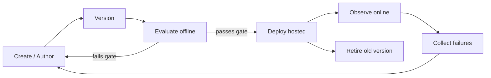
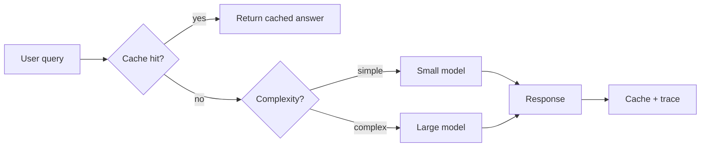
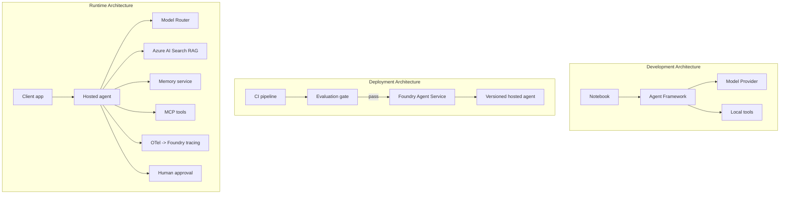

# פריסת סוכנים בקנה מידה עם Microsoft Foundry



עד לנקודה זו בקורס בנית סוכנים שרצים על הלפטופ שלך, בתוך מחברת, מונעים על ידי `az login` וכמה משתני סביבה. זו בדיוק הדרך הנכונה ללמוד. זו לא הדרך הנכונה להריץ סוכן שעליו תלויים אלפי לקוחות בשעה שלוש לפנות בוקר.

השיעור הזה עוסק בהבדל בין "זה עובד על המחשב שלי" לבין "זה עובד, באמינות ובעלות סבירה, בייצור." אנו סוגרים את הפער הזה באמצעות **Microsoft Foundry** ו-**Microsoft Foundry Agent Service**, ועושים זאת על ידי בניית סוכן תמיכה ללקוחות אמיתי שיש לו כלים, שליפה, זיכרון, הערכה ומעקב.

## מבוא

שיעור זה יכלול:

- ההבדל בין **סוכן אב-טיפוס** ל-**סוכן מפורסם**, ולמה המעבר עוסק בעיקר בכל מה ש*מסביב* למודל.
- **דפוסי פריסה** לסוכנים: אירוח בצד הלקוח, אירוח בשירות (Hosted Agents), ותזמון זרימות עבודה.
- **מחזור חיי הסוכן** ב-Microsoft Foundry — יצירה, גרסאות, פריסה, הערכה, תצפית, הפסקה.
- **אסטרטגיות סקיילינג**: ניתוב מודלים, מטמון, סימולטניות, ועיצוב ללא מצב.
- **תצפית** עם OpenTelemetry ועקבות Foundry.
- **אופטימיזציית עלויות** דרך בחירת מודל, ניתוב, ושערי הערכה.
- **שיקולי ארגון**: ממשל, אישור אנושי, והרצת שרתי MCP בבטחה בייצור.

## מטרות הלמידה

בסיום שיעור זה, תדעו כיצד:

- לבחור את דפוס הפריסה הנכון עבור עומס עבודה של סוכן נתון.
- לפרוס סוכן ל-Microsoft Foundry Agent Service כך שיהיה מדורג, מנוהל ונצפה.
- למדוד סוכן לעקבות ולחבר צינור הערכה שרץ לפני כל פרסום.
- ליישם ניתוב ו-cache של מודלים כדי לשמור על זמן תגובה ועלות בשליטה בקנה מידה.
- להוסיף שער אישור אנושי לפעולות בסיכון גבוה ולשלב שרת MCP באופן בטוח בייצור.

## דרישות מוקדמות

שיעור זה מניח שסיימתם את השיעורים הקודמים ואתם בנוח עם:

- בניית סוכנים עם [Microsoft Agent Framework](../14-microsoft-agent-framework/README.md) (שיעור 14).
- [שימוש בכלים](../04-tool-use/README.md) (שיעור 4) ו-[Agentic RAG](../05-agentic-rag/README.md) (שיעור 5).
- [זיכרון סוכן](../13-agent-memory/README.md) (שיעור 13) ו-[פרוטוקולים סוכן / MCP](../11-agentic-protocols/README.md) (שיעור 11).
- [תצפית והערכה](../10-ai-agents-production/README.md) (שיעור 10) — שיעור זה בונה ישירות עליו.

תזדקקו גם ל:

- **מנוי Azure** ו-**פרויקט Microsoft Foundry** עם לפחות מודל צ'אט אחד מפורסם.
- **Azure CLI** מאומת (`az login`).
- Python 3.12+ והחבילות במחסן [`requirements.txt`](../../../requirements.txt).

## מאב-טיפוס לייצור: מה באמת משתנה

סוכן אב-טיפוס וסוכן ייצור חולקים את הלולאה הליבה — ניתוח, קריאת כלים, תגובה. מה שמשתנה זה כל מה שמסביב ללולאה הזאת. המודל הוא אולי 20% מסוכן ייצור; 80% הנותרים הם השלד התפעולי.

| דאגה | אב-טיפוס | ייצור |
| --- | --- | --- |
| **אירוח** | רץ במחברת שלך | רץ כשירות אירוח, בגרסאות ומופץ |
| **זהות** | הטוקן שלך של `az login` | זהות מנוהלת עם RBAC ממוקד |
| **מצב** | בזיכרון, נאבד באתחול | מופרד (מחסן נושאים, שירות זיכרון) |
| **כישלון** | אתה רואה את מעקב השגיאות | ניסיונות חוזרים, גיבויים, מכתבים מתים, התראות |
| **עלות** | "זה כמה סנטים" | מעקב לפי בקשה, ניתוב, מטמון, תקציב |
| **איכות** | אתה בודק בעין את הפלט | מוערך אוטומטית לפני כל פרסום |
| **אמינות** | אתה מאשר כל פעולה | מדיניות + אדם בלולאה לפעולות בסיכון |

זכרו את הטבלה הזו. כל קטע למטה מתאים לאחת מהשורות האלה.

## דפוסי פריסת סוכנים

ישנם שלושה דפוסים שתשתמשו בהם, לעיתים בשילוב.

### 1. סוכנים מותאמים ללקוח

האובייקט של הסוכן חי בתוך תהליך היישום *שלך*. הקוד שלך קורא לספק המודל ישירות; לולאת הניתוח רצה בשירות שלך. זה מה שכל שיעור קודם עשה.

- **משתמשים בזה כש** אתם צריכים שליטה מלאה על הלולאה, תיווך מותאם אישית, או שאתם משבצים את הסוכן בתוך backend קיים.
- **תרומה**: אתם אחראים על סקיילינג, מצב, וחוסן בעצמכם.

### 2. סוכנים מאוחסנים (Foundry Agent Service)

הסוכן *נרשם כמשאב* ב-Microsoft Foundry. Foundry מארח את לולאת הניתוח, שומר נושאים, אוכף בטיחות תוכן ו-RBAC, ועושה את הסוכן גלוי בפורטל Foundry. האפליקציה שלך הופכת ללקוח דק שיוצר נושאים וקורא תגובות.

- **משתמשים בזה כש** רוצים עמידות, תצפית מובנית, ממשל, ופחות נפח תפעולי.
- **תרומה**: פחות שליטה ברזולוציה נמוכה בתמורה להרצה מנוהלת.

### 3. זרימות עבודה של סוכן

סוכנים וכלים רבים מורכבים לגרף עם זרימת בקרה מפורשת — שלבים רצופים, הסתעפויות, נקודות אישור אנושיות, ונקודות בדיקה עמידות שיכולות להפסיק ולהמשיך. זוהי יכולת **זרימות עבודה** במסגרת Microsoft Agent Framework המיושמת בקנה מידה של פריסה.

- **משתמשים בזה כש** מטלה אחת חוצה מספר סוכנים מומחים או דורשת שלב אישור באמצע.
- **תרומה**: יותר חלקים נעים; דרושה תצפית ברמת התזמון.



## מחזור חיי הסוכן ב-Microsoft Foundry

פריסת סוכן היא לא `push` חד-פעמי. זאת לולאה, ומאוד דומה למחזור שחרור תוכנה כי זה בדיוק מה שהיא.



הרעיון המרכזי, שנלקח מ-[שיעור 10](../10-ai-agents-production/README.md): **הערכה לא מקוונת היא שער, לא מחשבה אחרי**. גרסה חדשה של סוכן לא יוצרת אלא אם כן היא עוברת את ספי ההערכה שלך. תצפית מקוונת מזינה כישלונות מהעולם האמיתי חזרה לערכות מבחן לא מקוונות. זו כל הלולאה.

## אסטרטגיות סקיילינג

סקיילינג של סוכן שונה מסקיילינג של API וובי ללא מצב, כי כל בקשה יכולה להפעיל מספר קריאות למודל וכלים יקרים. ארבע טכניקות נושאות את רוב העומס.

**טיפול בבקשה ללא מצב**. אל תשמרו מצב לכל משתמש בזיכרון התהליך שלכם. אחסנו את נושאי השיחה במחסן הנושאים Foundry או בשירות זיכרון כך שכל מופע יוכל לטפל בכל בקשה. זה מה שמאפשר לכם סקיילינג אופקי — הוספת מופעים, ללא מושבים דביקים.

**ניתוב מודלים**. לא כל בקשה זקוקה למודל היעיל (והיקר) ביותר שלכם. ניתבו בקשות פשוטות — סיווג כוונות, תשובות קצרות עובדתיות — למודל קטן ומהיר, ושמרו את המודל הגדול לניתוח אמיתי. Foundry's **Model Router** יכול לעשות זאת עבורכם, או שתוכלו ליישם מסווג קל משקל בעצמכם. תבנו את הגרסה ה-DIY במעבדה.

**מטמון תגובות**. הרבה שאלות תמיכה הן חזרות קרובות ("איך אני מאפס את הסיסמה?"). מטמנו תשובות לשאלות נפוצות והגישו אותן בלי להשתמש במודל כלל. אפילו שיעור תאימות מטמון צנוע פוגע משמעותית בעלות ובזמן תגובה.

**סימולטניות ולחץ חוזר**. ספקי מודלים מוגבלים בקצב. גבילו את הסימולטניות שלכם, השתמשו בניסיונות חוזרים עם רטרובק אקספוננציאלי, והכשלו בחן (תגובה בתור "אנחנו מטפלים בזה" עדיפה על שגיאת 500).



## תצפית בייצור

אי אפשר להפעיל מה שלא רואים. כפי שנלמד בשיעור 10, Microsoft Agent Framework משדר עקבות **OpenTelemetry** באופן טבעי — כל קריאה למודל, הפעלת כלי, ושלב תזמור הופכים לרווח. בייצור אתם מייצאים את הרווחים הללו ל-Microsoft Foundry (או לכל backend תואם OTel) כדי שתוכלו:

- לעקוב אחרי תלונה של לקוח מתחילת הקצה ועד הסוף בכל קריאה למודל וכלי.
- לצפות בזמן תגובה p50/p95 ועלות לבקשה לאורך זמן.
- לקבל התראות על זינוק בשיעור שגיאות וחריגות בעלויות לפני שהמשתמשים שלכם (או צוות הכספים) שמים לב.

```python
from agent_framework.observability import get_tracer

tracer = get_tracer()

with tracer.start_as_current_span("support_request") as span:
    span.set_attribute("customer.tier", "enterprise")
    span.set_attribute("routed.model", "gpt-5-nano")
    # agent execution is traced automatically inside this span
```

תכונות כמו `customer.tier` ו-`routed.model` הן מה שהופכות קיר עקבות לשאלות שניתן לענות עליהן ("האם לקוחות ארגוניים מנותבים למודל הקטן יותר לעיתים קרובות מדי?").

## אופטימיזציית עלויות

העלות בסוכני ייצור נשלטת בעיקר על ידי הטוקנים. שלושה מנופים, לפי סדר השפעה:

1. **בחירת המודל בגודל נכון.** מודל קטן שעובר את שער ההערכה שלך כמעט תמיד זול יותר ממודל גדול שעובר גם. השתמש בהערכה כדי *להוכיח* שהמודל הקטן טוב מספיק במקום לבחור כברירת מחדל את הגדול ביותר מתוך זהירות.
2. **ניתוב לפי מורכבות.** כמו שצויין למעלה — שלם מחירי מודל גדול רק עבור בקשות שדורשות ניתוח מודל גדול.
3. **מטמון אגרסיבי.** קריאת המודל הזולה ביותר היא זו שאינה נעשית לעולם.

שערי הערכה ובקרת עלויות הם אותה משמעת שנצפית משני זוויות: ההערכה מורה לך את *רמת האיכות*, הניתוב והמטמון שומרים עליך קרוב ככל האפשר ל-*עלות* שלה.

## שיקולי פריסת ארגון

**ממשל.** סוכנים מאוחסנים יורשים את RBAC, בטיחות תוכן, ורישום ביקורת של Foundry. תן לכל סוכן זהות מנוהלת עם ההרשאה המינימלית הנדרשת — גישה רק לקריאה לבסיס הידע, גישה ממוקדת ל-API של טיקטים, ולא יותר.

**אדם בלולאה.** פעולות מסוימות חשובות מדי לאוטומציה מוחלטת — החזרת תשלום, מחיקת חשבון, העלאה לצוות משפטי. Microsoft Agent Framework תומך בכלים שדורשים **אישור**: הסוכן מציע את הפעולה, ההרצה נעצרת, אדם מאשר או דוחה, וזרימת העבודה ממשיכה. ראיתם את הפרימיטיב ב-[שיעור 6](../06-building-trustworthy-agents/README.md); כאן אתם מפרסים אותו.

**MCP בייצור.** [MCP](../11-agentic-protocols/README.md) מאפשר לסוכן שלך להשתמש בכלים חיצוניים דרך ממשק סטנדרטי. בייצור, התייחס לכל שרת MCP כגבול לא מהימן: תקבע את גרסת השרת, תריץ אותו עם זהות ממוקדת, תאמת את הפלט שלו, ואל תחשוף לו סודות לעולם. שרת MCP הוא תלות, ותלויות מתוקנות, מתועדות ומוגבלות בקצב.



שלוש התרשימים האלה — פיתוח, פריסה, ריצה — הם אותו סוכן בשלבים שונים של חייו. המעבדה בהמשך תלווה אותך בבנייתו.

## מעבדה מעשית: סוכן תמיכה ללקוח מוכן לייצור

פתח את [`code_samples/16-python-agent-framework.ipynb`](./code_samples/16-python-agent-framework.ipynb) ועבור עליו מקצה לקצה. תרכיב **סוכן תמיכה ללקוח Contoso** עם כל דאגה של ייצור מטובלת:

1. **קריאת כלים** — בדוק סטטוס הזמנה ופתח כרטיסי תמיכה.
2. **RAG** — ענה על שאלות מדיניות מבסיס ידע (Azure AI Search, עם גיבוי בזיכרון כדי שהמחברת תרוץ ללא משאב חיפוש).
3. **זיכרון** — זוכר את הלקוח בין סבבי השיחה.
4. **ניתוב מודל** — מסווג מורכבות מנתב כל בקשה למודל קטן או גדול.
5. **מטמון תגובות** — שאלות חוזרות מוגשות מהמטמון.
6. **אישור אנושי** — החזרים מעל סף נעצרים לחתימת אדם.
7. **צינור הערכה** — סט מבחן לא מקוון קטן מדרג את הסוכן ומשמש כשער שחרור.
8. **תצפית** — עקבות OpenTelemetry סביב כל בקשה.

### סיור

המחברת מאורגנת כך שכל דאגת ייצור היא חלק עצמאי ופועל. הלב שלה הוא מנגנון מטפל בבקשות של ניתוב ושל מטמון:

```python
async def handle_support_request(query: str, customer_id: str) -> str:
    # 1. Serve from cache when we can.
    cached = response_cache.get(normalize(query))
    if cached:
        return cached

    # 2. Route by complexity to control cost.
    model = "gpt-5-nano" if is_simple(query) else "gpt-5-mini"

    # 3. Run the agent inside a trace span for observability.
    with tracer.start_as_current_span("support_request") as span:
        span.set_attribute("routed.model", model)
        span.set_attribute("customer.id", customer_id)
        response = await support_agent.run(query, model=model)

    # 4. Cache and return.
    response_cache.set(normalize(query), response.text)
    return response.text
```

שער ההערכה שמגן על שחרור נראה כך:

```python
async def evaluation_gate(agent, test_cases, threshold: float = 0.8) -> bool:
    passed = 0
    for case in test_cases:
        result = await agent.run(case["input"])
        if score_response(result.text, case["expected"]) >= 0.8:
            passed += 1
    pass_rate = passed / len(test_cases)
    print(f"Evaluation pass rate: {pass_rate:.0%} (gate: {threshold:.0%})")
    return pass_rate >= threshold  # only deploy if the gate passes
```

קרא כל שורה — המחברת משאירה את היסודות קטנים בכוונה כך ששום דבר לא מוסתר מאחורי קריאת מסגרת.

## אימות סוכן מפורסם עם בדיקות עשן

שער ההערכה שלמעלה רץ *לא מקוון* כנגד אובייקט הסוכן שלך. כשהסוכן מפורסם כסוכן אחסון, אתה צריך בדיקה נוספת, אפילו זולה יותר: **האם נקודת הקצה המפורסמת באמת עונה?**

פריסת "הצלחה" מוכיחה רק שמסלול הבקרה קיבל את ההגדרה — זה לא מוכיח שהסוכן מגיב. תלות חסרה, ניתוב מודל שגוי, או חיבור שפג תוקף יכולים להשאיר פריסה ירוקה שלא מחזירה כלום. **בדיקת עשן** תופסת את זה בשניות, בכל פריסה, בלי עלות מלאה של הערכה.

מאגר זה כולל צינור בדיקות עשן מוכן לשימוש המבוסס על [AI Smoke Test](https://github.com/marketplace/actions/ai-smoke-test) GitHub Action:

- **קטלוג** — [`tests/lesson-16-smoke-tests.json`](../../../tests/lesson-16-smoke-tests.json) מכיל הנחיות ואישורים לסוכן תמיכה Contoso (תשובות מדיניות מבוססות, בדיקת הזמנה, שמירה על נושא, ורצף דיון רב-סבבי). קטלוגים לסוכנים של שיעורים אחרים נמצאים לצידו — ראה [`tests/README.md`](../tests/README.md).
- **זרימת עבודה** — [`.github/workflows/smoke-test.yml`](../../../.github/workflows/smoke-test.yml) נכנס עם Azure OIDC ושולח בכל פעם פקודה לנקודת הקצה Responses של הסוכן, ומבצעת כישלון במשימה על כל טעות אישור.

```yaml
- name: Smoke-test hosted agent
  uses: JFolberth/ai-smoketest@v1
  with:
    project_endpoint: ${{ inputs.project_endpoint }}
    agent_name: ContosoSupportAgent
    tests_file: tests/lesson-16-smoke-tests.json
```

הריצו אותו מהכרטיסייה **Actions** לאחר הסעת הסוכן שלכם, תוך אספקת נקודת הקצה של פרויקט Foundry ושם הסוכן. זהות מאוחדת זקוקה לתפקיד **Azure AI User** במסגרת פרויקט Foundry. חשבו על השכבות כעל פירמידה: בדיקות עשן (האם נגיש ותגובות?) מופעלות בכל הפעלה, הערכה לא מקוונת (האם טוב מספיק למשלוח?) מופעלת לפני קידום, והערכה מקוונת (איך זה מתפקד בשטח?) פועלת ברציפות.

## בדיקת ידע

בדקו את ההבנה שלכם לפני המעבר למשימה.

**1. בערך כמה מהסוכן בפרודקשן הוא "המודל," ומהו שאר החלק?**

<details>
<summary>תשובה</summary>

המודל הוא מיעוט במערכת - מצוטט לעיתים קרובות בכ־20%. השאר הוא שלד תפעולי: אירוח וניהול גרסאות, זהות ו-RBAC, מצב מוחצן, טיפול בכשלונות, מעקב עלויות, הערכה ובקרות עם מעורבות אנושית. המעבר לפרודקשן הוא בעיקר בניית כל מה ש*סביב* לולאת ההסקה.
</details>

**2. מתי תעדיפו סוכן Hosted Agent על פני סוכן מאוחסן בלקוח?**

<details>
<summary>תשובה</summary>

כאשר רוצים סביבת הרצה מנוהלת עם עמידות מובנית (תהליכים שממשיכים ויכולים להתחדש), יכולת תצפית, בטיחות תוכן ו-RBAC, ומוכנים לוותר על קצת שליטה ברמת הלולאה בתמורה לפחות שטח תפעולי. סוכן מאוחסן בלקוח מועדף כשצריך שליטה מלאה על הלולאה או כאשר משבצים את הסוכן במערכת backend קיימת.
</details>

**3. מדוע סוכן מתרחב חייב להיות ללא מצב בזיכרון התהליך שלו?**

<details>
<summary>תשובה</summary>

כך שכל מופע יכול לטפל בכל בקשה, מה שמאפשר קידום אופקי בלי מושבים דביקים (sticky sessions). מצב שיחות per-user מוחצן לאחסון תהליכים או שירות זיכרון. אם המצב היה בזיכרון התהליך, היינו מאבדים אותו באתחול ולא יכולים להפיץ את העומס בחופשיות.
</details>

**4. איזו בעיה פותר ניתוב מודל, וכיצד זה קשור להערכה?**

<details>
<summary>תשובה</summary>

ניתוב שולח בקשות פשוטות למודל קטן, זול ומהיר ושומר את המודל הגדול להסקות אמיתיות, תוך שליטה גם בזמן ההמתנה וגם בעלויות. זה מתקשר להערכה כי ההערכה היא זו שמוכיחה שהמודל הקטן טוב מספיק לכיתה של בקשות — ניתוב ללא הערכה הוא ניחוש.
</details>

**5. מהו "שער הערכה" והיכן הוא ממוקם במחזור החיים?**

<details>
<summary>תשובה</summary>

שער הערכה מפעיל מערך בדיקות לא מקוון נגד גרסת סוכן חדשה וחוסם הפעלה אלא אם שיעור ההצלחה עובר סף. הוא ממוקם בין "גרסה" ל"הפעלה" במחזור החיים, והופך איכות לתנאי מוקדם לשחרור במקום לבדוק לאחר השיגור.
</details>

**6. מדוע יש להתייחס לשרת MCP כגבול לא מהימן בפרודקשן?**

<details>
<summary>תשובה</summary>

כי זה תלות חיצונית שהסוכן שלך קורא לה. יש לקבע את הוורסיה שלו, להריץ אותו עם זהות מצומצמת, לאמת את הפלטים שלו, להגביל קצבה, ולעולם לא לחשוף לו סודות — אותה דיסציפלינה שמפעילים על כל תלות צד שלישי. הפלטים שלו משפיעים על הסקת המסקנות של הסוכן, ולכן אמון לא מאומת הוא סיכון אבטחה.
</details>

**7. איזו שינוי בודד בדרך כלל משפיע הכי הרבה על עלות סוכן בפרודקשן, ומדוע?**

<details>
<summary>תשובה</summary>

התאמת המודל לגודל הנכון — שימוש במודל הקטן ביותר שעדיין עובר את שער ההערכה. העלות נשלטת על ידי טוקנים, ומודל קטן העומד ברף האיכות כמעט תמיד זול יותר מגדול. מטמון וניתוב מפחיתים את העלות עוד יותר, אך בחירת המודל הבסיסי הנכון היא בעלת ההשפעה הרצינית ביותר.
</details>

**8. איזו תפקיד ממלאים מאפייני span כמו `customer.tier` ו-`routed.model` בתצפית?**

<details>
<summary>תשובה</summary>

הם הופכים עקבות גולמיות לשאלות עסקיות שניתן לענות עליהן. ללא מאפיינים יש לך קיר של span; איתם אפשר לשאול "האם לקוחות ארגוניים מנותבים למודל הקטן לעיתים קרובות מדי?" או "איזה מודל מטפל בבקשות האיטיות ביותר שלנו?" מאפיינים הם איך חותכים טלמטריה לממדים שחשובים לתפעול שלך.
</details>

## משימה

קחו את סוכן התמיכה בלקוחות מהמעבדה והקשו אותו לתרחיש ספציפי: **סוכן תמיכה בחיובי מנוי לחברת SaaS.**

ההגשה שלכם צריכה:

1. **להחליף את הכלים** לכלים רלוונטיים לחיוב: `get_subscription_status`, `get_invoice`, ו-`issue_credit` (אשראי מעל 50$ דורש אישור אנושי).
2. **להוסיף שלושה מסמכי RAG** המכסים את מדיניות ההחזרים של החברה, מחזור החיוב, ומדיניות הביטולים.
3. **להרחיב את מערך ההערכה** לפחות לשמונה מקרים, כולל לפחות שני מקרים ש*צריכים* להפעיל את דרך האישור האנושי, ולאשר שהשער ההערכה שלכם עובר או נכשל בהתאם.
4. **להוסיף דוח עלות אחד**: לאחר הרצת עשר שאילתות מעורבות דרך הסוכן, להדפיס כמה נכנסו למודל הקטן, כמה למודל הגדול וכמה נשמרו במטמון.

כתבו פסקה קצרה (בתא markdown) המסבירה איזו כלל ניתוב מודלים בחרתם וכיצד תאמתם אותו עם תעבורה אמיתית. אין תשובה נכונה יחידה — אתם מוערכים על האם דאגות הפרודקשן מחוברות באופן קוהרנטי.

## סיכום

בשיעור זה העברתם סוכן מפרוטוטייפ לפרודקשן עם Microsoft Foundry:

- המעבר לפרודקשן הוא בעיקר על **השלד התפעולי** סביב המודל — אירוח, זהות, מצב, טיפול בכשלים, עלות, איכות ואמון.
- למדתם שלוש **דפוסי הפעלה** — אירוח בלקוח, Hosted Agents, ו-Agent Workflows — ומתי כל אחד מתאים.
- סיירתם ב**מחזור חיי הסוכן**, שבו הערכה לא מקוונת **פועלת כשער לשחרור** ותצפית מקוונת מפנה כישלונות חזרה למערך הבדיקות.
- יישמתם **אסטרטגיות קנה מידה** — עיצוב ללא מצב, ניתוב מודלים, מטמון, ותחרות מוגבלת — וקישרתם אותן ל**אופטימיזציית עלות**.
- חיברתם **בקרות ארגוניות**: RBAC, אישור עם מעורבות אנושית, ואינטגרציית MCP בטוחה לפרודקשן.
- בניתם **סוכן תמיכה בלקוחות מוכן לפרודקשן** שמחבר בין כל הדאגות הללו בקוד רץ.

השיעור הבא מבצע את המסע ההפוך: במקום להתרחב לענן, תורידו אותם *למטה* למחשב מפתח יחיד ותפעילו אותם באופן מקומי לגמרי.

## משאבים נוספים

- <a href="https://learn.microsoft.com/azure/ai-foundry/what-is-azure-ai-foundry" target="_blank">תיעוד Microsoft Foundry</a>
- <a href="https://learn.microsoft.com/azure/ai-foundry/agents/overview" target="_blank">סקירת שירות סוכן Microsoft Foundry</a>
- <a href="https://learn.microsoft.com/en-us/agent-framework/overview/?wt.mc_id=youtube_26688_organicsocial_reactor&pivots=programming-language-python" target="_blank">Microsoft Agent Framework</a>
- <a href="https://learn.microsoft.com/en-us/azure/ai-foundry/openai/concepts/model-router" target="_blank">Model Router ב-Microsoft Foundry</a>
- <a href="https://learn.microsoft.com/azure/search/search-what-is-azure-search" target="_blank">Azure AI Search</a>
- <a href="https://opentelemetry.io/" target="_blank">OpenTelemetry</a>
- <a href="https://github.com/marketplace/actions/ai-smoke-test" target="_blank">פעולת GitHub לבדיקת עשן AI</a>
- <a href="https://modelcontextprotocol.io/" target="_blank">Model Context Protocol (MCP)</a>

## שיעור קודם

[בניית סוכני שימוש מחשב (CUA)](../15-browser-use/README.md)

## שיעור הבא

[יצירת סוכני AI מקומיים](../17-creating-local-ai-agents/README.md)

---

<!-- CO-OP TRANSLATOR DISCLAIMER START -->
**כתב ויתור**:
מסמך זה תורגם באמצעות שירות תרגום אוטומטי [Co-op Translator](https://github.com/Azure/co-op-translator). למרות שאנו שואפים לדיוק, יש לקחת בחשבון שתרגומים אוטומטיים עלולים להכיל שגיאות או אי-דיוקים. יש להחשיב את המסמך המקורי בשפתו הטבעית כמקור הסמכות. למידע קריטי מומלץ להשתמש בתרגום מקצועי על ידי מתרגם אדם. אנו לא אחראים לכל אי-הבנה או פירוש שגוי הנובע מהשימוש בתרגום זה.
<!-- CO-OP TRANSLATOR DISCLAIMER END -->