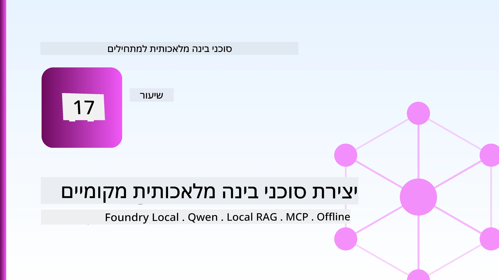
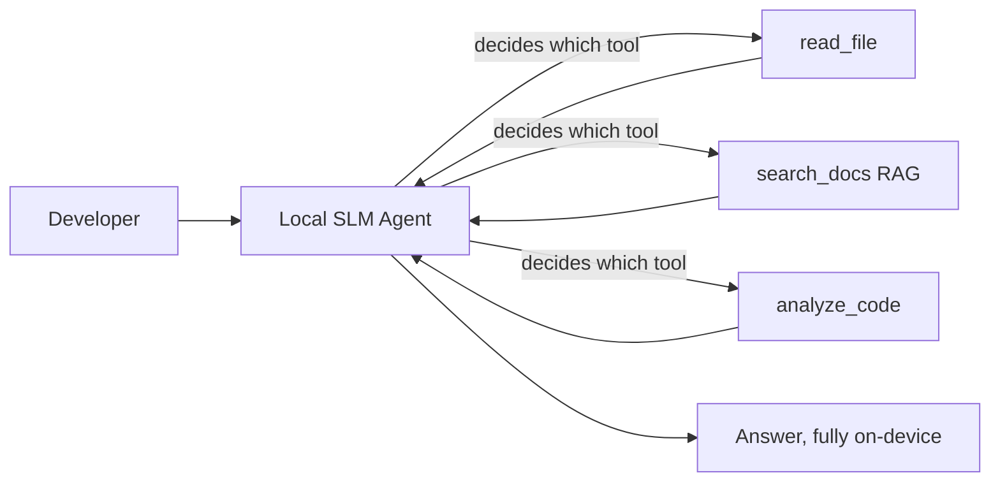
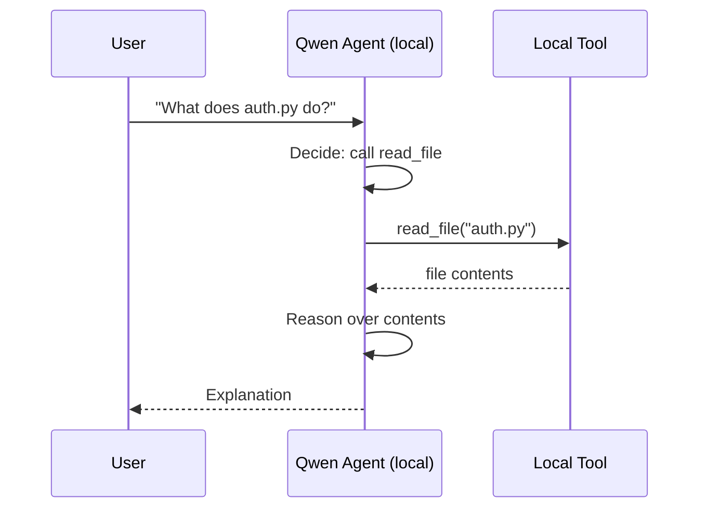
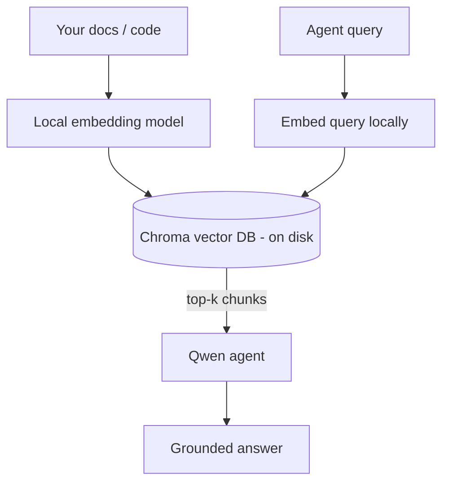
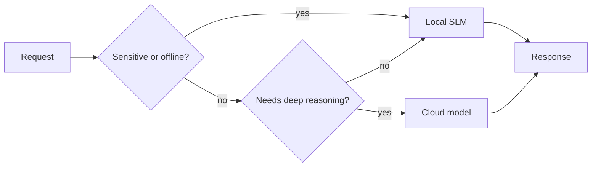

# יצירת סוכני בינה מלאכותית מקומיים באמצעות Microsoft Foundry Local ו-Qwen



השיעור הקודם הרחיב את הסוכנים *לענן*. שיעור זה מביא אותם *למטה* אל מחשב יחיד. בסיום יהיו לך עוזר הנדסי שעובד, שחושב, מפעיל כלים, קורא את הקבצים שלך ומחפש בתיעוד שלך — **בלי קריאת אינפרנס אחת בענן.**

למה תרצה את זה? שלוש סיבות שמופיעות לעיתים קרובות בעבודה הנדסית אמיתית:

- **פרטיות.** הקוד והמסמכים אף פעם לא יוצאים מהמחשב. אין בקשה, אין קטע קוד, אין נתוני לקוח שעוברים את גבול הרשת.
- **עלות.** אינפרנס מקומי אין לו חשבון לפי טוקן. אתה יכול לאיטרט כל היום במחיר של חשמל בלבד.
- **לא מקוון.** במטוס, במתקן מאובטח או בזמן תקלה, הסוכן עדיין עובד.

המלכוד הוא שאתה מחליף דגם ענן מתקדם ב-**מכונת שפה קטנה (SLM)** שרצה על ה-CPU, GPU או NPU שלך. השיעור עוסק בבניית סוכנים שהם *טובים* במסגרת הזו ולא מתיימרים שהמגבלה לא קיימת.

## מבוא

שיעור זה יכסה:

- **מכונות שפה קטנות (SLMs)** — מה הן, היכן הן מצטיינות, והיכן לא.
- **Microsoft Foundry Local** — סביבת ריצה שמורידה ומשרתת מודלים במכשיר דרך **API תואם OpenAI**.
- **מודלי קריאת פונקציות Qwen** — SLMs שמייצרות אמינות קריאות פונקציה, מה שמאפשר סוכנים מקומיים (ולא רק שיחה מקומית).
- **כלים מקומיים, RAG מקומי ו-MCP מקומי** — נותנים לסוכן יכולת בלי הענן.
- **דפוסי היברידיות** — מתי לשמור דברים מקומיים ומתי לפנות לענן.

## יעדי למידה

לאחר סיום שיעור זה תדע כיצד:

- להסביר את הפשרות של SLMs ולבחור מקרים מתאימים לשימוש בסוכן מקומי.
- להפעיל מודל Qwen מקומית עם Foundry Local ולחבר אליו דרך נקודת קצה תואמת OpenAI.
- לבנות סוכן שמפעיל כלים שרץ כולו על תחנת העבודה שלך.
- להוסיף RAG מקומי על המסמכים שלך באמצעות מסד וקטורי מקומי (Chroma).
- לחבר את הסוכן לשרת MCP מקומי ולחשוב על עיצובים היברידיים מקומיים/ענן.

## דרישות מוקדמות

שיעור זה מניח שסיימת את השיעורים הקודמים ונוח לך עם:

- [שימוש בכלים](../04-tool-use/README.md) (שיעור 4) ו-[Agentic RAG](../05-agentic-rag/README.md) (שיעור 5).
- [פרוטוקולי סוכנים / MCP](../11-agentic-protocols/README.md) (שיעור 11).
- [מסגרת סוכנים של Microsoft](../14-microsoft-agent-framework/README.md) (שיעור 14).

תזדקק גם ל:

- תחנת פיתוח. **8 ג"ב זיכרון הם מינימום ריאלי**; 16 ג"ב ומעלה זה נוח. GPU או NPU עוזרים אך לא נדרשים.
- **Microsoft Foundry Local** מותקן (ראה סעיף התקנה להלן).
- Python 3.12+ והחבילות במאגר [`requirements.txt`](../../../requirements.txt), בנוסף ל-`foundry-local-sdk`, `openai` ו-`chromadb` לשיעור זה.

## מכונות שפה קטנות: הכלי הנכון לעבודה מקומית

מודל ענן מתקדם כולל מאות מיליארדי פרמטרים ומרכז נתונים מאחוריו. SLM כולל כמה מיליארדים של פרמטרים וחייב להתאים לזיכרון ה-RAM של הלפטופ שלך. ההבדל הזה קובע את הציפיות.

**SLMs טובים ב:**

- משימות מובנות ומוגבלות — סיווג, חילוץ, סיכום של מסמך ידוע.
- **קריאת כלים** — החלטה איזו פונקציה לקרוא ובאילו ארגומנטים.
- איטרציה מהירה, זולה ופרטית על הנתונים שלך.

**SLMs חלשים ב:**

- חשיבה פתוחה, קפיצות מרובות בהקשר גדול.
- ידע רחב על העולם (ראו פחות ושכחו יותר).

אסטרטגיית הניצחון לסוכנים מקומיים היא לכן: **לתת ל-SLM לתזמן, ולתת לכלים לעשות את העבודה הכבדה.** המודל לא צריך *לדעת* את בסיס הקוד שלך — הוא צריך לדעת מתי לקרוא ל-`read_file` ול-`search_docs`. זה מתאים ישירות לנקודות החוזק של SLM.



## Microsoft Foundry Local

**Microsoft Foundry Local** היא סביבת ריצה קלה שמורידה, מנהלת ומשרתת מודלים לחלוטין על המחשב שלך. התכונה החשובה ביותר עבורנו היא שהיא חושפת **נקודת קצה HTTP תואמת OpenAI** — מה שאומר שה-SDK של OpenAI ולקוח OpenAI במסגרת הסוכנים של Microsoft עובדים נגדו בהחלפת `base_url` בלבד. כל מה שלמדת על בניית סוכנים מועבר ישירות; רק נקודת הקצה עוברת מהענן ל-`localhost`.

Foundry Local גם בוחרת אוטומטית את הבנייה הטובה ביותר למודל על החומרה שלך — בניית CPU, CUDA/GPU או NPU — כך שלא תצטרך לאופטימיזציה ידנית למחשב.

### התקנה

התקן את Foundry Local (ראה את ה-[תיעוד](https://learn.microsoft.com/azure/ai-foundry/foundry-local/) למערכת ההפעלה שלך), ואז וודא שזה עובד:

```bash
# Install (example; follow the docs for your platform)
winget install Microsoft.FoundryLocal      # Windows
# brew install microsoft/foundrylocal/foundrylocal   # macOS

# Download and run a Qwen model, then start the local service
foundry model run qwen2.5-7b-instruct
foundry service status
```

ברגע שהשירות רץ יש לך נקודת קצה מקומית תואמת OpenAI (בדרך כלל `http://localhost:PORT/v1`). הפנקס משתמש ב-`foundry-local-sdk` כדי לגלות את נקודת הקצה אוטומטית, כך שלא תצטרך לקבוע את הפורט בדפוס קשיח.

## קריאת פונקציות Qwen: למה זה חשוב

סוכן הוא רק סוכן אם הוא יכול לקרוא כלים. הרבה SLMs יכולים לשוחח אך מפיקים קריאות כלים שגויות ולא אמינות. מודלי **Qwen** מאומנים לקריאת פונקציות ומפיקים במדויק מבני קריאת כלים — וזה בדיוק מה שהופך מודל שיחה מקומי ל-*סוכן* מקומי.

הזרימה היא הלולאה הסטנדרטית של קריאת כלים שכבר מכירים, רק שזו רצה במכשיר:



## RAG מקומי

חיפוש בתיעוד הוא המקום שהסוכנים המקומיים מפיקים ממנו ערך. במקום לקוות ש-SLM זכר את התיעוד של המסגרת שלך, אתה מטמיע את התיעוד הזה ב**מסד וקטורי מקומי** ומאפשר לסוכן לאחזר את הקטעים הרלוונטיים לפי דרישה.

אנחנו משתמשים ב-**Chroma**, מחסן וקטורי מוטמע שרץ בתהליך ללא שרת לניהול. הצינור כולו מקומי: מודל הטמעה מקומי → וקטורים מקומיים → אחזור מקומי → SLM מקומי.



זה אותו דפוס Agentic RAG משיעור 5 — השינוי היחיד הוא שכל רכיב רץ על המחשב שלך.

## שרתי MCP מקומיים

[MCP](../11-agentic-protocols/README.md) הוא פרוטוקול, לא שירות ענן. שרת MCP יכול לרוץ כתהליך מקומי ב-`stdio`, לחשוף כלים לסוכן שלך על גבי הפרוטוקול הסטנדרטי. זה מאפשר שימוש חוזר באקוסיסטם ההולך וגדל של שרתי MCP — גישה לקבצים, פעולות גיט, שאילתות למסדי נתונים — כולן ללא חיבור לרשת.

פרופיל האבטחה שונה מהענן, אך לא נעדר: שרת MCP מקומי עדיין רץ בהרשאות המשתמש שלך, לכן הגבל את טווח הנגיעה (ספריית פרויקט, לא כל תיקיית הבית שלך) וטפל ביציאות שלו כקלטים לאימות.

## דפוסי היברידיות בין ענן ומקומי

"מקומי תחילה" לא אומר "רק מקומי". מערכות בוגרות מנותבות לפי רגישות וקושי:

| מצב | איפה זה רץ |
| --- | --- |
| קוד/נתונים רגישים, או לא מקוון | **SLM מקומי** |
| משימה פשוטה ומוגבלת | **SLM מקומי** (זול ומהיר) |
| חשיבה קשה מרובת קפיצות על נתונים לא רגישים | **מודל ענן** |
| הכל, בזמן תקלה | **SLM מקומי** (התדרדרות ממושמעת) |

זה משקף את רעיון ה**ניתוב למודל** משיעור 16 — רק שאחד ה"מודלים" הוא עכשיו המחשב שלך. עיצוב יציב חוזר למקומי כשהענן לא זמין, כך שהסוכן מתדרדר באיכות במקום לכשל לחלוטין.



## מעבדת עשה זאת בעצמך: עוזר הנדסי מקומי

פתח את [`code_samples/17-local-agent-foundry-local.ipynb`](./code_samples/17-local-agent-foundry-local.ipynb) ויעבור דרכו. תבנה **עוזר הנדסי מקומי** שרץ כולו על תחנת העבודה שלך ויכול:

1. **לקרוא כלים** — באמצעות קריאת פונקציות Qwen דרך Foundry Local.
2. **לבצע פעולות קבצים מקומיות** — לרשום ולקרוא קבצים בתיקיית פרויקט.
3. **לנתח קוד** — לדווח מדדים בסיסיים על קובץ מקור.
4. **לחפש בתיעוד** — RAG מקומי על תיקיית מסמכים עם Chroma.
5. **להשתמש ב-MCP** — להתחבר לשרת MCP מקומי (עם דילוג מוסר כאשר לא מוגדר שרת).

לא נעשה שימוש באינפרנס בענן בכל שלב.

### הסבר מעשי

העוזר מתחבר ל-Foundry Local דרך נקודת הקצה התואמת OpenAI, אז קוד הסוכן נראה כמעט זהה לשיעורי הענן — רק הלקוח משתנה:

```python
from foundry_local import FoundryLocalManager
from openai import OpenAI

# Foundry Local discovers/downloads the model and gives us a local endpoint.
manager = FoundryLocalManager(\"qwen2.5-7b-instruct\")
client = OpenAI(base_url=manager.endpoint, api_key=manager.api_key)  # api_key is a local placeholder
```

הכלים הם פונקציות Python רגילות המוגבלות לתיקיית פרויקט:

```python
def read_file(path: str) -> str:
    \"\"\"Read a file, but only inside the sandboxed project directory.\"\"\"
    full = (PROJECT_ROOT / path).resolve()
    if PROJECT_ROOT not in full.parents and full != PROJECT_ROOT:
        return \"Access denied: path is outside the project directory.\"
    return full.read_text(encoding=\"utf-8\")
```

שים לב לבדיקת הסנדבוקס — אפילו מקומית, כלי שקורא נתיבי מערכת אקראיים הוא סיכון. הפנקס שומר כל כלי מוגבל לשורש פרויקט אחד.

## בדיקת ידע

בדוק את הבנתך לפני המעבר למשימה.

**1. תן שתי סיבות ממשיות להריץ סוכן מקומית במקום בענן.**

<details>
<summary>תשובה</summary>

שתי כל אחת מהסיבות: **פרטיות** (הקוד והנתונים לא יוצאים מהמחשב), **עלות** (אין חשבון לפי טוקן), ו**יכולת לא מקוונת** (עובד בלי רשת — במטוס, במתקן מאובטח, או בתקלה). מגבלות רגולטוריות שאוסרות שליחת נתונים מחוץ למכשיר הן גורם שכיח לסיבת הפרטיות.
</details>

**2. מה החלוקה המומלצת של העבודה בין SLM וכליו בסוכן מקומי, ולמה?**

<details>
<summary>תשובה</summary>

תן ל-SLM **לתזמן** (להחליט איזה כלי לקרוא ובאילו ארגומנטים) ולתת לכלי **לעשות את העבודה הכבדה** (קריאת קבצים, אחזור מסמכים, חישוב תוצאות). SLM חזקים בהחלטות מוגבלות כמו בחירת כלים אך חלשים בידע רחב ובחשיבה מרובת קפיצות, אז להישען על כלים מתאים לחוזקותיהם.
</details>

**3. מה מאפשר שימוש חוזר בקוד סוכני ענן עם Foundry Local?**

<details>
<summary>תשובה</summary>

Foundry Local חושף **נקודת קצה HTTP תואמת OpenAI**. ה-SDK של OpenAI ולקוח OpenAI במסגרת הסוכן עובדים נגדו על ידי שינוי רק של `base_url` (ושימוש במפתח API מקומי דמה). כל השאר בקוד הסוכן נשאר זהה.
</details>

**4. למה דווקא מודל קריאת פונקציות Qwen ולא כל SLM?**

<details>
<summary>תשובה</summary>

כי סוכן חייב להפיק קריאות כלים אמינות ומבניות. הרבה SLMs יכולים לשוחח אך מייצרים מבני קריאות כלים שגויים או לא עקביים. מודלי Qwen מאומנים לקריאות פונקציה ומפיקים קריאות כלים עקביות, וזה מה שהופך מודל שיחה מקומי לסוכן מקומי שעובד.
</details>

**5. באותה צינור RAG מקומי, אילו רכיבים רצים על המחשב?**

<details>
<summary>תשובה</summary>

כולם: מודל ההטמעה, מסד הנתונים הוקטורי (Chroma, בדיסק), שלב האחזור, ו-SLM. המסמכים מוטמעים, נשמרים, מאוחזרים ומנותחים מקומית — אף רכיב לא נוגע בענן.
</details>

**6. שרת MCP מקומי רץ על המחשב שלך. האם זה הופך אותו אוטומטית לבטוח? איזה אמצעי זהירות יש לנקוט?**

<details>
<summary>תשובה</summary>

לא. שרת MCP מקומי רץ בהרשאות המשתמש שלך, אז הוא יכול לגשת לכל מה שאתה יכול. הזמן אותו למה שהוא צריך (למשל, תיקיית פרויקט בודדת ולא כל תיקיית הבית) וטפל ביציאות שלו כקלטים שיש לאמת לפני לפעול עליהם.
</details>

**7. תאר כלל ניתוב היברידי מתחשב שכולל מודל מקומי.**

<details>
<summary>תשובה</summary>

ניתוב בקשות רגישות או לא מקוונות ל-SLM המקומי; ניתוב משימות פשוטות ומוגבלות ל-SLM המקומי בגלל מהירות ועלות; ניתוב חשיבה קשה של קפיצות מרובות על נתונים לא רגישים למודל ענן; וחזרה ל-SLM המקומי אם הענן לא זמין כך שהסוכן מתדרדר בנעימות במקום להיכשל. זה ניתוב מודלים (שיעור 16) כשהמחשב המקומי הוא אחד המודלים.
</details>

**8. מהו מינימום ריאלי של זיכרון RAM להפעלת הסוכן המקומי בשיעור זה, ומה היתרון של יותר RAM?**

<details>
<summary>תשובה</summary>

סביב **8 ג"ב** הוא מינימום ריאלי; 16 ג"ב ומעלה זה נוח. יותר RAM מאפשר לך להפעיל מודלים גדולים ומתקדמים יותר ולשמור יותר הקשר בזיכרון. GPU או NPU מזרזים אינפרנס אך אינם דרושים — Foundry Local בוחרת בניית CPU כשאין מאיץ זמין.
</details>

## משימה

הרחב את העוזר ההנדסי המקומי ל**בוחן תיעוד מקומי** לפרויקט קטן לפי בחירתך (השתמש באחת מתיקיות השיעורים במאגר אם תרצה).

ההגשה שלך צריכה:

1. **לאנדקס תיקיית מסמכים/קוד אמיתית** אל Chroma (לפחות חמישה קבצים).
2. **להוסיף כלי `find_todos`** שסורק את הפרויקט אחר הערות `TODO`/`FIXME` ומחזיר אותן עם שם הקובץ ומספר השורה — תוך שמירה על אותה בדיקת סנדבוקס כמו `read_file`.
3. **שאל את הסוכן שלוש שאלות** שמאלצות אותו לשלב כלים: שאלה אחת טהורה של RAG, אחת שדורשת קריאת קובץ מסוים, ואחת שדורשת מציאת TODOs.
4. **מדוד את זה**: מדוד את זמן התגובה של כל אחת משלוש התגובות ושלח אותן בתא markdown. הגיב אם זמן התגובה מקובל עבור זרימת העבודה המיועדת שלך.

לאחר מכן כתוב פסקה קצרה על **מה היית מעביר לענן ומה היית שומר מקומי** עבור הסוקר הזה, ומדוע. אתה מוערך על האם הרכיבים המקומיים מחוברים נכון והאם ההיגיון ההיברידי שלך תקין — לא על איכות המודל.

## סיכום

בשיעור זה בנית סוכן הפועל כולו על המחשב שלך:

- **SLMs** מחליפים רוחב פרטים בפרטיות, עלות ותפעול לא מקוון — ומצטיינים כאשר הם **מתחברים לכלים** במקום לשאת את כל הידע בעצמם.
- **Foundry Local** מספק מודלים במכשיר מאחורי **נקודת קצה התואמת OpenAI**, כך שקוד הסוכן בענן שלך מועבר עם שינוי שורה אחד.
- **מודלי קריאה לפונקציות של Qwen** מאפשרים קריאה אמינה לכלים מקומיים — ומכאן סוכנים *מקומיים*.
- **RAG מקומי** (Chroma) ו-**MCP מקומי** מעניקים לסוכן יכולות מבלי לעזוב את המחשב.
- **תבניות היברידיות** מאפשרות הפניה לפי רגישות וקושי, עם מקומי כפלט פורח אלגנטי.

זה משלים את קשת ההטמעה: השיעור ה-16 הגדיל סוכנים לתוך Microsoft Foundry, והשיעור הזה הקטין אותם אל תחנת עבודה יחידה. השיעור הבא מתמקד בשמירת סוכנים מופעלים בטוחים.

## משאבים נוספים

- <a href="https://learn.microsoft.com/azure/ai-foundry/foundry-local/" target="_blank">תיעוד Microsoft Foundry Local</a>
- <a href="https://learn.microsoft.com/azure/ai-foundry/what-is-azure-ai-foundry" target="_blank">תיעוד Microsoft Foundry</a>
- <a href="https://learn.microsoft.com/en-us/agent-framework/overview/?wt.mc_id=youtube_26688_organicsocial_reactor&pivots=programming-language-python" target="_blank">מסגרת סוכני מיקרוסופט</a>
- <a href="https://qwen.readthedocs.io/en/latest/framework/function_call.html" target="_blank">תיעוד Qwen לקריאת פונקציות</a>
- <a href="https://modelcontextprotocol.io/" target="_blank">פרוטוקול הקשר מודל (MCP)</a>
- <a href="https://docs.trychroma.com/" target="_blank">מסד נתונים וקטורי Chroma</a>

## שיעור קודם

[הטמעת סוכנים מתקדמים](../16-deploying-scalable-agents/README.md)

## שיעור הבא

[אבטחת סוכני בינה מלאכותית](../18-securing-ai-agents/README.md)

---

<!-- CO-OP TRANSLATOR DISCLAIMER START -->
**כתב ויתור**:
מסמך זה תורגם באמצעות שירות תרגום אוטומטי [Co-op Translator](https://github.com/Azure/co-op-translator). למרות שאנו שואפים לדיוק, יש לקחת בחשבון שתרגומים אוטומטיים עלולים להכיל שגיאות או אי-דיוקים. יש להחשיב את המסמך המקורי בשפתו הטבעית כמקור הסמכות. למידע קריטי מומלץ להשתמש בתרגום מקצועי על ידי מתרגם אדם. אנו לא אחראים לכל אי-הבנה או פירוש שגוי הנובע מהשימוש בתרגום זה.
<!-- CO-OP TRANSLATOR DISCLAIMER END -->