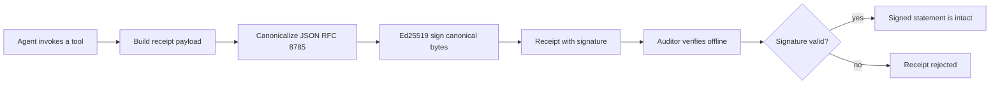
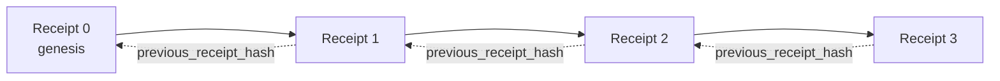

[צפה בסרטון השיעור: אבטחת סוכני AI עם קבלות קריפטוגרפיות](https://youtu.be/PLACEHOLDER_VIDEO_ID)

> _(סרטון השיעור ותמונת מיני יתווספו על ידי צוות התוכן של מיקרוסופט לאחר האיחוד, בהתאמה לדפוס השיעור 14 / 15.)_

# אבטחת סוכני AI עם קבלות קריפטוגרפיות

## מבוא

השיעור הזה יכסה:

- מדוע מסלולי ביקורת לסוכני AI חשובים לציות, איתור באגים ואמון.
- מהי קבלה קריפטוגרפית וכיצד היא שונה משורת יומן לא חתומה.
- איך לייצר קבלה חתומה עבור קריאת כלי של סוכן בפייתון פשוט.
- איך לאמת קבלה באופן לא מקוון ולגלות זיופים.
- איך לקשר קבלות כך שהסרת או שינוי סדר אחד יפריע לשרשרת.
- מה הקבלות מוכיחות ומה הן במפורש לא מוכיחות.

## מטרות הלמידה

לאחר סיום השיעור, תדעו כיצד:

- לזהות מצבי כשל שמניעים מקור קריפטוגרפי לפעולות הסוכן.
- לייצר קבלת Ed25519 חתומה על מטען JSON קנוני.
- לאמת קבלה באופן עצמאי באמצעות מפתח ציבורי של החותם בלבד.
- לגלות זיופים על ידי הרצת אימות חוזר על קבלה ששונתה.
- לבנות רצף מקושר בשרשרת של קבלות ולהסביר מדוע השרשרת חשובה.
- להבחין בגבול בין מה שהקבלות מוכיחות (ייחוס, שלמות, סדר) לבין מה שהן לא (נכונות הפעולה, תקפות המדיניות).

## הבעיה: מסלול הביקורת של הסוכן שלך

דמיין שהפעלת סוכן AI עבור Contoso Travel. הסוכן קורא בקשות לקוח, קורא ל-API טיסות כדי למצוא אפשרויות, ומזמין כיסאות בשם הלקוח. ברבעון האחרון, הסוכן עיבד 50,000 הזמנות.

היום מגיע מבקר. הוא שואל שאלה פשוטה: "הראה לי מה הסוכן שלך עשה."

אתה מוסר את קבצי הלוגים שלך. המבקר מסתכל בהם ושואל שאלה קשה יותר: "איך אני יודע שהלוגים האלה לא נערכו?"

זוהי בעיית מסלול הביקורת. רוב פריסות הסוכנים היום מסתמכות על:

- **יומני יישומים**: נכתבים על ידי הסוכן עצמו, ניתנים לעריכה על ידי כל מי שיש לו גישה למערכת הקבצים.
- **שירותי רישום בענן**: עמידים בפני זיופים ברמת הפלטפורמה אך רק אם המבקר סומך על מפעיל הפלטפורמה.
- **יומני עסקאות בסיס נתונים**: מותאמים לשינויים בבסיס נתונים אך לא לקריאות כלי שרירותיות.

אף אחד מאלה אינו יכול לענות על שאלה של המבקר מבלי שהמבקר יצטרך לסמוך על מישהו (עליך, על ספק הענן שלך, על ונדור בסיס הנתונים שלך). לשימוש פנימי, האמון הזה לעיתים קרובות מקובל. לעומסי עבודה מפוקחים (פיננסים, בריאות, כל דבר תחת חוק ה-AI של האיחוד האירופי) זה לא.

קבלות קריפטוגרפיות מצמצמות את הבעיה הזו בכך שהן יוצרות הצהרה חתומה שניתנת לאימות באופן עצמאי.
המבקר עדיין צריך סיבה מחוץ לערוץ לסמוך על מפתח החתימה ועל
הרכיב שהפיק את ההצהרה. מפתח מוטמע מוכיח עקביות פנימית,
לא זהות המנפיק או מיקום האכיפה.

## מהי קבלה קריפטוגרפית?

קבלה היא אובייקט JSON שמתעד מה סוכן עשה, חתום עם חתימה דיגיטלית.



קבלה מינימלית נראית כך:

```json
{
  "type": "agent.tool_call.v1",
  "agent_id": "contoso-travel-bot",
  "tool_name": "lookup_flights",
  "tool_args_hash": "sha256:a3f9c1...",
  "result_hash": "sha256:7b2e1d...",
  "policy_id": "contoso-travel-policy-v3",
  "timestamp": "2026-04-25T14:30:00Z",
  "sequence": 47,
  "previous_receipt_hash": "sha256:9d4e6a...",
  "signature": {
    "alg": "EdDSA",
    "sig": "c5af83...",
    "public_key": "8f3b2c..."
  }
}
```

שלוש תכונות מבצעות את העבודה:

1. **החתימה**. הקבלה נחתמת על ידי שער הסוכן באמצעות מפתח פרטי Ed25519. כל מי שיש לו את המפתח הציבורי המתאים יכול לאמת את החתימה באופן לא מקוון. הצד המבוסס חייב לקבע את המפתח הזה או לקבל אותו מרשום מהימן מחוץ לקבלה. זיוף כל שדה חתום מבטל את החתימה.

2. **הצפנה קנונית**. לפני החתימה, הקבלה מסודרת באמצעות סכמת קנוניזציה של JSON (JCS, RFC 8785). זה מבטיח ששתי מימושים שמייצרים את אותה הקבלה הלוגית יציגו תוצאה זהה בבייטים. ללא קנוניזציה, מסדרי JSON שונים היו מייצרים חתימות שונות לאותו תוכן.

3. **קישור בשרשרת האשכולות**. השדה `previous_receipt_hash` מקשר כל קבלה לזו שלפניה. הסרה או שינוי סדר של קבלה שוברים את הרצף המוצג. גילוי קיצור או שינוי בשליטת החותם גם דורש קיבוע של ראש השרשרת הנוכחי, נקודת ביקורת מעידה עצמאית, או מחויבות מאומתת באוכלוסייה סגורה.

יחד שלוש התכונות הללו מספקות שלוש ערובות:

- **ייחוס למפתח**: מפתח זה חתם על תוכן זה. זהות ארגונית או אנושית דורשת קישור מפתח מהימן.
- **שלמות**: התוכן לא השתנה מאז החתימה.
- **סדר בתוך הרצף המאומת**: קבלה זו מקשרת לזו שקודמת לה.

## ייצור קבלה בפייתון

אינך זקוק לספרייה מיוחדת ליצירת קבלה. הפרימיטיבים הקריפטוגרפיים זמינים ברבים והלוגיקה היא כמה עשרות שורות פייתון.

התרגילים המעשי `code_samples/18-signed-receipts.ipynb` מראים את כל התהליך. הקוד במעקב המקור `code_samples/18-signed-receipts.execution-receipt.json` מתעד את קודן המדויק של הפתק, סביבת הפייתון, מספר התאים, ובדיקות מהריצה הנקייה האחרונה מבלי לשנות את פלט השיעור השמור. הגרסה המסכמת:

```python
import json
import hashlib
import base64
from nacl import signing
from jcs import canonicalize  # RFC 8785 canonical JSON

def b64url_nopad(data: bytes) -> str:
    return base64.urlsafe_b64encode(data).decode("ascii").rstrip("=")

def sha256_canonical(obj) -> str:
    """SHA-256 of a Python object's JCS-canonical JSON form."""
    return f"sha256:{hashlib.sha256(canonicalize(obj)).hexdigest()}"

# Generate or load a signing key (in production, store in a key vault)
signing_key = signing.SigningKey.generate()
verify_key = signing_key.verify_key
TRUSTED_PUBLIC_KEYS = {b64url_nopad(bytes(verify_key))}  # pinned out of band by the verifier

# Build the receipt payload (no signature yet)
tool_args = {"origin": "SYD", "destination": "LAX"}
tool_result = [{"flight": "QF11", "price": 1850, "stops": 0}]

payload = {
    "type": "agent.tool_call.v1",
    "agent_id": "contoso-travel-bot",
    "tool_name": "lookup_flights",
    "tool_args_hash": sha256_canonical(tool_args),
    "result_hash": sha256_canonical(tool_result),
    "policy_id": "contoso-travel-policy-v3",
    "timestamp": "2026-04-25T14:30:00Z",
    "sequence": 0,
    "previous_receipt_hash": None,
}

# Canonicalize and sign the JCS bytes directly. PureEdDSA hashes internally.
canonical_bytes = canonicalize(payload)
signature_bytes = signing_key.sign(canonical_bytes).signature

# Attach a structured signature object.
receipt = {
    **payload,
    "signature": {
        "alg": "EdDSA",
        "sig": b64url_nopad(signature_bytes),
        "public_key": b64url_nopad(bytes(verify_key)),
    },
}
```

זו כל צינור החתימה. התרגילים במחברת מסבירים כל שלב.

## אימות קבלה וגילוי זיוף

האימות הוא הפעולה ההפוכה:

```python
import base64
import hashlib
from nacl import signing
from nacl.exceptions import CryptoError
from jcs import canonicalize

def b64url_decode(s: str) -> bytes:
    padding = "=" * ((4 - len(s) % 4) % 4)
    return base64.b64decode(s + padding, altchars=b"-_", validate=True)

def verify_receipt(receipt: dict, trusted_public_keys: set[str]) -> bool:
    # The signature is a structured object: {"alg", "sig", "public_key"}.
    if not isinstance(receipt, dict):
        return False
    sig_obj = receipt.get("signature")
    if not isinstance(sig_obj, dict) or sig_obj.get("alg") != "EdDSA":
        return False
    try:
        # An inline key proves only self-consistency. Trust is configured out of band.
        public_key = sig_obj.get("public_key")
        signature = sig_obj.get("sig")
        if not isinstance(public_key, str) or not isinstance(signature, str):
            return False
        if public_key not in trusted_public_keys:
            return False
        payload = {k: v for k, v in receipt.items() if k != "signature"}
        canonical_bytes = canonicalize(payload)
        verify_key = signing.VerifyKey(b64url_decode(public_key))
        verify_key.verify(canonical_bytes, b64url_decode(signature))
        return True
    except (CryptoError, TypeError, ValueError, KeyError, OverflowError):
        return False
```

הפונקציה הזו מקבלת קבלה יחד עם מערך המפתחות המקובעים של הצד המבוסס ומחזירה
`True` רק אם החתימה תקפה תחת מפתח מתקבל. אימות אינו דורש
קריאת רשת, אבל אמון במפתח עדיין הוא החלטת תצורה חיצונית.

כדי לראות גילוי זיוף בפעולה, המחברת מראה:

1. יצירת קבלה תקפה ואישור שהיא מאומתת.
2. שינוי ביט אחד בשדה `tool_args_hash`.
3. הרצת אימות מחדש וראיית כישלון.

זה ההוכחה המעשית שקבלות עמידות לזיופים: כל שינוי, קטן ככל שיהיה, שוברת את החתימה.

## שרשרת קבלות עבור סוכנים מרובי שלבים

קבלה חתומה יחידה מגנה על פעולה אחת. שרשרת קבלות מגנה על רצף פעולות.



כל קבלה מתעדת את ההאש של הקבלה שלפניה. כדי להסיר את קבלה 2 בשקט, התוקף יצטרך או:

- לשנות את שדה `previous_receipt_hash` של קבלה 3 (שוברת את חתימת קבלה 3), או
- לזייף חתימה חדשה על קבלה 3 ששונתה (דורש את המפתח הפרטי של הסוכן).

אם המפתח הפרטי מוגן והמאמת מקבע ראש שרשרת המעיד בצורה חיצונית,
התקפות אלה ניתנות לזיהוי. פרסום המפתח בתוך כל קבלה אינו
מספיק: החותם או התוקף יכולים להציג מפתח שונה, לשכתב סיומת, או
לקצר את השרשרת אלא אם לצד המבוסס יש עוגן אמון ושלמות חיצוני.

המחברת מסבירה:

1. בניית שרשרת של שלוש קבלות.
2. אימות שכל `previous_receipt_hash` של הקבלה תואם להאש האמיתי של הקבלה הקודמת.
3. זיוף בקבלה אחת באמצע וראיית קריסת השרשרת בדיוק בנקודה זו.

כך מייצרים מסלול ביקורת שמבקר חיצוני יכול לאמת תחת מפתחות הנפיקים המקובעים שלו ותחנות נקודת השרשרת, ללא צורך לסמוך על אכסון הלוג המשתנה שברשותך.


## מה הקבלות מוכיחות (ומה הן לא)

זה החלק החשוב ביותר בשיעור זה. הקבלות חזקות אך הכוח שלהן מוגבל.

**קבלות מוכיחות שלושה דברים:**

1. **ייחוס**: מפתח ספציפי חתם על מטען ספציפי.
2. **שלמות**: המטען לא השתנה מאז החתימה.
3. **סדר בתוך רצף מאומת ומוצג**: קבלה זו מקושרת לזו שקודמה לה.

**קבלות אינן מוכיחות:**

1. **נכונות**: שהפעולה של הסוכן הייתה הפעולה הנכונה. קבלה יכולה להיחתם גם על תשובה שגויה באותה מידה כמו על תשובה נכונה.
2. **ציות למדיניות**: שהמדיניות שצוינה ב-`policy_id` אכן הוערכה, או שהייתה מאפשרת את הפעולה אם נבדקה. הקבלה מתעדת מה שטוענים, לא מה שאכפו.
3. **זהות מעבר למפתח**: הקבלה אומרת "מפתח זה חתם על תוכן זה". היא לא אומרת "אדם זה אישר את זה". חיבור מפתח לאדם או לארגון דורש תשתית זהות נפרדת (ספרייה, רשם מפתחות ציבוריים וכו').
4. **אמת קלטים**: אם הסוכן מקבל הנחיה מנופחת ופועל על פיה, הקבלה מתעדת את הפעולה בנאמנות. הקבלות אינן תחליף לאימות קלט, אלא נמצאות אחרי שלב זה.
5. **ביצוע או אפקט בעולם האמיתי**: קבלת לאחר הקריאה מתעדת מה שמנפיק הקבלה טוען שקרה. הוכחה של כניסה או התאמה לאפקט חיצוני דורשת עדויות מהמבצע האמיתי או מגבול הספק.
6. **שלמות**: קבלה חסרה יכולה להצביע על חסימה, השמטה, אובדן או חוסר כלי מדידה. היעדרות הופכת לראיה רק בתוך אוכלוסייה מאומתת וסגורה.
7. **זמן מהימן**: חותמת זמן חתומה מוכיחה שהחותם נשא את הערך, לא שהערך היה נכון. זמן מהימן דורש סמכות זמן נפרדת או נקודת ביקורת מעידה.

גבול זה חשוב משתי סיבות:

- הוא מבהיר לך מה הקבלות מועילות לו: להפוך התנהגות סוכן לאומית ולחשופה לזיופים, אפילו מעבר לגבולות ארגוניים.
- הוא מבהיר לך אילו שכבות נוספות עדיין דרושות: אימות קלט (שיעור 6), אכיפת מדיניות (מוקף בקצרה להלן), ותשתית זהות (מחוץ להיקף שיעור זה).

טעות נפוצה היא להניח ש"יש לנו קבלות" פירושו "אנחנו מונחים". זה לא נכון. הקבלות הן בסיס. המשטר הוא המערכת שבונים מעל.

## קישור חתימת מאשר לפעולה המדויקת

סעיף 3 למעלה שווה לו חלק משלו: קבלת פעולה אומרת "מפתח זה חתם על תוכן זה," לעולם לא "אדם אישר זאת." לפעולות בסיכון גבוה (החזרים, מחיקות, העברות כספים), חתימת מאשר נפרדת יכולה לקשור את הפעולה המדויקת. חיבור מפתח זה לאדם ובדיקת נוכחות אנושית נותרות באחריות נפרדת.

הפט של המשך במחברת `code_samples/human-authorization-receipts.ipynb` מוסיף סוג נוסף של קבלה, `human.approval.v1`, באותו מבנה מעטפה כמו הקבלות של השיעור (מטען מוקלד שחתום ב-Ed25519 על בתיו הקנוניים של JCS, עם האובייקט `signature` מחוץ לבתים החתומים). מפתח מאשר חותם על **פעולה קנונית מלאה ועיכול שלה**; מפתח סוכן חותם על טענה שנושאת את **אותו עיכול פעולה** ו-`parent_approval_ref`, ה-`receipt_hash` של האישור, אותה הקונבנציה כמו `previous_receipt_hash` בשרשרת שבנית למעלה. אחת `verify_chain` עוקבת אחרי שני היצירות תחת **רישומי מפתחות נפרדים** (מפתחות מאשר נגד מפתחות סוכן), כך שהדרך בקוד משותפת אך הרשויות לעולם לא.

התכונה שזה מספק, מנוסחת בזהירות: *מפתח המאשר המקובע חתם על
הפעולה המדויקת הזו, ומפתח הסוכן חתם לאחר מכן על טענה שנושאת את אותו עיכול פעולה.*
זהו ראיה שימושית, אך לא הוכחה בעצמו שהפעולה בוצעה. כדי
לשלוט בביצוע, האישור המדויק חייב גם להישמר ולהיות מנוצל פעם אחת בשוליים
של המבצע בפועל; תוצאות ספק לא ידועות חייבות להישאר לא ידועות ולא
להיעשות ניסיון חוזר בעיוורון. המבחנים של המחברת לסירוב בודקים את שכבת שרשרת הקבלות:

- זיוף, סוכן מבולבל, מפתחות מזויפות מכל צד, וקלט פגום;
- **רשות שפגה**: חתימה שעדיין מאמתת, נדחתה בכל זאת כי גרסת המדיניות השתנתה, מפתח המאשר הוסר מהרשימה המקובעת, או האישור פג תוקף לפני זמן האימות שסופק;
- **החלפת עיכול**: קבלת פעולה חתומה תקפה המצביעה על אישור *אמיתי* שמקשר לפעולה קנונית *שונה*.

כל כישלון דוחה עם סיבה מובחנת, כך שמבקר שקורא סירוב יכול לדעת אם הרשות פגה או שהפעולה שטוענים השתנתה. האימות הוא קריאה בלבד וניתן לחזור עליו: הוא אינו צורך את האישור ואינו מפעיל ספק. מבצע נפרד צריך הגנת שיחזור אטומית ועמידה וכן תוצאות מפורשות של הצלחה, כשלון ותוצאה לא חד משמעית. קבלת האישור האנושי היא יצירת חינוך שהוגדרה בשיעור זה, לא סוג קבלה שהוגדר ב-`draft-farley-acta-signed-receipts`.

## הפניות לייצור

הקוד בפייתון בשיעור הזה מכוון להיות מינימלי כדי שתוכל לקרוא כל שורה ולהבין בדיוק מה קורה. בייצור, יש לך שתי אפשרויות:

1. **לבנות ישירות על הפרימיטיבים הקריפטוגרפיים.** 50 השורות שראית למעלה מספיקות להרבה מקרים של שימוש. PyNaCl (Ed25519) ו-`jcs` חבילה (JSON קנוני) הן ספריות מתוחזקות ומבוקרות היטב.

2. **להשתמש בספריית קבלה יצרנית.** מספר פרויקטים בקוד פתוח מיישמים את אותו תבנית עם תכונות נוספות (סיבוב מפתחות, אימות אצווה, הפצת מערך JWK, אינטגרציה עם מנועי מדיניות):
   - צינור החתימה משתמש בקונבנציות JCS ותחום-החתימה במסמך טיוטת IETF עצמאי ([`draft-farley-acta-signed-receipts`](https://datatracker.ietf.org/doc/draft-farley-acta-signed-receipts/), תיקון 02). הקבלה החינוכית השטוחה בשיעור זה שונה ממעטפת `{payload, signature}` שבטיוטה ואינה מוצגת כמימוש תואם. הטיוטה מפרסמת ערכת תאימות משותפת ([agent-governance-testvectors](https://github.com/ScopeBlind/agent-governance-testvectors)) למימושים שמטרתם פורמט החוט שלה.
   - ערכת כלי ממשל סוכני מיקרוסופט מרכיבה קבלות עם החלטות מדיניות מבוססות Cedar; ראו את הדרכה 33 באותו מאגר לדוגמה מקצה לקצה.
   - החבילות `protect-mcp` (npm) ו-`@veritasacta/verify` (npm) מספקות מימוש מבוסס Node של חתימת קבלה ואימות במצב לא מקוון, מיועדות לעטוף כל שרת MCP עם שרשרת ביקורת העמידה בפני זיופים, כולל זרם החזקת-לחתימה שהוא פעולה מושהית שמפיקה קבלת אישור הקשורה לעיכול הפעולה (נתמך ב-WebAuthn בזרם שולחן העבודה), אותה תבנית קבלת אישור כמו במחברת ההרשאה האנושית למעלה.
   - ערכת הפיתוח **[nobulex](https://github.com/arian-gogani/nobulex)** של פייתון (`pip install nobulex`) מספקת את אותו דפוס חתימה Ed25519 + JCS בפייתון עם אינטגרציות LangChain ו-CrewAI, כולל וקטורי בדיקת אימות-חוצה מפורסמים ומיפוי עמידה שתורם באמצעות [OWASP PR #2210](https://github.com/OWASP/CheatSheetSeries/pull/2210).
   - **[פרוטוקול EMILIA](https://github.com/emiliaprotocol/emilia-protocol)** מספק שכבת אכיפה משלימה לפעולה מדויקת: קבלות אישור שניתן לאמת אותן לא מקוון, WebAuthn יציב או סמכות קוואורום, צריכה חד-פעם בגבול המבצע, ונתיב מפורש לתוצאה בלתי חד-משמעית. המתאמים במסגרת שלה מתייחסים לקבלה כראיה נחוצה ולא כהוכחה שהתרחש אפקט חיצוני.

ההחלטה בין לפתח לבד לבין להשתמש בספרייה משקפת את ההחלטה בין לכתוב את ספריית JWT משלך לבין להשתמש בספרייה שנבדקה: שניהם סבירים; הספרייה חוסכת זמן ומפחיתה את שטח הביקורת; הגישה מהיסוד מכריחה אותך להבין כל פרימיטיב. השיעור הזה מלמד את הדרך מהיסוד כך שיש לך את הבסיס לכל בחירה.

## בדיקת ידע

בדוק את הבנתך לפני המעבר לתרגול המעשי.

**1. קבלה נחתמת עם מפתח פרטי Ed25519 של הסוכן. לבודק הביקורת יש רק את המפתח הציבורי. האם הבודק יכול לאמת את הקבלה לא מקוון?**

<details>
<summary>תשובה</summary>

כן, אימות קריפטוגרפי דורש רק את המפתח הציבורי ואת הבתים החתומים. ה
בודק חייב עדיין לקבל ולהצמיד את המפתח הציבורי שהתקבל באופן עצמאי מהקבלה.
לא נדרש קריאה לרשת לאחר שהוגדרה תצורת האמון הזאת.
</details>

**2. תוקף משנה את השדה `policy_id` של הקבלה כדי לטעון שהיא נשלטה על ידי מדיניות יותר מקלה. החתימה הייתה על המטען המקורי. מה קורה באימות?**

<details>
<summary>תשובה</summary>

האימות נכשל. החתימה חושבה על הבתים הקאנוניים של המטען המקורי; שינוי כל שדה משנה את אותם בתים, מה שהופך את החתימה ללא חוקית. התוקף היה צריך את המפתח הפרטי כדי ליצור חתימה תקפה חדשה, שהוא אינו מחזיק.
</details>

**3. למה הקבלה כוללת את `tool_args_hash` ו-`result_hash` במקום הארגומנטים והתוצאה הגולמיים?**

<details>
<summary>תשובה</summary>

שני סיבות. ראשית, ייתכן שהקבלה תצטרך להיות מאוחסנת או מועברת בסביבות שבהן דליפת התוכן הגולמי (PII, נתוני עסקים) מהווה בעיה. ה-hashing שומר על הקבלה קטנה ועל התוכן פרטי; הבודק מאמת שה-hash תואם לעותק מאוחסן בנפרד של התוכן בפועל. שנית, ל-hash יש גודל קבוע; קבלה עם hashes מוגבלת בגודלה ללא קשר לגודל הקלטים והתפוקות.
</details>

**4. שדה `previous_receipt_hash` מקשר כל קבלה לקודמתה. אם תוקף מוחק בשקט קבלה אחת מאמצע השרשרת, מה נהיה לא חוקי?**

<details>
<summary>תשובה</summary>

הקבלה הבאה שמוצגת כבר לא מקשרת לקודמתה הצפויה, ולכן האימות
של רצף זה נכשל מהחסרון ואילך. אם החותם שולט במפתח הפרטי,
הוא יכול לכתוב מחדש או לקצץ סיומת. זיהוי זה דורש ראש עכשווי יציב,
נקודת ביקורת חיצונית, או התחייבות אוכלוסייה מאומתת.
</details>

**5. קבלה מאומתת בהצלחה. האם זה מוכיח שהפעולה של הסוכן הייתה נכונה, תקינה או תואמת למדיניות?**

<details>
<summary>תשובה</summary>

לא. תחת מפתח יציב והקשר שרשרת, קבלה תקפה מוכיחה שיוך לחתימה,
שלמות התוכן, וקישור לקודמתה שהוצגה. היא לא מוכיחה ש
הפעולה הייתה נכונה או בוצעה, שהמדיניות הוערכה, שחותמת הזמן היא
מהימנה, או שהקובץ של הרשומות שלם. זה הגבול החשוב ביותר בשיעור.
</details>

## תרגול מעשי

פתח את `code_samples/18-signed-receipts.ipynb` והשלים את ארבעת החלקים:

1. **חלק 1**: חתום את הקבלה הראשונה שלך ואמת אותה.
2. **חלק 2**: שתול שינויים בקבלה וצפה בכישלון האימות.
3. **חלק 3**: בנה שרשרת של שלוש קבלות ואמת את שלמות השרשרת.
4. **חלק 4**: החל את התבנית על סוכן שנבנה עם Microsoft Agent Framework: עטוף קריאת כלי בחתימת קבלה, ואז אמת את הקבלה באופן עצמאי.

**אתגר מתמשך 1:** הרחב את סכמת הקבלה בשדה נוסף שתבחר (למשל, מזהה בקשה למעקב), עדכן את הלוגיקה הקאנונית של החתימה כדי לכלול אותו, ואשר שהקבלה עדיין מסתובבת דרך האימות. אז שנה את השדה לאחר החתימה ואשר שהאימות נכשל. זה מאלץ אותך להבין איך כל בית בקידוד הקאנוני תורם לחתימה.

**אתגר מתמשך 2:** חשב SHA-256 לשתי הקבלות שלך יחד (שרשר את הבתים הקאנוניים בסדר דטרמיניסטי) ושתל את_digest_ الناتج כשדה חדש על קבלה שלישית לפני החתימה עליה. אמת שכל שלוש הקבלות עדיין מסתובבות. בנית זה הרגע הוכחת הכללה חד-שלבית: כל מי שמחזיק בקבלה השלישית יכול להוכיח שהשתיים הראשונות התקיימו בזמן שחתמו עליה, בלי צורך לחשוף את תוכנן. זו התבנית שקבלות גילוי סלקטיבי משתמשות בה בקנה מידה (התחייבויות Merkle, RFC 6962).

## סיכום

קבלות קריפטוגרפיות נותנות לסוכני AI שרשרת ביקורת שהיא:

- **ניתנות לאימות עצמאי תחת אמון יציב**: צד עם מפתחות ציבוריים וחתימות שהתקבלו יכול לאמת ללא תלות בשירות.
- **הוכחת שינוי ברורה**: כל שינוי מבטל את החתימה.
- **ניידות**: קבלה היא קובץ JSON קטן; אפשר לארכב, להעביר, ולאמת בכל מקום.
- **מותאם לתקנים**: מבוסס על Ed25519 (RFC 8032), JCS (RFC 8785), ו-SHA-256, כל הפרימיטיבים הנפוצים.

הם אינם תחליף לאימות קלט, אכיפת מדיניות, קבלת מבצעים,
ראיות לתוצאה, בקרות שלמות, או תשתית זהות. הם הבסיס
לשכבות אלה. בעבודות מסודרות או בין ארגוניים, הקבלות מאפשרות
בדיקה עצמאית של הצהרות מוציא מסוים תחת תצורת האמון של הבודק.

המסקנה החשובה ביותר: קבלות מוכיחות שמפתח מסוים חתם על תוכן מסוים.
חותמת זמן נושאת היא טענה של החותם אלא אם מאומתת בזמן בנפרד.
קבלה לא מוכיחה שתוכנה היה נכון, שתבצע פעולה, או שקובץ
הרשומות שלם. שמור על ההבחנות האלו בקפדנות.

## רשימת בדיקה לייצור

כשאתה מוכן לעבור מהשיעור לפריסה של סוכנים עם חתימות קבלה בסביבה אמיתית:

- [ ] **העבר את מפתח החתימה מהמחשב הנייד של המפתח.** השתמש ב-Azure Key Vault, AWS KMS, או מודול אבטחה חומרתית. המפתח הפרטי החותם את הקבלות שלך אסור שייחשף בקוד המקור או בטקסט ברור במכונות היישום.
- [ ] **הקם אמון במפתח המאמת.** פרסם מפתחות באמצעות JWK Set או רישום, ואז הפוך את זהות המנפיק, סט המפתחות, ומדיניות הסיבוב לנעוצה מחוץ לקבלות בידי הצד המסתמך. מפתח בתוך הקבלה לבד אינו עוגן אמון.
- [ ] **נעץ את השרשרת מחוץ.** כתוב מדי פעם את ה-hash של ראש השרשרת העדכני ליומן שקיפות (Sigstore Rekor, RFC 3161 timestamp authority, או מערכת פנימית שנייה) כך שצד חיצוני יוכל לאשר "שרשרת זו התקיימה בזמן הזה."
- [ ] **אחסן קבלות באופן בלתי ניתן לשינוי.** אחסון blob append-only (Azure Storage עם מדיניות אי-שינוי, AWS S3 Object Lock) מונע מאיש פנים לכתוב מחדש היסטוריה בשכבת האחסון.
- [ ] **החליט על מדיניות שימור.** רוב הרגולציות דורשות שימור רב-שנתי. תכנן לצמיחת קבלות (כל קבלה ~500 בתים; סוכן שעושה 10K קריאות ליום מייצר ~1.8 GB לשנה).
- [ ] **תעד מה הקבלות אינן מכסות.** קבלות מוכיחות שיוך, שלמות וסידור. המדריך ההרציוני שלך צריך לפרט בבירור אילו בקרות נוספות (בדיקת קלט, אכיפת מדיניות, הגבלת קצב, תשתית זהות) קיימות לצד הקבלות בגישת הממשל שלך.

### יש לך עוד שאלות על אבטחת סוכני AI?

הצטרף ל-[Microsoft Foundry Discord](https://aka.ms/ai-agents/discord) לפגוש לומדים אחרים, להשתתף בשעות משרד, ולקבל תשובות לשאלות על סוכני AI.

## מעבר לשיעור זה

שיעור זה מכסה חתימת קבלה יחידה ושרשורי hash. אותם פרימיטיבים מרכיבים כמה דפוסים מתקדמים יותר שתיתקל בהם ככל שמצב הממשל שלך יבשיל:

- **גילוי סלקטיבי.** כאשר שדות הקבלה מחויבים באופן עצמאי (RFC 6962 בסגנון עץ מרקל), אפשר לחשוף שדות מסוימים לבודקים מסוימים ולהוכיח שהשאר לא שונו ללא גילוי שלהם. שימושי כשאותה קבלה צריכה לעמוד הן בביקורת מקיפה (שדורשת שלמות) והן בתקנות צמצום נתונים כמו GDPR (שדורשות שהבודק יראה רק מה שמותר).
- **ביטול קבלות.** אם מפתח חתימה הופך לפגיעה, יש צורך לסמן את כל הקבלות שחתומות במפתח הזה כלא מהימנות מהנקודה בזמן המתאים והלאה. דפוסים סטנדרטיים: מפתחות חתימה קצרים ברי-קיימא בתוספת רשימת ביטול מפורסמת, או יומן שקיפות עם רשומות ביטול.
- **קבלות חתימה דו-צדדית / מפוצלת.** יישומים מסוימים מפצלים את המטען החתום לחצי טרום-ביצוע (`authorization_*`) ולחצי שלאחר ביצוע (`result_*`) עם חתימות עצמאיות, שימושי כאשר החלטת ההרשאה והתוצאה הנצפית נוצרות על ידי שחקנים שונים או בזמנים שונים. זה מצרף באופן מצטבר לפורמט הקבלה שנלמד בשיעור זה.
- **הרכב מטען.** קבלה אוטמת כל בית שתכניס ב`result_hash`. מטענים במציאות לעיתים עשירים יותר מתוצאת קריאת כלי אחת: חשיבה טרום החלטה (חיזוי מודל, אפשרויות שנשקלו, הוכחות ושלמותן, מעמד סיכונים, שרשרת אחריות, תוצאת שער) כולם יכולים להתקיים בתוך המטען, אוטם ע"י קבלה יחידה. זה שומר על פורמט הקבלה מינימלי ומאפשר סכמות מטען להתפתח תחום אחר תחום.
- **עמידה חוצת יישומים.** מספר יישומים עצמאיים של אותו פורמט קבלה (פייתון, TypeScript, Rust, Go) בודקים זה את זה מול וקטורי בדיקה משותפים. אם תבנה יישום משלך, אימות מול וקטורי בדיקה מפורסמים מאשר תאימות חוט.
- **מעבר לאחר-קוואנטום.** Ed25519 נפרס באופן נרחב היום אך אינו עמיד לקוואנטים. תווית `alg` לבד אינה מעבר: פרופיל חייב להגדיר קידוד מפתח ML-DSA, בתים חתומים קאנוניים, אימות, מדיניות צד מסתמך, עמידות להנמכה, וסמנטיקה של מעבר. תכנן ובדוק מעבר בעל שתי חתימות נגד וקטורי בדיקה משותפים לפני שתטען לתאימות.

## משאבים נוספים

- <a href="https://datatracker.ietf.org/doc/draft-farley-acta-signed-receipts/" target="_blank">טיוטת IETF: קבלות החלטה חתומות לבקרת גישה מכונה-למכונה</a>
- <a href="https://learn.microsoft.com/azure/ai-studio/responsible-use-of-ai-overview" target="_blank">סקירה של AI אחראי (Azure AI)</a>
- <a href="https://datatracker.ietf.org/doc/html/rfc8032" target="_blank">RFC 8032: אלגוריתם חתימה דיגיטלית עם עקומת אדוארדס (EdDSA)</a>
- <a href="https://datatracker.ietf.org/doc/html/rfc8785" target="_blank">RFC 8785: סכמת קנוניזציה של JSON (JCS)</a>
- <a href="https://datatracker.ietf.org/doc/html/rfc6962" target="_blank">RFC 6962: שקיפות תעודות</a> (בנית עץ מרקל לשימוש בקבלות גילוי סלקטיבי)
- <a href="https://github.com/microsoft/agent-governance-toolkit/blob/main/docs/tutorials/33-offline-verifiable-receipts.md" target="_blank">ערכת כלים לממשל סוכני Microsoft, מדריך 33: קבלות החלטה שניתן לאמת אותן לא מקוון</a>
- <a href="https://github.com/ScopeBlind/agent-governance-testvectors" target="_blank">וקטורי בדיקת עמידה חוצת יישומים</a> לפורמט הקבלה המשמש בשיעור זה (Apache-2.0)
- <a href="https://pynacl.readthedocs.io/" target="_blank">תיעוד PyNaCl</a> (Ed25519 בפייתון)

## שיעור קודם

[יצירת סוכני AI מקומיים](../17-creating-local-ai-agents/README.md)

---

<!-- CO-OP TRANSLATOR DISCLAIMER START -->
**כתב ויתור**:
מסמך זה תורגם באמצעות שירות תרגום אוטומטי [Co-op Translator](https://github.com/Azure/co-op-translator). למרות שאנו שואפים לדיוק, יש לקחת בחשבון שתרגומים אוטומטיים עלולים להכיל שגיאות או אי-דיוקים. יש להחשיב את המסמך המקורי בשפתו הטבעית כמקור הסמכות. למידע קריטי מומלץ להשתמש בתרגום מקצועי על ידי מתרגם אדם. אנו לא אחראים לכל אי-הבנה או פירוש שגוי הנובע מהשימוש בתרגום זה.
<!-- CO-OP TRANSLATOR DISCLAIMER END -->