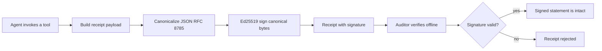
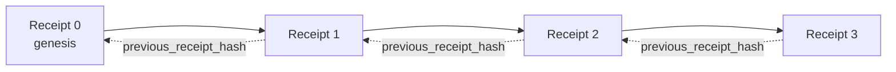

[צפו בסרטון השיעור: אבטחת סוכני AI עם קבלות קריפטוגרפיות](https://youtu.be/PLACEHOLDER_VIDEO_ID)

> _(סרטון השיעור והתמונה הממוזערת יתווספו על ידי צוות תוכן מיקרוסופט לאחר המיזוג, בהתאם לדפוס של שיעור 14 / 15.)_

# אבטחת סוכני AI עם קבלות קריפטוגרפיות

## מבוא

שיעור זה יכסה:

- מדוע עקבות ביקורת לסוכני AI חשובים לציות, איתור שגיאות ואמון.
- מהי קבלה קריפטוגרפית וכיצד היא שונה משורת יומן ללא חתימה.
- כיצד לייצר קבלה חתומה לקריאת כלי של סוכן בפייתון פשוט.
- כיצד לאמת קבלה בצורה לא מקוונת ולזהות זיופים.
- כיצד לקשר קבלות כך שמחיקה או שינוי סדר אחת מהם ישבר את השרשרת.
- מה הקבלות מוכיחות ומה הן במפורש אינן מוכיחות.

## מטרות הלמידה

עם סיום שיעור זה, תוכלו לדעת כיצד:

- לזהות מצבי כשל המניעים מקור קריפטוגרפי לפעולות סוכן.
- לייצר קבלה חתומה ב-Ed25519 על מטען JSON קנוני.
- לאמת קבלה באופן עצמאי באמצעות מפתח ציבורי של החתום בלבד.
- לזהות זיוף על ידי הרצת אימות מחדש על קבלה שעברה שינוי.
- לבנות רצף מקושר של קבלות ולהסביר מדוע השרשרת חשובה.
- להבחין בין מה הקבלות מוכיחות (שייכות, שלימות, סדר) לבין מה הן אינן מוכיחות (נכונות הפעולה, תקפות המדיניות).

## הבעיה: עקבות הביקורת של הסוכן שלכם

דמיינו שהפעלתם סוכן AI עבור Contoso Travel. הסוכן קורא בקשות לקוחות, קורא ל-API של טיסות לחיפוש אפשרויות ומזמין כיסאות בשם הלקוח. ברבעון האחרון, הסוכן עיבד 50,000 הזמנות.

היום מגיע בודק חשבונות. הוא שואל שאלה פשוטה: "הראה לי מה הסוכן שלך עשה."

אתם מספקים את קבצי היומן שלכם. הבודק מסתכל עליהם ושואל את השאלה הקשה יותר: "איך אני יודע שיומנים אלו לא נערכו?"

זו בעיית עקבות הביקורת. רוב פריסות הסוכנים היום מסתמכות על:

- **יומני יישומים**: נכתבים על-ידי הסוכן עצמו, ניתנים לעריכה על-ידי כל מי שיש לו גישה למערכת הקבצים.
- **שירותי רישום בענן**: בעלי יכולת זיהוי זיופים ברמת הפלטפורמה אך רק אם הבודק סומך על מפעיל הפלטפורמה.
- **יומני עסקאות מסד נתונים**: מתאימים לשינויים במסד הנתונים אך לא לקריאות כלים שרירותיות.

אף אחד מהם אינו יכול לענות לשאלה של הבודק מבלי שהבודק יצטרך לסמוך על מישהו (עליכם, ספק הענן שלכם, ספק מסד הנתונים שלכם). לשימוש פנימי, אמון זה מקובל לרוב. בעומסים מפוקחים (פיננסים, בריאות, כל דבר לפי תקנות ה-EU AI Act), זה אינו מקובל.

קבלות קריפטוגרפיות מצמצמות את הבעיה על ידי יצירת הצהרה חתומה שניתנת לאימות באופן עצמאי. הבודק עדיין זקוק לסיבה מחוץ לערוץ לסמוך על מפתח החתימה ועל הרכיב שיצר את ההצהרה. מפתח מוטמע מוכיח עקביות פנימית, לא זהות המנפיק או מיקום האכיפה.


## מהי קבלה קריפטוגרפית?

קבלה היא אובייקט JSON המתעד מה עשה הסוכן, וחתום בחתימה דיגיטלית.



קבלה מינימלית נראית כך:

```json
{
  "type": "agent.tool_call.v1",
  "agent_id": "contoso-travel-bot",
  "tool_name": "lookup_flights",
  "tool_args_hash": "sha256:a3f9c1...",
  "result_hash": "sha256:7b2e1d...",
  "policy_id": "contoso-travel-policy-v3",
  "timestamp": "2026-04-25T14:30:00Z",
  "sequence": 47,
  "previous_receipt_hash": "sha256:9d4e6a...",
  "signature": {
    "alg": "EdDSA",
    "sig": "c5af83...",
    "public_key": "8f3b2c..."
  }
}
```

שלושה מאפיינים עושים את העבודה:

1. **החתימה**. הקבלה חתומה על-ידי שער הסוכן באמצעות מפתח פרטי Ed25519. כל מי שיש לו את המפתח הציבורי התואם יכול לאמת את החתימה בצורה לא מקוונת. צד המבוסס חייב לקבע את המפתח או לפתור אותו מרישום אמין מחוץ לקבלה. זיוף כל שדה חתום מבטל את החתימה.

2. **קידוד קנוני**. לפני החתימה, הקבלה מעובדת לפי תוכנית הקנוניזציה של JSON (JCS, RFC 8785). זה מבטיח ששתי יישומים המייצרים את אותו תוכן קבלה יפיקו פלט זהה בבית. ללא קנוניזציה, מאכילי JSON שונים היו מייצרים חתימות שונות על אותו תוכן.

3. **שרשור חשיש**. השדה `previous_receipt_hash` מקשר כל קבלה לזו שלפניה. הסרה או שינוי סדר של קבלה שוברים את הרצף המוצג. גילוי קיצור או עריכה מבוקרת על ידי החותם דורש גם נקודת ביקורת עם ראש שרשרת קבוע, עדות עצמאית, או התחייבות מאומתת באוכלוסייה סגורה.

יחד מאפיינים אלו מספקים שלוש הבטחות:

- **שייכות למפתח**: מפתח זה חתום על תוכן זה. זהות ארגונית או אנושית דורשת קשירת מפתח מהימנה.
- **שלמות**: התוכן לא השתנה מאז החתימה.
- **סדר ברצף מאומת**: קבלה זו מקשרת לקבלה הקודמת.

## יצירת קבלה בפייתון

אין צורך בספרייה מיוחדת להפקת קבלה. הפרימיטיבים הקריפטוגרפיים זמינים באופן נרחב והלוגיקה היא כמה עשרות שורות קוד בפייתון.

התרגילים המעשי ב-`code_samples/18-signed-receipts.ipynb` מראים את התהליך המלא. ספריית המקור שבשליטת גרסה `code_samples/18-signed-receipts.execution-receipt.json` מתעדת את ה-hash המדויק של הפנקס, סביבת הפייתון, ספירת התאים והבדיקות מהריצה האחרונה הנקייה ללא שינוי הפלטים של השיעור. הגרסה המסכמת:

```python
import json
import hashlib
import base64
from nacl import signing
from jcs import canonicalize  # RFC 8785 canonical JSON

def b64url_nopad(data: bytes) -> str:
    return base64.urlsafe_b64encode(data).decode("ascii").rstrip("=")

def sha256_canonical(obj) -> str:
    """SHA-256 of a Python object's JCS-canonical JSON form."""
    return f"sha256:{hashlib.sha256(canonicalize(obj)).hexdigest()}"

# Generate or load a signing key (in production, store in a key vault)
signing_key = signing.SigningKey.generate()
verify_key = signing_key.verify_key
TRUSTED_PUBLIC_KEYS = {b64url_nopad(bytes(verify_key))}  # pinned out of band by the verifier

# Build the receipt payload (no signature yet)
tool_args = {"origin": "SYD", "destination": "LAX"}
tool_result = [{"flight": "QF11", "price": 1850, "stops": 0}]

payload = {
    "type": "agent.tool_call.v1",
    "agent_id": "contoso-travel-bot",
    "tool_name": "lookup_flights",
    "tool_args_hash": sha256_canonical(tool_args),
    "result_hash": sha256_canonical(tool_result),
    "policy_id": "contoso-travel-policy-v3",
    "timestamp": "2026-04-25T14:30:00Z",
    "sequence": 0,
    "previous_receipt_hash": None,
}

# Canonicalize and sign the JCS bytes directly. PureEdDSA hashes internally.
canonical_bytes = canonicalize(payload)
signature_bytes = signing_key.sign(canonical_bytes).signature

# Attach a structured signature object.
receipt = {
    **payload,
    "signature": {
        "alg": "EdDSA",
        "sig": b64url_nopad(signature_bytes),
        "public_key": b64url_nopad(bytes(verify_key)),
    },
}
```

זה כל צינור החתימה. התרגילים בפנקס עוברים כל שלב.

## אימות קבלה וזיהוי זיופים

האימות הוא הפעולה ההפוכה:

```python
import base64
import hashlib
from nacl import signing
from nacl.exceptions import CryptoError
from jcs import canonicalize

def b64url_decode(s: str) -> bytes:
    # Strict: Python's decoder skips characters outside the alphabet and also
    # accepts padding, the standard +/ alphabet and non-zero spare bits.
    # Re-encoding and comparing accepts only the one unpadded base64url form.
    padding = "=" * ((4 - len(s) % 4) % 4)
    data = base64.urlsafe_b64decode(s + padding)
    if base64.urlsafe_b64encode(data).decode("ascii").rstrip("=") != s:
        raise ValueError("not canonical unpadded base64url")
    return data

def verify_receipt(receipt: dict, trusted_public_key: str) -> bool:
    # trusted_public_key is the issuer's key, obtained from somewhere other
    # than this receipt. Never use receipt["signature"]["public_key"] here:
    # see "What Receipts Prove (and What They Do Not)" below.
    # Fails closed: anything malformed returns False instead of raising.
    if not isinstance(receipt, dict) or not isinstance(trusted_public_key, str):
        return False
    sig_obj = receipt.get("signature")
    if not isinstance(sig_obj, dict) or sig_obj.get("alg") != "EdDSA":
        return False
    sig_b64 = sig_obj.get("sig")
    if not isinstance(sig_b64, str):
        return False

    try:
        # Reconstruct the payload that was actually signed (everything except signature).
        payload = {k: v for k, v in receipt.items() if k != "signature"}
        canonical_bytes = canonicalize(payload)
        verify_key = signing.VerifyKey(b64url_decode(trusted_public_key))
        verify_key.verify(canonical_bytes, b64url_decode(sig_b64))
        return True
    except (CryptoError, TypeError, ValueError, KeyError, OverflowError):
        return False
    except Exception:
        # An undecodable key or signature, or a payload that cannot be
        # canonicalized: fail closed rather than raise.
        return False
```

פונקציה זו מקבלת קבלה ומפתח ציבורי של המנפיק, ומחזירה `True` אם החתימה תקפה ו-`False` אחרת, כולל כאשר הקלט לקוי. אין צורך בקריאה לרשת או שירות אימות: ברגע שמחזיקים במפתח המנפיק, האימות הוא באופן מלא מקומי ולא מקוון. מה שעדיין דרוש הוא מפתח זה, המושג ממקור אחר מאשר הקבלה עצמה.

לצפייה בזיהוי זיופים בפעולה, הפנקס מראה:

1. יצירת קבלה תקפה ואישור שהיא מאומתת.
2. שינוי ביט אחד בשדה `tool_args_hash`.
3. הרצת אימות מחדש ובחינת כישלון.
4. זיוף מחדש, אבל הפעם עם חתימה במפתח שיצר התוקף והטמעת המפתח בקבלה.

שלב 4 הוא זה שכדאי לשבת איתו. קבלה זו עקבית פנימית: החתימה אמיתית לתוכנה ולמפתח שהיא נושאת, ולכן מאומתת אל מול אותו מפתח. היא נכשלת רק כשהיא נבדקת מול המפתח האמיתי של המנפיק. שלבים 2 ו-3 תופסים את מי שלא טרח לחתום מחדש; שלב 4 תופס את זה שכן.

זו ההדגמה המעשי לכך שקבלות מתועדות לזיופים: כל שינוי בשדה חתום שוברת את החתימה, בתנאי שמבצעים אימות מול מפתח שהמתקיף לא סיפק. האובייקט `signature` עצמו מחוץ לבייטים החתומים, ולכן המפתח לאימות חייב להגיע ממקור חיצוני לקבלה.

## שרשור קבלות עבור סוכנים מרובי שלבים

קבלה בודדת חתומה מגנה על פעולה אחת. שרשרת של קבלות מגנה על רצף.



כל קבלה מתעדת את החשיש של הקבלה הקודמת לה. כדי להסיר בשקט את הקבלה 2, על התוקף:

- לשנות את שדה `previous_receipt_hash` בקבלה 3 (שובר את החתימה של קבלה 3), או
- לזייף חתימה חדשה על קבלה 3 ששונתה (דורש את המפתח הפרטי של הסוכן).

אם המפתח הפרטי נמצא בכספת חומרה והמאמתים בודקים כל קבלה מול מפתח ציבורי של המנפיק, שהושג באופן עצמאי (ערכת JWK מפורסמת או ערך קונפיג קבוע), אין אף התקפה מוצלחת ללא גילוי. פרסום המפתח בתוך כל קבלה בלבד אינו מספק: תוקף יכול לחתום מחדש עם המפתח שלו ולהטמיע אותו במקום, שהוא המקרה `04_resigned_receipt.json`.

הפנקס מראה:

1. בניית שרשרת של שלוש קבלות.
2. אימות ששדה `previous_receipt_hash` של כל קבלה תואם לחשיש האמיתי של הקבלה הקודמת.
3. זיוף קבלה באמצע וראיית הפסקת השרשרת בנקודה המדויקת.

כך מייצרים עקבות ביקורת שניתן לאמת על ידי בודק חיצוני תחת מפתחות מנפיקים מקובעים ונקודות ביקורת בשרשרת, מבלי לסמוך על מאגר יומנים משתנים שלכם.


## מה הקבלות מוכיחות (ומה הן אינן)

זה החלק החשוב ביותר בשיעור זה. הקבלות הן עוצמתיות אך בכוחן יש גבול.

**קבלות מוכיחות שלושה דברים:**

1. **שייכות**: מפתח ספציפי חתום על מטען ספציפי.
2. **שלמות**: המטען לא השתנה מאז החתימה.
3. **סדר ברצף שהוצג ואומת**: קבלה זו מקשרת לקודמתה.

**קבלות אינן מוכיחות:**

1. **נכונות**: שהפעולה של הסוכן הייתה הפעולה הנכונה. ניתן לחתום על קבלה עבור תשובה שגויה באותה קלות כפי שעושים זאת על תשובה נכונה.
2. **ציות למדיניות**: שהמדיניות המצוינת ב-`policy_id` אומתה בפועל, או שהייתה מאפשרת פעולה זו אם הייתה נבדקת. הקבלה מתעדת את הטענה, לא את האכיפה.
3. **זהות מעבר למפתח**: הקבלה אומרת "מפתח זה חתום על תוכן זה." היא אינה אומרת "אדם זה אישר זאת." חיבור מפתח לאדם או ארגון דורש תשתית זהות נפרדת (ספרייה, רישום מפתחות ציבוריים וכו').
4. **נכונות הקלטים**: אם הסוכן מקבל הנחיה שעברה מניפולציה ופועל לפיה, הקבלה מתעדת את הפעולה בנאמנות. הקבלות הן אחרי איסוף הקלטים, לא תחליף לבדיקתם.
5. **ביצוע או השפעה בעולם האמיתי**: קבלת פוסט-קריאה מתעדת מה שהמנפיק טען שקרה. הוכחת כניסה או התאמת השפעה מחייבת ראיות מהמבצע האמיתי או מגוף הספק.
6. **שלימות**: קבלה חסרה יכולה להצביע על חסימה, השמטה, אובדן או חוסר ניטור. היעדרות קורית רק באוכלוסייה סגורה מאומתת.
7. **זמן מהימן**: חותמת זמן חתומה מוכיחה כי החותם החזיק בערך זה, לא שהערך היה נכון. זמן מהימן דורש רשות זמן נפרדת או נקודת ביקורת.

**המפתח בקבלה אינו המפתח איתו מאמתים.** זה נובע מנקודה 3, וזו הנקודה היחידה שבה ההבחנה צריכה להשפיע על קודכם ולא רק על הבנתכם. ה-`public_key` בדוגמה למעלה קיים כדי שהדוגמה תהיה עצמאית. מאמת אף פעם לא צריך לסמוך עליו. כל אחד יכול לקחת קבלה, לשנותה, לחתום עליה במפתח שיצר, ולהטמיע את המפתח; התוצאה מאומתת באופן מושלם אל עצמה. זו התרחיש `04_resigned_receipt.json` ב-`sample_receipts/`, ולכן `verify_receipt` למעלה מקבל את המפתח כארגומנט במקום לקרוא אותו מהקבלה. השיגו את מפתח המנפיק באופן עצמאי, מערכת JWK ברשימת הבדיקות למטה או עוגן אחר שקבעתם מראש, ואמתו עמו. חתימה שנבדקה בעזרת מפתח שהגיע באותה מעטפה מוכיחה רק שהמעטפה עקבית פנימית.

גבול זה חשוב משני טעמים:

- הוא אומר מהי תועלת הקבלות: הפיכת התנהגות הסוכן לניתנת לביקורת וזיהוי זיופים, אפילו מעבר לגבולות ארגוניים.
- הוא אומר מה נדרשות שכבות נוספות: אימות קלט (שיעור 6), אכיפת מדיניות (מכוסה בקצרה למטה), ותשתית זהות (מחוץ להיקף השיעור).

טעות נפוצה היא להניח ש"יש לנו קבלות" פירושו "יש לנו ממשל." זה לא כך. הקבלות הן בסיס. הממשל הוא המערכת שבונים מעליו.

## קשירת חתימת המאשר לפעולה המדויקת

סעיף 3 למעלה ראוי לפרק משלו: קבלת פעולה אומרת "מפתח זה חתום על תוכן זה," לעולם לא "אדם אישר זאת." לפעולות בסיכון גבוה (החזרים, מחיקות, העברות כספים), חתימת מאשר נפרדת יכולה לקשר לפעולה המדויקת. חיבור המפתח לאדם ובדיקת נוכחות האדם נשארות באחריות נפרדת.

הפנקס ההמשך `code_samples/human-authorization-receipts.ipynb` מוסיף סוג קבלה שני, `human.approval.v1`, באותו מבנה מעטפה כמו קבלות השיעור (מטען ממוין חתום Ed25519 על הבייטים הקנוניים של JCS, עם אובייקט `signature` מחוץ לבייטים החתומים). מפתח המאשר חותם על **הפעולה הקנונית המלאה ועיכול שלה**; מפתח הסוכן חותם על טענה הכוללת את **אותו עיכול פעולה** ו-`parent_approval_ref`, ה-`receipt_hash` של האישור, ההסכמה היא כפי ב-`previous_receipt_hash` בשרשרת שבניתם למעלה. אחד מ-`verify_chain` מאמת את שני הקבצים תחת **רשומות מפתחות מקובעות נפרדות** (מפתחות מאשרים מול מפתחות סוכן), כך שקוד המסלול משותף אך הרשויות לעולם לא.

המאפיין שנרכש בזהירות: *מפתח המאשר המקובע חתם על הפעולה המדויקת הזו, ומפתח הסוכן לאחר מכן חתם על הצהרה הנושאת את אותו עיכול פעולה.*
זהו ראיה שימושית, אך איננו הוכחה בפני עצמם שהפעולה בוצעה. לשלוט בביצוע, האישור המדויק חייב להיות שמור ונצרך פעם אחת בגבול המבצע האמיתי; תוצאות ספק לא מוכרות חייבות להישאר לא מוכרות ולא לנסות שוב בעיוורון. מערכות דחיית הפנקס בודקות את שכבת שרשרת הקבלות:

- זיופים, סגן מבלבל, מפתחות מזויפים בשני הצדדים, וקלט פגום;
- **סמכות פגה**: חתימה שעדיין מאומתת, נדחתה בכל זאת כי גרסת המדיניות השתנתה, מפתח המאשר הוסר מרשימת הנעילה, או שהאישור פג תוקף לפני זמן האימות שסופק;
ניסה שוב בעיוורון. פיקסציית סירוב המחברת בוחנת את שכבת שרשרת הקבלה:

- זיוף, סגן מבלבל, מפתחות מזויפים מצד כל צד, וקלט פגום;
- **סמכות ישנה**: חתימה שעדיין מאומתת, נדחתה בכל זאת כי גרסת המדיניות זזה, מפתח המאשר סובב מחוץ לרישום המקובע, או שהאישור פג תוקף לפני זמן האימות שנמסר;
- **החלפת דיגסט**: קבלה לפעולה חתומה בתוקף המצביעה על אישור *אמיתי* המחייב פעולה קאנונית *שונה*.

כל כישלון מסרב מסיבה מובחנת, כך שבודק המתעד את הסירוב יכול לדעת אם הסמכות הפכה מיושנת או שהפעולה המתועדת השתנתה. האימות הוא קריאה בלבד וחזרתי: הוא אינו צורך את האישור ואינו מפעיל ספק שירות. מבצע נפרד זקוק להגנה על השמעה חוזרת עמידה, אטומית, ותוצאות מפורשות של הצלחה, כישלון ובלתי חד-משמעי. קבלת האישור האנושי היא קומפוזיציה חינוכית המוגדרת בשיעור זה, ולא סוג קבלה המוגדר על ידי `draft-farley-acta-signed-receipts`.

## הפניות לייצור

קוד הפייתון בשיעור זה הוא בזירות בכוונה כך שתוכל לקרוא כל שורה ולהבין בדיוק מה קורה. בפרודקשן, יש לך שתי אפשרויות:

1. **לבנות ישירות על הפרימיטיבים הקריפטוגרפיים.** 50 השורות שראיתם למעלה מספיקות להרבה שימושים. PyNaCl (Ed25519) ו-`jcs` החבילה (JSON קנוניקלית) הן ספריות המתוחזקות ובעלות ביקורת.

2. **להשתמש בספריית קבלות לפרודקשן.** כמה פרויקטים בקוד פתוח מממשים את אותו דפוס עם תכונות נוספות (סיבוב מפתחות, אימות באצווה, הפצת סט JWK, אינטגרציה עם מנועי מדיניות):
   - צינור החתימה משתמש בקונבנציונליות JCS ו-signature-scope בטיוטת IETF עצמאית ([`draft-farley-acta-signed-receipts`](https://datatracker.ietf.org/doc/draft-farley-acta-signed-receipts/), גרסה 02). הקבלה הפלטית החינוכית בשיעור זה שונה מקופסית ה`{payload, signature}` שבטיוטה ואינה מוצגת כמימוש תואם. הטיוטה מפרסמת ערכת תאימות משותפת ([agent-governance-testvectors](https://github.com/ScopeBlind/agent-governance-testvectors)) למימושים המכוונים לפורמט הכבל שלה.
   - ערכת הכלים Microsoft Agent Governance מרכיבה קבלות עם החלטות מדיניות מבוססות Cedar; ראה הדוגמה מקצה לקצה במדריך 33 במאגר ההוא.
   - החבילות `protect-mcp` (npm) ו-`@veritasacta/verify` (npm) מספקות מימוש מבוסס Node של חתימת קבלה ואימות לא מקוון, מיועדות לעטוף כל שרת MCP עם מסלול ביקורת המגלה מניפולציה, כולל תהליך החזקת חתימה משותפת שבו פעולה מושהית מפיקה קבלת אישור הקשורה לסיכום הפעולה (מתמך על WebAuthn בזרימת שולחן העבודה), אותו דפוס קבלת אישור כפי במחברת ההרשאה האנושית לעיל.
   - **[nobulex](https://github.com/arian-gogani/nobulex)** Python SDK (`pip install nobulex`) מספק את אותו דפוס חתימה Ed25519 + JCS בפייתון עם אינטגרציות LangChain ו-CrewAI, כולל וקטורי בדיקה מפרסמים לבחינת חוצי-אימות ומיפוי תאימות שוּתף דרך [OWASP PR #2210](https://github.com/OWASP/CheatSheetSeries/pull/2210).
   - **[EMILIA Protocol](https://github.com/emiliaprotocol/emilia-protocol)** מספק שכבת אכיפה מדויקת משלים: קבלות אישור הניתנות לאימות לא מקוון, WebAuthn מוצמד או סמכות קוואורום, צריכה חד-פעמית בגבול המבצע, ונתיב תוצאה בלתי-מפורשת מפורש. מתאמי המסגרת שלה מתייחסים לקבלה כראיה נדרשת ולא כהוכחה שהתרחש אפקט חיצוני.

ההחלטה בין לפתח לבד לבין להשתמש בספרייה משקפת את ההחלטה בין לכתוב ספריית JWT משלך ולהשתמש באחת שנבדקה: שניהם הגיוניים; הספרייה חוסכת זמן ומפחיתה את שטח הבדיקה; הגישה מהיסוד מאלצת אותך להבין כל פרימיטיב. שיעור זה מלמד את המסלול מהיסוד כדי שיהיה לך בסיס לכל אחת מהבחירות.

## בדיקת ידע

בדוק את הבנתך לפני המעבר לתרגיל המעשי.

**1. קבלה נחתמת עם מפתח Ed25519 פרטי של הסוכן. למבקר יש רק את המפתח הציבורי. האם המבקר יכול לאמת את הקבלה במצב לא מקוון?**

<details>
<summary>תשובה</summary>

כן, אימות קריפטוגרפי דורש רק את המפתח הציבורי והבתים החתומים. ה-
המבקר עדיין חייב לקבל ולהצמיד את המפתח הציבורי המקובל באופן עצמאי מהקבלה.
לאחר שהגדרת האמון הזו הוקמה, אין צורך בקריאת רשת.
</details>

**2. תוקף משנה את השדה `policy_id` של קבלה כדי לטעון שהיא נשלטה על ידי מדיניות סלחנית יותר. החתימה הייתה על המטען המקורי. מה קורה במהלך האימות?**

<details>
<summary>תשובה</summary>

האימות נכשל. החתימה חושבה על הבייטים הקנוניים של המטען המקורי; שינוי בכל שדה במטען משנה את הבייטים הללו, מה שהופך את החתימה שלא תקפה. התוקף יצטרך את המפתח הפרטי כדי לייצר חתימה תקפה חדשה, שהוא אינו מחזיק בה.
</details>

**3. מדוע הקבלה כוללת `tool_args_hash` ו-`result_hash` במקום הפרמטרים התורניים והתוצאה הגולמיים?**

<details>
<summary>תשובה</summary>

יש לכך שתי סיבות. ראשית, ייתכן והקבלה צריכה להיארז או להישלח בסביבות שבהן חשיפת התוכן הגולמי (מידע אישי מזהה, נתוני עסק) מהווה בעיה. ביצוע חשיש שומר על הקבלה קטנה ועל התוכן פרטי; המבדק מאמת שהחשיש תואם להעתק שמור בנפרד של התוכן האמיתי. שנית, לחשישים יש גודל קבוע; קבלה עם חשישים מוגבלת בגודלה ללא תלות בגודל הקלטים והתוצרים.
</details>

**4. שדה `previous_receipt_hash` מקשר כל קבלה ל"קבלה הקודמת" שלה. אם תוקף מוחק בשקט קבלה אחת מתוך אמצע השרשרת, מה יהפוך ללא תקף?**

<details>
<summary>תשובה</summary>

כל קבלה שהגיעה לאחר הקבלה שנמחקה. שדות `previous_receipt_hash` שלהן כבר לא תואמים את השרשרת בפועל (כי הקבלה אליה התייחסו כבר אינה קיימת, או שהשרשרת מפנה כעת לקבלה קודמת שונה). כדי להסתיר את ההסרה, התוקף יצטרך לחתום מחדש על כל הקבלות המאוחרות יותר, מה שדורש את המפתח הפרטי של המנפיק. חתימה מחדש עם כל מפתח אחר תיכשל בבדיקה מול מפתח המנפיק.
</details>

**5. קבלה מאומתת נכונה. האם זה מוכיח שהפעולה של הסוכן הייתה נכונה, תקפה או בהתאם למדיניות?**

<details>
<summary>תשובה</summary>

לא. תחת מפתח נעוץ והקשר שרשרת, קבלה תקפה מוכיחה ייחוס חתימה,
שלמות תוכן וקישור לקבלה הקודמת שהוצגה. היא לא מוכיחה ש
הפעולה הייתה נכונה או בוצעה, שהמדיניות הוערכה, שחותמת הזמן היא
אמינה, או שמערך הרשומות שלם. זו הגבול החשוב ביותר בשיעור.
</details>

## תרגול מעשי

פתח את `code_samples/18-signed-receipts.ipynb` והשלים את כל ארבעת החלקים:

1. **חלק 1**: חתום על הקבלה הראשונה שלך ואמת אותה.
2. **חלק 2**: פגע בקבלה וצפה בכישלון האימות.
3. **חלק 3**: בנה שרשרת של שלוש קבלות ואמת את שלמות השרשרת.
4. **חלק 4**: החל את התבנית על סוכן שנבנה עם Microsoft Agent Framework: עטוף קריאת כלי בחתימת קבלה, ואז אמת את הקבלה באופן עצמאי.

**אתגר נוסף 1:** הרחב את סכימת הקבלה עם שדה נוסף שבחרת (למשל, מזהה בקשה למעקב), עדכן את הלוגיקה לחתימה הקנונית כדי לכלול אותו, ואמת שהקבלה עוברת את תהליך האימות בשלמותה. לאחר מכן שנה את השדה לאחר החתימה ואמת שהאימות נכשל. זה מאלץ אותך להבין כיצד כל בית בקידוד הקנוני תורם לחתימה.

**אתגר מתיחה 2:** חשב SHA-256-Hash לשני הקבלות שלך יחד (שלב את הבתים הקנוניים שלהם בסדר דטרמיניסטי) ותשלב את הסיכום המתקבל כשדה חדש בקבלה שלישית לפני החתימה שלה. אמת שכל שלוש הקבלות עדיין עוברות סיבוב. הרגע יצרת הוכחת הכללה שלב אחד: כל מי שמחזיק בקבלה השלישית יכול להראות ששתי הראשונות היו קיימות בזמן שחתמו עליה, מבלי להזדקק לחשוף את תוכנן. זהו התבנית שבה משתמשות קבלות של גילוי סלקטיבי בקנה מידה (מחויבות מרקל, RFC 6962).

## מסקנה

קבלות קריפטוגרפיות מעניקות לסוכני AI מסלול ביקורת שהוא:

- **ניתן לאימות עצמאי תחת אמון מקובע**: צד עם מפתחות ציבוריים מאושרים ובתים חתומים יכול לאמת ללא תלות בשירות.
- **עדים לשינוי**: כל שינוי מבטל את החתימה.
- **נייד**: קבלה היא קובץ JSON קטן; ניתן לארכיב, לשדר ולאמת בכל מקום.
- **מותאם לסטנדרטים**: מבוסס על Ed25519 (RFC 8032), JCS (RFC 8785), ו-SHA-256, כולם פרימיטיבים נפוצים.

הם אינם תחליף לבדיקה של קלט, אכיפת מדיניות, קבלת מבצעים,
ראיות לתוצאה, בקרות שלמות, או תשתית זהות. הם בסיס
לשכבות אלה. בעבודות מסודרות או רב-ארגוניות, קבלות מאפשרות לבדוק באופן עצמאי
הצהרות ספציפיות של המנפיק תחת תצורת האמון של המבקר.

התובנה החשובה ביותר: קבלות מוכיחות שמפתח מסוים חתם תוכן ספציפי. חותם עם חותמת זמן נחשב לאישור חתימה אלא אם צוינה חותמת זמן נפרדת. קבלה
אינה מוכיחה שהתוכן שלה היה נכון, שהפעולה בוצעה, או שסט הרשומות שלם. שמור על ההבחנות האלה בקפדנות.


- [ ] **קבע אמון במפתח המוודא.** פרסם מפתחות דרך JWK Set או רישום, ואז תן לצדדים שתלויים לאבטח את זהות המנפיק, סט המפתחות ומדיניות הסיבוב מחוץ לקבלות הפרטניות. מפתח מקומי לבדו אינו עוגן אמון.
- [ ] **עגן את השרשרת מחוץ למערכת.** מדי פעם כתוב את המזהה האחרון של ראש השרשרת ליומן שקיפות (Sigstore Rekor, רשות חותמות זמן לפי RFC 3161, או מערכת פנימית שנייה) כדי שאדם חיצוני יוכל לאשר "שרשרת זו התקיימה בזמן הזה."
- [ ] **אחסן קבלות בצורה בלתי משתנה.** אחסון מסוג Append-only (Azure Storage עם מדיניות אי-שינוי, AWS S3 Object Lock) מונע מאדם פנימי לשכתב היסטוריה ברמת האחסון.
- [ ] **החלט על תקופת שמירה.** מערכות רגולציה רבות מצריכות שמירה לשנים רבות. תכנן לצמיחת הקבלות (כל קבלה כ-500 בתים; סוכן שמבצע 10K קריאות ביום מייצר כ-1.8 ג"ב בשנה).
- [ ] **תעד מה הקבלות לא מכסות.** קבלות מוכיחות שיוך, שלמות, וסדר. מדריך ההפעלה שלך צריך לרשום במפורש מה הבקרות הנוספות (בדיקת קלט, אכיפת מדיניות, הגבלת קצב, תשתית זהות) המשלימות את הקבלות בתצורת הממשל שלך.


הצטרפו ל-[Microsoft Foundry Discord](https://aka.ms/ai-agents/discord) כדי לפגוש לומדים אחרים, להשתתף בשעות קבלה ולקבל מענה לשאלות שלכם על סוכני AI.

## מעבר לשיעור זה

שיעור זה מכסה חתימה על קבלה בודדת ורצפים בשרשרת גיבוב. אותם פרימיטיבים מתארגנים למספר דפוסים מתקדמים נוספים שתיתקלו בהם ככל שעמדת הממשל שלכם תתפתח:

- **גילוי סלקטיבי.** כאשר שדות הקבלה מוקשרים באופן עצמאי (עץ מרקל בסגנון RFC 6962), ניתן לחשוף שדות ספציפיים למבקרים מסוימים ולהוכיח שהשאר לא השתנו מבלי לחשוף אותם. שימושי כאשר אותה קבלה צריכה לעמוד בדרישות ביקורת מקיפה (שדורשת שלמות) ובתקנות צמצום נתונים כמו GDPR (שדורשות שהמבקר יראה כמה שפחות).
- **ביטול קבלת חתימה.** אם מפתח החתימה נפגע, דרוש אמצעי לסמן שכל הקבלות שחתומות על ידי מפתח זה אינן אמינות מנקודת זמן מסוימת ואילך. דפוסים סטנדרטיים: מפתחות חתימה קצרים יחד עם רשימת ביטול מפורסמת, או יומן שקיפות עם רשומות ביטול.
- **קבלות חתימה דו-צדדית / מפוצלת.** כמה מימושים מפצלים את המטען החתום למחצית לפני ביצוע (`authorization_*`) ואחרי ביצוע (`result_*`) עם חתימות עצמאיות, שימושי כשחלטת האישור והתוצאה הנצפית מיוצרים על ידי שחקנים שונים או בזמנים שונים. זה מצטבר על פורמט הקבלה שנלמד בשיעור זה.
- **הרכבת מטען.** קבלה חותמת את כל הבתים שהכנסתם ל-`result_hash`. מטענים בעולם האמיתי לרוב עשירים מתוצאות קריאה של כלי יחיד: נימוקים לפני החלטה (תחזית מודל, אפשרויות שנבדקו, ראיות ושלימותן, סיכון, שרשרת אחריות, תוצאת שער) יכולים להתקיים בתוך המטען, הכל חתם בקבלה אחת. זה שומר על פורמט הקבלה מינימלי ומאפשר לסכמות מטען להתפתח תחום אחר תחום.
- **התאמה בין מימושים שונים.** מימושים עצמאיים מרובים של אותו פורמט קבלה (Python, TypeScript, Rust, Go) מבצעים בדיקות מצטלבות מול וקטורים משותפים. אם אתם מפתחים מימוש משלכם, אימות מול וקטורים מפורסמים מאשר תאימות ברמת החוט.
- **מעבר אחרי-כמותי.** Ed25519 בשימוש רחב היום אך אינו עמיד בפני מחשבים כמותיים. תווית `alg` לבדה אינה מעבר: פרופיל חייב להגדיר קידוד מפתחות ML-DSA, בתים חתומים קאנוניים, אימות, מדיניות לקוחות, עמידות להורדה והמשמעויות במעבר. תכננו ובדקו מעבר עם חתימה כפולה מול וקטורים משותפים לפני שתטענו לתאימות.

## משאבים נוספים

- <a href="https://datatracker.ietf.org/doc/draft-farley-acta-signed-receipts/" target="_blank">טיוטת IETF: קבלות החלטה חתומות לבקרת גישה מכונה-למכונה</a>
- <a href="https://learn.microsoft.com/azure/ai-studio/responsible-use-of-ai-overview" target="_blank">סקירת AI אחראי (Azure AI)</a>
- <a href="https://datatracker.ietf.org/doc/html/rfc8032" target="_blank">RFC 8032: אלגוריתם חתימה דיגיטלית מבוסס עקומת אדוארדס (EdDSA)</a>
- <a href="https://datatracker.ietf.org/doc/html/rfc8785" target="_blank">RFC 8785: סכמת נרמול JSON (JCS)</a>
- <a href="https://datatracker.ietf.org/doc/html/rfc6962" target="_blank">RFC 6962: שקיפות תעודות</a> (בניית עץ מרקל המשמשת בקבלות גילוי-סלקטיבי)
- <a href="https://github.com/microsoft/agent-governance-toolkit/blob/main/docs/tutorials/33-offline-verifiable-receipts.md" target="_blank">ערכת כלים לניהול Microsoft Agent, הדרכה 33: קבלות החלטה שניתן לאמת אותן לא מקוונות</a>
- <a href="https://github.com/ScopeBlind/agent-governance-testvectors" target="_blank">וקטורי מבחן התאימות בין יישומים</a> עבור פורמט הקבלה המשמש בשיעור זה (Apache-2.0)
- <a href="https://pynacl.readthedocs.io/" target="_blank">תיעוד PyNaCl</a> (Ed25519 בפייתון)

## השיעור הקודם

[יצירת סוכני בינה מלאכותית מקומיים](../17-creating-local-ai-agents/README.md)

---

<!-- CO-OP TRANSLATOR DISCLAIMER START -->
**כתב ויתור**:
מסמך זה תורגם באמצעות שירות תרגום אוטומטי [Co-op Translator](https://github.com/Azure/co-op-translator). למרות שאנו שואפים לדיוק, יש לקחת בחשבון שתרגומים אוטומטיים עלולים להכיל שגיאות או אי-דיוקים. יש להחשיב את המסמך המקורי בשפתו הטבעית כמקור הסמכות. למידע קריטי מומלץ להשתמש בתרגום מקצועי על ידי מתרגם אדם. אנו לא אחראים לכל אי-הבנה או פירוש שגוי הנובע מהשימוש בתרגום זה.
<!-- CO-OP TRANSLATOR DISCLAIMER END -->