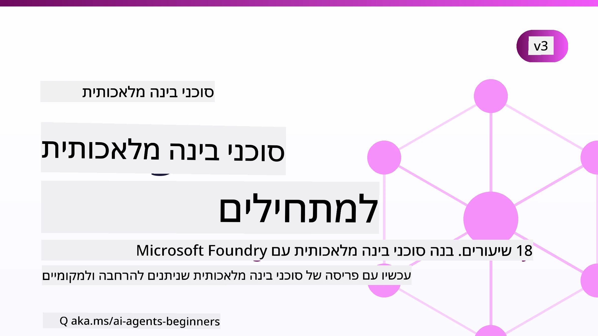

# סוכני בינה מלאכותית למתחילים - קורס



## קורס המלמד את כל מה שצריך לדעת כדי להתחיל לבנות סוכני בינה מלאכותית

[](https://github.com/microsoft/ai-agents-for-beginners/blob/master/LICENSE?WT.mc_id=academic-105485-koreyst)
[](https://GitHub.com/microsoft/ai-agents-for-beginners/graphs/contributors/?WT.mc_id=academic-105485-koreyst)
[](https://GitHub.com/microsoft/ai-agents-for-beginners/issues/?WT.mc_id=academic-105485-koreyst)
[](https://GitHub.com/microsoft/ai-agents-for-beginners/pulls/?WT.mc_id=academic-105485-koreyst)
[](http://makeapullrequest.com?WT.mc_id=academic-105485-koreyst)

### 🌐 תמיכה רב-שפתית

#### תרגומים המתוחזקים עם [Co-op Translator](https://github.com/Azure/co-op-translator)

<!-- CO-OP TRANSLATOR LANGUAGES TABLE START -->
[Arabic](../ar/README.md) | [Bengali](../bn/README.md) | [Bulgarian](../bg/README.md) | [Burmese (Myanmar)](../my/README.md) | [Chinese (Simplified)](../zh-CN/README.md) | [Chinese (Traditional, Hong Kong)](../zh-HK/README.md) | [Chinese (Traditional, Macau)](../zh-MO/README.md) | [Chinese (Traditional, Taiwan)](../zh-TW/README.md) | [Croatian](../hr/README.md) | [Czech](../cs/README.md) | [Danish](../da/README.md) | [Dutch](../nl/README.md) | [Estonian](../et/README.md) | [Finnish](../fi/README.md) | [French](../fr/README.md) | [German](../de/README.md) | [Greek](../el/README.md) | [Hebrew](./README.md) | [Hindi](../hi/README.md) | [Hungarian](../hu/README.md) | [Indonesian](../id/README.md) | [Italian](../it/README.md) | [Japanese](../ja/README.md) | [Kannada](../kn/README.md) | [Khmer](../km/README.md) | [Korean](../ko/README.md) | [Lithuanian](../lt/README.md) | [Malay](../ms/README.md) | [Malayalam](../ml/README.md) | [Manipuri (Meitei Mayek)](../mni/README.md) | [Marathi](../mr/README.md) | [Nepali](../ne/README.md) | [Nigerian Pidgin](../pcm/README.md) | [Norwegian](../no/README.md) | [Persian (Farsi)](../fa/README.md) | [Polish](../pl/README.md) | [Portuguese (Brazil)](../pt-BR/README.md) | [Portuguese (Portugal)](../pt-PT/README.md) | [Punjabi (Gurmukhi)](../pa/README.md) | [Romanian](../ro/README.md) | [Russian](../ru/README.md) | [Serbian (Cyrillic)](../sr/README.md) | [Slovak](../sk/README.md) | [Slovenian](../sl/README.md) | [Spanish](../es/README.md) | [Swahili](../sw/README.md) | [Swedish](../sv/README.md) | [Tagalog (Filipino)](../tl/README.md) | [Tamil](../ta/README.md) | [Telugu](../te/README.md) | [Thai](../th/README.md) | [Turkish](../tr/README.md) | [Ukrainian](../uk/README.md) | [Urdu](../ur/README.md) | [Vietnamese](../vi/README.md)

> **מעדיפים לשכפל מקומית?**
>
> מאגר זה כולל מעל 50 תרגומים של שפות שמגבירים משמעותית את גודל ההורדה. כדי לשכפל ללא תרגומים, השתמשו ב-sparse checkout:
>
> **Bash / macOS / Linux:**
> ```bash
> git clone --filter=blob:none --sparse https://github.com/microsoft/ai-agents-for-beginners.git
> cd ai-agents-for-beginners
> git sparse-checkout set --no-cone '/*' '!translations' '!translated_images'
> ```
>
> **CMD (Windows):**
> ```cmd
> git clone --filter=blob:none --sparse https://github.com/microsoft/ai-agents-for-beginners.git
> cd ai-agents-for-beginners
> git sparse-checkout set --no-cone "/*" "!translations" "!translated_images"
> ```
>
> זה נותן לכם את כל מה שצריך כדי להשלים את הקורס עם הורדה הרבה יותר מהירה.
<!-- CO-OP TRANSLATOR LANGUAGES TABLE END -->

**לחלופות שפתיות נוספות, ראו את [השפות הנתמכות של Co-op Translator](https://github.com/Azure/co-op-translator/blob/main/docs/supported-languages.md).**

[](https://GitHub.com/microsoft/ai-agents-for-beginners/watchers/?WT.mc_id=academic-105485-koreyst)
[](https://GitHub.com/microsoft/ai-agents-for-beginners/network/?WT.mc_id=academic-105485-koreyst)
[](https://GitHub.com/microsoft/ai-agents-for-beginners/stargazers/?WT.mc_id=academic-105485-koreyst)

[](https://discord.com/invite/ATgtXmAS5D)


## 🌱 מתחילים

בקורס זה יש שיעורים המכסים את יסודות בניית סוכני בינה מלאכותית. כל שיעור מכסה נושא נפרד, לכן התחילו איפה שתרצו!

ישנה תמיכה רב-שפתית לקורס זה. כנסו אל [השפות הזמינות כאן](#-multi-language-support).

אם זו הפעם הראשונה שלכם בבנייה עם דגמי בינה מלאכותית גנרטיבית, בדקו את הקורס שלנו [בינה מלאכותית גנרטיבית למתחילים](https://aka.ms/genai-beginners), הכולל 21 שיעורים על בנייה עם GenAI.

אל תשכחו [לתת כוכב (🌟) למאגר זה](https://docs.github.com/en/get-started/exploring-projects-on-github/saving-repositories-with-stars?WT.mc_id=academic-105485-koreyst) ו-[לזלוג את המאגר הזה](https://github.com/microsoft/ai-agents-for-beginners/fork) כדי להריץ את הקוד.

### פגשו לומדים אחרים, וקבלו מענה לשאלותיכם

אם תקלעו לקשיים או יש לכם שאלות לגבי בניית סוכני בינה מלאכותית, הצטרפו לערוץ הדיסקורד המיוחד שלנו ב-[Microsoft Foundry Discord](https://aka.ms/ai-agents/discord).

### מה אתם צריכים

בכל שיעור בקורס הזה יש דוגמאות קוד, הנמצאות בתיקיית code_samples. אתם יכולים [לזלוג את המאגר הזה](https://github.com/microsoft/ai-agents-for-beginners/fork) כדי ליצור העתק משלכם.

דוגמאות הקוד בתרגילים הללו משתמשות במסגרת Microsoft Agent Framework עם שירות Microsoft Foundry Agent Service V2:

- [Microsoft Foundry](https://aka.ms/ai-agents-beginners/ai-foundry) - דרוש חשבון Azure

קורס זה משתמש במסגרת וסוכנויות AI הבאות מ-Microsoft:

- [Microsoft Agent Framework (MAF)](https://learn.microsoft.com/agent-framework/overview/)
- [Microsoft Foundry Agent Service V2](https://aka.ms/ai-agents-beginners/ai-agent-service)

חלק מדוגמאות הקוד תומכות גם בספקים תואמי OpenAI אחרים כמו [MiniMax](https://platform.minimaxi.com/), שמציע מודלים עם הקשר גדול (עד 204 אלף טוקנים). ראו את [הגדרת הקורס](./00-course-setup/README.md) לפרטים על התצורה.

למידע נוסף על הפעלת הקוד לקורס זה, כנסו אל [הגדרת הקורס](./00-course-setup/README.md).

## 🙏 רוצים לעזור?

יש לכם הצעות או מצאתם שגיאות איות או קוד? [פתחו עניין](https://github.com/microsoft/ai-agents-for-beginners/issues?WT.mc_id=academic-105485-koreyst) או [צרו בקשת משיכה](https://github.com/microsoft/ai-agents-for-beginners/pulls?WT.mc_id=academic-105485-koreyst)


## 📂 כל שיעור כולל

- שיעור כתוב במדריך וידאו קצר
- דוגמאות קוד פייתון המשתמשות במסגרת Microsoft Agent Framework עם Microsoft Foundry
- קישורים למשאבים נוספים להמשך הלמידה


## 🗃️ שיעורים

| **שיעור**                                    | **טקסט וקוד**                                      | **וידאו**                                                   | **למידה נוספת**                                                                     |
|----------------------------------------------|----------------------------------------------------|------------------------------------------------------------|---------------------------------------------------------------------------------------|
| מבוא לסוכני AI ומקרי שימוש                    | [Link](./01-intro-to-ai-agents/README.md)                  | [Video](https://youtu.be/3zgm60bXmQk?si=z8QygFvYQv-9WtO1)                            | [Link](https://aka.ms/ai-agents-beginners/collection?WT.mc_id=academic-105485-koreyst)                                                      |
| חקר מסגרות סוכנות מלאכותית                   | [Link](./02-explore-agentic-frameworks/README.md)                    | [Video](https://youtu.be/ODwF-EZo_O8?si=Vawth4hzVaHv-u0H)                            | [Link](https://aka.ms/ai-agents-beginners/collection?WT.mc_id=academic-105485-koreyst)                                                      |
| הבנת תבניות עיצוב סוכנות מלאכותית           | [Link](./03-agentic-design-patterns/README.md)                    | [Video](https://youtu.be/m9lM8qqoOEA?si=BIzHwzstTPL8o9GF)                            | [Link](https://aka.ms/ai-agents-beginners/collection?WT.mc_id=academic-105485-koreyst)                                                      |
| תבנית עיצוב שימוש בכלים                      | [Link](./04-tool-use/README.md)                    | [Video](https://youtu.be/vieRiPRx-gI?si=2z6O2Xu2cu_Jz46N)                           | [Link](https://aka.ms/ai-agents-beginners/collection?WT.mc_id=academic-105485-koreyst)                                                     |
| סוכני RAG                                   | [Link](./05-agentic-rag/README.md)                   | [Video](https://youtu.be/WcjAARvdL7I?si=gKPWsQpKiIlDH9A3)                           | [Link](https://aka.ms/ai-agents-beginners/collection?WT.mc_id=academic-105485-koreyst)                                                     |
| בניית סוכני AI אמינים                        | [Link](./06-building-trustworthy-agents/README.md)                   | [Video](https://youtu.be/iZKkMEGBCUQ?si=jZjpiMnGFOE9L8OK)                           | [Link](https://aka.ms/ai-agents-beginners/collection?WT.mc_id=academic-105485-koreyst)                                                     |
| תבנית עיצוב תכנון                           | [Link](./07-planning-design/README.md)                   | [Video](https://youtu.be/kPfJ2BrBCMY?si=6SC_iv_E5-mzucnC)                           | [Link](https://aka.ms/ai-agents-beginners/collection?WT.mc_id=academic-105485-koreyst)                                                     |
| תבנית עיצוב רב-סוכנית                       | [Link](./08-multi-agent/README.md)                   | [Video](https://youtu.be/V6HpE9hZEx0?si=rMgDhEu7wXo2uo6g)                           | [Link](https://aka.ms/ai-agents-beginners/collection?WT.mc_id=academic-105485-koreyst)                                                     |
| תבנית עיצוב מטה-קוגניציה                      | [Link](./09-metacognition/README.md)                   | [Video](https://youtu.be/His9R6gw6Ec?si=8gck6vvdSNCt6OcF)                           | [Link](https://aka.ms/ai-agents-beginners/collection?WT.mc_id=academic-105485-koreyst)                                                     |
| סוכני AI בפרודקשן                            | [Link](./10-ai-agents-production/README.md)                   | [Video](https://youtu.be/l4TP6IyJxmQ?si=31dnhexRo6yLRJDl)                           | [Link](https://aka.ms/ai-agents-beginners/collection?WT.mc_id=academic-105485-koreyst)                                                     |
| שימוש בפרוטוקולי סוכנות (MCP, A2A ו-NLWeb)   | [Link](./11-agentic-protocols/README.md)                   | [Video](https://youtu.be/X-Dh9R3Opn8)                           | [Link](https://aka.ms/ai-agents-beginners/collection?WT.mc_id=academic-105485-koreyst)                                                     |
| הנדסת הקשר לסוכני AI                         | [Link](./12-context-engineering/README.md)                   | [Video](https://youtu.be/F5zqRV7gEag)                           | [Link](https://aka.ms/ai-agents-beginners/collection?WT.mc_id=academic-105485-koreyst)                                                     |
| ניהול זיכרון סוכני                          | [Link](./13-agent-memory/README.md)                   | [Video](https://youtu.be/QrYbHesIxpw?si=vZkVwKrQ4ieCcIPx)                            |                                                                                       |
| חקר Microsoft Agent Framework                | [Link](./14-microsoft-agent-framework/README.md)                   |                                                            |                                                                                       |
| בניית סוכני שימוש במחשב (CUA)                | [Link](./15-browser-use/README.md)                   |                                                            | [Link](https://docs.browser-use.com/examples/templates/playwright-integration)                                                    |
| פריסת סוכנים בקנה מידה                       | [Link](./16-deploying-scalable-agents/README.md)                   |                                                            | [Link](https://learn.microsoft.com/azure/ai-foundry/agents/overview)                                                    |
| יצירת סוכני AI מקומיים                      | [Link](./17-creating-local-ai-agents/README.md)                   |                                                            | [Link](https://learn.microsoft.com/azure/ai-foundry/foundry-local/)                                                    |
| אבטחת סוכני AI                             | [Link](./18-securing-ai-agents/README.md)                   |                                                            | [Link](https://aka.ms/ai-agents-beginners/collection?WT.mc_id=academic-105485-koreyst)                                                    |

## 🎒 קורסים נוספים

הצוות שלנו מייצר קורסים נוספים! קבלו הצצה:

<!-- CO-OP TRANSLATOR OTHER COURSES START -->
### LangChain
[](https://aka.ms/langchain4j-for-beginners)
[](https://aka.ms/langchainjs-for-beginners?WT.mc_id=m365-94501-dwahlin)
[](https://github.com/microsoft/langchain-for-beginners?WT.mc_id=m365-94501-dwahlin)
---

### Azure / Edge / MCP / סוכנים
[](https://github.com/microsoft/AZD-for-beginners?WT.mc_id=academic-105485-koreyst)
[](https://github.com/microsoft/edgeai-for-beginners?WT.mc_id=academic-105485-koreyst)
[](https://github.com/microsoft/mcp-for-beginners?WT.mc_id=academic-105485-koreyst)
[](https://github.com/microsoft/ai-agents-for-beginners?WT.mc_id=academic-105485-koreyst)

---
 
### סדרת בינה מלאכותית גנרטיבית
[](https://github.com/microsoft/generative-ai-for-beginners?WT.mc_id=academic-105485-koreyst)
[-9333EA?style=for-the-badge&labelColor=E5E7EB&color=9333EA)](https://github.com/microsoft/Generative-AI-for-beginners-dotnet?WT.mc_id=academic-105485-koreyst)
[-C084FC?style=for-the-badge&labelColor=E5E7EB&color=C084FC)](https://github.com/microsoft/generative-ai-for-beginners-java?WT.mc_id=academic-105485-koreyst)
[-E879F9?style=for-the-badge&labelColor=E5E7EB&color=E879F9)](https://github.com/microsoft/generative-ai-with-javascript?WT.mc_id=academic-105485-koreyst)

---
 
### למידה בסיסית
[](https://aka.ms/ml-beginners?WT.mc_id=academic-105485-koreyst)
[](https://aka.ms/datascience-beginners?WT.mc_id=academic-105485-koreyst)
[](https://aka.ms/ai-beginners?WT.mc_id=academic-105485-koreyst)
[](https://github.com/microsoft/Security-101?WT.mc_id=academic-96948-sayoung)
[](https://aka.ms/webdev-beginners?WT.mc_id=academic-105485-koreyst)
[](https://aka.ms/iot-beginners?WT.mc_id=academic-105485-koreyst)
[](https://github.com/microsoft/xr-development-for-beginners?WT.mc_id=academic-105485-koreyst)

---
 
### סדרת קופיילוט
[](https://aka.ms/GitHubCopilotAI?WT.mc_id=academic-105485-koreyst)
[](https://github.com/microsoft/mastering-github-copilot-for-dotnet-csharp-developers?WT.mc_id=academic-105485-koreyst)
[](https://github.com/microsoft/CopilotAdventures?WT.mc_id=academic-105485-koreyst)
<!-- CO-OP TRANSLATOR OTHER COURSES END -->

## 🌟 תודה מהקהילה

תודה ל-[שיבאם גויאל](https://www.linkedin.com/in/shivam2003/) על תרומתו בדוגמאות קוד חשובות המדגימות Agentic RAG.

## תרומה לפרוייקט

פרויקט זה מקבל ברצון תרומות והצעות. רוב התרומות דורשות ממך להסכים ל-
הסכם רישיון תורם (CLA) המצהיר שיש לך את הזכות, ובאופן פעיל אתה מעניק לנו
את הזכויות להשתמש בתרומתך. לפרטים, בקר ב- <https://cla.opensource.microsoft.com>.

כאשר אתה מגיש בקשת מיזוג, בוט CLA יקבע אוטומטית אם עליך לספק
CLA ויעטר את בקשת המיזוג בהתאם (למשל, בדיקת סטטוס, תגובה). פשוט פעל לפי ההנחיות
שסיפק הבוט. תצטרך לעשות זאת רק פעם אחת בכל הרפוזיטוריות המשתמשות ב-CLA שלנו.

פרויקט זה אימץ את [קוד ההתנהגות למקור הפתוח של מיקרוסופט](https://opensource.microsoft.com/codeofconduct/).
למידע נוסף ראה את [שאלות נפוצות לגבי קוד ההתנהגות](https://opensource.microsoft.com/codeofconduct/faq/) או
פנה ל-[opencode@microsoft.com](mailto:opencode@microsoft.com) עם שאלות או הערות נוספות.

## סימני מסחר

ייתכן שבפרויקט זה יש סימני מסחר או לוגואים של פרויקטים, מוצרים או שירותים. שימוש מורשה בסימני המסחר
או בלוגואים של מיקרוסופט כפוף וצריך לעקוב אחרי
[הנחיות סימני המסחר והמותג של מיקרוסופט](https://www.microsoft.com/legal/intellectualproperty/trademarks/usage/general).
שימוש בסימני המסחר או לוגואים של מיקרוסופט בגרסאות מותאמות של פרויקט זה חייב לא לגרום לבלבול או להעיד על חסות מיקרוסופט.
כל שימוש בסימני מסחר או לוגואים של צדדים שלישיים כפוף למדיניות אותם צדדים.

## לקבלת עזרה


אם נתקעת או יש לך שאלות לגבי בניית אפליקציות AI, הצטרף ל-

[](https://aka.ms/foundry/discord)

אם יש לך משוב על מוצר או שגיאות בזמן הבניה בקר ב-

[](https://aka.ms/foundry/forum)

---

<!-- CO-OP TRANSLATOR DISCLAIMER START -->
**כתב ויתור**:
מסמך זה תורגם באמצעות שירות תרגום אוטומטי [Co-op Translator](https://github.com/Azure/co-op-translator). למרות שאנו שואפים לדיוק, יש לקחת בחשבון שתרגומים אוטומטיים עלולים להכיל שגיאות או אי-דיוקים. יש להחשיב את המסמך המקורי בשפתו הטבעית כמקור הסמכות. למידע קריטי מומלץ להשתמש בתרגום מקצועי על ידי מתרגם אדם. אנו לא אחראים לכל אי-הבנה או פירוש שגוי הנובע מהשימוש בתרגום זה.
<!-- CO-OP TRANSLATOR DISCLAIMER END -->