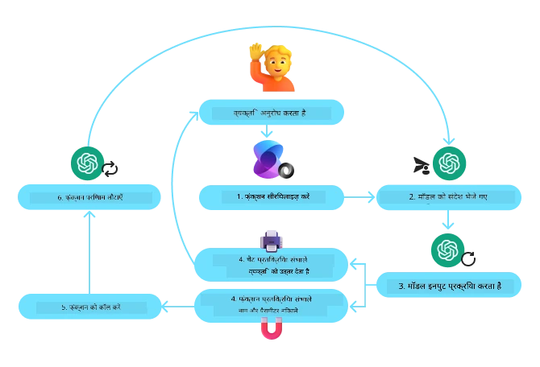
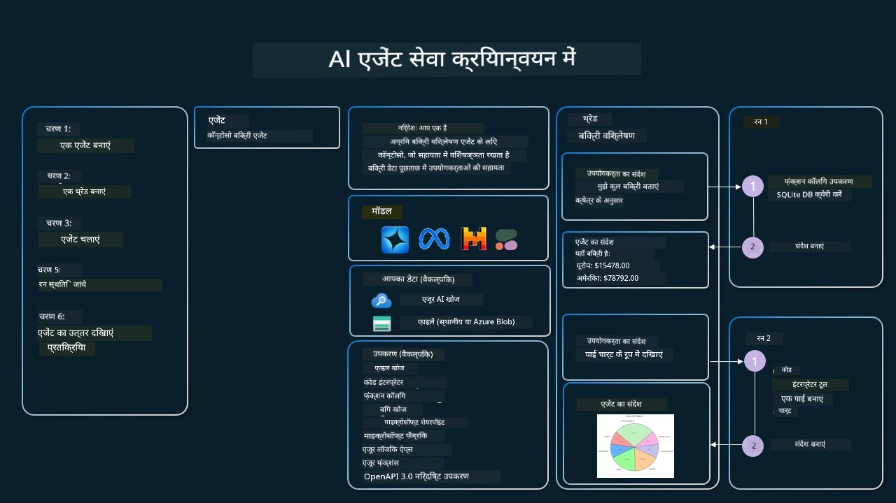

[](https://youtu.be/vieRiPRx-gI?si=cEZ8ApnT6Sus9rhn)

> _(इस पाठ का वीडियो देखने के लिए ऊपर की छवि पर क्लिक करें)_

# टूल उपयोग डिजाइन पैटर्न

टूल्स दिलचस्प होते हैं क्योंकि वे AI एजेंटों को अधिक व्यापक क्षमताओं की अनुमति देते हैं। एजेंट के पास सीमित क्रियाओं का समूह होने के बजाय, एक टूल जोड़कर, एजेंट अब कई प्रकार की क्रियाएँ कर सकता है। इस अध्याय में, हम टूल उपयोग डिजाइन पैटर्न पर चर्चा करेंगे, जो यह वर्णन करता है कि AI एजेंट कैसे विशिष्ट टूल का उपयोग करके अपने लक्ष्य प्राप्त कर सकते हैं।

## परिचय

इस पाठ में, हम निम्नलिखित प्रश्नों के उत्तर खोजेंगे:

- टूल उपयोग डिजाइन पैटर्न क्या है?
- इसे किन उपयोग मामलों में लागू किया जा सकता है?
- डिजाइन पैटर्न को लागू करने के लिए आवश्यक तत्व/निर्माण खंड क्या हैं?
- विश्वसनीय AI एजेंट बनाने के लिए टूल उपयोग डिजाइन पैटर्न का उपयोग करते समय कौन-कौन से विशेष विचार आवश्यक हैं?

## सीखने के लक्ष्य

इस पाठ को पूरा करने के बाद, आप सक्षम होंगे:

- टूल उपयोग डिजाइन पैटर्न और इसके उद्देश्य को परिभाषित करना।
- उन उपयोग मामलों की पहचान करना जहां टूल उपयोग डिजाइन पैटर्न लागू होता है।
- डिजाइन पैटर्न लागू करने के लिए आवश्यक मुख्य तत्वों को समझना।
- इस डिजाइन पैटर्न का उपयोग करने वाले AI एजेंटों में विश्वसनीयता सुनिश्चित करने के लिए विचारों को पहचानना।

## टूल उपयोग डिजाइन पैटर्न क्या है?

**टूल उपयोग डिजाइन पैटर्न** LLMs को बाहरी टूल्स के साथ संवाद करने की क्षमता प्रदान करता है ताकि वे विशिष्ट लक्ष्यों को प्राप्त कर सकें। टूल वे कोड होते हैं जिन्हें एजेंट द्वारा क्रियान्वित किया जा सकता है। एक टूल एक साधारण फ़ंक्शन हो सकता है जैसे कैलकुलेटर, या तीसरे पक्ष की सेवा के लिए API कॉल जैसे स्टॉक मूल्य पता लगाना या मौसम पूर्वानुमान। AI एजेंट के संदर्भ में, टूल मॉडल-जनित फ़ंक्शन कॉल के जवाब में एक्सीक्यूट किए जाते हैं।

## इसे किन उपयोग मामलों में लागू किया जा सकता है?

AI एजेंट टूल्स का उपयोग जटिल कार्यों को पूरा करने, जानकारी प्राप्त करने, या निर्णय लेने के लिए कर सकते हैं। टूल उपयोग डिजाइन पैटर्न अक्सर उन परिदृश्यों में उपयोग किया जाता है जहाँ बाहरी सिस्टमों जैसे डेटाबेस, वेब सेवाएँ, या कोड इंटरप्रेटर के साथ गतिशील संवाद आवश्यक होता है। यह कई उपयोग मामलों के लिए उपयोगी है, जिनमें शामिल हैं:

- **गतिशील सूचना पुनःप्राप्ति:** एजेंट बाहरी API या डेटाबेस से नवीनतम डेटा प्राप्त कर सकते हैं (जैसे, SQLite डेटाबेस से डेटा विश्लेषण के लिए पूछताछ करना, स्टॉक मूल्य या मौसम की जानकारी प्राप्त करना)।
- **कोड निष्पादन और व्याख्या:** एजेंट कोड या स्क्रिप्ट चलाकर गणितीय समस्याएं हल कर सकते हैं, रिपोर्ट बना सकते हैं, या सिमुलेशन कर सकते हैं।
- **वर्कफ्लो स्वचालन:** कार्य शेड्यूलर, ईमेल सेवाएँ, या डेटा पाइपलाइनों जैसे टूल का उपयोग करके पुनरावर्ती या बहु-चरण वर्कफ्लो को स्वचालित करना।
- **ग्राहक सहायता:** एजेंट CRM सिस्टम, टिकटिंग प्लेटफ़ॉर्म, या नॉलेज बेस के साथ संवाद कर उपयोगकर्ता प्रश्नों को हल कर सकते हैं।
- **सामग्री जनरेशन और संपादन:** एजेंट व्याकरण जांच, पाठ सारांश, या सामग्री सुरक्षा मूल्यांकन जैसे टूल का उपयोग सामग्री निर्माण कार्यों में सहायता के लिए कर सकते हैं।

## टूल उपयोग डिजाइन पैटर्न को लागू करने के लिए किन तत्वों/निर्माण खंडों की आवश्यकता होती है?

ये निर्माण खंड AI एजेंट को कई प्रकार के कार्य करने की अनुमति देते हैं। आइए टूल उपयोग डिजाइन पैटर्न को लागू करने के लिए आवश्यक मुख्य तत्व देखें:

- **फ़ंक्शन/टूल स्कीमाएं**: उपलब्ध टूल्स के विस्तृत परिभाषाएँ, जिनमें फ़ंक्शन नाम, उद्देश्य, आवश्यक पैरामीटर, और अपेक्षित आउटपुट शामिल हैं। ये स्कीमाएं LLM को यह समझने में मदद करती हैं कि कौन-कौन से टूल उपलब्ध हैं और वैध अनुरोध कैसे बनाए जाएं।

- **फ़ंक्शन निष्पादन लॉजिक**: यह नियंत्रित करता है कि उपयोगकर्ता की अभिप्रेत क्रिया और वार्तालाप संदर्भ के आधार पर टूल कब और कैसे बुलाए जाएं। इसमें योजना बनाने वाले मॉड्यूल, रूटिंग तंत्र, या सशर्त प्रवाह शामिल हो सकते हैं जो टूल के उपयोग को गतिशील रूप से निर्धारित करते हैं।

- **संदेश प्रबंधन प्रणाली**: घटक जो उपयोगकर्ता इनपुट, LLM प्रतिक्रियाओं, टूल कॉल्स, और टूल आउटपुट के बीच संवाद प्रवाह का प्रबंधन करते हैं।

- **टूल एकीकरण फ्रेमवर्क**: वह अवसंरचना जो एजेंट को विभिन्न टूल्स से जोड़ती है, चाहे वे सरल फ़ंक्शन हों या जटिल बाहरी सेवाएँ।

- **त्रुटि प्रबंधन और सत्यापन**: टूल निष्पादन में विफलताओं को संभालने, पैरामीटर की जाँच करने, और अप्रत्याशित प्रतिक्रियाओं का प्रबंधन करने के तंत्र।

- **स्थिति प्रबंधन**: वार्तालाप संदर्भ, पिछले टूल इंटरैक्शन, और लगातार डेटा को ट्रैक करता है ताकि बहु-चरण इंटरैक्शन में निरंतरता बनी रहे।

इसके बाद, आइए फ़ंक्शन/टूल कॉलिंग को अधिक विवरण में देखें।
 
### फ़ंक्शन/टूल कॉलिंग

फ़ंक्शन कॉलिंग वह प्राथमिक तरीका है जिससे हम बड़े भाषा मॉडल्स (LLMs) को टूल्स के साथ संवाद करने में सक्षम बनाते हैं। आप अक्सर 'फ़ंक्शन' और 'टूल' शब्दों का प्रतिव्यवहार करते हुए देखेंगे क्योंकि 'फ़ंक्शन' (पुनः उपयोग योग्य कोड ब्लॉक्स) वे 'टूल' हैं जिनका उपयोग एजेंट कार्यों को पूरा करने के लिए करते हैं। किसी फ़ंक्शन के कोड को चलाने के लिए, LLM को उपयोगकर्ता के अनुरोध की तुलना उस फ़ंक्शन के विवरण से करनी होती है। इसके लिए, उपलब्ध सभी फ़ंक्शन्स के विवरण वाले एक स्कीमा को LLM को भेजा जाता है। LLM फिर कार्य के लिए सबसे उपयुक्त फ़ंक्शन चुनता है और उसका नाम तथा तर्क वापस करता है। चुना गया फ़ंक्शन चलाया जाता है, इसकी प्रतिक्रिया LLM को भेजी जाती है, जो उस जानकारी का उपयोग उपयोगकर्ता के अनुरोध का उत्तर देने के लिए करता है।

डेवलपर्स के लिए एजेंट के लिए फ़ंक्शन कॉलिंग लागू करने हेतु आवश्यक होगा:

1. एक LLM मॉडल जो फ़ंक्शन कॉलिंग का समर्थन करता हो
2. फ़ंक्शन विवरणों वाला स्कीमा
3. प्रत्येक वर्णित फ़ंक्शन के लिए कोड

चलिए शहर में वर्तमान समय प्राप्त करने के उदाहरण से समझाते हैं:

1. **ऐसा LLM इनिशियलाइज़ करें जो फ़ंक्शन कॉलिंग का समर्थन करता हो:**

    सभी मॉडल फ़ंक्शन कॉलिंग का समर्थन नहीं करते, इसलिए यह जांचना महत्वपूर्ण है कि जिस LLM का आप उपयोग कर रहे हैं वह करता है या नहीं। <a href="https://learn.microsoft.com/azure/ai-services/openai/how-to/function-calling" target="_blank">Azure OpenAI</a> फ़ंक्शन कॉलिंग का समर्थन करता है। हम Azure OpenAI **Responses API** (स्थिर `/openai/v1/` एंडपॉइंट — कोई `api_version` आवश्यक नहीं) के खिलाफ OpenAI क्लाइंट शुरू करके काम शुरू कर सकते हैं। 

    ```python
    # Initialize the OpenAI client for Azure OpenAI (Responses API, v1 endpoint)
    client = OpenAI(
        base_url=f"{os.environ['AZURE_OPENAI_ENDPOINT'].rstrip('/')}/openai/v1/",
        api_key=os.environ["AZURE_OPENAI_API_KEY"],
    )
    deployment_name = os.environ["AZURE_OPENAI_DEPLOYMENT"]
    ```

1. **फ़ंक्शन स्कीमा बनाएँ**:

    इसके बाद हम एक JSON स्कीमा परिभाषित करेंगे जिसमें फ़ंक्शन का नाम, फ़ंक्शन क्या करता है इसका विवरण, और फ़ंक्शन पैरामीटर के नाम व विवरण शामिल होंगे।
    फिर इस स्कीमा को पिछले बनाए गए क्लाइंट को, साथ ही उपयोगकर्ता के सैन फ्रांसिस्को में समय ज्ञात करने के अनुरोध के साथ, भेजेंगे। महत्वपूर्ण यह है कि जो वापस मिलता है वह एक **टूल कॉल** होता है, प्रश्न का अंतिम उत्तर नहीं। जैसा कि पहले बताया गया है, LLM कार्य के लिए चुने गए फ़ंक्शन का नाम और उसे दिए जाने वाले तर्क लौटाता है।

    ```python
    # Function description for the model to read (Responses API flat tool format)
    tools = [
        {
            "type": "function",
            "name": "get_current_time",
            "description": "Get the current time in a given location",
            "parameters": {
                "type": "object",
                "properties": {
                    "location": {
                        "type": "string",
                        "description": "The city name, e.g. San Francisco",
                    },
                },
                "required": ["location"],
            },
        }
    ]
    ```
   
    ```python
  
    # Initial user message
    messages = [{"role": "user", "content": "What's the current time in San Francisco"}]

    # First API call: Ask the model to use the function
    response = client.responses.create(
        model=deployment_name,
        input=messages,
        tools=tools,
        tool_choice="auto",
        store=False,
    )

    # The Responses API returns tool calls as function_call items in response.output.
    # Append them to the conversation so the model has full context on the next turn.
    messages += response.output

    print("Model's response:")
    print(response.output)
  
    ```

    ```bash
    Model's response:
    [ResponseFunctionToolCall(arguments='{"location":"San Francisco"}', call_id='call_pOsKdUlqvdyttYB67MOj434b', name='get_current_time', type='function_call')]
    ```
  
1. **कार्य को पूरा करने के लिए आवश्यक फ़ंक्शन कोड:**

    अब जबकि LLM ने निर्णय ले लिया है कि कौन सा फ़ंक्शन चलाना है, उस कार्य को पूरा करने वाला कोड कार्यान्वित और निष्पादित होना चाहिए।
    हम पाइथन में वर्तमान समय प्राप्त करने कोड को लागू कर सकते हैं। हमें अंतिम परिणाम प्राप्त करने के लिए response_message से नाम और तर्क निष्कर्षित करने का कोड भी लिखना होगा।

    ```python
      def get_current_time(location):
        """Get the current time for a given location"""
        print(f"get_current_time called with location: {location}")  
        location_lower = location.lower()
        
        for key, timezone in TIMEZONE_DATA.items():
            if key in location_lower:
                print(f"Timezone found for {key}")  
                current_time = datetime.now(ZoneInfo(timezone)).strftime("%I:%M %p")
                return json.dumps({
                    "location": location,
                    "current_time": current_time
                })
      
        print(f"No timezone data found for {location_lower}")  
        return json.dumps({"location": location, "current_time": "unknown"})
    ```

     ```python
    # Handle function calls
    tool_calls = [item for item in response.output if item.type == "function_call"]
    if tool_calls:
        for tool_call in tool_calls:
            if tool_call.name == "get_current_time":

                function_args = json.loads(tool_call.arguments)

                time_response = get_current_time(
                    location=function_args.get("location")
                )

                # Return the tool result as a function_call_output item
                messages.append({
                    "type": "function_call_output",
                    "call_id": tool_call.call_id,
                    "output": time_response,
                })
    else:
        print("No tool calls were made by the model.")

    # Second API call: Get the final response from the model
    final_response = client.responses.create(
        model=deployment_name,
        input=messages,
        tools=tools,
        store=False,
    )

    return final_response.output_text
     ```

     ```bash
      get_current_time called with location: San Francisco
      Timezone found for san francisco
      The current time in San Francisco is 09:24 AM.
     ```

फ़ंक्शन कॉलिंग अधिकांश, यदि सभी नहीं, एजेंट टूल उपयोग डिज़ाइन का मूल है, हालांकि इसे स्क्रैच से लागू करना कभी-कभी चुनौतीपूर्ण हो सकता है।
जैसा कि हमने [पाठ 2](../../../02-explore-agentic-frameworks) में जाना, एजेंटिक फ्रेमवर्क हमें टूल उपयोग लागू करने के लिए पूर्व-निर्मित निर्माण खंड प्रदान करते हैं।
 
## एजेंटिक फ्रेमवर्क के साथ टूल उपयोग उदाहरण

यहाँ कुछ उदाहरण दिए गए हैं कि कैसे आप विभिन्न एजेंटिक फ्रेमवर्क का उपयोग करके टूल उपयोग डिजाइन पैटर्न लागू कर सकते हैं:

### Microsoft एजेंट फ्रेमवर्क

<a href="https://learn.microsoft.com/azure/ai-services/agents/overview" target="_blank">Microsoft एजेंट फ्रेमवर्क</a> एक ओपन-सोर्स AI फ्रेमवर्क है AI एजेंट बनाने के लिए। यह फ़ंक्शन कॉलिंग का उपयोग सरल बनाता है क्योंकि आप टूल्स को Python फ़ंक्शन के रूप में `@tool` डेकोरेटर के साथ परिभाषित कर सकते हैं। फ्रेमवर्क मॉडल और आपके कोड के बीच संवाद को संभालता है। यह फ़ाइल खोज और कोड इंटरप्रेटर जैसे पूर्व-निर्मित टूलों तक पहुंच भी प्रदान करता है `FoundryChatClient` के माध्यम से।

निम्नलिखित आरेख Microsoft एजेंट फ्रेमवर्क के साथ फ़ंक्शन कॉलिंग की प्रक्रिया को दर्शाता है:



Microsoft एजेंट फ्रेमवर्क में, टूल्स डेकोरेटेड फ़ंक्शन्स के रूप में परिभाषित होते हैं। हम पहले देखे गये `get_current_time` फ़ंक्शन को `@tool` डेकोरेटर का उपयोग करके एक टूल में परिवर्तित कर सकते हैं। फ्रेमवर्क स्वचालित रूप से फ़ंक्शन और उसके पैरामीटरों को सीरियलाइज़ करेगा, जो LLM को भेजने के लिए स्कीमा बनाएगा।

```python
import os
from agent_framework import tool
from agent_framework.foundry import FoundryChatClient
from azure.identity import AzureCliCredential

@tool(approval_mode="never_require")
def get_current_time(location: str) -> str:
    """Get the current time for a given location"""
    ...

# Create the client
provider = FoundryChatClient(
    project_endpoint=os.environ["AZURE_AI_PROJECT_ENDPOINT"],
    model=os.environ["AZURE_AI_MODEL_DEPLOYMENT_NAME"],
    credential=AzureCliCredential(),
)

# Create an agent and run with the tool
agent = provider.as_agent(name="TimeAgent", instructions="Use available tools to answer questions.", tools=get_current_time)
response = await agent.run("What time is it?")
```

#### MCP सर्वर से टूल्स

टूल्स आपके कोड में फ़ंक्शन होने जरूरी नहीं हैं। मॉडल कंटेक्स्ट प्रोटोकॉल (MCP, जिसे [पाठ 11](../11-agentic-protocols/README.md) में कवर किया गया है) बोलने वाला एक सर्वर अपने टूल्स को उनके स्कीमाओं के साथ प्रकाशित करता है, और फ्रेमवर्क उन्हें उसी तरह लोड कर सकता है जैसे यह किसी डेकोरेटेड फ़ंक्शन को सीरियलाइज़ करता है। `MCPStreamableHTTPTool` HTTP के माध्यम से ऐसे सर्वर से जुड़ता है, टूल स्कीमाएँ पढ़ता है, और इन्हें किसी भी स्थानीय टूल्स के बगल में मॉडल को प्रदान करता है।

नीचे दिया गया उदाहरण <a href="https://keenable.ai" target="_blank">Keenable</a> द्वारा होस्ट की गई वेब सर्च सर्वर का उपयोग करता है। इसका उपयोग मुफ्त है बिना खाते या API कुंजी के (प्रति आईपी अनुरोधों पर दर सीमा लगाई गई है), इसलिए आपको केवल अपने मॉडल के प्रमाण-पत्रों की ज़रूरत है। किसी भी दूरस्थ टूल की तरह, मॉडल द्वारा लिखे गए क्वेरी सर्वर को भेजे जाते हैं।

```python
from agent_framework import MCPStreamableHTTPTool

web_search = MCPStreamableHTTPTool(
    name="Keenable web search",
    url="https://api.keenable.ai/mcp",
)

# Connecting loads the server's tool schemas; the agent decides when to call them
async with web_search:
    agent = provider.as_agent(
        name="ResearchAgent",
        instructions="Use available tools to answer questions.",
        tools=[web_search],
    )
    response = await agent.run("What is new in the latest Python release?")
    print(response.text)
```

सर्वर दो टूल्स, `search_web_pages` और `fetch_page_content` प्रकाशित करता है। जब किसी प्रश्न को वर्तमान जानकारी की आवश्यकता होती है, तो मॉडल `search_web_pages` को कॉल करता है, टाइटल, URLs और टेक्स्ट स्निपेट्स वापस पाता है, और इन्हें देखकर उत्तर लिखता है, जैसा कि ऊपर `get_current_time` उदाहरण में था।
  
### Microsoft Foundry एजेंट सेवा

<a href="https://learn.microsoft.com/azure/ai-services/agents/overview" target="_blank">Microsoft Foundry एजेंट सेवा</a> एक नया एजेंटिक फ्रेमवर्क है जिसे डेवलपर्स को उच्च गुणवत्ता वाले, और विस्तार योग्य AI एजेंट सुरक्षित रूप से निर्माण, तैनाती, और स्केल करने का सशक्त बनाने के लिए डिजाइन किया गया है, जिसमें बैकएंड कंप्यूट और स्टोरेज संसाधनों का प्रबंधन करने की आवश्यकता नहीं होती। यह विशेष रूप से उद्यम अनुप्रयोगों के लिए उपयोगी है क्योंकि यह एक पूरी तरह प्रबंधित सेवा है जिसमें उद्यम स्तरीय सुरक्षा है।

LLM API के सीधे विकास की तुलना में, Microsoft Foundry एजेंट सेवा कुछ लाभ प्रदान करता है, जिनमें शामिल हैं:

- स्वचालित टूल कॉलिंग – टूल कॉल पार्स करने, टूल को कॉल करने, और प्रतिक्रिया को हैंडल करने की आवश्यकता नहीं; यह सब अब सर्वर-साइड होता है
- सुरक्षित रूप से प्रबंधित डेटा – अपनी वार्तालाप स्थिति प्रबंधित करने के बजाय, आप थ्रेड्स पर भरोसा कर सकते हैं जो सभी आवश्यक जानकारी संग्रहीत करते हैं
- आउट-ऑफ-द-बॉक्स टूल्स – ऐसे टूल्स जो आपकी डेटा स्रोतों के साथ संवाद करने के लिए उपयोग किए जा सकते हैं, जैसे Bing, Azure AI Search और Azure Functions।

Microsoft Foundry एजेंट सेवा में उपलब्ध टूल्स को दो श्रेणियों में विभाजित किया जा सकता है:

1. ज्ञान टूल्स:
    - <a href="https://learn.microsoft.com/azure/ai-services/agents/how-to/tools/bing-grounding?tabs=python&pivots=overview" target="_blank">Bing Search के साथ ग्राउंडिंग</a>
    - <a href="https://learn.microsoft.com/azure/ai-services/agents/how-to/tools/file-search?tabs=python&pivots=overview" target="_blank">फ़ाइल खोज</a>
    - <a href="https://learn.microsoft.com/azure/ai-services/agents/how-to/tools/azure-ai-search?tabs=azurecli%2Cpython&pivots=overview-azure-ai-search" target="_blank">Azure AI Search</a>

2. क्रियात्मक टूल्स:
    - <a href="https://learn.microsoft.com/azure/ai-services/agents/how-to/tools/function-calling?tabs=python&pivots=overview" target="_blank">फ़ंक्शन कॉलिंग</a>
    - <a href="https://learn.microsoft.com/azure/ai-services/agents/how-to/tools/code-interpreter?tabs=python&pivots=overview" target="_blank">कोड इंटरप्रेटर</a>
    - <a href="https://learn.microsoft.com/azure/ai-services/agents/how-to/tools/openapi-spec?tabs=python&pivots=overview" target="_blank">OpenAPI परिभाषित टूल्स</a>
    - <a href="https://learn.microsoft.com/azure/ai-services/agents/how-to/tools/azure-functions?pivots=overview" target="_blank">Azure Functions</a>

एजेंट सेवा हमें इन टूल्स को एक `toolset` के रूप में एक साथ उपयोग करने की अनुमति देता है। यह `threads` का भी उपयोग करता है जो किसी विशेष वार्तालाप के संदेशों का इतिहास ट्रैक करता है।

कल्पना करें कि आप Contoso नामक कंपनी में एक बिक्री एजेंट हैं। आप एक संवादात्मक एजेंट विकसित करना चाहते हैं जो आपकी बिक्री डेटा के बारे में प्रश्नों का उत्तर दे सके।

निम्न छवि दर्शाती है कि आप Microsoft Foundry एजेंट सेवा का उपयोग कैसे कर सकते हैं अपनी बिक्री डेटा का विश्लेषण करने के लिए:



इस सेवा के साथ किसी भी टूल का उपयोग करने के लिए हम एक क्लाइंट बना सकते हैं और एक टूल या टूलसेट को परिभाषित कर सकते हैं। इसे व्यावहारिक रूप से लागू करने के लिए हम निम्नलिखित पाइथन कोड का उपयोग कर सकते हैं। LLM टूलसेट को देखकर निर्णय ले सकेगा कि उपयोगकर्ता-निर्मित फ़ंक्शन, `fetch_sales_data_using_sqlite_query`, या पूर्व-निर्मित कोड इंटरप्रेटर उपयोग करना है या नहीं, उपयोगकर्ता अनुरोध के आधार पर।

```python 
import os
from azure.ai.projects import AIProjectClient
from azure.identity import DefaultAzureCredential
from fetch_sales_data_functions import fetch_sales_data_using_sqlite_query # fetch_sales_data_using_sqlite_query function which can be found in a fetch_sales_data_functions.py file.
from azure.ai.projects.models import ToolSet, FunctionTool, CodeInterpreterTool

project_client = AIProjectClient.from_connection_string(
    credential=DefaultAzureCredential(),
    conn_str=os.environ["PROJECT_CONNECTION_STRING"],
)

# Initialize toolset
toolset = ToolSet()

# Initialize function calling agent with the fetch_sales_data_using_sqlite_query function and adding it to the toolset
fetch_data_function = FunctionTool(fetch_sales_data_using_sqlite_query)
toolset.add(fetch_data_function)

# Initialize Code Interpreter tool and adding it to the toolset. 
code_interpreter = CodeInterpreterTool()toolset.add(code_interpreter)

agent = project_client.agents.create_agent(
    model="gpt-5-mini", name="my-agent", instructions="You are helpful agent", 
    toolset=toolset
)
```

## विश्वसनीय AI एजेंट बनाने के लिए टूल उपयोग डिजाइन पैटर्न का उपयोग करते समय विशेष विचार क्या हैं?

LLMs द्वारा गतिशील रूप से उत्पन्न SQL के साथ सामान्य चिंता सुरक्षा की होती है, विशेष रूप से SQL इंजेक्शन या दुर्भावनापूर्ण क्रियाओं जैसे डेटाबेस गिराना या छेड़छाड़ करने का जोखिम। हालांकि ये चिंता वैध हैं, इन्हें प्रभावी ढंग से डेटाबेस पहुंच अनुमतियाँ ठीक से कॉन्फ़िगर करके कम किया जा सकता है। अधिकांश डेटाबेस के लिए इसका मतलब होता है कि डेटाबेस को केवल-पठन मोड में कॉन्फ़िगर किया जाए। PostgreSQL या Azure SQL जैसी डेटाबेस सेवाओं के लिए, ऐप को केवल-पठन (SELECT) भूमिका सौंपनी चाहिए।

ऐप को सुरक्षित वातावरण में चलाना सुरक्षा को और भी बढ़ाता है। उद्यम परिदृश्यों में, डेटा आमतौर पर संचालन प्रणालियों से निकाला और परिवर्तित किया जाता है एक केवल-पठन डेटाबेस या डेटा वेयरहाउस में उपयोगकर्ता-मित्रवत स्कीमा के साथ। यह दृष्टिकोण सुनिश्चित करता है कि डेटा सुरक्षित, प्रदर्शन और पहुंच के लिए अनुकूलित है, और ऐप की पहुंच सीमित और केवल-पठन होती है।

## नमूना कोड

- पाइथन: [Agent Framework](./code_samples/04-python-agent-framework.ipynb)
- .NET: [Agent Framework](./code_samples/04-dotnet-agent-framework.md)

## क्या टूल उपयोग डिजाइन पैटर्न के बारे में आपके पास और प्रश्न हैं?

[Microsoft Foundry Discord](https://discord.com/invite/ATgtXmAS5D) से जुड़ें अन्य सीखने वालों से मिलने, ऑफिस आवर्स में भाग लेने, और अपने AI एजेंट से संबंधित प्रश्नों का उत्तर पाने के लिए।

## अतिरिक्त संसाधन

- <a href="https://microsoft.github.io/build-your-first-agent-with-azure-ai-agent-service-workshop/" target="_blank">Azure AI Agents सेवा कार्यशाला</a>
- <a href="https://github.com/Azure-Samples/contoso-creative-writer/tree/main/docs/workshop" target="_blank">Contoso क्रिएटिव राइटर मल्टी-एजेंट वर्कशॉप</a>
- <a href="https://learn.microsoft.com/azure/ai-services/agents/overview" target="_blank">माइक्रोसॉफ्ट एजेंट फ्रेमवर्क अवलोकन</a>

## इस एजेंट का स्मोक-टेस्ट करना (वैकल्पिक)

[Lesson 16](../16-deploying-scalable-agents/README.md) में एजेंट तैनात करना सीखने के बाद, आप इस पाठ के `TravelToolAgent` का स्मोक-टेस्ट कर सकते हैं (क्या यह अभी भी अपने टूल्स को कॉल करता है और उत्तर देता है?) [`tests/lesson-04-smoke-tests.json`](../../../tests/lesson-04-smoke-tests.json) के साथ। इसे चलाने के लिए [`tests/README.md`](../tests/README.md) देखें।

## पिछला पाठ

[Agentic Design Patterns को समझना](../03-agentic-design-patterns/README.md)

## अगला पाठ

[Agentic RAG](../05-agentic-rag/README.md)

---

<!-- CO-OP TRANSLATOR DISCLAIMER START -->
**अस्वीकरण**:
इस दस्तावेज़ का अनुवाद AI अनुवाद सेवा [Co-op Translator](https://github.com/Azure/co-op-translator) का उपयोग करके किया गया है। जबकि हम सटीकता के लिए प्रयास करते हैं, कृपया ध्यान दें कि स्वचालित अनुवादों में त्रुटियाँ या अशुद्धियाँ हो सकती हैं। मूल दस्तावेज़ अपनी मूल भाषा में ही प्रामाणिक स्रोत माना जाना चाहिए। महत्वपूर्ण जानकारी के लिए, पेशेवर मानव अनुवाद की सिफारिश की जाती है। इस अनुवाद के उपयोग से उत्पन्न किसी भी गलतफहमी या गलत व्याख्या के लिए हम उत्तरदायी नहीं हैं।
<!-- CO-OP TRANSLATOR DISCLAIMER END -->