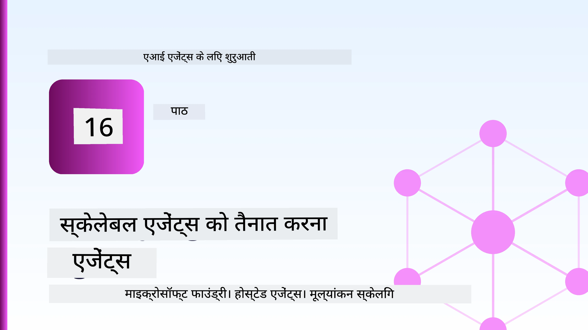
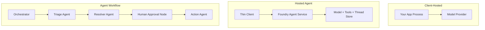
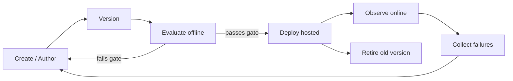
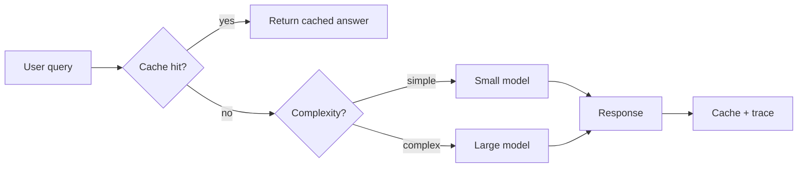
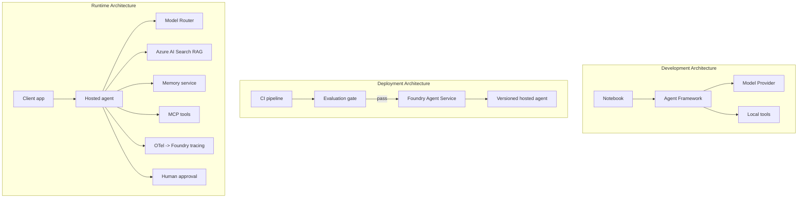

# Microsoft Foundry के साथ स्केलेबल एजेंट्स को तैनात करना



अब तक इस कोर्स में आपने ऐसे एजेंट बनाए हैं जो आपके लैपटॉप पर, नोटबुक के अंदर चलते हैं, `az login` और कुछ पर्यावरण चर द्वारा संचालित होते हैं। यह सीखने का बिलकुल सही तरीका है। लेकिन यह उस एजेंट को चलाने का सही तरीका नहीं है जिस पर हजारों ग्राहक 3 बजे सुबह भरोसा करते हैं।

यह पाठ "यह मेरी मशीन पर काम करता है" और "यह उत्पादन में विश्वसनीयता और किफायती तरीके से काम करता है" के बीच के अंतर के बारे में है। हम इस अंतर को **Microsoft Foundry** और **Microsoft Foundry Agent Service** का उपयोग करके बंद करते हैं, और ऐसा एक वास्तविक ग्राहक सहायता एजेंट बनाकर करते हैं जिसमें टूल्स, पुनःप्राप्ति, मेमोरी, मूल्यांकन, और निगरानी शामिल हैं।

## परिचय

यह पाठ निम्नलिखित को कवर करेगा:

- **प्रोटोटाइप एजेंट** और **तैनात एजेंट** के बीच का अंतर, और क्यों संक्रमण मुख्य रूप से मॉडल के *आसपस* की सारी चीजों के बारे में है।
- एजेंट्स के लिए **तैनाती पैटर्न**: क्लाइंट-होस्टेड, सर्विस-होस्टेड (होस्टेड एजेंट्स), और वर्कफ़्लो-ऑर्केस्ट्रेटेड।
- Microsoft Foundry पर **एजेंट जीवनचक्र** — बनाना, संस्करण बनाना, तैनात करना, मूल्यांकन करना, निरीक्षण करना, सेवानिवृत्त करना।
- **स्केलिंग रणनीतियाँ**: मॉडल रूटिंग, कैशिंग, समवर्ती संचालन, और स्टेटलेस डिज़ाइन।
- OpenTelemetry और Foundry ट्रेसिंग के साथ **पर्यवेक्षण**।
- मॉडल चयन, रूटिंग, और मूल्यांकन गेट के माध्यम से **लागत अनुकूलन**।
- **एंटरप्राइज विचार**: गवर्नेंस, मानव अनुमोदन, और उत्पादन में MCP सर्वर को सुरक्षित रूप से चलाना।

## सीखने के लक्ष्य

इस पाठ को पूरा करने के बाद, आप जान पाएंगे कि कैसे:

- किसी दिए गए एजेंट वर्कलोड के लिए सही तैनाती पैटर्न चुनें।
- किसी एजेंट को Microsoft Foundry Agent Service में तैनात करें ताकि वह संस्करणित, संचालित, और पर्यवेक्षित हो।
- ट्रेसिंग के लिए एक एजेंट को इंस्ट्रूमेंट करें और एक मूल्यांकन पाइपलाइन कनेक्ट करें जो हर रिलीज से पहले चलता है।
- स्केल में विलंबता और लागत को नियंत्रण में रखने के लिए मॉडल रूटिंग और कैशिंग लागू करें।
- उच्च जोखिम वाली क्रियाओं के लिए मानव अनुमोदन गेट जोड़ें और उत्पादन-सुरक्षित तरीके से MCP सर्वर एकीकृत करें।

## पूर्वापेक्षाएं

यह पाठ मानता है कि आपने पिछले पाठ पूरे कर लिए हैं और निम्नलिखित में आरामदायक हैं:

- [Microsoft Agent Framework](../14-microsoft-agent-framework/README.md) के साथ एजेंट बनाना (पाठ 14)।
- [टूल उपयोग](../04-tool-use/README.md) (पाठ 4) और [Agentic RAG](../05-agentic-rag/README.md) (पाठ 5)।
- [एजेंट मेमोरी](../13-agent-memory/README.md) (पाठ 13) और [Agentic Protocols / MCP](../11-agentic-protocols/README.md) (पाठ 11)।
- [पर्यवेक्षण और मूल्यांकन](../10-ai-agents-production/README.md) (पाठ 10) — यह पाठ सीधे वहीं से बनता है।

आपको निम्नलिखित की भी आवश्यकता होगी:

- एक **Azure सदस्यता** और एक **Microsoft Foundry प्रोजेक्ट** जिसमें कम से कम एक तैनात चैट मॉडल हो।
- प्रमाणीकृत **Azure CLI** (`az login`)।
- Python 3.12+ और रिपोजिटरी के पैकेज [`requirements.txt`](../../../requirements.txt)।

## प्रोटोटाइप से प्रोडक्शन तक: वास्तव में क्या बदलता है

एक प्रोटोटाइप एजेंट और एक प्रोडक्शन एजेंट का कोर लूप समान होता है — कारण बताएं, टूल्स को कॉल करें, प्रतिक्रिया दें। जो बदलता है वह उस लूप के चारों ओर लिपटी हुई हर चीज़ है। मॉडल लगभग 20% प्रोडक्शन एजेंट का होता है; बाकी 80% परिचालन कंकाल है।

| चिंता | प्रोटोटाइप | प्रोडक्शन |
| --- | --- | --- |
| **होस्टिंग** | आपके नोटबुक में चलता है | एक होस्टेड सेवा के रूप में चलता है, संस्करणित और जारी किया जाता है |
| **पहचान** | आपका `az login` टोकन | स्कोप्ड RBAC के साथ प्रबंधित पहचान |
| **राज्य** | इन-मेमोरी, पुनः आरंभ पर खो जाता है | बाहरी (थ्रेड स्टोर, मेमोरी सेवा) |
| **विफलता** | आप ट्रेसबैक देखते हैं | पुनः प्रयास, फॉलबैक, डेड-लेटर, अलर्ट |
| **लागत** | "यह कुछ सेंट्स है" | प्रति अनुरोध ट्रैक किया जाता है, रूटेड, कैश्ड, बजट किया गया |
| **गुणवत्ता** | आप आउटपुट को आंख से जांचते हैं | हर रिलीज से पहले स्वचालित रूप से मूल्यांकन किया जाता है |
| **विश्वास** | आप हर क्रिया को मंजूरी देते हैं | जोखिम भरे कार्यों के लिए नीति + मानव-इन-द-लूप |

इस तालिका को ध्यान में रखें। नीचे हर अनुभाग इन पंक्तियों में से एक से मेल खाता है।

## एजेंट तैनाती पैटर्न

तीन पैटर्न हैं जिन्हें आप अक्सर संयोजन में उपयोग करेंगे।

### 1. क्लाइंट-होस्टेड एजेंट्स

एजेंट वस्तु आपके *एप्लिकेशन प्रक्रिया* के अंदर रहती है। आपका कोड सीधे मॉडल प्रदाता को कॉल करता है; तर्क लूप आपकी सेवा में चलता है। यह वह है जो हर पिछले पाठ में किया गया है।

- **इसे तब उपयोग करें** जब आपको लूप पर पूर्ण नियंत्रण चाहिए, कस्टम मिडलवेयर, या आप एजेंट को किसी मौजूदा बैकएंड में सम्मिलित कर रहे हैं।
- **समझौता**: आप स्केलिंग, राज्य, और लचीलापन स्वयं संभालते हैं।

### 2. होस्टेड एजेंट्स (Foundry Agent Service)

एजेंट Microsoft Foundry में *एक संसाधन के रूप में पंजीकृत* है। Foundry तर्क लूप होस्ट करता है, थ्रेड स्टोर करता है, कंटेंट सुरक्षा और RBAC लागू करता है, और एजेंट को Foundry पोर्टल में दृश्य बनाता है। आपका ऐप एक पतला क्लाइंट बन जाता है जो थ्रेड बनाता है और प्रतिक्रियाएँ पढ़ता है।

- **इसे तब उपयोग करें** जब आप टिकाऊपन, अंतर्निर्मित पर्यवेक्षण, शासन, और कम परिचालन सतह क्षेत्र चाहते हैं।
- **समझौता**: प्रबंधित रनटाइम के बदले कम स्तर का नियंत्रण।

### 3. एजेंट वर्कफ़्लोज़

कई एजेंट (और टूल्स) को स्पष्ट नियंत्रण प्रवाह वाले एक ग्राफ में जोड़ा जाता है — अनुक्रमिक चरण, शाखा बनाना, मानव अनुमोदन नोड्स, और टिकाऊ चेकपॉइंट जो रोक सकते हैं और पुनः शुरू कर सकते हैं। यह Microsoft Agent Framework का **वर्कफ़्लोज़** फीचर है जो तैनाती स्तर पर लागू होता है।

- **इसे तब उपयोग करें** जब एक कार्य कई विशेष एजेंट्स तक फैला हो या बीच में एक अनुमोदन कदम आवश्यक हो।
- **समझौता**: अधिक गतिशील हिस्से; ऑर्केस्ट्रेशन-स्तर की पर्यवेक्षण आवश्यक।



## Microsoft Foundry पर एजेंट जीवनचक्र

एक एजेंट को तैनात करना एक एकबारगी `push` नहीं है। यह एक लूप है, और यह सॉफ्टवेयर रिलीज़ साइकिल की तरह दिखता है क्योंकि वास्तव में यही है।



मूल विचार, जो [पाठ 10](../10-ai-agents-production/README.md) से लिया गया है: **ऑफ़लाइन मूल्यांकन एक गेट है, बाद की सोच नहीं।** जब तक नया एजेंट संस्करण आपकी मूल्यांकन सीमाओं को पार नहीं करता, तब तक यह जारी नहीं होता। ऑनलाइन पर्यवेक्षण फिर वास्तविक विश्व की विफलताओं को आपके ऑफ़लाइन परीक्षण सेट में वापस भेजता है। यह पूरा लूप है।

## स्केलिंग रणनीतियाँ

एक एजेंट को स्केल करना एक स्टेटलेस वेब API को स्केल करने से अलग है, क्योंकि प्रत्येक अनुरोध कई महंगे मॉडल और टूल कॉल को ट्रिगर कर सकता है। चार तकनीकें अधिकांश लोड संभालती हैं।

**स्टेटलेस अनुरोध हैंडलिंग।** अपनी प्रक्रिया मेमोरी में किसी यूजर का राज्य न रखें। बातचीत के थ्रेड को Foundry थ्रेड स्टोर या मेमोरी सेवा में स्थायी बनाएं ताकि कोई भी उदाहरण किसी भी अनुरोध को संभाल सके। यही आपको क्षैतिज स्केलिंग की अनुमति देता है — उदाहरण जोड़ें, कोई स्टिकी सेशन नहीं।

**मॉडल रूटिंग।** हर अनुरोध को आपके सबसे सक्षम (और सबसे महंगे) मॉडल की आवश्यकता नहीं होती। सरल अनुरोधों — इरादा वर्गीकरण, संक्षिप्त तथ्यात्मक उत्तर — को एक छोटे, तेज मॉडल पर रूट करें, और बड़े मॉडल को वास्तविक तर्क के लिए आरक्षित रखें। Foundry का **Model Router** इसे आपके लिए कर सकता है, या आप स्वयं एक हल्का वर्गीकर्ता लागू कर सकते हैं। आप लैब में DIY संस्करण बनाएंगे।

**प्रतिक्रिया कैशिंग।** कई समर्थन प्रश्न करीब-दुहरीकरण होते हैं ("मैं अपना पासवर्ड कैसे रीसेट करूं?")। सामान्य प्रश्नों के उत्तर कैश करें और बिना मॉडल को हिट किए उन्हें सेवा दें। एक मामूली कैश हिट दर भी लागत और विलंबता को महत्वपूर्ण रूप से कम करती है।

**समवर्तीता और बैकप्रेशर।** मॉडल प्रदाताओं के पास दर सीमाएँ होती हैं। अपनी समवर्तीता को सीमित करें, गुणोत्तर बैकऑफ के साथ पुनः प्रयास करें, और विनम्रतापूर्वक विफल हों (क्यूड "हम उस पर हैं" प्रतिक्रिया 500 से बेहतर है)।



## उत्पादन में पर्यवेक्षण

आप वह नहीं चला सकते जो आप नहीं देख सकते। जैसा कि पाठ 10 में कवर किया गया है, Microsoft Agent Framework स्वाभाविक रूप से **OpenTelemetry** ट्रेस जारी करता है — हर मॉडल कॉल, टूलInvocation, और ऑर्केस्ट्रेशन चरण एक स्पैन बन जाता है। उत्पादन में आप उन स्पैनों को Microsoft Foundry (या किसी भी OTel-अनुकूल बैकेंड) को निर्यात करते हैं ताकि आप:

- एक ग्राहक शिकायत को उसके अंत तक प्रति मॉडल और टूल कॉल ट्रेस कर सकें।
- समय के साथ प्रति अनुरोध p50/p95 विलंबता और लागत को देख सकें।
- उपयोगकर्ताओं (या आपके वित्त टीम) के ध्यान में आने से पहले त्रुटि-दर स्पाइक और लागत विसंगतियों पर अलर्ट जारी करें।

```python
from agent_framework.observability import get_tracer

tracer = get_tracer()

with tracer.start_as_current_span("support_request") as span:
    span.set_attribute("customer.tier", "enterprise")
    span.set_attribute("routed.model", "gpt-5-nano")
    # agent execution is traced automatically inside this span
```

`customer.tier` और `routed.model` जैसे गुण एक ट्रेस की दीवार को उत्तर योग्य प्रश्नों में बदल देते हैं ("क्या एंटरप्राइज ग्राहक बहुत बार छोटे मॉडल पर रूट हो रहे हैं?")।

## लागत अनुकूलन

उत्पादन एजेंट्स में लागत टोकन द्वारा नियंत्रित होती है। तीन लीवर, प्रभाव के क्रम में:

1. **मॉडल का सही आकार चुनना।** छोटा मॉडल जो आपकी मूल्यांकन गेट पार करता है, वह लगभग हमेशा बड़े मॉडल से सस्ता होता है जो पार करता है। सावधानी से बड़े मॉडल के बजाय छोटे मॉडल की अच्छी गुणवत्ता का मूल्यांकन करके साबित करें।
2. **जटिलता के आधार पर रूटिंग।** ऊपर जैसा — केवल उन अनुरोधों के लिए बड़े मॉडल का मूल्य चुकाएं जिन्हें बड़े मॉडल तर्क की जरूरत हो।
3. **कड़ी कैशिंग करें।** सबसे सस्ता मॉडल कॉल वह है जो आप कभी नहीं करते।

मूल्यांकन गेट और लागत नियंत्रण दो कोणों से देखी जाने वाली एक ही अनुशासन हैं: मूल्यांकन आपको *गुणवत्ता का न्यूनतम स्तर* बताता है, रूटिंग और कैशिंग लागत को उस स्तर के जितना संभव हो कम रखती हैं।

## एंटरप्राइज तैनाती विचार

**गवर्नेंस।** होस्टेड एजेंट्स Foundry के RBAC, कंटेंट सुरक्षा, और ऑडिट लॉगिंग विरासत में पाते हैं। प्रत्येक एजेंट को न्यूनतम आवश्यक विशेषाधिकार के साथ प्रबंधित पहचान दें — ज्ञान आधार केवल पढ़ने की पहुँच, टिकटिंग API के लिए स्कोप्ड पहुँच, और कुछ नहीं।

**मानव-इन-द-लूप।** कुछ क्रियाएं इतनी महत्वपूर्ण होती हैं कि उन्हें पूरी तरह से स्वचालित करना उचित नहीं होता — रिफंड जारी करना, खाता हटाना, कानूनी टीम को बढ़ाना। Microsoft Agent Framework **अनुमोदन-आवश्यक** टूल्स का समर्थन करता है: एजेंट क्रिया प्रस्तावित करता है, निष्पादन रोका जाता है, मानव मंजूर या अस्वीकार करता है, और वर्कफ़्लो फिर चलता है। आपने [पाठ 6](../06-building-trustworthy-agents/README.md) में इस प्रिमिटिव को देखा; यहाँ आप इसे तैनात कर रहे हैं।

**उत्पादन में MCP।** [MCP](../11-agentic-protocols/README.md) आपके एजेंट को बाहरी टूल्स मानक इंटरफ़ेस के माध्यम से उपभोग करने देता है। उत्पादन में, हर MCP सर्वर को एक अविश्वसनीय सीमा मानें: सर्वर संस्करण पिन करें, इसे स्कोप्ड पहचान के साथ चलाएं, इसके आउटपुट का सत्यापन करें, और कभी भी इसे गुप्त जानकारी न दें। MCP सर्वर एक निर्भरता है, और निर्भरता पैच, ऑडिट, और दर-सीमित होती हैं।



ये तीन चित्र — विकास, तैनाती, रनटाइम — एजेंट के जीवन के तीन चरण हैं। इसके बाद की लैब आपको इसे बनाने के लिए मार्गदर्शित करेगी।

## हैंड्स-ऑन लैब: एक उत्पादन-तैयार ग्राहक सहायता एजेंट

[`code_samples/16-python-agent-framework.ipynb`](./code_samples/16-python-agent-framework.ipynb) खोलें और इसे अंत तक पूरा करें। आप एक **Contoso ग्राहक सहायता एजेंट** बनाएंगे जिसमें हर उत्पादन चिंता जुड़ी होगी:

1. **टूल कॉलिंग** — ऑर्डर स्टेटस देखें और सपोर्ट टिकट खोलें।
2. **RAG** — ज्ञान आधार से नीति संबंधी प्रश्नों का उत्तर दें (Azure AI Search, जिसमें इन-मेमोरी फॉलबैक है ताकि नोटबुक बिना Search संसाधन के चले)।
3. **मेमोरी** — बातचीत के दौर में ग्राहक को याद रखें।
4. **मॉडल रूटिंग** — एक जटिलता वर्गीकर्ता हर अनुरोध को छोटे या बड़े मॉडल में रूट करता है।
5. **प्रतिक्रिया कैशिंग** — पुनरावृत्त प्रश्न कैश से परोसे जाते हैं।
6. **मानव अनुमोदन** — सीमा से ऊपर रिफंड मानव अनुमोदन के लिए रोकता है।
7. **मूल्यांकन पाइपलाइन** — एक छोटा ऑफ़लाइन परीक्षण सेट एजेंट को स्कोर करता है और रिलीज़ गेट की तरह कार्य करता है।
8. **पर्यवेक्षण** — हर अनुरोध के आसपास OpenTelemetry ट्रेसिंग।

### वॉकथ्रू

नोटबुक का आयोजन इस प्रकार है कि हर उत्पादन चिंता एक स्व-निहित, चलाने योग्य अनुभाग है। इसका दिल रूटिंग-प्लस-कैशिंग अनुरोध हैंडलर है:

```python
async def handle_support_request(query: str, customer_id: str) -> str:
    # 1. Serve from cache when we can.
    cached = response_cache.get(normalize(query))
    if cached:
        return cached

    # 2. Route by complexity to control cost.
    model = "gpt-5-nano" if is_simple(query) else "gpt-5-mini"

    # 3. Run the agent inside a trace span for observability.
    with tracer.start_as_current_span("support_request") as span:
        span.set_attribute("routed.model", model)
        span.set_attribute("customer.id", customer_id)
        response = await support_agent.run(query, model=model)

    # 4. Cache and return.
    response_cache.set(normalize(query), response.text)
    return response.text
```

रिलीज़ की रक्षा करने वाला मूल्यांकन गेट कुछ इस तरह दिखता है:

```python
async def evaluation_gate(agent, test_cases, threshold: float = 0.8) -> bool:
    passed = 0
    for case in test_cases:
        result = await agent.run(case["input"])
        if score_response(result.text, case["expected"]) >= 0.8:
            passed += 1
    pass_rate = passed / len(test_cases)
    print(f"Evaluation pass rate: {pass_rate:.0%} (gate: {threshold:.0%})")
    return pass_rate >= threshold  # only deploy if the gate passes
```

हर पंक्ति पढ़ें — नोटबुक उद्देश रूप से प्रिमिटिव्स को छोटा रखता है ताकि इसके पीछे कोई फ्रेमवर्क कॉल छिपा ना हो।

## धूम्रपान परीक्षणों के साथ तैनात एजेंट का सत्यापन

उपरोक्त मूल्यांकन गेट आपके एजेंट वस्तु के खिलाफ *ऑफ़लाइन* चलता है। एक बार एजेंट को Hosted Agent के रूप में तैनात करने के बाद, आपको एक और, इससे भी सस्ता परीक्षण चाहिए: **क्या तैनात एंडपॉइंट वास्तव में उत्तर दे रहा है?**

"सफलतापूर्वक" तैनात करना केवल यह साबित करता है कि नियंत्रण विमान परिभाषा स्वीकार करता है — यह साबित नहीं करता कि एजेंट उत्तर देता है। एक गायब निर्भरता, खराब मॉडल रूटिंग, या समाप्त कनेक्शन एक हरा तैनाती छोड़ सकता है जो कुछ लौटाता नहीं। एक **धूम्रपान परीक्षण** इसे सेकंडों में पकड़ लेता है, हर तैनाती पर, पूरी मूल्यांकन लागत के बिना।

यह रिपोजिटरी [AI स्मोक टेस्ट](https://github.com/marketplace/actions/ai-smoke-test) GitHub Action पर आधारित तैयार-सुई-सेट स्मोक टेस्ट पाइपलाइन प्रदान करता है:

- **कैटलॉग** — [`tests/lesson-16-smoke-tests.json`](../../../tests/lesson-16-smoke-tests.json) में Contoso सपोर्ट एजेंट के लिए प्रॉम्प्ट्स और एसेर्शन हैं (ग्राउंडेड पॉलिसी उत्तर, ऑर्डर लुकअप, विषय पर बने रहना, और मल्टी-टर्न थ्रेड कंटिन्यूटी)। अन्य पाठों के एजेंटों के कैटलॉग भी इसके साथ रहते हैं — देखें [`tests/README.md`](../tests/README.md)।
- **वर्कफ़्लो** — [`.github/workflows/smoke-test.yml`](../../../.github/workflows/smoke-test.yml) Azure OIDC के साथ लॉगिन करता है और हर प्रॉम्प्ट को एजेंट के Responses एंडपॉइंट पर POST करता है, किसी भी एसेर्शन मिस पर जॉब फेल कर देता है।

```yaml
- name: Smoke-test hosted agent
  uses: JFolberth/ai-smoketest@v1
  with:
    project_endpoint: ${{ inputs.project_endpoint }}
    agent_name: ContosoSupportAgent
    tests_file: tests/lesson-16-smoke-tests.json
```

अपने एजेंट को तैनात करने के बाद, **Actions** टैब से इसे चलाएँ, अपने Foundry प्रोजेक्ट एंडपॉइंट और एजेंट नाम प्रदान करते हुए। संयुक्त पहचान को Foundry प्रोजेक्ट स्कोप पर **Azure AI User** भूमिका की आवश्यकता होती है। लेयर्स को पिरामिड के रूप में सोचें: स्मोक टेस्ट (पहुंच योग्य और प्रतिक्रिया दे रहा है?) हर परिनियोजन पर चलता है, ऑफ़लाइन मूल्यांकन (पर्याप्त अच्छा है क्या भेजने के लिए?) प्रमोशन से पहले चलता है, और ऑनलाइन मूल्यांकन (यह वास्तविक उपयोग में कैसा कर रहा है?) लगातार चलता रहता है।

## ज्ञान जांच

असाइनमेंट पर जाने से पहले अपनी समझ का परीक्षण करें।

**1. एक प्रोडक्शन एजेंट में लगभग कितना हिस्सा "मॉडल" होता है, और बाकी क्या होता है?**

<details>
<summary>उत्तर</summary>

मॉडल प्रणाली का अल्पसंख्यक होता है — अक्सर इसे लगभग 20% कहा जाता है। बाकी है परिचालन भित्ति: होस्टिंग और संस्करण प्रबंधन, पहचान और RBAC, बाहरीकृत स्थिति, विफलता प्रबंधन, लागत ट्रैकिंग, मूल्यांकन, और मानव-इन-द-लूप नियंत्रण। उत्पादन में जाना मुख्य रूप से तर्क लूप के *आसपास* सब कुछ बनाने के बारे में है।
</details>

**2. आप कब क्लाइंट-होस्टेड एजेंट के बजाए Hosted Agent का चयन करेंगे?**

<details>
<summary>उत्तर</summary>

जब आप एक प्रबंधित रनटाइम चाहते हैं जिसमें अंतर्निहित स्थायित्व (थ्रेड्स जो बने रहते हैं और फिर से शुरू हो सकते हैं), निरीक्षणीयता, कंटेंट सुरक्षा, और RBAC हो, और आप ऑपरेशनल सतह के क्षेत्र को कम करने के लिए तर्क लूप के कुछ निचले स्तर के नियंत्रण का त्याग करने को तैयार हों। क्लाइंट-होस्टेड तब बेहतर है जब आपको लूप पर पूरा नियंत्रण चाहिए या एजेंट को मौजूदा बैकएंड में एम्बेड करना हो।
</details>

**3. एक स्केलेबल एजेंट को अपनी प्रोसेस मेमोरी में स्टेटलेस क्यों होना चाहिए?**

<details>
<summary>उत्तर</summary>

ताकि कोई भी इंस्टेंस किसी भी अनुरोध को संभाल सके, जो बिना स्थायी सत्रों के क्षैतिज स्केलिंग को संभव बनाता है। प्रति-उपयोगकर्ता संवाद स्थिति को थ्रेड स्टोर या मेमोरी सेवा में बाहरीकृत किया जाता है। यदि स्थिति प्रोसेस मेमोरी में रहती, तो पुनःप्रारंभ पर वह खो जाती और आप लोड को स्वतंत्र रूप से वितरित नहीं कर सकते।
</details>

**4. मॉडल रूटिंग किस समस्या को हल करता है, और इसका मूल्यांकन से क्या संबंध है?**

<details>
<summary>उत्तर</summary>

रूटिंग सरल अनुरोधों को एक छोटे, सस्ते, तेज़ मॉडल को भेजता है और बड़े मॉडल को वास्तविक तर्क के लिए आरक्षित करता है, जिससे विलंबता और लागत दोनों नियंत्रित होती हैं। इसका मूल्यांकन से संबंध इस कारण है कि मूल्यांकन यह *साबित* करता है कि छोटा मॉडल एक प्रकार के अनुरोधों के लिए पर्याप्त अच्छा है — बिना मूल्यांकन के रूटिंग केवल अनुमान है।
</details>

**5. "मूल्यांकन गेट" क्या है और यह जीवनचक्र में कहाँ होता है?**

<details>
<summary>उत्तर</summary>

एक मूल्यांकन गेट नए एजेंट संस्करण के खिलाफ ऑफ़लाइन परीक्षण सेट चलाता है और जब तक पास दर थ्रेशोल्ड पार नहीं करती, तैनाती को रोकता है। यह जीवनचक्र में "संस्करण" और "तैनात" के बीच होता है, गुणवत्ता को रिलीज़ का पूर्वापेक्षित शर्त बनाता है बजाय इसके कि आप इसे भेजने के बाद जांचें।
</details>

**6. प्रोडक्शन में MCP सर्वर को अविश्वसनीय सीमा के रूप में क्यों माना जाना चाहिए?**

<details>
<summary>उत्तर</summary>

क्योंकि यह एक बाहरी निर्भरता है जिसे आपका एजेंट कॉल करता है। आपको इसका संस्करण पिन करना चाहिए, स्कोप्ड पहचान के साथ चलाना चाहिए, इसके आउटपुट को सत्यापित करना चाहिए, दर-सीमा लगानी चाहिए, और इसे कभी भी गुप्त जानकारी नहीं देनी चाहिए — वही अनुशासन जो आप किसी भी तृतीय-पक्ष निर्भरता पर लागू करते हैं। इसके आउटपुट आपके एजेंट के तर्क में आते हैं, इसलिए बिना सत्यापन के भरोसा सुरक्षा जोखिम है।
</details>

**7. प्रोडक्शन एजेंट की लागत पर आमतौर पर सबसे बड़ा प्रभाव डालने वाला एकल परिवर्तन क्या है, और क्यों?**

<details>
<summary>उत्तर</summary>

मॉडल का सही आकार चुनना — सबसे छोटा मॉडल उपयोग करना जो आपकी मूल्यांकन गेट पास करता हो। लागत टोकनों द्वारा नियंत्रित होती है, और एक छोटा मॉडल जो गुणवत्ता मानक पूरा करता है, आमतौर पर बड़े मॉडल की तुलना में सस्ता होता है। कैशिंग और रूटिंग फिर लागत को और कम कर देते हैं, लेकिन सही मूल मॉडल चुनना पहले-क्रम का सबसे बड़ा प्रभाव डालता है।
</details>

**8. निरीक्षणीयता में `customer.tier` और `routed.model` जैसे स्पैन गुण क्या भूमिका निभाते हैं?**

<details>
<summary>उत्तर</summary>

वे कच्चे ट्रेसेज को उत्तरयोग्य व्यावसायिक प्रश्नों में बदल देते हैं। बिना गुणों के आपके पास स्पैन्स की दीवार होती है; उनके साथ आप पूछ सकते हैं "क्या एंटरप्राइज़ ग्राहक बहुत बार छोटे मॉडल की ओर भेजे जा रहे हैं?" या "कौन सा मॉडल हमारे सबसे धीमे अनुरोधों को संभालता है?" गुण वे हैं जिनसे आप टेलीमेट्री को उस मापदंड के अनुसार विभाजित करते हैं जो आपकी ऑपरेशन के लिए महत्वपूर्ण हैं।
</details>

## असाइनमेंट

लैब से ग्राहक समर्थन एजेंट लें और इसे एक विशेष परिदृश्य के लिए मजबूत करें: **एक SaaS कंपनी के लिए सदस्यता बिलिंग समर्थन एजेंट।**

आपकी प्रस्तुतिकरण को निम्नलिखित होना चाहिए:

1. **उपकरणों को बदलें** जो बिलिंग से संबंधित हों: `get_subscription_status`, `get_invoice`, और `issue_credit` (50 डॉलर से ऊपर के क्रेडिट के लिए मानव अनुमोदन आवश्यक)।
2. **तीन RAG दस्तावेज़ जोड़ें** जो कंपनी की रिफंड नीति, बिलिंग चक्र, और रद्द करने की नीति को कवर करें।
3. **मूल्यांकन सेट को कम से कम आठ मामलों तक बढ़ाएँ**, जिसमें कम से कम दो ऐसे शामिल हों जिनसे *मानव अनुमोदन मार्ग* ट्रिगर होना चाहिए, और सत्यापित करें कि आपका मूल्यांकन गेट सही ढंग से पास या फेल करता है।
4. **एक लागत रिपोर्ट जोड़ें**: एजेंट के माध्यम से दस मिश्रित क्वेरी चलाने के बाद, दिखाएँ कि कितनी छोटी मॉडल को गईं, कितनी बड़ी मॉडल को गईं, और कितनी कैश से सेवा दी गईं।

एक संक्षिप्त अनुच्छेद (मार्कडाउन सेल में) लिखें जिसमें यह बताएं कि आपने कौन सा मॉडल-रूटिंग नियम चुना और आप इसे वास्तविक ट्रैफ़िक के साथ कैसे सत्यापित करेंगे। कोई एक सही उत्तर नहीं है — आपको यह आंका जाएगा कि उत्पादन संबंधी चिंताएं संयोजित रूप से तार्किक हैं या नहीं।

## सारांश

इस पाठ में आपने Microsoft Foundry के साथ एक एजेंट को प्रोटोटाइप से प्रोडक्शन में स्थानांतरित किया:

- प्रोडक्शन में जाने का मुख्य हिस्सा मॉडल के आसपास **ऑपरेशनल भित्ति** है — होस्टिंग, पहचान, स्थिति, विफलता प्रबंधन, लागत, गुणवत्ता, और भरोसेमंदी।
- आप तीन **तैनाती पैटर्न** सीख चुके हैं — क्लाइंट-होस्टेड, Hosted Agents, और Agent Workflows — और कब कौन सा उपयुक्त होता है।
- आपने **एजेंट जीवनचक्र** का पालन किया, जहाँ ऑफ़लाइन **मूल्यांकन रिलीज़ गेट के रूप में कार्य करता है** और ऑनलाइन निरीक्षणीयता विफलताओं को परीक्षण सेट में वापस भेजती है।
- आपने **स्केलिंग रणनीतियाँ** अपनाईं — स्टेटलेस डिज़ाइन, मॉडल रूटिंग, कैशिंग, और सीमित समवर्तीता — और उन्हें **लागत अनुकूलन** से जोड़ा।
- आपने **एंटरप्राइज नियंत्रण** जोड़े: RBAC, मानव-इन-द-लूप अनुमोदन, और उत्पादन-सुरक्षित MCP एकीकरण।
- आपने एक **प्रोडक्शन-तैयार ग्राहक समर्थन एजेंट** बनाया जो इन सभी चिंताओं को runnable कोड में जोड़ता है।

अगला पाठ विपरीत यात्रा है: एजेंट्स को क्लाउड में स्केल करने के बजाय, आप उन्हें एकल डेवलपर मशीन पर लाते हैं और पूरी तरह स्थानीय रूप से चलाते हैं।

## अतिरिक्त संसाधन

- <a href="https://learn.microsoft.com/azure/ai-foundry/what-is-azure-ai-foundry" target="_blank">Microsoft Foundry दस्तावेज़ीकरण</a>
- <a href="https://learn.microsoft.com/azure/ai-foundry/agents/overview" target="_blank">Microsoft Foundry एजेंट सेवा अवलोकन</a>
- <a href="https://learn.microsoft.com/en-us/agent-framework/overview/?wt.mc_id=youtube_26688_organicsocial_reactor&pivots=programming-language-python" target="_blank">Microsoft Agent Framework</a>
- <a href="https://learn.microsoft.com/en-us/azure/ai-foundry/openai/concepts/model-router" target="_blank">Microsoft Foundry में मॉडल राउटर</a>
- <a href="https://learn.microsoft.com/azure/search/search-what-is-azure-search" target="_blank">Azure AI Search</a>
- <a href="https://opentelemetry.io/" target="_blank">OpenTelemetry</a>
- <a href="https://github.com/marketplace/actions/ai-smoke-test" target="_blank">AI स्मोक टेस्ट GitHub Action</a>
- <a href="https://modelcontextprotocol.io/" target="_blank">मॉडल कंटेक्स्ट प्रोटोकॉल (MCP)</a>

## पिछला पाठ

[कंप्यूटर उपयोग एजेंट (CUA) बनाना](../15-browser-use/README.md)

## अगला पाठ

[स्थानीय AI एजेंट बनाना](../17-creating-local-ai-agents/README.md)

---

<!-- CO-OP TRANSLATOR DISCLAIMER START -->
**अस्वीकरण**:
इस दस्तावेज़ का अनुवाद AI अनुवाद सेवा [Co-op Translator](https://github.com/Azure/co-op-translator) का उपयोग करके किया गया है। जबकि हम सटीकता के लिए प्रयास करते हैं, कृपया ध्यान दें कि स्वचालित अनुवादों में त्रुटियाँ या अशुद्धियाँ हो सकती हैं। मूल दस्तावेज़ अपनी मूल भाषा में ही प्रामाणिक स्रोत माना जाना चाहिए। महत्वपूर्ण जानकारी के लिए, पेशेवर मानव अनुवाद की सिफारिश की जाती है। इस अनुवाद के उपयोग से उत्पन्न किसी भी गलतफहमी या गलत व्याख्या के लिए हम उत्तरदायी नहीं हैं।
<!-- CO-OP TRANSLATOR DISCLAIMER END -->