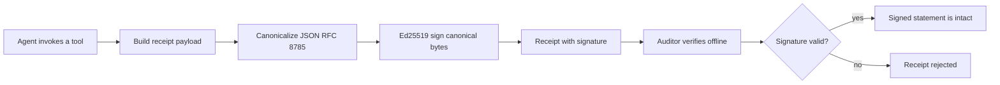
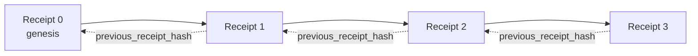

[पाठ वीडियो देखें: क्रिप्टोग्राफ़िक रसीदों के साथ AI एजेंट्स को सुरक्षित करना](https://youtu.be/PLACEHOLDER_VIDEO_ID)

> _(पाठ वीडियो और थंबनेल माइक्रोसॉफ्ट कंटेंट टीम द्वारा मर्ज के बाद जोड़े जाएंगे, जो पाठ 14 / 15 पैटर्न से मेल खाते हैं.)_

# क्रिप्टोग्राफ़िक रसीदों के साथ AI एजेंट्स को सुरक्षित करना

## परिचय

इस पाठ में शामिल होंगे:

- कंप्लायंस, डिबगिंग, और विश्वास के लिए AI एजेंट्स के ऑडिट ट्रेल्स क्यों महत्वपूर्ण हैं।
- क्रिप्टोग्राफ़िक रसीद क्या है और यह बिना हस्ताक्षर वाली लॉग लाइन से कैसे अलग है।
- एक एजेंट के टूल कॉल के लिए साइन की गई रसीद को प्लेन पाइथन में कैसे उत्पन्न करें।
- एक रसीद को ऑफ़लाइन सत्यापित करना और छेड़छाड़ का पता लगाना।
- रसीदों को चेन कैसे करें ताकि किसी एक को हटाने या पुनःक्रमित करने से चेन टूट जाए।
- रसीदें क्या प्रमाणित करती हैं और वे स्पष्ट रूप से क्या प्रमाणित नहीं करती हैं।

## सीखने के लक्ष्य

इस पाठ को पूरा करने के बाद, आप जानेंगे कि कैसे:

- ऐसे फेल्योर मोड्स की पहचान करें जो एजेंट क्रियाओं के लिए क्रिप्टोग्राफ़िक प्रेषण को प्रेरित करते हैं।
- एक पारंपरिक JSON पेलोड पर Ed25519-सही हुई रसीद उत्पन्न करें।
- केवल साइनर की सार्वजनिक कुंजी का उपयोग करके स्वतंत्र रूप से रसीद सत्यापित करें।
- संशोधित रसीद पर पुनः सत्यापन करके छेड़छाड़ का पता लगाएं।
- रसीदों की एक हैश-चेन वाली श्रृंखला बनाएँ और समझाएँ कि यह श्रृंखला क्यों महत्वपूर्ण है।
- यह पहचानें कि रसीदें क्या प्रमाणित करती हैं (अट्रिब्यूशन, इंटीग्रिटी, आदेश) और वे क्या नहीं करतीं (कार्रवाई की सहीता, पॉलिसी की सत्यता)।

## समस्या: आपके एजेंट का ऑडिट ट्रेल

कल्पना करें कि आपने Contoso Travel के लिए एक AI एजेंट तैनात किया है। एजेंट ग्राहक अनुरोध पढ़ता है, फ्लाइट्स API से विकल्प खोजता है, और ग्राहक की ओर से सीटें बुक करता है। पिछले तिमाही में, एजेंट ने 50,000 बुकिंग प्रोसेस कीं।

आज एक ऑडिटर आता है। वे एक सरल प्रश्न पूछते हैं: "मुझे दिखाइए कि आपका एजेंट क्या कर चुका है।"

आप उन्हें अपने लॉग फ़ाइलें देते हैं। ऑडिटर उन्हें देखता है और एक कठिन सवाल पूछता है: "मुझे कैसे पता चले कि इन लॉग्स को संपादित नहीं किया गया?"

यही ऑडिट-ट्रेल समस्या है। आज अधिकांश एजेंट परिनियोजन इस पर निर्भर करते हैं:

- **एप्लिकेशन लॉग्स**: एजेंट द्वारा खुद लिखे गए, जिन्हें फ़ाइल-सिस्टम एक्सेस वाले कोई भी संपादित कर सकता है।
- **क्लाउड लॉगिंग सेवाएं**: प्लेटफ़ॉर्म स्तर पर छेड़छाड़ पता लगाना संभव है लेकिन केवल तब जब ऑडिटर प्लेटफ़ॉर्म ऑपरेटर पर भरोसा करता हो।
- **डेटाबेस ट्रांज़ेक्शन लॉग्स**: डेटाबेस परिवर्तनों के लिए उपयुक्त लेकिन मनमाने टूल कॉल के लिए नहीं।

इनमें से कोई भी बिना ऑडिटर को किसी पर भरोसा किए सवाल का जवाब नहीं दे सकता (आप पर, आपके क्लाउड प्रदाता पर, आपके डेटाबेस विक्रेता पर)। आंतरिक उपयोग के लिए यह भरोसा अक्सर स्वीकार्य होता है। लेकिन विनियमित वर्कलोड (वित्त, स्वास्थ्य देखभाल, EU AI अधिनियम के अंतर्गत) के लिए यह स्वीकार्य नहीं है।

क्रिप्टोग्राफ़िक रसीदें इस समस्या को संकुचित करती हैं द्वारा एक हस्ताक्षरित कथन को स्वतंत्र रूप से
सत्यापित किया जा सकता है। ऑडिटर को अभी भी साइनिंग की कुंजी और
उस घटक पर जो कथन उत्पन्न करता है, पर भरोसा करने के लिए बाहरी कारण चाहिए। एम्बेडेड कुंजी आत्म-संगति साबित करती है,
न कि जारीकर्ता की पहचान या प्रवर्तन स्थान।

## क्रिप्टोग्राफ़िक रसीद क्या है?

एक रसीद एक JSON ऑब्जेक्ट है जो रिकॉर्ड करता है कि एक एजेंट ने क्या किया, इसे डिजिटल हस्ताक्षर के साथ साइन किया जाता है।



एक न्यूनतम रसीद इस तरह दिखती है:

```json
{
  "type": "agent.tool_call.v1",
  "agent_id": "contoso-travel-bot",
  "tool_name": "lookup_flights",
  "tool_args_hash": "sha256:a3f9c1...",
  "result_hash": "sha256:7b2e1d...",
  "policy_id": "contoso-travel-policy-v3",
  "timestamp": "2026-04-25T14:30:00Z",
  "sequence": 47,
  "previous_receipt_hash": "sha256:9d4e6a...",
  "signature": {
    "alg": "EdDSA",
    "sig": "c5af83...",
    "public_key": "8f3b2c..."
  }
}
```

तीन गुण काम कर रहे हैं:

1. **हस्ताक्षर**। रसीद एजेंट के गेटवे द्वारा Ed25519 प्राइवेट की के उपयोग से साइन की गई है। जो कोई भी संबंधित सार्वजनिक कुंजी रखता है वह ऑफ़लाइन हस्ताक्षर सत्यापित कर सकता है। विश्वसनीय पार्टी को उस कुंजी को पिन करना होगा या इसे रसीद के बाहर विश्वसनीय रजिस्ट्री से हल करना होगा। किसी भी साइन किए गए फील्ड में छेड़छाड़ हस्ताक्षर को अमान्य कर देती है।

2. **पारंपरिक एन्कोडिंग**। साइनिंग से पहले रसीद JSON कैनोनिकलाइजेशन स्कीम (JCS, RFC 8785) का उपयोग करके सीरियलाइज की जाती है। यह सुनिश्चित करता है कि दो अलग-अलग कार्यान्वयन एक ही तार्किक रसीद के लिए बाइट-एकसमान आउटपुट बनाएं। बिना कैनोनिकलाइजेशन के, अलग JSON सीरियलाइज़र एक ही सामग्री के लिए अलग-अलग हस्ताक्षर बनाएंगे।

3. **हैश चेनिंग**। `previous_receipt_hash` फील्ड प्रत्येक रसीद को पहले की रसीद से जोड़ता है। किसी रसीद को चुपचाप हटाने के लिए, हमलावर को या तो:

एक साथ ये गुण तीन गारंटियां प्रदान करते हैं:

- **कुंजी के लिए अट्रिब्यूशन**: इस कुंजी ने इस सामग्री पर हस्ताक्षर किया। संगठनात्मक या मानवीय पहचान के लिए विश्वसनीय कुंजी बाइंडिंग आवश्यक है।
- **इंटीग्रिटी**: साइन करने के बाद सामग्री में कोई बदलाव नहीं हुआ है।
- **सत्यापित अनुक्रम के भीतर क्रमबद्धता**: इस रसीद का लिंक उस पूर्ववर्ती से है।

## पाइथन में रसीद बनाना

रसीद उत्पन्न करने के लिए किसी विशेष लाइब्रेरी की आवश्यकता नहीं है। क्रिप्टोग्राफ़िक प्रिमिटिव्स व्यापक रूप से उपलब्ध हैं और लॉजिक कुछ दर्जन लाइनों का पाइथन है।

`code_samples/18-signed-receipts.ipynb` में हैंड्स-ऑन अभ्यास पूरा फ्लो दिखाते हैं। सोर्स-कंट्रोल्ड `code_samples/18-signed-receipts.execution-receipt.json` ठीक उसी नोटबुक की हैश, पाइथन वातावरण, सेल काउंट, और नवीनतम साफ निष्पादन की जाँच रिकॉर्ड करता है बिना पाठ के सहेजे गए आउटपुट को बदले। संक्षिप्त संक्षेप:

```python
import json
import hashlib
import base64
from nacl import signing
from jcs import canonicalize  # RFC 8785 canonical JSON

def b64url_nopad(data: bytes) -> str:
    return base64.urlsafe_b64encode(data).decode("ascii").rstrip("=")

def sha256_canonical(obj) -> str:
    """SHA-256 of a Python object's JCS-canonical JSON form."""
    return f"sha256:{hashlib.sha256(canonicalize(obj)).hexdigest()}"

# Generate or load a signing key (in production, store in a key vault)
signing_key = signing.SigningKey.generate()
verify_key = signing_key.verify_key
TRUSTED_PUBLIC_KEYS = {b64url_nopad(bytes(verify_key))}  # pinned out of band by the verifier

# Build the receipt payload (no signature yet)
tool_args = {"origin": "SYD", "destination": "LAX"}
tool_result = [{"flight": "QF11", "price": 1850, "stops": 0}]

payload = {
    "type": "agent.tool_call.v1",
    "agent_id": "contoso-travel-bot",
    "tool_name": "lookup_flights",
    "tool_args_hash": sha256_canonical(tool_args),
    "result_hash": sha256_canonical(tool_result),
    "policy_id": "contoso-travel-policy-v3",
    "timestamp": "2026-04-25T14:30:00Z",
    "sequence": 0,
    "previous_receipt_hash": None,
}

# Canonicalize and sign the JCS bytes directly. PureEdDSA hashes internally.
canonical_bytes = canonicalize(payload)
signature_bytes = signing_key.sign(canonical_bytes).signature

# Attach a structured signature object.
receipt = {
    **payload,
    "signature": {
        "alg": "EdDSA",
        "sig": b64url_nopad(signature_bytes),
        "public_key": b64url_nopad(bytes(verify_key)),
    },
}
```

यही पूरी साइनिंग पाइपलाइन है। नोटबुक में अभ्यास हर कदम से परिचित कराता है।

## रसीद सत्यापन और छेड़छाड़ का पता लगाना

सत्यापन विपरीत ऑपरेशन है:

```python
import base64
import hashlib
from nacl import signing
from nacl.exceptions import CryptoError
from jcs import canonicalize

def b64url_decode(s: str) -> bytes:
    # Strict: Python's decoder skips characters outside the alphabet and also
    # accepts padding, the standard +/ alphabet and non-zero spare bits.
    # Re-encoding and comparing accepts only the one unpadded base64url form.
    padding = "=" * ((4 - len(s) % 4) % 4)
    data = base64.urlsafe_b64decode(s + padding)
    if base64.urlsafe_b64encode(data).decode("ascii").rstrip("=") != s:
        raise ValueError("not canonical unpadded base64url")
    return data

def verify_receipt(receipt: dict, trusted_public_key: str) -> bool:
    # trusted_public_key is the issuer's key, obtained from somewhere other
    # than this receipt. Never use receipt["signature"]["public_key"] here:
    # see "What Receipts Prove (and What They Do Not)" below.
    # Fails closed: anything malformed returns False instead of raising.
    if not isinstance(receipt, dict) or not isinstance(trusted_public_key, str):
        return False
    sig_obj = receipt.get("signature")
    if not isinstance(sig_obj, dict) or sig_obj.get("alg") != "EdDSA":
        return False
    sig_b64 = sig_obj.get("sig")
    if not isinstance(sig_b64, str):
        return False

    try:
        # Reconstruct the payload that was actually signed (everything except signature).
        payload = {k: v for k, v in receipt.items() if k != "signature"}
        canonical_bytes = canonicalize(payload)
        verify_key = signing.VerifyKey(b64url_decode(trusted_public_key))
        verify_key.verify(canonical_bytes, b64url_decode(sig_b64))
        return True
    except (CryptoError, TypeError, ValueError, KeyError, OverflowError):
        return False
    except Exception:
        # An undecodable key or signature, or a payload that cannot be
        # canonicalized: fail closed rather than raise.
        return False
```

यह फ़ंक्शन एक रसीद और जारीकर्ता की सार्वजनिक कुंजी लेता है, और हस्ताक्षर मान्य होने पर `True` लौटाता है और अन्यथा `False` वापस करता है, जिसमें इनपुट का त्रुटिपूर्ण होना भी शामिल है। कोई नेटवर्क कॉल और सत्यापन सेवा नहीं: एक बार जब आपके पास जारीकर्ता की कुंजी होती है, तो सत्यापन पूरी तरह से स्थानीय और ऑफ़लाइन होता है। जो इसे अभी भी चाहिए वह है वह कुंजी, जो रसीद के अलावा कहीं और से प्राप्त की गई हो।

छेड़छाड़ की पहचान को सक्रिय रूप से देखने के लिए, नोटबुक निम्नलिखित चलता है:

1. एक वैध रसीद बनाना और पुष्टि करना कि यह सत्यापित होती है।
2. `tool_args_hash` फील्ड के एक बाइट को संशोधित करना।
3. पुनः सत्यापन चलाएं और असफलता देखा।
4. फिर से छेड़छाड़ करें, लेकिन इस बार हमलावर द्वारा जनरेट की गई कुंजी के साथ पुनः साइन करें और उस कुंजी को रसीद में एम्बेड करें।

चरण 4 पर ध्यान देना जरूरी है। वह रसीद आंतरिक रूप से संगत है: इसका हस्ताक्षर इसका सच्चा है इसकी सामग्री और इसके अंदर की कुंजी के लिए, इसलिए यह उसी के खिलाफ सत्यापित होती है। यह तब विफल होती है जब इसे जारीकर्ता की वास्तविक कुंजी से जांचा जाता है। चरण 2 और 3 उन हमलावरों को पकड़ते हैं जिन्होंने पुनः साइन करने की परवाह नहीं की; चरण 4 उन लोगों को पकड़ता है जिन्होंने किया।

यह व्यावहारिक प्रदर्शन है कि रसीदें छेड़छाड़-सूचक हैं: किसी भी हस्ताक्षरित फील्ड में कोई भी बदलाव हस्ताक्षर को भंग कर देता है, बशर्ते आप उस कुंजी से सत्यापन करें जो हमलावर ने प्रदान नहीं की। `signature` वस्तु स्वयं साइन किए गए बाइट्स के बाहर है, इसलिए जिस कुंजी से आप सत्यापित करते हैं वह रसीद के अलावा कहीं और से आनी चाहिए।

## मल्टी-स्टेप एजेंट्स के लिए रसीद चेनिंग

एक एकल साइन की गई रसीद एक क्रिया की सुरक्षा करती है। रसीदों की एक श्रृंखला एक अनुक्रम की सुरक्षा करती है।



प्रत्येक रसीद उससे पहले वाली रसीद के हैश को रिकॉर्ड करती है। रसीद 2 को चुपचाप हटाने के लिए हमलावर को या तो:

- रसीद 3 के `previous_receipt_hash` फील्ड को संशोधित करना (रसीद 3 के हस्ताक्षर को तोड़ता है), या
- संशोधित रसीद 3 पर नया हस्ताक्षर बनाना (एजेंट की निजी कुंजी की आवश्यकता होती है)।

यदि निजी कुंजी एक हार्डवेयर की वॉल्ट में है और सत्यापनकर्ता हर रसीद को जारीकर्ता की सार्वजनिक कुंजी के खिलाफ स्वतंत्र रूप से जांचते हैं (एक प्रकाशित JWK सेट या पहले से पिन किया गया कॉन्फ़िग मान), तो किसी भी हमले का पता बिना पकड़ाए लगाना असंभव है। प्रत्येक रसीद में कुंजी प्रकाशित करना पर्याप्त नहीं है: हमलावर अपनी कुंजी के साथ पुनः साइन कर सकता है और उसे एम्बेड कर सकता है, जो कि फिक्सचर `04_resigned_receipt.json` है।

नोटबुक इस पर चलता है:

1. तीन रसीदों की एक श्रृंखला बनाना।
2. सत्यापित करना कि प्रत्येक रसीद का `previous_receipt_hash` पूर्व रसीद के असली हैश से मेल खाता है।
3. बीच में एक रसीद के साथ छेड़छाड़ करना और देखना कि श्रृंखला उसी स्थान पर टूट जाती है।

इस प्रकार आप ऐसा ऑडिट ट्रेल उत्पन्न करते हैं जिसे एक बाहरी ऑडिटर अपने
पिन किए हुए जारीकर्ता कुंजी और श्रृंखला चेकपॉइंट के तहत सत्यापित कर सकता है, बिना आपके परिवर्तनीय लॉग स्टोर पर भरोसा किए।

## रसीदें क्या प्रमाणित करती हैं (और क्या नहीं)

यह इस पाठ का सबसे महत्वपूर्ण खंड है। रसीदें शक्तिशाली हैं, लेकिन उनकी शक्ति सीमित है।

**रसीदें तीन बातें प्रमाणित करती हैं:**

1. **अट्रिब्यूशन**: एक विशिष्ट कुंजी ने विशिष्ट पेलोड पर हस्ताक्षर किया।
2. **इंटीग्रिटी**: पेलोड साइन करने के बाद से नहीं बदला।
3. **प्रस्तुत, सत्यापित अनुक्रम के भीतर क्रमबद्धता**: इस रसीद का लिंक उस पूर्ववर्ती से है।

**रसीदें प्रमाणित नहीं करतीं:**

1. **सहीपन**: कि एजेंट की क्रिया सही कार्रवाई थी। एक गलत उत्तर के लिए भी रसीद उतनी ही साफ़ साइन हो सकती है जितनी एक सही उत्तर के लिए।
2. **पॉलिसी अनुपालन**: कि `policy_id` में संदर्भित नीति वास्तव में मूल्यांकित की गई, या यह क्रिया अनुमति देती यदि जांची जाती। रसीद रिकॉर्ड करती है कि क्या दावा किया गया, क्या प्रवर्तन किया गया नहीं।
3. **कुंजी से परे पहचान**: रसीद कहती है "इस कुंजी ने इस सामग्री पर हस्ताक्षर किया।" यह नहीं कहती "इस मानव ने अनुमोदन किया।" कुंजी को व्यक्ति या संगठन से जोड़ना अलग पहचान अवसंरचना (डायरेक्टरी, सार्वजनिक कुंजी रजिस्ट्री, आदि) की जरूरत है।
4. **इनपुट की सत्यता**: यदि एजेंट को छेड़े गए प्रॉम्प्ट मिलते हैं और वह उस पर कार्य करता है, तो रसीद कार्रवाई को सही ढंग से रिकॉर्ड करती है। रसीदें इनपुट सत्यापन के बाद की होती हैं, न कि उसकी जगह।
5. **कार्यान्वयन या वास्तविक प्रभाव**: एक पोस्ट-कॉल रसीद बताती है कि जारीकर्ता ने क्या दावा किया। प्रवेश साबित करना या बाहरी प्रभाव मिलाना वास्तविक निष्पादक या प्रदाता सीमा से सबूत मांगता है।
6. **पूर्णता**: अनुपस्थित रसीद का मतलब ब्लॉक होना, छोड़ा जाना, खो जाना या प्रवृत्त न होना हो सकता है। अनुपस्थिति प्रमाण केवल प्रमाणिकृत बंद जनसंख्या में मायने रखता है।
7. **विश्वसनीय समय**: हस्ताक्षरित टाइमस्टैम्प प्रमाणित करता है कि साइनर उस मूल्य को रखा, न कि कि मूल्य सही था। विश्वसनीय समय के लिए अलग समय प्राधिकारी या गवाह चेकपॉइंट चाहिए।

**रसीद में कुंजी वही कुंजी नहीं है जिससे आप सत्यापन करते हैं।** यह बिंदु 3 से निकलता है, और यह वह जगह है जहां यह अंतर आपके कोड को समझने की तुलना में बदलना चाहिए। ऊपर के नमूने में `public_key` इसलिए है ताकि उदाहरण स्वयंपूर्ण हो। सत्यापनकर्ता को इसे कभी भरोसा नहीं करना चाहिए। कोई भी रसीद लें, उसमें बदलाव करें, अपनी बनाई कुंजी से साइन करें, और उसे सम्मिलित करें; परिणाम स्वयं के खिलाफ पूरी तरह सत्यापित होगा। यह फिक्सचर `04_resigned_receipt.json` है `sample_receipts/` में, और इसलिए `verify_receipt` ऊपर कुंजी को तर्क के रूप में लेता है बजाय इसे रसीद से पढ़ने के। जारीकर्ता की कुंजी को स्वतंत्र रूप से प्राप्त करें, नीचे प्रोडक्शन चेकलिस्ट में JWK सेट से या किसी अन्य पिन किए गए एंकर से, और उसी से सत्यापन करें। उसी लिफाफे से आई कुंजी के साथ जाँची गई हस्ताक्षर केवल यह साबित करती है कि लिफाफा स्व-संगत है।

इस सीमा का महत्व दो कारणों से है:

- यह बताता है कि रसीदें किस लिए उपयोगी हैं: एजेंट व्यवहार को ऑडिटेबल और छेड़छाड़-सूचक बनाना, यहां तक कि संगठनात्मक सीमाओं के पार भी।
- यह बताता है कि आपको अभी भी किन अतिरिक्त परतों की जरूरत है: इनपुट सत्यापन (पाठ 6), पॉलिसी प्रवर्तन (संक्षेप में नीचे), और पहचान अवसंरचना (इस पाठ के दायरे से बाहर)।

एक सामान्य गलती यह मान लेना है कि "हमारे पास रसीदें हैं" का मतलब है "हम पर शासन होता है।" ऐसा नहीं है। रसीदें एक आधार हैं। शासन वह प्रणाली है जो आप उसके ऊपर बनाते हैं।

## अनुमोदक के हस्ताक्षर को सटीक क्रिया से बांधना

ऊपर आइटम 3 अपना खंड का हकदार है: एक क्रिया रसीद कहती है "इस कुंजी ने इस सामग्री पर हस्ताक्षर किया," कभी नहीं "एक मानव ने अनुमोदन किया।" उच्च जोखिम वाली क्रियाओं (रिफंड, हटाना, वायर ट्रांसफर) के लिए एक अलग अनुमोदक हस्ताक्षर सटीक क्रिया से जुड़ सकता है। उस कुंजी को मानव से जोड़ना और मानव उपस्थिति की जांच अलग जिम्मेदारियां रह जाती हैं।

अगले नोटबुक `code_samples/human-authorization-receipts.ipynb` में एक दूसरा रसीद प्रकार, `human.approval.v1`, जोड़ा गया है, जो उसी लिफाफे के आकार में है जैसा कि पाठ के रसीदों का है (Ed25519 द्वारा हस्ताक्षरित एक टाइप किया हुआ पेलोड जो इसके कैनोनिकल JCS बाइट्स पर आधारित है, और `signature` ऑब्जेक्ट हस्ताक्षरित बाइट्स के बाहर है)। एक अनुमोदक कुंजी **पूर्ण कैनोनिकल क्रिया और उसके डाइजेस्ट** पर हस्ताक्षर करती है; एक एजेंट कुंजी एक दावे पर हस्ताक्षर करती है जो **उसी क्रिया डाइजेस्ट** को वहन करता है और एक `parent_approval_ref`, अनुमोदन का `receipt_hash`, वही परंपरा जो आपने ऊपर बनाई गई चेन में `previous_receipt_hash` है। एक `verify_chain` दोनों कलाकृतियों को **अलग-अलग पिन की गई कुंजी रजिस्ट्रीज़** (अनुमोदक कुंजियाँ बनाम एजेंट कुंजियाँ) के अंतर्गत चलाता है, इसलिए कोड पथ साझा होता है लेकिन अधिकारकर्ता कभी साझा नहीं होते।

इस संपत्ति को सावधानी से कहा गया है: *पिन की गई अनुमोदक कुंजी ने इस सटीक क्रिया पर हस्ताक्षर किया है, और एजेंट कुंजी ने बाद में उसी क्रिया डाइजेस्ट को वहन करने वाला बयान हस्ताक्षर किया है।*
यह उपयोगी सबूत है, लेकिन यह अपनी तरह से यह प्रमाण नहीं है कि क्रिया निष्पादित हुई। निष्पादन को नियंत्रित करने के लिए, सटीक अनुमोदन को भी आरक्षित और एकबारगी वास्तविक निष्पादक सीमा पर खपत किया जाना चाहिए; अज्ञात प्रदाता परिणाम अज्ञात रहने चाहिए बजाय इसके कि उन्हें अंधाधुंध पुन: प्रयास किया जाए। नोटबुक के इनकार के परीक्षण रसीद-श्रृंखला परत को परखते हैं:

- छेड़छाड़, भ्रमित डिप्टी, किसी भी पक्ष पर नकली कुंजियाँ, और गलत इनपुट;
- **पुराना अधिकार**: एक हस्ताक्षर जो अभी भी सत्यापित होता है, फिर भी अस्वीकार किया गया क्योंकि नीति संस्करण बदल गया, अनुमोदक कुंजी पिन की गई रजिस्ट्री से बाहर कर दी गई, या अनुमोदन उपलब्ध सत्यापन समय से पहले समाप्त हो गया;
- **डाइजेस्ट प्रतिस्थापन**: एक वैध रूप से हस्ताक्षरित क्रिया रसीद जो एक *वास्तविक* अनुमोदन को इंगित करती है जो *विभिन्न* कैनोनिकल क्रिया को बांधती है।

- छेड़छाड़, भ्रमित डिप्टी, दोनों पक्षों पर जाली चाबियां, और गलत स्वरूप इनपुट;
- **पुरानी प्राधिकार**: एक हस्ताक्षर जो अभी भी सत्यापित करता है, फिर भी अस्वीकार कर दिया गया क्योंकि नीति संस्करण बदल गया था, अनुमोदक कुंजी पिन की गई रजिस्ट्री से हटा दी गई थी, या आपूर्ति किए गए सत्यापन समय से पहले अनुमोदन की अवधि समाप्त हो गई थी;
- **डाइजेस्ट प्रतिस्थापन**: एक वैध रूप से हस्ताक्षरित क्रिया रसीद जो एक *वास्तविक* अनुमोदन की ओर इशारा करती है जो एक *विभिन्न* मानक क्रिया को बांधती है।

प्रत्येक अस्वीकृति अलग कारण के साथ अस्वीकार करती है, इसलिए एक ऑडिटर जो अस्वीकृति पढ़ता है वह बता सकता है कि प्राधिकरण समाप्त हो गया है या दावा किया गया कार्य बदल गया है। सत्यापन केवल पढ़ने वाला और पुनरावृत्ति योग्य है: यह अनुमोदन का उपभोग नहीं करता या प्रदाता को नहीं बुलाता। एक अलग निष्पादक को टिकाऊ, परमाणु पुन:प्रेषण सुरक्षा और स्पष्ट सफलता, विफलता, और अनिर्णीत परिणामों की ज़रूरत होती है। मानव-अनुमोदन रसीद इस पाठ द्वारा परिभाषित एक शैक्षिक संरचना है, न कि `draft-farley-acta-signed-receipts` द्वारा परिभाषित रसीद प्रकार।

## उत्पादन संदर्भ

इस पाठ में Python कोड जानबूझकर न्यूनतम है ताकि आप प्रत्येक पंक्ति पढ़ सकें और पूरी तरह से समझ सकें कि क्या हो रहा है। उत्पादन में, आपके पास दो विकल्प होते हैं:

1. **क्रिप्टोग्राफिक प्रारंभिक तत्वों पर सीधे निर्माण करें।** ऊपर आप जो 50 पंक्तियां देखी थीं वह कई उपयोग मामलों के लिए पर्याप्त हैं। PyNaCl (Ed25519) और `jcs` पैकेज (कैनोनिकल JSON) अच्छी तरह से मेंटेन और ऑडिट की गई लाइब्रेरी हैं।

2. **एक उत्पादन रसीद लाइब्रेरी का उपयोग करें।** कई ओपन-सोर्स परियोजनाएं अतिरिक्त विशेषताओं (की रोटेशन, बैच सत्यापन, JWK सेट वितरण, नीति इंजन के साथ एकीकरण) के साथ समान पैटर्न लागू करती हैं:
   - साइनिंग पाइपलाइन स्वतंत्र IETF इंटरनेट-ड्राफ्ट ([`draft-farley-acta-signed-receipts`](https://datatracker.ietf.org/doc/draft-farley-acta-signed-receipts/), संशोधन 02) में JCS और सिग्नेचर-स्कोप सम्मेलन का उपयोग करती है। इस पाठ की फ्लैट शैक्षिक रसीद ड्राफ्ट के `{payload, signature}` लिफाफे से भिन्न है और इसे एक अनुरूप कार्यान्वयन के रूप में प्रस्तुत नहीं किया गया है। ड्राफ्ट अपने वायर फॉर्मेट को लक्षित करने वाले कार्यान्वयन के लिए एक साझा अनुरूपता सूट ([agent-governance-testvectors](https://github.com/ScopeBlind/agent-governance-testvectors)) प्रकाशित करता है।
   - Microsoft Agent Governance Toolkit रसीदों को Cedar-आधारित नीति निर्णयों के साथ संयोजित करता है; अंत से अंत तक उदाहरण के लिए उस रिपॉजिटरी में ट्यूटोरियल 33 देखें।
   - `protect-mcp` (npm) और `@veritasacta/verify` (npm) पैकेज रसीद साइनिंग और ऑफ़लाइन सत्यापन का Node-आधारित कार्यान्वयन प्रदान करते हैं, जिसका उद्देश्य किसी भी MCP सर्वर को छेड़छाड़-प्रमाणित ऑडिट ट्रेल से लैस करना है, जिसमें एक होल्ड-फॉर-को-साइन फ्लो शामिल है जिसमें एक रुका हुआ कार्य एक अनुमोदन रसीद जारी करता है जो कार्य डाइजेस्ट से जुड़ा होता है (डेस्कटॉप फ्लो में WebAuthn-समर्थित), ऊपर मानव-अधिकारिता नोटबुक के समान अनुमोदन-रसीद पैटर्न।
   - **[nobulex](https://github.com/arian-gogani/nobulex)** Python SDK (`pip install nobulex`) LangChain और CrewAI इंटीग्रेशन के साथ Python में वही Ed25519 + JCS साइनिंग पैटर्न प्रदान करता है, जिसमें प्रकाशित क्रॉस-मान्यकरण परीक्षण वेक्टर और [OWASP PR #2210](https://github.com/OWASP/CheatSheetSeries/pull/2210) द्वारा योगदानित अनुपालन मानचित्रण शामिल है।
   - **[EMILIA Protocol](https://github.com/emiliaprotocol/emilia-protocol)** एक पूरक सटीक-कार्रवाई प्रवर्तन परत प्रदान करता है: ऑफ़लाइन-सत्यापित अनुमोदन रसीदें, पिन किए गए WebAuthn या क्वोरम प्राधिकरण, निष्पादक सीमा पर एक बार उपयोग, और एक स्पष्ट अनिर्धारित-परिणाम पथ। इसका फ्रेमवर्क एडेप्टर रसीद को एक आवश्यक साक्ष्य के रूप में मानता है, न कि बाहरी प्रभाव के होने का प्रमाण।

अपनी खुद की रसीद बनाने और लाइब्रेरी का उपयोग करने के बीच निर्णय उसी निर्णय की तरह है जैसे अपनी JWT लाइब्रेरी लिखने या एक परीक्षण की हुई का उपयोग करने का: दोनों ही उचित हैं; लाइब्रेरी समय बचाती है और ऑडिट सतह कम करती है; शुरुआती से शुरू करने का तरीका आपको प्रत्येक प्रारंभिक तत्व को समझने पर मजबूर करता है। यह पाठ शुरुआती से शुरू करने वाला रास्ता सिखाता है ताकि आपके पास दोनों विकल्पों के लिए आधार हो।

## ज्ञान जांच

अभ्यास करने से पहले अपनी समझ का परीक्षण करें।

**1. रसीद एजेंट की निजी Ed25519 कुंजी से हस्ताक्षरित होती है। ऑडिटर के पास केवल सार्वजनिक कुंजी होती है। क्या ऑडिटर रसीद को ऑफ़लाइन सत्यापित कर सकता है?**

<details>
<summary>उत्तर</summary>

हाँ, क्रिप्टोग्राफिक सत्यापन के लिए केवल सार्वजनिक कुंजी और हस्ताक्षरित बाइट्स की आवश्यकता होती है। 
ऑडिटर को अभी भी रसीद से स्वतंत्र रूप से स्वीकार्य सार्वजनिक कुंजी प्राप्त करनी और पिन करनी होती है।
इस ट्रस्ट कॉन्फ़िगरेशन के स्थापित होने के बाद कोई नेटवर्क कॉल आवश्यक नहीं है।
</details>

**2. एक हमलावर रसीद के `policy_id` क्षेत्र को संशोधित करता है ताकि दावा कर सके कि इसे एक अधिक अनुमति देने वाली नीति द्वारा शासित किया गया था। हस्ताक्षर मूल पेलोड पर था। सत्यापन के दौरान क्या होता है?**

<details>
<summary>उत्तर</summary>

सत्यापन विफल होता है। हस्ताक्षर मूल पेलोड के कैनोनिकल बाइट्स पर गणना किया गया था; किसी भी पेलोड क्षेत्र को संशोधित करने से वे बाइट्स बदल जाते हैं, जिससे हस्ताक्षर अमान्य हो जाता है। हमलावर को नया वैध हस्ताक्षर बनाने के लिए निजी कुंजी की आवश्यकता होगी, जो उसके पास नहीं है।
</details>

**3. रसीद में कच्चे तर्क और परिणाम के बजाय `tool_args_hash` और `result_hash` क्यों शामिल हैं?**

<details>
<summary>उत्तर</summary>

दो कारण। पहला, रसीद को उन वातावरण में संग्रहित या प्रेषित करने की आवश्यकता हो सकती है जहां कच्ची सामग्री (PII, व्यावसायिक डेटा) का लीक होना समस्या है। हैशिंग रसीद को छोटा और सामग्री को निजी बनाये रखता है; ऑडिटर यह सत्यापित करता है कि हैश वास्तविक सामग्री की अलग से संग्रहीत प्रति से मेल खाता है। दूसरा, हैश का आकार निश्चित होता है; हैश वाली रसीद का आकार इनपुट और आउटपुट के आकार से स्वतंत्र होता है।
</details>

**4. `previous_receipt_hash` क्षेत्र प्रत्येक रसीद को उसके पूर्ववर्ती से जोड़ता है। यदि हमलावर चेन के मध्य से एक रसीद चुपके से हटा देता है, तो क्या अमान्य हो जाता है?**

<details>
<summary>उत्तर</summary>

हर वह रसीद जो हटाई गई रसीद के बाद आई। उनके `previous_receipt_hash` क्षेत्र वास्तविक चेन से मेल नहीं खाते (क्योंकि उन्होंने जिस रसीद का संदर्भ दिया था वह अब मौजूद नहीं है, या चेन अब एक अलग पूर्ववर्ती की ओर इंगित करता है)। हटाए जाने को छुपाने के लिए हमलावर को बाद की हर रसीद को फिर से साइन करना होगा, जिसके लिए जारीकर्ता की निजी कुंजी चाहिए। किसी अन्य कुंजी से पुनः हस्ताक्षर जारीकर्ता की कुंजी के खिलाफ जांच करने पर विफल होगा।
</details>

**5. एक रसीद साफ-सुथरी तरह से सत्यापित होती है। क्या इसका मतलब है कि एजेंट की कार्रवाई सही, प्रमाणित, या नीति के अनुरूप थी?**

<details>
<summary>उत्तर</summary>

नहीं। पिन की गई कुंजी और चेन संदर्भ के तहत, एक वैध रसीद हस्ताक्षर प्रवृत्ति,
सामग्री अखंडता और प्रस्तुत पूर्ववर्ती से लिंक साबित करती है। यह साबित नहीं करती कि
कार्रवाई सही थी या निष्पादित हुई, कि नीति का मूल्यांकन हुआ, कि टाइमस्टैम्प
विश्वसनीय है, या कि रिकॉर्ड सेट पूरा है। यह इस पाठ की सबसे महत्वपूर्ण सीमा है।
</details>

## अभ्यास

`code_samples/18-signed-receipts.ipynb` खोलें और चारों अनुभाग पूरे करें:

1. **अनुभाग 1**: अपनी पहली रसीद पर हस्ताक्षर करें और उसे सत्यापित करें।
2. **अनुभाग 2**: रसीद के साथ छेड़छाड़ करें और सत्यापन असफल होने को देखें।
3. **अनुभाग 3**: तीन-रसीद चेन बनाएँ और चेन की अखंडता सत्यापित करें।
4. **अनुभाग 4**: Microsoft Agent Framework से निर्मित एजेंट पर पैटर्न लागू करें: रसीद-साइनिंग में एक टूल कॉल को लपेटें, फिर रसीद को स्वतंत्र रूप से सत्यापित करें।

**विस्तार चुनौती 1:** अपने चयन का एक अतिरिक्त क्षेत्र के साथ रसीद स्कीमा का विस्तार करें (उदाहरण के लिए, ट्रेसिंग के लिए एक अनुरोध ID), इसे शामिल करने के लिए कैनोनिकल साइनिंग लॉजिक अपडेट करें, और पुष्टि करें कि रसीद अभी भी सत्यापन के माध्यम से गुज़रती है। फिर साइनिंग के बाद उस क्षेत्र को संशोधित करें और पुष्टि करें कि सत्यापन विफल हो जाता है। यह आपको यह समझने के लिए मजबूर करता है कि कैनोनिकल एनकोडिंग का प्रत्येक बाइट हस्ताक्षर में कैसे योगदान देता है।

**विस्तार चुनौती 2:** अपने दो रसीदों को SHA-256 हैश करें (उनके कैनोनिकल बाइट्स को निश्चित क्रम में संयोजित करें) और परिणामस्वरूप डाइजेस्ट को एक तीसरी रसीद पर नए क्षेत्र के रूप में एम्बेड करें, फिर इसे साइन करें। सत्यापित करें कि सभी तीन रसीदें अभी भी राउंड-ट्रिप कर रही हैं। आपने अभी एक-चरण समावेशन प्रमाण बनाया है: तीसरी रसीद रखने वाला कोई भी व्यक्ति प्रमाणित कर सकता है कि पहली दो रसीदें उस समय मौजूद थीं जब इसे साइन किया गया था, बिना उनकी सामग्री प्रकट किए। यह पैटर्न है जो चयनात्मक-प्रकटीकरण रसीदें पैमाने पर उपयोग करती हैं (Merkle प्रतिबद्धताएं, RFC 6962)।

## निष्कर्ष

क्रिप्टोग्राफिक रसीदें AI एजेंटों को एक ऑडिट ट्रेल प्रदान करती हैं जो:

- **पिन्ड ट्रस्ट के तहत स्वतंत्र रूप से सत्यापित योग्य**: स्वीकार्य सार्वजनिक कुंजियों और हस्ताक्षरित बाइट्स के साथ कोई भी पार्टी बिना सेवा निर्भरता के सत्यापित कर सकती है।
- **छेड़छाड़-प्रमाणित**: कोई भी संशोधन हस्ताक्षर को अमान्य कर देता है।
- **पोर्टेबल**: रसीद एक छोटा JSON फ़ाइल है; इसे कहीं भी संग्रहित, प्रेषित और सत्यापित किया जा सकता है।
- **मापदंड-संगत**: Ed25519 (RFC 8032), JCS (RFC 8785), और SHA-256 पर निर्मित, जो कि व्यापक रूप से लागू प्रारंभिक तत्व हैं।

वे इनपुट सत्यापन, नीति प्रवर्तन, निष्पादक प्रवेश, 
परिणाम साक्ष्य, पूर्णता नियंत्रण, या पहचान अवसंरचना के लिए विकल्प नहीं हैं। वे उन परतों का आधार हैं। विनियमित या बहु-संगठन कार्यप्रवाहों में, रसीदें व्यक्तिगत जारीकर्ता वक्तव्यों को स्वतंत्र रूप से जांच योग्य बनाती हैं ऑडिटर के अपने ट्रस्ट कॉन्फ़िगरेशन के तहत।

सबसे महत्वपूर्ण निष्कर्ष: रसीदें साबित करती हैं कि एक विशेष कुंजी ने एक विशेष

रसीद यह साबित नहीं करती कि इसकी सामग्री सच थी, कोई कार्रवाई निष्पादित हुई, या रिकॉर्ड सेट पूरा था। इन भेदों को सावधानी से बनाए रखें।

## उत्पादन चेकलिस्ट


- [ ] **सत्यापन कुंजी ट्रस्ट स्थापित करें।** कुंजियों को एक JWK सेट या रजिस्ट्रि के माध्यम से प्रकाशित करें, फिर भरोसेमंद पक्षों को व्यक्तिगत रसीदों के बाहर स्वीकार्य जारीकर्ता पहचान, कुंजी सेट और रोटेशन नीति पिन करने दें। एक इनलाइन कुंजी अकेले ट्रस्ट एंकर नहीं है।

- [ ] **रसीदों को अपरिवर्तनीय रूप से संग्रहीत करें।** केवल जोड़ने वाले ब्लॉब स्टोरेज (Azure Storage with immutability policies, AWS S3 Object Lock) आंतरिक उपयोगकर्ता को संग्रह स्तर पर इतिहास पुनः लिखने से रोकता है।
- [ ] **धारण योजना तय करें।** कई अनुपालन शासनालयों में कई वर्षों की धारण आवश्यक होती है। रसीदों की वृद्धि की योजना बनाएं (प्रत्येक रसीद लगभग 500 बाइट है; 10K कॉल प्रतिदिन करने वाला एजेंट प्रति वर्ष लगभग 1.8 GB उत्पन्न करता है)।
- [ ] **रसीदें क्या नहीं कवर करतीं इसे दस्तावेज़ करें।** रसीदें प्रवृत्ति, अखंडता, और अनुक्रमण सिद्ध करती हैं। आपका रनबुक स्पष्ट रूप से सूचीबद्ध करना चाहिए कि आपके शासन स्थिति में रसीदों के साथ कौन से अतिरिक्त नियंत्रण (इनपुट सत्यापन, नीति प्रवर्तन, दर सीमांकन, पहचान अवसंरचना) शामिल हैं।

### AI एजेंटों को सुरक्षित करने के बारे में आपके और सवाल हैं?


### क्या AI एजेंट्स को सुरक्षित करने के बारे में आपके और प्रश्न हैं?

अन्य शिक्षार्थियों से मिलने, कार्यालय काल में भाग लेने और अपने AI एजेंट्स के प्रश्नों के उत्तर पाने के लिए [Microsoft Foundry Discord](https://aka.ms/ai-agents/discord) से जुड़ें।

## इस पाठ से परे

यह पाठ एकल-रसीद हस्ताक्षर और हैश-चेन किए गए अनुक्रम को कवर करता है। समान प्रिमिटिव कई अधिक उन्नत पैटर्न में संयोजित होते हैं जिनसे आप अपने शासन स्थिति के परिपक्व होने पर मिल सकते हैं:

- **चयनात्मक प्रकटीकरण।** जब एक रसीद के फ़ील्ड स्वतंत्र रूप से प्रतिबद्ध होते हैं (RFC 6962-शैली का मर्कल ट्री), तो आप विशिष्ट ऑडिटर को विशेष फ़ील्ड प्रकट कर सकते हैं और बिना उन्हें उजागर किए यह साबित कर सकते हैं कि बाकी फ़ील्ड अपरिवर्तित हैं। यह तब उपयोगी होता है जब एक ही रसीद को व्यापक लेखा परीक्षा (जो पूर्णतावाद मांगती है) और डेटा-संकुचन नियमों जैसे GDPR (जो ऑडिटर को जितना आवश्यक हो उतना ही दिखाना चाहता है) दोनों को संतुष्ट करना होता है।
- **रसीद का निरस्तीकरण।** यदि कोई हस्ताक्षर कुंजी समझौता हो जाती है, तो आपको एक तरीका चाहिए जिससे उस कुंजी द्वारा हस्ताक्षरित सभी रसीदों को एक निश्चित समय से आगे अप्रमाणित के रूप में चिह्नित किया जा सके। मानक पैटर्न: अल्पकालिक हस्ताक्षर कुंजी और एक प्रकाशित निरस्तीकरण सूची, या निरस्तीकरण प्रविष्टियों के साथ एक पारदर्शिता लॉग।
- **द्विपक्षीय / विभाजित-हस्ताक्षर रसीद।** कुछ कार्यान्वयन हस्ताक्षरित पेलोड को पूर्व-कार्यान्वयन (`authorization_*`) और पश्चात-कार्यान्वयन (`result_*`) आधों में स्वतंत्र हस्ताक्षरों के साथ विभाजित करते हैं, जो उपयोगी होता है जब प्राधिकरण निर्णय और देखे गए परिणाम अलग-अलग अभिनेताओं द्वारा या अलग-अलग समय पर उत्पन्न किए जाते हैं। यह इस पाठ में सिखाए गए रसीद प्रारूप पर योगात्मक रूप से संयोजित होता है।
- **Payload composition.** एक रसीद उन सभी बाइट्स को सील करती है जो आप `result_hash` में डालते हैं। वास्तविक दुनिया के पेलोड अक्सर एक साधारण टूल कॉल परिणाम से अधिक समृद्ध होते हैं: प्री-डिसीजन तर्क (मॉडल पूर्वानुमान, विचार किए गए विकल्प, साक्ष्य और उसकी पूर्णता, जोखिम स्थिति, जवाबदेही श्रृंखला, गेट परिणाम) सभी पेलोड के अंदर रह सकते हैं, जिन्हें एक एकल रसीद द्वारा सील किया जाता है। यह रसीद प्रारूप को न्यूनतम रखता है जबकि डोमेन-दर-डोमेन पेलोड स्कीमाओं को विकसित होने देता है।
- **Cross-implementation conformance.** एक ही रसीद प्रारूप के कई स्वतंत्र कार्यान्वयन (Python, TypeScript, Rust, Go) साझा परीक्षण वेक्टरों के खिलाफ क्रॉस-वेरिफाई करते हैं। यदि आप अपना स्वयं का कार्यान्वयन बनाते हैं, तो प्रकाशित वेक्टरों के खिलाफ सत्यापन वायर संगतता की पुष्टि करता है।
- **Post-quantum migration.** Ed25519 आज व्यापक रूप से तैनात है लेकिन क्वांटम-प्रतिरोधी नहीं है। केवल `alg` लेबल माइग्रेशन नहीं है: एक प्रोफ़ाइल को ML-DSA कुंजी एन्कोडिंग, कैनोनिकल साइन किए गए बाइट्स, सत्यापन, भरोसेमंद पार्टी नीति, डाउनग्रेड प्रतिरोध, और संक्रमण अर्थव्यवस्था को परिभाषित करना चाहिए। संगतता दावे करने से पहले साझा वेक्टरों के खिलाफ एक दोहरा-हस्ताक्षर संक्रमण की योजना बनाएं और परीक्षण करें।

## Additional Resources

- <a href="https://datatracker.ietf.org/doc/draft-farley-acta-signed-receipts/" target="_blank">IETF Internet-Draft: Signed Decision Receipts for Machine-to-Machine Access Control</a>
- <a href="https://learn.microsoft.com/azure/ai-studio/responsible-use-of-ai-overview" target="_blank">Responsible AI overview (Azure AI)</a>
- <a href="https://datatracker.ietf.org/doc/html/rfc8032" target="_blank">RFC 8032: Edwards-Curve Digital Signature Algorithm (EdDSA)</a>
- <a href="https://datatracker.ietf.org/doc/html/rfc8785" target="_blank">RFC 8785: JSON Canonicalization Scheme (JCS)</a>
- <a href="https://datatracker.ietf.org/doc/html/rfc6962" target="_blank">RFC 6962: Certificate Transparency</a> (Merkle-tree construction used by selective-disclosure receipts)
- <a href="https://github.com/microsoft/agent-governance-toolkit/blob/main/docs/tutorials/33-offline-verifiable-receipts.md" target="_blank">Microsoft Agent Governance Toolkit, Tutorial 33: Offline-Verifiable Decision Receipts</a>
- <a href="https://github.com/ScopeBlind/agent-governance-testvectors" target="_blank">Cross-implementation conformance test vectors</a> for the receipt format used in this lesson (Apache-2.0)
- <a href="https://pynacl.readthedocs.io/" target="_blank">PyNaCl documentation</a> (Ed25519 in Python)

## Previous Lesson

[लोकल एआई एजेंट्स बनाना](../17-creating-local-ai-agents/README.md)

---

<!-- CO-OP TRANSLATOR DISCLAIMER START -->
**अस्वीकरण**:
इस दस्तावेज़ का अनुवाद AI अनुवाद सेवा [Co-op Translator](https://github.com/Azure/co-op-translator) का उपयोग करके किया गया है। जबकि हम सटीकता के लिए प्रयास करते हैं, कृपया ध्यान दें कि स्वचालित अनुवादों में त्रुटियाँ या अशुद्धियाँ हो सकती हैं। मूल दस्तावेज़ अपनी मूल भाषा में ही प्रामाणिक स्रोत माना जाना चाहिए। महत्वपूर्ण जानकारी के लिए, पेशेवर मानव अनुवाद की सिफारिश की जाती है। इस अनुवाद के उपयोग से उत्पन्न किसी भी गलतफहमी या गलत व्याख्या के लिए हम उत्तरदायी नहीं हैं।
<!-- CO-OP TRANSLATOR DISCLAIMER END -->