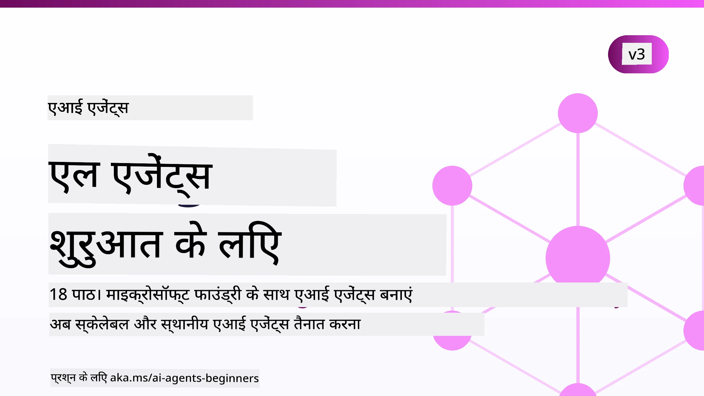

# शुरुआती लोगों के लिए AI एजेंट्स - एक कोर्स



## एक कोर्स जो आपको AI एजेंट्स बनाने के लिए आवश्यक सब कुछ सिखाता है

[](https://github.com/microsoft/ai-agents-for-beginners/blob/master/LICENSE?WT.mc_id=academic-105485-koreyst)
[](https://GitHub.com/microsoft/ai-agents-for-beginners/graphs/contributors/?WT.mc_id=academic-105485-koreyst)
[](https://GitHub.com/microsoft/ai-agents-for-beginners/issues/?WT.mc_id=academic-105485-koreyst)
[](https://GitHub.com/microsoft/ai-agents-for-beginners/pulls/?WT.mc_id=academic-105485-koreyst)
[](http://makeapullrequest.com?WT.mc_id=academic-105485-koreyst)

### 🌐 बहुभाषी समर्थन

#### अनुवाद [Co-op Translator](https://github.com/Azure/co-op-translator) के साथ बनाए रखे जाते हैं

<!-- CO-OP TRANSLATOR LANGUAGES TABLE START -->
[Arabic](../ar/README.md) | [Bengali](../bn/README.md) | [Bulgarian](../bg/README.md) | [Burmese (Myanmar)](../my/README.md) | [Chinese (Simplified)](../zh-CN/README.md) | [Chinese (Traditional, Hong Kong)](../zh-HK/README.md) | [Chinese (Traditional, Macau)](../zh-MO/README.md) | [Chinese (Traditional, Taiwan)](../zh-TW/README.md) | [Croatian](../hr/README.md) | [Czech](../cs/README.md) | [Danish](../da/README.md) | [Dutch](../nl/README.md) | [Estonian](../et/README.md) | [Finnish](../fi/README.md) | [French](../fr/README.md) | [German](../de/README.md) | [Greek](../el/README.md) | [Hebrew](../he/README.md) | [Hindi](./README.md) | [Hungarian](../hu/README.md) | [Indonesian](../id/README.md) | [Italian](../it/README.md) | [Japanese](../ja/README.md) | [Kannada](../kn/README.md) | [Khmer](../km/README.md) | [Korean](../ko/README.md) | [Lithuanian](../lt/README.md) | [Malay](../ms/README.md) | [Malayalam](../ml/README.md) | [Manipuri (Meitei Mayek)](../mni/README.md) | [Marathi](../mr/README.md) | [Nepali](../ne/README.md) | [Nigerian Pidgin](../pcm/README.md) | [Norwegian](../no/README.md) | [Persian (Farsi)](../fa/README.md) | [Polish](../pl/README.md) | [Portuguese (Brazil)](../pt-BR/README.md) | [Portuguese (Portugal)](../pt-PT/README.md) | [Punjabi (Gurmukhi)](../pa/README.md) | [Romanian](../ro/README.md) | [Russian](../ru/README.md) | [Serbian (Cyrillic)](../sr/README.md) | [Slovak](../sk/README.md) | [Slovenian](../sl/README.md) | [Spanish](../es/README.md) | [Swahili](../sw/README.md) | [Swedish](../sv/README.md) | [Tagalog (Filipino)](../tl/README.md) | [Tamil](../ta/README.md) | [Telugu](../te/README.md) | [Thai](../th/README.md) | [Turkish](../tr/README.md) | [Ukrainian](../uk/README.md) | [Urdu](../ur/README.md) | [Vietnamese](../vi/README.md)

> **स्थानीय रूप से क्लोन करना पसंद है?**
>
> इस रिपोजिटरी में 50+ भाषा अनुवाद शामिल हैं जो डाउनलोड साइज को काफी बढ़ाते हैं। अनुवादों के बिना क्लोन करने के लिए, sparse checkout का उपयोग करें:
>
> **Bash / macOS / Linux:**
> ```bash
> git clone --filter=blob:none --sparse https://github.com/microsoft/ai-agents-for-beginners.git
> cd ai-agents-for-beginners
> git sparse-checkout set --no-cone '/*' '!translations' '!translated_images'
> ```
>
> **CMD (Windows):**
> ```cmd
> git clone --filter=blob:none --sparse https://github.com/microsoft/ai-agents-for-beginners.git
> cd ai-agents-for-beginners
> git sparse-checkout set --no-cone "/*" "!translations" "!translated_images"
> ```
>
> इससे आपको कोर्स पूरा करने के लिए आवश्यक सब कुछ मिल जाएगा और डाउनलोड बहुत तेज़ होगा।
<!-- CO-OP TRANSLATOR LANGUAGES TABLE END -->

**अतिरिक्त भाषा विकल्पों के लिए, देखें [Co-op Translator के समर्थित भाषाएं](https://github.com/Azure/co-op-translator/blob/main/docs/supported-languages.md)।**

[](https://GitHub.com/microsoft/ai-agents-for-beginners/watchers/?WT.mc_id=academic-105485-koreyst)
[](https://GitHub.com/microsoft/ai-agents-for-beginners/network/?WT.mc_id=academic-105485-koreyst)
[](https://GitHub.com/microsoft/ai-agents-for-beginners/stargazers/?WT.mc_id=academic-105485-koreyst)

[](https://discord.com/invite/ATgtXmAS5D)


## 🌱 शुरुआत

इस कोर्स में AI एजेंट बनाने की मूल बातें कवर की गई हैं। हर पाठ अपने विषय को कवर करता है, इसलिए आप अपनी पसंद से कहीं से भी शुरू कर सकते हैं!

इस कोर्स के लिए बहुभाषी समर्थन उपलब्ध है। हमारे [यहाँ उपलब्ध भाषाओं](#-multi-language-support) पर जाएं। 

यदि यह आपका पहली बार जनरेटिव AI मॉडल के साथ निर्माण है, तो हमारे [Generative AI For Beginners](https://aka.ms/genai-beginners) कोर्स को देखें, जिसमें GenAI के साथ निर्माण पर 21 पाठ शामिल हैं।

इस रिपो को [स्टार (🌟)](https://docs.github.com/en/get-started/exploring-projects-on-github/saving-repositories-with-stars?WT.mc_id=academic-105485-koreyst) करना न भूलें और कोड चलाने के लिए [इस रिपो को फोर्क करें](https://github.com/microsoft/ai-agents-for-beginners/fork)।

### अन्य शिक्षार्थियों से मिलें, अपने प्रश्नों के उत्तर पाएं

अगर आप फंस जाएं या AI एजेंट बनाने के बारे में कोई प्रश्न हो, तो हमारी समर्पित Discord चैनल में शामिल हों [Microsoft Foundry Discord](https://aka.ms/ai-agents/discord) पर।

### आपको क्या चाहिए 

इस कोर्स की हर पाठ में कोड उदाहरण शामिल हैं, जो code_samples फोल्डर में पाए जा सकते हैं। आप [इस रिपो को फोर्क करें](https://github.com/microsoft/ai-agents-for-beginners/fork) अपनी खुद की कॉपी बनाने के लिए।  

इन अभ्यासों में कोड उदाहरण Microsoft Agent Framework के साथ Microsoft Foundry Agent Service V2 का उपयोग करते हैं:

- [Microsoft Foundry](https://aka.ms/ai-agents-beginners/ai-foundry) - Azure खाता आवश्यक

इस कोर्स में Microsoft के निम्नलिखित AI एजेंट फ्रेमवर्क और सेवाएं उपयोग की गई हैं:

- [Microsoft Agent Framework (MAF)](https://learn.microsoft.com/agent-framework/overview/)
- [Microsoft Foundry Agent Service V2](https://aka.ms/ai-agents-beginners/ai-agent-service)

कुछ कोड उदाहरण वैकल्पिक OpenAI-संगत प्रदाताओं का भी समर्थन करते हैं जैसे कि [MiniMax](https://platform.minimaxi.com/), जो बड़े संदर्भ मॉडल (204K टोकन तक) प्रदान करता है। कॉन्फ़िगरेशन विवरण के लिए [Course Setup](./00-course-setup/README.md) देखें।

इस कोर्स के लिए कोड चलाने की अधिक जानकारी के लिए, [Course Setup](./00-course-setup/README.md) देखें।

## 🙏 मदद करना चाहते हैं?

क्या आपके पास सुझाव हैं या आपने वर्तनी या कोड गलतियां पाई हैं? [एक समस्या उठाएं](https://github.com/microsoft/ai-agents-for-beginners/issues?WT.mc_id=academic-105485-koreyst) या [पुल अनुरोध बनाएँ](https://github.com/microsoft/ai-agents-for-beginners/pulls?WT.mc_id=academic-105485-koreyst)


## 📂 हर पाठ में शामिल है

- README में एक लिखित पाठ और एक छोटा वीडियो
- Microsoft Agent Framework के साथ Python कोड उदाहरण Microsoft Foundry का उपयोग करते हुए
- आपके सीखने को जारी रखने के लिए अतिरिक्त संसाधनों के लिंक


## 🗃️ पाठ

| **पाठ**                                     | **पाठ्य और कोड**                                   | **वीडियो**                                                   | **अतिरिक्त सीखना**                                                                |
|----------------------------------------------|----------------------------------------------------|------------------------------------------------------------|-------------------------------------------------------------------------------------|
| AI एजेंट्स का परिचय और एजेंट उपयोग के मामले   | [लिंक](./01-intro-to-ai-agents/README.md)          | [वीडियो](https://youtu.be/3zgm60bXmQk?si=z8QygFvYQv-9WtO1)  | [लिंक](https://aka.ms/ai-agents-beginners/collection?WT.mc_id=academic-105485-koreyst) |
| AI एजेंटिक फ्रेमवर्क का अन्वेषण               | [लिंक](./02-explore-agentic-frameworks/README.md)  | [वीडियो](https://youtu.be/ODwF-EZo_O8?si=Vawth4hzVaHv-u0H)  | [लिंक](https://aka.ms/ai-agents-beginners/collection?WT.mc_id=academic-105485-koreyst) |
| AI एजेंटिक डिजाइन पैटर्न को समझना             | [लिंक](./03-agentic-design-patterns/README.md)     | [वीडियो](https://youtu.be/m9lM8qqoOEA?si=BIzHwzstTPL8o9GF)  | [लिंक](https://aka.ms/ai-agents-beginners/collection?WT.mc_id=academic-105485-koreyst) |
| टूल उपयोग डिजाइन पैटर्न                      | [लिंक](./04-tool-use/README.md)                    | [वीडियो](https://youtu.be/vieRiPRx-gI?si=2z6O2Xu2cu_Jz46N)  | [लिंक](https://aka.ms/ai-agents-beginners/collection?WT.mc_id=academic-105485-koreyst) |
| एजेंटिक RAG                                  | [लिंक](./05-agentic-rag/README.md)                 | [वीडियो](https://youtu.be/WcjAARvdL7I?si=gKPWsQpKiIlDH9A3)  | [लिंक](https://aka.ms/ai-agents-beginners/collection?WT.mc_id=academic-105485-koreyst) |
| भरोसेमंद AI एजेंट्स बनाना                    | [लिंक](./06-building-trustworthy-agents/README.md) | [वीडियो](https://youtu.be/iZKkMEGBCUQ?si=jZjpiMnGFOE9L8OK ) | [लिंक](https://aka.ms/ai-agents-beginners/collection?WT.mc_id=academic-105485-koreyst) |
| योजना डिजाइन पैटर्न                           | [लिंक](./07-planning-design/README.md)             | [वीडियो](https://youtu.be/kPfJ2BrBCMY?si=6SC_iv_E5-mzucnC)  | [लिंक](https://aka.ms/ai-agents-beginners/collection?WT.mc_id=academic-105485-koreyst) |
| मल्टी-एजेंट डिजाइन पैटर्न                     | [लिंक](./08-multi-agent/README.md)                 | [वीडियो](https://youtu.be/V6HpE9hZEx0?si=rMgDhEu7wXo2uo6g)  | [लिंक](https://aka.ms/ai-agents-beginners/collection?WT.mc_id=academic-105485-koreyst) |
| मेकाग्निशन डिजाइन पैटर्न                      | [लिंक](./09-metacognition/README.md)               | [वीडियो](https://youtu.be/His9R6gw6Ec?si=8gck6vvdSNCt6OcF)  | [लिंक](https://aka.ms/ai-agents-beginners/collection?WT.mc_id=academic-105485-koreyst) |
| प्रोडक्शन में AI एजेंट्स                       | [लिंक](./10-ai-agents-production/README.md)        | [वीडियो](https://youtu.be/l4TP6IyJxmQ?si=31dnhexRo6yLRJDl)  | [लिंक](https://aka.ms/ai-agents-beginners/collection?WT.mc_id=academic-105485-koreyst) |
| एजेंटिक प्रोटोकॉल का उपयोग (MCP, A2A और NLWeb) | [लिंक](./11-agentic-protocols/README.md)           | [वीडियो](https://youtu.be/X-Dh9R3Opn8)                                 | [लिंक](https://aka.ms/ai-agents-beginners/collection?WT.mc_id=academic-105485-koreyst) |
| AI एजेंट्स के लिए संदर्भ इंजीनियरिंग          | [लिंक](./12-context-engineering/README.md)         | [वीडियो](https://youtu.be/F5zqRV7gEag)                                 | [लिंक](https://aka.ms/ai-agents-beginners/collection?WT.mc_id=academic-105485-koreyst) |
| एजेंटिक मेमोरी प्रबंधन                       | [लिंक](./13-agent-memory/README.md)     |      [वीडियो](https://youtu.be/QrYbHesIxpw?si=vZkVwKrQ4ieCcIPx)                                                      |                                                                                        |
| Microsoft Agent Framework का अन्वेषण                       | [लिंक](./14-microsoft-agent-framework/README.md)                            |                                                            |                                                                                        |
| कंप्यूटर उपयोग एजेंट्स (CUA) बनाना            | [लिंक](./15-browser-use/README.md)     |                                                            | [लिंक](https://docs.browser-use.com/examples/templates/playwright-integration)         |
| स्केलेबल एजेंट्स तैनात करना                   | [लिंक](./16-deploying-scalable-agents/README.md) |                                                    | [लिंक](https://learn.microsoft.com/azure/ai-foundry/agents/overview)                   |
| स्थानीय AI एजेंट्स बनाना                      | [लिंक](./17-creating-local-ai-agents/README.md)  |                                                    | [लिंक](https://learn.microsoft.com/azure/ai-foundry/foundry-local/)                    |
| AI एजेंट्स की सुरक्षा                         | [लिंक](./18-securing-ai-agents/README.md)  |                                                            | [लिंक](https://aka.ms/ai-agents-beginners/collection?WT.mc_id=academic-105485-koreyst) |

## 🎒 अन्य कोर्स

हमारी टीम अन्य कोर्स भी बनाती है! चेक करें:

<!-- CO-OP TRANSLATOR OTHER COURSES START -->
### LangChain
[](https://aka.ms/langchain4j-for-beginners)
[](https://aka.ms/langchainjs-for-beginners?WT.mc_id=m365-94501-dwahlin)
[](https://github.com/microsoft/langchain-for-beginners?WT.mc_id=m365-94501-dwahlin)
---

### Azure / Edge / MCP / एजेंट्स
[](https://github.com/microsoft/AZD-for-beginners?WT.mc_id=academic-105485-koreyst)
[](https://github.com/microsoft/edgeai-for-beginners?WT.mc_id=academic-105485-koreyst)
[](https://github.com/microsoft/mcp-for-beginners?WT.mc_id=academic-105485-koreyst)
[](https://github.com/microsoft/ai-agents-for-beginners?WT.mc_id=academic-105485-koreyst)

---
 
### Generative AI सीरीज
[](https://github.com/microsoft/generative-ai-for-beginners?WT.mc_id=academic-105485-koreyst)
[-9333EA?style=for-the-badge&labelColor=E5E7EB&color=9333EA)](https://github.com/microsoft/Generative-AI-for-beginners-dotnet?WT.mc_id=academic-105485-koreyst)
[-C084FC?style=for-the-badge&labelColor=E5E7EB&color=C084FC)](https://github.com/microsoft/generative-ai-for-beginners-java?WT.mc_id=academic-105485-koreyst)
[-E879F9?style=for-the-badge&labelColor=E5E7EB&color=E879F9)](https://github.com/microsoft/generative-ai-with-javascript?WT.mc_id=academic-105485-koreyst)

---
 
### मुख्य सीखना
[](https://aka.ms/ml-beginners?WT.mc_id=academic-105485-koreyst)
[](https://aka.ms/datascience-beginners?WT.mc_id=academic-105485-koreyst)
[](https://aka.ms/ai-beginners?WT.mc_id=academic-105485-koreyst)
[](https://github.com/microsoft/Security-101?WT.mc_id=academic-96948-sayoung)
[](https://aka.ms/webdev-beginners?WT.mc_id=academic-105485-koreyst)
[](https://aka.ms/iot-beginners?WT.mc_id=academic-105485-koreyst)
[](https://github.com/microsoft/xr-development-for-beginners?WT.mc_id=academic-105485-koreyst)

---
 
### कोपिलॉट श्रृंखला
[](https://aka.ms/GitHubCopilotAI?WT.mc_id=academic-105485-koreyst)
[](https://github.com/microsoft/mastering-github-copilot-for-dotnet-csharp-developers?WT.mc_id=academic-105485-koreyst)
[](https://github.com/microsoft/CopilotAdventures?WT.mc_id=academic-105485-koreyst)
<!-- CO-OP TRANSLATOR OTHER COURSES END -->

## 🌟 समुदाय धन्यवाद

एजेंटिक RAG प्रदर्शित करने वाले महत्वपूर्ण कोड नमूनों के लिए [शिवम गोयल](https://www.linkedin.com/in/shivam2003/) का धन्यवाद। 

## योगदान देना

इस परियोजना में योगदान और सुझाव स्वागत योग्य हैं। अधिकांश योगदानों के लिए आपको एक
कंट्रीब्यूटर लाइसेंस एग्रीमेंट (CLA) से सहमति देनी होती है जो बताता है कि आपके पास अधिकार है, और आप वास्तव में हमें
आपके योगदान का उपयोग करने का अधिकार देते हैं। विवरण के लिए <https://cla.opensource.microsoft.com> देखें।

जब आप पुल अनुरोध सबमिट करते हैं, तो CLA बोट स्वचालित रूप से यह निर्धारित करेगा कि क्या आपको 
CLA प्रदान करने की आवश्यकता है और PR को उचित रूप से सजाएगा (जैसे स्थिति जांच, टिप्पणी)। बस बोट द्वारा दी गई
निर्देशों का पालन करें। यह प्रक्रिया आपको हमारे CLA उपयोग करने वाले सभी रेपो के लिए केवल एक बार करनी होगी।

इस परियोजना ने [माइक्रोसॉफ्ट ओपन सोर्स कोड ऑफ कंडक्ट](https://opensource.microsoft.com/codeofconduct/) को अपनाया है।
अधिक जानकारी के लिए [कोड ऑफ कंडक्ट FAQ](https://opensource.microsoft.com/codeofconduct/faq/) देखें या
किसी भी अतिरिक्त प्रश्न या टिप्पणियों के लिए [opencode@microsoft.com](mailto:opencode@microsoft.com) से संपर्क करें।

## ट्रेडमार्क

इस परियोजना में परियोजनाओं, उत्पादों, या सेवाओं के ट्रेडमार्क या लोगो हो सकते हैं। Microsoft
के ट्रेडमार्क या लोगो के प्राधिकृत उपयोग के लिए यह आवश्यक है कि वे
[Microsoft के ट्रेडमार्क और ब्रांड दिशानिर्देशों](https://www.microsoft.com/legal/intellectualproperty/trademarks/usage/general) का पालन करें।
इस परियोजना के संशोधित संस्करणों में Microsoft ट्रेडमार्क या लोगो का उपयोग भ्रम पैदा नहीं करना चाहिए या Microsoft के प्रायोजन का संकेत नहीं देना चाहिए।
किसी तृतीय पक्ष के ट्रेडमार्क या लोगो का उपयोग उनके नीतियों के अधीन है।

## सहायता प्राप्त करना


यदि आप फंसे हुए हैं या AI ऐप बनाते समय आपके कोई प्रश्न हैं, तो जुड़ें:

[](https://aka.ms/foundry/discord)

यदि आपके पास उत्पाद संबंधी प्रतिक्रिया है या निर्माण में त्रुटियाँ हैं तो जाएं:

[](https://aka.ms/foundry/forum)

---

<!-- CO-OP TRANSLATOR DISCLAIMER START -->
**अस्वीकरण**:
इस दस्तावेज़ का अनुवाद AI अनुवाद सेवा [Co-op Translator](https://github.com/Azure/co-op-translator) का उपयोग करके किया गया है। जबकि हम सटीकता के लिए प्रयास करते हैं, कृपया ध्यान दें कि स्वचालित अनुवादों में त्रुटियाँ या अशुद्धियाँ हो सकती हैं। मूल दस्तावेज़ अपनी मूल भाषा में ही प्रामाणिक स्रोत माना जाना चाहिए। महत्वपूर्ण जानकारी के लिए, पेशेवर मानव अनुवाद की सिफारिश की जाती है। इस अनुवाद के उपयोग से उत्पन्न किसी भी गलतफहमी या गलत व्याख्या के लिए हम उत्तरदायी नहीं हैं।
<!-- CO-OP TRANSLATOR DISCLAIMER END -->