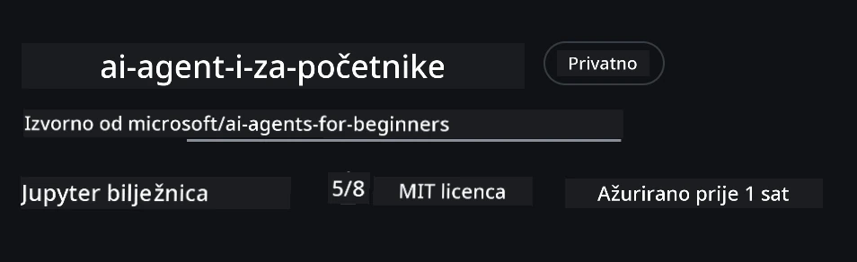
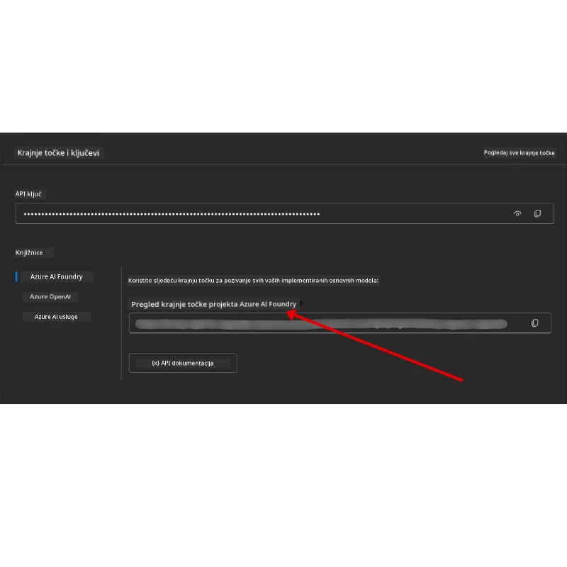

# Postavljanje tečaja

## Uvod

Ova lekcija će pokriti kako pokrenuti primjere koda iz ovog tečaja.

## Pridružite se drugim učenicima i zatražite pomoć

Prije nego što počnete klonirati svoj repozitorij, pridružite se [AI Agents For Beginners Discord kanalu](https://aka.ms/ai-agents/discord) kako biste dobili pomoć prilikom postavljanja, postavili pitanja o tečaju ili se povezali s drugim učenicima.

## Klonirajte ili forkajte ovaj repozitorij

Za početak, molimo klonirajte ili forkajte GitHub repozitorij. To će napraviti vašu vlastitu verziju materijala tečaja tako da možete pokretati, testirati i prilagođavati kod!

To možete učiniti klikom na link <a href="https://github.com/microsoft/ai-agents-for-beginners/fork" target="_blank">forkajte repozitorij</a>

Sada biste trebali imati svoju vlastitu forkanu verziju ovog tečaja na sljedećem linku:



### Osnovno kloniranje (preporučeno za radionice / Codespaces)

  >Puni repozitorij može biti velik (~3 GB) kad preuzmete cijelu povijest i sve datoteke. Ako sudjelujete samo na radionici ili trebate samo nekoliko mapa s lekcijama, osnovno (shallow) kloniranje (ili sparse kloniranje) preuzima znatno manje.

#### Brzo osnovno kloniranje — minimalna povijest, sve datoteke

Zamijenite `<your-username>` u donjim naredbama svojim URL-om forka (ili upstream URL-om ako želite).

Za kloniranje samo najnovije povijesti commita (malo preuzimanje):

```bash
git clone --depth 1 https://github.com/<your-username>/ai-agents-for-beginners.git
```

Za kloniranje određenog ogranka:

```bash
git clone --depth 1 --branch <branch-name> https://github.com/<your-username>/ai-agents-for-beginners.git
```

#### Djelomično (sparse) kloniranje — minimalni blobovi + samo odabrane mape

Ovo koristi djelomično kloniranje i sparse-checkout (zahtijeva Git 2.25+ i preporučeni moderni Git s podrškom za djelomično kloniranje):

```bash
git clone --depth 1 --filter=blob:none --sparse https://github.com/<your-username>/ai-agents-for-beginners.git
```

Uđite u mapu repozitorija:

```bash
cd ai-agents-for-beginners
```

Zatim navedite koje mape želite (primjeru ispod su dvije mape):

```bash
git sparse-checkout set 00-course-setup 01-intro-to-ai-agents
```

Nakon kloniranja i provjere datoteka, ako trebate samo datoteke i želite osloboditi prostor (bez git povijesti), molimo obrišite metapodatke repozitorija (💀nepovratno — izgubit ćete svu Git funkcionalnost):

```bash
# zsh/bash
rm -rf .git
```

```powershell
# PowerShell
Remove-Item -Recurse -Force .git
```

#### Korištenje GitHub Codespaces (preporučeno za izbjegavanje velikih lokalnih preuzimanja)

- Kreirajte novi Codespace za ovaj repozitorij putem [GitHub sučelja](https://github.com/codespaces).  

- U terminalu novokreiranog Codespacea pokrenite jednu od gore navedenih naredbi za osnovno/sparse kloniranje kako biste u Codespace workspace doveli samo potrebne mape s lekcijama.
- Opcionalno: nakon kloniranja unutar Codespacesa, uklonite .git kako biste oslobodili dodatni prostor (pogledajte naredbe za uklanjanje gore).
- Napomena: Ako radije otvorite repozitorij direktno u Codespaces (bez dodatnog kloniranja), imajte na umu da Codespaces će izgraditi devcontainer okruženje i možda će konstruirati više nego što vam je potrebno.

#### Savjeti

- Uvijek zamijenite URL kloniranja s URL-om svog forka ako želite uređivati/commitati.
- Ako kasnije trebate više povijesti ili datoteka, možete ih dohvatiti ili podesiti sparse-checkout za uključivanje dodatnih mapa.

## Pokretanje koda

Ovaj tečaj nudi seriju Jupyter bilježnica koje možete pokretati da biste stekli praktično iskustvo izgradnje AI agenata.

Primjeri koda koriste **Microsoft Agent Framework (MAF)** s `FoundryChatClient`, koji se povezuje na **Microsoft Foundry Agent Service V2** (Responses API) putem **Microsoft Foundry**.

Sve Python bilježnice su označene oznakom `*-python-agent-framework.ipynb`.

## Zahtjevi

- Python 3.12+
  - **NAPOMENA**: Ako nemate instaliran Python3.12, osigurajte da ga instalirate. Zatim kreirajte svoj venv koristeći python3.12 kako biste osigurali ispravne verzije instalirane iz requirements.txt datoteke.
  
    >Primjer

    Kreirajte Python venv direktorij:

    ```bash
    python -m venv venv
    ```

    Zatim aktivirajte venv okruženje za:

    ```bash
    # zsh/bash
    source venv/bin/activate
    ```
  
    ```dos
    # Command Prompt for Windows
    venv\Scripts\activate
    ```

- .NET 10+: Za primjere koda koji koriste .NET, osigurajte da instalirate [.NET 10 SDK](https://dotnet.microsoft.com/download/dotnet/10.0) ili noviji. Zatim provjerite verziju instaliranog .NET SDK-a:

    ```bash
    dotnet --list-sdks
    ```

- **Azure CLI** — Potrebno za autentifikaciju. Instalirajte sa [aka.ms/installazurecli](https://aka.ms/installazurecli).
- **Azure Pretplata** — Za pristup Microsoft Foundry i Microsoft Foundry Agent Service.
- **Microsoft Foundry Projekt** — Projekt s implementiranim modelom (npr., `gpt-5-mini`). Pogledajte [Korak 1](#korak-1-kreirajte-microsoft-foundry-projekt) dolje.

U korijenu ovog repozitorija uključili smo datoteku `requirements.txt` koja sadrži sve potrebne Python pakete za pokretanje primjera koda.

Možete ih instalirati pokretanjem sljedeće naredbe u terminalu u korijenu repozitorija:

```bash
pip install -r requirements.txt
```

Preporučujemo kreiranje Python virtualnog okruženja kako biste izbjegli sukobe i probleme.

## Postavljanje VSCode-a

Provjerite da koristite ispravnu verziju Pythona u VSCodeu.


## Postavljanje Microsoft Foundry i Microsoft Foundry Agent Service

### Korak 1: Kreirajte Microsoft Foundry Projekt

Trebate Microsoft Foundry **projekt** s implementiranim modelom da biste mogli pokretati bilježnice. Kreirajte projekt direktno u trenutnom Microsoft Foundry sučelju; hub nije potreban.

1. Idite na [ai.azure.com](https://ai.azure.com) i prijavite se svojim Azure računom.
2. Odaberite **Kreiraj projekt** i slijedite upute za kreiranje vašeg projekta.
3. U projektu implementirajte model (npr., `gpt-5-mini`) iz **Models + Endpoints** → **Deploy model**.

### Korak 2: Dohvatite projektni endpoint i ime implementacije modela

Iz vašeg projekta u Microsoft Foundry portalu:

- **Projektni endpoint** — Idite na stranicu **Pregled** i kopirajte URL endpointa.



- **Ime implementacije modela** — Idite na **Models + Endpoints**, odaberite implementirani model i zabilježite **Deployment name** (npr., `gpt-5-mini`).

### Korak 3: Prijavite se na Azure s `az login`

Većina bilježnica se autentificira preko vaše **Azure CLI prijave** — koristeći `AzureCliCredential` ili `DefaultAzureCredential` (obje preuzimaju vašu `az login` sesiju) iz paketa `azure-identity` — tako da ne trebaju API ključeve. Nekoliko lekcija i opcionalnih integracija koristi API ključeve; provjerite preduvjete svake lekcije za dodatne varijable okoline. Ovo zahtijeva da ste prijavljeni putem Azure CLI.

1. **Instalirajte Azure CLI** ako već niste: [aka.ms/installazurecli](https://aka.ms/installazurecli)

2. **Prijavite se** pokretanjem:

    ```bash
    az login
    ```

    Ili ako ste u udaljenom/Codespace okruženju bez preglednika:

    ```bash
    az login --use-device-code
    ```

3. **Odaberite pretplatu** ako ste upitani — odaberite onu koja sadrži vaš Foundry projekt.

4. **Provjerite** jeste li prijavljeni:

    ```bash
    az account show
    ```

> **Zašto `az login`?** Bilježnice se autentificiraju koristeći `AzureCliCredential` (ili `DefaultAzureCredential`, koji također preuzima vašu Azure CLI prijavu) iz paketa `azure-identity`. To znači da vaša Azure CLI sesija pruža vjerodajnice — nema API ključeva ili tajni u vašoj datoteci `.env`. Ovo je [najbolja sigurnosna praksa](https://learn.microsoft.com/azure/developer/ai/keyless-connections).

### Korak 4: Kreirajte svoju `.env` datoteku

Kopirajte primjer datoteke:

```bash
# zsh/bash
cp .env.example .env
```

```powershell
# PowerShell
Copy-Item .env.example .env
```

Otvorite `.env` i ispunite ove dvije vrijednosti:

```env
AZURE_AI_PROJECT_ENDPOINT=https://<your-project>.services.ai.azure.com/api/projects/<your-project-id>
AZURE_AI_MODEL_DEPLOYMENT_NAME=gpt-5-mini
```

| Varijabla | Gdje je pronaći |
|----------|-----------------|
| `AZURE_AI_PROJECT_ENDPOINT` | Foundry portal → vaš projekt → **Pregled** stranica |
| `AZURE_AI_MODEL_DEPLOYMENT_NAME` | Foundry portal → **Modeli + Krajnje točke** → naziv vašeg implementiranog modela |

To je sve za većinu lekcija! Bilježnice će se automatski autentificirati putem vaše `az login` sesije.

### Korak 5: Instalirajte Python ovisnosti

```bash
pip install -r requirements.txt
```

Preporučujemo da ovo pokrenete unutar virtualnog okruženja koje ste ranije stvorili.

## Opcionalna postava: Azure AI Search (Lekcije 5 i 16)

Bilježnice Lekcije 5 (Agentic RAG) i Lekcije 16 rade odmah sa **memorijskom bazom znanja** — nisu potrebni dodatni Azure resursi. Ako ih želite povezati sa stvarnim **Azure AI Search** indeksom, imajte na umu da **bilježnica Lekcije 16 trenutno koristi autentifikaciju na temelju ključa**: prelazi s pretraživanja u memoriji na Azure AI Search samo kada su **i** `AZURE_SEARCH_SERVICE_ENDPOINT` **i** `AZURE_SEARCH_API_KEY` postavljeni, inače ostaje na pretraživanju u memoriji — dakle, da biste je pokrenuli protiv stvarnog indeksa morate postaviti i administratorski ključ. Autentifikacija bez ključa pomoću Microsoft Entra ID (RBAC) je preporučeni pristup za vlastiti produkcijski kod, u skladu s `az login` tijekom koji se koristi svugdje drugdje u ovom tečaju.

Koraci RBAC u nastavku primjenjuju se na uzorke vodiča za postavljanje i vaš vlastiti kod. Oni ne omogućuju autentifikaciju bez ključa u bilježnici Lekcije 16; Lekcija 16 još uvijek zahtijeva i krajnju točku i administratorski ključ za korištenje Azure AI Search.

1. **Omogućite pristup temeljen na ulozi** na vašoj usluzi pretraživanja:

    ```bash
    az search service update --name <service-name> --resource-group <resource-group> --auth-options aadOrApiKey
    ```

2. **Dodijelite sebi potrebne uloge** (kreiranje/učitavanje indeksa i upiti):

    ```bash
    az role assignment create --assignee <your-user-or-principal-id> --role "Search Service Contributor" --scope $(az search service show -g <resource-group> -n <service-name> --query id -o tsv)
    az role assignment create --assignee <your-user-or-principal-id> --role "Search Index Data Contributor" --scope $(az search service show -g <resource-group> -n <service-name> --query id -o tsv)
    ```

3. **Dodajte krajnju točku** u vašu `.env` datoteku:

| Varijabla | Gdje je pronaći |
|----------|---------------|
| `AZURE_SEARCH_SERVICE_ENDPOINT` | Azure portal → vaš **Azure AI Search** resurs → **Pregled** → URL |
| `AZURE_SEARCH_API_KEY` | Potrebno (s krajnjom točkom) za omogućavanje Azure AI Search u Lesson 16 bilježnici, koja koristi autentifikaciju na temelju ključa. Azure portal → **Postavke** → **Ključevi** → glavni administratorski ključ |

> **Zašto bez ključa?** Administratorski ključevi omogućuju potpuni pristup pisanju vašoj usluzi pretraživanja i mogu se slučajno otkriti putem `.env` datoteka. Kod RBAC-a koristi se vaša `az login` identitet — isti bezključni obrazac Entra ID koji koriste bilježnice tečaja (putem `AzureCliCredential` / `DefaultAzureCredential`). Pogledajte [Povezivanje na Azure AI Search pomoću uloga](https://learn.microsoft.com/azure/search/search-security-rbac).

Pogledajte [Azure AI Search vodič za postavljanje](./AzureSearch.md) za potpune primjere kreiranja indeksa u Pythonu i .NET-u.

## Dodatna postava za lekcije koje direktno koriste Azure OpenAI (Lekcije 6 i 8)

Neke bilježnice u lekcijama 6 i 8 koriste **Azure OpenAI** izravno (koristeći **Responses API**) umjesto kroz Microsoft Foundry projekt. Ovi primjeri su prije koristili GitHub modele, koji su zastarjeli i ne podržavaju Responses API. Dodajte ove varijable u vašu `.env` datoteku:

| Varijabla | Gdje je pronaći |
|----------|---------------|
| `AZURE_OPENAI_ENDPOINT` | Azure portal → vaš **Azure OpenAI** resurs → **Keys and Endpoint** → Endpoint (npr. `https://<your-resource>.openai.azure.com`) |
| `AZURE_OPENAI_DEPLOYMENT` | Ime vašeg implementiranog modela (npr. `gpt-5-mini`) koji podržava Responses API |
| `AZURE_OPENAI_API_KEY` | Opcionalno — samo ako koristite autentifikaciju na osnovi ključa umjesto `az login` / Entra ID |

> Responses API koristi stabilnu `/openai/v1/` endpoint, tako da nije potreban `api-version`. Prijavite se s `az login` za korištenje autentifikacije bez ključa putem Entra ID-a.

## Alternativni pružatelj: MiniMax (kompatibilan s OpenAI)

[MiniMax](https://platform.minimaxi.com/) pruža modele s velikim kontekstom (do 204K tokena) putem API-ja kompatibilnog s OpenAI. Budući da Microsoft Agent Framework's `OpenAIChatClient` radi sa bilo kojim endpointom kompatibilnim s OpenAI, možete koristiti MiniMax kao zamjenu za lekcije koje koriste `OpenAIChatClient`.

Dodajte ove varijable u vašu `.env` datoteku:

| Varijabla | Gdje je pronaći |
|----------|-----------------|
| `MINIMAX_API_KEY` | [MiniMax Platforma](https://platform.minimaxi.com/) → API ključevi |
| `MINIMAX_BASE_URL` | Koristite `https://api.minimax.io/v1` (zadana vrijednost) |
| `MINIMAX_MODEL_ID` | Ime modela za korištenje (npr., `MiniMax-M3`) |

**Primjer modela**: `MiniMax-M3` (preporučeno), `MiniMax-M2.7`, `MiniMax-M2.7-highspeed` (brži odgovori). Imena modela i dostupnost mogu se mijenjati tijekom vremena, a pristup određenom modelu može ovisiti o vašem računu.

Primjeri koda koji koriste `OpenAIChatClient` (npr., Lekcija 14 rezervacija hotela) automatski će prepoznati i koristiti vašu MiniMax konfiguraciju kad je `MINIMAX_API_KEY` postavljen.

## Alternativni pružatelj: Novita AI (kompatibilan s OpenAI)

[Novita AI](https://novita.ai/llm-api) pruža OpenAI-kompatibilan API za open-source i najnovije LLM-ove (DeepSeek, Llama, Qwen i druge). Budući da Microsoft Agent Framework's `OpenAIChatClient` radi s bilo kojim OpenAI-kompatibilnim endpointom, možete koristiti Novita AI kao zamjenu za Azure OpenAI ili OpenAI.

Dodajte ove varijable u vašu `.env` datoteku:

| Varijabla | Gdje je pronaći |
|----------|-----------------|
| `NOVITA_API_KEY` | [Novita AI Nadzorna ploča](https://novita.ai/settings/key-management) → API ključevi |
| `NOVITA_BASE_URL` | Koristite `https://api.novita.ai/openai/v1` (zadana vrijednost) |
| `NOVITA_MODEL_ID` | Naziv modela za korištenje (npr. `moonshotai/kimi-k3`) |

**Primjeri modela**: `moonshotai/kimi-k3`, `zai-org/glm-5.2`, `deepseek/deepseek-v4-flash-0731`. Novita AI također podržava mnoge druge open-source obitelji modela (Llama, Qwen, GLM i druge) — pogledajte [Novita AI biblioteku modela](https://novita.ai/llm-api) za trenutačni popis dostupnih modela i njihovih ID-ova.

Trenutni primjeri ne koriste automatski `NOVITA_*` varijable. Za korištenje Novita AI, te vrijednosti morate izričito proslijediti prilikom konstruiranja `OpenAIChatClient` u primjeru koji pokrećete.

## Alternativni pružatelj usluga: Foundry Local (Pokretanje modela na uređaju)

[Foundry Local](https://foundrylocal.ai) je lagano runtime okruženje koje preuzima, upravlja i poslužuje jezične modele **u potpunosti na vašem računalu** putem OpenAI-kompatibilnog API-ja — bez potrebe za cloudom.

Budući da Microsoft Agent Framework's `OpenAIChatClient` funkcionira s bilo kojim OpenAI-kompatibilnim endpointom, Foundry Local je zamjena za Azure OpenAI koja radi lokalno.

**1. Instalirajte Foundry Local**

```bash
# Windows
winget install Microsoft.FoundryLocal

# macOS
brew install foundrylocal
```

**2. Preuzmite i pokrenite model** (ovo također pokreće lokalnu uslugu):

```bash
foundry model list          # see available models
foundry model run phi-4-mini
```

**3. Instalirajte Python SDK** koji se koristi za otkrivanje lokalnog endpointa:

```bash
pip install foundry-local-sdk
```

**4. Usmjerite Microsoft Agent Framework na vaš lokalni model:**

```python
from foundry_local import FoundryLocalManager
from agent_framework.openai import OpenAIChatClient

# Downloads (if needed) and serves the model locally, then discovers the endpoint/port.
manager = FoundryLocalManager("phi-4-mini")

chat_client = OpenAIChatClient(
    base_url=manager.endpoint,      # e.g. http://localhost:<port>/v1
    api_key=manager.api_key,        # always "not-required" for Foundry Local
    model_id=manager.get_model_info("phi-4-mini").id,
)

agent = chat_client.as_agent(
    name="LocalAgent",
    instructions="You are a helpful assistant running fully on-device.",
)
```

> **Napomena:** Foundry Local izlaže OpenAI-kompatibilni endpoint za **Chat Completions**. Koristite ga za lokalni razvoj i offline scenarije. Za puni skup značajki **Responses API-ja** (držaće razgovore i sl.) koristite Azure OpenAI ili Microsoft Foundry projekt.

## Dodatna konfiguracija za Lekciju 8 (Bing Grounding Workflow)

Uvjetni radni tok u lekciji 8 koristi **Bing grounding** putem Microsoft Foundryja. Ako planirate pokrenuti taj primjer, dodajte ovu varijablu u vašu `.env` datoteku:

| Varijabla | Gdje je pronaći |
|----------|-----------------|
| `BING_CONNECTION_ID` | Microsoft Foundry portal → vaš projekt → **Management** → **Connected resources** → vaša Bing veza → kopirajte ID veze |

## Otklanjanje poteškoća

### Pogreške provjere SSL certifikata na macOS-u

Ako ste na macOS-u i naiđete na pogrešku poput:

```plaintext
ssl.SSLCertVerificationError: [SSL: CERTIFICATE_VERIFY_FAILED] certificate verify failed: self-signed certificate in certificate chain
```

Ovo je poznati problem Pythona na macOS-u gdje se SSL certifikati sustava ne smatraju automatski pouzdanim. Isprobajte sljedeće korake redom:

**Opcija 1: Pokrenite Pythonov Install Certificates skript (preporučeno)**

```bash
# Replace 3.XX with your installed Python version (e.g., 3.12 or 3.13):
/Applications/Python\ 3.XX/Install\ Certificates.command
```

**Opcija 2: Koristite `connection_verify=False` u vašem notebooku (samo za GitHub Models notebooks)**

U notebooku Lekcije 6 (`06-building-trustworthy-agents/code_samples/06-system-message-framework.ipynb`) već je uključen zakomentirani workaround. Otkomentirajte `connection_verify=False` kada naiđete na pogreške certifikata:

```python
client = ChatCompletionsClient(
    endpoint=endpoint,
    credential=AzureKeyCredential(token),
    connection_verify=False,  # Disable SSL verification if you encounter certificate errors
)
```

> **⚠️ Upozorenje:** Onemogućavanje SSL provjere (`connection_verify=False`) smanjuje sigurnost preskačući validaciju certifikata. Koristite ovo samo kao privremeno rješenje u razvojnim okruženjima. Nikada ne koristite ovo u produkciji.

**Opcija 3: Instalirajte i koristite `truststore`**

```bash
pip install truststore
```

Zatim dodajte sljedeće na početak vašeg notebooka ili skripte prije bilo kakvih mrežnih poziva:

```python
import truststore
truststore.inject_into_ssl()
```

## Zapeo negdje?

Ako imate bilo kakvih problema s ovim postavkama, pridružite se našem <a href="https://discord.gg/kzRShWzttr" target="_blank">Azure AI Community Discordu</a> ili <a href="https://github.com/microsoft/ai-agents-for-beginners/issues?WT.mc_id=academic-105485-koreyst" target="_blank">otvorite issue</a>.

## Sljedeća lekcija

Sada ste spremni pokrenuti kod za ovaj tečaj. Sretno s daljnjim učenjem o svijetu AI agenata! 

[Uvod u AI agente i primjere korištenja agenata](../01-intro-to-ai-agents/README.md)

---

<!-- CO-OP TRANSLATOR DISCLAIMER START -->
**Napomena**:
Ovaj dokument je preveden korištenjem AI prevoditeljskog servisa [Co-op Translator](https://github.com/Azure/co-op-translator). Iako težimo točnosti, imajte na umu da automatski prijevodi mogu sadržavati greške ili netočnosti. Izvorni dokument na izvornom jeziku treba smatrati autoritativnim izvorom. Za važne informacije preporuča se profesionalni ljudski prijevod. Nismo odgovorni za bilo kakva nesporazumevanja ili pogrešne interpretacije koje proizlaze iz korištenja ovog prijevoda.
<!-- CO-OP TRANSLATOR DISCLAIMER END -->