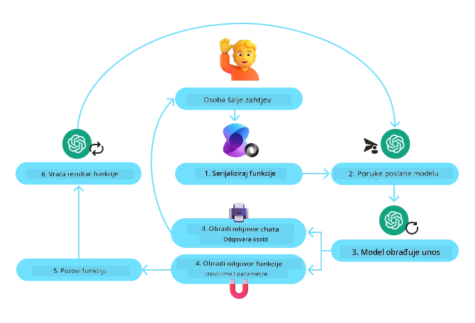
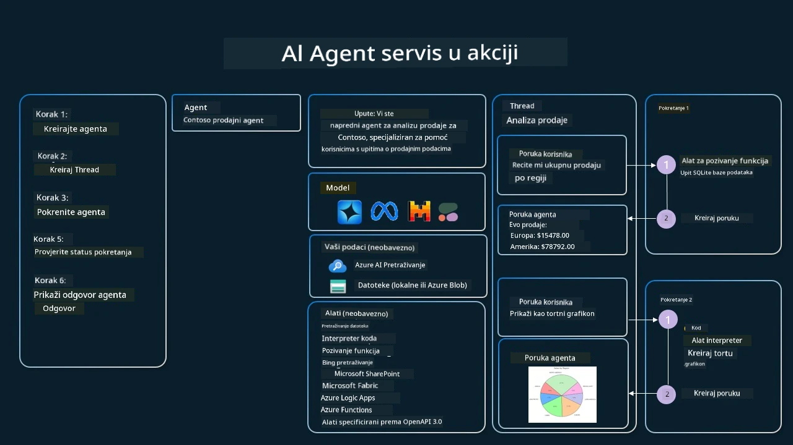

[](https://youtu.be/vieRiPRx-gI?si=cEZ8ApnT6Sus9rhn)

> _(Kliknite na gornju sliku za pregled videa ove lekcije)_

# Predložak za korištenje alata

Alati su zanimljivi jer omogućuju AI agentima širi spektar sposobnosti. Umjesto da agent ima ograničen skup radnji koje može izvršiti, dodavanjem alata agent sada može obaviti širok raspon radnji. U ovom poglavlju ćemo proučiti predložak za korištenje alata, koji opisuje kako AI agenti mogu koristiti specifične alate za postizanje svojih ciljeva.

## Uvod

U ovoj lekciji tražimo odgovore na sljedeća pitanja:

- Što je predložak za korištenje alata?
- U kojim se slučajevima primjene može koristiti?
- Koji su elementi/gradivni blokovi potrebni za implementaciju predloška?
- Koje su posebne razmatranja pri korištenju predloška za korištenje alata za izgradnju pouzdanih AI agenata?

## Ciljevi učenja

Nakon završetka ove lekcije moći ćete:

- Definirati predložak za korištenje alata i njegovu svrhu.
- Prepoznati slučajeve korištenja u kojima je predložak primjenjiv.
- Razumjeti ključne elemente potrebne za implementaciju predloška.
- Prepoznati razmatranja za osiguravanje pouzdanosti AI agenata koji koriste ovaj predložak.

## Što je predložak za korištenje alata?

**Predložak za korištenje alata** fokusira se na omogućavanje LLM-ovima (velikim jezičnim modelima) da komuniciraju s vanjskim alatima kako bi postigli specifične ciljeve. Alati su kod koji agent može izvršiti za obavljanje radnji. Alat može biti jednostavna funkcija poput kalkulatora ili poziv API-ja treće strane kao što je pregled cijena dionica ili vremenska prognoza. U kontekstu AI agenata, alati su dizajnirani da ih agenti izvršavaju kao odgovor na **funkcijske pozive generirane modelom**.

## U kojim slučajevima se može primijeniti?

AI agenti mogu koristiti alate za dovršavanje složenih zadataka, dohvaćanje informacija ili donošenje odluka. Predložak za korištenje alata često se koristi u scenarijima koji zahtijevaju dinamičku interakciju s vanjskim sustavima poput baza podataka, web servisa ili interpretatora koda. Ova sposobnost korisna je za različite slučajeve, uključujući:

- **Dinamičko dohvaćanje informacija:** Agent može upitavati vanjske API-je ili baze podataka kako bi pribavio ažurirane podatke (npr. upit SQLite baze za analizu podataka, dohvat cijena dionica ili vremenskih informacija).
- **Izvršavanje i interpretacija koda:** Agent može izvršavati kod ili skripte za rješavanje matematičkih problema, generiranje izvještaja ili izvođenje simulacija.
- **Automatizacija radnih tijekova:** Automatizacija ponavljajućih ili višestepenskih procesa integriranjem alata poput raspoređivača zadataka, servisima e-pošte ili podatkovnim cjevovodima.
- **Korisnička podrška:** Agent može komunicirati s CRM sustavima, platformama za izdavanje kartica ili bazama znanja za rješavanje korisničkih upita.
- **Generiranje i uređivanje sadržaja:** Agent može koristiti alate poput provjere gramatike, sažimanja teksta ili ocjenjivača sigurnosti sadržaja za pomoć u zadacima stvaranja sadržaja.

## Koji su elementi/gradivni blokovi potrebni za implementaciju predloška za korištenje alata?

Ovi gradivni blokovi omogućuju AI agentu obavljanje širokog raspona zadataka. Pogledajmo ključne elemente potrebne za implementaciju predloška za korištenje alata:

- **Sheme funkcija/alata**: Detaljni opisi dostupnih alata, uključujući ime funkcije, svrhu, potrebne parametre i očekivane rezultate. Ove sheme omogućuju LLM-u razumijevanje dostupnih alata i kako sastaviti valjane zahtjeve.

- **Logika izvršavanja funkcije**: Određuje kako i kada se alati pozivaju na temelju korisnikove namjere i konteksta razgovora. To može uključivati module planiranja, mehanizme usmjeravanja ili uvjetne tokove koji dinamički određuju korištenje alata.

- **Sustav za upravljanje porukama**: Komponente koje upravljaju tijekovima razgovora između korisničkih unosa, LLM-ovih odgovora, poziva alata i rezultata alata.

- **Okvir za integraciju alata**: Infrastruktura koja povezuje agenta s raznim alatima, bilo da su to jednostavne funkcije ili složene vanjske usluge.

- **Rukovanje pogreškama i validacija**: Mehanizmi za upravljanje neuspjesima pri izvršavanju alata, validaciju parametara i upravljanje neočekivanim odgovorima.

- **Upravljanje stanjem**: Praćenje konteksta razgovora, prethodnih interakcija s alatima i trajnih podataka radi osiguravanja dosljednosti tijekom višekratnih okretaja.

Sljedeće, pogledajmo detaljnije pozivanje funkcija/alata.
 
### Pozivanje funkcija/alata

Pozivanje funkcije je primarni način na koji omogućavamo velikim jezičnim modelima (LLM-ovima) da komuniciraju s alatima. Često ćete vidjeti da se 'Funkcija' i 'Alat' koriste naizmjence jer su 'funkcije' (blokovi ponovno upotrebljivog koda) alati koje agent koristi za izvršavanje zadataka. Da bi se pozvao kod neke funkcije, LLM mora usporediti korisnički zahtjev s opisom funkcije. Za to se šalje shema koja sadrži opise svih dostupnih funkcija LLM-u. LLM zatim odabire najprikladniju funkciju za zadatak i vraća njezino ime i argumente. Odabrana funkcija se poziva, njezin odgovor se šalje natrag LLM-u, koji koristi informacije kako bi odgovorio na korisnički zahtjev.

Za razvoj funkcije pozivanja za agente, potrebno je:

1. Model LLM koji podržava pozivanje funkcija
2. Shema koja sadrži opise funkcija
3. Kod za svaku opisanu funkciju

Koristit ćemo primjer dobivanja točnog vremena u nekom gradu za ilustraciju:

1. **Inicijalizacija LLM-a koji podržava pozivanje funkcija:**

    Ne podržavaju svi modeli pozivanje funkcija, stoga je važno provjeriti podršku u modelu koji koristite.     <a href="https://learn.microsoft.com/azure/ai-services/openai/how-to/function-calling" target="_blank">Azure OpenAI</a> podržava pozivanje funkcija. Možemo početi inicijalizirati OpenAI klijent prema Azure OpenAI **Responses API-ju** (stabilna `/openai/v1/` krajnja točka — nije potreban `api_version`). 

    ```python
    # Initialize the OpenAI client for Azure OpenAI (Responses API, v1 endpoint)
    client = OpenAI(
        base_url=f"{os.environ['AZURE_OPENAI_ENDPOINT'].rstrip('/')}/openai/v1/",
        api_key=os.environ["AZURE_OPENAI_API_KEY"],
    )
    deployment_name = os.environ["AZURE_OPENAI_DEPLOYMENT"]
    ```

1. **Kreiranje sheme funkcije**:

    Sljedeće ćemo definirati JSON shemu koja sadrži ime funkcije, opis što funkcija radi i imena i opise parametara funkcije.
    Zatim ćemo ovu shemu proslijediti ranije kreiranom klijentu zajedno s korisničkim zahtjevom za pronalaskom vremena u San Franciscu. Važno je napomenuti da se vraća **poziv alata**, **a ne** konačni odgovor na pitanje. Kao što je ranije navedeno, LLM vraća ime funkcije koju je odabrao za zadatak i argumente koji će joj biti dodijeljeni.

    ```python
    # Function description for the model to read (Responses API flat tool format)
    tools = [
        {
            "type": "function",
            "name": "get_current_time",
            "description": "Get the current time in a given location",
            "parameters": {
                "type": "object",
                "properties": {
                    "location": {
                        "type": "string",
                        "description": "The city name, e.g. San Francisco",
                    },
                },
                "required": ["location"],
            },
        }
    ]
    ```
   
    ```python
  
    # Initial user message
    messages = [{"role": "user", "content": "What's the current time in San Francisco"}]

    # First API call: Ask the model to use the function
    response = client.responses.create(
        model=deployment_name,
        input=messages,
        tools=tools,
        tool_choice="auto",
        store=False,
    )

    # The Responses API returns tool calls as function_call items in response.output.
    # Append them to the conversation so the model has full context on the next turn.
    messages += response.output

    print("Model's response:")
    print(response.output)
  
    ```

    ```bash
    Model's response:
    [ResponseFunctionToolCall(arguments='{"location":"San Francisco"}', call_id='call_pOsKdUlqvdyttYB67MOj434b', name='get_current_time', type='function_call')]
    ```
  
1. **Kod funkcije potreban da izvrši zadatak:**

    Sada kada je LLM odabrao koju funkciju treba izvršiti, kod koji izvršava zadatak treba biti implementiran i pokrenut.
    Možemo implementirati kod za dobivanje točnog vremena u Pythonu. Također ćemo morati napisati kod za izdvajanje imena i argumenata iz response_message kako bismo dobili konačni rezultat.

    ```python
      def get_current_time(location):
        """Get the current time for a given location"""
        print(f"get_current_time called with location: {location}")  
        location_lower = location.lower()
        
        for key, timezone in TIMEZONE_DATA.items():
            if key in location_lower:
                print(f"Timezone found for {key}")  
                current_time = datetime.now(ZoneInfo(timezone)).strftime("%I:%M %p")
                return json.dumps({
                    "location": location,
                    "current_time": current_time
                })
      
        print(f"No timezone data found for {location_lower}")  
        return json.dumps({"location": location, "current_time": "unknown"})
    ```

     ```python
    # Handle function calls
    tool_calls = [item for item in response.output if item.type == "function_call"]
    if tool_calls:
        for tool_call in tool_calls:
            if tool_call.name == "get_current_time":

                function_args = json.loads(tool_call.arguments)

                time_response = get_current_time(
                    location=function_args.get("location")
                )

                # Return the tool result as a function_call_output item
                messages.append({
                    "type": "function_call_output",
                    "call_id": tool_call.call_id,
                    "output": time_response,
                })
    else:
        print("No tool calls were made by the model.")

    # Second API call: Get the final response from the model
    final_response = client.responses.create(
        model=deployment_name,
        input=messages,
        tools=tools,
        store=False,
    )

    return final_response.output_text
     ```

     ```bash
      get_current_time called with location: San Francisco
      Timezone found for san francisco
      The current time in San Francisco is 09:24 AM.
     ```

Pozivanje funkcija je srž većine, ako ne i svih, dizajna korištenja alata agenta, no implementacija od početka ponekad može biti izazovna.
Kao što smo naučili u [Lekciji 2](../../../02-explore-agentic-frameworks), agentni okviri nam pružaju unaprijed izrađene gradivne blokove za implementaciju korištenja alata.
 
## Primjeri korištenja alata s agentnim okvirima

Evo nekoliko primjera kako implementirati predložak za korištenje alata koristeći različite agentne okvire:

### Microsoft Agent Framework

<a href="https://learn.microsoft.com/azure/ai-services/agents/overview" target="_blank">Microsoft Agent Framework</a> je otvoreni AI okvir za izgradnju AI agenata. Pojednostavljuje proces korištenja poziva funkcija dopuštajući da se alati definiraju kao Python funkcije s dekoratorom `@tool`. Okvir upravlja međusobnom komunikacijom između modela i vašeg koda. Također pruža pristup unaprijed izrađenim alatima kao što su Pretraživanje datoteka i Interpreter koda putem `FoundryChatClient`.

Sljedeća shema ilustrira proces pozivanja funkcije s Microsoft Agent Frameworkom:



U Microsoft Agent Frameworku alati se definiraju kao dekorirane funkcije. Možemo pretvoriti funkciju `get_current_time` koju smo ranije vidjeli u alat korištenjem dekoratora `@tool`. Okvir će automatski serijalizirati funkciju i njezine parametre, stvarajući shemu za slanje LLM-u.

```python
import os
from agent_framework import tool
from agent_framework.foundry import FoundryChatClient
from azure.identity import AzureCliCredential

@tool(approval_mode="never_require")
def get_current_time(location: str) -> str:
    """Get the current time for a given location"""
    ...

# Create the client
provider = FoundryChatClient(
    project_endpoint=os.environ["AZURE_AI_PROJECT_ENDPOINT"],
    model=os.environ["AZURE_AI_MODEL_DEPLOYMENT_NAME"],
    credential=AzureCliCredential(),
)

# Create an agent and run with the tool
agent = provider.as_agent(name="TimeAgent", instructions="Use available tools to answer questions.", tools=get_current_time)
response = await agent.run("What time is it?")
```

#### Alati s MCP servera

Alati ne moraju biti funkcije u vašem vlastitom kodu. Server koji koristi Model Context Protocol (MCP, obrađeno u [Lekciji 11](../11-agentic-protocols/README.md)) objavljuje svoje alate zajedno sa shemama, i okvir ih može učitati na isti način kao i serijalizirana dekorirana funkcija. `MCPStreamableHTTPTool` se povezuje na takav server preko HTTP-a, čita sheme alata i nudi ih modelu uz lokalne alate.

Primjer ispod koristi web pretraživački server koji je domaćin <a href="https://keenable.ai" target="_blank">Keenable</a>. Besplatan je za korištenje bez računa ili API ključa (zahtjevi su ograničeni po IP adresi), pa su vam jedine vjerodajnice one za vaš model. Kao i kod bilo kojeg udaljenog alata, upiti koje model piše šalju se tom serveru.

```python
from agent_framework import MCPStreamableHTTPTool

web_search = MCPStreamableHTTPTool(
    name="Keenable web search",
    url="https://api.keenable.ai/mcp",
)

# Connecting loads the server's tool schemas; the agent decides when to call them
async with web_search:
    agent = provider.as_agent(
        name="ResearchAgent",
        instructions="Use available tools to answer questions.",
        tools=[web_search],
    )
    response = await agent.run("What is new in the latest Python release?")
    print(response.text)
```

Server objavljuje dva alata, `search_web_pages` i `fetch_page_content`. Kad je potrebna trenutna informacija, model poziva `search_web_pages`, dobiva nazive, URL-ove i isječke teksta, te iz njih sastavlja svoj odgovor, isti je slučaj kao u primjeru `get_current_time` ranije.
  
### Microsoft Foundry Agent Service

<a href="https://learn.microsoft.com/azure/ai-services/agents/overview" target="_blank">Microsoft Foundry Agent Service</a> je noviji agentni okvir dizajniran da programerima omogući sigurno izgradnju, implementaciju i skaliranje visokokvalitetnih i proširivih AI agenata bez potrebe za upravljanjem osnovnim računalnim i skladišnim resursima. Posebno je koristan za korporativne aplikacije budući da je u potpunosti upravljana usluga s sigurnošću razine poduzeća.

U usporedbi s razvojem direktno s LLM API-jima, Microsoft Foundry Agent Service pruža neke prednosti, uključujući:

- Automatsko pozivanje alata – nema potrebe za parsiranjem poziva alata, izvođenjem alata i rukovanjem odgovorom; sve se to sada obavlja na strani servera
- Sigurno upravljanje podacima – umjesto upravljanja vlastitim stanjem razgovora, možete se osloniti na threadove za pohranu svih potrebnih informacija
- Alati spremni za korištenje – alati za interakciju s vašim izvorištima podataka, kao što su Bing, Azure AI Search i Azure Functions.

Alati dostupni u Microsoft Foundry Agent Service mogu se podijeliti u dvije kategorije:

1. Alati za znanje:
    - <a href="https://learn.microsoft.com/azure/ai-services/agents/how-to/tools/bing-grounding?tabs=python&pivots=overview" target="_blank">Podloga s Bing pretraživanjem</a>
    - <a href="https://learn.microsoft.com/azure/ai-services/agents/how-to/tools/file-search?tabs=python&pivots=overview" target="_blank">Pretraživanje datoteka</a>
    - <a href="https://learn.microsoft.com/azure/ai-services/agents/how-to/tools/azure-ai-search?tabs=azurecli%2Cpython&pivots=overview-azure-ai-search" target="_blank">Azure AI Search</a>

2. Alati za akciju:
    - <a href="https://learn.microsoft.com/azure/ai-services/agents/how-to/tools/function-calling?tabs=python&pivots=overview" target="_blank">Pozivanje funkcija</a>
    - <a href="https://learn.microsoft.com/azure/ai-services/agents/how-to/tools/code-interpreter?tabs=python&pivots=overview" target="_blank">Interpreter koda</a>
    - <a href="https://learn.microsoft.com/azure/ai-services/agents/how-to/tools/openapi-spec?tabs=python&pivots=overview" target="_blank">Alati definirani OpenAPI-jem</a>
    - <a href="https://learn.microsoft.com/azure/ai-services/agents/how-to/tools/azure-functions?pivots=overview" target="_blank">Azure Functions</a>

Agent Service nam omogućuje korištenje ovih alata zajedno kao `toolset`. Također koristi `threads` koji prate povijest poruka u određenom razgovoru.

Zamislite da ste prodajni agent u tvrtki Contoso. Želite razviti konverzacijski agent koji može odgovoriti na pitanja o vašim prodajnim podacima.

Slika ispod ilustrira kako biste mogli koristiti Microsoft Foundry Agent Service za analizu vaših prodajnih podataka:



Za korištenje bilo kojeg od ovih alata s uslugom možemo kreirati klijenta i definirati alat ili skup alata. Za praktičnu implementaciju možemo iskoristiti sljedeći Python kod. LLM će moći pogledati skup alata i odlučiti hoće li koristiti funkciju kreiranu od korisnika, `fetch_sales_data_using_sqlite_query`, ili unaprijed izgrađeni Interpreter koda, ovisno o korisničkom zahtjevu.

```python 
import os
from azure.ai.projects import AIProjectClient
from azure.identity import DefaultAzureCredential
from fetch_sales_data_functions import fetch_sales_data_using_sqlite_query # fetch_sales_data_using_sqlite_query function which can be found in a fetch_sales_data_functions.py file.
from azure.ai.projects.models import ToolSet, FunctionTool, CodeInterpreterTool

project_client = AIProjectClient.from_connection_string(
    credential=DefaultAzureCredential(),
    conn_str=os.environ["PROJECT_CONNECTION_STRING"],
)

# Initialize toolset
toolset = ToolSet()

# Initialize function calling agent with the fetch_sales_data_using_sqlite_query function and adding it to the toolset
fetch_data_function = FunctionTool(fetch_sales_data_using_sqlite_query)
toolset.add(fetch_data_function)

# Initialize Code Interpreter tool and adding it to the toolset. 
code_interpreter = CodeInterpreterTool()toolset.add(code_interpreter)

agent = project_client.agents.create_agent(
    model="gpt-5-mini", name="my-agent", instructions="You are helpful agent", 
    toolset=toolset
)
```

## Koja su posebna razmatranja pri korištenju predloška za korištenje alata za izgradnju pouzdanih AI agenata?

Česta briga kada SQL dinamički generiraju LLM-ovi je sigurnost, posebno rizik od SQL injekcija ili zlonamjernih radnji, poput brisanja ili manipulacije bazom podataka. Iako su te zabrinutosti opravdane, mogu se učinkovito ublažiti pravilnim konfiguriranjem dopuštenja za pristup bazi podataka. Za većinu baza to uključuje konfiguriranje baze u samo za čitanje. Za usluge baza poput PostgreSQL-a ili Azure SQL, aplikacija bi trebala imati dodijeljenu ulogu samo za čitanje (SELECT).

Pokretanje aplikacije u sigurnom okruženju dodatno povećava zaštitu. U korporativnim scenarijima, podaci se obično izvlače i transformiraju iz operativnih sustava u bazu podataka ili skladište podataka samo za čitanje s korisnički prihvatljivom shemom. Ovaj pristup osigurava da su podaci sigurni, optimizirani za performanse i dostupnost, te da aplikacija ima ograničen, samo za čitanje pristup.

## Primjeri koda

- Python: [Agent Framework](./code_samples/04-python-agent-framework.ipynb)
- .NET: [Agent Framework](./code_samples/04-dotnet-agent-framework.md)

## Imate li dodatnih pitanja o predlošcima za korištenje alata?

Pridružite se [Microsoft Foundry Discord](https://discord.com/invite/ATgtXmAS5D) da upoznate druge učenike, sudjelujete na radnim satima i dobijete odgovore na pitanja o AI agentima.

## Dodatni resursi

- <a href="https://microsoft.github.io/build-your-first-agent-with-azure-ai-agent-service-workshop/" target="_blank">Azure AI Agents Service radionica</a>
- <a href="https://github.com/Azure-Samples/contoso-creative-writer/tree/main/docs/workshop" target="_blank">Contoso Creative Writer Multi-Agent Radionica</a>
- <a href="https://learn.microsoft.com/azure/ai-services/agents/overview" target="_blank">Pregled Microsoft Agent Okvira</a>

## Osnovno testiranje ovog agenta (neobavezno)

Nakon što naučite postavljati agente u [Lekcija 16](../16-deploying-scalable-agents/README.md), možete osnovno testirati `TravelToolAgent` ove lekcije (još uvijek poziva svoje alate i odgovara?) s [`tests/lesson-04-smoke-tests.json`](../../../tests/lesson-04-smoke-tests.json). Pogledajte [`tests/README.md`](../tests/README.md) za upute kako ga pokrenuti.

## Prethodna lekcija

[Razumijevanje agentnih dizajnerskih obrazaca](../03-agentic-design-patterns/README.md)

## Sljedeća lekcija

[Agentni RAG](../05-agentic-rag/README.md)

---

<!-- CO-OP TRANSLATOR DISCLAIMER START -->
**Napomena**:
Ovaj dokument je preveden korištenjem AI prevoditeljskog servisa [Co-op Translator](https://github.com/Azure/co-op-translator). Iako težimo točnosti, imajte na umu da automatski prijevodi mogu sadržavati greške ili netočnosti. Izvorni dokument na izvornom jeziku treba smatrati autoritativnim izvorom. Za važne informacije preporuča se profesionalni ljudski prijevod. Nismo odgovorni za bilo kakva nesporazumevanja ili pogrešne interpretacije koje proizlaze iz korištenja ovog prijevoda.
<!-- CO-OP TRANSLATOR DISCLAIMER END -->