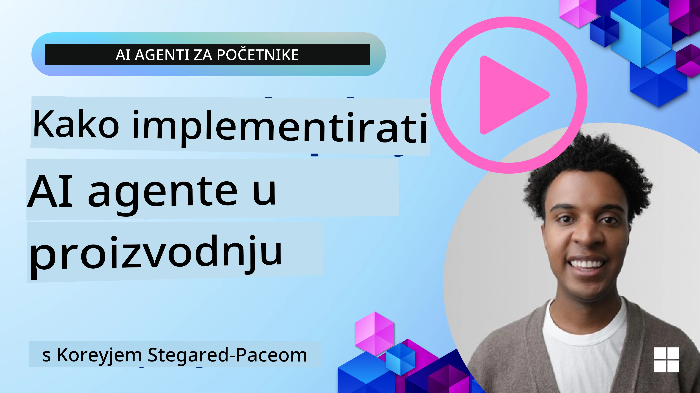

# AI agenti u produkciji: promatranje i evaluacija

[](https://youtu.be/l4TP6IyJxmQ?si=reGOyeqjxFevyDq9)

Kako AI agenti prelaze iz eksperimentalnih prototipova u stvarne primjene, postaje važno razumjeti njihovo ponašanje, pratiti njihovu izvedbu te sistematski ocijeniti njihove rezultate.

## Ciljevi učenja

Nakon završetka ove lekcije, znat ćete kako/razumjeti:
- Temeljne pojmove promatranja i evaluacije agenata
- Tehnike za poboljšanje izvedbe, troškova i učinkovitosti agenata
- Što i kako sistematski evaluirati vaše AI agente
- Kako kontrolirati troškove prilikom uvođenja AI agenata u produkciju
- Kako instrumentirati agente izgrađene Microsoft Agent Frameworkom

Cilj je opremiti vas znanjem za transformaciju vaših "crnih kutija" agenata u prozirne, upravljive i pouzdane sustave.

_**Napomena:** Važno je implementirati AI agente koji su sigurni i pouzdani. Pogledajte i lekciju [Izgradnja pouzdanih AI agenata](../06-building-trustworthy-agents/README.md)._

## Tragovi i intervali

Alati za promatranje poput [Langfuse](https://langfuse.com/) ili [Microsoft Foundry](https://learn.microsoft.com/en-us/azure/ai-foundry/what-is-azure-ai-foundry) obično prikazuju izvedbe agenata kao tragove i intervale.

- **Trag** predstavlja cjelokupan zadatak agenta od početka do kraja (kao što je rukovanje korisničkim upitom).
- **Intervali** su pojedinačni koraci unutar traga (kao što je pozivanje jezičnog modela ili dohvaćanje podataka).


<!-- Image URL retained for illustration purposes -->

Bez promatranja AI agent može djelovati kao "crna kutija" – njegovo unutarnje stanje i razmišljanje su neprozirni, što otežava dijagnosticiranje problema ili optimizaciju izvedbe. Uz promatranje, agenti postaju "staklene kutije" koje nude transparentnost ključnu za izgradnju povjerenja i osiguranje ispravnog rada.

## Zašto je promatranje važno u produkcijskim okruženjima

Prijenos AI agenata u produkcijska okruženja donosi novi skup izazova i zahtjeva. Promatranje više nije „luksuz“, već ključna sposobnost:

*   **Otklanjanje grešaka i analiza osnovnog uzroka:** Kada agent zakaže ili proizvede neočekivani rezultat, alati za promatranje pružaju tragove potrebne za točno određivanje izvora pogreške. Ovo je osobito važno kod složenih agenata koji mogu uključivati višestruke pozive LLM-a, interakcije s alatima i uvjetnu logiku.
*   **Upravljanje latencijom i troškovima:** AI agenti često koriste LLM-ove i druge vanjske API-je koji se naplaćuju po tokenu ili pozivu. Promatranje omogućuje precizno praćenje tih poziva, pomažući u otkrivanju operacija koje su prespore ili pretjerano skupe. To omogućava optimizaciju promptova, odabir učinkovitijih modela ili redizajn tijeka rada za upravljanje operativnim troškovima i osiguranje kvalitetnog korisničkog doživljaja.
*   **Povjerenje, sigurnost i usklađenost:** U mnogim primjenama važno je osigurati sigurno i etično ponašanje agenata. Promatranje pruža revizijski trag akcija i odluka agenta. To se može koristiti za otkrivanje i ublažavanje problema poput injektiranja promptova, generiranja štetnog sadržaja ili nepravilnog rukovanja osobnim podacima (PII). Na primjer, možete pregledati tragove da razumijete zašto je agent dao određeni odgovor ili koristio specifični alat.
*   **Kontinuirani krugovi poboljšanja:** Podaci iz promatranja temelj su iterativnog procesa razvoja. Praćenjem kako agenti rade u stvarnom svijetu, timovi mogu identificirati područja za poboljšanje, prikupiti podatke za fino podešavanje modela i provjeriti učinke promjena. To stvara povratnu petlju gdje uvidi iz produkcijskog online praćenja informiraju offline eksperimentiranje i usavršavanje, vodeći postupno boljoj izvedbi agenta.

## Ključne metrike za praćenje

Za praćenje i razumijevanje ponašanja agenata treba pratiti niz metrika i signala. Iako specifične metrike mogu varirati ovisno o svrsi agenta, neke su univerzalno važne.

Evo nekih od najčešćih metrika koje alati za promatranje prate:

**Latencija:** Kako brzo agent odgovara? Duga čekanja negativno utječu na korisničko iskustvo. Latenciju treba mjeriti za zadatke i pojedinačne korake praćenjem izvedbi agenta. Na primjer, agent koji koristi 20 sekundi za sve pozive modelu može biti ubrzan korištenjem bržeg modela ili paralelnim izvođenjem poziva.

**Troškovi:** Koliki je trošak po izvedbi agenta? AI agenti ovise o LLM pozivima koji se naplaćuju po tokenu ili vanjskim API-jima. Česta upotreba alata ili višestruki promptovi mogu brzo povećati troškove. Na primjer, ako agent pet puta pozove LLM radi marginalnog poboljšanja kvalitete, morate procijeniti je li trošak opravdan ili možete smanjiti broj poziva ili koristiti jeftiniji model. Praćenje u stvarnom vremenu može pomoći u otkrivanju neočekivanih skokova (npr. bugova koji uzrokuju prekomjerne API pozive).

**Pogreške zahtjeva:** Koliko zahtjeva je agent neuspješno izvršio? Ovo može uključivati API greške ili neuspjele pozive alata. Za povećanje robusnosti agenta u produkciji možete implementirati rezervne opcije ili ponovne pokušaje. Na primjer, ako je LLM pružatelj A nedostupan, prebacite se na LLM pružatelja B kao rezervu.

**Povratne informacije korisnika:** Implementacija izravnih korisničkih evaluacija daje vrijedne uvide. To može uključivati eksplicitne ocjene (👍palac gore/👎dolje, ⭐1-5 zvjezdica) ili tekstualne komentare. Konzistentne negativne povratne informacije trebale bi vas upozoriti jer su znak da agent ne radi prema očekivanjima.

**Implicitne povratne informacije korisnika:** Korisničko ponašanje pruža neizravne povratne informacije čak i bez eksplicitnih ocjena. To može uključivati trenutne preformulacije pitanja, ponovljene upite ili pritiskanje gumba za ponovno pokušavanje. Na primjer, ako vidite da korisnici neprestano postavljaju isto pitanje, to je znak da agent ne radi prema očekivanjima.

**Točnost:** Koliko često agent proizvodi točne ili poželjne rezultate? Definicije točnosti variraju (npr. ispravnost rješavanja problema, točnost dohvaćanja informacija, zadovoljstvo korisnika). Prvi korak je definirati što za vašeg agenta znači uspjeh. Točnost možete pratiti automatiziranim provjerama, evaluacijskim ocjenama ili oznakama dovršenosti zadatka. Na primjer, označavanje tragova kao "uspješan" ili "neuspješan".

**Automatizirane evaluacijske metrike:** Također možete postaviti automatizirane evaluacije. Na primjer, možete koristiti LLM za ocjenu izlaza agenta, npr. je li koristan, točan ili nije. Postoji više open source biblioteka koje pomažu ocjenjivati različite aspekte agenta, npr. [RAGAS](https://docs.ragas.io/) za RAG agente ili [LLM Guard](https://github.com/protectai/llm-guard) za otkrivanje štetnog jezika ili injektiranja prompta.

U praksi kombinacija ovih metrika pruža najbolji pregled zdravlja AI agenta. U ovom poglavlju [primjer bilježnice](./code_samples/10-expense_claim-demo.ipynb) pokazat ćemo kako ove metrike izgledaju na stvarnim primjerima, ali prvo ćemo naučiti kako izgleda tipični tijek rada evaluacije.

## Instrumentirajte svog agenta

Za prikupljanje podataka o tragovima potrebno je instrumentirati vaš kod. Cilj je instrumentirati kod agenta da emitira tragove i metrike koje platforma za promatranje može uhvatiti, obraditi i vizualizirati.

**OpenTelemetry (OTel):** [OpenTelemetry](https://opentelemetry.io/) postao je industrijski standard za promatranje LLM-a. Nudi skup API-ja, SDK-ova i alata za generiranje, prikupljanje i izvoz telemetrijskih podataka.

Postoji mnogo biblioteka za instrumentaciju koje omotavaju postojeće agent okvire i olakšavaju izvoz OpenTelemetry intervala u alat za promatranje. Microsoft Agent Framework integrira OpenTelemetry izvorno. Ispod je primjer instrumentacije MAF agenta:

```python
from agent_framework.observability import get_tracer, get_meter

tracer = get_tracer()
meter = get_meter()

with tracer.start_as_current_span("agent_run"):
    # Agent execution is traced automatically
    pass
```

Primjer bilježnice [example notebook](./code_samples/10-expense_claim-demo.ipynb) u ovom poglavlju pokazat će kako instrumentirati vaš MAF agent.

**Ručno kreiranje intervala:** Iako biblioteke za instrumentaciju pružaju dobru osnovu, često postoje slučajevi kad su potrebne detaljnije ili prilagođene informacije. Možete ručno kreirati intervale da dodate prilagođenu aplikacijsku logiku. Još važnije, mogu obogatiti automatski ili ručno stvorene intervale prilagođenim atributima (poznatim i kao oznake ili metapodaci). Ti atributi mogu uključivati poslovne podatke, međurezultate ili bilo koji kontekst koristan za otklanjanje grešaka ili analizu, kao što su `user_id`, `session_id` ili `model_version`.

Primjer ručnog kreiranja tragova i intervala s [Langfuse Python SDK](https://langfuse.com/docs/sdk/python/sdk-v3):

```python
from langfuse import get_client
 
langfuse = get_client()
 
span = langfuse.start_span(name="my-span")
 
span.end()
```

## Evaluacija agenta

Promatranje nam daje metrike, ali evaluacija je proces analize tih podataka (i provođenja testova) kako bismo utvrdili koliko dobro AI agent radi i kako se može poboljšati. Drugim riječima, jednom kada imate te tragove i metrike, kako ih upotrebljavate za prosudbu agenta i donošenje odluka?

Redovita evaluacija je važna jer su AI agenti često nedeterministični i mogu se razvijati (putem nadogradnji ili promjena ponašanja modela) – bez evaluacije ne biste znali radi li vaš „pametni agent“ dobro ili je nazadovao.

Postoje dvije kategorije evaluacija za AI agente: **online evaluacija** i **offline evaluacija**. Obje su vrijedne i nadopunjuju se. Obično započinjemo s offline evaluacijom, jer je to minimalni nužni korak prije uvođenja bilo kojeg agenta.

### Offline evaluacija


Ovo uključuje evaluaciju agenta u kontroliranim uvjetima, obično koristeći testne skupove podataka, a ne žive korisničke upite. Koristite kurirane skupove podataka gdje znate očekivani izlaz ili ispravno ponašanje, a zatim pokrećete agenta na njima.

Na primjer, ako ste izgradili agenta za matematičke zadatke iz teksta, mogli biste imati [testni skup podataka](https://huggingface.co/datasets/openai/gsm8k) od 100 problema s poznatim odgovorima. Offline evaluacija se često radi tijekom razvoja (i može biti dio CI/CD procesa) kako bi se provjerila poboljšanja ili spriječili nazadovanja. Prednost je što je **ponovljivo i možete dobiti jasne metrike točnosti jer imate stvarne činjenice**. Također možete simulirati korisničke upite i mjeriti odgovore agenta u odnosu na idealne odgovore ili koristiti automatizirane metrike kao gore opisano.

Ključni izazov s offline evaluacijom je osigurati da je vaš testni skup podataka sveobuhvatan i da ostaje relevantan – agent može dobro raditi na fiksnom testnom skupu, ali naići na vrlo različite upite u produkciji. Stoga trebate redovito ažurirati testne skupove novim rubnim slučajevima i primjerima koji odražavaju stvarne scenarije. Korisna je mješavina malih "smoke test" slučajeva i većih evaluacijskih setova: mali za brze provjere, veći za šire metrike izvedbe.

### Online evaluacija


Ovo se odnosi na evaluaciju agenta u živom, stvarnom okruženju, tj. tijekom stvarne upotrebe u produkciji. Online evaluacija uključuje praćenje izvedbe agenta na stvarnim korisničkim interakcijama i kontinuiranu analizu rezultata.

Na primjer, možete pratiti stope uspješnosti, ocjene zadovoljstva korisnika ili druge metrike na stvarnom prometu. Prednost online evaluacije je što **hvata stvari koje možda ne biste očekivali u laboratorijskim uvjetima** – možete uočiti promjene modela tijekom vremena (ako agentova učinkovitost opada kako se mijenjaju ulazni obrasci) i uočiti neočekivane upite ili situacije koji nisu bili u vašim testnim podacima. Daje istinsku sliku ponašanja agenta u stvarnom svijetu.

Online evaluacija često uključuje prikupljanje implicitnih i eksplicitnih povratnih informacija korisnika, kako je opisano, i moguće pokretanje shadow testova ili A/B testova (gdje nova verzija agenta radi paralelno radi usporedbe s prethodnom). Izazov je što može biti teško dobiti pouzdane oznake ili ocjene za žive interakcije – možda ćete se oslanjati na povratne informacije korisnika ili sekundarne metrike (npr. je li korisnik kliknuo rezultat).

### Kombiniranje ova dva pristupa

Online i offline evaluacije nisu međusobno isključive; vrlo su komplementarne. Uvidi iz online praćenja (npr. novi tipovi korisničkih upita kod kojih agent loše radi) mogu se koristiti za proširenje i poboljšanje offline testnih skupova podataka. Suprotno, agenti koji dobro rade u offline testovima mogu se s većim povjerenjem uvesti i pratiti online.

Zapravo, mnogi timovi usvajaju petlju:

_offline evaluacija -> uvođenje -> online praćenje -> prikupljanje novih neuspjeha -> dodavanje u offline skup -> usavršavanje agenta -> ponavljanje_.

## Uobičajeni problemi

Prilikom uvođenja AI agenata u produkciju možda ćete naići na razne izazove. Evo nekih uobičajenih problema i njihovih mogućih riješenja:

| **Problem**    | **Moguće rješenje**   |
| ------------- | ------------------ |
| AI agent ne obavlja zadatke dosljedno | - Doradite prompt koji dajete AI agentu; budite jasni u ciljevima.<br>- Identificirajte gdje razdvajanje zadataka na podzadatke i njihovo upravljanje kroz više agenata može pomoći. |
| AI agent ulazi u beskonačne petlje  | - Osigurajte jasne uvjete za zaustavljanje kako bi agent znao kada prekinuti proces.<br>- Za složene zadatke koji zahtijevaju rezoniranje i planiranje, koristite veći model specijaliziran za rezoniranje. |
| Pozivi alata AI agenta ne rade dobro   | - Testirajte i validirajte izlaz alata izvan sustava agenta.<br>- Doradite definirane parametre, promptove i nazive alata.  |
| Sustav više agenata ne radi dosljedno | - Doradite promptove svakom agentu kako bi bili specifični i međusobno različiti.<br>- Izgradite hijerarhijski sustav koristeći "routing" ili kontrolni agent za određivanje pravog agenta. |

Mnogi od tih problema mogu se učinkovitije identificirati implementacijom promatranja. Tragovi i metrike o kojima smo ranije govorili pomažu točno locirati gdje u tijeku rada agenta dolazi do problema, čineći otklanjanje grešaka i optimizaciju znatno učinkovitijima.

## Upravljanje troškovima

Evo nekoliko strategija za upravljanje troškovima uvođenja AI agenata u produkciju:

**Korištenje manjih modela:** Mali jezični modeli (SLM) mogu dobro funkcionirati za određene agencijske slučajeve i znatno će smanjiti troškove. Kao što je ranije spomenuto, izgradnja sustava za evaluaciju za određivanje i usporedbu performansi u odnosu na veće modele najbolji je način da se shvati koliko će dobro SLM raditi za vaš slučaj upotrebe. Razmotrite korištenje SLM-ova za jednostavnije zadatke poput klasifikacije namjere ili izvlačenja parametara, dok veće modele rezervirate za složeno rezoniranje.

**Korištenje modela usmjerivača:** Slično je koristiti raznolikost modela i veličina. Možete koristiti LLM/SLM ili serverless funkciju za usmjeravanje zahtjeva na temelju složenosti prema modelima koji najbolje odgovaraju. To će također pomoći u smanjenju troškova, a istovremeno osigurati performanse na pravim zadacima. Na primjer, upućujte jednostavne upite manjim, bržim modelima, a skupe velike modele koristite samo za složene zadatke rezoniranja.

**Keširanje odgovora:** Prepoznavanje čestih zahtjeva i zadataka te pružanje odgovora prije nego što prođu kroz vaš agencijski sustav dobar je način za smanjenje količine sličnih zahtjeva. Možete čak implementirati tok za prepoznavanje sličnosti zahtjeva s keširanim zahtjevima korištenjem jednostavnijih AI modela. Ova strategija može značajno smanjiti troškove za često postavljana pitanja ili uobičajene radne tokove.

## Pogledajmo kako to funkcionira u praksi

U [primjernom bilježniku ovog odjeljka](./code_samples/10-expense_claim-demo.ipynb) vidjet ćemo primjere kako možemo koristiti alate za promatranje i evaluaciju našeg agenta.


### Imate li još pitanja o AI agentima u produkciji?

Pridružite se [Microsoft Foundry Discordu](https://discord.com/invite/ATgtXmAS5D) kako biste upoznali druge učenike, prisustvovali radnom vremenu i dobili odgovore na svoja pitanja o AI agentima.

## Prethodna lekcija

[Metakognitivni dizajnerski uzorak](../09-metacognition/README.md)

## Sljedeća lekcija

[Agencijski protokoli](../11-agentic-protocols/README.md)

---

<!-- CO-OP TRANSLATOR DISCLAIMER START -->
**Napomena**:
Ovaj dokument je preveden korištenjem AI prevoditeljskog servisa [Co-op Translator](https://github.com/Azure/co-op-translator). Iako težimo točnosti, imajte na umu da automatski prijevodi mogu sadržavati greške ili netočnosti. Izvorni dokument na izvornom jeziku treba smatrati autoritativnim izvorom. Za važne informacije preporuča se profesionalni ljudski prijevod. Nismo odgovorni za bilo kakva nesporazumevanja ili pogrešne interpretacije koje proizlaze iz korištenja ovog prijevoda.
<!-- CO-OP TRANSLATOR DISCLAIMER END -->