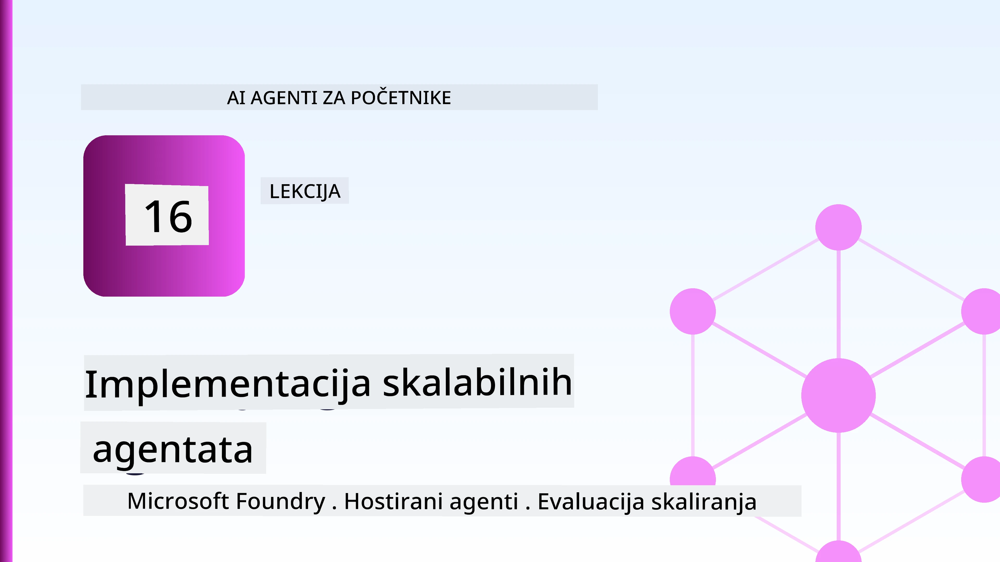
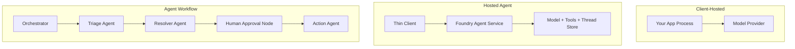
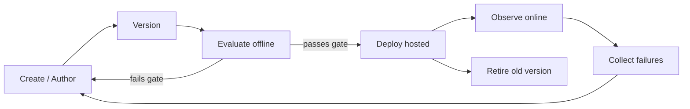
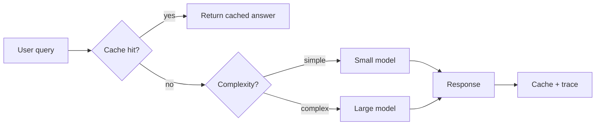
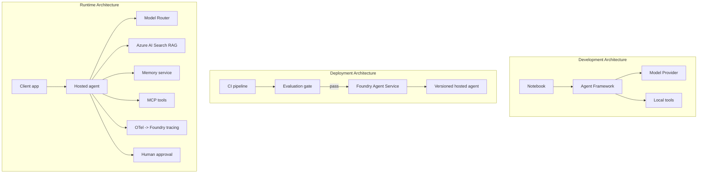

# Implementacija skalabilnih agenata s Microsoft Foundry



Do sada u tečaju ste izgradili agente koji rade na vašem prijenosnom računalu, unutar bilježnice, pokretani s `az login` i nekoliko varijabli okoline. To je upravo pravi način za učenje. To nije pravi način za pokretanje agenta na kojem tisuće korisnika ovise u 3 ujutro.

Ova lekcija se bavi prazninom između "radi na mom računalu" i "radi pouzdano i povoljno u produkciji." Tu prazninu zatvaramo korištenjem **Microsoft Foundry** i **Microsoft Foundry Agent Service**, a radimo to izgradnjom pravog agenta za korisničku podršku koji ima alate, dohvat informacija, memoriju, evaluaciju i nadzor.

## Uvod

Ova će lekcija pokriti:

- Razliku između **prototipnog agenta** i **implementiranog agenta**, i zašto je prijelaz uglavnom oko svega *oko* modela.
- **Obrasci implementacije** za agente: klijent-hostiran, servis-hostiran (Hosted Agents), i orkestrirani putem tijeka rada.
- **Životni ciklus agenta** na Microsoft Foundry — kreiranje, verzioniranje, implementacija, evaluacija, opažanje, povlačenje.
- **Strategije skaliranja**: usmjeravanje modela, keširanje, istovremenost i dizajn bez stanja.
- **Opažljivost** s OpenTelemetryjem i pronalaženjem pogrešaka u Foundryju.
- **Optimizacija troškova** kroz odabir modela, usmjeravanje i evaluacijske kapije.
- **Razmatranja za poduzeća**: upravljanje, ljudsko odobrenje i sigurno pokretanje MCP servera u produkciji.

## Ciljevi učenja

Nakon dovršetka ove lekcije, znat ćete kako:

- Odabrati pravi obrazac implementacije za određeni radni opterećenje agenta.
- Implementirati agenta u Microsoft Foundry Agent Service tako da je verzioniran, upravljan i opažen.
- Instrumentirati agenta za praćenje i povezati evaluacijski pipeline koji se izvršava prije svakog izdanja.
- Primijeniti usmjeravanje modela i keširanje kako bi se latencija i troškovi držali pod kontrolom pri skaliranju.
- Dodati kapiju ljudskog odobrenja za visokorizične radnje i integrirati MCP server na siguran način za produkciju.

## Pretpostavke

Ova lekcija pretpostavlja da ste završili ranije lekcije i da ste upoznati s:

- Izgradnjom agenata s [Microsoft Agent Framework](../14-microsoft-agent-framework/README.md) (Lekcija 14).
- [Korištenje alata](../04-tool-use/README.md) (Lekcija 4) i [Agentic RAG](../05-agentic-rag/README.md) (Lekcija 5).
- [Memorija agenta](../13-agent-memory/README.md) (Lekcija 13) i [Agentic protokoli / MCP](../11-agentic-protocols/README.md) (Lekcija 11).
- [Opažljivost i evaluacija](../10-ai-agents-production/README.md) (Lekcija 10) — ova lekcija se direktno nadovezuje na nju.

Također će vam trebati:

- **Pretplata na Azure** i **Microsoft Foundry projekt** s barem jednim implementiranim modelom za chat.
- **Azure CLI** s prijavom (`az login`).
- Python 3.12+ i paketi u repozitoriju [`requirements.txt`](../../../requirements.txt).

## Od prototipa do produkcije: što se zapravo mijenja

Prototipni agent i produkcijski agent dijele isti osnovni ciklus — rezonirati, pozvati alate, odgovoriti. Ono što se mijenja je sve što je umotano oko tog ciklusa. Model čini možda 20% produkcijskog agenta; ostalih 80% je operativni kostur.

| Briga | Prototip | Produkcija |
| --- | --- | --- |
| **Hosting** | Radi u vašoj bilježnici | Radi kao hostirana usluga, verzionirana i izbačena postupno |
| **Identitet** | Vaš `az login` token | Upravljani identitet s ograničenim RBAC-om |
| **Stanje** | U memoriji, gubi se pri ponovnom pokretanju | Eksternalizirano (spremište niti, memorijska usluga) |
| **Kvar** | Vidite trag pogreške | Pokušaji ponovo, zamjene, mrtva pošta, upozorenja |
| **Trošak** | "To je nekoliko centi" | Praćeno po zahtjevu, usmjereno, keširano, budžetirano |
| **Kvaliteta** | Provjeravate vizualno izlaz | Automatski se evaluira prije svakog izdanja |
| **Povjerenje** | Odobravate svaku radnju | Pravila + čovjek u petlji za rizične akcije |

Zapamtite ovu tablicu. Svaki dio ispod mapira se na jedan od ovih redaka.

## Obrasci implementacije agenata

Postoje tri obrasca koje ćete koristiti, često u kombinaciji.

### 1. Klijent-hostirani agenti

Objekt agenta živi unutar *vašeg* procesa aplikacije. Vaš kod izravno poziva pružatelja modela; ciklus rezoniranja pokreće se u vašoj usluzi. To je ono što su radile sve prethodne lekcije.

- **Koristite kada** vam treba potpuna kontrola nad ciklusom, prilagođeni middleware, ili ugrađujete agenta unutar postojeće pozadinske aplikacije.
- **Kompromis**: sami upravljate skaliranjem, stanjem i otpornosti.

### 2. Hostirani agenti (Foundry Agent Service)

Agent je *registriran kao resurs* u Microsoft Foundry. Foundry hostira ciklus rezoniranja, pohranjuje niti, provodi sigurnost sadržaja i RBAC, te agent postaje vidljiv u Foundry portalu. Vaša aplikacija postaje lagani klijent koji stvara niti i čita odgovore.

- **Koristite kada** želite trajnost, ugrađenu opažljivost, upravljanje i manji operativni sloj.
- **Kompromis**: manje niska razina kontrole u zamjenu za upravljano izvršavanje.

### 3. Tijekovi rada agenata

Više agenata (i alata) kompozitno se povezuje u graf s eksplicitnim tijekovima kontrole — sekvencijalni koraci, grananje, čvorovi s ljudskim odobravanjem i trajne kontrolne točke koje mogu pauzirati i nastaviti. Ovo je značajka Microsoft Agent Framework **Workflows** primijenjena na razini implementacije.

- **Koristite kada** jedna zadaća obuhvaća nekoliko specijaliziranih agenata ili zahtijeva korak odobrenja usred procesa.
- **Kompromis**: više pokretnih dijelova; potrebna je opažljivost na razini orkestracije.



## Životni ciklus agenta na Microsoft Foundry

Implementacija agenta nije jednokratni `push`. To je ciklus, i izgleda vrlo slično ciklusu izdanja softvera jer to upravo i jest.



Ključna ideja, prenesena iz [Lekcije 10](../10-ai-agents-production/README.md): **offline evaluacija je kapija, ne naknadna misao.** Nova verzija agenta ne ide u distribuciju ako ne prođe vaše evaluacijske pragove. Online opažljivost tada vraća stvarne pogreške unutar vašeg offline testnog skupa. To je cijeli ciklus.

## Strategije skaliranja

Skaliranje agenta razlikuje se od skaliranja web API-ja bez stanja, jer svaki zahtjev može pokrenuti više skupih poziva modela i alata. Četiri tehnike podnose većinu opterećenja.

**Rad s bezstanjskim zahtjevima.** Nemojte držati per-korisničko stanje u memoriji procesa. Spremite niti razgovora u Foundry thread store ili memorijsku uslugu tako da bilo koja instanca može obraditi bilo koji zahtjev. To vam omogućuje horizontalno skaliranje – dodajte instance, nema povezanih sesija.

**Usmjeravanje modela.** Nije svaki zahtjev potreban za vašim najmoćnijim (i najskupljim) modelom. Usmjerite jednostavne zahtjeve — klasifikaciju namjere, kratke činjenične odgovore — na mali, brz model, i rezervirajte veliki model za stvarno rezoniranje. Foundryjev **Model Router** može to učiniti za vas ili možete sami implementirati lagani klasifikator. Izgradit ćete DIY verziju u laboratoriju.

**Keširanje odgovora.** Mnogi upiti za podršku su gotovo duplikati ("kako resetirati lozinku?"). Keširajte odgovore na česta pitanja i poslužite ih bez da udarate model uopće. Čak i umjeren postotak pogodaka u kešu značajno smanjuje troškove i latenciju.

**Istovremenost i pritisak pozadinske mreže (backpressure).** Pružatelji modela imaju ograničenja brzine. Ograničite svoju istovremenost, koristite ponovne pokušaje s eksponencijalnim odmakom i greške tretirajte graciozno (queued odgovor "radimo na tome" bolji je od 500).



## Opažljivost u produkciji

Ne možete upravljati onim što ne možete vidjeti. Kao što je pokriveno u Lekciji 10, Microsoft Agent Framework izvodi **OpenTelemetry** tragove nativno — svaki poziv modela, poziv alata i korak orkestracije postaju spanovi. U produkciji te spanove izvozite u Microsoft Foundry (ili bilo koji kompatibilni OTel backend) tako da možete:

- Pratiti jednu žalbu korisnika end-to-end kroz svaki poziv modela i alata.
- Promatrati p50/p95 latenciju i troškove po zahtjevu tijekom vremena.
- Upozoravati na nagle poraste stope pogrešaka i anomalije troškova prije nego što to primijete vaši korisnici (ili vaš financijski tim).

```python
from agent_framework.observability import get_tracer

tracer = get_tracer()

with tracer.start_as_current_span("support_request") as span:
    span.set_attribute("customer.tier", "enterprise")
    span.set_attribute("routed.model", "gpt-5-nano")
    # agent execution is traced automatically inside this span
```

Atributi poput `customer.tier` i `routed.model` ono su što pretvara zid tragova u pitanja na koja se može odgovoriti ("doduše li korporativni korisnici prečesto na mali model?").

## Optimizacija troškova

Trošak u produkcijskim agentima dominiraju tokeni. Tri poluge, po redu utjecaja:

1. **Pravilan odabir veličine modela.** Mali model koji prođe vaš evaluacijski prag gotovo je uvijek jeftiniji od velikog koji također prolazi. Koristite evaluaciju da *dokažete* da je mali model dovoljno dobar, umjesto da iz sigurnosti birate najveći model.
2. **Usmjeravanje po složenosti.** Kao gore — platite cijenu velikog modela samo za zahtjeve koji trebaju rezoniranje velikim modelom.
3. **Agresivno keširanje.** Najjeftiniji poziv modela je onaj koji uopće ne napravite.

Evaluacijske kapije i kontrola troškova su ista disciplina promatrana iz dva kuta: evaluacija vam daje *kvalitativni minimum*, usmjeravanje i keširanje vas drže što bliže *troškovnom* minimumu.

## Razmatranja implementacije u poduzeću

**Upravljanje (Governance).** Hostirani agenti nasljeđuju Foundryjevu RBAC, sigurnost sadržaja i zapisivanje audita. Svakom agentu dajte upravljani identitet s najmanjim potrebnim privilegijama — pristup samo za čitanje baze znanja, ograničeni pristup API-ju za tikete, ništa više.

**Čovjek u petlji.** Neke akcije su previše bitne da bi se automatizirale — izdavanje povrata novca, brisanje računa, eskalacija pravnom timu. Microsoft Agent Framework podržava alate koji zahtijevaju **odobrenje**: agent predlaže akciju, izvršenje se pauzira, čovjek odobrava ili odbija, a tijek rada se nastavlja. Vidjeli ste primitiv u [Lekciji 6](../06-building-trustworthy-agents/README.md); ovdje ga implementirate.

**MCP u produkciji.** [MCP](../11-agentic-protocols/README.md) omogućuje vašem agentu da koristi vanjske alate kroz standardizirani sučelje. U produkciji tretirajte svaki MCP server kao nepouzdan rub: fiksirajte verziju servera, pokrećite ga s ograničenim identitetom, provjerite njegove izlaze i nikad mu ne izlažite tajne. MCP server je ovisnost, a ovisnosti se održavaju, revidiraju i limitiraju.



Ta tri dijagrama — razvoj, implementacija, izvršavanje — isti su agent u tri faze svog života. Laboratorij koji slijedi vodi vas kroz njegovu izgradnju.

## Praktična vježba: Agent korisničke podrške spreman za proizvodnju

Otvorite [`code_samples/16-python-agent-framework.ipynb`](./code_samples/16-python-agent-framework.ipynb) i prođite kroz njega do kraja. Sastavit ćete **Contoso agenta korisničke podrške** sa svim produkcijskim značajkama:

1. **Pozivanje alata** — provjera statusa narudžbe i otvaranje tiketa za podršku.
2. **RAG** — odgovaranje na pitanja o pravilima iz baze znanja (Azure AI Search, s rezervnim memorijskim rješenjem tako da bilježnica radi bez resursa Search).
3. **Memorija** — pamćenje korisnika kroz okrete razgovora.
4. **Usmjeravanje modela** — klasifikator složenosti usmjerava svaki zahtjev na mali ili veliki model.
5. **Keširanje odgovora** — ponovljena pitanja se poslužuju iz keša.
6. **Ljudsko odobrenje** — povrati novca iznad određenog praga čekaju na ljudsko odobrenje.
7. **Evaluacijski pipeline** — mali offline testni set ocjenjuje agenta i djeluje kao kapija za izdanje.
8. **Opažljivost** — OpenTelemetry praćenje oko svakog zahtjeva.

### Prikaz

Bilježnica je organizirana tako da je svaka produkcijska briga zaseban, pokretni odjeljak. Srž je rukovatelj zahtjevima s usmjeravanjem i keširanjem:

```python
async def handle_support_request(query: str, customer_id: str) -> str:
    # 1. Serve from cache when we can.
    cached = response_cache.get(normalize(query))
    if cached:
        return cached

    # 2. Route by complexity to control cost.
    model = "gpt-5-nano" if is_simple(query) else "gpt-5-mini"

    # 3. Run the agent inside a trace span for observability.
    with tracer.start_as_current_span("support_request") as span:
        span.set_attribute("routed.model", model)
        span.set_attribute("customer.id", customer_id)
        response = await support_agent.run(query, model=model)

    # 4. Cache and return.
    response_cache.set(normalize(query), response.text)
    return response.text
```

Evaluacijska kapija koja štiti izdanje izgleda ovako:

```python
async def evaluation_gate(agent, test_cases, threshold: float = 0.8) -> bool:
    passed = 0
    for case in test_cases:
        result = await agent.run(case["input"])
        if score_response(result.text, case["expected"]) >= 0.8:
            passed += 1
    pass_rate = passed / len(test_cases)
    print(f"Evaluation pass rate: {pass_rate:.0%} (gate: {threshold:.0%})")
    return pass_rate >= threshold  # only deploy if the gate passes
```

Pročitajte svaki redak — bilježnica namjerno drži primitivce male tako da ništa nije skriveno iza poziva okvira.

## Validacija implementiranog agenta pomoću smoke testova

Gore navedena evaluacijska kapija se izvršava *offline* nad vašim objektom agenta. Kad je agent implementiran kao Hostirani agent, potrebno vam je još jedna, još jeftinija provjera: **odgovara li stvarno endpoint?**

"Uspješno" implementiranje samo dokazuje da je kontrolna ravnina prihvatila definiciju — ne dokazuje da agent odgovara. Nedostajuća ovisnost, loše usmjeravanje modela ili istekla veza mogu ostaviti "zelenu" implementaciju koja ne vraća ništa. **Smoke test** to otkriva u sekundama, pri svakom izdanju, bez troška pune evaluacije.

Ovaj repozitorij dolazi s gotovim pipelineom za smoke testove izgrađenim na [AI Smoke Test](https://github.com/marketplace/actions/ai-smoke-test) GitHub Action:

- **Katalog** — [`tests/lesson-16-smoke-tests.json`](../../../tests/lesson-16-smoke-tests.json) sadrži upite i tvrdnje za Contoso podršku agenta (odgovore na politika pitanja zakotvljene u podacima, pretraživanje narudžbe, ostanak na temi i kontinuitet niza). Katalozi za agente iz drugih lekcija stoje uz njega — vidi [`tests/README.md`](../tests/README.md).
- **Tijek rada** — [`.github/workflows/smoke-test.yml`](../../../.github/workflows/smoke-test.yml) prijavljuje se s Azure OIDC i POST-a svaki upit na endpoint za Odgovore agenta, prekidajući zadatak pri svakoj promašaj tvrdnje.

```yaml
- name: Smoke-test hosted agent
  uses: JFolberth/ai-smoketest@v1
  with:
    project_endpoint: ${{ inputs.project_endpoint }}
    agent_name: ContosoSupportAgent
    tests_file: tests/lesson-16-smoke-tests.json
```

Pokrenite ga s kartice **Actions** kad je vaš agent implementiran, pružajući endpoint vašeg Foundry projekta i ime agenta. Federirana identitet treba imati ulogu **Azure AI User** u opsegu Foundry projekta. Zamislite slojeve kao piramidu: testovi dima (dostupni i odgovaraju?) se izvode pri svakoj implementaciji, offline evaluacija (dovoljno dobra za isporuku?) se izvodi prije promocije, a online evaluacija (kako se ponaša u stvarnom okruženju?) se izvodi kontinuirano.

## Provjera znanja

Testirajte svoje razumijevanje prije prelaska na zadatak.

**1. Otprilike koliko proizvodnog agenta je „model“, a što je ostatak?**

<details>
<summary>Odgovor</summary>

Model je manjina sustava — često se navodi oko 20%. Ostatak čini operativni kostur: hosting i verzioniranje, identitet i RBAC, vanjsko pohranjeno stanje, rukovanje greškama, praćenje troškova, evaluacija i kontrole s ljudskim pristupom. Prijelaz u produkciju uglavnom znači izgradnju svega *oko* petlje rezoniranja.
</details>

**2. Kada biste odabrali Hosted Agenta umjesto agenta koji se hostira na klijentu?**

<details>
<summary>Odgovor</summary>

Kada želite upravljani runtime s ugrađenom trajnošću (threadovi koji traju i mogu se nastaviti), promatranjem, sigurnošću sadržaja i RBAC-om, te ste spremni žrtvovati nešto niže razine kontrole nad petljom rezoniranja za manju operativnu površinu. Hostiran na klijentu je poželjan kad trebate potpunu kontrolu nad petljom ili ugrađujete agenta u postojeći backend.
</details>

**3. Zašto skalabilni agent mora biti bezstanje u vlastitoj memoriji procesa?**

<details>
<summary>Odgovor</summary>

Tako da bilo koja instanca može obraditi bilo koji zahtjev, što omogućava horizontalno skaliranje bez „sticky sessions“. Stanje razgovora po korisniku vanjski je pohranjeno u thread store ili memorijsku uslugu. Kad bi stanje živjelo u memoriji procesa, izgubili biste ga pri ponovnom pokretanju i ne biste mogli slobodno distribuirati opterećenje.
</details>

**4. Koji problem rješava model routing i kako se odnosi na evaluaciju?**

<details>
<summary>Odgovor</summary>

Routing šalje jednostavne zahtjeve malom, jeftinom, brzom modelu i rezervira veliki model za stvarno rezoniranje, kontrolirajući latenciju i troškove. To se odnosi na evaluaciju jer je evaluacija ono što *dokazuje* da je mali model dovoljno dobar za određenu klasu zahtjeva — routing bez evaluacije je nagađanje.
</details>

**5. Što je „evaluation gate“ i gdje se nalazi u životnom ciklusu?**

<details>
<summary>Odgovor</summary>

Evaluation gate pokreće offline testni skup na novoj verziji agenta i blokira implementaciju osim ako stopa prolaza ne prijeđe prag. Nalazi se između „version“ i „deploy“ u životnom ciklusu, čineći kvalitetu preduvjetom za izdanje, a ne nečim što provjeravate nakon lansiranja.
</details>

**6. Zašto MCP server treba smatrati nepouzdanom granicom u produkciji?**

<details>
<summary>Odgovor</summary>

Zato što je to vanjski ovisni element u koji vaš agent poziva. Trebali biste fiksirati njegovu verziju, pokretati ga s ograničenim identitetom, validirati njegove izlaze, ograničiti brzinu poziva i nikad mu ne izlagati tajne — ista disciplina kao i za bilo koju treću stranu. Njegovi izlazi utječu na rezoniranje vašeg agenta, pa neprovjerena povjerenja predstavljaju sigurnosni rizik.
</details>

**7. Koja pojedinačna promjena obično ima najveći utjecaj na trošak proizvodnog agenta i zašto?**

<details>
<summary>Odgovor</summary>

Pravilna veličina modela — korištenje najmanjeg modela koji još prolazi vaš evaluation gate. Trošak dominiraju tokeni, a manji model koji zadovoljava kvalitetu gotovo je uvijek jeftiniji od većeg. Keširanje i routing dodatno smanjuju trošak, ali izbor pravog osnovnog modela ima najveći prvi red utjecaja.
</details>

**8. Koju ulogu atributi spanova poput `customer.tier` i `routed.model` imaju u promatranju?**

<details>
<summary>Odgovor</summary>

Oni pretvaraju sirove traceve u odgovarajuća poslovna pitanja. Bez atributa imate zid spanova; s njima možete pitati „da li se poslovni korisnici prečesto usmjeravaju na mali model?“ ili „koji model obrađuje naše najsporije zahtjeve?“ Atributi su način na koji režete telemetriju dimenzijama koje su važne za vašu operaciju.
</details>

## Zadatak

Uzmite agenta za korisničku podršku iz laboratorija i prilagodite ga za specifični scenarij: **agent za podršku naplati pretplate za SaaS tvrtku.**

Vaša predaja bi trebala:

1. **Zamijeniti alate** sa onima relevantnima za naplatu: `get_subscription_status`, `get_invoice`, i `issue_credit` (krediti iznad 50$ zahtijevaju odobrenje čovjeka).
2. **Dodati tri RAG dokumenta** koja pokrivaju pravilnik tvrtke za povrate, ciklus naplate i politiku otkazivanja.
3. **Proširiti evaluacijski skup** na barem osam slučajeva, uključujući barem dva koja *moraju* pokrenuti put odobrenja čovjeka, i potvrditi da vaš evaluation gate ispravno prolazi ili ne prolazi.
4. **Dodati jedan izvještaj o troškovima**: nakon što prođete deset mješovitih upita kroz agenta, ispišite koliko je išlo na mali model, koliko na veliki model i koliko je posluženo iz keša.

Napišite kratak odlomak (u markdown ćeliji) objašnjavajući koju ste pravilo za usmjeravanje modela odabrali i kako biste ga validirali stvarnim prometom. Ne postoji jedini točan odgovor — procjenjuje se jeste li povezali proizvodne brige koherentno.

## Sažetak

U ovoj lekciji ste prebacili agenta iz prototipa u produkciju s Microsoft Foundry:

- Prijelaz u produkciju uglavnom se odnosi na **operativni kostur** oko modela — hosting, identitet, stanje, rukovanje greškama, troškovi, kvaliteta i povjerenje.
- Naučili ste tri **obrasca implementacije** — hostiranje na klijentu, Hosted Agenti i Agent Workflows — i kada se koji koristi.
- Prošli ste kroz **životni ciklus agenta**, gdje offline **evaluacija djeluje kao ispit za izdanje** i online promatranje vraća greške natrag u testni skup.
- Primijenili ste **strategije skaliranja** — dizajn bez stanja, routing modela, keširanje i ograničenu konkurentnost — i povezali ih s **optimizacijom troškova**.
- Uvezali ste **enterprise kontrole**: RBAC, odobrenje čovjekom u petlji i sigurnu integraciju MCP-a u produkciji.
- Izgradili ste **agent za korisničku podršku spreman za produkciju** koji povezuje sve ove brige u izvediv kod.

Sljedeća lekcija ide suprotnim putem: umjesto skaliranja agenata u oblak, spustit ćete ih *dolje* na jedan razvojni stroj i pokrenuti ih lokalno.

## Dodatni resursi

- <a href="https://learn.microsoft.com/azure/ai-foundry/what-is-azure-ai-foundry" target="_blank">Microsoft Foundry dokumentacija</a>
- <a href="https://learn.microsoft.com/azure/ai-foundry/agents/overview" target="_blank">Pregled Microsoft Foundry Agent Service</a>
- <a href="https://learn.microsoft.com/en-us/agent-framework/overview/?wt.mc_id=youtube_26688_organicsocial_reactor&pivots=programming-language-python" target="_blank">Microsoft Agent Framework</a>
- <a href="https://learn.microsoft.com/en-us/azure/ai-foundry/openai/concepts/model-router" target="_blank">Model Router u Microsoft Foundry</a>
- <a href="https://learn.microsoft.com/azure/search/search-what-is-azure-search" target="_blank">Azure AI Search</a>
- <a href="https://opentelemetry.io/" target="_blank">OpenTelemetry</a>
- <a href="https://github.com/marketplace/actions/ai-smoke-test" target="_blank">AI Smoke Test GitHub Action</a>
- <a href="https://modelcontextprotocol.io/" target="_blank">Model Context Protocol (MCP)</a>

## Prethodna lekcija

[Izgradnja agenata za korištenje računala (CUA)](../15-browser-use/README.md)

## Sljedeća lekcija

[Izrada lokalnih AI agenata](../17-creating-local-ai-agents/README.md)

---

<!-- CO-OP TRANSLATOR DISCLAIMER START -->
**Napomena**:
Ovaj dokument je preveden korištenjem AI prevoditeljskog servisa [Co-op Translator](https://github.com/Azure/co-op-translator). Iako težimo točnosti, imajte na umu da automatski prijevodi mogu sadržavati greške ili netočnosti. Izvorni dokument na izvornom jeziku treba smatrati autoritativnim izvorom. Za važne informacije preporuča se profesionalni ljudski prijevod. Nismo odgovorni za bilo kakva nesporazumevanja ili pogrešne interpretacije koje proizlaze iz korištenja ovog prijevoda.
<!-- CO-OP TRANSLATOR DISCLAIMER END -->