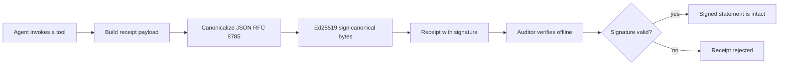
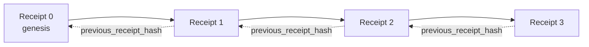

[Pogledajte video lekciju: Zaštita AI agenata kriptografskim potvrdom](https://youtu.be/PLACEHOLDER_VIDEO_ID)

> _(Video lekcija i sličica bit će dodani od strane Microsoftovog tima za sadržaj nakon spajanja, u skladu s obrascem lekcije 14 / 15.)_

# Zaštita AI agenata kriptografskim potvrdom

## Uvod

Ova će lekcija obuhvatiti:

- Zašto su zapisnici o aktivnostima za AI agente važni za usklađenost, otklanjanje pogrešaka i povjerenje.
- Što je kriptografska potvrda i kako se razlikuje od nepotpisane linije zapisnika.
- Kako proizvesti potpisanu potvrdu za poziv alata agenta u običnom Pythonu.
- Kako provjeriti potvrdu izvan mreže i otkriti manipulaciju.
- Kako povezati potvrde tako da uklanjanje ili preraspoređivanje jedne prekida lanac.
- Što potvrde dokazuju, a što one izričito ne dokazuju.

## Ciljevi učenja

Nakon završetka ove lekcije, znat ćete kako:

- Identificirati načine otkazivanja koji motiviraju kriptografsku izvornost omogućavanja radnji agenta.
- Proizvesti Ed25519-potpisanu potvrdu s kanonskim JSON teretom.
- Neovisno provjeriti potvrdu koristeći samo javni ključ potpisnika.
- Otkrivati manipulaciju ponovnim pokretanjem provjere na izmijenjenoj potvrdi.
- Izgraditi lanac potvrda povezanih hešom i objasniti zašto je lanac važan.
- Prepoznati granicu između onoga što potvrde dokazuju (pripisivanje, integritet, redoslijed) i onoga što ne dokazuju (ispravnost radnje, valjanost politike).

## Problem: Zapisnik aktivnosti vašeg agenta

Zamislite da ste rasporedili AI agenta za Contoso Travel. Agent čita zahtjeve korisnika, poziva API za letove da bi pronašao opcije i rezervira sjedala u ime korisnika. Prošlog kvartala agent je obradio 50,000 rezervacija.

Danas dolazi revizor. Postavlja jednostavno pitanje: "Pokažite mi što je vaš agent radio."

Predajete mu datoteke zapisnika. Revizor ih promatra i postavlja teže pitanje: "Kako znam da ti zapisnici nisu uređivani?"

Ovo je problem zapisnika aktivnosti. Većina rasporeda agenata danas se oslanja na:

- **Aplikacijske zapisnike**: zapisane od strane samog agenta, uređive od bilo koga tko ima pristup datotečnom sustavu.
- **Usluge zapisivanja u oblaku**: dokazivo zaštićene od manipulacije na razini platforme, ali samo ako revizor vjeruje operatoru platforme.
- **Zapisnike transakcija baze podataka**: pogodne za promjene u bazi, ali ne i za proizvoljne pozive alata.

Nijedan od ovih ne može odgovoriti na revizorovo pitanje bez zahtjeva da revizor nekome vjeruje (vama, vašem cloud davatelju, prodavaču baze podataka). Za internu upotrebu, ta je povjerenja često prihvatljiva. Za regulirane slučajeve korištenja (financije, zdravstvo, sve pod EU AI zakonom), nije.

Kriptografske potvrde suzbijaju ovaj problem tako što pružaju potpisanu izjavu koja se može neovisno verificirati.
Revizor i dalje treba izvanbantni razlog za povjerenje u potpisni ključ i
komponentu koja je proizvela izjavu. Ugrađeni ključ dokazuje samo dosljednost,
ne identitet izdavatelja ili mjesto provođenja.

## Što je kriptografska potvrda?

Potvrda je JSON objekt koji bilježi što je agent učinio, potpisan digitalnim potpisom.



Minimalna potvrda izgleda ovako:

```json
{
  "type": "agent.tool_call.v1",
  "agent_id": "contoso-travel-bot",
  "tool_name": "lookup_flights",
  "tool_args_hash": "sha256:a3f9c1...",
  "result_hash": "sha256:7b2e1d...",
  "policy_id": "contoso-travel-policy-v3",
  "timestamp": "2026-04-25T14:30:00Z",
  "sequence": 47,
  "previous_receipt_hash": "sha256:9d4e6a...",
  "signature": {
    "alg": "EdDSA",
    "sig": "c5af83...",
    "public_key": "8f3b2c..."
  }
}
```

Tri svojstva obavljaju rad:

1. **Potpis**. Potvrdu potpisuje pristupna točka agenta koristeći privatni Ed25519 ključ. Svatko s odgovarajućim javnim ključem može offline provjeriti potpis. Dokazna strana mora zaključati taj ključ ili ga dohvatiti iz pouzdanog registra izvan potvrde. Manipulacija bilo kojim potpisanim poljem poništava potpis.

2. **Kanonsko kodiranje**. Prije potpisivanja, potvrda se serijalizira koristeći JSON Canonicalization Scheme (JCS, RFC 8785). To osigurava da dvije implementacije koje proizvode istu logičku potvrdu proizvode identičan bajtni ishod. Bez kanonizacije, različiti JSON serijalizatori bi stvarali različite potpise za isti sadržaj.

3. **Heš lanac**. Polje `previous_receipt_hash` povezuje svaku potvrdu s prethodnom. Uklanjanje ili preraspored potvrde prekida predstavljenu sekvencu. Otkrivanje skraćivanja ili prepisivanja kontroliranog od potpisnika također zahtijeva zaključani trenutni vrh lanca, neovisno svjedočenu kontrolnu točku ili autentificirani zaključak zatvorene populacije.

Zajedno ova svojstva pružaju tri jamstva:

- **Pripisivanje ključu**: taj ključ potpisao je ovaj sadržaj. Organizacijski ili ljudski identitet zahtijeva pouzdano vezivanje ključa.
- **Integritet**: sadržaj se nije mijenjao od potpisivanja.
- **Redoslijed unutar verificirane sekvence**: ova potvrda povezana je s prethodnikom.

## Proizvodnja potvrde u Pythonu

Ne trebate posebnu knjižnicu za proizvodnju potvrde. Kriptografski primitivci su široko dostupni, a logika je tek nekoliko desetaka linija Pythona.

Praktični zadatci u `code_samples/18-signed-receipts.ipynb` vode kroz cjelokupan tijek. Izvorno kontrolirani `code_samples/18-signed-receipts.execution-receipt.json` bilježi točan hash bilježnice, Python okruženje, broj ćelija i provjere iz najnovjeg čistog izvođenja bez mijenjanja spremljenih rezultata lekcije. Sažeti prikaz:

```python
import json
import hashlib
import base64
from nacl import signing
from jcs import canonicalize  # RFC 8785 canonical JSON

def b64url_nopad(data: bytes) -> str:
    return base64.urlsafe_b64encode(data).decode("ascii").rstrip("=")

def sha256_canonical(obj) -> str:
    """SHA-256 of a Python object's JCS-canonical JSON form."""
    return f"sha256:{hashlib.sha256(canonicalize(obj)).hexdigest()}"

# Generate or load a signing key (in production, store in a key vault)
signing_key = signing.SigningKey.generate()
verify_key = signing_key.verify_key
TRUSTED_PUBLIC_KEYS = {b64url_nopad(bytes(verify_key))}  # pinned out of band by the verifier

# Build the receipt payload (no signature yet)
tool_args = {"origin": "SYD", "destination": "LAX"}
tool_result = [{"flight": "QF11", "price": 1850, "stops": 0}]

payload = {
    "type": "agent.tool_call.v1",
    "agent_id": "contoso-travel-bot",
    "tool_name": "lookup_flights",
    "tool_args_hash": sha256_canonical(tool_args),
    "result_hash": sha256_canonical(tool_result),
    "policy_id": "contoso-travel-policy-v3",
    "timestamp": "2026-04-25T14:30:00Z",
    "sequence": 0,
    "previous_receipt_hash": None,
}

# Canonicalize and sign the JCS bytes directly. PureEdDSA hashes internally.
canonical_bytes = canonicalize(payload)
signature_bytes = signing_key.sign(canonical_bytes).signature

# Attach a structured signature object.
receipt = {
    **payload,
    "signature": {
        "alg": "EdDSA",
        "sig": b64url_nopad(signature_bytes),
        "public_key": b64url_nopad(bytes(verify_key)),
    },
}
```

To je cjelokupni proces potpisivanja. Zadaci u bilježnici vode kroz svaki korak.

## Verifikacija potvrde i otkrivanje manipulacije

Verifikacija je suprotna operacija:

```python
import base64
import hashlib
from nacl import signing
from nacl.exceptions import CryptoError
from jcs import canonicalize

def b64url_decode(s: str) -> bytes:
    padding = "=" * ((4 - len(s) % 4) % 4)
    return base64.b64decode(s + padding, altchars=b"-_", validate=True)

def verify_receipt(receipt: dict, trusted_public_keys: set[str]) -> bool:
    # The signature is a structured object: {"alg", "sig", "public_key"}.
    if not isinstance(receipt, dict):
        return False
    sig_obj = receipt.get("signature")
    if not isinstance(sig_obj, dict) or sig_obj.get("alg") != "EdDSA":
        return False
    try:
        # An inline key proves only self-consistency. Trust is configured out of band.
        public_key = sig_obj.get("public_key")
        signature = sig_obj.get("sig")
        if not isinstance(public_key, str) or not isinstance(signature, str):
            return False
        if public_key not in trusted_public_keys:
            return False
        payload = {k: v for k, v in receipt.items() if k != "signature"}
        canonical_bytes = canonicalize(payload)
        verify_key = signing.VerifyKey(b64url_decode(public_key))
        verify_key.verify(canonical_bytes, b64url_decode(signature))
        return True
    except (CryptoError, TypeError, ValueError, KeyError, OverflowError):
        return False
```

Ova funkcija prima potvrdu plus zaključani skup ključeva korisnika i vraća
`True` samo ako je potpis valjan pod prihvaćenim ključem. Verifikacija ne zahtijeva
mrežni poziv, ali povjerenje u ključ ostaje vanjsku konfiguracijsku odluku.

Za vidjeti otkrivanje manipulacije u praksi, bilježnica vodi kroz:

1. Proizvodnju valjane potvrde i potvrđivanje da se ona provjerava.
2. Izmjenu jednog bajta polja `tool_args_hash`.
3. Ponovno pokretanje verifikacije i uočavanje neuspjeha.

Ovo je praktični dokaz da su potvrde otporne na manipulacije: bilo kakva izmjena, ma koliko mala, prekida potpis.

## Povezivanje potvrda za agente s više koraka

Jedna potpisana potvrda štiti jednu akciju. Lanac potvrda štiti niz.



Svaka potvrda bilježi heš potvrde prije nje. Da bi neovlašteni uklonio potvrdu 2 tiho, morao bi ili:

- Izmijeniti polje `previous_receipt_hash` potvrde 3 (prekida potpis potvrde 3), ILI
- Izraditi novi potpis na izmijenjenoj potvrdi 3 (zahtijeva privatni ključ agenta).

Ako je privatni ključ zaštićen i provjeritelj zaključava neovisno svjedočeni vrh lanca,
ove su napade moguće otkriti. Objavljivanje ključa unutar svake potvrde nije
dovoljno: potpisnik ili napadač može prikazati drugi ključ, prepisati sufiks ili
skratiti lanac osim ako korisnik nema vanjski anker povjerenja i potpunosti.

Bilježnica vodi kroz:

1. Izrada lanca od tri potvrde.
2. Provjera da `previous_receipt_hash` svake potvrde odgovara stvarnom hash-u prethodne potvrde.
3. Manipulacija jednom potvrdom u sredini i promatranje prekida lanca upravo na toj točki.

Ovo je način na koji se proizvodi trag revizije koji vanjski revizor može verificirati pod svojim
vlastitim učvršćenim ključevima izdavatelja i kontrolnim točkama lanca, bez povjerenja u vaš promjenjivi zapisnik.

## Što potvrde dokazuju (a što ne)

Ovo je najvažniji dio ove lekcije. Potvrde su moćne, ali njihova moć je ograničena.

**Potvrde dokazuju tri stvari:**

1. **Pripadnost**: određeni ključ je potpisao određeni sadržaj.
2. **Integritet**: sadržaj se nije promijenio od potpisa.
3. **Redoslijed u predstavljenom, verificiranom nizu**: ova potvrda povezuje se s prethodnikom.

**Potvrde NE dokazuju:**

1. **Ispravnost**: da je akcija agenta bila ispravna akcija. Potvrda može biti potpisana i za krivi odgovor jednako lako kao i za ispravan.
2. **Usuglašenost s politikom**: da je politika referencirana u `policy_id` zapravo evaluirana, ili da bi dozvolila ovu akciju ako bi bila provjerena. Potvrda bilježi što je tvrdnjeno, ne što je primijenjeno.
3. **Identitet izvan ključa**: potvrda kaže "ovaj ključ je potpisao ovaj sadržaj." Ne kaže "taj čovjek je to autorizirao." Povezivanje ključa s osobom ili organizacijom zahtijeva zasebnu infrastrukturu identiteta (direktorij, registar javnih ključeva itd.).
4. **Iskrenost unosa**: ako agent primi manipulirani upit i postupi prema njemu, potvrda vjerno bilježi tu akciju. Potvrde su nizvodno od validacije unosa, ne zamjena za nju.
5. **Izvršenje ili stvarni svjetski učinak**: potvrda nakon poziva bilježi što njezin izdavatelj tvrdi da se dogodilo. Dokazivanje primitka ili usklađivanje vanjskog učinka zahtijeva dokaze od stvarnog izvršitelja ili granice pružatelja.
6. **Potpunost**: izostanak potvrde može značiti blokadu, izostavljanje, gubitak ili neinstrumentiranost. Izostanak postaje dokaz samo unutar autentificirane zatvorene zajednice.
7. **Pouzdano vrijeme**: potpisani vremenski zapis dokazuje da je potpisnik nosio tu vrijednost, ne da je vrijednost bila točna. Pouzdano vrijeme zahtijeva zasebnu vremensku vlast ili svjedočenu kontrolnu točku.

Ova granica je važna iz dva razloga:

- Kaže vam za što su potvrde korisne: da bi ponašanje agenta bilo revizorski provjerljivo i očito za manipulaciju, čak i preko organizacijskih granica.
- Kaže vam koje dodatne slojeve još trebate: validaciju unosa (Lekcija 6), provođenje politika (ukratko obrađeno u nastavku) i infrastrukturu identiteta (izvan opsega ove lekcije).

Česta pogreška je pretpostaviti da "imamo potvrde" znači "mi smo u upravljanju." Nije tako. Potvrde su temelj. Upravljanje je sustav koji gradite iznad njih.

## Povezivanje potpisa odobritelja s točnom akcijom

Stavka 3 iznad zaslužuje vlastiti odjeljak: potvrda akcije kaže "ovaj ključ je potpisao ovaj sadržaj," nikad "čovjek je to autorizirao." Za akcije visokog rizika (povrati, brisanja, prijenosi novca), zaseban potpis odobritelja može povezati točnu akciju. Povezivanje tog ključa s čovjekom i provjera ljudske prisutnosti ostaju zasebne odgovornosti.

Sljedeća bilježnica `code_samples/human-authorization-receipts.ipynb` dodaje drugu vrstu potvrde, `human.approval.v1`, u istom obliku omotnice kao i potvrde lekcije (tipizirani sadržaj potpisan Ed25519 nad njegovim kanonskim JCS bajtovima, s objektom `signature` izvan potpisanih bajtova). Ključ odobritelja potpisuje **potpunu kanonsku akciju i njezin digest**; ključ agenta potpisuje izjavu koja nosi **isti digest akcije** i `parent_approval_ref`, `receipt_hash` odobrenja, istu konvenciju kao u `previous_receipt_hash` u lancu koji ste gore izgradili. Jedan `verify_chain` obrađuje oba artefakta pod **zasebnim registrima ključnih sidara** (ključevi odobritelja nasuprot ključevima agenata), tako da je put koda zajednički, ali autoriteti nikada nisu.

Svojstvo koje to donosi, pažljivo izrečeno: *učvršćeni ključ odobritelja potpisao je ovu točnu
akciju, a ključ agenta je kasnije potpisao izjavu koja nosi isti digest akcije.*
To je korisni dokaz, ali nije sam po sebi dokaz da je akcija izvršena. Za
kontrolu izvršenja, točno odobrenje mora biti također rezervirano i iskorišteno jednom na
stvarnoj granici izvršitelja; nepoznati ishod pružatelja mora ostati nepoznat umjesto da se
slijepo ponavlja. Fiksacije odbijanja u bilježnici testiraju sloj lanca potvrda:

- manipulacije, zbunjeni zastupnik, krivotvoreni ključevi na bilo kojoj strani i neispravan unos;
- **istekla ovlast**: potpis koji se još uvijek provjerava, ali je odbijen jer je verzija politike promijenjena, ključ odobravatelja je izrotiran iz prikovanog registra, ili je odobrenje isteklo prije vremena provjere;
- **zamjena sažetka**: valjano potpisani primitak akcije koji upućuje na *pravo* odobrenje koje obvezuje *drugu* kanonsku akciju.

Svaki neuspjeh odbija s različitim razlogom, tako da revizor koji čita odbijanje može utvrditi je li ovlast zastarjela ili se radnja promijenila. Provjera je samo za čitanje i ponovljiva: ne troši odobrenje niti poziva pružatelja usluge. Poseban izvršitelj zahtijeva trajnu, atomsku zaštitu ponovnog izvršenja i eksplicitne ishode uspjeha, neuspjeha i neodređenosti. Potvrda ljudskog odobrenja je edukativna kompozicija definirana ovom lekcijom, a ne vrsta potvrde definirana `draft-farley-acta-signed-receipts`.

## Referenca za proizvodnju

Python kod u ovoj lekciji je namjerno minimalan da biste mogli pročitati svaki redak i točno razumjeti što se događa. U produkciji imate dvije opcije:

1. **Izgradite izravno na kriptografskim primitivima.** 50 linija koje ste vidjeli gore dovoljno je za mnoge slučajeve uporabe. PyNaCl (Ed25519) i `jcs` paket (kanonski JSON) su dobro održavane i revidirane biblioteke.

2. **Koristite proizvodnu biblioteku za potvrde.** Nekoliko open-source projekata implementira isti uzorak s dodatnim značajkama (rotacija ključeva, grupna verifikacija, distribucija JWK seta, integracija s policy engine-ima):
   - Pipeline za potpisivanje koristi JCS i konvencije opsega potpisa u neovisnom IETF Internet-Draftu ([`draft-farley-acta-signed-receipts`](https://datatracker.ietf.org/doc/draft-farley-acta-signed-receipts/), revizija 02). Ova lekcija s ravnom obrazovnom potvrdom razlikuje se od `{payload, signature}` omotača iz nacrta i nije predstavljena kao sukladna implementacija. Nacrt objavljuje zajednički skup sukladnosti ([agent-governance-testvectors](https://github.com/ScopeBlind/agent-governance-testvectors)) za implementacije usmjerene na njegov žični format.
   - Microsoft Agent Governance Toolkit sastavlja potvrde s Cedar-temeljenim odlukama o politici; pogledajte Tutorial 33 u tom spremištu za primjer od početka do kraja.
   - Paketi `protect-mcp` (npm) i `@veritasacta/verify` (npm) pružaju Node-baziranu implementaciju potpisivanja potvrda i offline verifikacije, namijenjenu za omotavanje bilo kojeg MCP poslužitelja s auditnim tragom koji je otporan na manipulacije, uključujući i tijek zadržane su-koautorizacije u kojem pauzirana akcija emitira potvrdu odobrenja vezanu uz sažetak akcije (WebAuthn podržan u desktop tijeku), isti uzorak potvrde odobrenja kao u gornjem bilježniku za ljudsku autorizaciju.
   - **[nobulex](https://github.com/arian-gogani/nobulex)** Python SDK (`pip install nobulex`) pruža isti Ed25519 + JCS obrazac potpisivanja u Pythonu s integracijama LangChain i CrewAI, uključujući objavljene vektore za međuprovalnu provjeru i mapiranje usklađenosti doprineseno putem [OWASP PR #2210](https://github.com/OWASP/CheatSheetSeries/pull/2210).
   - **[EMILIA Protocol](https://github.com/emiliaprotocol/emilia-protocol)** pruža komplementarni sloj izvršenja točnog djelovanja: offline-verificirane potvrde odobrenja, usidreni WebAuthn ili kvorum ovlasti, jednokratnu potrošnju na granici izvršitelja i eksplicitni put s neodređenim ishodom. Njegovi adapteri okvira tretiraju potvrdu kao neophodan dokaz umjesto kao dokaz da je vanjski učinak nastupio.

Odluka između izrade vlastitog i korištenja biblioteke odražava odluku između pisanja vlastite JWT biblioteke i korištenja testirane: oba su razumljiva; biblioteka štedi vrijeme i smanjuje površinu revizije; pristup od nule tjera vas da razumijete svaku primitivu. Ova lekcija podučava put od nule kako biste imali temelj za bilo koji odabir.

## Provjera znanja

Testirajte svoje razumijevanje prije prelaska na praktičnu vježbu.

**1. Potvrda je potpisana privatnim Ed25519 ključem agenta. Revizor ima samo javni ključ. Može li revizor potvrdu verificirati offline?**

<details>
<summary>Odgovor</summary>

Da, kriptografska verifikacija zahtijeva samo javni ključ i potpisane bajtove.  
Revizor još uvijek mora neovisno pribaviti i usidriti prihvaćeni javni ključ, neovisno o potvrdi.  
Nakon uspostave te konfiguracije povjerenja nije potrebni mrežni poziv.  
</details>

**2. Napadač mijenja polje `policy_id` potvrde da tvrdi da je bila pod upravom permisivnije politike. Potpis je bio nad izvornim teretom. Što se događa tijekom verifikacije?**

<details>
<summary>Odgovor</summary>

Verifikacija ne uspijeva. Potpis je izračunat preko kanonskih bajtova izvornog tereta; izmjena bilo kojeg polja mijenja te bajtove, čime potpis postaje nevažeći. Napadač bi trebao privatni ključ da proizvede novi valjani potpis, kojeg nema.
</details>

**3. Zašto potvrda sadrži `tool_args_hash` i `result_hash`, a ne sirove argumente i rezultat?**

<details>
<summary>Odgovor</summary>

Dva razloga. Prvo, potvrda se može arhivirati ili prenositi u okruženjima gdje bi propuštanje sirovog sadržaja (PII, poslovni podaci) bio problem. Hashiranje drži potvrdu malom i sadržaj privatnim; revizor verificira da se hash poklapa s zasebno pohranjenom kopijom stvarnog sadržaja. Drugo, hashovi imaju fiksnu veličinu; potvrda s hashovima je omeđena veličinom bez obzira koliko su ulazi i izlazi bili veliki.
</details>

**4. Polje `previous_receipt_hash` povezuje svaku potvrdu s prethodnikom. Ako napadač tiho izbriše jednu potvrdu iz sredine lanca, što postaje nevaljano?**

<details>
<summary>Odgovor</summary>

Sljedeća prikazana potvrda više ne povezuje na očekivanog prethodnika, pa verifikacija  
tog prikazanog slijeda ne uspijeva od praznine nadalje. Ako potpisnik kontrolira privatni  
ključ, može prepisati ili skratiti sufiks. Detektiranje toga zahtijeva usidrenu trenutnu glavu,  
vanjski kontrolni punkt ili ovjerenu predanost populaciji.  
</details>

**5. Potvrda se uspješno verificira. Dokazuje li to da je agentova akcija bila ispravna, valjana ili usklađena s politikom?**

<details>
<summary>Odgovor</summary>

Ne. Pod usidrenim ključem i lančanim kontekstom, valjana potvrda dokazuje atribuciju potpisa,  
integritet sadržaja i vezu na prikazanog prethodnika. NE dokazuje da je  
akcija bila ispravna ili izvršena, da je politika evaluirana, da je vremenska oznaka  
pouzdana ili da je skup zapisa potpun. Ovo je najvažnija granica u lekciji.
</details>

## Praktična vježba

Otvorite `code_samples/18-signed-receipts.ipynb` i dovršite svih četiri dijela:

1. **Dio 1**: Potpišite svoju prvu potvrdu i verificirajte je.
2. **Dio 2**: Manipulirajte potvrdom i uočite neuspjeh verifikacije.
3. **Dio 3**: Izgradite lanac od tri potvrde i verificirajte integritet lanca.
4. **Dio 4**: Primijenite obrazac na agenta izrađenog s Microsoft Agent Frameworkom: obavijte poziv alata u potpisivanje potvrde, zatim neovisno verificirajte potvrdu.

**Izazov za dodatno usavršavanje 1:** proširite shemu potvrde dodatnim poljem po vlastitom izboru (na primjer, ID zahtjeva za praćenje), ažurirajte kanonsku logiku potpisivanja da ga uključi i potvrdite da potvrda i dalje prolazi kroz verifikaciju. Zatim izmijenite polje nakon potpisivanja i potvrdite da verifikacija ne uspijeva. Ovo vas prisiljava da razumijete kako svaki bajt kanonskog kodiranja doprinosi potpisu.

**Izazov za dodatno usavršavanje 2:** SHA-256 hashirajte dvije svoje potvrde zajedno (spojite njihove kanonske bajtove u determinističkom redu) i ugradite dobiveni sažetak kao novo polje na trećoj potvrdi prije njenog potpisivanja. Verificirajte da sve tri potvrde i dalje prolaze verifikaciju. Upravo ste izgradili dokaz uključivanja u jednom koraku: svatko tko posjeduje treću potvrdu može dokazati da su prve dvije postojale u vrijeme njenog potpisivanja, bez potrebe da otkriva njihov sadržaj. Ovo je obrazac koji potvrde selektivnog otkrivanja koriste u velikoj mjeri (Merkle obveze, RFC 6962).

## Zaključak

Kriptografske potvrde daju AI agentima trag revizije koji je:

- **Neovisno provjerljiv pod usidrenim povjerenjem**: strana s prihvaćenim javnim ključevima i potpisanim bajtovima može verificirati bez ovisnosti o usluzi.
- **Otkrivaju manipulacije**: svaka izmjena poništava potpis.
- **Prijenosiv**: potvrda je mala JSON datoteka; može se arhivirati, prenositi i verificirati bilo gdje.
- **U skladu sa standardima**: temeljen na Ed25519 (RFC 8032), JCS (RFC 8785) i SHA-256, svim široko primijenjenim primitivama.

Nisu zamjena za provjeru unosa, provedbu politike, dozvolu izvršitelja,  
dokaz ishoda, kontrole potpunosti ili infrastrukturu identiteta. Oni su temelj  
za te slojeve. U reguliranim ili višestruko-organizacijskim tijekovima rada, potvrde čine  
pojedinačne izjave izdavatelja neovisno provjerljivima pod povjerenjem revizora.

Najvažnija poruka: potvrde dokazuju da je određeni ključ potpisao određeni  
sadržaj. Priložena vremenska oznaka je potpisnikova tvrdnja osim ako nije zasebno vremenski potvrđena.  
Potvrda ne dokazuje da je njen sadržaj bio istinit, da je akcija izvršena ili da je  
skup zapisa potpun. Držite te razlike čvrsto.

## Kontrolni popis za produkciju

Kad ste spremni preći s ove lekcije na implementaciju agenata s potpisanim potvrdam u stvarnom okruženju:

- [ ] **Premjestite ključ za potpisivanje s developerskog laptopa.** Koristite Azure Key Vault, AWS KMS ili hardverski sigurnosni modul. Privatni ključ koji potpisuje vaše potvrde nikada ne smije živjeti u kontroli izvora ili u običnom tekstu na aplikacijskim računalima.
- [ ] **Usredotočite povjerenje u ključ verifiera.** Objavite ključeve preko JWK seta ili registra, zatim neka strane koje se oslanjaju usidre prihvaćeni identitet izdavača, skup ključeva i politiku rotacije izvan pojedinačnih potvrda. Inline ključ sam po sebi nije sidro povjerenja.
- [ ] **Usidrite lanac izvana.** Povremeno zapišite posljednji hash glave lanca u dnevnik transparentnosti (Sigstore Rekor, RFC 3161 ovlaštenje vremenske oznake ili drugi interni sustav) tako da vanjska strana može potvrditi "ovaj lanac je postojao u to vrijeme."
- [ ] **Pohranite potvrde nepromjenjivo.** Dodavanje samo u blob spremište (Azure Storage s politikama nepromjenjivosti, AWS S3 Object Lock) sprječava insajdere da prepisuju povijest na razini spremišta.
- [ ] **Odlučite o čuvanju.** Mnogi propisi zahtijevaju višegodišnje čuvanje. Planirajte rast potvrda (svaka potvrda je ~500 bajtova; agent koji izvršava 10K poziva dnevno stvara ~1,8 GB godišnje).
- [ ] **Dokumentirajte što potvrde ne pokrivaju.** Potvrde dokazuju atribuciju, integritet i redoslijed. Vaš vodič za rad mora izričito navesti koje dodatne kontrole (provjeru unosa, provedbu politike, ograničenje brzine, infrastrukturu identiteta) stoje uz potvrde u vašem upravljačkom stavu.

### Imate li dodatnih pitanja o osiguranju AI agenata?

Pridružite se [Microsoft Foundry Discord](https://aka.ms/ai-agents/discord) kako biste se upoznali s drugim učenicima, sudjelovali u uredskim satima i dobili odgovore na pitanja o AI agentima.

## Iza ove lekcije

Ova lekcija pokriva potpisivanje pojedinačnih potvrda i sekvence lančanih hashova. Isti primitivni elementi sastavljaju se u nekoliko naprednijih obrazaca na koje možete naići kako se vaš upravljački stav razvija:

- **Selektivno otkrivanje.** Kada su polja potvrde neovisno obvezana (Merkle stablo u stilu RFC 6962), možete otkriti specifična polja određenim revizorima i dokazati da ostala ostaju nepromijenjena bez izlaganja. Korisno kada ista potvrda mora zadovoljiti i opsežnu reviziju (koja zahtijeva potpunost) i regulative o minimizaciji podataka poput GDPR-a (koji žele da revizor vidi što je manje moguće).
- **Poništavanje potvrda.** Ako je ključ za potpisivanje kompromitiran, trebate način označavanja svih potvrda potpisanih tim ključem kao nepouzdane od određenog trenutka nadalje. Standardni obrasci: kratkotrajni ključevi za potpisivanje i objavljene liste poništenja, ili dnevnik transparentnosti s unosima poništenja.
- **Bilateralna / podijeljena potpisna potvrda.** Neke implementacije dijele potpisani teret na prije-izvršne (`authorization_*`) i poslije-izvršne (`result_*`) polovice s neovisnim potpisima, korisno kada odluku o autorizaciji i promatrani rezultat proizvode različiti akteri ili u različitim vremenima. Ovo se aditivno nadograđuje na format potvrde podučavan u ovoj lekciji.
- **Sastav tereta.** Potvrda pečati bilo koje bajtove koje stavite u `result_hash`. Stvarni tereti često su bogatiji od rezultata jednog poziva alatu: razlozi prije odluke (predviđanje modela, razmotrene opcije, dokaz i njegova potpunost, rizik, lanac odgovornosti, rezultat kapije) mogu svi živjeti unutar tereta, zatvoreni jedinstvenom potvrdom. Ovo održava format potvrde minimalnim dok dopušta šemu tereta da se razvija po domenama.
- **Usklađenost među implementacijama.** Više neovisnih implementacija istog formata potvrde (Python, TypeScript, Rust, Go) međusobno se verificiraju prema zajedničkim testnim vektorima. Ako izgradite vlastitu implementaciju, validacija prema objavljenim vektorima potvrđuje kompatibilnost prijenosa.
- **Migracija nakon kvantnog računanja.** Ed25519 je danas široko primijenjen, ali nije kvantno otporan. Oznaka `alg` sama nije migracija: profil mora definirati ML-DSA kodiranje ključa, kanonske potpisane bajtove, verifikaciju, politiku oviseće strane, otpornost na degradaciju i semantiku prijelaza. Planirajte i testirajte dvostruku potpisnu tranziciju prema zajedničkim vektorima prije ikakvih tvrdnji o kompatibilnosti.

## Dodatni resursi

- <a href="https://datatracker.ietf.org/doc/draft-farley-acta-signed-receipts/" target="_blank">IETF Internet nacrt: Potvrde o potpisanoj odluci za kontrolu pristupa stroj-stroju</a>
- <a href="https://learn.microsoft.com/azure/ai-studio/responsible-use-of-ai-overview" target="_blank">Pregled odgovornog AI (Azure AI)</a>
- <a href="https://datatracker.ietf.org/doc/html/rfc8032" target="_blank">RFC 8032: Edwards-krivuljni Digitalni Potpisni Algoritam (EdDSA)</a>
- <a href="https://datatracker.ietf.org/doc/html/rfc8785" target="_blank">RFC 8785: JSON Kanonicalizacijska Šema (JCS)</a>
- <a href="https://datatracker.ietf.org/doc/html/rfc6962" target="_blank">RFC 6962: Transparentnost certifikata</a> (konstrukcija Merkle stabla korištena u potvrdi selektivnog otkrivanja)
- <a href="https://github.com/microsoft/agent-governance-toolkit/blob/main/docs/tutorials/33-offline-verifiable-receipts.md" target="_blank">Microsoft Agent Governance Toolkit, Tutorial 33: Offline-Verifiable Decision Receipts</a>
- <a href="https://github.com/ScopeBlind/agent-governance-testvectors" target="_blank">Testni vektori usklađenosti među implementacijama</a> za format potvrde korišten u ovoj lekciji (Apache-2.0)
- <a href="https://pynacl.readthedocs.io/" target="_blank">PyNaCl dokumentacija</a> (Ed25519 u Pythonu)

## Prethodna lekcija

[Izrada lokalnih AI agenata](../17-creating-local-ai-agents/README.md)

---

<!-- CO-OP TRANSLATOR DISCLAIMER START -->
**Napomena**:
Ovaj dokument je preveden korištenjem AI prevoditeljskog servisa [Co-op Translator](https://github.com/Azure/co-op-translator). Iako težimo točnosti, imajte na umu da automatski prijevodi mogu sadržavati greške ili netočnosti. Izvorni dokument na izvornom jeziku treba smatrati autoritativnim izvorom. Za važne informacije preporuča se profesionalni ljudski prijevod. Nismo odgovorni za bilo kakva nesporazumevanja ili pogrešne interpretacije koje proizlaze iz korištenja ovog prijevoda.
<!-- CO-OP TRANSLATOR DISCLAIMER END -->