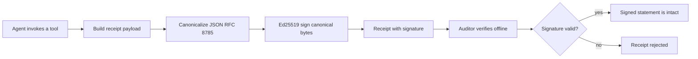
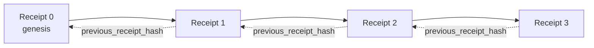

[Pogledajte video lekcije: Sigurnost AI agenata pomoću kriptografskih potvrda](https://youtu.be/PLACEHOLDER_VIDEO_ID)

> _(Video lekcije i sličica bit će dodani od strane Microsoftovog tima za sadržaj nakon spajanja, u skladu sa obrascem lekcija 14 / 15.)_

# Sigurnost AI agenata pomoću kriptografskih potvrda

## Uvod

Ova lekcija će obuhvatiti:

- Zašto su audit staze za AI agente važne za usklađenost, otklanjanje pogrešaka i povjerenje.
- Što je kriptografska potvrda i kako se razlikuje od nesignirane zapisne linije.
- Kako proizvesti potpisanu potvrdu za poziv alata agenta u običnom Pythonu.
- Kako offline verificirati potvrdu i otkriti manipulaciju.
- Kako povezati potvrde lancem tako da uklanjanje ili promjena redoslijeda jedne prekida lanac.
- Što potvrde dokazuju i što eksplicitno ne dokazuju.

## Ciljevi učenja

Nakon završetka ove lekcije, znat ćete kako:

- Identificirati načine otkaza koji motiviraju kriptografsko podrijetlo za radnje agenta.
- Proizvesti potvrdu potpisanu Ed25519 nad kanonskim JSON sadržajem.
- Neovisno verificirati potvrdu koristeći samo javni ključ potpisnika.
- Otkriti manipulaciju ponovnim pokretanjem verifikacije na izmijenjenoj potvrdi.
- Izgraditi lanac potvrda povezanih hash-om i objasniti zašto lanac ima značaj.
- Prepoznati granicu između onoga što potvrde dokazuju (pripadnost, integritet, redoslijed) i onoga što ne dokazuju (ispravnost radnje, valjanost politike).

## Problem: Audit staza vašeg agenta

Zamislite da ste postavili AI agenta za Contoso Travel. Agent čita zahtjeve korisnika, poziva API za letačke opcije i rezervira sjedala u ime korisnika. U zadnjem kvartalu, agent je obrađivao 50.000 rezervacija.

Danas dolazi revizor. Postavlja jednostavno pitanje: "Pokažite mi što je vaš agent radio."

Predajete svoje zapisnike. Revizor ih pregleda i postavlja teže pitanje: "Kako znam da ti zapisnici nisu uređivani?"

Ovo je problem audit staze. Većina današnjih implementacija agenata oslanja se na:

- **Zapisnike aplikacije**: zapisane od samog agenta, mogu ih uređivati svi s pristupom datotečnom sustavu.
- **Usluge zapisivanja u oblaku**: dokazuju nepromjenjivost na razini platforme, ali samo ako revizor vjeruje operatoru platforme.
- **Zapisnike transakcija baze podataka**: dobro za praćenje promjena baze, ali ne i za proizvoljne pozive alata.

Nijedan od ovih ne može odgovoriti na pitanje revizora bez potrebe da revizor vjeruje nekome (vama, vašem cloud pružatelju, vašem dobavljaču baze). Za internu upotrebu, to povjerenje je često prihvatljivo. Za regulirane radne opterećenja (financije, zdravstvo, sve što podliježe EU AI Aktu) nije.

Kriptografske potvrde suzile su ovaj problem tako što su potpisanu izjavu učinile neovisno
provjerljivom. Revizoru je i dalje potreban izvan-kanalni razlog da vjeruje potpisnom ključu i
komponenti koja je proizvela izjavu. Ugrađeni ključ dokazuje samo unutarnju dosljednost,
ne identitet izdavatelja ili mjesto provedbe.

## Što je kriptografska potvrda?

Potvrda je JSON objekt koji bilježi što je agent učinio, potpisan digitalnim potpisom.



Minimalna potvrda izgleda ovako:

```json
{
  "type": "agent.tool_call.v1",
  "agent_id": "contoso-travel-bot",
  "tool_name": "lookup_flights",
  "tool_args_hash": "sha256:a3f9c1...",
  "result_hash": "sha256:7b2e1d...",
  "policy_id": "contoso-travel-policy-v3",
  "timestamp": "2026-04-25T14:30:00Z",
  "sequence": 47,
  "previous_receipt_hash": "sha256:9d4e6a...",
  "signature": {
    "alg": "EdDSA",
    "sig": "c5af83...",
    "public_key": "8f3b2c..."
  }
}
```

Tri svojstva su ona koja obavljaju posao:

1. **Potpis**. Potvrda je potpisana putem gatewaya agenta koristeći Ed25519 privatni ključ. Svatko tko ima odgovarajući javni ključ može offline provjeriti potpis. Povjerenik mora "prikvačiti" taj ključ ili ga dohvatiti iz pouzdanog registra izvan potvrde. Manipulacija bilo kojim potpisanim poljem onemogućava valjanost potpisa.

2. **Kanonska enkodiranje**. Prije potpisivanja, potvrda se serijalizira koristeći JSON Canonicalization Scheme (JCS, RFC 8785). To osigurava da dvije implementacije koje proizvode isti logički sadržaj daju bajt-identičan rezultat. Bez kanonizacije, različiti JSON serijalizatori proizvodili bi različite potpise za isti sadržaj.

3. **Lančano povezivanje hash-a**. Polje `previous_receipt_hash` povezuje svaku potvrdu s prethodnom. Uklanjanje ili promjena redoslijeda potvrde prekida sekvencu. Otkriti skraćenje ili prepisivanje pod kontrolom potpisnika zahtijeva s druge strane prikvačeni trenutni lanac, neovisne provjere ili autentificiranu obvezu zatvorene populacije.

Zajedno ova svojstva daju tri jamstva:

- **Pripadnost ključa**: taj ključ je potpisao ovaj sadržaj. Organizacijski ili ljudski identitet zahtijeva pouzdanu vezu ključa.
- **Integritet**: sadržaj nije promijenjen nakon potpisivanja.
- **Redoslijed unutar verificirane sekvence**: ova potvrda povezana je s prethodnikom.

## Proizvodnja potvrde u Pythonu

Ne trebate posebnu biblioteku za proizvodnju potvrde. Kriptografski primitivci su široko dostupni, a logika je samo nekoliko desetaka linija Pythona.

Praktični zadaci u `code_samples/18-signed-receipts.ipynb` vode vas kroz cijeli tijek. Kontrolirani izvorni `code_samples/18-signed-receipts.execution-receipt.json` bilježi točan hash bilježnice, Python okruženje, broj ćelija i provjere iz posljednjeg čistog izvođenja bez mijenjanja spremljenih izlaza lekcije. Sažeta verzija:

```python
import json
import hashlib
import base64
from nacl import signing
from jcs import canonicalize  # RFC 8785 canonical JSON

def b64url_nopad(data: bytes) -> str:
    return base64.urlsafe_b64encode(data).decode("ascii").rstrip("=")

def sha256_canonical(obj) -> str:
    """SHA-256 of a Python object's JCS-canonical JSON form."""
    return f"sha256:{hashlib.sha256(canonicalize(obj)).hexdigest()}"

# Generate or load a signing key (in production, store in a key vault)
signing_key = signing.SigningKey.generate()
verify_key = signing_key.verify_key
TRUSTED_PUBLIC_KEYS = {b64url_nopad(bytes(verify_key))}  # pinned out of band by the verifier

# Build the receipt payload (no signature yet)
tool_args = {"origin": "SYD", "destination": "LAX"}
tool_result = [{"flight": "QF11", "price": 1850, "stops": 0}]

payload = {
    "type": "agent.tool_call.v1",
    "agent_id": "contoso-travel-bot",
    "tool_name": "lookup_flights",
    "tool_args_hash": sha256_canonical(tool_args),
    "result_hash": sha256_canonical(tool_result),
    "policy_id": "contoso-travel-policy-v3",
    "timestamp": "2026-04-25T14:30:00Z",
    "sequence": 0,
    "previous_receipt_hash": None,
}

# Canonicalize and sign the JCS bytes directly. PureEdDSA hashes internally.
canonical_bytes = canonicalize(payload)
signature_bytes = signing_key.sign(canonical_bytes).signature

# Attach a structured signature object.
receipt = {
    **payload,
    "signature": {
        "alg": "EdDSA",
        "sig": b64url_nopad(signature_bytes),
        "public_key": b64url_nopad(bytes(verify_key)),
    },
}
```

To je cijeli potpisni proces. Vježbe u bilježnici prolaze svaki korak.

## Verifikacija potvrde i otkrivanje manipulacijâ

Verifikacija je obrnuta operacija:

```python
import base64
import hashlib
from nacl import signing
from nacl.exceptions import CryptoError
from jcs import canonicalize

def b64url_decode(s: str) -> bytes:
    # Strict: Python's decoder skips characters outside the alphabet and also
    # accepts padding, the standard +/ alphabet and non-zero spare bits.
    # Re-encoding and comparing accepts only the one unpadded base64url form.
    padding = "=" * ((4 - len(s) % 4) % 4)
    data = base64.urlsafe_b64decode(s + padding)
    if base64.urlsafe_b64encode(data).decode("ascii").rstrip("=") != s:
        raise ValueError("not canonical unpadded base64url")
    return data

def verify_receipt(receipt: dict, trusted_public_key: str) -> bool:
    # trusted_public_key is the issuer's key, obtained from somewhere other
    # than this receipt. Never use receipt["signature"]["public_key"] here:
    # see "What Receipts Prove (and What They Do Not)" below.
    # Fails closed: anything malformed returns False instead of raising.
    if not isinstance(receipt, dict) or not isinstance(trusted_public_key, str):
        return False
    sig_obj = receipt.get("signature")
    if not isinstance(sig_obj, dict) or sig_obj.get("alg") != "EdDSA":
        return False
    sig_b64 = sig_obj.get("sig")
    if not isinstance(sig_b64, str):
        return False

    try:
        # Reconstruct the payload that was actually signed (everything except signature).
        payload = {k: v for k, v in receipt.items() if k != "signature"}
        canonical_bytes = canonicalize(payload)
        verify_key = signing.VerifyKey(b64url_decode(trusted_public_key))
        verify_key.verify(canonical_bytes, b64url_decode(sig_b64))
        return True
    except (CryptoError, TypeError, ValueError, KeyError, OverflowError):
        return False
    except Exception:
        # An undecodable key or signature, or a payload that cannot be
        # canonicalized: fail closed rather than raise.
        return False
```

Ova funkcija prima potvrdu i javni ključ izdavatelja, te vraća `True` ako je potpis valjan, a `False` inače, uključujući kad je unos neispravan. Nema mrežnog poziva ni verifikacijske usluge: nakon što imate izdavateljev ključ, verifikacija je potpuno lokalna i offline. Ono što i dalje zahtijeva jest taj ključ, dobiven negdje drugdje osim iz same potvrde.

Da biste vidjeli otkrivanje manipulacije u praksi, bilježnica vodi kroz:

1. Proizvodnju valjane potvrde i potvrđivanje njene verifikacije.
2. Izmjenu jednog bajta u polju `tool_args_hash`.
3. Ponovno pokretanje verifikacije i uočavanje neuspjeha.
4. Ponovnu manipulaciju, ali ovaj put ponovnim potpisivanjem s ključem koji je napadač generirao i ugrađivanjem tog ključa u potvrdu.

Korak 4 vrijedi dobro razumjeti. Ta potvrda je interno dosljedna: njen potpis je autentičan za njezin sadržaj i za ključ koji nosi, pa se provjerava s tim ključem. Neuspjeh nastaje samo kad se provjerava s pravim izdavateljevým ključem. Koraci 2 i 3 hvataju napadača koji se nije potrudio ponovno potpisati; korak 4 hvata onoga koji je to učinio.

Ovo je praktični dokaz da su potvrde otporne na manipulaciju: svaka promjena potpisanog polja prekida potpis, pod uvjetom da verifikaciju radite s ključem koji napadač nije dostavio. Sam `signature` objekt je izvan potpisanih bajtova, zbog čega ključ s kojim verificirate mora doći negdje drugdje osim iz potvrde.

## Povezivanje potvrda u lanac za agente s višestrukim koracima

Jedna potpisana potvrda štiti jednu radnju. Lanac potvrda štiti slijed.



Svaka potvrda zapisuje hash prethodne potvrde. Za tiho uklanjanje potvrde 2, napadač bi morao:

- Izmijeniti polje `previous_receipt_hash` potvrde 3 (što prekida potpis potvrde 3), ILI
- Krivotvoriti novi potpis na izmijenjenoj potvrdi 3 (što zahtijeva privatni ključ agenta).

Ako je privatni ključ u hardverskom skladištu ključeva, a verifieri provjeravaju svaku potvrdu prema javnom ključu izdavatelja dobivenom neovisno (objavljeni JWK set ili prikvačena konfiguracijska vrijednost), nijedan od tih napada nije moguć bez otkrivanja. Objavljivanje ključa u svakoj potvrdi nije dovoljno: napadač može ponovo potpisati svojim ključem i ubaciti ga umjesto toga, što je fixture `04_resigned_receipt.json`.

Bilježnica vodi kroz:

1. Izgradnju lanca od tri potvrde.
2. Provjeru da `previous_receipt_hash` svake potvrde odgovara stvarnom hashu prethodne.
3. Manipulaciju jedne potvrde u sredini i uočavanje prekida lanca baš na tom mjestu.

Ovo je način proizvodnje audit staze koju vanjski revizor može verificirati pod svojim
vlastitim prikvačenim ključevima izdavatelja i provjerama lanca, bez povjerenja u vašu promjenjivu pohranu zapisnika.

## Što potvrde dokazuju (a što ne)

Ovo je najvažniji dio ove lekcije. Potvrde su moćne, ali njihova moć je ograničena.

**Potvrde dokazuju tri stvari:**

1. **Pripadnost**: određeni ključ je potpisao određeni sadržaj.
2. **Integritet**: sadržaj nije promijenjen od potpisivanja.
3. **Redoslijed unutar predstavljene, verificirane sekvence**: ova potvrda je povezana s prethodnikom.

**Potvrde ne dokazuju:**

1. **Ispravnost**: da je radnja agenta bila ispravna. Potvrda može biti potpisana za netočan odgovor jednako lako kao i za točan.
2. **Usklađenost s politikom**: da je politika navedena u `policy_id` zapravo procijenjena, ili da bi dopustila ovu radnju ako bi se provjeravala. Potvrda bilježi ono što je tvrdnjeno, ne ono što je izvršeno.
3. **Identitet izvan ključa**: potvrda kaže "taj ključ je potpisao ovaj sadržaj." Ne kaže "taj je čovjek ovlastio ovo." Povezivanje ključa s osobom ili organizacijom zahtijeva zasebnu identitetsku infrastrukturu (direktorij, registar javnih ključeva itd.).
4. **Iskrenost ulaza**: ako agent primi manipulirani upit i djeluje prema njemu, potvrda vjerodostojno bilježi radnju. Potvrde su nakon validacije ulaza, nisu njezin zamjenski alat.
5. **Izvršenje ili stvarni učinak**: potvrda izdana nakon poziva bilježi što izdavatelj tvrdi da se dogodilo. Dokazivanje pristupanja ili usklađivanje sa stvarnim učinkom zahtijeva dokaz od stvarnog izvršitelja ili granice pružatelja.
6. **Potpunost**: odsutna potvrda može značiti blokadu, izostavljanje, gubitak ili neinstrumentiranost. Odsutnost postaje dokaz samo unutar autentificirane zatvorene populacije.
7. **Pouzdano vrijeme**: potpisani vremenski pečat dokazuje da potpisnik posjeduje tu vrijednost, ne da je vrijednost točna. Pouzdano vrijeme zahtijeva zasebnu vremensku vlast ili svjedočenu kontrolnu točku.

**Ključ u potvrdi nije ključ s kojim vršite verifikaciju.** To proizlazi iz stavke 3, i to je jedino mjesto gdje razlikovanje mora promijeniti vaš kod, ne samo razumijevanje. `public_key` iz primjera je tamo da primjer bude samostalan. Verifikator mu nikad ne smije vjerovati. Bilo tko može uzeti potvrdu, promijeniti je, potpisati s ključem koji je generirao, i ubaciti taj ključ; rezultat se savršeno verificira prema sebi. To je fixture `04_resigned_receipt.json` unutar `sample_receipts/`, i razlog zašto `verify_receipt` gore prima ključ kao argument, a ne izvlači ga iz potvrde. Nabavite izdavateljev ključ neovisno, iz JWK seta u Produkcijskom kontrolnom popisu ispod ili drugog pin-anog sidra unaprijed, i verificirajte prema njemu. Potpis provjeren s ključem koji je došao u istom omotu dokazuje samo da je omot interno dosljedan.

Ta granica je važna iz dva razloga:

- Kaže što su potvrde korisne za: omogućavanje auditabilnog i otkrivanja manipulacije ponašanja agenata, čak i preko organizacijskih granica.
- Kaže koje dodatne slojeve još trebate: validaciju unosa (Lekcija 6), provedbu politike (kratko obrađeno dolje) i identitetsku infrastrukturu (izvan dosega ove lekcije).

Česta pogreška je pretpostaviti da "imamo potvrde" znači "imamo upravljanje." Ne znači. Potvrde su temelj. Upravljanje je sustav koji gradite iznad njih.

## Vezanje potpisa odobritelja uz točnu radnju

Stavka 3 gore zaslužuje zasebni odjeljak: potvrda radnje kaže "taj ključ je potpisao ovaj sadržaj," nikad "ta je osoba ovlastila ovo." Za radnje visokog rizika (povrati, brisanja, transferi novca), zasebni potpis odobritelja može vezati točnu radnju. Povezivanje tog ključa s osobom i provjera ljudske prisutnosti ostaju zasebne odgovornosti.

Sljedeća bilježnica `code_samples/human-authorization-receipts.ipynb` dodaje drugi tip potvrde, `human.approval.v1`, u isti omotni oblik kao i potvrde iz lekcije (tipizirani sadržaj potpisan Ed25519 preko njegovih kanonskih JCS bajtova, s objektom `signature` izvan potpisanih bajtova). Ključ odobritelja potpisuje **potpunu kanonsku radnju i njezin digest**; ključ agenta potpisuje tvrdnju koja nosi **isti digest radnje** i `parent_approval_ref`, `receipt_hash` odobrenja, istu konvenciju kao `previous_receipt_hash` u lancu koji ste napravili gore. Jedan `verify_chain` provjerava oba artefakta pod **posebnim pin-anih registarima ključeva** (ključevi odobritelja nasuprot ključeva agenta), tako da je kod zajednički, ali ovlasti nikad nisu.

Svojstvo koje to donosi, pažljivo navedeno: *prikvačeni ključ odobritelja potpisao je ovu točnu
radnju, a ključ agenta je kasnije potpisao izjavu koja nosi isti digest radnje.*
To je korisni dokaz, ali samo po sebi nije dokaz o izvršenju radnje. Da bi se
kontroliralo izvršenje, točno odobrenje mora također biti rezervirano i iskorišteno jednom na
stvarnoj granici izvršitelja; nepoznati ishodi pružatelja moraju ostati nepoznati, a ne
slijepo se ponovo pokušavati. Bilježnički odbijajući fixture testiraju sloj lanca potvrda:

- manipulaciju, zbunjenu zastupništvu, krivotvorene ključeve s bilo koje strane i neispravan unos;
- **zastarjelu ovlast**: potpis koji se još verificira, ali je odbijen jer se verzija politike promijenila, ključ odobritelja je uklonjen iz registra ili je odobrenje isteklo prije navedenog vremena verifikacije;
- **zamjenu digesta**: valjano potpisana potvrda radnje koja se odnosi na *stvarno* odobrenje koje veže *drugu* kanonsku radnju.

Svaki neuspjeh odbija se s različitim razlogom, tako da revizor koji čita odbijanje može utvrditi je li ovlast istekla ili se tražena radnja promijenila. Verifikacija je samo za čitanje i ponovljiva: ne troši odobrenje niti poziva pružatelja. Poseban izvršitelj treba trajnu, atomsku zaštitu ponovnog izvođenja i eksplicitne ishode uspjeha, neuspjeha i neodređenih. Potvrda ljudskog odobrenja je obrazovni sastav definiran ovom lekcijom, a ne vrsta potvrde definirana u `draft-farley-acta-signed-receipts`.

## Proizvodne reference

Python kod u ovoj lekciji je namjerno minimalan kako biste mogli pročitati svaki redak i točno razumjeti što se događa. U produkciji imate dvije opcije:

1. **Nadogradite izravno na kriptografske primitive.** 50 linija koje ste vidjeli gore dovoljnih je za mnoge slučajeve korištenja. PyNaCl (Ed25519) i `jcs` paket (kanonski JSON) dobro su održavane i revidirane biblioteke.

2. **Koristite produkcijsku knjižnicu za račune.** Nekoliko open-source projekata implementira isti obrazac s dodatnim značajkama (rotacija ključeva, batch-verifikacija, distribucija JWK seta, integracija s policy motorima):
   - Potpisni pipeline koristi JCS i konvencije raspona potpisa u neovisnom IETF Internet nacrtu ([`draft-farley-acta-signed-receipts`](https://datatracker.ietf.org/doc/draft-farley-acta-signed-receipts/), revizija 02). Ovaj edukativni plosnati račun razlikuje se od `{payload, signature}` omotača nacrta i nije predstavljen kao usklađena implementacija. Nacrt objavljuje zajednički komplet za usklađenost ([agent-governance-testvectors](https://github.com/ScopeBlind/agent-governance-testvectors)) za implementacije koje ciljaju njegov žični format.
   - Microsoft Agent Governance Toolkit sastavlja račune s odlukama politike temeljenim na Cedar-u; pogledajte Tutorial 33 u toj repozitoriji za kompletan primjer.
   - Paket `protect-mcp` (npm) i `@veritasacta/verify` (npm) pružaju Node-baziranu implementaciju potpisivanja računa i offline verifikacije, namijenjenu za omatanje bilo kojeg MCP servera s auditu informacijom otpornom na manipulaciju, uključujući tijek zadržavanja za ko-potpis u kojem pauzirana radnja emitira odobreni račun vezan za sažetak radnje (WebAuthn podržan u desktop tijeku), isti obrazac potvrde odobrenja kao i bilježnica s ljudskom autorizacijom gore.
   - **[nobulex](https://github.com/arian-gogani/nobulex)** Python SDK (`pip install nobulex`) pruža isti obrazac potpisivanja Ed25519 + JCS u Pythonu s integracijama LangChain i CrewAI, uključujući objavljene vektore za međuprovalnu validaciju i mapiranje usklađenosti koje je doprinosiom [OWASP PR #2210](https://github.com/OWASP/CheatSheetSeries/pull/2210).
   - **[EMILIA Protocol](https://github.com/emiliaprotocol/emilia-protocol)** pruža dopunsku sloj provedbe točne radnje: offline-verifikabilne potvrde odobrenja, pritisnuta WebAuthn ili kvorumska ovlast, jednokratna potrošnja na granici izvršitelja, i eksplicitni put s nedeterminiranim ishodom. Njegovi prilagodnici okvira tretiraju račun kao neophodan dokaz, a ne kao potvrdu da se dogodio vanjski učinak.

Odluka između izrade vlastitog i upotrebe knjižnice sliči odluci između pisanja vlastite JWT knjižnice i korištenja ispitane: oba su razumna; knjižnica štedi vrijeme i smanjuje površinu audita; pristup od nule prisiljava vas da razumijete svaki primitiv. Ova lekcija podučava put od nule da imate temelj za bilo koji izbor.

## Provjera Znanja

Testirajte svoje razumijevanje prije nego što prijeđete na praktični zadatak.

**1. Račun potpisuje agentov privatni Ed25519 ključ. Auditor ima samo javni ključ. Može li auditor provjeriti račun offline?**

<details>
<summary>Odgovor</summary>

Da, kriptografska verifikacija zahtijeva samo javni ključ i potpisane bajtove. 
Auditor ipak mora neovisno pribaviti i fiksirati prihvaćeni javni ključ, neovisno o računu.
Nakon što je uspostavljena ta konfiguracija povjerenja, nije potreban nikakav mrežni poziv.
</details>

**2. Napadač mijenja `policy_id` polje računa tvrdeći da je upravljan permisivnijom politikom. Potpis je bio nad izvornim teretom. Što se događa tijekom verifikacije?**

<details>
<summary>Odgovor</summary>

Verifikacija ne uspijeva. Potpis je izračunat nad kanonskim bajtovima izvornog tereta; mijenjanje bilo kojeg polja tereta mijenja te bajtove, čime potpis postaje nevažeć. Napadaču je potreban privatni ključ za stvaranje novog valjanog potpisa, kojeg on nema.
</details>

**3. Zašto račun uključuje `tool_args_hash` i `result_hash` umjesto sirovih argumenata i rezultata?**

<details>
<summary>Odgovor</summary>

Dva razloga. Prvo, račun može biti potreban za arhiviranje ili prijenos u okruženjima gdje bi curenje sirovog sadržaja (PII, poslovni podaci) bio problem. Hashiranje čini račun malim i sadržaj privatnim; auditor provjerava da se hash podudara s zasebno pohranjenom kopijom stvarnog sadržaja. Drugo, hashovi imaju fiksnu veličinu; račun s hashovima je ograničen veličinom bez obzira koliko su veliki ulazi i izlazi bili.
</details>

**4. `previous_receipt_hash` polje povezuje svaki račun s njegovim prethodnikom. Ako napadač tiho izbriše jedan račun iz sredine lanca, što postaje nevažeće?**

<details>
<summary>Odgovor</summary>

Svaki račun koji je došao nakon izbrisanog. Njihova `previous_receipt_hash` polja više ne odgovaraju stvarnom lancu (jer račun na koji su referirali više ne postoji ili lanac sada pokazuje na drugog prethodnika). Da bi sakrio brisanje, napadač bi morao opet potpisati svaki kasniji račun, što zahtijeva privatni ključ izdavatelja. Ponovni potpis bilo kojim drugim ključem ne uspijeva pri provjeri s izdavateljev ključem.
</details>

**5. Račun se čisto verificira. Dokazuje li to da je agentova radnja bila ispravna, valjana ili usklađena s politikom?**

<details>
<summary>Odgovor</summary>

Ne. Pod fiksiranim ključem i kontekstom lanca, valjani račun dokazuje pripisivanje potpisa,
integritet sadržaja i vezu s prikazanim prethodnikom. NE dokazuje da je
radnja bila ispravna ili izvršena, da je politika evaluirana, da je vremenska oznaka
vjerodostojna ili da je zapis kompletan. Ovo je najvažnija granica u lekciji.
</details>

## Praktični Zadatak

Otvorite `code_samples/18-signed-receipts.ipynb` i dovršite sva četiri dijela:

1. **Dio 1**: Potpišite svoj prvi račun i verificirajte ga.
2. **Dio 2**: Manipulirajte računom i promatrajte neuspjeh verifikacije.
3. **Dio 3**: Izgradite lanac od tri računa i verificirajte cjelovitost lanca.
4. **Dio 4**: Primijenite obrazac na agenta građenog s Microsoft Agent Framework: omotajte poziv alata potpisivanjem računa, zatim verificirajte račun neovisno.

**Izazov za napredne 1:** proširite shemu računa dodatnim poljem po vašem izboru (npr. ID zahtjeva za praćenje), ažurirajte kanonsku logiku potpisivanja da ga uključi i potvrdite da račun još uvijek prolazi verifikaciju. Zatim izmijenite polje nakon potpisivanja i potvrdite da verifikacija ne uspije. Ovo vas prisiljava da shvatite kako svaki bajt kanonskog kodiranja doprinosi potpisu.

**Izazov za napredne 2:** Izračunajte SHA-256 hash od dva računa zajedno (konkatenirajte njihove kanonske bajtove u determinističkom redu) i ugurajte dobiveni sažetak kao novo polje na treći račun prije potpisivanja. Verificirajte da sva tri računa i dalje prolaze verifikaciju. Upravo ste izgradili dokaz uključenja u jednom koraku: bilo koji nositelj trećeg računa može dokazati da su prva dva postojala u vrijeme potpisivanja, bez potrebe da otkriva njihov sadržaj. Ovo je obrazac koji selektivno-otkrivene potvrde koriste u velikom opsegu (Merkle-ovi obvezujući zapisi, RFC 6962).

## Zaključak

Kriptografski računi daju AI agentima stazu audita koja je:

- **Neovisno verificirana pod fiksiranim povjerenjem**: stranka s prihvaćenim javnim ključevima i potpisanim bajtovima može verificirati bez ovisnosti o servisu.
- **Otpornosti na manipulaciju**: bilo kakva izmjena poništava potpis.
- **Prijenosiva**: račun je mala JSON datoteka; može se arhivirati, prenositi i verificirati bilo gdje.
- **Usklađena sa standardima**: temelji se na Ed25519 (RFC 8032), JCS (RFC 8785) i SHA-256, svim široko korištenim primitivima.

Nisu zamjena za validaciju unosa, provođenje politike, dozvolu izvršitelja,
dokaze ishoda, kontrole potpunosti ili identitetsku infrastrukturu. Oni su temelj
za te slojeve. U reguliranim ili više-organizacijskim radnim tokovima, računi čine specifične
izjave izdavatelja neovisno provjerljivima pod auditorovom vlastitom konfiguracijom povjerenja.

Najvažnija pouka: računi dokazuju da je određeni ključ potpisao određeni
sadržaj. Vremenska oznaka je tvrdnja potpisnika osim ako nije posebno vremenski potvrđena. 
Račun ne dokazuje da je njegov sadržaj bio istinit, da je akcija izvršena, ili da je
zapis kompletan. Te razlike čvrsto držite.

## Provjerna Lista za Produkciju

Kad budete spremni prijeći s ove lekcije na implementaciju agenata potpisanih računom u stvarnom okruženju:

- [ ] **Premjestite potpisni ključ s developerskog prijenosnog računala.** Koristite Azure Key Vault, AWS KMS ili hardverski sigurnosni modul. Privatni ključ koji potpisuje vaše račune ne smije nikada biti u verzioniranju izvornog koda ili u običnom tekstu na strojevima aplikacije.
- [ ] **Uspostavite povjerenje ključa verifikatora.** Objavite ključeve kroz JWK set ili registar, zatim neka zainteresirane strane fiksiraju prihvaćeni identitet izdavatelja, skup ključeva i politiku rotacije izvan pojedinačnih računa. Sam inline ključ nije sidro povjerenja.
- [ ] **Sidrite lanac izvana.** Povremeno zapišite heš najučitanije glave lanca u transparentni zapis (Sigstore Rekor, RFC 3161 vremenska ovlast ili drugi interni sustav) kako bi vanjska strana mogla potvrditi "taj lanac je postojao u ovo vrijeme."
- [ ] **Pohranite račune neizmjenjivo.** Arhivirajuća pohrana (Azure Storage s pravilima neizmjenjivosti, AWS S3 Object Lock) sprječava insajdera da prepravi povijest na sloju pohrane.
- [ ] **Odlučite o čuvanju.** Mnogi režimi usklađenosti zahtijevaju višegodišnje zadržavanje. Planirajte rast računâ (svaki račun je ~500 bajtova; agent koji generira 10K poziva dnevno proizvodi ~1,8 GB godišnje).
- [ ] **Dokumentirajte što računi ne pokrivaju.** Računi dokazuju pripisivanje, integritet i redoslijed. Vaš vodič treba eksplicitno navesti koje dodatne kontrole (validacija unosa, provođenje politike, ograničavanje brzine, infrastruktura identiteta) su uz račune u vašem stavu upravljanja.

### Imate li još pitanja o osiguravanju AI agenata?

Pridružite se [Microsoft Foundry Discord](https://aka.ms/ai-agents/discord) i susretnite se s ostalim polaznicima, prisustvujte radnim satima i dobijte odgovore na svoja pitanja o AI agentima.

## Iza ove Lekcije

Ova lekcija pokriva potpisivanje jednog računa i hash-lančane sekvence. Isti primitivni elementi čine nekoliko naprednijih obrazaca koje možete sresti kako vaš stav upravljanja sazrijeva:

- **Selektivno otkrivanje.** Kada su polja računa neovisno obavezana (Merkle stablo u RFC 6962 stilu), možete odabrati otkriti određena polja određenim auditorima i dokazati da su ostala nepromijenjena bez izlaganja. Korisno kada isti račun mora zadovoljiti sveobuhvatni audit (koji želi potpunost) i propise o minimiziranju podataka poput GDPR-a (koji žele da auditor vidi što je manje moguće).
- **Poništenje računa.** Ako je potpisni ključ kompromitiran, trebate način da označite sve račune potpisane tim ključem kao nepouzdane od određenog trenutka nadalje. Standardni obrasci: kratkotrajni potpisni ključevi plus objavljene liste poništenja ili transparentni zapis s unosima poništenja.
- **Dvosmjerni / računi s podijeljenim potpisom.** Neke implementacije dijele potpisani teret u predizvršne (`authorization_*`) i poslijeezekucijske (`result_*`) polovice s neovisnim potpisima, korisno kada odluku o autorizaciji i zapaženi rezultat proizvode različiti akteri ili u različito vrijeme. Ovo se aditivno nadovezuje na format računa podučavan u ovoj lekciji.
- **Sastav tereta.** Račun zatvara sve bajtove koje stavite u `result_hash`. Realni tereti često su bogatiji od rezultata pojedinačnog poziva alata: pred-odluka (predviđanje modela, razmotrene opcije, dokazi i njihova potpunost, stav prema riziku, lanac odgovornosti, ishod vrata) može sve živjeti unutar tereta, zatvoreno jednim računom. Ovo drži format računa minimalnim dok dopušta evoluciju shema tereta po domenama.
- **Međusobna usklađenost implementacija.** Više neovisnih implementacija istog formata računa (Python, TypeScript, Rust, Go) međusobno se verificiraju prema zajedničkim test vektorima. Ako napravite vlastitu implementaciju, validacija prema objavljenim vektorima potvrđuje kompatibilnost žičnog formata.
- **Migracija iza kvantnog računarstva.** Ed25519 je danas široko korišten, ali nije kvantno otporan. Samo oznaka `alg` nije migracija: profil mora definirati ML-DSA kodiranje ključa, kanonske potpisane bajtove, verifikaciju, policu stranke koja se oslanja, otpornost na snižavanje i semantiku prijelaza. Planirajte i testirajte prijelaz s dvostrukim potpisom prema zajedničkim vektorima prije tvrdnji o kompatibilnosti.

## Dodatni Resursi

- <a href="https://datatracker.ietf.org/doc/draft-farley-acta-signed-receipts/" target="_blank">IETF Internet Nacrt: Potpisani Računi Odluka za Pristup Stroj-stroj</a>
- <a href="https://learn.microsoft.com/azure/ai-studio/responsible-use-of-ai-overview" target="_blank">Pregled Odgovornog AI (Azure AI)</a>
- <a href="https://datatracker.ietf.org/doc/html/rfc8032" target="_blank">RFC 8032: Edwards-Kurva Digitalni Potpisni Algoritam (EdDSA)</a>
- <a href="https://datatracker.ietf.org/doc/html/rfc8785" target="_blank">RFC 8785: Shema Kanonizacije JSON-a (JCS)</a>
- <a href="https://datatracker.ietf.org/doc/html/rfc6962" target="_blank">RFC 6962: Transparentnost Certifikata</a> (Merkle konstrukcija korištena u selektivnim potvrdama otkrivanja)
- <a href="https://github.com/microsoft/agent-governance-toolkit/blob/main/docs/tutorials/33-offline-verifiable-receipts.md" target="_blank">Microsoft Agent Governance Toolkit, Tutorial 33: Offline-Verifikabilni Računi Odluka</a>
- <a href="https://github.com/ScopeBlind/agent-governance-testvectors" target="_blank">Vektori za test međusobne usklađenosti implementacija</a> za format računa korišten u ovoj lekciji (Apache-2.0)
- <a href="https://pynacl.readthedocs.io/" target="_blank">Dokumentacija PyNaCl</a> (Ed25519 u Pythonu)

## Prethodna Lekcija

[Izrada lokalnih AI agenata](../17-creating-local-ai-agents/README.md)

---

<!-- CO-OP TRANSLATOR DISCLAIMER START -->
**Napomena**:
Ovaj dokument je preveden korištenjem AI prevoditeljskog servisa [Co-op Translator](https://github.com/Azure/co-op-translator). Iako težimo točnosti, imajte na umu da automatski prijevodi mogu sadržavati greške ili netočnosti. Izvorni dokument na izvornom jeziku treba smatrati autoritativnim izvorom. Za važne informacije preporuča se profesionalni ljudski prijevod. Nismo odgovorni za bilo kakva nesporazumevanja ili pogrešne interpretacije koje proizlaze iz korištenja ovog prijevoda.
<!-- CO-OP TRANSLATOR DISCLAIMER END -->