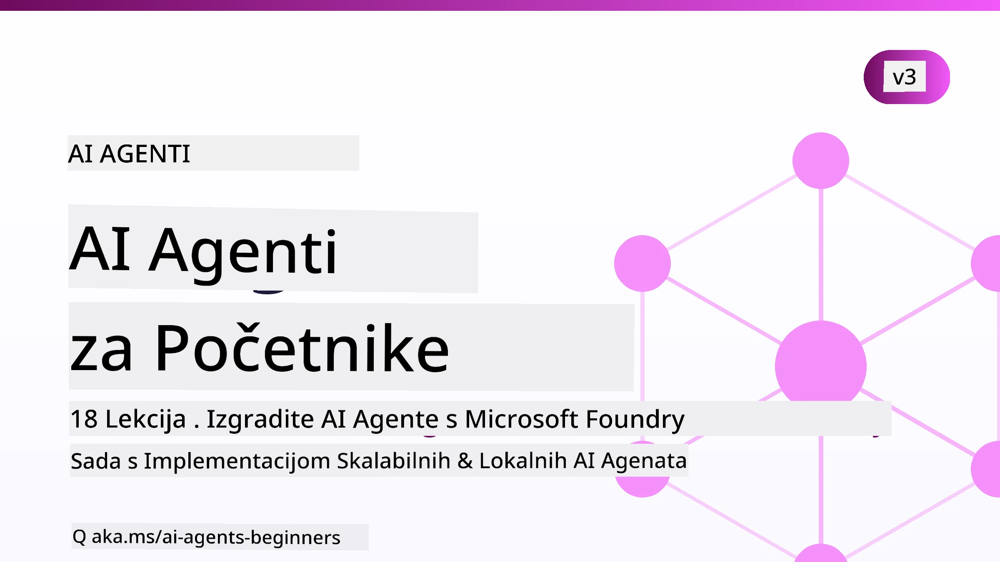

# AI agenti za početnike - tečaj



## Tečaj koji podučava sve što trebate znati da biste počeli graditi AI agente

[](https://github.com/microsoft/ai-agents-for-beginners/blob/master/LICENSE?WT.mc_id=academic-105485-koreyst)
[](https://GitHub.com/microsoft/ai-agents-for-beginners/graphs/contributors/?WT.mc_id=academic-105485-koreyst)
[](https://GitHub.com/microsoft/ai-agents-for-beginners/issues/?WT.mc_id=academic-105485-koreyst)
[](https://GitHub.com/microsoft/ai-agents-for-beginners/pulls/?WT.mc_id=academic-105485-koreyst)
[](http://makeapullrequest.com?WT.mc_id=academic-105485-koreyst)

### 🌐 Višejezična podrška

#### Prijevode održava [Co-op Translator](https://github.com/Azure/co-op-translator)

<!-- CO-OP TRANSLATOR LANGUAGES TABLE START -->
[Arabic](../ar/README.md) | [Bengali](../bn/README.md) | [Bulgarian](../bg/README.md) | [Burmese (Myanmar)](../my/README.md) | [Chinese (Simplified)](../zh-CN/README.md) | [Chinese (Traditional, Hong Kong)](../zh-HK/README.md) | [Chinese (Traditional, Macau)](../zh-MO/README.md) | [Chinese (Traditional, Taiwan)](../zh-TW/README.md) | [Croatian](./README.md) | [Czech](../cs/README.md) | [Danish](../da/README.md) | [Dutch](../nl/README.md) | [Estonian](../et/README.md) | [Finnish](../fi/README.md) | [French](../fr/README.md) | [German](../de/README.md) | [Greek](../el/README.md) | [Hebrew](../he/README.md) | [Hindi](../hi/README.md) | [Hungarian](../hu/README.md) | [Indonesian](../id/README.md) | [Italian](../it/README.md) | [Japanese](../ja/README.md) | [Kannada](../kn/README.md) | [Khmer](../km/README.md) | [Korean](../ko/README.md) | [Lithuanian](../lt/README.md) | [Malay](../ms/README.md) | [Malayalam](../ml/README.md) | [Marathi](../mr/README.md) | [Nepali](../ne/README.md) | [Nigerian Pidgin](../pcm/README.md) | [Norwegian](../no/README.md) | [Persian (Farsi)](../fa/README.md) | [Polish](../pl/README.md) | [Portuguese (Brazil)](../pt-BR/README.md) | [Portuguese (Portugal)](../pt-PT/README.md) | [Punjabi (Gurmukhi)](../pa/README.md) | [Romanian](../ro/README.md) | [Russian](../ru/README.md) | [Serbian (Cyrillic)](../sr/README.md) | [Slovak](../sk/README.md) | [Slovenian](../sl/README.md) | [Spanish](../es/README.md) | [Swahili](../sw/README.md) | [Swedish](../sv/README.md) | [Tagalog (Filipino)](../tl/README.md) | [Tamil](../ta/README.md) | [Telugu](../te/README.md) | [Thai](../th/README.md) | [Turkish](../tr/README.md) | [Ukrainian](../uk/README.md) | [Urdu](../ur/README.md) | [Vietnamese](../vi/README.md)

> **Dajte prednost lokalnom kloniranju?**
>
> Ovaj spremište uključuje prijevode na više od 50 jezika, što znatno povećava veličinu preuzimanja. Za kloniranje bez prijevoda, koristite sparse checkout:
>
> **Bash / macOS / Linux:**
> ```bash
> git clone --filter=blob:none --sparse https://github.com/microsoft/ai-agents-for-beginners.git
> cd ai-agents-for-beginners
> git sparse-checkout set --no-cone '/*' '!translations' '!translated_images'
> ```
>
> **CMD (Windows):**
> ```cmd
> git clone --filter=blob:none --sparse https://github.com/microsoft/ai-agents-for-beginners.git
> cd ai-agents-for-beginners
> git sparse-checkout set --no-cone "/*" "!translations" "!translated_images"
> ```
>
> Ovo vam daje sve što trebate za završetak tečaja uz znatno brže preuzimanje.
<!-- CO-OP TRANSLATOR LANGUAGES TABLE END -->

**Za dodatne jezične opcije, pogledajte [podržane jezike Co-op Translatora](https://github.com/Azure/co-op-translator/blob/main/docs/supported-languages.md).**

[](https://GitHub.com/microsoft/ai-agents-for-beginners/watchers/?WT.mc_id=academic-105485-koreyst)
[](https://GitHub.com/microsoft/ai-agents-for-beginners/network/?WT.mc_id=academic-105485-koreyst)
[](https://GitHub.com/microsoft/ai-agents-for-beginners/stargazers/?WT.mc_id=academic-105485-koreyst)

[](https://discord.com/invite/ATgtXmAS5D)


## 🌱 Početak

Ovaj tečaj ima lekcije koje pokrivaju osnove izgradnje AI agenata. Svaka lekcija pokriva svoju temu pa započnite gdje god želite!

Postoji višejezična podrška za ovaj tečaj. Pogledajte naše [dostupne jezike ovdje](#-multi-language-support).

Ako ovo prvi put gradite s generativnim AI modelima, pogledajte naš tečaj [Generative AI For Beginners](https://aka.ms/genai-beginners), koji uključuje 21 lekciju o radu s GenAI.

Ne zaboravite [označiti (🌟) ovo spremište](https://docs.github.com/en/get-started/exploring-projects-on-github/saving-repositories-with-stars?WT.mc_id=academic-105485-koreyst) i [razgranati ovo spremište](https://github.com/microsoft/ai-agents-for-beginners/fork) da biste mogli pokrenuti kod.

### Upoznajte druge učenike, dobijte odgovore na svoja pitanja

Ako zapnete ili imate pitanja o izgradnji AI agenata, pridružite se našem posvećenom Discord kanalu u [Microsoft Foundry Discord](https://aka.ms/ai-agents/discord).

### Što vam treba

Svaka lekcija u ovom tečaju uključuje primjere koda, koji se nalaze u mapi code_samples. Možete [razgranati ovo spremište](https://github.com/microsoft/ai-agents-for-beginners/fork) da biste napravili vlastitu kopiju.

Primjeri koda u ovim vježbama koriste Microsoft Agent Framework s Microsoft Foundry Agent Service V2:

- [Microsoft Foundry](https://aka.ms/ai-agents-beginners/ai-foundry) - Potreban Azure račun

Ovaj tečaj koristi sljedeće AI agent okvire i usluge od Microsofta:

- [Microsoft Agent Framework (MAF)](https://learn.microsoft.com/agent-framework/overview/)
- [Microsoft Foundry Agent Service V2](https://aka.ms/ai-agents-beginners/ai-agent-service)

Neki primjeri koda također podržavaju alternativne OpenAI-kompatibilne pružatelje poput [MiniMax](https://platform.minimaxi.com/), koji nudi modele s velikim kontekstom (do 204K tokena). Pogledajte [Course Setup](./00-course-setup/README.md) za detalje o konfiguraciji.

Za više informacija o pokretanju koda za ovaj tečaj, pogledajte [Course Setup](./00-course-setup/README.md).

## 🙏 Želite pomoći?

Imate prijedloge ili ste pronašli pravopisne ili kodne pogreške? [Otvori problem](https://github.com/microsoft/ai-agents-for-beginners/issues?WT.mc_id=academic-105485-koreyst) ili [izradi pull request](https://github.com/microsoft/ai-agents-for-beginners/pulls?WT.mc_id=academic-105485-koreyst)


## 📂 Svaka lekcija uključuje

- Pisana lekcija smještena u README i kratki video
- Primjere Python koda koristeći Microsoft Agent Framework s Microsoft Foundry
- Poveznice na dodatne resurse za nastavak učenja


## 🗃️ Lekcije

| **Lekcija**                                   | **Tekst & Kod**                                    | **Video**                                                  | **Dodatno učenje**                                                                     |
|----------------------------------------------|----------------------------------------------------|------------------------------------------------------------|----------------------------------------------------------------------------------------|
| Uvod u AI agente i primjenu agenata           | [Poveznica](./01-intro-to-ai-agents/README.md)          | [Video](https://youtu.be/3zgm60bXmQk?si=z8QygFvYQv-9WtO1)  | [Poveznica](https://aka.ms/ai-agents-beginners/collection?WT.mc_id=academic-105485-koreyst) |
| Istraživanje AI agentskih okvira              | [Poveznica](./02-explore-agentic-frameworks/README.md)  | [Video](https://youtu.be/ODwF-EZo_O8?si=Vawth4hzVaHv-u0H)  | [Poveznica](https://aka.ms/ai-agents-beginners/collection?WT.mc_id=academic-105485-koreyst) |
| Razumijevanje dizajnerskih obrazaca AI agenata     | [Poveznica](./03-agentic-design-patterns/README.md)     | [Video](https://youtu.be/m9lM8qqoOEA?si=BIzHwzstTPL8o9GF)  | [Poveznica](https://aka.ms/ai-agents-beginners/collection?WT.mc_id=academic-105485-koreyst) |
| Dizajnerski obrazac korištenja alata           | [Poveznica](./04-tool-use/README.md)                    | [Video](https://youtu.be/vieRiPRx-gI?si=2z6O2Xu2cu_Jz46N)  | [Poveznica](https://aka.ms/ai-agents-beginners/collection?WT.mc_id=academic-105485-koreyst) |
| Agenti RAG pristupa                                | [Poveznica](./05-agentic-rag/README.md)                 | [Video](https://youtu.be/WcjAARvdL7I?si=gKPWsQpKiIlDH9A3)  | [Poveznica](https://aka.ms/ai-agents-beginners/collection?WT.mc_id=academic-105485-koreyst) |
| Izgradnja pouzdanih AI agenata                     | [Poveznica](./06-building-trustworthy-agents/README.md) | [Video](https://youtu.be/iZKkMEGBCUQ?si=jZjpiMnGFOE9L8OK ) | [Poveznica](https://aka.ms/ai-agents-beginners/collection?WT.mc_id=academic-105485-koreyst) |
| Dizajnerski obrazac planiranja                     | [Poveznica](./07-planning-design/README.md)             | [Video](https://youtu.be/kPfJ2BrBCMY?si=6SC_iv_E5-mzucnC)  | [Poveznica](https://aka.ms/ai-agents-beginners/collection?WT.mc_id=academic-105485-koreyst) |
| Dizajnerski obrazac za višestruke agente          | [Poveznica](./08-multi-agent/README.md)                 | [Video](https://youtu.be/V6HpE9hZEx0?si=rMgDhEu7wXo2uo6g)  | [Poveznica](https://aka.ms/ai-agents-beginners/collection?WT.mc_id=academic-105485-koreyst) |
| Dizajnerski obrazac metakognicije                   | [Poveznica](./09-metacognition/README.md)               | [Video](https://youtu.be/His9R6gw6Ec?si=8gck6vvdSNCt6OcF)  | [Poveznica](https://aka.ms/ai-agents-beginners/collection?WT.mc_id=academic-105485-koreyst) |
| AI agenti u produkciji                              | [Poveznica](./10-ai-agents-production/README.md)        | [Video](https://youtu.be/l4TP6IyJxmQ?si=31dnhexRo6yLRJDl)  | [Poveznica](https://aka.ms/ai-agents-beginners/collection?WT.mc_id=academic-105485-koreyst) |
| Korištenje agentskih protokola (MCP, A2A i NLWeb)  | [Poveznica](./11-agentic-protocols/README.md)           | [Video](https://youtu.be/X-Dh9R3Opn8)                                 | [Poveznica](https://aka.ms/ai-agents-beginners/collection?WT.mc_id=academic-105485-koreyst) |
| Context engineering za AI agente                    | [Poveznica](./12-context-engineering/README.md)         | [Video](https://youtu.be/F5zqRV7gEag)                                 | [Poveznica](https://aka.ms/ai-agents-beginners/collection?WT.mc_id=academic-105485-koreyst) |
| Upravljanje agentskom memorijom                      | [Poveznica](./13-agent-memory/README.md)     |      [Video](https://youtu.be/QrYbHesIxpw?si=vZkVwKrQ4ieCcIPx)                                                      |                                                                                        |
| Istraživanje Microsoft Agent Framework-a                         | [Poveznica](./14-microsoft-agent-framework/README.md)                            |                                                            |                                                                                        |
| Izgradnja agenata za korištenje računala (CUA)           | [Poveznica](./15-browser-use/README.md)     |                                                            | [Poveznica](https://docs.browser-use.com/examples/templates/playwright-integration)         |
| Implementacija skalabilnih agenata                      | [Poveznica](./16-deploying-scalable-agents/README.md) |                                                    | [Poveznica](https://learn.microsoft.com/azure/ai-foundry/agents/overview)                   |
| Izrada lokalnih AI agenata                              | [Poveznica](./17-creating-local-ai-agents/README.md)  |                                                    | [Poveznica](https://learn.microsoft.com/azure/ai-foundry/foundry-local/)                    |
| Osiguravanje AI agenata                                | [Poveznica](./18-securing-ai-agents/README.md)  |                                                            | [Poveznica](https://aka.ms/ai-agents-beginners/collection?WT.mc_id=academic-105485-koreyst) |

## 🎒 Drugi tečajevi

Naš tim producira i druge tečajeve! Pogledajte:

<!-- CO-OP TRANSLATOR OTHER COURSES START -->
### LangChain
[](https://aka.ms/langchain4j-for-beginners)
[](https://aka.ms/langchainjs-for-beginners?WT.mc_id=m365-94501-dwahlin)
[](https://github.com/microsoft/langchain-for-beginners?WT.mc_id=m365-94501-dwahlin)
---

### Azure / Edge / MCP / Agenti
[](https://github.com/microsoft/AZD-for-beginners?WT.mc_id=academic-105485-koreyst)
[](https://github.com/microsoft/edgeai-for-beginners?WT.mc_id=academic-105485-koreyst)
[](https://github.com/microsoft/mcp-for-beginners?WT.mc_id=academic-105485-koreyst)
[](https://github.com/microsoft/ai-agents-for-beginners?WT.mc_id=academic-105485-koreyst)

---
 
### Serija generativnog AI
[](https://github.com/microsoft/generative-ai-for-beginners?WT.mc_id=academic-105485-koreyst)
[-9333EA?style=for-the-badge&labelColor=E5E7EB&color=9333EA)](https://github.com/microsoft/Generative-AI-for-beginners-dotnet?WT.mc_id=academic-105485-koreyst)
[-C084FC?style=for-the-badge&labelColor=E5E7EB&color=C084FC)](https://github.com/microsoft/generative-ai-for-beginners-java?WT.mc_id=academic-105485-koreyst)
[-E879F9?style=for-the-badge&labelColor=E5E7EB&color=E879F9)](https://github.com/microsoft/generative-ai-with-javascript?WT.mc_id=academic-105485-koreyst)

---
 
### Osnovno učenje
[](https://aka.ms/ml-beginners?WT.mc_id=academic-105485-koreyst)
[](https://aka.ms/datascience-beginners?WT.mc_id=academic-105485-koreyst)
[](https://aka.ms/ai-beginners?WT.mc_id=academic-105485-koreyst)
[](https://github.com/microsoft/Security-101?WT.mc_id=academic-96948-sayoung)
[](https://aka.ms/webdev-beginners?WT.mc_id=academic-105485-koreyst)
[](https://aka.ms/iot-beginners?WT.mc_id=academic-105485-koreyst)
[](https://github.com/microsoft/xr-development-for-beginners?WT.mc_id=academic-105485-koreyst)

---
 
### Serija Copilot
[](https://aka.ms/GitHubCopilotAI?WT.mc_id=academic-105485-koreyst)
[](https://github.com/microsoft/mastering-github-copilot-for-dotnet-csharp-developers?WT.mc_id=academic-105485-koreyst)
[](https://github.com/microsoft/CopilotAdventures?WT.mc_id=academic-105485-koreyst)
<!-- CO-OP TRANSLATOR OTHER COURSES END -->

## 🌟 Zahvale zajednici

Zahvaljujemo [Shivam Goyal](https://www.linkedin.com/in/shivam2003/) na doprinosu važnih primjera koda koji pokazuju Agentic RAG. 

## Doprinos

Ovaj projekt prima doprinose i prijedloge. Većina doprinosa zahtijeva da se složite s
Ugovorom o licenci za doprinositelje (CLA) kojim izjavljujete da imate pravo i zaista dajete
prava za korištenje vašeg doprinosa. Za detalje, posjetite <https://cla.opensource.microsoft.com>.

Kada pošaljete zahtjev za povlačenje, CLA bot će automatski utvrditi trebate li pružiti
CLA i prikladno označiti PR (npr. provjera statusa, komentar). Slijedite upute
koje vam daje bot. Ovo ćete morati napraviti samo jednom za sve repozitorije koji koriste naš CLA.

Ovaj projekt je usvojio [Microsoftov kodeks ponašanja za otvoreni kod](https://opensource.microsoft.com/codeofconduct/).
Za više informacija pogledajte [FAQ Kodeksa ponašanja](https://opensource.microsoft.com/codeofconduct/faq/) ili
kontaktirajte [opencode@microsoft.com](mailto:opencode@microsoft.com) za dodatna pitanja ili komentare.

## Zaštićeni znakovi

Ovaj projekt može sadržavati zaštitne znakove ili logotipe projekata, proizvoda ili usluga. Ovlaštena uporaba Microsoftovih
zaštitnih znakova ili logotipa podliježe i mora slijediti
[Pravila za zaštitne znakove i brend Microsofta](https://www.microsoft.com/legal/intellectualproperty/trademarks/usage/general).
Upotreba Microsoftovih zaštitnih znakova ili logotipa u izmijenjenim verzijama ovog projekta ne smije dovesti do zabune ili sugerirati sponzorstvo Microsofta.
Svaka uporaba zaštitnih znakova ili logotipa trećih strana podliježe pravilima tih trećih strana.

## Dobivanje pomoći


Ako zapnete ili imate bilo kakvih pitanja o izradi AI aplikacija, pridružite se:

[](https://aka.ms/foundry/discord)

Ako imate povratne informacije o proizvodu ili pronađete pogreške tijekom izrade, posjetite:

[](https://aka.ms/foundry/forum)

---

<!-- CO-OP TRANSLATOR DISCLAIMER START -->
**Napomena**:
Ovaj dokument je preveden korištenjem AI prevoditeljskog servisa [Co-op Translator](https://github.com/Azure/co-op-translator). Iako težimo točnosti, imajte na umu da automatski prijevodi mogu sadržavati greške ili netočnosti. Izvorni dokument na izvornom jeziku treba smatrati autoritativnim izvorom. Za važne informacije preporuča se profesionalni ljudski prijevod. Nismo odgovorni za bilo kakva nesporazumevanja ili pogrešne interpretacije koje proizlaze iz korištenja ovog prijevoda.
<!-- CO-OP TRANSLATOR DISCLAIMER END -->