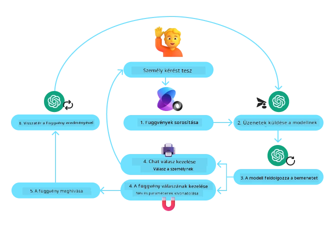
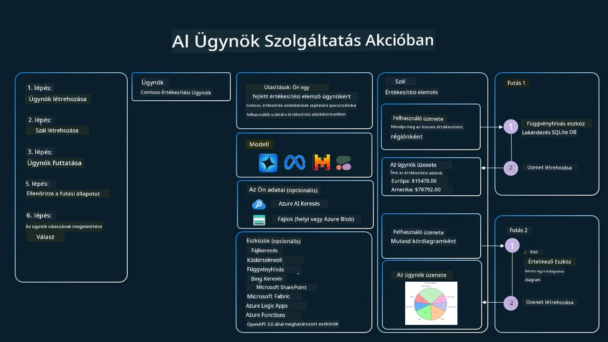

[](https://youtu.be/vieRiPRx-gI?si=cEZ8ApnT6Sus9rhn)

> _(Kattints a fenti képre a lecke videójának megtekintéséhez)_

# Eszközhasználati tervezési mintázat

Az eszközök érdekesek, mert lehetővé teszik az AI ügynökök számára, hogy szélesebb körű képességekkel rendelkezzenek. Ahelyett, hogy az ügynök csak egy korlátozott számú műveletet végezhetne el, egy eszköz hozzáadásával az ügynök most már széles skáláját tudja végrehajtani a műveleteknek. Ebben a fejezetben megvizsgáljuk az Eszközhasználati tervezési mintázatot, amely leírja, hogyan használhatják az AI ügynökök a specifikus eszközöket a céljaik eléréséhez.

## Bevezetés

Ebben a leckében a következő kérdésekre keressük a választ:

- Mi az eszközhasználati tervezési mintázat?
- Milyen felhasználási esetekre alkalmazható?
- Milyen elemek/építőkövek szükségesek a mintázat megvalósításához?
- Milyen különleges szempontokat kell figyelembe venni az Eszközhasználati tervezési mintázat alkalmazásakor, hogy megbízható AI ügynököket építsünk?

## Tanulási célok

A lecke elvégzése után képes leszel:

- Meghatározni az Eszközhasználati tervezési mintázatot és annak célját.
- Azonosítani a felhasználási eseteket, ahol az Eszközhasználati tervezési mintázat alkalmazható.
- Megérteni a mintázat megvalósításához szükséges kulcsfontosságú elemeket.
- Felismerni a megbízhatóság biztosításához szükséges szempontokat az AI ügynökök esetében ezen mintázat használatakor.

## Mi az Eszközhasználati tervezési mintázat?

A **Tool Use Design Pattern** (Eszközhasználati tervezési mintázat) arra fókuszál, hogy az LLM-eket képessé tegye arra, hogy külső eszközökkel kommunikáljanak specifikus célok elérése érdekében. Az eszközök olyan kódok, amelyeket egy ügynök futtathat műveletek végrehajtására. Egy eszköz lehet egy egyszerű függvény, például egy számológép, vagy egy API hívás egy harmadik fél szolgáltatásához, például részvényárfolyam lekérdezés vagy időjárás-előrejelzés. AI ügynökök esetében az eszközöket úgy tervezik, hogy az **modell által generált függvényhívások** válaszaként fussanak le.

## Milyen felhasználási esetekre alkalmazható?

Az AI ügynökök eszközöket használhatnak összetett feladatok elvégzésére, információk lekérésére vagy döntéshozatalra. Az eszközhasználati tervezési mintázatot gyakran alkalmazzák olyan helyzetekben, amelyek dinamikus interakciót igényelnek külső rendszerekkel, például adatbázisokkal, webszolgáltatásokkal vagy kódértelmezőkkel. Ez a képesség számos különböző felhasználási esetben hasznos, többek között:

- **Dinamikus információ lekérés:** Az ügynökök külső API-kat vagy adatbázisokat kérdezhetnek le, hogy naprakész adatokat szerezzenek (például SQLite adatbázis lekérdezése adatelemzéshez, részvényárfolyamok vagy időjárás információk lekérése).
- **Kódvégrehajtás és értelmezés:** Az ügynökök kódokat vagy szkripteket futtathatnak matematikai problémák megoldására, jelentések generálására vagy szimulációk végrehajtására.
- **Folyamatok automatizálása:** Ismétlődő vagy több lépésből álló folyamatok automatizálása olyan eszközökkel, mint ütemezők, e-mail szolgáltatások vagy adatcsővezetékek integrálása.
- **Ügyfélszolgálat:** Az ügynökök CRM rendszerekkel, jegyrendszerekkel vagy tudásbázisokkal kommunikálhatnak felhasználói kérdések megoldására.
- **Tartalomgenerálás és szerkesztés:** Az ügynökök olyan eszközöket használhatnak, mint helyesírás-ellenőrzők, szövegösszefoglalók vagy tartalombiztonsági értékelők, hogy segítsék a tartalomalkotást.

## Milyen elemek/építőkövek szükségesek az eszközhasználati tervezési mintázat megvalósításához?

Ezek az építőkövek teszik lehetővé, hogy az AI ügynök széles körű feladatokat végezzen el. Nézzük meg az Eszközhasználati tervezési mintázat megvalósításához szükséges kulcselemeket:

- **Függvény/Eszköz sémák**: Részletes definíciók az elérhető eszközökről, beleértve a függvény nevét, célját, szükséges paramétereket és várt kimeneteket. Ezek a sémák lehetővé teszik, hogy az LLM megértse, milyen eszközök állnak rendelkezésre és hogyan kell érvényes kéréseket összeállítani.

- **Függvény végrehajtási logika:** Irányítja, hogy mikor és hogyan legyenek meghívva az eszközök a felhasználó szándéka és a beszélgetés kontextusa alapján. Ide tartozhatnak tervező modulok, útválasztási mechanizmusok vagy feltételes folyamatok, amelyek dinamikusan határozzák meg az eszközhasználatot.

- **Üzenetkezelő rendszer:** Olyan komponensek, amelyek kezelik a beszélgetési folyamatot a felhasználói bemenetek, LLM válaszok, eszközhívások és eszközkimenetek között.

- **Eszközintegrációs keretrendszer:** Infrastruktúra, amely összeköti az ügynököt különféle eszközökkel, akár egyszerű függvényekről, akár összetett külső szolgáltatásokról legyen szó.

- **Hibakezelés és érvényesítés:** Mechanizmusok az eszközvégrehajtási hibák kezelésére, paraméterek érvényesítésére és váratlan válaszok kezelésére.

- **Állapotkezelés:** Követi a beszélgetés kontextusát, korábbi eszközhasználatokat és tartós adatokat, hogy biztosítsa a konzisztenciát az egymást követő interakciók során.

Ezután nézzük meg részletesebben a Függvény/Eszköz hívást.
 
### Függvény/Eszköz hívás

A függvényhívás az elsődleges módja annak, hogy a Nagy Nyelvi Modellek (LLM-ek) eszközökkel kommunikáljanak. Gyakran használjuk a 'Függvény' és 'Eszköz' kifejezéseket felcserélhetően, mert a 'függvények' (újrafelhasználható kódrészek) azok az 'eszközök', amelyeket az ügynökök a feladatok végrehajtására használnak. Ahhoz, hogy egy függvény kódját meghívják, az LLM-nek össze kell hasonlítania a felhasználói kérést a függvények leírásával. Ehhez egy olyan séma kerül az LLM-hez, amely az összes elérhető függvény leírását tartalmazza. Az LLM kiválasztja az adott feladathoz legmegfelelőbb függvényt, majd visszaadja annak nevét és argumentumait. A kiválasztott függvény meghívásra kerül, válasza visszaküldésre kerül az LLM-nek, amely ezt az információt használja a felhasználói kérés megválaszolására.

A fejlesztőknek az ügynökök függvényhívásának megvalósításához szükségük lesz:

1. Egy LLM modellre, amely támogatja a függvényhívást
2. Egy sémára, amely a függvényleírásokat tartalmazza
3. A leírt függvényekhez tartozó kódra

Vegyünk egy példát arra, hogyan kérhetjük le egy város aktuális idejét:

1. **Indítsunk el egy függvényhívást támogató LLM-et:**

    Nem minden modell támogatja a függvényhívást, ezért fontos ellenőrizni, hogy a használt LLM igen.     <a href="https://learn.microsoft.com/azure/ai-services/openai/how-to/function-calling" target="_blank">Az Azure OpenAI</a> támogatja a függvényhívást. Az OpenAI kliens az Azure OpenAI **Responses API**-ja (az `/openai/v1/` stabil végpont – `api_version` nélkül) felé indítható el.

    ```python
    # Initialize the OpenAI client for Azure OpenAI (Responses API, v1 endpoint)
    client = OpenAI(
        base_url=f"{os.environ['AZURE_OPENAI_ENDPOINT'].rstrip('/')}/openai/v1/",
        api_key=os.environ["AZURE_OPENAI_API_KEY"],
    )
    deployment_name = os.environ["AZURE_OPENAI_DEPLOYMENT"]
    ```

1. **Hozzunk létre egy függvénysémát**:

    Ezután meghatározunk egy JSON sémát, amely tartalmazza a függvény nevét, a függvény leírását, illetve az argumentumok neveit és leírásait. 
    Ezt a sémát továbbadjuk az előzőleg létrehozott kliensnek, a felhasználó San Francisco-i időlekérdezésével együtt. Fontos megjegyezni, hogy egy **eszközhívás** az, amit visszakapunk, **nem** a kérdés végső válasza. Ahogy korábban említettük, az LLM visszaadja a kiválasztott függvény nevét és az argumentumokat.

    ```python
    # Function description for the model to read (Responses API flat tool format)
    tools = [
        {
            "type": "function",
            "name": "get_current_time",
            "description": "Get the current time in a given location",
            "parameters": {
                "type": "object",
                "properties": {
                    "location": {
                        "type": "string",
                        "description": "The city name, e.g. San Francisco",
                    },
                },
                "required": ["location"],
            },
        }
    ]
    ```
   
    ```python
  
    # Initial user message
    messages = [{"role": "user", "content": "What's the current time in San Francisco"}]

    # First API call: Ask the model to use the function
    response = client.responses.create(
        model=deployment_name,
        input=messages,
        tools=tools,
        tool_choice="auto",
        store=False,
    )

    # The Responses API returns tool calls as function_call items in response.output.
    # Append them to the conversation so the model has full context on the next turn.
    messages += response.output

    print("Model's response:")
    print(response.output)
  
    ```

    ```bash
    Model's response:
    [ResponseFunctionToolCall(arguments='{"location":"San Francisco"}', call_id='call_pOsKdUlqvdyttYB67MOj434b', name='get_current_time', type='function_call')]
    ```
  
1. **A függvényhez szükséges kód a feladat végrehajtásához:**

    Miután az LLM kiválasztotta a futtatandó függvényt, le kell fejleszteni és végrehajtani azt a kódot, amely a feladatot ellátja.
    Megvalósíthatjuk az aktuális idő lekérését Pythonban. A választ tartalmazó üzenetből ki kell nyerni a függvény nevét és argumentumait is, hogy megkapjuk a végső eredményt.

    ```python
      def get_current_time(location):
        """Get the current time for a given location"""
        print(f"get_current_time called with location: {location}")  
        location_lower = location.lower()
        
        for key, timezone in TIMEZONE_DATA.items():
            if key in location_lower:
                print(f"Timezone found for {key}")  
                current_time = datetime.now(ZoneInfo(timezone)).strftime("%I:%M %p")
                return json.dumps({
                    "location": location,
                    "current_time": current_time
                })
      
        print(f"No timezone data found for {location_lower}")  
        return json.dumps({"location": location, "current_time": "unknown"})
    ```

     ```python
    # Handle function calls
    tool_calls = [item for item in response.output if item.type == "function_call"]
    if tool_calls:
        for tool_call in tool_calls:
            if tool_call.name == "get_current_time":

                function_args = json.loads(tool_call.arguments)

                time_response = get_current_time(
                    location=function_args.get("location")
                )

                # Return the tool result as a function_call_output item
                messages.append({
                    "type": "function_call_output",
                    "call_id": tool_call.call_id,
                    "output": time_response,
                })
    else:
        print("No tool calls were made by the model.")

    # Second API call: Get the final response from the model
    final_response = client.responses.create(
        model=deployment_name,
        input=messages,
        tools=tools,
        store=False,
    )

    return final_response.output_text
     ```

     ```bash
      get_current_time called with location: San Francisco
      Timezone found for san francisco
      The current time in San Francisco is 09:24 AM.
     ```

A függvényhívás a legtöbb, ha nem az összes ügynök-eszközhasználati tervezés központi eleme, azonban megvalósítása gyakran kihívást jelenthet nulláról.
Ahogy a [2. leckéből](../../../02-explore-agentic-frameworks) megtanultuk, az ügynöki keretrendszerek előre elkészített építőköveket kínálnak az eszközhasználat megvalósításához.
 
## Eszközhasználati példák ügynöki keretrendszerekkel

Íme néhány példa arra, hogyan valósíthatod meg az Eszközhasználati tervezési mintázatot különböző ügynöki keretrendszerekkel:

### Microsoft Agent Framework

<a href="https://learn.microsoft.com/azure/ai-services/agents/overview" target="_blank">A Microsoft Agent Framework</a> egy nyílt forráskódú AI keretrendszer AI ügynökök építéséhez. Egyszerűsíti a függvényhívás használatát azzal, hogy lehetővé teszi eszközök definiálását Python függvényekként az `@tool` dekorátorral. A keretrendszer kezeli a kommunikációt a modell és a kódod között. Pre-installált eszközökhöz is hozzáférést biztosít, például File Search és Code Interpreter az `FoundryChatClient` segítségével.

Az alábbi ábra szemlélteti a függvényhívás folyamatát a Microsoft Agent Framework-kel:



A Microsoft Agent Framework-ben az eszközök dekorált függvényekként vannak definiálva. Az `get_current_time` függvényt, amit korábban láttunk, át tudjuk alakítani eszközzé az `@tool` dekorátor használatával. A keretrendszer automatikusan szerializálja a függvényt és annak paramétereit, így létrehozva a sémát, amit az LLM-nek küld.

```python
import os
from agent_framework import tool
from agent_framework.foundry import FoundryChatClient
from azure.identity import AzureCliCredential

@tool(approval_mode="never_require")
def get_current_time(location: str) -> str:
    """Get the current time for a given location"""
    ...

# Create the client
provider = FoundryChatClient(
    project_endpoint=os.environ["AZURE_AI_PROJECT_ENDPOINT"],
    model=os.environ["AZURE_AI_MODEL_DEPLOYMENT_NAME"],
    credential=AzureCliCredential(),
)

# Create an agent and run with the tool
agent = provider.as_agent(name="TimeAgent", instructions="Use available tools to answer questions.", tools=get_current_time)
response = await agent.run("What time is it?")
```

#### Eszközök egy MCP szerverből

Az eszközök nem feltétlenül kell, hogy a saját kódod függvényei legyenek. Egy szerver, amely a Model Context Protocolt (MCP, amit a [11. leckében](../11-agentic-protocols/README.md) tárgyalunk) használ, publikálja eszközeit azok sémáival együtt, és a keretrendszer ugyanúgy betöltheti azokat, mint a dekorált függvényeket. Az `MCPStreamableHTTPTool` HTTP-n keresztül kapcsolódik egy ilyen szerverhez, beolvassa az eszközsémákat, és a modellt helyi eszközök mellett kínálja nekik.

Az alábbi példa a <a href="https://keenable.ai" target="_blank">Keenable</a> által üzemeltetett webkereső szervert használja. Ez ingyenes fiók vagy API kulcs nélkül használható (a kérések IP-nként korlátozottak), így a modellhez szükséges hitelesítő adatok az egyetlenek. Mint minden távoli eszköz esetén, a modell által írt lekérdezéseket ezen a szerveren hajtják végre.

```python
from agent_framework import MCPStreamableHTTPTool

web_search = MCPStreamableHTTPTool(
    name="Keenable web search",
    url="https://api.keenable.ai/mcp",
)

# Connecting loads the server's tool schemas; the agent decides when to call them
async with web_search:
    agent = provider.as_agent(
        name="ResearchAgent",
        instructions="Use available tools to answer questions.",
        tools=[web_search],
    )
    response = await agent.run("What is new in the latest Python release?")
    print(response.text)
```

A szerver két eszközt publikál, `search_web_pages` és `fetch_page_content`. Amikor friss információra van szükség, a modell hívja `search_web_pages`-t, visszakap címeket, URL-eket és szövegrészleteket, és ezek alapján írja meg a választ – ugyanolyan ciklus, mint a fentebb említett `get_current_time` példában.
  
### Microsoft Foundry Agent Service

<a href="https://learn.microsoft.com/azure/ai-services/agents/overview" target="_blank">A Microsoft Foundry Agent Service</a> egy újabb ügynöki keretrendszer, amely lehetővé teszi a fejlesztők számára, hogy biztonságosan építsenek, telepítsenek és skálázzanak magas színvonalú, bővíthető AI ügynököket anélkül, hogy a mögöttes számítási és tárolási erőforrásokat kellene kezelniük. Ez különösen hasznos vállalati alkalmazásokhoz, mivel teljesen menedzselt szolgáltatás, vállalati szintű biztonsággal.

Az LLM API-val való közvetlen fejlesztéshez képest a Microsoft Foundry Agent Service az alábbi előnyöket kínálja:

- Automatikus eszközhívás – nincs szükség eszközhívás elemzésére, eszköz meghívására vagy a válasz kezelésére; ezek mind szerveroldalon történnek
- Biztonságosan kezelt adatok – ahelyett, hogy saját beszélgetési állapotot kezelnél, a szálakra támaszkodhatsz minden szükséges információ tárolására
- Készen kapott eszközök – eszközök adatforrásokkal való interakcióhoz, mint a Bing, Azure AI Search és Azure Functions.

A Microsoft Foundry Agent Service-ben elérhető eszközök két kategóriába sorolhatók:

1. Tudásbázis eszközök:
    - <a href="https://learn.microsoft.com/azure/ai-services/agents/how-to/tools/bing-grounding?tabs=python&pivots=overview" target="_blank">Bing Search alapozás</a>
    - <a href="https://learn.microsoft.com/azure/ai-services/agents/how-to/tools/file-search?tabs=python&pivots=overview" target="_blank">Fájl keresés</a>
    - <a href="https://learn.microsoft.com/azure/ai-services/agents/how-to/tools/azure-ai-search?tabs=azurecli%2Cpython&pivots=overview-azure-ai-search" target="_blank">Azure AI Search</a>

2. Műveleti eszközök:
    - <a href="https://learn.microsoft.com/azure/ai-services/agents/how-to/tools/function-calling?tabs=python&pivots=overview" target="_blank">Függvényhívás</a>
    - <a href="https://learn.microsoft.com/azure/ai-services/agents/how-to/tools/code-interpreter?tabs=python&pivots=overview" target="_blank">Kódértelmező</a>
    - <a href="https://learn.microsoft.com/azure/ai-services/agents/how-to/tools/openapi-spec?tabs=python&pivots=overview" target="_blank">OpenAPI által definiált eszközök</a>
    - <a href="https://learn.microsoft.com/azure/ai-services/agents/how-to/tools/azure-functions?pivots=overview" target="_blank">Azure Functions</a>

Az Agent Service lehetővé teszi, hogy ezeket az eszközöket együtt, mint egy `toolset` használjuk. Használja továbbá a `threads`-t, amelyek egy adott beszélgetés üzenethistóriáját követik nyomon.

Képzeld el, hogy egy Contoso nevű cégnél vagy értékesítési ügynök. Egy olyan beszélgető ügynököt szeretnél fejleszteni, amely tud válaszolni az értékesítési adataiddal kapcsolatos kérdésekre.

Az alábbi kép szemlélteti, hogyan használhatnád a Microsoft Foundry Agent Service-t az értékesítési adatok elemzésére:



Az eszközök használatához a szolgáltatással egy ügyfelet hozhatunk létre és definiálhatunk egy eszközt vagy eszközkészletet. Ennek gyakorlati megvalósításához az alábbi Python kódot használhatjuk. Az LLM képes lesz átnézni az eszközkészletet és eldönteni, hogy a felhasználó által létrehozott függvényt, `fetch_sales_data_using_sqlite_query`-t vagy a beépített Kódértelmezőt használja-e a felhasználói kérés alapján.

```python 
import os
from azure.ai.projects import AIProjectClient
from azure.identity import DefaultAzureCredential
from fetch_sales_data_functions import fetch_sales_data_using_sqlite_query # fetch_sales_data_using_sqlite_query function which can be found in a fetch_sales_data_functions.py file.
from azure.ai.projects.models import ToolSet, FunctionTool, CodeInterpreterTool

project_client = AIProjectClient.from_connection_string(
    credential=DefaultAzureCredential(),
    conn_str=os.environ["PROJECT_CONNECTION_STRING"],
)

# Initialize toolset
toolset = ToolSet()

# Initialize function calling agent with the fetch_sales_data_using_sqlite_query function and adding it to the toolset
fetch_data_function = FunctionTool(fetch_sales_data_using_sqlite_query)
toolset.add(fetch_data_function)

# Initialize Code Interpreter tool and adding it to the toolset. 
code_interpreter = CodeInterpreterTool()toolset.add(code_interpreter)

agent = project_client.agents.create_agent(
    model="gpt-5-mini", name="my-agent", instructions="You are helpful agent", 
    toolset=toolset
)
```

## Milyen különleges szempontokat kell figyelembe venni az Eszközhasználati tervezési mintázat alkalmazásánál, hogy megbízható AI ügynököket építsünk?

Az LLM-ek által dinamikusan generált SQL-lel kapcsolatos gyakori aggodalom a biztonság, különösen az SQL injekció vagy rosszindulatú műveletek, például az adatbázis törlése vagy manipulálása. Ezek az aggodalmak jogosak, de hatékonyan enyhíthetőek az adatbázis-hozzáférési engedélyek megfelelő konfigurálásával. A legtöbb adatbázis esetén ez azt jelenti, hogy az adatbázist csak olvashatóvá kell tenni. PostgreSQL vagy Azure SQL szolgáltatások esetén az alkalmazásnak csak olvasási (SELECT) jogosultságot kell kapnia.

Az alkalmazás biztonságos környezetben való futtatása tovább növeli a védelmet. Vállalati környezetekben az adatokat általában kivonják és átalakítják egy műveleti rendszerekből származó, olvasható adatbázisba vagy adattárházba, amely felhasználóbarát sémát használ. Ez a megközelítés biztosítja az adatok biztonságát, optimalizált teljesítményt és elérhetőséget, valamint, hogy az alkalmazás korlátozott, csak olvasási hozzáféréssel rendelkezik.

## Minta kódok

- Python: [Agent keretrendszer](./code_samples/04-python-agent-framework.ipynb)
- .NET: [Agent keretrendszer](./code_samples/04-dotnet-agent-framework.md)

## Több kérdésed van az Eszközhasználati tervezési mintázattal kapcsolatban?

Csatlakozz a [Microsoft Foundry Discord](https://discord.com/invite/ATgtXmAS5D) csoporthoz, ismerkedj más tanulókkal, vegyél részt konzultációkon és kapj válaszokat az AI Ügynökökkel kapcsolatos kérdéseidre.

## További források

- <a href="https://microsoft.github.io/build-your-first-agent-with-azure-ai-agent-service-workshop/" target="_blank">Azure AI Agents Service Workshop</a>
- <a href="https://github.com/Azure-Samples/contoso-creative-writer/tree/main/docs/workshop" target="_blank">Contoso Kreatív Író Többügynökös Műhely</a>
- <a href="https://learn.microsoft.com/azure/ai-services/agents/overview" target="_blank">Microsoft Ügynök Keretrendszer Áttekintés</a>

## Az ügynök rövid tesztelése (opcionális)

Miután megtanultad ügynököket telepíteni a [16. leckében](../16-deploying-scalable-agents/README.md), kipróbálhatod az ezen lecke `TravelToolAgent`-jét (még mindig hívja a eszközeit és válaszol?) a [`tests/lesson-04-smoke-tests.json`](../../../tests/lesson-04-smoke-tests.json) segítségével. Lásd a [`tests/README.md`](../tests/README.md), hogy hogyan kell futtatni.

## Előző lecke

[Az ügynöki tervezési minták megértése](../03-agentic-design-patterns/README.md)

## Következő lecke

[Ügynöki RAG](../05-agentic-rag/README.md)

---

<!-- CO-OP TRANSLATOR DISCLAIMER START -->
**Jogi nyilatkozat**:
Ez a dokumentum az AI fordítási szolgáltatás, a [Co-op Translator](https://github.com/Azure/co-op-translator) segítségével készült. Bár az pontosságra törekszünk, kérjük, vegye figyelembe, hogy az automatikus fordítások hibákat vagy pontatlanságokat tartalmazhatnak. Az eredeti dokumentum az anyanyelvén tekintendő hiteles forrásnak. Fontos információk esetén professzionális emberi fordítást javasolunk. Nem vállalunk felelősséget semmilyen félreértésért vagy téves értelmezésért, amely ebből a fordításból ered.
<!-- CO-OP TRANSLATOR DISCLAIMER END -->