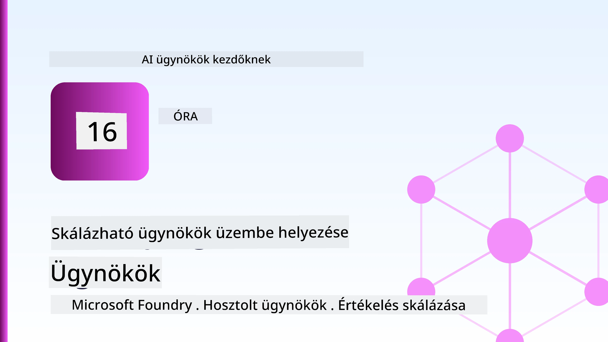
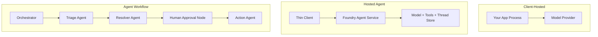
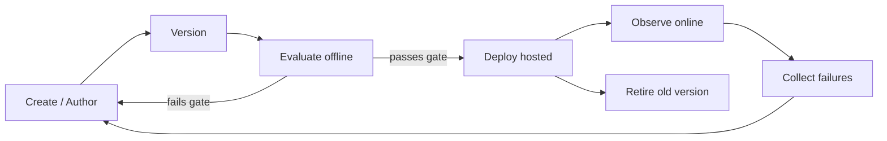
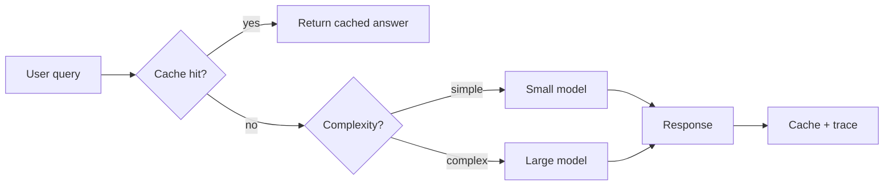
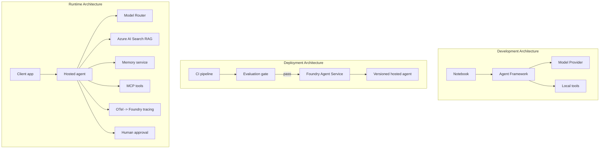

# Skálázható ügynökök telepítése a Microsoft Foundryval



Eddig a tanfolyamon olyan ügynököket építettél, amelyek a laptopodon futnak, egy jegyzetfüzeten belül, `az login` és néhány környezeti változó vezérlésével. Pontosan ez a helyes mód a tanulásra. Ez azonban nem a helyes mód arra, hogy egy, több ezer ügyféltől függő ügynököt működtess 3 órakor hajnalban.

Ez a lecke arról szól, hogy milyen szakadék van az „az én gépemen működik” és az „ez megbízhatóan és megfizethetően működik éles környezetben” között. Ezt a szakadékot a **Microsoft Foundry** és a **Microsoft Foundry Agent Service** segítségével hidaljuk át, méghozzá egy valódi ügyféltámogatási ügynök felépítésével, amely eszközökkel, visszakereséssel, memóriával, értékeléssel és monitorozással rendelkezik.

## Bevezetés

Ez a lecke a következőket fogja lefedni:

- A **prototípus ügynök** és a **telepített ügynök** közötti különbséget, és hogy a váltás főként a modell körüli *minden másról* szól.
- Ügynökök **telepítési mintáit**: kliens által hosztolt, szolgáltatás által hosztolt (Hosted Agents), és munkafolyamat-orchestrált.
- Az **ügynök életciklusát** a Microsoft Foundryban — létrehozás, verziózás, telepítés, értékelés, megfigyelés, megszüntetés.
- **Skálázási stratégiák**: modellirányítás, gyorsítótárazás, egyidejűség és állapotmentes dizájn.
- **Megfigyelhetőség** OpenTelemetry-vel és Foundry-tracinggel.
- **Költségoptimalizálás** modellválasztással, irányítással és értékelési kapukkal.
- **Vállalati szempontok**: irányítás, emberi jóváhagyás, és MCP szerverek biztonságos futtatása éles környezetben.

## Tanulási célok

A lecke elvégzése után tudni fogod, hogyan:

- Válassz megfelelő telepítési mintát egy adott ügynök munkaterheléshez.
- Telepíts egy ügynököt a Microsoft Foundry Agent Service-re úgy, hogy verziózott, irányított és megfigyelhető legyen.
- Ösztönözz egy ügynököt tracingre és kapcsolj be egy értékelési folyamatot, amely minden kiadás előtt lefut.
- Alkalmazz modellirányítást és gyorsítótárazást a késleltetés és költség alacsonyan tartásához skálázás esetén.
- Adj hozzá emberi jóváhagyási kaput magas kockázatú műveleteknél, és integrálj MCP szervert biztonságos éles üzemmódban.

## Előfeltételek

Feltételezzük, hogy az előző leckék elvégzése után jártas vagy:

- Ügynökök építése a [Microsoft Agent Framework](../14-microsoft-agent-framework/README.md) segítségével (14. lecke).
- [Eszközhasználat](../04-tool-use/README.md) (4. lecke) és [Agentic RAG](../05-agentic-rag/README.md) (5. lecke).
- [Ügynök memória](../13-agent-memory/README.md) (13. lecke) és [Agentic Protokollok / MCP](../11-agentic-protocols/README.md) (11. lecke).
- [Megfigyelhetőség és értékelés](../10-ai-agents-production/README.md) (10. lecke) — erre a leckére épít közvetlenül.

Szükséged lesz továbbá:

- Egy **Azure előfizetésre** és egy **Microsoft Foundry projektre**, amely legalább egy telepített csevegő modellt tartalmaz.
- Az **Azure CLI** hitelesítésre (`az login`).
- Python 3.12+-ra és az adattárban lévő csomagokra [`requirements.txt`](../../../requirements.txt).

## Prototípusról a termelésre: mi változik valójában

Egy prototípus ügynök és egy éles ügynök ugyanazt az alapvető ciklust használja — problémamegoldás, eszközök hívása, válaszadás. Ami változik, az a ciklus köré csomagolt minden más. A modell talán a termelési ügynök 20%-a; a másik 80% az operációs váz.

| Szempont | Prototípus | Termelés |
| --- | --- | --- |
| **Hosztolás** | A jegyzetfüzetedben fut | Szolgáltatásként fut, verziózott és kiterjesztett |
| **Azonosítás** | A te `az login` tokened | Kezelt azonosítás, scoped RBAC-kal |
| **Állapot** | Memóriában, újraindításkor elveszik | Külső tárolású (szál tároló, memória szolgáltatás) |
| **Hiba** | Látod a tracebacket | Újrapróbálkozás, visszaesés, dead-letter, riasztás |
| **Költség** | "Pár cent" | Kérésenként követett, irányított, gyorsítótárazott, költségvetett |
| **Minőség** | Kézzel átnézett kimenet | Automatikusan értékelt minden kiadás előtt |
| **Bizalom** | Minden műveletet jóváhagysz | Szabályzat + emberi jóváhagyás kockázatos műveletekhez |

Tartsd szem előtt ezt a táblázatot. Az alábbi szakaszok mindegyike ezek közül az egyiket térképezi fel.

## Ügynök telepítési minták

Három mintát fogsz használni, gyakran kombinálva.

### 1. Kliens által hosztolt ügynökök

Az ügynök objektum *a te* alkalmazásfolyamatodban él. A kódod közvetlenül hívja a modell szolgáltatót; a problémamegoldó ciklus a szolgáltatásodban fut. Ezt használtuk minden korábbi leckében.

- **Használd akkor, ha** teljes ellenőrzésre van szükséged a ciklus fölött, egyedi middleware-re, vagy az ügynököt egy meglévő backendbe ágyazod.
- **Hátrány**: az skálázásról, állapotról és ellenállóságról neked kell gondoskodnod.

### 2. Hosztolt ügynökök (Foundry Agent Service)

Az ügynök *erőforrásként van regisztrálva* a Microsoft Foundryban. A Foundry hosztolja a problémamegoldó ciklust, tárolja a szálakat, érvényesíti a tartalombiztonságot és RBAC-ot, és láthatóvá teszi az ügynököt a Foundry portálon. Az alkalmazásod vékony klienssé válik, amely szálakat hoz létre és olvassa a válaszokat.

- **Használd akkor, ha** tartósságot, beépített megfigyelhetőséget, irányítást és kisebb operációs felületet szeretnél.
- **Hátrány**: kevesebb alacsony szintű kontroll a menedzselt futtatókörnyezetért cserébe.

### 3. Ügynök munkafolyamatok

Több ügynököt (és eszközt) komponálnak egy gráffá explicit vezérlési folyamattal — szekvenciális lépések, elágazások, emberi jóváhagyási pontok és tartós ellenőrző pontok, amelyek megállíthatók és folytathatók. Ez a Microsoft Agent Framework **Workflows** képessége telepítési skálán alkalmazva.

- **Használd akkor, ha** egy feladat több specializált ügynököt igényel vagy jóváhagyási lépést a közepén.
- **Hátrány**: több mozgó rész, szükség van orchestrációs szintű megfigyelhetőségre.



## Az ügynök életciklusa a Microsoft Foundryban

Az ügynök telepítése nem egyszeri `push`. Ez egy ciklus, és nagyon hasonlít a szoftver kiadási ciklusára, mert pontosan az.



A kulcsötlet, amely az [10. leckéből](../10-ai-agents-production/README.md) származik: **az offline értékelés kapu, nem utólagos gondolat.** Egy új ügynök verzió nem kerül szállításra, hacsak nem teljesíti az értékelési küszöböket. Az online megfigyelhetőség pedig visszacsatolja a valós világban történt hibákat az offline tesztkészletedbe. Ez az egész ciklus.

## Skálázási stratégiák

Az ügynök skálázása különbözik egy állapotmentes web API skálázásától, mert minden kérés több drága modell- és eszközhívást indíthat. Négy technika viszi a terhelés nagy részét.

**Állapotmentes kéréskezelés.** Ne tárolj felhasználónkénti állapotot a folyamatod memóriájában. Tárold a beszélgetési szálakat a Foundry száltárolójában vagy memória szolgáltatásban, hogy bármelyik példány kezelni tudjon bármelyik kérést. Ez teszi lehetővé a vízszintes skálázást — példányok hozzáadása, ragadós munkamenetek nélkül.

**Modellirányítás.** Nem minden kérésnek kell a legerősebb (és legdrágább) modell. Egyszerű kéréseket — szándékosztályozás, rövid tényszerű válaszok — irányíts kis, gyors modellhez, és hagyd a nagy modellt az igazi érvelésre. A Foundry **Model Router** ezt megteszi helyetted, vagy te is csinálhatsz egy könnyű osztályozót. A DIY verziót a laborban építed meg.

**Válasz gyorsítótárazás.** Sok támogatási kérdés közel azonos („hogyan állíthatom vissza a jelszavam?”). Gyorsítótárazd a gyakori kérdések válaszait, és szolgáld ki anélkül, hogy elérnéd a modellt. Még egy szerény cache találati arány is jelentősen csökkenti a költséget és a késleltetést.

**Egyidejűség és vissznyomás.** A modellszolgáltatóknak sebességkorlátozásaik vannak. Korlátozd az egyidejűséget, használj exponenciális visszakísérletezést, és hibakezelj szépen (egy sorban álló „dolgozunk rajta” válasz jobb egy 500-nál).



## Megfigyelhetőség éles környezetben

Amit nem látsz, azt nem tudod működtetni. Ahogy a 10. leckében tárgyaltuk, a Microsoft Agent Framework natívan ad ki **OpenTelemetry** trace-eket — minden modellhívás, eszközmeghívás és orkesztrációs lépés egy span lesz. Élesben ezek a span-ek kiexportálhatók Microsoft Foundryba (vagy bármely OTel-kompatibilis háttérbe), hogy:

- Egyetlen ügyfélpanaszt végigkövess modell- és eszközmeghívásokon keresztül.
- Idővel nyomon kövesd a p50/p95 késleltetést és költséget kérésenként.
- Hibaarány csúcsokat és költséganomáliákat jelezz a felhasználók (vagy a pénzügyi csapat) előtt.

```python
from agent_framework.observability import get_tracer

tracer = get_tracer()

with tracer.start_as_current_span("support_request") as span:
    span.set_attribute("customer.tier", "enterprise")
    span.set_attribute("routed.model", "gpt-5-nano")
    # agent execution is traced automatically inside this span
```

Az olyan attribútumok, mint a `customer.tier` és a `routed.model`, azok, amelyek egy falnyi trace-et feleletre váró kérdésekké alakítanak („a vállalati ügyfeleket túl gyakran irányítja a rendszer a kis modellhez?”).

## Költségoptimalizálás

A költség a termelési ügynököknél leginkább a tokenekből adódik. Három befolyásoló faktor, fontossági sorrendben:

1. **Megfelelő méretű modell.** Egy kis modell, amely átmegy az értékelési kapun, szinte mindig olcsóbb, mint egy nagy modell, amely szintén átmegy. Használd az értékelést arra, hogy *bizonyítsd*, hogy a kis modell elég jó, ahelyett, hogy alapból a legnagyobb modellt választanád biztonsági okokból.
2. **Irányítás összetettség alapján.** Ahogy korábban — csak azoknak a kéréseknek fizess nagy modelles árakat, amelyek ténylegesen nagy modelles érvelést igényelnek.
3. **Erőteljes gyorsítótárazás.** A legolcsóbb modellhívás az, amit sosem csinálsz meg.

Az értékelési kapuk és költségkontroll ugyanannak a fegyelemnek két oldala: az értékelés megmondja a *minőségi alsó határt*, az irányítás és gyorsítótárazás pedig a költséget tartja olyan közel ehhez az alsó határhoz, amennyire csak lehet.

## Vállalati telepítési szempontok

**Irányítás.** A Hosted Agents örökli a Foundry RBAC-ját, tartalombiztonságát és audit naplózását. Adj minden ügynöknek olyan kezelt identitást, amely a szükséges minimális jogosultságokkal rendelkezik — csak olvasási jogosultság a tudásbázishoz, korlátozott hozzáférés a jegyrendszer API-hoz, semmi több.

**Ember a folyamatban.** Bizonyos műveletek túl kockázatosak az automatikus végrehajtáshoz — visszatérítés kiadása, fiók törlése, jogi csapat bevonása. A Microsoft Agent Framework támogatja az **jóváhagyást igénylő** eszközöket: az ügynök javasolja a műveletet, a végrehajtás szünetel, egy ember jóváhagyja vagy elutasítja, majd a munkafolyamat folytatódik. Ezt a primitívet már láttad a [6. leckében](../06-building-trustworthy-agents/README.md); itt telepíted.

**MCP élesben.** Az [MCP](../11-agentic-protocols/README.md) lehetővé teszi, hogy az ügynök külső eszközöket használjon szabványos interfészen keresztül. Éles környezetben minden MCP szervert megbízhatatlan határként kezelj: rögzítsd a szerver verzióját, futtasd scoped identitással, ellenőrizd az outputokat, és soha ne adj ki neki titkokat. Egy MCP szerver függőség, a függőségeket pedig javítják, auditálják és korlátozzák.



Ezek a három diagram — fejlesztés, telepítés, futási idő — ugyanaz az ügynök a három életszakaszában. A következő labor segít megépíteni ezt.

## Gyakorlati labor: Egy éles környezetre kész ügyféltámogatási ügynök

Nyisd meg a [`code_samples/16-python-agent-framework.ipynb`](./code_samples/16-python-agent-framework.ipynb) fájlt, és haladj végig rajta teljesen. Összeállítasz egy **Contoso ügyféltámogatási ügynököt**, amibe a termelési szempontok mindegyike be van kötve:

1. **Eszköz hívás** — rendelés állapotának lekérdezése és támogatási jegyek megnyitása.
2. **RAG** — irányelvekre adott válaszok tudásbázisból (Azure AI Search, memóriában lévő visszaeséssel, hogy a jegyzetfüzet Search erőforrás nélkül fusson).
3. **Memória** — megjegyzi az ügyfelet a beszélgetés fordulói között.
4. **Modellirányítás** — egy összetettségi osztályozó minden kérést kis vagy nagy modellhez irányít.
5. **Válasz gyorsítótárazás** — ismétlődő kérdéseket gyorsítótárból szolgál ki.
6. **Emberi jóváhagyás** — küszöbérték feletti visszatérítések emberi jóváhagyásra várnak.
7. **Értékelési folyamat** — egy kis offline tesztkészlet pontozza az ügynököt és kiadási kapuként működik.
8. **Megfigyelhetőség** — OpenTelemetry trace minden kérés körül.

### Áttekintés

A jegyzetfüzet úgy van felépítve, hogy minden termelési szempont önálló, futtatható szakasz legyen. A lényege a routing-plus-caching kéréskezelő:

```python
async def handle_support_request(query: str, customer_id: str) -> str:
    # 1. Serve from cache when we can.
    cached = response_cache.get(normalize(query))
    if cached:
        return cached

    # 2. Route by complexity to control cost.
    model = "gpt-5-nano" if is_simple(query) else "gpt-5-mini"

    # 3. Run the agent inside a trace span for observability.
    with tracer.start_as_current_span("support_request") as span:
        span.set_attribute("routed.model", model)
        span.set_attribute("customer.id", customer_id)
        response = await support_agent.run(query, model=model)

    # 4. Cache and return.
    response_cache.set(normalize(query), response.text)
    return response.text
```

A kiadást védő értékelési kapu így néz ki:

```python
async def evaluation_gate(agent, test_cases, threshold: float = 0.8) -> bool:
    passed = 0
    for case in test_cases:
        result = await agent.run(case["input"])
        if score_response(result.text, case["expected"]) >= 0.8:
            passed += 1
    pass_rate = passed / len(test_cases)
    print(f"Evaluation pass rate: {pass_rate:.0%} (gate: {threshold:.0%})")
    return pass_rate >= threshold  # only deploy if the gate passes
```

Olvass el minden sort — a jegyzetfüzet szándékosan tartja kicsire a primitíveket, hogy semmi ne legyen elrejtve egy framework-hívás mögött.

## Telepített ügynök érvényesítése füst tesztekkel

A fenti értékelési kapu *offline* lefut az ügynök objektumon. Amint az ügynök Hosted Agent-ként telepítve van, egy további, még olcsóbb ellenőrzésre van szükség: **a telepített végpont tényleg válaszol-e?**

A „sikeres” telepítés csak azt bizonyítja, hogy a vezérlési sík elfogadta a definíciót — nem bizonyítja, hogy az ügynök válaszol. Egy hiányzó függőség, rossz modellirányítás vagy lejárt kapcsolat zöld telepítést eredményezhet, amely semmit sem ad vissza. Egy **füst teszt** ezt másodpercek alatt elkapja, minden telepítésnél, anélkül, hogy a teljes értékelést költségeznéd.

Ez a tárház egy készen álló füstmérési csővezetéket tartalmaz, amely az [AI Smoke Test](https://github.com/marketplace/actions/ai-smoke-test) GitHub Action alapjaira épül:

- **Katalógus** — [`tests/lesson-16-smoke-tests.json`](../../../tests/lesson-16-smoke-tests.json) tartalmaz promptokat és igazolásokat a Contoso ügyféltámogatási ügynökhöz (megalapozott szabályzati válaszok, rendelés lekérdezés, témakövetés és többfordulós beszélgetési folytonosság). Más leckék ügynökeinek katalógusai ezzel együtt élnek — lásd [`tests/README.md`](../tests/README.md).
- **Munkafolyamat** — [`.github/workflows/smoke-test.yml`](../../../.github/workflows/smoke-test.yml) Azure OIDC-vel jelentkezik be és POST-olja az összes promptot az ügynök válasz végpontjára, meghibásodás esetén a feladatot elutasítva.

```yaml
- name: Smoke-test hosted agent
  uses: JFolberth/ai-smoketest@v1
  with:
    project_endpoint: ${{ inputs.project_endpoint }}
    agent_name: ContosoSupportAgent
    tests_file: tests/lesson-16-smoke-tests.json
```

Futtassa az **Actions** fülről, miután az ügynök telepítve lett, megadva a Foundry projekt végpontját és az ügynök nevét. A szövetséges identitásnak a **Azure AI User** szerepre van szüksége a Foundry projekt hatókörében. Gondoljon a rétegekre úgy, mint egy piramisra: a füstpróbák (elérhető és válaszol?) minden telepítéskor futnak, az offline értékelés (elég jó a kiadásra?) a promóció előtt, az online értékelés (hogyan teljesít a valós környezetben?) folyamatosan fut.

## Tudásellenőrzés

Tesztelje megértését, mielőtt továbblép a feladatra.

**1. Körülbelül mennyi egy éles ügynök „modell”, és mi a maradék?**

<details>
<summary>Válasz</summary>

A modell a rendszer kisebb része — gyakran kb. 20%-nak tekintik. A maradék az operatív váz: hosztolás és verziókezelés, azonosítás és RBAC, külső állapot, hibakezelés, költségkövetés, értékelés és emberi beavatkozás. A produção-ba lépés főként arról szól, hogy mindent a gondolkodási ciklus *köré* építsen.
</details>

**2. Mikor választaná a Hosted Agent-et egy kliens által hosztolt ügynök helyett?**

<details>
<summary>Válasz</summary>

Amikor egy menedzselt futtatókörnyezetet akar beépített tartóssággal (folytonos és visszaállítható szálak), megfigyelhetőséggel, tartalombiztonsággal és RBAC-kal, és hajlandó feláldozni a gondolkodási ciklus alacsony szintű irányításának egy részét a kisebb operatív felületért. A kliens által hosztolt ügynök előnyösebb, ha teljes irányítás kell a ciklus felett, vagy ha az ügynök egy meglévő háttérrendszerbe van beágyazva.
</details>

**3. Miért kell egy skálázható ügynöknek állapotmentesnek lennie a saját folyamat memóriájában?**

<details>
<summary>Válasz</summary>

Hogy bármelyik példány tudjon bármilyen kérést kezelni, ami lehetővé teszi a vízszintes skálázást ragadós munkamenetek nélkül. A felhasználónkénti beszélgetési állapot külső tárolóba vagy memóriaszolgáltatásba kerül. Ha az állapot a folyamat memóriájában lenne, elveszne újraindításnál, és nem lehetne szabadon elosztani a terhelést.
</details>

**4. Milyen problémát old meg a modell irányítás, és hogyan kapcsolódik az értékeléshez?**

<details>
<summary>Válasz</summary>

Az irányítás egyszerű kéréseket egy kis, olcsó, gyors modellhez küld, és a nagy modellt a valódi érvelésre tartja fenn, így kontrollálja a késleltetést és a költséget. Kapcsolódik az értékeléshez, mert az értékelés bizonyítja, hogy a kis modell elegendő egy adott kéréskategóriára — az értékelés nélküli irányítás csak találgatás.
</details>

**5. Mi az az „értékelési kapu”, és hol helyezkedik el az életciklusban?**

<details>
<summary>Válasz</summary>

Egy értékelési kapu új ügynök verzióra offline teszthalmazt futtat, és blokkolja a telepítést, ha a sikerességi arány nem éri el a küszöböt. Az életciklusban a „verzió” és a „telepítés” között helyezkedik el, így a minőség előfeltétele a kiadásnak, nem pedig utólagos ellenőrzés.
</details>

**6. Miért kell az MCP szervert megbízhatatlan határként kezelni éles környezetben?**

<details>
<summary>Válasz</summary>

Mert egy külső függőség, amit az ügynök hív meg. Rögzíteni kell a verzióját, scoped identitással futtatni, érvényesíteni a kimeneteit, korlátozni a kihasználhatóságát, és soha nem szabad neki titkokat átadni — ugyanaz a fegyelem kell, mint bármely harmadik fél függőségnél. Kimenetei befolyásolják az ügynök érvelését, így az érvénytelenített bizalom biztonsági kockázat.
</details>

**7. Melyik egyetlen változtatás szokta leginkább befolyásolni az éles ügynök költségét és miért?**

<details>
<summary>Válasz</summary>

A modell méretezése — a legkisebb olyan modellt használni, amely még átmegy az értékelési kapun. A költség a tokenekből adódik, és egy kisebb, az elvárt minőséget teljesítő modell majdnem mindig olcsóbb, mint a nagyobb. A gyorsítótárazás és az irányítás tovább csökkenti a költségeket, de a megfelelő alapmodell választása a legnagyobb elsődleges hatás.
</details>

**8. Milyen szerepet töltenek be olyan span attribútumok, mint `customer.tier` és `routed.model` a megfigyelhetőségben?**

<details>
<summary>Válasz</summary>

Nyers trace-ekből választható üzleti kérdéseket készítenek. Attribútumok nélkül csak egy span fal; velük meg lehet kérdezni, hogy „a vállalati ügyfeleket túl gyakran irányítják a kicsi modellhez?” vagy „melyik modell kezeli a leglassabb kéréseinket?” Az attribútumokkal szeletelhető a telemetria az üzemeltetés szempontjából fontos dimenziók szerint.
</details>

## Feladat

Vegye a laborból a ügyfélszolgálati ügynököt és erősítse meg egy konkrét szcenárióra: **egy SaaS cég előfizetéses számlázási ügyfélszolgálati ügynök.**

A beadásnak tartalmaznia kell:

1. **Cserélje le az eszközöket** számlázási relevánsakra: `get_subscription_status`, `get_invoice` és `issue_credit` (50 dollár fölötti jóváírások emberi jóváhagyást igényelnek).
2. **Adjon hozzá három RAG dokumentumot** a cég visszatérítési politikájáról, számlázási ciklusáról és lemondási szabályzatáról.
3. **Bővítse az értékelési készletet** legalább nyolc esetre, amelyek közül legalább kettőnek *kell* emberi jóváhagyást kiváltania, és erősítse meg, hogy az értékelési kapu helyesen enged vagy tilt.
4. **Adj hozzá egy költségjelentést**: tíz vegyes lekérdezés lefuttatása után nyomtassa ki, hány ment a kis modellhez, hány a nagy modellhez, és hányt szolgáltak ki gyorsítótárból.

Írjon egy rövid bekezdést (markdown cellában), amely elmagyarázza, mely modell-irányítási szabályt választotta, és hogyan validálná azt valódi forgalommal. Nincs egyetlen helyes válasz – az értékelés alapján vizsgálják, hogy az éles környezet aggodalmai koherensen vannak-e összekapcsolva.

## Összegzés

Ebben a leckében egy ügynököt prototípusról átvezettél az éles környezetbe Microsoft Foundry-val:

- Az élesítés főként a modell köré épülő **operatív váznál** van — hosztolás, azonosítás, állapot, hibakezelés, költség, minőség és bizalom.
- Megismerted a három **telepítési mintát** — kliens felől hosztolt, Hosted Agent, és Agent Workflow — és hogy melyik mikor illik.
- Végigmentél az **ügynök életciklusán**, ahol az offline **értékelés kiadási kapuként működik**, és az online megfigyelhetőség visszacsatolja a hibákat a teszthalmazba.
- Alkalmaztad a **skálázási stratégiákat** — állapotmentes kialakítás, modell irányítás, gyorsítótárazás, és korlátozott párhuzamosság — és összekapcsoltad a **költségoptimalizálással**.
- Beépítetted a **vállalati vezérléseket**: RBAC, emberi jóváhagyás a beavatkozásban, és éles MCP integráció.
- Építettél egy **élesre kész ügyfélszolgálati ügynököt**, amely mindezeket az aggodalmakat futtatható kódba köti össze.

A következő lecke az ellentétes utat járja: ahelyett, hogy ügynököket skálázna fel a felhőbe, egyetlen fejlesztői gépre viszi őket és teljesen helyben futtatja.

## További források

- <a href="https://learn.microsoft.com/azure/ai-foundry/what-is-azure-ai-foundry" target="_blank">Microsoft Foundry dokumentáció</a>
- <a href="https://learn.microsoft.com/azure/ai-foundry/agents/overview" target="_blank">Microsoft Foundry Agent Service áttekintés</a>
- <a href="https://learn.microsoft.com/en-us/agent-framework/overview/?wt.mc_id=youtube_26688_organicsocial_reactor&pivots=programming-language-python" target="_blank">Microsoft Agent Framework</a>
- <a href="https://learn.microsoft.com/en-us/azure/ai-foundry/openai/concepts/model-router" target="_blank">Model Router a Microsoft Foundry-ban</a>
- <a href="https://learn.microsoft.com/azure/search/search-what-is-azure-search" target="_blank">Azure AI Search</a>
- <a href="https://opentelemetry.io/" target="_blank">OpenTelemetry</a>
- <a href="https://github.com/marketplace/actions/ai-smoke-test" target="_blank">AI Smoke Test GitHub Action</a>
- <a href="https://modelcontextprotocol.io/" target="_blank">Model Context Protocol (MCP)</a>

## Előző lecke

[Számítógép-használati ügyfélszolgálati ügynökök (CUA)](../15-browser-use/README.md)

## Következő lecke

[Helyi AI ügynökök létrehozása](../17-creating-local-ai-agents/README.md)

---

<!-- CO-OP TRANSLATOR DISCLAIMER START -->
**Jogi nyilatkozat**:
Ez a dokumentum az AI fordítási szolgáltatás, a [Co-op Translator](https://github.com/Azure/co-op-translator) segítségével készült. Bár az pontosságra törekszünk, kérjük, vegye figyelembe, hogy az automatikus fordítások hibákat vagy pontatlanságokat tartalmazhatnak. Az eredeti dokumentum az anyanyelvén tekintendő hiteles forrásnak. Fontos információk esetén professzionális emberi fordítást javasolunk. Nem vállalunk felelősséget semmilyen félreértésért vagy téves értelmezésért, amely ebből a fordításból ered.
<!-- CO-OP TRANSLATOR DISCLAIMER END -->