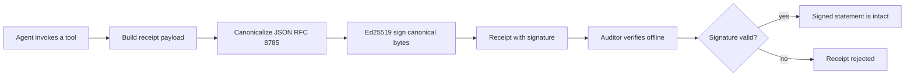
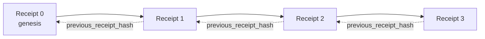

[Nézze meg az oktatóvideót: AI ügynökök biztosítása kriptográfiai bizonylatokkal](https://youtu.be/PLACEHOLDER_VIDEO_ID)

> _(Az oktatóvideót és a bélyegképet a Microsoft tartalomcsapata adja hozzá az összeolvasztás után, az oktatás 14/15 mintájához igazodva.)_

# AI ügynökök biztosítása kriptográfiai bizonylatokkal

## Bevezetés

Ez az oktatás a következőkről fog szólni:

- Miért számítanak az audit nyomvonalak az AI ügynökök esetében a megfelelés, hibakeresés és bizalom szempontjából.
- Mi az a kriptográfiai bizonylat, és miben különbözik egy aláíratlan naplóbejegyzéstől.
- Hogyan lehet egyszerű Pythonban aláírt bizonylatot készíteni egy ügynök eszközhívásához.
- Hogyan lehet offline ellenőrizni egy bizonylatot észlelve az esetleges manipulációt.
- Hogyan lehet láncolni a bizonylatokat úgy, hogy egy eltávolítás vagy átrendezés megszakítsa a láncot.
- Mit bizonyítanak a bizonylatok, és mit NEM bizonyítanak kifejezetten.

## Tanulási célok

Az oktatás elvégzése után tudni fogja, hogyan:

- Azonosítani azokat a hibamódokat, amelyek az ügynöki cselekvések kriptográfiai hitelességét indokolják.
- Előállítani egy Ed25519-gyel aláírt bizonylatot egy kanonikus JSON adattartalomról.
- Függetlenül ellenőrizni egy bizonylatot csak az aláíró nyilvános kulcsával.
- Észlelni a manipulációt azzal, hogy módosított bizonylaton újra lefuttatja az ellenőrzést.
- Építeni egy hash láncolt bizonylatsorozatot és elmagyarázni, miért fontos a lánc.
- Felismerni a határvonalat azzal kapcsolatban, hogy mit bizonyítanak a bizonylatok (hozzárendelés, integritás, sorrendiség), és mit nem (a cselekvés helyessége, a szabályzat érvényessége).

## A probléma: az ügynök audit nyomvonala

Tegyük fel, hogy telepítettél egy AI ügynököt a Contoso Travel számára. Az ügynök olvassa az ügyfelek kéréseit, hív egy járat-API-t az opciók kereséséhez, és foglal helyeket az ügyfél nevében. Múlt negyedévben az ügynök 50 000 foglalást dolgozott fel.

Ma megjelenik egy auditor. Egy egyszerű kérdést tesz fel: „Mutasd meg, mit csinált az ügynököd.”

Átadod a naplófájlokat. Az auditor megnézi őket, és felteszi a nehezebb kérdést: „Honnan tudhatom, hogy ezeket a naplókat nem szerkesztették meg?”

Ez az audit nyomvonal problémája. A legtöbb mai ügynök bevezetés a következőkre támaszkodik:

- **Alkalmazás naplók**: az ügynök által írt, bárki által módosítható, aki hozzáfér a fájlrendszerhez.
- **Felhő alapú naplózási szolgáltatások**: a platform szintjén biztonságosak, de csak ha az auditor megbízik a platform üzemeltetőjében.
- **Adatbázis tranzakciós naplók**: jól alkalmasak adatbázis változásokhoz, de nem tetszőleges eszközhívásokhoz.

Ezek közül egyik sem tudja megválaszolni az auditor kérdését anélkül, hogy az auditor valakiben (parent, felhőszolgáltatója, adatbázis szolgáltatója) megbízzon. Belső használatra ez gyakran elfogadható. Szabályozott feladatokhoz (pénzügy, egészségügy, bármi az EU AI rendelet hatálya alá tartozó) nem az.

A kriptográfiai bizonylatok ezt a problémát úgy szűkítik le, hogy egy aláírt állítást függetlenül
ellenőrizhetővé tesznek. Az auditor azonban továbbra is kívülről jövő okot igényel az aláíró kulcs és
a bizonylatot előállító komponens megbízhatóságának elfogadására. A beágyazott kulcs önmagában az önkonszisztenciát igazolja,
nem az kibocsátó személyazonosságát vagy az érvényesítés helyét.

## Mi az a kriptográfiai bizonylat?

Egy bizonylat egy JSON objektum, amely rögzíti, mit csinált az ügynök, digitális aláírással ellátva.



Egy minimális bizonylat így néz ki:

```json
{
  "type": "agent.tool_call.v1",
  "agent_id": "contoso-travel-bot",
  "tool_name": "lookup_flights",
  "tool_args_hash": "sha256:a3f9c1...",
  "result_hash": "sha256:7b2e1d...",
  "policy_id": "contoso-travel-policy-v3",
  "timestamp": "2026-04-25T14:30:00Z",
  "sequence": 47,
  "previous_receipt_hash": "sha256:9d4e6a...",
  "signature": {
    "alg": "EdDSA",
    "sig": "c5af83...",
    "public_key": "8f3b2c..."
  }
}
```

Három tulajdonság végzi a munkát:

1. **Az aláírás**. A bizonylatot az ügynök átjárója írja alá Ed25519 privát kulccsal. Bárki, aki rendelkezik a megfelelő nyilvános kulccsal, offline ellenőrizheti az aláírást. A megbízó félnek le kell tennie ezt a kulcsot vagy megbízható nyilvántartásból kell lekérnie azt a bizonylaton kívül. Bármely aláírt mező manipulálása érvénytelenné teszi az aláírást.

2. **Kanonikus kódolás**. Aláírás előtt a bizonylatot a JSON Canonicalization Scheme (JCS, RFC 8785) formátumban szerializáljuk. Ez biztosítja, hogy két különböző megvalósítás, amely ugyanazt a logikai bizonylatot állítja elő, bájtsorozat szintjén azonos kimenetet eredményezzen. Kanonizálás nélkül a különböző JSON sorosítók eltérő aláírásokat állítanának elő ugyanarra a tartalomra.

3. **Hash láncolás**. Az `previous_receipt_hash` mező összekapcsolja az aktuális bizonylatot az előzővel. Egy bizonylat eltávolítása vagy átrendezése megszakítja a bemutatott sorozatot. A lekicsinyítés vagy az aláíró által kontrollált átírás észleléséhez szükség van egy rögzített aktuális láncfejre, függetlenül tanúsított ellenőrzőpontra vagy hitelesített zárt populációs kötelezettségvállalásra.

Együttesen ezek a tulajdonságok három garanciát nyújtanak:

- **Kulcshoz rendelés**: ez a kulcs írta alá ezt a tartalmat. Szervezeti vagy emberi identitás igazolásához megbízható kulcskötés szükséges.
- **Integritás**: a tartalom az aláírás óta nem változott.
- **Sorrendiség az ellenőrzött sorozatban**: ez a bizonylat kapcsolatban áll az előddel.

## Bizonylat előállítása Pythonban

Nem kell külön könyvtár a bizonylat előállításához. A kriptográfiai primitívek széles körben elérhetők, a logika néhány tucat sor Python.

A gyakorlati feladatok a `code_samples/18-signed-receipts.ipynb` végigvezetik a teljes folyamatot. A verziókövetett `code_samples/18-signed-receipts.execution-receipt.json` rögzíti a pontos jegyzetfüzet-hash-t, Python környezetet, cellaszámot és ellenőrzéseket a legutóbbi tiszta futtatásból anélkül, hogy megváltoztatná az óra mentett kimeneteit. A rövidített változat:

```python
import json
import hashlib
import base64
from nacl import signing
from jcs import canonicalize  # RFC 8785 canonical JSON

def b64url_nopad(data: bytes) -> str:
    return base64.urlsafe_b64encode(data).decode("ascii").rstrip("=")

def sha256_canonical(obj) -> str:
    """SHA-256 of a Python object's JCS-canonical JSON form."""
    return f"sha256:{hashlib.sha256(canonicalize(obj)).hexdigest()}"

# Generate or load a signing key (in production, store in a key vault)
signing_key = signing.SigningKey.generate()
verify_key = signing_key.verify_key
TRUSTED_PUBLIC_KEYS = {b64url_nopad(bytes(verify_key))}  # pinned out of band by the verifier

# Build the receipt payload (no signature yet)
tool_args = {"origin": "SYD", "destination": "LAX"}
tool_result = [{"flight": "QF11", "price": 1850, "stops": 0}]

payload = {
    "type": "agent.tool_call.v1",
    "agent_id": "contoso-travel-bot",
    "tool_name": "lookup_flights",
    "tool_args_hash": sha256_canonical(tool_args),
    "result_hash": sha256_canonical(tool_result),
    "policy_id": "contoso-travel-policy-v3",
    "timestamp": "2026-04-25T14:30:00Z",
    "sequence": 0,
    "previous_receipt_hash": None,
}

# Canonicalize and sign the JCS bytes directly. PureEdDSA hashes internally.
canonical_bytes = canonicalize(payload)
signature_bytes = signing_key.sign(canonical_bytes).signature

# Attach a structured signature object.
receipt = {
    **payload,
    "signature": {
        "alg": "EdDSA",
        "sig": b64url_nopad(signature_bytes),
        "public_key": b64url_nopad(bytes(verify_key)),
    },
}
```

Ez az egész aláírási folyamat. A jegyzetfüzet feladatai lépésről lépésre végigvezetnek.

## Bizonylat ellenőrzése és manipuláció észlelése

Az ellenőrzés a fordított művelet:

```python
import base64
import hashlib
from nacl import signing
from nacl.exceptions import CryptoError
from jcs import canonicalize

def b64url_decode(s: str) -> bytes:
    padding = "=" * ((4 - len(s) % 4) % 4)
    return base64.b64decode(s + padding, altchars=b"-_", validate=True)

def verify_receipt(receipt: dict, trusted_public_keys: set[str]) -> bool:
    # The signature is a structured object: {"alg", "sig", "public_key"}.
    if not isinstance(receipt, dict):
        return False
    sig_obj = receipt.get("signature")
    if not isinstance(sig_obj, dict) or sig_obj.get("alg") != "EdDSA":
        return False
    try:
        # An inline key proves only self-consistency. Trust is configured out of band.
        public_key = sig_obj.get("public_key")
        signature = sig_obj.get("sig")
        if not isinstance(public_key, str) or not isinstance(signature, str):
            return False
        if public_key not in trusted_public_keys:
            return False
        payload = {k: v for k, v in receipt.items() if k != "signature"}
        canonical_bytes = canonicalize(payload)
        verify_key = signing.VerifyKey(b64url_decode(public_key))
        verify_key.verify(canonical_bytes, b64url_decode(signature))
        return True
    except (CryptoError, TypeError, ValueError, KeyError, OverflowError):
        return False
```

Ez a függvény fogad egy bizonylatot és a megbízó fél rögzített kulcskészletét, és visszaad
`True`-at, csak ha az aláírás elfogadott kulcs esetén érvényes. Az ellenőrzés nem igényel
hálózati hívást, de a kulcs megbízhatósága továbbra is külső konfigurációs döntés.

A manipuláció észlelésének bemutatásához a jegyzetfüzet végigvezeti:

1. Érvényes bizonylat előállítása és ellenőrzésének megerősítése.
2. Az `tool_args_hash` mező egy bájtjának módosítása.
3. Az ellenőrzés újrafuttatása és sikertelenségének megfigyelése.

Ez a gyakorlati bemutató, hogy a bizonylatok manipuláció-ellenállók: bármilyen módosítás, bármilyen kicsi, megszakítja az aláírást.

## Bizonylatok láncolása többlépéses ügynökökhöz

Egyetlen aláírt bizonylat egy cselekvést véd. Egy bizonylatlánc egy egész sorozatot.



Minden bizonylat rögzíti az előző bizonylat hash-ét. Egy támadónak, aki csendben el akar távolítani egy 2. számút, vagy:

- Módosítania kell a 3. számú bizonylat `previous_receipt_hash` mezőjét (ez megszakítja a 3. számú bizonylat aláírását), VAGY
- Egy új aláírást kell meghamisítania a módosított 3. számú bizonylaton (ehhez az ügynök privát kulcsa szükséges).

Ha a privát kulcs védett, és az ellenőrző rögzíti egy függetlenül tanúsított láncfej jelenlétét,
ezek a támadások észlelhetők. A kulcs megjelenítése minden bizonylatban nem elég: az aláíró vagy a támadó más kulcsot is előadhat, átírhatja a lánc végét, vagy lerövidítheti a láncot, hacsak a megbízó fél nem rendelkezik külső megbízhatósági és teljességi horgonyzóval.


A jegyzetkönyv végigvezeti a következőket:

1. Három bizonylat láncának felépítése.
2. Annak ellenőrzése, hogy minden bizonylat `previous_receipt_hash` értéke megegyezik-e az előző bizonylat tényleges hash értékével.
3. Egy bizonylat közepén történő manipuláció és annak megfigyelése, hogy a lánc pontosan ott megszakad.

Így hozható létre olyan audit nyomvonal, amelyet egy külső auditor a saját általa rögzített kibocsátói kulcsokkal és láncellenőrzési pontokkal tud megerősíteni anélkül, hogy a módosítható naplóadatbázisban megbízna.


## Amit a bizonylatok bizonyítanak (és amit nem)

Ez a lecke legfontosabb része. A bizonylatok erőteljesek, de határaik vannak.

**A bizonylatok három dolgot bizonyítanak:**

1. **Hozzárendelés**: egy adott kulccsal aláírták a konkrét adathalmazt.
2. **Integritás**: az adathalmaz nem változott az aláírás óta.
3. **Sorrend a bemutatott, ellenőrzött sorozaton belül**: ez a bizonylat kapcsolódik az előzőhöz.

**A bizonylatok NEM bizonyítanak:**

1. **Helyességet**: hogy az ügynök cselekedete a helyes volt. Egy bizonylat ugyanúgy aláírható rossz válasz esetén, mint jó választ.
2. **Szabályozási megfelelést**: hogy az `policy_id`-ben hivatkozott szabályozást valóban kiértékelték-e, vagy hogy az adott cselekvést engedélyezte volna, ha ellenőrzik. A bizonylat a állítottakat rögzíti, nem azt, hogy mit hajtottak végre.
3. **Személyazonosságot a kulcson túl**: a bizonylat azt mondja, „ez a kulcs írta alá ezt a tartalmat.” Nem mondja, hogy „egy ember engedélyezte ezt.” Egy kulcs személyhez vagy szervezethez való kapcsolása külön személyazonosság-kezelő infrastruktúrát igényel (pl. címtár, nyilvános kulcs lista stb.).
4. **A bemenetek igazságát**: ha az ügynök hamisított bemenetet kap és arra cselekszik, a bizonylat hűen rögzíti a cselekvést. A bizonylatok a bemenet-ellenőrzés után állnak, nem helyettesítik azt.
5. **Végrehajtást vagy valós hatást**: egy utólagos bizonylat azt rögzíti, amit a kibocsátó állít. A belépés bizonyítása vagy egy külső hatás összepárosítása a tényleges végrehajtó vagy szolgáltató határ vonalán kívüli bizonyítékot igényel.
6. **Teljességet**: egy hiányzó bizonylat jelentheti, hogy blokkolták, kihagyták, elveszett vagy nem volt instrumentálva. A hiány csak hitelesített zárt közösségben válik bizonyítékká.
7. **Megtartott időt**: egy aláírt időbélyeg igazolja, hogy az aláíró birtokában volt a megadott értéknek, nem azt, hogy az érték helyes volt. Megbízható időhöz külön időhatóság vagy tanúsított ellenőrzési pont szükséges.

Ez a határvonal két okból fontos:

- Megmutatja, mire használhatók a bizonylatok: az ügynöki viselkedés auditálhatóvá és manipulációra érzékennyé tétele még szervezeti határokon átívelve is.
- Megmutatja, milyen további rétegekre van még szükség: bemenet-ellenőrzésre (6. lecke), szabályzat végrehajtásra (az alábbiakban röviden tárgyalt), és személyazonosság-infrastruktúrára (ez a lecke hatókörén kívül esik).

Egy gyakori tévedés azt hinni, hogy „vannak bizonylataink” = „irányítás alatt vagyunk”. Nem így van. A bizonylatok az alapot képezik. Az irányítás az a rendszer, amelyet erre az alapra építünk.

## Egy jóváhagyó aláírásának kötése a pontos cselekvéshez

A fentiek közül a 3. pont megér egy külön szakaszt: egy cselekvéshozzáférési bizonylat azt mondja, „ez a kulcs írta alá ezt a tartalmat”, sosem azt, hogy „egy ember engedélyezte ezt.” Magas kockázatú műveletek esetén (visszatérítés, törlés, átutalás) egy külön jóváhagyó aláírás kötheti a pontos cselekvést. A kulcs személyhez kötése és az emberi jelenlét ellenőrzése külön feladat marad.

A következő jegyzetkönyv `code_samples/human-authorization-receipts.ipynb` egy második bizonylattípust vezet be, `human.approval.v1`, ugyanolyan boríték formában, mint a lecke bizonylatai (egy típusos adathalmaz Ed25519 aláírással az aláírt JCS bájtokon, `signature` objektummal az aláírt bájtokon kívül). Egy jóváhagyó kulcs írja alá a **teljes kanonikus cselekvést és annak lenyomatát**; egy ügynök kulcsa egy állítást ír alá, amely **ugyanazon cselekvés lenyomatát** és egy `parent_approval_ref`-t tartalmaz, az `receipt_hash`-t a jóváhagyásról, ugyanolyan konvenció szerint mint az `previous_receipt_hash` a fent épített láncban. Egy `verify_chain` mindkét iratot külön **rögzített kulcskönyvtárak alatt járja be** (jóváhagyó kulcsok vs ügynök kulcsok), így a kódút közös, de a hatóságok sosem.

Ez az állapot pontosan ezt biztosítja: *a rögzített jóváhagyó kulcs aláírta ezt a pontos
műveletet, és az ügynök kulcsa később aláírta ugyanazon művelet lenyomatát tartalmazó nyilatkozatot.*
Ez hasznos bizonyíték, de önmagában nem bizonyítja, hogy a művelet végrehajtódott. A
végrehajtás ellenőrzéséhez a pontos jóváhagyást a tényleges végrehajtói oldalon egyszerre el kell foglalni és felhasználni; ismeretlen szolgáltatói eredmények maradjanak ismeretlenek, ne próbáljanak vakon újra.
A jegyzetkönyv visszautasítási tesztjei a bizonylatlánc réteget próbálják:


- **elavult hatóság**: egy még ellenőrző aláírás, amelyet mégis elutasítanak, mert a szabályzat verzió változott, a jóváhagyó kulcs rotálódott a rögzített könyvtárból, vagy a jóváhagyás lejárt az adott ellenőrzési időpont előtt;
- **lenyomat helyettesítés**: egy érvényesen aláírt cselekvési bizonylat, amely egy *valódi* jóváhagyást mutat be, ami egy *másik* kanonikus cselekvést köt le.


Minden hiba visszautasítása egyedi okkal történik, így egy auditor, aki olvassa a visszautasítást, meg tudja mondani, hogy a hatáskör elavult-e vagy a követelt művelet megváltozott-e. A verifikáció csak olvasható és ismételhető: nem fogyasztja el a jóváhagyást és nem hív meg szolgáltatót. Egy külön végrehajtónak tartós, atomi újrajátszás elleni védelemre és egyértelmű sikeres, sikertelen és bizonytalan eredményekre van szüksége. Az emberi jóváhagyási bizonylat egy oktató jellegű összetétel, amelyet ez a lecke határoz meg, nem pedig egy bizonylattípus, amelyet a `draft-farley-acta-signed-receipts` definiál.

## Termelési hivatkozások

Ennek a leckének a Python kódja szándékosan minimális, hogy minden sort el tudjon olvasni és pontosan megértse, mi történik. Termelési környezetben két lehetősége van:

1. **Közvetlenül építsen a kriptográfiai primitívekre.** A fenti 50 sor sok használati esethez elegendő. A PyNaCl (Ed25519) és a `jcs` csomag (kanonikus JSON) jól karbantartott és auditált könyvtárak.

2. **Használjon termelési bizonylat könyvtárat.** Számos nyílt forráskódú projekt valósítja meg ugyanazt a mintát további funkciókkal (kulcscsere, kötegelt verifikáció, JWK halmaz terjesztés, integráció szabálymotorokkal):
   - Az aláíró feldolgozócső használja az JCS és az aláírási terület konvenciókat egy független IETF Internet-Draftban ([`draft-farley-acta-signed-receipts`](https://datatracker.ietf.org/doc/draft-farley-acta-signed-receipts/), 02-es revízió). Ennek a leckének a lapos, oktató bizonylata eltér a draft `{payload, signature}` borítékától, és nem egy konform megvalósításként kerül bemutatásra. A draft közzétesz egy közös konformancia csomagot ([agent-governance-testvectors](https://github.com/ScopeBlind/agent-governance-testvectors)) a vonatkozó formátumra célzott megvalósítások számára.
   - A Microsoft Agent Governance Toolkit Cedar alapú szabályhatározatokkal fűzi össze a bizonylatokat; ennek végponttól-végpontig példáját lásd a tárházban a 33-as oktatóanyagban.
   - A `protect-mcp` (npm) és `@veritasacta/verify` (npm) csomagok Node alapú megvalósítást nyújtanak a bizonylat aláírására és offline verifikációra, amely bármely MCP szervert tamper-evidens audit trail-lel tud burkolni, beleértve a co-sign kezelésű folyamatot, amelyben egy szüneteltetett művelet kibocsát egy az akció összegzéssel kötött jóváhagyási bizonylatot (asztali folyamatban WebAuthn alátámasztással), ugyanazt a jóváhagyási bizonylat mintát, mint a fentebb bemutatott emberi jóváhagyási jegyzetfüzet.
   - A **[nobulex](https://github.com/arian-gogani/nobulex)** Python SDK (`pip install nobulex`) ugyanazt az Ed25519 + JCS aláírási mintát biztosítja Pythonban LangChain és CrewAI integrációkkal, beleértve a közzétett keresztellenőrző tesztvektorokat és egy megfelelőségi leképezést, amelyet az [OWASP PR #2210](https://github.com/OWASP/CheatSheetSeries/pull/2210) járult hozzá.
   - Az **[EMILIA Protocol](https://github.com/emiliaprotocol/emilia-protocol)** egy kiegészítő pontos művelet-végrehajtási réteget nyújt: offline ellenőrizhető jóváhagyási nyugták, rögzített WebAuthn vagy kvórumhatóság, egyszeri felhasználás a végrehajtó határán, és egy egyértelműen meghatározatlan kimenetű útvonal. Keretrendszer-adapterei a nyugtát szükséges bizonyítékként kezelik, nem pedig annak bizonyítékaként, hogy külső hatás történt.

A saját megvalósítás és a könyvtár használata közötti döntés hasonló a saját JWT könyvtár írása és egy tesztelt használata közötti döntéshez: mindkettő ésszerű; a könyvtár időt takarít meg és csökkenti az auditfelületet; a nulláról induló megközelítés arra kényszerít, hogy minden primitívet megérts. Ez a lecke a nulláról induló utat tanítja, hogy meglegyen a alapod bármelyik választáshoz.

## Tudásellenőrzés

Teszteld a megértésed, mielőtt a gyakorlati feladatra lépnél.

**1. Egy nyugtát az ügynök privát Ed25519 kulcsával írnak alá. Az ellenőr csak a nyilvános kulccsal rendelkezik. Ellenőrizheti az ellenőr a nyugtát offline?**

<details>
<summary>Válasz</summary>

Igen, a kriptográfiai ellenőrzéshez csak a nyilvános kulcsra és az aláírt bájtokra van szükség. Az
ellenőrnek azonban függetlenül meg kell szereznie és rögzítenie kell az elfogadott nyilvános kulcsot a nyugta nélkül.
Miután ez a bizalmi beállítás megvalósult, nincs szükség hálózati hívásra.
</details>

**2. Egy támadó módosítja a `policy_id` mezőt egy bizonylaton, hogy azt állítsa, egy engedékenyebb szabályzat alapján készült. Az aláírás az eredeti adatcsomagra vonatkozott. Mi történik az ellenőrzés során?**

<details>
<summary>Válasz</summary>

Az ellenőrzés meghiúsul. Az aláírás az eredeti adatcsomag kanonikus byte-jai alapján készült; bármely mező módosítása megváltoztatja ezeket a byte-okat, így az aláírás érvénytelenné válik. A támadónak a privát kulcsra lenne szüksége egy új, érvényes aláírás létrehozásához, amivel nem rendelkezik.
</details>

**3. Miért tartalmaz a bizonylat egy `tool_args_hash` és `result_hash` mezőt a nyers argumentumok és eredmény helyett?**

<details>
<summary>Válasz</summary>

Két okból. Először is, a bizonylatot archiválni vagy továbbítani kell olyan környezetekben, ahol a nyers tartalom (személyes adatok, üzleti adatok) kiszivárgása problémát jelenthet. A hashelés kicsiben tartja a bizonylatot és védi a tartalmat; a felügyelő ellenőrzi, hogy a hash megfelel-e egy külön tárolt példánynak. Másodszor, a hash-eknek fix méretük van; egy hash-eket tartalmazó bizonylat mérete korlátozott marad, függetlenül az inputok és outputok méretétől.
</details>

**4. A `previous_receipt_hash` mező minden bizonylatot összekapcsol az előzőjével. Ha egy támadó csendben kitöröl egy bizonylatot a lánc közepéről, mi válik érvénytelenné?**

<details>
<summary>Válasz</summary>

A következő bemutatott bizonylat már nem kapcsolódik az elvárt elődhez, így az adott bemutatott sorozat ellenőrzése a hiánytól kezdve meghiúsul. Ha az aláíró rendelkezik a privát kulccsal, átírhatja vagy levághatja a lánc egy végződő részét. Ennek felismeréséhez rögzített aktuális fejre, külső ellenőrzőpontra vagy hitelesített népességi elkötelezettségre van szükség.


</details>

**5. Egy nyugta tisztán igazolja. Ez bizonyítja, hogy az ügynök cselekedete helyes, megalapozott vagy megfelel-e a szabályzatnak?**

<details>
<summary>Válasz</summary>

Nem. Egy rögzített kulcs és lánckörnyezet alatt egy érvényes nyugta bizonyítja az aláírás hozzárendelhetőségét,
a tartalom sértetlenségét és a bemutatott előd megkötését. Nem bizonyítja azonban,
hogy a művelet helyes volt vagy végrehajtották, hogy az irányelvet kiértékelték, hogy az időbélyeg
megbízható, vagy hogy a rekordkészlet teljes. Ez a lecke legfontosabb határa.
</details>

## Gyakorlati feladat

Nyisd meg az `code_samples/18-signed-receipts.ipynb` fájlt és töltsd ki mind a négy részt:

1. **1. rész**: Írd alá az első nyugtádat, és ellenőrizd azt.
2. **2. rész**: Manipuláld a nyugtát, és figyeld meg az ellenőrzés sikertelenségét.
3. **3. rész**: Építs egy három-nyugta láncot, és ellenőrizd a lánc sértetlenségét.
4. **4. rész**: Alkalmazd a mintát egy Microsoft Agent Framework-dal készült ügynökön: burkold az eszközhívást nyugta aláírásba, majd ellenőrizd a nyugtát külön.

**Extra kihívás 1:** bővítsd a nyugta sémát egy tetszőleges további mezővel (például egy kérés azonosítóval a nyomon követéshez), frissítsd a kanonikus aláírási logikát, hogy tartalmazza azt, és bizonyítsd, hogy a nyugta továbbra is átmegy az ellenőrzésen. Ezután módosítsd a mezőt az aláírás után, és bizonyítsd, hogy az ellenőrzés meghiúsul. Ez arra kényszerít, hogy megértsd, hogyan járul hozzá a kanonikus kódolás minden bájtja az aláíráshoz.

**Extra kihívás 2:** Használj SHA-256 hash-t két nyugtád összefűzött kanonikus bájtjára, és ágyazd be a kapott lenyomatot egy új mezőként egy harmadik nyugtába az aláírás előtt. Ellenőrizd, hogy mindhárom nyugta továbbra is átmegy az ellenőrzésen. Most egy egylépéses inklúziós bizonyítékot építettél: bárki, aki birtokolja a harmadik nyugtát, bizonyíthatja, hogy az első kettő létezett az aláírás idején az adataik felfedése nélkül. Ez az a minta, amit a szelektív közzétételi nyugták nagy léptékben alkalmaznak (Merkle elkötelezettségek, RFC 6962).

## Összefoglalás

A kriptográfiai nyugták egy auditálási nyomot adnak az MI ügynököknek, amely:

- **Függetlenül ellenőrizhető rögzített bizalom alatt**: egy elfogadott nyilvános kulccsal és aláírt bájtokkal rendelkező fél valóban szolgáltatásfüggőség nélkül ellenőrizhet.
- **Manipulációbiztos**: bármilyen módosítás érvénytelenné teszi az aláírást.
- **Hordozható**: a nyugta egy kis JSON fájl; archiválható, továbbítható és bárhol ellenőrizhető.
- **Szabványkövető**: Ed25519 (RFC 8032), JCS (RFC 8785) és SHA-256 szabványokra épül, mind széles körben alkalmazott primitívek.

Nem helyettesítik a bemeneti érvényesítést, szabályzat érvényesítést, végrehajtó elfogadást,
eredménybizonyítékot, teljességi ellenőrzéseket vagy az identitásinfrastruktúrát. Ezek az alapkőveik
ezen rétegeknek. Szabályozott vagy több szervezetes munkafolyamatokban a nyugták lehetővé teszik,
hogy a kibocsátó egyedi nyilatkozatai függetlenül ellenőrizhetők legyenek az auditor saját bizalmi konfigurációja szerint.

A legfontosabb tanulság: a nyugták bizonyítják, hogy egy bizonyos kulcs aláírt egy bizonyos
tartalmat. A benne hordozott időbélyeg egy aláírói állítás, hacsak nincs külön időhitelesítve. Egy
nyugta nem bizonyítja, hogy a tartalma igaz volt, hogy egy művelet végrehajtásra került, vagy hogy a
rekordkészlet teljes volt. Ezeket a különbségeket tartsd szigorúan szem előtt.

## Bevezetési ellenőrzőlista

Amikor készen állsz arra, hogy kilépj ebből a leckéből és éles környezetben helyezd üzembe az aláírt nyugtás ügynököket:

- [ ] **Mozgasd az aláíró kulcsot a fejlesztői laptopról.** Használj Azure Key Vault-ot, AWS KMS-t vagy hardveres biztonsági modult. Az a privát kulcs, amellyel a nyugtáidat aláírod, soha nem élhet forráskód-tárolóban vagy tiszta szövegként az alkalmazási gépeken.
- [ ] **Hozzon létre ellenőrző kulcs bizalmat.** Kiadja a kulcsokat JWK Készleten vagy regisztráción keresztül, majd a megbízó felek rögzítik az elfogadott kibocsátó identitását, kulcskészletet és forgatási szabályzatot az egyes bizonylatokon kívül. Egy beágyazott kulcs önmagában nem bizalmi horgony.
- [ ] **Horgonyozza be a láncot külsőleg.** Időszakosan írja be a legfrissebb láncfej-hash-t egy átláthatósági naplóba (Sigstore Rekor, RFC 3161 időbélyegző hatóság, vagy egy második belső rendszer), így egy külső fél megerősítheti, hogy "ez a lánc létezett ezen az időpontban."
- [ ] **Tárolja a bizonylatokat módosíthatatlanul.** Csak hozzáfűzhető blob-tárolás (Azure Storage immutabilitási szabályzatokkal, AWS S3 Object Lock) megakadályozza, hogy egy bennfentes átírja a történelmet a tárolási rétegen.
- [ ] **Döntsön a megőrzésről.** Sok megfelelőségi rendszer több éves megőrzést ír elő. Tervezze meg a bizonylatnövekedést (egy bizonylat kb. 500 bájt; egy ügynök, amely naponta 10 ezer hívást generál, évente kb. 1,8 GB adatot állít elő).
- [ ] **Dokumentálja, mit nem fednek le a bizonylatok.** A bizonylatok bizonyítják a hozzárendelést, integritást és sorrendet. Az útmutatónak világosan fel kell sorolnia, hogy milyen további ellenőrzések (bemeneti validáció, szabályzat végrehajtás, ráta korlátozás, identitás-infrastruktúra) vannak jelen a bizonylatok mellett a kormányzási álláspontban.

### Van még kérdése az AI ügynökök biztonságáról?

Csatlakozzon a [Microsoft Foundry Discord](https://aka.ms/ai-agents/discord) közösséghez, hogy más tanulókkal találkozzon, részt vegyen ügyfélórákon, és megkapja AI Ügynökök kérdéseire a válaszokat.

## Tovább a leckén túl

Ez a lecke egyetlen bizonylat aláírását és hash-elosztott szekvenciákat fed le. Ugyanezek az primitívek több fejlettebb mintát alkotnak, amelyeket a kormányzási pozíció fejlesztésével találkozhat:

- **Szelektív nyilvánosságra hozatal.** Ha egy bizonylat mezői önállóan vannak lekötve (RFC 6962 stílusú Merkle fa), akkor konkrét mezőket meg lehet mutatni bizonyos auditoroknak és igazolni, hogy a többi változatlan maradt anélkül, hogy azokat felfednék. Hasznos, amikor ugyanazon bizonylatnak egyszerre kell kielégítenie egy átfogó auditot (amely teljességet igényel) és adatminimalizálási szabályokat, mint a GDPR (amely azt szeretné, hogy az auditor a lehető legkevesebbet lássa).
- **Bizonylat visszavonás.** Ha egy aláíró kulcs kompromittálódik, szükség van egy módra, hogy egy adott időponttól kezdve minden azzal a kulccsal aláírt bizonylatot megbízhatatlannak jelöljünk. Szokásos minták: rövid élettartamú aláíró kulcsok plusz közzétett visszavonási lista, vagy egy átláthatósági napló visszavonási bejegyzésekkel.
- **Kétoldalú / megosztott aláírású bizonylatok.** Egyes megvalósítások az aláírt terhelést végrehajtás előtti (`authorization_*`) és végrehajtás utáni (`result_*`) felére osztják, független aláírásokkal, ami hasznos, ha az engedélyezési döntést és a megfigyelt eredményt eltérő szereplők vagy időpontok állítják elő. Ez összeadódóan épül rá a jelen leckében tanult bizonylatformátumra.
- **Terhelés összeállítás.** Egy bizonylat bármilyen bájtot lezár, amit a `result_hash` beilleszt. A valós terhelések gyakran gazdagabbak, mint egyetlen eszközhívás eredménye: döntés előtti érvelés (modell-előrejelzés, megfontolt opciók, bizonyíték és annak teljessége, kockázati helyzet, felelősségi lánc, kapu eredménye) mind beleférhetnek, egyetlen bizonylattal lezárva. Ez minimalizálja a bizonylatformátumot, miközben lehetővé teszi, hogy a terhelési sémák domain-specifikusan fejlődjenek.
- **Implementációk közötti megfelelőség.** Több független megvalósítás ugyanazon bizonylatformátumra (Python, TypeScript, Rust, Go) közös tesztvektorok alapján ellenőriz. Ha saját megvalósítást épít, a közzétett vektorokkal történő validáció biztosítja a vezetékre vonatkozó kompatibilitást.
- **Kvantum utáni migráció.** Az Ed25519 ma széles körben használt, de nem kvantumbiztos. Önmagában egy `alg` címke nem migráció: egy profilnak definiálnia kell ML-DSA kulcskódolást, kanonikus aláírt bájtokat, érvényesítést, megbízói szabályzatot, leminősítés elleni védelmet és átmeneti szemantikát. Tervezze meg és tesztelje a kettős aláírásos átmenetet közös vektorok ellen, mielőtt kompatibilitási állításokat tesz.

## További források

- <a href="https://datatracker.ietf.org/doc/draft-farley-acta-signed-receipts/" target="_blank">IETF Internet-Draft: Aláírt döntési bizonylatok gép-gép hozzáférés-vezérléshez</a>
- <a href="https://learn.microsoft.com/azure/ai-studio/responsible-use-of-ai-overview" target="_blank">Felelős AI áttekintés (Azure AI)</a>
- <a href="https://datatracker.ietf.org/doc/html/rfc8032" target="_blank">RFC 8032: Edwards-görbe digitális aláírási algoritmus (EdDSA)</a>
- <a href="https://datatracker.ietf.org/doc/html/rfc8785" target="_blank">RFC 8785: JSON kanonikalizációs séma (JCS)</a>
- <a href="https://datatracker.ietf.org/doc/html/rfc6962" target="_blank">RFC 6962: Tanúsítvány átláthatóság</a> (Merkle-fa szerkezet a szelektív nyilvánosságra hozott bizonylatokhoz)
- <a href="https://github.com/microsoft/agent-governance-toolkit/blob/main/docs/tutorials/33-offline-verifiable-receipts.md" target="_blank">Microsoft Agent Governance Toolkit, 33. oktatóanyag: Offline-ellenőrizhető döntési bizonylatok</a>
- <a href="https://github.com/ScopeBlind/agent-governance-testvectors" target="_blank">Implementációk közötti megfelelőség teszt vektorok</a> a jelen leckében használt bizonylatformátumhoz (Apache-2.0)
- <a href="https://pynacl.readthedocs.io/" target="_blank">PyNaCl dokumentáció</a> (Ed25519 Pythonban)

## Előző lecke

[Helyi AI ügynökök létrehozása](../17-creating-local-ai-agents/README.md)

---

<!-- CO-OP TRANSLATOR DISCLAIMER START -->
**Jogi nyilatkozat**:
Ez a dokumentum az AI fordítási szolgáltatás, a [Co-op Translator](https://github.com/Azure/co-op-translator) segítségével készült. Bár az pontosságra törekszünk, kérjük, vegye figyelembe, hogy az automatikus fordítások hibákat vagy pontatlanságokat tartalmazhatnak. Az eredeti dokumentum az anyanyelvén tekintendő hiteles forrásnak. Fontos információk esetén professzionális emberi fordítást javasolunk. Nem vállalunk felelősséget semmilyen félreértésért vagy téves értelmezésért, amely ebből a fordításból ered.
<!-- CO-OP TRANSLATOR DISCLAIMER END -->