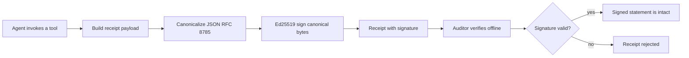
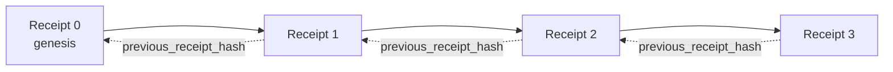

[Nézze meg az oktatóvideót: AI Ügynökök Biztosítása Kriptográfiai Bizonylatokkal](https://youtu.be/PLACEHOLDER_VIDEO_ID)

> _(Az oktatóvideót és a miniatűr képet a Microsoft tartalomcsapata fogja hozzáadni az egyesítés után, az 14/15. leckeminta alapján.)_

# AI Ügynökök Biztosítása Kriptográfiai Bizonylatokkal

## Bevezetés

Ez a lecke a következőket fogja ismertetni:

- Miért fontosak az auditnaplók az AI ügynökök esetében a megfelelőség, hibakeresés és bizalom szempontjából.
- Mi az a kriptográfiai bizonylat, és miben különbözik egy aláíratlan naplóbejegyzéstől.
- Hogyan lehet egyszerű Pythonban aláírt bizonylatot készíteni egy ügynök eszközhívásához.
- Hogyan lehet offline ellenőrizni egy bizonylatot észlelve a manipulációt.
- Hogyan lehet összefűzni bizonylatokat úgy, hogy egy eltávolítás vagy átrendezés megszakítsa a láncot.
- Mit bizonyítanak a bizonylatok, és mit egyértelműen nem bizonyítanak.

## Tanulási Célok

A lecke elvégzése után képes lesz:

- Azonosítani azokat a hibamódokat, amelyek kriptográfiai eredetbizonyítást tesznek szükségessé az ügynök műveleteihez.
- Elkészíteni egy Ed25519-gyel aláírt bizonylatot egy kanonikus JSON hasznalattal.
- Függetlenül ellenőrizni egy bizonylatot kizárólag az aláíró nyilvános kulcsával.
- Észlelni a manipulációt úgy, hogy módosított bizonylaton újra lefuttatja az ellenőrzést.
- Hash láncolt bizonylatok sorozatát építeni és elmagyarázni, miért fontos a lánc.
- Felismerni a határvonalat aközött, amit a bizonylatok bizonyítanak (hozzárendelés, sértetlenség, sorrend) és, amit nem bizonyítanak (a művelet helyessége, a szabályzat megalapozottsága).

## A probléma: Az ügynök auditnaplója

Képzelje el, hogy telepített egy AI ügynököt a Contoso Travel számára. Az ügynök elolvassa az ügyfél kéréseit, lekérdezi a járatokat egy API-n keresztül, és lefoglalja a helyeket az ügyfél nevében. Az elmúlt negyedévben 50 000 foglalást dolgozott fel.

Ma megjelenik egy auditor. Egyszerű kérdést tesz fel: "Mutassa meg, mit csinált a ügynöke."

Átadja a naplófájlokat. Az auditor megnézi őket, majd feltesz egy nehezebb kérdést: "Hogyan tudom, hogy ezeket a naplókat nem szerkesztették?"

Ez az auditnapló probléma. A legtöbb mai ügynök telepítés a következőkre támaszkodik:

- **Alkalmazás naplók**: maga az ügynök írja, bárki szerkesztheti, akinek hozzáférése van a fájlrendszerhez.
- **Felhő alapú naplózási szolgáltatások**: platform szinten nyomon követhető a manipuláció, de csak ha az auditor megbízik a platform üzemeltetőjében.
- **Adatbázis tranzakció naplók**: jól használhatók adatbázis változásokhoz, de nem tetszőleges eszköz hívásokhoz.

Egyik sem tud válaszolni az auditor kérdésére anélkül, hogy az auditor valakiben megbízzon (Önben, a felhőszolgáltatóban, az adatbázis beszállítóban). Belső használatra ez gyakran elfogadható, szabályozott munkaterheléseknél (pénzügy, egészségügy, az EU AI törvény hatálya alatt) nem.

A kriptográfiai bizonylatok ezt a problémát szűkítik le azzal, hogy az aláírt állítást függetlenül
ellenőrizhetővé teszik. Az auditor továbbra is kívülről kap megbízható okot az aláíró kulcs és az állítást előállító komponens meglétének elfogadására.
Egy beágyazott kulcs önkonzisztenciát bizonyít,
nem az kibocsátó személyazonosságát vagy a végrehajtás helyét.

## Mi az a Kriptográfiai Bizonylat?

Egy bizonylat egy JSON objektum, amely rögzíti, mit csinált az ügynök, digitális aláírással ellátva.



Egy minimális bizonylat így néz ki:

```json
{
  "type": "agent.tool_call.v1",
  "agent_id": "contoso-travel-bot",
  "tool_name": "lookup_flights",
  "tool_args_hash": "sha256:a3f9c1...",
  "result_hash": "sha256:7b2e1d...",
  "policy_id": "contoso-travel-policy-v3",
  "timestamp": "2026-04-25T14:30:00Z",
  "sequence": 47,
  "previous_receipt_hash": "sha256:9d4e6a...",
  "signature": {
    "alg": "EdDSA",
    "sig": "c5af83...",
    "public_key": "8f3b2c..."
  }
}
```

Három tulajdonság végzi a munkát:

1. **Az aláírás**. A bizonylatot az ügynök kapuja írja alá egy Ed25519 privát kulccsal. Bárki, akinek megvan a megfelelő nyilvános kulcs, offline ellenőrizheti az aláírást. Az ellenőrzőtársaságnak azt a kulcsot kell rögzítenie, vagy egy megbízható nyilvántartásból kell lekérnie a bizonylaton kívül. Bármely aláírt mező manipulálása érvényteleníti az aláírást.

2. **Kanonikus kódolás**. Az aláírás előtt a bizonylatot a JSON Kanonizációs Séma (JCS, RFC 8785) szerint szerializálják. Ez biztosítja, hogy két implementáció, amely ugyanazt a logikai bizonylatot állítja elő, bájtonként azonos kimenetet produkáljon. Kanonizáció nélkül különböző JSON szerializálók eltérő aláírásokat adnának ugyanarra a tartalomra.

3. **Hash láncolás**. A `previous_receipt_hash` mező összeköti az egyes bizonylatokat az előtte állóval. Egy bizonylat eltávolítása vagy átrendezése megszakítja a bemutatott láncot. A csonkolás vagy az aláíró által vezérelt átírás észlelése azt is megköveteli, hogy a jelenlegi láncfejet rögzítsék, függetlenül tanúsított ellenőrzőponttal vagy hitelesített zárt populációs kötelezettségvállalással.

Ezek a tulajdonságok együtt három garanciát nyújtanak:

- **Kulcshoz rendelés**: ez a kulcs írta alá ezt a tartalmat. Szervezeti vagy emberi azonosításhoz megbízható kulcskötés szükséges.
- **Integritás**: a tartalom nem változott az aláírás óta.
- **A hitelesített láncon belüli sorrend**: ez a bizonylat összekapcsolódik az előddel.

## Bizonylat készítése Pythonban

Bizonylat készítéséhez nincs szükség speciális könyvtárra. A kriptográfiai primitívek széles körben elérhetőek, a logika néhány tucat Python sor.

A gyakorlati feladatok a `code_samples/18-signed-receipts.ipynb` alatt végigvezetik a teljes folyamatot. A forrásvezérelt `code_samples/18-signed-receipts.execution-receipt.json` rögzíti a pontos notebook hash-t, Python környezetet, cellaszámot és az ellenőrzéseket a legutóbbi tiszta futásból anélkül, hogy megváltoztatná a lecke mentett kimeneteit. Az összefoglaló változat:

```python
import json
import hashlib
import base64
from nacl import signing
from jcs import canonicalize  # RFC 8785 canonical JSON

def b64url_nopad(data: bytes) -> str:
    return base64.urlsafe_b64encode(data).decode("ascii").rstrip("=")

def sha256_canonical(obj) -> str:
    """SHA-256 of a Python object's JCS-canonical JSON form."""
    return f"sha256:{hashlib.sha256(canonicalize(obj)).hexdigest()}"

# Generate or load a signing key (in production, store in a key vault)
signing_key = signing.SigningKey.generate()
verify_key = signing_key.verify_key
TRUSTED_PUBLIC_KEYS = {b64url_nopad(bytes(verify_key))}  # pinned out of band by the verifier

# Build the receipt payload (no signature yet)
tool_args = {"origin": "SYD", "destination": "LAX"}
tool_result = [{"flight": "QF11", "price": 1850, "stops": 0}]

payload = {
    "type": "agent.tool_call.v1",
    "agent_id": "contoso-travel-bot",
    "tool_name": "lookup_flights",
    "tool_args_hash": sha256_canonical(tool_args),
    "result_hash": sha256_canonical(tool_result),
    "policy_id": "contoso-travel-policy-v3",
    "timestamp": "2026-04-25T14:30:00Z",
    "sequence": 0,
    "previous_receipt_hash": None,
}

# Canonicalize and sign the JCS bytes directly. PureEdDSA hashes internally.
canonical_bytes = canonicalize(payload)
signature_bytes = signing_key.sign(canonical_bytes).signature

# Attach a structured signature object.
receipt = {
    **payload,
    "signature": {
        "alg": "EdDSA",
        "sig": b64url_nopad(signature_bytes),
        "public_key": b64url_nopad(bytes(verify_key)),
    },
}
```

Ez az egész aláírási folyamat. A notebook feladatok az egyes lépéseket részletesen bemutatják.

## Bizonylat ellenőrzése és manipuláció észlelése

Az ellenőrzés a fordított művelet:

```python
import base64
import hashlib
from nacl import signing
from nacl.exceptions import CryptoError
from jcs import canonicalize

def b64url_decode(s: str) -> bytes:
    # Strict: Python's decoder skips characters outside the alphabet and also
    # accepts padding, the standard +/ alphabet and non-zero spare bits.
    # Re-encoding and comparing accepts only the one unpadded base64url form.
    padding = "=" * ((4 - len(s) % 4) % 4)
    data = base64.urlsafe_b64decode(s + padding)
    if base64.urlsafe_b64encode(data).decode("ascii").rstrip("=") != s:
        raise ValueError("not canonical unpadded base64url")
    return data

def verify_receipt(receipt: dict, trusted_public_key: str) -> bool:
    # trusted_public_key is the issuer's key, obtained from somewhere other
    # than this receipt. Never use receipt["signature"]["public_key"] here:
    # see "What Receipts Prove (and What They Do Not)" below.
    # Fails closed: anything malformed returns False instead of raising.
    if not isinstance(receipt, dict) or not isinstance(trusted_public_key, str):
        return False
    sig_obj = receipt.get("signature")
    if not isinstance(sig_obj, dict) or sig_obj.get("alg") != "EdDSA":
        return False
    sig_b64 = sig_obj.get("sig")
    if not isinstance(sig_b64, str):
        return False

    try:
        # Reconstruct the payload that was actually signed (everything except signature).
        payload = {k: v for k, v in receipt.items() if k != "signature"}
        canonical_bytes = canonicalize(payload)
        verify_key = signing.VerifyKey(b64url_decode(trusted_public_key))
        verify_key.verify(canonical_bytes, b64url_decode(sig_b64))
        return True
    except (CryptoError, TypeError, ValueError, KeyError, OverflowError):
        return False
    except Exception:
        # An undecodable key or signature, or a payload that cannot be
        # canonicalized: fail closed rather than raise.
        return False
```

Ez a függvény fogad egy bizonylatot és az kibocsátó nyilvános kulcsát, és `True`-t ad vissza, ha az aláírás érvényes, `False`-et pedig ellenkező esetben, beleértve a hibás bemeneteket is. Nincs hálózati hívás vagy ellenőrző szolgáltatás: amint megvan az kibocsátó kulcsa, az ellenőrzés teljesen helyi és offline. Amit még mindig megkövetel az a kulcs, amelyet a bizonylat tartalmán kívülről kell beszerezni.

Az manipuláció észlelésének szemléltetéséhez a notebook:

1. Egy érvényes bizonylat készítése és megerősítése, hogy az ellenőrzése sikeres.
2. A `tool_args_hash` mező egy byte-jának módosítása.
3. Egy újabb ellenőrzés lefuttatása és a sikertelen visszaigazolás
4. Újabb manipuláció, de ezúttal az támadó által generált kulccsal történő újraaláírás és ennek a kulcsnak a bizonylatba ágyazása.

A 4. lépés megértése különösen fontos. Ez a bizonylat belsőleg konzisztens: az aláírás eredeti a tartalomhoz és a benne lévő kulcshoz, így önmagával szemben sikeresen ellenőrizhető. Csak akkor bukik meg, ha az kibocsátó valódi kulcsával ellenőrizzük. A 2. és 3. lépés elkap egy támadót, aki nem vett fáradságot az újraaláírásra, a 4. lépés pedig azt, aki igen.

Ez a gyakorlati példája annak, hogy a bizonylatok manipulációérzékenyek: bármely aláírt mező megváltoztatása megszakítja az aláírást, feltéve, hogy olyannal ellenőriz, amelyet a támadó nem szolgáltatott. A `signature` objektum maga a aláírt byte-okon kívül van, ezért a kulcs, amivel az ellenőrzés történik, máshonnan kell, hogy származzon, nem magából a bizonylatból.

## Bizonylatok láncolása többlépéses ügynökök számára

Egyetlen aláírt bizonylat egy műveletet véd. Egy bizonylatlánc egy sorozatot véd.



Minden bizonylat rögzíti az előző bizonylat hash-ét. Ha valaki csendben el akarja távolítani a 2. bizonylatot, akkor vagy:

- Meg kell változtatnia a 3. bizonylat `previous_receipt_hash` mezőjét (ez megszakítja a 3. bizonylat aláírását), VAGY
- Új aláírást kell hamisítania a módosított 3. bizonylaton (ehhez az ügynök privát kulcsára van szükség).

Ha a privát kulcs hardveres kulcstárolóban van, és az ellenőrzők minden bizonylatot összevetnek a kibocsátó nyilvános kulcsával, amelyet függetlenül szereznek be (például egy közzétett JWK Set vagy rögzített konfigurációs érték), akkor egyik támadás sem kivitelezhető észrevétel nélkül. A kulcs publikálása minden bizonylatban nem elég: egy támadó újból aláírhatja a saját kulcsával, és azt ágyazhatja be, ez az `04_resigned_receipt.json`.

A notebook végigmegy a következőn:

1. Egy három bizonylatból álló lánc építése.
2. Ellenőrzés, hogy minden bizonylat `previous_receipt_hash` megegyezik az előző bizonylat tényleges hash-ével.
3. Egy bizonylat manipulálása a lánc közepén és a lánc megszakadása pontosan ott.

Így állít elő olyan auditnaplót, amit egy külső auditor saját,
rögzített kibocsátó kulcsaival és lánc ellenőrzőpontokkal is ellenőrizhet, anélkül, hogy a módosítható napló tárolójára kellene bíznia magát.

## Mit bizonyítanak a bizonylatok (és mit nem)

Ez a lecke legfontosabb része. A bizonylatok erősek, de korlátozott az erejük.

**A bizonylatok három dolgot bizonyítanak:**

1. **Hozzárendelést**: egy adott kulcs írta alá a konkrét terhelést.
2. **Integritást**: a terhelés nem változott az aláírás óta.
3. **Sorrendet egy bemutatott, hitelesített sorozatban**: ez a bizonylat összekapcsolódik az előddel.

**A bizonylatok NEM bizonyítanak:**

1. **Helyességet**: hogy az ügynök művelete a helyes volt. Egy bizonylat ugyanazzal a tisztasággal aláírható hibás válaszra is.
2. **Szabályzati megfelelést**: hogy a `policy_id`-ban hivatkozott szabályzatot ténylegesen értékelték volna, vagy hogy az engedélyezte volna ezt a műveletet. A bizonylat azt rögzíti, amit állítottak, nem ami végrehajtottak.
3. **Azonosítást a kulcson túl**: a bizonylat azt mondja, "ez a kulcs írta alá ezt a tartalmat." Nem mondja, "egy ember engedélyezte ezt." Kulcsot személyhez vagy szervezethez kötni külön azonosítási infrastruktúrát igényel (pl. címtár, nyilvános kulcs regiszter).
4. **A bemenetek igazságtartalmát**: ha az ügynök manipulált promptot kap és azon műveletet hajt végre, a bizonylat hűen rögzíti a műveletet. A bizonylatok az input-ellenőrzés alatti vagy utáni lépés, nem helyettesítői aznak.
5. **Végrehajtás vagy valós hatás**: egy utólagos bizonylat azt rögzíti, amit annak kibocsátója állít. A belépési jog vagy külső hatás bizonyításához az adott végrehajtótól vagy szolgáltató határtól származó bizonyíték kell.
6. **Teljességet**: egy hiányzó bizonylat jelenthet blokkolást, kihagyást, elvesztést vagy hiányos rögzítést. A hiány bizonyítékká válik csak egy hitelesített zárt populációban.
7. **Megbízható időt**: az aláírt időbélyeg azt bizonyítja, hogy az aláíró birtokolta azt az értéket, nem pedig azt, hogy az érték helyes volt. A megbízható idő külön időhatóságot vagy tanúsított ellenőrzőpontot igényel.

**A bizonylatban lévő kulcs nem az, amivel az ellenőrzést végzi.** Ez a 3. pontból következik, és az egyetlen hely, ahol a különbség a kódját változtatja meg a megértése helyett. A fenti mintában az `public_key` ott van, hogy az példa önálló legyen. Az ellenőrző soha nem bízhat meg benne. Bárki vehet egy bizonylatot, módosíthatja, aláírhatja egy általuk generált kulccsal, és beágyazhatja azt a kulcsot; az eredmény önmagával szemben tökéletesen ellenőrizhető. Ez az `04_resigned_receipt.json` fixture az `sample_receipts/`-ban, és magyarázza, hogy a fentebb `verify_receipt` miért fogad kulcsot argumentumként, nem pedig olvassa ki a bizonylatból. Beszerezze az kibocsátó kulcsát függetlenül, a Production Checklistben lévő JWK Setből vagy más előzetesen rögzített forrásból, és azzal ellenőrizze. Egy ugyanabba a borítékba érkezett kulccsal végzett aláírás ellenőrzés csak a boríték önkonzisztenciáját bizonyítja.

Ez a határvonal két okból fontos:

- Megmondja, mire jók a bizonylatok: az ügynök viselkedésének auditálhatóvá és manipulációérzékennyé tételére, még szervezeti határokon átívelve is.
- Megmondja, milyen további rétegekre van még szüksége: bemeneti ellenőrzésre (6. lecke), szabályzati végrehajtásra (röviden érintve lent), és azonosítási infrastruktúrára (nem része ennek a leckének).

Gyakori hiba feltételezni, hogy a "van bizonylatunk" azt jelenti, hogy "irányítva vagyunk." Nem így van. A bizonylatok alapot nyújtanak. Az irányítás az a rendszer, amit erre épít.

## A jóváhagyó aláírásának összekötése a pontos művelettel

A 3. pont megérdemel egy külön szakaszt: egy műveletbizonylat azt mondja, "ez a kulcs írta alá ezt a tartalmat," soha nem azt, hogy "egy ember engedélyezte ezt." Magas kockázatú műveletek (visszatérítések, törlések, átutalások) esetén egy külön jóváhagyói aláírás kötheti össze a pontos műveletet. Az adott kulcs összekapcsolása emberrel és az ember jelenlétének ellenőrzése külön feladat marad.

A következő jegyzetfüzet, `code_samples/human-authorization-receipts.ipynb`, egy második típusú bizonylatot ad hozzá, `human.approval.v1`, ugyanabban a boríték alakban, mint a lecke bizonylatai (egy típusosított adatterhelés, amelyet Ed25519 aláír a kanonikus JCS bájtjain keresztül, az aláírt bájtokon kívül pedig az `signature` objektummal). Egy jóváhagyó kulcs aláírja a **teljes kanonikus műveletet és annak kivonatát**; egy ügynök kulcs egy állítást ír alá, amely viseli a **ugyanazt a műveletkivonatot** és egy `parent_approval_ref`, a jóváhagyás `receipt_hash`, ugyanaz a konvenció, mint az `previous_receipt_hash` a fent épített láncban. Egy `verify_chain` mindkét műtárgyat kezeli **különálló rögzített kulcsnyilvántartások alatt** (jóváhagyó kulcsok vs ügynök kulcsok), így a kódút közös, de a hatóságok soha nem.

Ez a tulajdonság, gondosan megfogalmazva: *a rögzített jóváhagyó kulcs aláírta ezt a pontos
műveletet, és az ügynök kulcs később aláírt egy nyilatkozatot, amely viseli ugyanazt a műveletkivonatot.*
Ez hasznos bizonyíték, de önmagában nem bizonyíték arra, hogy a művelet végrehajtódott. A
végrehajtás ellenőrzéséhez a pontos jóváhagyást szintén meg kell őrizni, és egyszer el kell fogyasztani a
tényleges végrehajtói határon; az ismeretlen szolgáltató kimeneteket ismeretlenként kell hagyni, nem pedig
vakon újrapróbálkozni. A jegyzetfüzet elutasító rögzítői tesztelik a bizonylatlánc rétegét:

- hamisítás, összezavarodott helyettesítő, hamisított kulcsok bármelyik oldalon, és hibás bemenet;
- **lejárt hatóság**: egy aláírás, amely továbbra is hitelesíthető, de elutasítva, mert a szabályzat verziója változott, a jóváhagyó kulcsot eltávolították a rögzített nyilvántartásból, vagy a jóváhagyás lejárt a megadott ellenőrzési idő előtt;
- **kivonat helyettesítés**: egy szabályosan aláírt műveletbizonylat, amely egy *valódi* jóváhagyásra mutat, amely egy *másik* kanonikus művelethez köt.

Minden hibát eltérő okkal utasítanak el, így egy ellenőr elolvasva az elutasítást meg tudja mondani, hogy a hatóság lejárt-e vagy a bejelentett művelet megváltozott-e. Az ellenőrzés csak olvasható és ismételhető: nem fogyasztja el a jóváhagyást és nem hív meg szolgáltatót. Egy külön végrehajtónak tartós, atomi újrajátszás elleni védelmet, valamint explicit sikeres, sikertelen és bizonytalan kimeneteleket kell kezelnie. Az emberi jóváhagyás bizonylata egy oktató jellegű kompozíció, amelyet ez a lecke határoz meg, nem pedig egy `draft-farley-acta-signed-receipts` által definiált bizonylattípus.

## Gyártási hivatkozások

A leckében szereplő Python kód szándékosan minimális, hogy minden sort el tudj olvasni, és pontosan megérthesd, mi történik. Éles környezetben két lehetőséged van:

1. **Építs közvetlenül a kriptográfiai primitívekre.** A fent látott 50 sor sok használati esethez elegendő. A PyNaCl (Ed25519) és az `jcs` csomag (kanonikus JSON) jól karbantartott és auditált könyvtárak.

2. **Használj éles környezethez készült bizonylat könyvtárat.** Több nyílt forráskódú projekt valósítja meg ugyanazt a mintát további funkciókkal (kulcscsere, kötegelt ellenőrzés, JWK-készlet terjesztés, szabályzati motorok integrációja):
   - Az aláíró folyamat a JCS és az aláírási terület konvencióit használja egy független IETF Internet-Draftban ([`draft-farley-acta-signed-receipts`](https://datatracker.ietf.org/doc/draft-farley-acta-signed-receipts/), 02-es verzió). A lecke egyszerűsített oktató jellegű bizonylatmodellje eltér a draft `{payload, signature}` borítékától, és nem konform implementációként van bemutatva. A draft közzétesz egy megosztott konformancia tesztcsomagot ([agent-governance-testvectors](https://github.com/ScopeBlind/agent-governance-testvectors)) azokhoz az implementációkhoz, amelyek a hálózati formátumát célozzák meg.
   - A Microsoft Agent Governance Toolkit Cedar-alapú szabályzati döntésekkel állít össze bizonylatokat; végponttól végpontig példát lásd a tárhelyen található 33. oktatóanyagban.
   - Az `protect-mcp` (npm) és `@veritasacta/verify` (npm) csomagok egy Node alapú aláíró és offline ellenőrző megvalósítást adnak, amelyek célja, hogy bármely MCP szervert manipulációbiztos audit lánccal lássanak el, beleértve egy tartott-együtt-aláírás menetrendet is, ahol egy szüneteltetett művelet kibocsát egy jóváhagyási bizonylatot, amely kötődik a művelet lenyomatához (desktop folyamatban WebAuthn támogatással), ugyanaz a jóváhagyási bizonylat minta, mint a fenti emberi engedélyezéses jegyzetben.
   - A **[nobulex](https://github.com/arian-gogani/nobulex)** Python SDK (`pip install nobulex`) ugyanazt az Ed25519 + JCS aláírási mintát biztosítja Pythonban LangChain és CrewAI integrációkkal, beleértve publikált keresztvalidációs tesztvektorokat és egy megfelelőségi leképezést, amit [OWASP PR #2210](https://github.com/OWASP/CheatSheetSeries/pull/2210) révén járultak hozzá.
   - A **[EMILIA Protocol](https://github.com/emiliaprotocol/emilia-protocol)** kiegészítő, pontos művelet-végrehajtási réteget biztosít: offline ellenőrizhető jóváhagyási bizonylatokat, rögzített WebAuthn vagy kvórum hatóságot, egyszeri felhasználást a végrehajtó határán, és egy explicit bizonytalan kimeneti utat. Keretrendszer adapterei nem bizonyítékként kezelik a bizonylatot arról, hogy külső hatás történt, hanem szükséges bizonyítékként.

A saját fejlesztés és a könyvtár használata közötti döntés hasonló, mint amikor JWT könyvtárat írsz saját magad vagy használsz egy tesztelt könyvtárat: mindkettő ésszerű; a könyvtár időt spórol és csökkenti az audit felületet; az alapoktól való fejlesztés megkívánja, hogy minden primitívet érts. Ez a lecke az alapoktól való utat tanítja, hogy bármelyik választáshoz meglegyen az alapod.

## Tudásellenőrzés

Teszteld az ismereteidet, mielőtt továbblépsz a gyakorlati feladathoz.

**1. Egy bizonylatot az ügynök privát Ed25519 kulcsával írnak alá. Az auditor csak a nyilvános kulccsal rendelkezik. Tudja az auditor offline ellenőrizni a bizonylatot?**

<details>
<summary>Válasz</summary>

Igen, a kriptográfiai ellenőrzéshez csak a nyilvános kulcs és az aláírt bájtok szükségesek. Az
auditornak azonban függetlenül meg kell szereznie és rögzítenie a nemrég elfogadott nyilvános kulcsot.
Azután nem szükséges hálózati hívás, ha ez a bizalomkonfiguráció megvan.
</details>

**2. Egy támadó módosítja a bizonylat `policy_id` mezőjét, hogy azt állítsa, lazább szabályzás vonatkozott rá. Az aláírás az eredeti terhelésen készült. Mi történik az ellenőrzés során?**

<details>
<summary>Válasz</summary>

Az ellenőrzés sikertelen lesz. Az aláírást a kanonikus bájtokon számították ki az eredeti terheléshez; bármely mező módosítása megváltoztatja ezeket a bájtokat, ami érvénytelenné teszi az aláírást. A támadónak a privát kulcs szükséges lenne egy új, érvényes aláíráshoz, ami nincs meg neki.
</details>

**3. Miért tartalmaz a bizonylat egy `tool_args_hash` és egy `result_hash` mezőt a nyers argumentumok és eredmény helyett?**

<details>
<summary>Válasz</summary>

Két okból. Először is, a bizonylatot archiválni vagy továbbítani kell olyan környezetekben, ahol a nyers tartalom kiszivárgása (személyes adatok, üzleti adatok) probléma. A hashelés kicsiben tartja a bizonylatot és védi a tartalmat; az auditor ellenőrzi, hogy a hash megegyezik egy külön tárolt, tényleges tartalom másolatával. Másodszor, a hash-ek fix méretűek; a hash-eket tartalmazó bizonylat mérete állandó, függetlenül az inputok vagy outputok méretétől.
</details>

**4. A `previous_receipt_hash` mező minden bizonylatot összeköt az elődjével. Ha egy támadó csendben töröl egy bizonylatot a lánc közepéről, mi válik érvénytelenné?**

<details>
<summary>Válasz</summary>

Minden bizonylat, amely a törölt után jött. Az `previous_receipt_hash` mezőjük már nem egyezik meg a tényleges lánccal (mert a hivatkozott bizonylat már nem létezik, vagy a lánc egy másik elődöt mutat). A törlés elrejtéséhez a támadónak újra alá kellene írnia minden későbbi bizonylatot, amihez az kiállító privát kulcsa kell. Bármely más kulccsal való újraaláírás megbukik az ellenőrzéskor a kiállító kulcsa alapján.
</details>

**5. Egy bizonylat tisztán ellenőrződik. Bizonyítja ez, hogy az ügynök művelete helyes, érvényes vagy szabályzatnak megfelelő volt?**

<details>
<summary>Válasz</summary>

Nem. Egy rögzített kulcs és lánc kontextus mellett egy érvényes bizonylat bizonyítja az aláírás hozzárendelését,
a tartalom integritását, és a bemutatott előd kapcsolódását. Nem bizonyítja, hogy a
művelet helyes vagy végrehajtott volt, hogy a szabályzat értékelve lett-e, hogy az időbélyeg
megbízható, vagy hogy az adatállomány teljes. Ez a lecke legfontosabb határa.
</details>

## Gyakorlati feladat

Nyisd meg `code_samples/18-signed-receipts.ipynb` fájlt és teljesítsd mind a négy részt:

1. **1. rész**: Írd alá az első bizonylatodat, és ellenőrizd azt.
2. **2. rész**: Manipuláld a bizonylatot és figyeld meg az ellenőrzés sikertelenségét.
3. **3. rész**: Építs egy három bizonylatból álló láncot és ellenőrizd a lánc integritását.
4. **4. rész**: Alkalmazd a mintát a Microsoft Agent Framework-kel készült ügynöknél: csomagold a segédeszköz hívást bizonylat aláírásába, majd ellenőrizd a bizonylatot külön.

**Kihívás 1:** bővítsd a bizonylat sémát egy általad választott további mezővel (például egy kérés azonosítóval a nyomon követéshez), frissítsd a kanonikus aláírás logikát, hogy tartalmazza ezt, és erősítsd meg, hogy a bizonylat még mindig sikeresen körbefut az ellenőrzésen. Ezután módosítsd a mezőt az aláírás után, és erősítsd meg, hogy az ellenőrzés sikertelen lesz. Ez kényszerít rá, hogy megértsd, hogyan járul hozzá a kanonikus kódolás minden bájtja az aláíráshoz.

**Kihívás 2:** SHA-256-tal hashezd össze két bizonylatodat (kötve össze a kanonikus bájtjaikat determinisztikus sorrendben), és ágyazd be az eredő lenyomatot egy harmadik bizonylat új mezőjében az aláírás előtt. Ellenőrizd, hogy mindhárom bizonylat továbbra is sikeresen ellenőrizhető. Így egy lépéses befogadási bizonyítékot hoztál létre: aki birtokolja a harmadik bizonylatot, bizonyíthatja, hogy az első két bizonylat létezett az aláírás időpontjában, anélkül, hogy felfedné azok tartalmát. Ez a minta az, amit a szelektív nyilvánosságra hozatalú bizonylatok használnak nagyszabásúan (Merkle elköteleződések, RFC 6962).

## Összefoglalás

A kriptográfiai bizonylatok audit nyomot adnak az AI ügynököknek, amely:

- **Függetlenül ellenőrizhető, fixált bizalom mellett**: elfogadott nyilvános kulcsokkal és aláírt bájtokkal a féltől függetlenül ellenőrizhető, szolgáltatásfüggőség nélkül.
- **Manipulációt jelző**: bármilyen módosítás érvénytelenné teszi az aláírást.
- **Hordozható**: a bizonylat egy kis JSON fájl; archiválható, továbbítható és bárhol ellenőrizhető.
- **Szabványkövető**: Ed25519 (RFC 8032), JCS (RFC 8785) és SHA-256 primitívekre épül, mind széles körben használt.

Nem helyettesítik az inputellenőrzést, szabályzat végrehajtást, futtatói engedélyezést,
kimeneti bizonyítékot, teljességi ellenőrzéseket vagy azonosítási infrastruktúrát. Ezeknek a
rétegeknek az alapját jelentik. Szabályozott vagy több szervezetet érintő munkafolyamatokban a bizonylatok
az egyedi kiállítói állításokat függetlenül ellenőrizhetővé teszik az auditor saját bizalmi konfigurációja alatt.

A legfontosabb tanulság: a bizonylatok bizonyítják, hogy egy adott kulcs adott
tartalmat írt alá. A hordozott időbélyeg aláírói állítás, hacsak nincs külön időpecsét. Egy
bizonylat nem bizonyítja, hogy a tartalma igaz volt, hogy egy művelet megtörtént, vagy hogy az
adatgyűjtemény teljes. Ezeket a különbségeket tartsd szigorúan.

## Éles környezetre vonatkozó ellenőrzőlista

Amikor készen állsz arra, hogy kilépj ebből a leckéből, és éles bizonylat-aláírt ügynököket telepíts:

- [ ] **Mozgasd az aláíró kulcsot a fejlesztői laptopról.** Használj Azure Key Vaultot, AWS KMS-t vagy hardveres biztonsági modult. A bizonylataid aláírására használt privát kulcs soha ne legyen a forráskódban vagy titkosítatlanul alkalmazásgépeken.
- [ ] **Állítsd be az ellenőrző kulcsok bizalmát.** Publikáld a kulcsokat JWK készleten vagy regiszterben, majd a függő felek rögzítsék az elfogadott kiállító identitást, kulcskészletet és kulcscsere szabályzatot a bizonylatokon kívül. Egyetlen beágyazott kulcs nem szolgál bizalmi horgonyként.
- [ ] **Horgonyozd a láncot külsőleg.** Időszakosan írd a legfrissebb láncfej hash-t egy átláthatósági naplóba (Sigstore Rekor, RFC 3161 időbélyeg hitelesítő vagy másik belső rendszer), hogy egy külső partner igazolhassa: "ez a lánc ekkor létezett."
- [ ] **Tárold a bizonylatokat változtathatatlanul.** Csak hozzáfűzhető blob tárolók (Azure Storage változtathatatlansági szabályzatokkal, AWS S3 Object Lock) megakadályozzák, hogy egy belső szereplő újraírásokat hajtson végre a tárolási rétegben.
- [ ] **Határozd meg a megőrzési időt.** Számos megfelelőségi rendszer többéves megőrzést ír elő. Tervezd meg a bizonylatok növekedését (egy bizonylat kb. 500 bájt; egy ügynök napi 10 ezer hívással kb. évi 1,8 GB-ot generál).
- [ ] **Dokumentáld, mit nem fednek le a bizonylatok.** A bizonylatok bizonyítják a hozzárendelést, integritást és sorrendet. Az üzemeltetési kézikönyvednek egyértelműen fel kell tüntetnie, hogy milyen további ellenőrzések (input ellenőrzés, szabályzat végrehajtás, sebességkorlátozás, azonosítási infrastruktúra) vannak a bizonylatok mellett a kormányzási rendszeredben.

### További kérdéseid vannak az AI ügynökök biztonságáról?

Csatlakozz a [Microsoft Foundry Discord](https://aka.ms/ai-agents/discord) szerverhez, hogy találkozz más tanulókkal, részt vegyél nyitvatartási órákon, és választ kapj AI ügynökök kapcsán.

## Ezen a leckén túl

Ez a lecke az egyedi bizonylat aláírást és a hash-láncolt sorozatokat fedi le. Ugyanezek a primitívek több haladó mintában komponálódnak, amelyekkel találkozhatsz, ahogy érlelődik a kormányzási pozíciód:

- **Szelektív nyilvánosságra hozatal.** Amikor egy bizonylat mezői függetlenül kötelezettek (RFC 6962-stílusú Merkle fa), megmutathatsz specifikus mezőket bizonyos auditoroknak, és bizonyíthatod, hogy a többi változatlan maradt anélkül, hogy kiszolgáltatnád azokat. Hasznos, ha ugyanaz a bizonylat megfelel egy átfogó auditnak (amely teljes körűséget akar) és adatminimalizációs szabályozásoknak mint a GDPR (amely csak a szükséges legkevesebbet akarja az auditor számára).
- **Bizonylat visszavonás.** Ha egy aláíró kulcs kompromittálódik, szükséged van arra a módra, hogy az összes kulccsal aláírt bizonylatot egy adott időponttól ne bízzák meg. Szokásos minták: rövid életű aláíró kulcsok plusz közzétett visszavonási lista, vagy egy átláthatósági napló visszavonási bejegyzésekkel.
- **Kétoldalú / megosztott aláírású bizonylatok.** Egyes megvalósítások a aláírt terhet egymástól független aláírásokkal rendelkező végrehajtás előtti (`authorization_*`) és végrehajtás utáni (`result_*`) felére bontják, ami hasznos, ha az engedélyezési döntést és a megfigyelt eredményt különböző szereplők vagy különböző időpontokban hozzák létre. Ez additív módon épül be a jelen leckében tanult bizonylat-formátumra.
- **Terhelés összeállítása.** Egy bizonylat függetlenül lezárja az `result_hash`-be helyezett bájtokat. A valós terhelések gyakran gazdagabbak, mint egyetlen eszközhívás eredménye: a döntés előtti érvelés (modell-előrejelzés, mérlegelt opciók, bizonyíték és annak teljessége, kockázati helyzet, elszámoltathatósági lánc, kapu eredménye) mind a terhelés része lehet, amelyet egyetlen bizonylattal zárnak le. Ez minimalizálja a bizonylatformátumot, miközben engedi, hogy a terhelési sémák domainekre bontva fejlődjenek.
- **Megvalósítások közötti konformitás.** Több független megvalósítás ugyanazon bizonylatformátumhoz (Python, TypeScript, Rust, Go) keresztellenőrzi a közös tesztvektorokat. Ha saját megvalósítást készítesz, a közzétett vektorokkal való validálás megerősíti a kábelkompatibilitást.
- **Poszt-quantum migráció.** Az Ed25519 ma széles körben használatos, de nem kvantumrezisztens. Az `alg` címke önmagában nem migráció: egy profilnak definiálnia kell az ML-DSA kulcskódolást, a kanonikus aláírt bájtokat, az ellenőrzést, a megbízó fél politikáját, a visszalépés elleni védelmet és az átmeneti szemantikát. Tervezd meg és teszteld a két aláírásos átmenetet közös vektorokon, mielőtt kompatibilitási állításokat teszel.

## További források

- <a href="https://datatracker.ietf.org/doc/draft-farley-acta-signed-receipts/" target="_blank">IETF Internet-Draft: Aláírt döntési bizonylatok gép-gép hozzáférés-vezérléshez</a>
- <a href="https://learn.microsoft.com/azure/ai-studio/responsible-use-of-ai-overview" target="_blank">Felelős MI áttekintés (Azure AI)</a>
- <a href="https://datatracker.ietf.org/doc/html/rfc8032" target="_blank">RFC 8032: Edwards-görbe digitális aláírási algoritmus (EdDSA)</a>
- <a href="https://datatracker.ietf.org/doc/html/rfc8785" target="_blank">RFC 8785: JSON kanonikalizációs séma (JCS)</a>
- <a href="https://datatracker.ietf.org/doc/html/rfc6962" target="_blank">RFC 6962: Tanúsítvány átláthatóság</a> (Merkle-fa felépítése, amelyet a szelektív-közzétételű bizonylatok használnak)
- <a href="https://github.com/microsoft/agent-governance-toolkit/blob/main/docs/tutorials/33-offline-verifiable-receipts.md" target="_blank">Microsoft Agent Governance Toolkit, 33. oktatóanyag: Offline-ellenőrizhető döntési bizonylatok</a>
- <a href="https://github.com/ScopeBlind/agent-governance-testvectors" target="_blank">Megvalósítások közötti konformitási tesztvektorok</a> a jelen leckében használt bizonylatformátumhoz (Apache-2.0)
- <a href="https://pynacl.readthedocs.io/" target="_blank">PyNaCl dokumentáció</a> (Ed25519 Pythonban)

## Előző lecke

[Helyi MI ügynökök létrehozása](../17-creating-local-ai-agents/README.md)

---

<!-- CO-OP TRANSLATOR DISCLAIMER START -->
**Jogi nyilatkozat**:
Ez a dokumentum az AI fordítási szolgáltatás, a [Co-op Translator](https://github.com/Azure/co-op-translator) segítségével készült. Bár az pontosságra törekszünk, kérjük, vegye figyelembe, hogy az automatikus fordítások hibákat vagy pontatlanságokat tartalmazhatnak. Az eredeti dokumentum az anyanyelvén tekintendő hiteles forrásnak. Fontos információk esetén professzionális emberi fordítást javasolunk. Nem vállalunk felelősséget semmilyen félreértésért vagy téves értelmezésért, amely ebből a fordításból ered.
<!-- CO-OP TRANSLATOR DISCLAIMER END -->