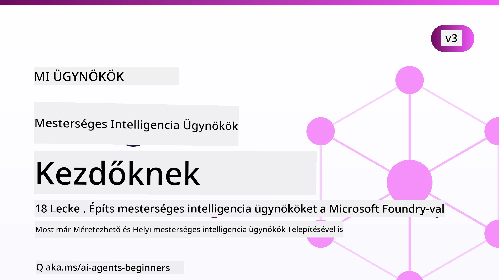

# AI Ügynökök Kezdőknek - Egy Tanfolyam



## Egy tanfolyam, amely megtanít mindent, amit tudnod kell az AI Ügynökök fejlesztésének megkezdéséhez

[](https://github.com/microsoft/ai-agents-for-beginners/blob/master/LICENSE?WT.mc_id=academic-105485-koreyst)
[](https://GitHub.com/microsoft/ai-agents-for-beginners/graphs/contributors/?WT.mc_id=academic-105485-koreyst)
[](https://GitHub.com/microsoft/ai-agents-for-beginners/issues/?WT.mc_id=academic-105485-koreyst)
[](https://GitHub.com/microsoft/ai-agents-for-beginners/pulls/?WT.mc_id=academic-105485-koreyst)
[](http://makeapullrequest.com?WT.mc_id=academic-105485-koreyst)

### 🌐 Többnyelvű Támogatás

#### Fordítások karbantartva a [Co-op Translator](https://github.com/Azure/co-op-translator) által

<!-- CO-OP TRANSLATOR LANGUAGES TABLE START -->
[Arab](../ar/README.md) | [Bengáli](../bn/README.md) | [Bolgár](../bg/README.md) | [Burmai (Myanmar)](../my/README.md) | [Kínai (Egyszerűsített)](../zh-CN/README.md) | [Kínai (Hagyományos, Hongkong)](../zh-HK/README.md) | [Kínai (Hagyományos, Makaó)](../zh-MO/README.md) | [Kínai (Hagyományos, Tajvan)](../zh-TW/README.md) | [Horvát](../hr/README.md) | [Cseh](../cs/README.md) | [Dán](../da/README.md) | [Holland](../nl/README.md) | [Észt](../et/README.md) | [Finn](../fi/README.md) | [Francia](../fr/README.md) | [Német](../de/README.md) | [Görög](../el/README.md) | [Héber](../he/README.md) | [Hindi](../hi/README.md) | [Magyar](./README.md) | [Indonéz](../id/README.md) | [Olasz](../it/README.md) | [Japán](../ja/README.md) | [Kannada](../kn/README.md) | [Khmer](../km/README.md) | [Koreai](../ko/README.md) | [Litván](../lt/README.md) | [Maláj](../ms/README.md) | [Malayalam](../ml/README.md) | [Manipuri (Meitei Mayek)](../mni/README.md) | [Marathi](../mr/README.md) | [Nepáli](../ne/README.md) | [Nigériai pidgin](../pcm/README.md) | [Norvég](../no/README.md) | [Perzsa (Fárszi)](../fa/README.md) | [Lengyel](../pl/README.md) | [Portugál (Brazília)](../pt-BR/README.md) | [Portugál (Portugália)](../pt-PT/README.md) | [Punjabi (Gurmukhi)](../pa/README.md) | [Román](../ro/README.md) | [Orosz](../ru/README.md) | [Szerb (Cirill)](../sr/README.md) | [Szlovák](../sk/README.md) | [Szlovén](../sl/README.md) | [Spanyol](../es/README.md) | [Szuahéli](../sw/README.md) | [Svéd](../sv/README.md) | [Tagalog (Filippínó)](../tl/README.md) | [Tamil](../ta/README.md) | [Telugu](../te/README.md) | [Thai](../th/README.md) | [Török](../tr/README.md) | [Ukrán](../uk/README.md) | [Urdu](../ur/README.md) | [Vietnami](../vi/README.md)

> **Inkább helyben klónoznál?**
>
> Ez a tárház több mint 50 nyelvű fordítást tartalmaz, ami jelentősen megnöveli a letöltési méretet. Fordítások nélkül való klónozáshoz használj ritkított checkout-ot:
>
> **Bash / macOS / Linux:**
> ```bash
> git clone --filter=blob:none --sparse https://github.com/microsoft/ai-agents-for-beginners.git
> cd ai-agents-for-beginners
> git sparse-checkout set --no-cone '/*' '!translations' '!translated_images'
> ```
>
> **CMD (Windows):**
> ```cmd
> git clone --filter=blob:none --sparse https://github.com/microsoft/ai-agents-for-beginners.git
> cd ai-agents-for-beginners
> git sparse-checkout set --no-cone "/*" "!translations" "!translated_images"
> ```
>
> Ez mindent megad, amire szükséged van a tanfolyam teljesítéséhez sokkal gyorsabb letöltéssel.
<!-- CO-OP TRANSLATOR LANGUAGES TABLE END -->

**További nyelvi lehetőségekért lásd a [Co-op Translator támogatott nyelvei](https://github.com/Azure/co-op-translator/blob/main/docs/supported-languages.md) listáját.**

[](https://GitHub.com/microsoft/ai-agents-for-beginners/watchers/?WT.mc_id=academic-105485-koreyst)
[](https://GitHub.com/microsoft/ai-agents-for-beginners/network/?WT.mc_id=academic-105485-koreyst)
[](https://GitHub.com/microsoft/ai-agents-for-beginners/stargazers/?WT.mc_id=academic-105485-koreyst)

[](https://discord.com/invite/ATgtXmAS5D)


## 🌱 Kezdés

Ez a tanfolyam leckéket tartalmaz az AI ügynökök építésének alapjairól. Minden lecke a saját témájával foglalkozik, szóval kezdj akárhol!

Ez a tanfolyam többnyelvű támogatással rendelkezik. Nézd meg elérhető nyelveinket [itt](#-multi-language-support). 

Ha most építesz először Generatív AI modellekkel, nézd meg a [Generatív AI Kezdőknek](https://aka.ms/genai-beginners) tanfolyamunkat, amely 21 leckét tartalmaz a GenAI-val való építésről.

Ne felejtsd el [csillagozni (🌟) ezt a repo-t](https://docs.github.com/en/get-started/exploring-projects-on-github/saving-repositories-with-stars?WT.mc_id=academic-105485-koreyst) és [forkolni ezt a repo-t](https://github.com/microsoft/ai-agents-for-beginners/fork), hogy futtathasd a kódot.

### Ismerkedj meg más tanulókkal, Kapd meg a Válaszokat Kérdéseidre

Ha elakadnál vagy kérdéseid lennének az AI Ügynökök építésével kapcsolatban, csatlakozz a dedikált Discord csatornánkhoz a [Microsoft Foundry Discordban](https://aka.ms/ai-agents/discord).

### Amire szükséged van 

Minden lecke ebben a tanfolyamban tartalmaz kódpéldákat, amelyek a code_samples mappában találhatók. [Forkold ezt a repót](https://github.com/microsoft/ai-agents-for-beginners/fork), hogy létrehozd a saját másolatodat.  

Ezek a kódpéldák a Microsoft Agent Framework és a Microsoft Foundry Agent Service V2 szolgáltatásokat használják:

- [Microsoft Foundry](https://aka.ms/ai-agents-beginners/ai-foundry) - Azure fiók szükséges

Ez a tanfolyam a következő Microsoft AI Ügynök keretrendszereket és szolgáltatásokat használja:

- [Microsoft Agent Framework (MAF)](https://learn.microsoft.com/agent-framework/overview/)
- [Microsoft Foundry Agent Service V2](https://aka.ms/ai-agents-beginners/ai-agent-service)

Néhány kódminta támogat alternatív OpenAI-kompatibilis szolgáltatókat is, mint például a [MiniMax](https://platform.minimaxi.com/), amely nagy kontextusú modelleket kínál (akár 204K token). Lásd a [Tanfolyam beállítása](./00-course-setup/README.md) részt a konfiguráció részleteiért.

A tanfolyam kódjának futtatásáról további információkért látogasd meg a [Tanfolyam beállítása](./00-course-setup/README.md) oldalt.

## 🙏 Szeretnél segíteni?

Van javaslatod vagy találtál helyesírási, kódhibákat? [Jelents hibát](https://github.com/microsoft/ai-agents-for-beginners/issues?WT.mc_id=academic-105485-koreyst) vagy [Hozz létre pull requestet](https://github.com/microsoft/ai-agents-for-beginners/pulls?WT.mc_id=academic-105485-koreyst)


## 📂 Minden lecke tartalmaz

- Egy írott leckét a README fájlban és egy rövid videót
- Python kódpéldákat Microsoft Agent Frameworkkel és Microsoft Foundry-val
- További erőforrásokra mutató linkeket a tanulás folytatásához


## 🗃️ Leckék

| **Lecke**                                   | **Szöveg & Kód**                                    | **Videó**                                                  | **További tanulás**                                                                     |
|----------------------------------------------|----------------------------------------------------|------------------------------------------------------------|----------------------------------------------------------------------------------------|
| AI Ügynökök és Ügynök felhasználási esetek bevezetése       | [Link](./01-intro-to-ai-agents/README.md)          | [Videó](https://youtu.be/3zgm60bXmQk?si=z8QygFvYQv-9WtO1)  | [Link](https://aka.ms/ai-agents-beginners/collection?WT.mc_id=academic-105485-koreyst) |
| AI Ügynöki keretrendszerek felfedezése              | [Link](./02-explore-agentic-frameworks/README.md)  | [Videó](https://youtu.be/ODwF-EZo_O8?si=Vawth4hzVaHv-u0H)  | [Link](https://aka.ms/ai-agents-beginners/collection?WT.mc_id=academic-105485-koreyst) |
| AI Ügynöki tervezési minták megértése     | [Link](./03-agentic-design-patterns/README.md)     | [Videó](https://youtu.be/m9lM8qqoOEA?si=BIzHwzstTPL8o9GF)  | [Link](https://aka.ms/ai-agents-beginners/collection?WT.mc_id=academic-105485-koreyst) |
| Eszközhasználati tervezési minta                      | [Link](./04-tool-use/README.md)                    | [Videó](https://youtu.be/vieRiPRx-gI?si=2z6O2Xu2cu_Jz46N)  | [Link](https://aka.ms/ai-agents-beginners/collection?WT.mc_id=academic-105485-koreyst) |
| Ügynöki RAG                                  | [Link](./05-agentic-rag/README.md)                 | [Videó](https://youtu.be/WcjAARvdL7I?si=gKPWsQpKiIlDH9A3)  | [Link](https://aka.ms/ai-agents-beginners/collection?WT.mc_id=academic-105485-koreyst) |
| Megbízható AI Ügynökök építése               | [Link](./06-building-trustworthy-agents/README.md) | [Videó](https://youtu.be/iZKkMEGBCUQ?si=jZjpiMnGFOE9L8OK ) | [Link](https://aka.ms/ai-agents-beginners/collection?WT.mc_id=academic-105485-koreyst) |
| Tervezési minta tervezés                      | [Link](./07-planning-design/README.md)             | [Videó](https://youtu.be/kPfJ2BrBCMY?si=6SC_iv_E5-mzucnC)  | [Link](https://aka.ms/ai-agents-beginners/collection?WT.mc_id=academic-105485-koreyst) |
| Több ügynökös tervezési minta                   | [Link](./08-multi-agent/README.md)                 | [Videó](https://youtu.be/V6HpE9hZEx0?si=rMgDhEu7wXo2uo6g)  | [Link](https://aka.ms/ai-agents-beginners/collection?WT.mc_id=academic-105485-koreyst) |
| Metakognitív tervezési minta                 | [Link](./09-metacognition/README.md)               | [Videó](https://youtu.be/His9R6gw6Ec?si=8gck6vvdSNCt6OcF)  | [Link](https://aka.ms/ai-agents-beginners/collection?WT.mc_id=academic-105485-koreyst) |
| AI Ügynökök bevetésben                      | [Link](./10-ai-agents-production/README.md)        | [Videó](https://youtu.be/l4TP6IyJxmQ?si=31dnhexRo6yLRJDl)  | [Link](https://aka.ms/ai-agents-beginners/collection?WT.mc_id=academic-105485-koreyst) |
| Ügynöki protokollok használata (MCP, A2A és NLWeb) | [Link](./11-agentic-protocols/README.md)           | [Videó](https://youtu.be/X-Dh9R3Opn8)                                 | [Link](https://aka.ms/ai-agents-beginners/collection?WT.mc_id=academic-105485-koreyst) |
| Kontextusmérnökség AI Ügynökök számára            | [Link](./12-context-engineering/README.md)         | [Videó](https://youtu.be/F5zqRV7gEag)                                 | [Link](https://aka.ms/ai-agents-beginners/collection?WT.mc_id=academic-105485-koreyst) |
| Ügynöki memória kezelése                      | [Link](./13-agent-memory/README.md)     |      [Videó](https://youtu.be/QrYbHesIxpw?si=vZkVwKrQ4ieCcIPx)                                                      |                                                                                        |
| Microsoft Agent Framework felfedezése                         | [Link](./14-microsoft-agent-framework/README.md)                            |                                                            |                                                                                        |
| Számítógép-használó ügynökök (CUA) építése           | [Link](./15-browser-use/README.md)     |                                                            | [Link](https://docs.browser-use.com/examples/templates/playwright-integration)         |
| Skálázható ügynökök telepítése                    | [Link](./16-deploying-scalable-agents/README.md) |                                                    | [Link](https://learn.microsoft.com/azure/ai-foundry/agents/overview)                   |
| Helyi AI Ügynökök létrehozása                     | [Link](./17-creating-local-ai-agents/README.md)  |                                                    | [Link](https://learn.microsoft.com/azure/ai-foundry/foundry-local/)                    |
| AI Ügynökök biztonságossá tétele                           | [Link](./18-securing-ai-agents/README.md)  |                                                            | [Link](https://aka.ms/ai-agents-beginners/collection?WT.mc_id=academic-105485-koreyst) |

## 🎒 Más tanfolyamok

Csapatunk más tanfolyamokat is készít! Nézd meg:

<!-- CO-OP TRANSLATOR OTHER COURSES START -->
### LangChain
[](https://aka.ms/langchain4j-for-beginners)
[](https://aka.ms/langchainjs-for-beginners?WT.mc_id=m365-94501-dwahlin)
[](https://github.com/microsoft/langchain-for-beginners?WT.mc_id=m365-94501-dwahlin)
---

### Azure / Edge / MCP / Ügynökök
[](https://github.com/microsoft/AZD-for-beginners?WT.mc_id=academic-105485-koreyst)
[](https://github.com/microsoft/edgeai-for-beginners?WT.mc_id=academic-105485-koreyst)
[](https://github.com/microsoft/mcp-for-beginners?WT.mc_id=academic-105485-koreyst)
[](https://github.com/microsoft/ai-agents-for-beginners?WT.mc_id=academic-105485-koreyst)

---
 
### Generatív MI sorozat
[](https://github.com/microsoft/generative-ai-for-beginners?WT.mc_id=academic-105485-koreyst)
[-9333EA?style=for-the-badge&labelColor=E5E7EB&color=9333EA)](https://github.com/microsoft/Generative-AI-for-beginners-dotnet?WT.mc_id=academic-105485-koreyst)
[-C084FC?style=for-the-badge&labelColor=E5E7EB&color=C084FC)](https://github.com/microsoft/generative-ai-for-beginners-java?WT.mc_id=academic-105485-koreyst)
[-E879F9?style=for-the-badge&labelColor=E5E7EB&color=E879F9)](https://github.com/microsoft/generative-ai-with-javascript?WT.mc_id=academic-105485-koreyst)

---
 
### Alapvető tanulás
[](https://aka.ms/ml-beginners?WT.mc_id=academic-105485-koreyst)
[](https://aka.ms/datascience-beginners?WT.mc_id=academic-105485-koreyst)
[](https://aka.ms/ai-beginners?WT.mc_id=academic-105485-koreyst)
[](https://github.com/microsoft/Security-101?WT.mc_id=academic-96948-sayoung)
[](https://aka.ms/webdev-beginners?WT.mc_id=academic-105485-koreyst)
[](https://aka.ms/iot-beginners?WT.mc_id=academic-105485-koreyst)
[](https://github.com/microsoft/xr-development-for-beginners?WT.mc_id=academic-105485-koreyst)

---
 
### Copilot sorozat
[](https://aka.ms/GitHubCopilotAI?WT.mc_id=academic-105485-koreyst)
[](https://github.com/microsoft/mastering-github-copilot-for-dotnet-csharp-developers?WT.mc_id=academic-105485-koreyst)
[](https://github.com/microsoft/CopilotAdventures?WT.mc_id=academic-105485-koreyst)
<!-- CO-OP TRANSLATOR OTHER COURSES END -->

## 🌟 Közösségi köszönet

Köszönet [Shivam Goyal]-nek (https://www.linkedin.com/in/shivam2003/) a fontos kódrészletekért, amelyek bemutatják az Agentic RAG-et.

## Hozzájárulás

Ez a projekt szívesen fogad hozzájárulásokat és javaslatokat. A legtöbb hozzájáruláshoz el kell fogadnia egy
Közreműködői Licencmegállapodást (CLA), amelyben kijelenti, hogy joga van, és valóban megadja nekünk
a hozzájárulás használatára vonatkozó jogokat. Részletekért látogasson el ide: <https://cla.opensource.microsoft.com>.

Amikor pull requestet küld be, egy CLA bot automatikusan megállapítja, hogy szükséges-e CLA-t megadnia,
és megfelelően jelöli a PR-t (pl. állapotellenőrzés, megjegyzés). Egyszerűen kövesse a
a bot utasításait. Ezt csak egyszer kell megtennie az összes CLA-t használó repó között.

Ez a projekt elfogadta a [Microsoft Nyílt Forráskódú Magatartási Szabályzatát](https://opensource.microsoft.com/codeofconduct/).
További információkért lásd a [Magatartási Szabályzat GYIK](https://opensource.microsoft.com/codeofconduct/faq/)-t,
vagy lépjen kapcsolatba az [opencode@microsoft.com]-mal (mailto:opencode@microsoft.com) további kérdésekkel vagy megjegyzésekkel.

## Védjegyek

Ez a projekt tartalmazhat projektek, termékek vagy szolgáltatások védjegyeit vagy logóit. A Microsoft
védjegyek vagy logók engedélyezett használata
a [Microsoft védjegy- és márkaútmutató](https://www.microsoft.com/legal/intellectualproperty/trademarks/usage/general) betartását igényli.
A Microsoft védjegyek vagy logók használata a projekt módosított verzióiban nem okozhat félreértést vagy nem sugallhat Microsoft támogatást.
Harmadik féltől származó védjegyek vagy logók használata a harmadik felek szabályzataihoz kötött.

## Segítség kérése


Ha elakad, vagy kérdése van az AI alkalmazások fejlesztésével kapcsolatban, csatlakozzon:

[](https://aka.ms/foundry/discord)

Ha termékvisszajelzést vagy hibabejelentést szeretne tenni fejlesztés közben, látogassa meg:

[](https://aka.ms/foundry/forum)

---

<!-- CO-OP TRANSLATOR DISCLAIMER START -->
**Jogi nyilatkozat**:
Ez a dokumentum az AI fordítási szolgáltatás, a [Co-op Translator](https://github.com/Azure/co-op-translator) segítségével készült. Bár az pontosságra törekszünk, kérjük, vegye figyelembe, hogy az automatikus fordítások hibákat vagy pontatlanságokat tartalmazhatnak. Az eredeti dokumentum az anyanyelvén tekintendő hiteles forrásnak. Fontos információk esetén professzionális emberi fordítást javasolunk. Nem vállalunk felelősséget semmilyen félreértésért vagy téves értelmezésért, amely ebből a fordításból ered.
<!-- CO-OP TRANSLATOR DISCLAIMER END -->