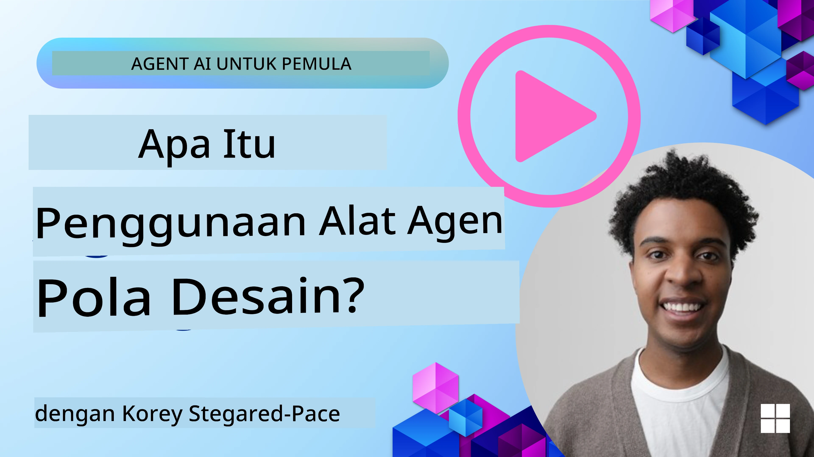
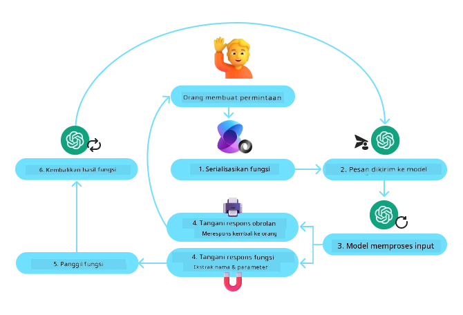
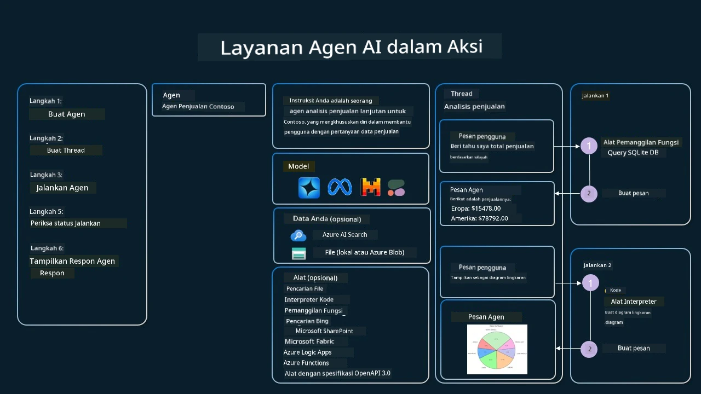

[](https://youtu.be/vieRiPRx-gI?si=cEZ8ApnT6Sus9rhn)

> _(Klik gambar di atas untuk melihat video pelajaran ini)_

# Pola Desain Penggunaan Alat

Alat menarik karena memungkinkan agen AI memiliki rentang kemampuan yang lebih luas. Alih-alih agen memiliki sekumpulan tindakan terbatas yang dapat dilakukan, dengan menambahkan alat, agen sekarang dapat melakukan berbagai tindakan. Dalam bab ini, kita akan melihat Pola Desain Penggunaan Alat, yang menggambarkan bagaimana agen AI dapat menggunakan alat tertentu untuk mencapai tujuan mereka.

## Pendahuluan

Dalam pelajaran ini, kami akan mencoba menjawab pertanyaan-pertanyaan berikut:

- Apa itu pola desain penggunaan alat?
- Apa saja kasus penggunaan yang dapat diterapkan?
- Apa saja elemen/blok bangunan yang diperlukan untuk mengimplementasikan pola desain ini?
- Apa saja pertimbangan khusus untuk menggunakan Pola Desain Penggunaan Alat dalam membangun agen AI yang dapat dipercaya?

## Tujuan Pembelajaran

Setelah menyelesaikan pelajaran ini, Anda akan dapat:

- Mendefinisikan Pola Desain Penggunaan Alat dan tujuannya.
- Mengidentifikasi kasus penggunaan di mana Pola Desain Penggunaan Alat dapat diterapkan.
- Memahami elemen kunci yang diperlukan untuk mengimplementasikan pola desain ini.
- Mengenali pertimbangan untuk memastikan kepercayaan pada agen AI yang menggunakan pola desain ini.

## Apa itu Pola Desain Penggunaan Alat?

**Pola Desain Penggunaan Alat** berfokus pada memberikan kemampuan kepada LLM untuk berinteraksi dengan alat eksternal guna mencapai tujuan tertentu. Alat adalah kode yang dapat dijalankan oleh agen untuk melakukan tindakan. Sebuah alat bisa berupa fungsi sederhana seperti kalkulator, atau panggilan API ke layanan pihak ketiga seperti pencarian harga saham atau prakiraan cuaca. Dalam konteks agen AI, alat dirancang untuk dijalankan oleh agen sebagai respons terhadap **panggilan fungsi yang dihasilkan model**.

## Apa saja kasus penggunaan yang dapat diterapkan?

Agen AI dapat memanfaatkan alat untuk menyelesaikan tugas kompleks, mengambil informasi, atau membuat keputusan. Pola desain penggunaan alat sering digunakan dalam skenario yang memerlukan interaksi dinamis dengan sistem eksternal, seperti basis data, layanan web, atau interpreter kode. Kemampuan ini berguna untuk berbagai kasus penggunaan termasuk:

- **Pengambilan Informasi Dinamis:** Agen dapat mengkueri API eksternal atau basis data untuk mengambil data terkini (misal, mengkueri basis data SQLite untuk analisis data, mengambil harga saham atau informasi cuaca).
- **Eksekusi dan Interpretasi Kode:** Agen dapat menjalankan kode atau skrip untuk menyelesaikan masalah matematika, menghasilkan laporan, atau melakukan simulasi.
- **Otomasi Proses Kerja:** Mengotomasi alur kerja berulang atau multi-langkah dengan mengintegrasikan alat seperti penjadwal tugas, layanan email, atau pipeline data.
- **Dukungan Pelanggan:** Agen dapat berinteraksi dengan sistem CRM, platform tiket, atau basis pengetahuan untuk menyelesaikan pertanyaan pengguna.
- **Pembuatan dan Pengeditan Konten:** Agen dapat memanfaatkan alat seperti pemeriksa tata bahasa, peringkas teks, atau evaluator keamanan konten untuk membantu tugas pembuatan konten.

## Apa saja elemen/blok bangunan yang diperlukan untuk mengimplementasikan pola desain penggunaan alat?

Blok bangunan ini memungkinkan agen AI melakukan berbagai tugas. Mari kita lihat elemen kunci yang diperlukan untuk mengimplementasikan Pola Desain Penggunaan Alat:

- **Skema Fungsi/Alat**: Definisi rinci alat yang tersedia, termasuk nama fungsi, tujuan, parameter yang diperlukan, dan keluaran yang diharapkan. Skema ini memungkinkan LLM memahami alat apa saja yang tersedia dan bagaimana menyusun permintaan yang valid.

- **Logika Eksekusi Fungsi**: Mengatur bagaimana dan kapan alat dipanggil berdasarkan maksud pengguna dan konteks percakapan. Ini dapat mencakup modul perencana, mekanisme pengarah, atau alur kondisional yang menentukan penggunaan alat secara dinamis.

- **Sistem Penanganan Pesan**: Komponen yang mengelola aliran percakapan antara input pengguna, respons LLM, panggilan alat, dan keluaran alat.

- **Kerangka Integrasi Alat**: Infrastruktur yang menghubungkan agen dengan berbagai alat, baik itu fungsi sederhana atau layanan eksternal kompleks.

- **Penanganan Kesalahan & Validasi**: Mekanisme untuk menangani kegagalan dalam eksekusi alat, memvalidasi parameter, dan mengelola respons tak terduga.

- **Manajemen Status**: Melacak konteks percakapan, interaksi alat sebelumnya, dan data persistensi untuk memastikan konsistensi dalam interaksi multi-langkah.

Selanjutnya, mari kita lihat Panggilan Fungsi/Alat dengan lebih detail.
 
### Panggilan Fungsi/Alat

Panggilan fungsi adalah cara utama kita memungkinkan Large Language Models (LLM) berinteraksi dengan alat. Anda sering akan melihat 'Fungsi' dan 'Alat' digunakan secara bergantian karena 'fungsi' (blok kode yang dapat digunakan ulang) adalah 'alat' yang digunakan agen untuk menyelesaikan tugas. Agar kode sebuah fungsi dapat dipanggil, LLM harus membandingkan permintaan pengguna dengan deskripsi fungsi tersebut. Untuk ini, sebuah skema yang berisi deskripsi semua fungsi yang tersedia dikirim ke LLM. LLM kemudian memilih fungsi yang paling tepat untuk tugas itu dan mengembalikan nama serta argumennya. Fungsi yang dipilih dipanggil, responsnya dikirim kembali ke LLM, yang menggunakan informasi tersebut untuk merespon permintaan pengguna.

Untuk pengembang mengimplementasikan panggilan fungsi untuk agen, Anda akan memerlukan:

1. Model LLM yang mendukung panggilan fungsi
2. Skema yang berisi deskripsi fungsi
3. Kode untuk setiap fungsi yang dideskripsikan

Mari kita gunakan contoh mendapatkan waktu saat ini di sebuah kota untuk mengilustrasikan:

1. **Inisialisasi LLM yang mendukung panggilan fungsi:**

    Tidak semua model mendukung panggilan fungsi, jadi penting memastikan LLM yang Anda gunakan melakukannya. <a href="https://learn.microsoft.com/azure/ai-services/openai/how-to/function-calling" target="_blank">Azure OpenAI</a> mendukung panggilan fungsi. Kita bisa mulai dengan menginisiasi klien OpenAI terhadap **Responses API** Azure OpenAI (endpoint stabil `/openai/v1/` — tanpa perlu `api_version`). 

    ```python
    # Initialize the OpenAI client for Azure OpenAI (Responses API, v1 endpoint)
    client = OpenAI(
        base_url=f"{os.environ['AZURE_OPENAI_ENDPOINT'].rstrip('/')}/openai/v1/",
        api_key=os.environ["AZURE_OPENAI_API_KEY"],
    )
    deployment_name = os.environ["AZURE_OPENAI_DEPLOYMENT"]
    ```

1. **Buat Skema Fungsi**:

    Selanjutnya kita akan mendefinisikan skema JSON yang berisi nama fungsi, deskripsi apa yang dilakukan fungsi, dan nama serta deskripsi parameter fungsi.
    Kita kemudian akan mengambil skema ini dan memberikannya ke klien yang dibuat sebelumnya, bersama dengan permintaan pengguna untuk menemukan waktu di San Francisco. Yang penting diperhatikan adalah **panggilan alat** yang dikembalikan, **bukan** jawaban akhir dari pertanyaannya. Seperti disebutkan sebelumnya, LLM mengembalikan nama fungsi yang dipilih untuk tugas, dan argumen yang akan diteruskannya.

    ```python
    # Function description for the model to read (Responses API flat tool format)
    tools = [
        {
            "type": "function",
            "name": "get_current_time",
            "description": "Get the current time in a given location",
            "parameters": {
                "type": "object",
                "properties": {
                    "location": {
                        "type": "string",
                        "description": "The city name, e.g. San Francisco",
                    },
                },
                "required": ["location"],
            },
        }
    ]
    ```
   
    ```python
  
    # Initial user message
    messages = [{"role": "user", "content": "What's the current time in San Francisco"}]

    # First API call: Ask the model to use the function
    response = client.responses.create(
        model=deployment_name,
        input=messages,
        tools=tools,
        tool_choice="auto",
        store=False,
    )

    # The Responses API returns tool calls as function_call items in response.output.
    # Append them to the conversation so the model has full context on the next turn.
    messages += response.output

    print("Model's response:")
    print(response.output)
  
    ```

    ```bash
    Model's response:
    [ResponseFunctionToolCall(arguments='{"location":"San Francisco"}', call_id='call_pOsKdUlqvdyttYB67MOj434b', name='get_current_time', type='function_call')]
    ```
  
1. **Kode fungsi yang diperlukan untuk menjalankan tugas:**

    Setelah LLM memilih fungsi yang harus dijalankan, kode yang menjalankan tugas perlu diimplementasikan dan dieksekusi.
    Kita bisa mengimplementasikan kode untuk mendapatkan waktu saat ini dalam Python. Kita juga perlu menulis kode untuk mengekstrak nama dan argumen dari response_message untuk mendapatkan hasil akhirnya.

    ```python
      def get_current_time(location):
        """Get the current time for a given location"""
        print(f"get_current_time called with location: {location}")  
        location_lower = location.lower()
        
        for key, timezone in TIMEZONE_DATA.items():
            if key in location_lower:
                print(f"Timezone found for {key}")  
                current_time = datetime.now(ZoneInfo(timezone)).strftime("%I:%M %p")
                return json.dumps({
                    "location": location,
                    "current_time": current_time
                })
      
        print(f"No timezone data found for {location_lower}")  
        return json.dumps({"location": location, "current_time": "unknown"})
    ```

     ```python
    # Handle function calls
    tool_calls = [item for item in response.output if item.type == "function_call"]
    if tool_calls:
        for tool_call in tool_calls:
            if tool_call.name == "get_current_time":

                function_args = json.loads(tool_call.arguments)

                time_response = get_current_time(
                    location=function_args.get("location")
                )

                # Return the tool result as a function_call_output item
                messages.append({
                    "type": "function_call_output",
                    "call_id": tool_call.call_id,
                    "output": time_response,
                })
    else:
        print("No tool calls were made by the model.")

    # Second API call: Get the final response from the model
    final_response = client.responses.create(
        model=deployment_name,
        input=messages,
        tools=tools,
        store=False,
    )

    return final_response.output_text
     ```

     ```bash
      get_current_time called with location: San Francisco
      Timezone found for san francisco
      The current time in San Francisco is 09:24 AM.
     ```

Panggilan Fungsi adalah inti dari sebagian besar, jika tidak semua, desain penggunaan alat agen, namun mengimplementasikannya dari nol kadang bisa menantang.
Seperti yang kita pelajari di [Pelajaran 2](../../../02-explore-agentic-frameworks) kerangka agen menyediakan kita blok bangunan yang sudah jadi untuk mengimplementasikan penggunaan alat.
 
## Contoh Penggunaan Alat dengan Kerangka Agen

Berikut beberapa contoh bagaimana Anda dapat mengimplementasikan Pola Desain Penggunaan Alat menggunakan berbagai kerangka agen:

### Kerangka Agen Microsoft

<a href="https://learn.microsoft.com/azure/ai-services/agents/overview" target="_blank">Kerangka Agen Microsoft</a> adalah kerangka kerja AI sumber terbuka untuk membangun agen AI. Kerangka ini menyederhanakan proses penggunaan panggilan fungsi dengan memungkinkan Anda mendefinisikan alat sebagai fungsi Python dengan dekorator `@tool`. Kerangka ini menangani komunikasi bolak-balik antara model dan kode Anda. Ia juga menyediakan akses ke alat yang sudah jadi seperti Pencarian File dan Interpreter Kode melalui `FoundryChatClient`.

Diagram berikut menggambarkan proses panggilan fungsi dengan Kerangka Agen Microsoft:



Dalam Kerangka Agen Microsoft, alat didefinisikan sebagai fungsi berdekorasi. Kita bisa mengubah fungsi `get_current_time` yang kita lihat sebelumnya menjadi alat dengan menggunakan dekorator `@tool`. Kerangka akan secara otomatis menserialisasi fungsi dan parameternya, membuat skema untuk dikirim ke LLM.

```python
import os
from agent_framework import tool
from agent_framework.foundry import FoundryChatClient
from azure.identity import AzureCliCredential

@tool(approval_mode="never_require")
def get_current_time(location: str) -> str:
    """Get the current time for a given location"""
    ...

# Create the client
provider = FoundryChatClient(
    project_endpoint=os.environ["AZURE_AI_PROJECT_ENDPOINT"],
    model=os.environ["AZURE_AI_MODEL_DEPLOYMENT_NAME"],
    credential=AzureCliCredential(),
)

# Create an agent and run with the tool
agent = provider.as_agent(name="TimeAgent", instructions="Use available tools to answer questions.", tools=get_current_time)
response = await agent.run("What time is it?")
```

#### Alat dari server MCP

Alat tidak harus fungsi dalam kode Anda sendiri. Server yang menggunakan Model Context Protocol (MCP, dibahas di [Pelajaran 11](../11-agentic-protocols/README.md)) menerbitkan alatnya bersama skema, dan kerangka dapat memuatnya dengan cara yang sama seperti menserialisasi fungsi berdekorasi. `MCPStreamableHTTPTool` terhubung ke server tersebut lewat HTTP, membaca skema alat, dan menawarkan alat tersebut ke model bersamaan dengan alat lokal.

Contoh di bawah menggunakan server pencarian web yang dihosting oleh <a href="https://keenable.ai" target="_blank">Keenable</a>. Gratis digunakan tanpa akun atau kunci API (permintaan dibatasi per IP), sehingga satu-satunya kredensial yang Anda butuhkan adalah untuk model Anda. Seperti alat jauh lainnya, query yang ditulis model dikirim ke server tersebut.

```python
from agent_framework import MCPStreamableHTTPTool

web_search = MCPStreamableHTTPTool(
    name="Keenable web search",
    url="https://api.keenable.ai/mcp",
)

# Connecting loads the server's tool schemas; the agent decides when to call them
async with web_search:
    agent = provider.as_agent(
        name="ResearchAgent",
        instructions="Use available tools to answer questions.",
        tools=[web_search],
    )
    response = await agent.run("What is new in the latest Python release?")
    print(response.text)
```

Server menerbitkan dua alat, `search_web_pages` dan `fetch_page_content`. Ketika sebuah pertanyaan membutuhkan informasi terkini, model memanggil `search_web_pages`, mendapatkan kembali judul, URL, dan cuplikan teks, lalu menulis jawabannya dari sana, siklus yang sama seperti contoh `get_current_time` di atas.
  
### Microsoft Foundry Agent Service

<a href="https://learn.microsoft.com/azure/ai-services/agents/overview" target="_blank">Microsoft Foundry Agent Service</a> adalah kerangka agen yang lebih baru yang dirancang untuk memberdayakan pengembang membangun, menyebarkan, dan meningkatkan agen AI berkualitas tinggi yang dapat diperluas dengan aman tanpa perlu mengelola sumber daya komputasi dan penyimpanan dasar. Ini sangat berguna untuk aplikasi perusahaan karena merupakan layanan terkelola penuh dengan keamanan tingkat perusahaan.

Dibandingkan dengan pengembangan langsung dengan API LLM, Microsoft Foundry Agent Service memberikan beberapa keuntungan, termasuk:

- Panggilan alat otomatis – tidak perlu mem-parsing panggilan alat, memanggil alat, dan menangani respons; semua ini kini dilakukan di sisi server
- Pengelolaan data yang aman – daripada mengelola status percakapan sendiri, Anda dapat mengandalkan thread untuk menyimpan semua informasi yang Anda butuhkan
- Alat siap pakai – Alat yang bisa Anda gunakan untuk berinteraksi dengan sumber data Anda, seperti Bing, Azure AI Search, dan Azure Functions.

Alat yang tersedia di Microsoft Foundry Agent Service dapat dibagi dalam dua kategori:

1. Alat Pengetahuan:
    - <a href="https://learn.microsoft.com/azure/ai-services/agents/how-to/tools/bing-grounding?tabs=python&pivots=overview" target="_blank">Grounding dengan Bing Search</a>
    - <a href="https://learn.microsoft.com/azure/ai-services/agents/how-to/tools/file-search?tabs=python&pivots=overview" target="_blank">Pencarian File</a>
    - <a href="https://learn.microsoft.com/azure/ai-services/agents/how-to/tools/azure-ai-search?tabs=azurecli%2Cpython&pivots=overview-azure-ai-search" target="_blank">Azure AI Search</a>

2. Alat Aksi:
    - <a href="https://learn.microsoft.com/azure/ai-services/agents/how-to/tools/function-calling?tabs=python&pivots=overview" target="_blank">Panggilan Fungsi</a>
    - <a href="https://learn.microsoft.com/azure/ai-services/agents/how-to/tools/code-interpreter?tabs=python&pivots=overview" target="_blank">Interpreter Kode</a>
    - <a href="https://learn.microsoft.com/azure/ai-services/agents/how-to/tools/openapi-spec?tabs=python&pivots=overview" target="_blank">Alat yang didefinisikan oleh OpenAPI</a>
    - <a href="https://learn.microsoft.com/azure/ai-services/agents/how-to/tools/azure-functions?pivots=overview" target="_blank">Azure Functions</a>

Layanan Agen memungkinkan kita menggunakan alat-alat ini bersama sebagai sebuah `toolset`. Ini juga menggunakan `threads` yang melacak riwayat pesan dari percakapan tertentu.

Bayangkan Anda adalah agen penjualan di perusahaan bernama Contoso. Anda ingin mengembangkan agen percakapan yang dapat menjawab pertanyaan tentang data penjualan Anda.

Gambar berikut menggambarkan bagaimana Anda dapat menggunakan Microsoft Foundry Agent Service untuk menganalisis data penjualan Anda:



Untuk menggunakan alat mana pun dengan layanan, kita dapat membuat klien dan mendefinisikan alat atau set alat. Untuk mengimplementasikannya secara praktis, kita dapat menggunakan kode Python berikut. LLM akan dapat melihat set alat dan memutuskan apakah menggunakan fungsi buatan pengguna, `fetch_sales_data_using_sqlite_query`, atau Interpreter Kode yang sudah jadi tergantung permintaan pengguna.

```python 
import os
from azure.ai.projects import AIProjectClient
from azure.identity import DefaultAzureCredential
from fetch_sales_data_functions import fetch_sales_data_using_sqlite_query # fetch_sales_data_using_sqlite_query function which can be found in a fetch_sales_data_functions.py file.
from azure.ai.projects.models import ToolSet, FunctionTool, CodeInterpreterTool

project_client = AIProjectClient.from_connection_string(
    credential=DefaultAzureCredential(),
    conn_str=os.environ["PROJECT_CONNECTION_STRING"],
)

# Initialize toolset
toolset = ToolSet()

# Initialize function calling agent with the fetch_sales_data_using_sqlite_query function and adding it to the toolset
fetch_data_function = FunctionTool(fetch_sales_data_using_sqlite_query)
toolset.add(fetch_data_function)

# Initialize Code Interpreter tool and adding it to the toolset. 
code_interpreter = CodeInterpreterTool()toolset.add(code_interpreter)

agent = project_client.agents.create_agent(
    model="gpt-5-mini", name="my-agent", instructions="You are helpful agent", 
    toolset=toolset
)
```

## Apa saja pertimbangan khusus untuk menggunakan Pola Desain Penggunaan Alat dalam membangun agen AI yang dapat dipercaya?

Kekhawatiran umum dengan SQL yang dihasilkan secara dinamis oleh LLM adalah keamanan, khususnya risiko injeksi SQL atau tindakan berbahaya, seperti menghapus atau merusak basis data. Walaupun kekhawatiran ini valid, mereka dapat diatasi secara efektif dengan mengonfigurasi izin akses basis data dengan benar. Untuk sebagian besar basis data, ini melibatkan konfigurasi basis data sebagai hanya-baca. Untuk layanan basis data seperti PostgreSQL atau Azure SQL, aplikasi harus diberi peran hanya-baca (SELECT).

Menjalankan aplikasi dalam lingkungan yang aman semakin meningkatkan perlindungan. Dalam skenario perusahaan, data biasanya diekstrak dan diubah dari sistem operasional ke basis data hanya-baca atau gudang data dengan skema yang mudah digunakan. Pendekatan ini memastikan bahwa data aman, dioptimalkan untuk kinerja dan aksesibilitas, dan aplikasi memiliki akses terbatas hanya-baca.

## Contoh Kode

- Python: [Kerangka Agen](./code_samples/04-python-agent-framework.ipynb)
- .NET: [Kerangka Agen](./code_samples/04-dotnet-agent-framework.md)

## Punya Pertanyaan lebih lanjut tentang Pola Desain Penggunaan Alat?

Bergabunglah dengan [Microsoft Foundry Discord](https://discord.com/invite/ATgtXmAS5D) untuk bertemu dengan pembelajar lain, menghadiri jam kantor, dan mendapatkan jawaban untuk pertanyaan Agen AI Anda.

## Sumber Daya Tambahan

- <a href="https://microsoft.github.io/build-your-first-agent-with-azure-ai-agent-service-workshop/" target="_blank">Lokakarya Azure AI Agents Service</a>
- <a href="https://github.com/Azure-Samples/contoso-creative-writer/tree/main/docs/workshop" target="_blank">Workshop Multi-Agen Penulis Kreatif Contoso</a>
- <a href="https://learn.microsoft.com/azure/ai-services/agents/overview" target="_blank">Gambaran Umum Kerangka Agen Microsoft</a>

## Pengujian Ringkas Agen Ini (Opsional)

Setelah Anda belajar menerapkan agen di [Pelajaran 16](../16-deploying-scalable-agents/README.md), Anda dapat melakukan pengujian ringkas `TravelToolAgent` dari pelajaran ini (apakah masih memanggil alatnya dan menjawab?) dengan [`tests/lesson-04-smoke-tests.json`](../../../tests/lesson-04-smoke-tests.json). Lihat [`tests/README.md`](../tests/README.md) tentang cara menjalankannya.

## Pelajaran Sebelumnya

[Memahami Pola Desain Agen](../03-agentic-design-patterns/README.md)

## Pelajaran Selanjutnya

[RAG Agen](../05-agentic-rag/README.md)

---

<!-- CO-OP TRANSLATOR DISCLAIMER START -->
**Penafian**:
Dokumen ini telah diterjemahkan menggunakan layanan terjemahan AI [Co-op Translator](https://github.com/Azure/co-op-translator). Meskipun kami berupaya untuk mencapai akurasi, harap diketahui bahwa terjemahan otomatis mungkin mengandung kesalahan atau ketidakakuratan. Dokumen asli dalam bahasa aslinya harus dianggap sebagai sumber yang sah. Untuk informasi penting, disarankan menggunakan terjemahan profesional oleh manusia. Kami tidak bertanggung jawab atas kesalahpahaman atau penafsiran yang keliru yang timbul dari penggunaan terjemahan ini.
<!-- CO-OP TRANSLATOR DISCLAIMER END -->