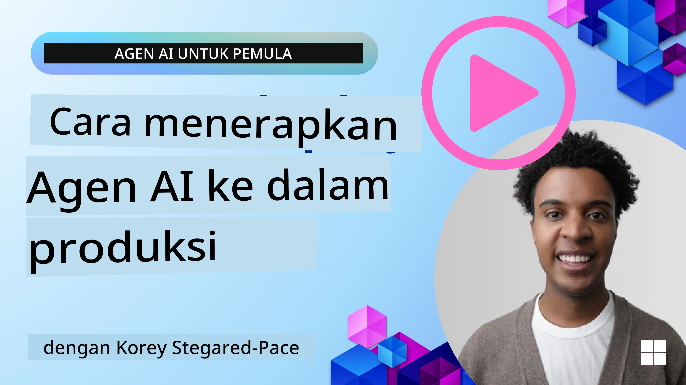

# Agen AI dalam Produksi: Observabilitas & Evaluasi

[](https://youtu.be/l4TP6IyJxmQ?si=reGOyeqjxFevyDq9)

Saat agen AI beralih dari prototipe eksperimental ke aplikasi dunia nyata, kemampuan untuk memahami perilakunya, memantau kinerjanya, dan secara sistematis mengevaluasi keluaran mereka menjadi penting.

## Tujuan Pembelajaran

Setelah menyelesaikan pelajaran ini, Anda akan tahu cara/ mengerti:
- Konsep inti observabilitas dan evaluasi agen
- Teknik untuk meningkatkan kinerja, biaya, dan efektivitas agen
- Apa dan bagaimana mengevaluasi agen AI Anda secara sistematis
- Cara mengontrol biaya saat menerapkan agen AI ke produksi
- Cara menginstrumentasi agen yang dibangun dengan Microsoft Agent Framework

Tujuannya adalah untuk membekali Anda dengan pengetahuan untuk mengubah agen "kotak hitam" Anda menjadi sistem yang transparan, dapat dikelola, dan dapat diandalkan.

_**Catatan:** Penting untuk menerapkan Agen AI yang aman dan dapat dipercaya. Lihat juga pelajaran [Building Trustworthy AI Agents](../06-building-trustworthy-agents/README.md)._

## Jejak dan Span

Alat observabilitas seperti [Langfuse](https://langfuse.com/) atau [Microsoft Foundry](https://learn.microsoft.com/en-us/azure/ai-foundry/what-is-azure-ai-foundry) biasanya merepresentasikan jalannya agen sebagai jejak dan span.

- **Jejak** mewakili seluruh tugas agen dari awal hingga akhir (seperti menangani kueri pengguna).
- **Span** adalah langkah individual dalam jejak tersebut (seperti memanggil model bahasa atau mengambil data).


<!-- Image URL retained for illustration purposes -->

Tanpa observabilitas, agen AI bisa terasa seperti "kotak hitam" - keadaan internal dan penalarannya tidak transparan, membuat sulit untuk mendiagnosis masalah atau mengoptimalkan kinerja. Dengan observabilitas, agen menjadi "kotak kaca," menawarkan transparansi yang sangat penting untuk membangun kepercayaan dan memastikan mereka beroperasi seperti yang diinginkan.

## Mengapa Observabilitas Penting di Lingkungan Produksi

Memindahkan agen AI ke lingkungan produksi membawa serangkaian tantangan dan persyaratan baru. Observabilitas bukan lagi "hal yang bagus untuk dimiliki" tetapi kemampuan yang krusial:

*   **Debugging dan Analisis Penyebab Utama**: Saat agen gagal atau menghasilkan keluaran yang tidak terduga, alat observabilitas memberikan jejak yang diperlukan untuk menemukan sumber kesalahan. Ini sangat penting pada agen kompleks yang mungkin melibatkan banyak panggilan LLM, interaksi alat, dan logika kondisional.
*   **Manajemen Latensi dan Biaya**: Agen AI sering mengandalkan LLM dan API eksternal lain yang dikenai biaya per token atau per panggilan. Observabilitas memungkinkan pelacakan presisi panggilan-panggilan ini, membantu mengidentifikasi operasi yang terlalu lambat atau mahal. Ini memungkinkan tim mengoptimalkan prompt, memilih model yang lebih efisien, atau merancang ulang alur kerja untuk mengelola biaya operasional dan memastikan pengalaman pengguna yang baik.
*   **Kepercayaan, Keamanan, dan Kepatuhan**: Dalam banyak aplikasi, penting untuk memastikan agen berperilaku dengan aman dan etis. Observabilitas menyediakan jejak audit tindakan dan keputusan agen. Ini dapat digunakan untuk mendeteksi dan mengatasi masalah seperti injeksi prompt, pembuatan konten berbahaya, atau penanganan informasi identitas pribadi (PII) yang salah. Misalnya, Anda dapat meninjau jejak untuk memahami mengapa agen memberikan respons tertentu atau menggunakan alat spesifik.
*   **Lingkaran Perbaikan Berkelanjutan**: Data observabilitas adalah dasar dari proses pengembangan iteratif. Dengan memantau bagaimana agen berperforma di dunia nyata, tim dapat mengidentifikasi area untuk perbaikan, mengumpulkan data untuk penyempurnaan model, dan memvalidasi dampak perubahan. Ini menciptakan umpan balik di mana wawasan produksi dari evaluasi online menginformasikan eksperimen dan penyempurnaan offline, menghasilkan kinerja agen yang semakin baik.

## Metrik Kunci yang Harus Dilacak

Untuk memantau dan memahami perilaku agen, berbagai metrik dan sinyal harus dilacak. Meskipun metrik spesifik mungkin bervariasi berdasarkan tujuan agen, beberapa sangat penting secara universal.

Berikut beberapa metrik paling umum yang dipantau alat observabilitas:

**Latensi:** Seberapa cepat agen merespons? Waktu tunggu lama berdampak negatif pada pengalaman pengguna. Anda harus mengukur latensi untuk tugas dan langkah individual dengan melacak jalannya agen. Contohnya, agen yang membutuhkan 20 detik untuk semua panggilan model dapat dipercepat dengan menggunakan model yang lebih cepat atau menjalankan panggilan model secara paralel.

**Biaya:** Berapa biaya per jalannya agen? Agen AI mengandalkan panggilan LLM yang dikenakan biaya per token atau API eksternal. Penggunaan alat yang sering atau banyak prompt dapat dengan cepat meningkatkan biaya. Misalnya, jika agen memanggil LLM lima kali untuk peningkatan kualitas kecil, Anda harus menilai apakah biayanya sepadan atau bisa mengurangi jumlah panggilan atau menggunakan model lebih murah. Pemantauan waktu nyata juga membantu mengidentifikasi lonjakan tak terduga (misalnya bug yang menyebabkan loop API berlebihan).

**Kesalahan Permintaan:** Berapa banyak permintaan yang gagal oleh agen? Ini bisa termasuk kesalahan API atau panggilan alat yang gagal. Untuk membuat agen Anda lebih tangguh terhadap ini di produksi, Anda dapat mengatur fallback atau pengulangan. Misalnya, jika penyedia LLM A down, Anda beralih ke penyedia LLM B sebagai cadangan.

**Umpan Balik Pengguna:** Implementasi evaluasi langsung pengguna memberikan wawasan berharga. Ini dapat berupa penilaian eksplisit (👍jempol naik/👎turun, ⭐1-5 bintang) atau komentar teks. Umpan balik negatif yang konsisten harus menjadi peringatan karena ini tanda agen tidak bekerja sesuai harapan.

**Umpan Balik Pengguna Implisit:** Perilaku pengguna memberikan umpan balik tidak langsung meskipun tanpa penilaian eksplisit. Ini bisa termasuk pengulangan pertanyaan secara langsung, kueri berulang, atau mengklik tombol coba ulang. Misalnya, jika Anda melihat pengguna berulang kali menanyakan pertanyaan yang sama, ini tanda agen tidak bekerja sesuai harapan.

**Akurasi:** Seberapa sering agen menghasilkan keluaran yang benar atau diinginkan? Definisi akurasi bervariasi (misalnya, kebenaran pemecahan masalah, akurasi pengambilan informasi, kepuasan pengguna). Langkah pertama adalah mendefinisikan seperti apa keberhasilan untuk agen Anda. Anda dapat melacak akurasi melalui pemeriksaan otomatis, skor evaluasi, atau label penyelesaian tugas. Misalnya, menandai jejak sebagai "berhasil" atau "gagal".

**Metrik Evaluasi Otomatis:** Anda juga bisa mengatur evaluasi otomatis. Misalnya, Anda dapat menggunakan LLM untuk memberi skor keluaran agen apakah berguna, akurat, atau tidak. Ada juga beberapa pustaka open source yang membantu menilai berbagai aspek agen. Misalnya [RAGAS](https://docs.ragas.io/) untuk agen RAG atau [LLM Guard](https://github.com/protectai/llm-guard) untuk mendeteksi bahasa berbahaya atau injeksi prompt.

Dalam praktiknya, kombinasi metrik ini memberikan cakupan terbaik terhadap kesehatan agen AI. Dalam [notebook contoh](./code_samples/10-expense_claim-demo.ipynb) bab ini, kami akan menunjukkan bagaimana metrik ini terlihat dalam contoh nyata, tetapi pertama, kita akan mempelajari bagaimana alur kerja evaluasi tipikal.

## Menginstrumentasi Agen Anda

Untuk mengumpulkan data pelacakan, Anda perlu menginstrumentasi kode Anda. Tujuannya adalah menginstrumentasi kode agen untuk mengeluarkan jejak dan metrik yang dapat ditangkap, diproses, dan divisualisasikan oleh platform observabilitas.

**OpenTelemetry (OTel):** [OpenTelemetry](https://opentelemetry.io/) telah menjadi standar industri untuk observabilitas LLM. Ini menyediakan seperangkat API, SDK, dan alat untuk menghasilkan, mengumpulkan, dan mengekspor data telemetri.

Ada banyak pustaka instrumentasi yang membungkus kerangka agen yang ada dan memudahkan ekspor span OpenTelemetry ke alat observabilitas. Microsoft Agent Framework terintegrasi secara native dengan OpenTelemetry. Berikut contoh menginstrumentasi agen MAF:

```python
from agent_framework.observability import get_tracer, get_meter

tracer = get_tracer()
meter = get_meter()

with tracer.start_as_current_span("agent_run"):
    # Agent execution is traced automatically
    pass
```

[notebook contoh](./code_samples/10-expense_claim-demo.ipynb) di bab ini akan mendemonstrasikan cara menginstrumentasi agen MAF Anda.

**Pembuatan Span Manual:** Meskipun pustaka instrumentasi menyediakan dasar yang baik, sering kali ada kasus yang membutuhkan informasi lebih detail atau kustom. Anda dapat membuat span secara manual untuk menambahkan logika aplikasi khusus. Lebih penting lagi, mereka dapat memperkaya span yang dibuat otomatis atau manual dengan atribut khusus (juga dikenal sebagai tag atau metadata). Atribut ini bisa mencakup data bisnis spesifik, perhitungan antara, atau konteks apa pun yang berguna untuk debugging atau analisis, seperti `user_id`, `session_id`, atau `model_version`.

Contoh membuat jejak dan span secara manual dengan [Langfuse Python SDK](https://langfuse.com/docs/sdk/python/sdk-v3):

```python
from langfuse import get_client
 
langfuse = get_client()
 
span = langfuse.start_span(name="my-span")
 
span.end()
```

## Evaluasi Agen

Observabilitas memberi kita metrik, tetapi evaluasi adalah proses menganalisis data tersebut (dan melakukan pengujian) untuk menentukan seberapa baik agen AI berperforma dan bagaimana ia dapat diperbaiki. Dengan kata lain, setelah Anda memiliki jejak dan metrik tersebut, bagaimana Anda menggunakannya untuk menilai agen dan mengambil keputusan?

Evaluasi rutin penting karena agen AI sering kali tidak deterministik dan bisa berkembang (melalui pembaruan atau perilaku model yang bergeser) – tanpa evaluasi, Anda tidak akan tahu apakah “agen pintar” Anda benar-benar menjalankan tugas dengan baik atau malah menurun.

Ada dua kategori evaluasi untuk agen AI: **evaluasi online** dan **evaluasi offline**. Keduanya berharga dan saling melengkapi. Biasanya kita mulai dengan evaluasi offline, karena ini adalah langkah minimum yang diperlukan sebelum menerapkan agen apa pun.

### Evaluasi Offline


Ini melibatkan evaluasi agen dalam pengaturan terkontrol, biasanya menggunakan dataset pengujian, bukan kueri pengguna langsung. Anda menggunakan dataset yang dikurasi di mana Anda tahu keluaran yang diharapkan atau perilaku yang benar, lalu menjalankan agen Anda pada dataset tersebut.

Misalnya, jika Anda membangun agen soal kata matematika, Anda mungkin memiliki [dataset pengujian](https://huggingface.co/datasets/openai/gsm8k) berisi 100 masalah dengan jawaban diketahui. Evaluasi offline sering dilakukan selama pengembangan (dan bisa menjadi bagian dari pipeline CI/CD) untuk memeriksa peningkatan atau menghindari regresi. Keuntungannya adalah ini **dapat diulang dan Anda mendapatkan metrik akurasi jelas karena ada kebenaran dasar**. Anda juga dapat menyimulasikan kueri pengguna dan mengukur respons agen terhadap jawaban ideal atau menggunakan metrik otomatis seperti yang dijelaskan di atas.

Tantangan utama evaluasi offline adalah memastikan dataset pengujian Anda komprehensif dan tetap relevan – agen mungkin bekerja baik pada dataset pengujian tetap tetapi menghadapi kueri yang sangat berbeda dalam produksi. Oleh karena itu, Anda harus memperbarui dataset pengujian dengan kasus tepi dan contoh baru yang mencerminkan skenario dunia nyata.​ Campuran kasus "smoke test" kecil dan set evaluasi yang lebih besar berguna: set kecil untuk pemeriksaan cepat dan set besar untuk metrik kinerja lebih luas​.

### Evaluasi Online


Ini merujuk pada evaluasi agen dalam lingkungan nyata langsung, yaitu selama penggunaan aktual di produksi. Evaluasi online melibatkan pemantauan kinerja agen pada interaksi pengguna nyata dan menganalisis hasil secara terus-menerus.

Misalnya, Anda mungkin melacak tingkat keberhasilan, skor kepuasan pengguna, atau metrik lain pada trafik langsung. Keuntungan evaluasi online adalah ini **menangkap hal-hal yang mungkin tidak Anda antisipasi di laboratorium** – Anda dapat mengamati pergeseran model seiring waktu (jika efektivitas agen menurun saat pola input bergeser) dan menangkap kueri atau situasi tak terduga yang tidak ada dalam data pengujian Anda​. Ini memberikan gambaran nyata tentang bagaimana agen berperilaku di dunia nyata.

Evaluasi online sering kali melibatkan pengumpulan umpan balik pengguna implisit dan eksplisit, seperti yang dibahas, dan mungkin menjalankan tes bayangan atau tes A/B (di mana versi agen baru berjalan paralel untuk dibandingkan dengan versi lama). Tantangannya adalah sulit mendapatkan label atau skor yang andal untuk interaksi langsung – Anda mungkin mengandalkan umpan balik pengguna atau metrik hilir (misalnya apakah pengguna mengklik hasil).

### Menggabungkan Kedua Metode

Evaluasi online dan offline tidak saling eksklusif; keduanya sangat melengkapi. Wawasan dari pemantauan online (misalnya tipe baru kueri pengguna di mana agen kurang baik) dapat digunakan untuk menambah dan memperbaiki dataset pengujian offline. Sebaliknya, agen yang bekerja baik dalam tes offline kemudian dapat diterapkan dengan lebih percaya diri dan dipantau online.

Bahkan, banyak tim mengadopsi siklus:

_evaluasi offline -> terapkan -> pantau online -> kumpulkan kasus kegagalan baru -> tambahkan ke dataset offline -> perbaiki agen -> ulangi_.

## Masalah Umum

Saat Anda menerapkan agen AI ke produksi, Anda mungkin menghadapi berbagai tantangan. Berikut beberapa masalah umum dan solusi potensialnya:

| **Masalah**    | **Solusi Potensial**   |
| ------------- | ------------------ |
| Agen AI tidak menjalankan tugas dengan konsisten | - Perbaiki prompt yang diberikan kepada Agen AI; buat tujuan jelas.<br>- Identifikasi apakah membagi tugas menjadi subtugas dan menanganinya oleh beberapa agen membantu. |
| Agen AI mengalami loop terus-menerus  | - Pastikan Anda memiliki ketentuan penghentian yang jelas supaya Agen tahu kapan menghentikan proses.<br>- Untuk tugas kompleks yang membutuhkan penalaran dan perencanaan, gunakan model lebih besar khusus untuk tugas penalaran. |
| Panggilan alat Agen AI tidak berjalan baik   | - Uji dan validasi keluaran alat di luar sistem agen.<br>- Perbaiki parameter, prompt, dan penamaan alat yang telah ditetapkan.  |
| Sistem Multi-Agen tidak bekerja konsisten | - Perbaiki prompt yang diberikan ke masing-masing agen agar spesifik dan berbeda satu sama lain.<br>- Bangun sistem hierarkis menggunakan agen "routing" atau pengendali untuk menentukan agen yang tepat. |

Banyak masalah ini dapat lebih efektif dikenali dengan adanya observabilitas. Jejak dan metrik yang kita bahas sebelumnya membantu menentukan secara tepat bagian mana dari alur kerja agen yang bermasalah, membuat debugging dan optimasi jauh lebih efisien.

## Mengelola Biaya

Berikut beberapa strategi untuk mengelola biaya penerapan agen AI ke produksi:

**Menggunakan Model yang Lebih Kecil:** Small Language Models (SLM) dapat bekerja dengan baik pada beberapa kasus penggunaan agen dan akan mengurangi biaya secara signifikan. Seperti yang disebutkan sebelumnya, membangun sistem evaluasi untuk menentukan dan membandingkan kinerja dengan model yang lebih besar adalah cara terbaik untuk memahami seberapa baik SLM akan bekerja pada kasus penggunaan Anda. Pertimbangkan menggunakan SLM untuk tugas yang lebih sederhana seperti klasifikasi intent atau ekstraksi parameter, sementara mempertahankan model yang lebih besar untuk penalaran yang kompleks.

**Menggunakan Model Router:** Strategi serupa adalah menggunakan keberagaman model dan ukuran. Anda dapat menggunakan LLM/SLM atau fungsi tanpa server untuk mengarahkan permintaan berdasarkan kompleksitas ke model yang paling sesuai. Ini juga akan membantu mengurangi biaya sekaligus memastikan kinerja pada tugas yang tepat. Misalnya, arahkan kueri sederhana ke model yang lebih kecil dan lebih cepat, dan hanya gunakan model besar yang mahal untuk tugas penalaran yang kompleks.

**Menyimpan Cache Respon:** Mengidentifikasi permintaan dan tugas yang umum serta menyediakan responsnya sebelum melalui sistem agen Anda adalah cara yang baik untuk mengurangi volume permintaan serupa. Anda bahkan dapat mengimplementasikan alur untuk mengidentifikasi seberapa mirip sebuah permintaan dengan permintaan yang sudah di-cache menggunakan model AI yang lebih dasar. Strategi ini dapat secara signifikan mengurangi biaya untuk pertanyaan yang sering diajukan atau alur kerja umum.

## Mari kita lihat bagaimana ini bekerja dalam praktik

Dalam [notebook contoh pada bagian ini](./code_samples/10-expense_claim-demo.ipynb), kita akan melihat contoh bagaimana kita dapat menggunakan alat observabilitas untuk memantau dan mengevaluasi agen kita.


### Punya Pertanyaan Lebih Lanjut tentang AI Agents di Produksi?

Bergabunglah dengan [Microsoft Foundry Discord](https://discord.com/invite/ATgtXmAS5D) untuk bertemu dengan pelajar lain, mengikuti jam kantor, dan mendapatkan jawaban atas pertanyaan Anda tentang AI Agents.

## Pelajaran Sebelumnya

[Metacognition Design Pattern](../09-metacognition/README.md)

## Pelajaran Selanjutnya

[Agentic Protocols](../11-agentic-protocols/README.md)

---

<!-- CO-OP TRANSLATOR DISCLAIMER START -->
**Penafian**:
Dokumen ini telah diterjemahkan menggunakan layanan terjemahan AI [Co-op Translator](https://github.com/Azure/co-op-translator). Meskipun kami berupaya untuk mencapai akurasi, harap diketahui bahwa terjemahan otomatis mungkin mengandung kesalahan atau ketidakakuratan. Dokumen asli dalam bahasa aslinya harus dianggap sebagai sumber yang sah. Untuk informasi penting, disarankan menggunakan terjemahan profesional oleh manusia. Kami tidak bertanggung jawab atas kesalahpahaman atau penafsiran yang keliru yang timbul dari penggunaan terjemahan ini.
<!-- CO-OP TRANSLATOR DISCLAIMER END -->