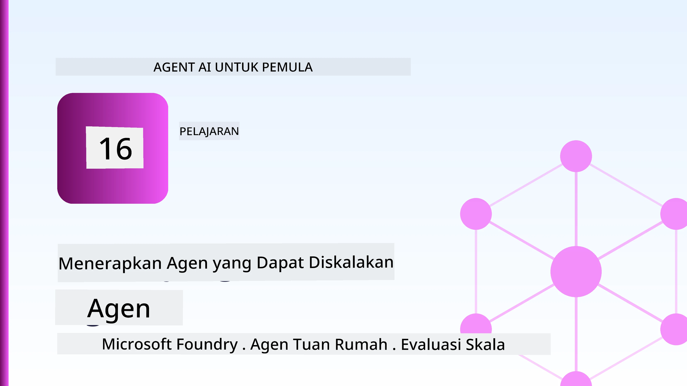
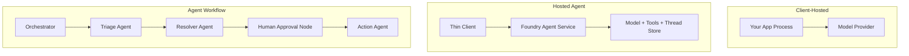
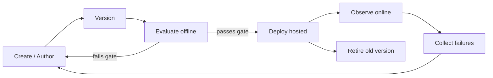
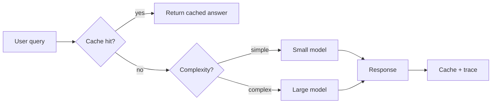
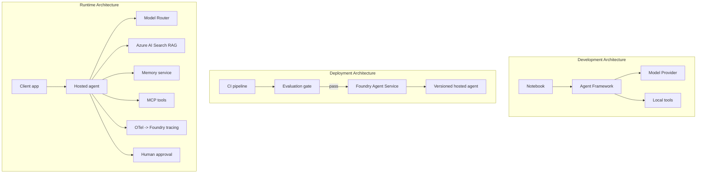

# Mendeploy Agen Skala Besar dengan Microsoft Foundry



Hingga titik ini dalam kursus, Anda telah membangun agen yang berjalan di laptop Anda, di dalam notebook, digerakkan oleh `az login` dan beberapa variabel lingkungan. Itu adalah cara yang tepat untuk belajar. Namun itu bukan cara yang tepat untuk menjalankan agen yang ribuan pelanggan andalkan pada jam 3 pagi.

Pelajaran ini tentang kesenjangan antara "berfungsi di mesin saya" dan "berfungsi, dengan andal dan terjangkau, dalam produksi." Kami menutup kesenjangan itu menggunakan **Microsoft Foundry** dan **Microsoft Foundry Agent Service**, dan kami melakukannya dengan membangun agen dukungan pelanggan nyata yang memiliki alat, pengambilan, memori, evaluasi, dan pemantauan.

## Pengantar

Pelajaran ini akan membahas:

- Perbedaan antara **agen prototipe** dan **agen yang terdeploy**, dan mengapa transisi ini sebagian besar tentang segala hal *di sekeliling* model.
- **Pola deployment** untuk agen: di-host oleh klien, di-host layanan (Hosted Agents), dan terorkestrasi dalam alur kerja.
- **Siklus hidup agen** di Microsoft Foundry — buat, versi, deploy, evaluasi, amati, pensiunkan.
- **Strategi skala**: routing model, caching, konkurensi, dan desain tanpa status.
- **Observabilitas** dengan OpenTelemetry dan pelacakan Foundry.
- **Optimasi biaya** melalui pemilihan model, routing, dan gerbang evaluasi.
- **Pertimbangan perusahaan**: tata kelola, persetujuan manusia, dan menjalankan server MCP dengan aman dalam produksi.

## Tujuan Pembelajaran

Setelah menyelesaikan pelajaran ini, Anda akan tahu cara:

- Memilih pola deployment yang tepat untuk beban kerja agen tertentu.
- Mendeploy agen ke Microsoft Foundry Agent Service sehingga agen tersebut memiliki versi, diawasi tata kelolanya, dan dapat diamati.
- Menginstrumentasi agen untuk pelacakan dan menghubungkan pipeline evaluasi yang berjalan sebelum setiap rilis.
- Menerapkan routing dan caching model agar latency dan biaya tetap terkendali dalam skala besar.
- Menambahkan gerbang persetujuan manusia untuk tindakan dengan risiko tinggi dan mengintegrasikan server MCP dengan cara yang aman untuk produksi.

## Prasyarat

Pelajaran ini mengasumsikan Anda telah menyelesaikan pelajaran sebelumnya dan nyaman dengan:

- Membangun agen dengan [Microsoft Agent Framework](../14-microsoft-agent-framework/README.md) (Pelajaran 14).
- [Penggunaan Alat](../04-tool-use/README.md) (Pelajaran 4) dan [Agentic RAG](../05-agentic-rag/README.md) (Pelajaran 5).
- [Memori Agen](../13-agent-memory/README.md) (Pelajaran 13) dan [Protokol Agentik / MCP](../11-agentic-protocols/README.md) (Pelajaran 11).
- [Observabilitas dan Evaluasi](../10-ai-agents-production/README.md) (Pelajaran 10) — pelajaran ini membangun langsung dari situ.

Anda juga akan memerlukan:

- **Langganan Azure** dan **proyek Microsoft Foundry** dengan setidaknya satu model chat yang sudah dideploy.
- **Azure CLI** yang sudah diautentikasi (`az login`).
- Python 3.12+ dan paket-paket di repositori [`requirements.txt`](../../../requirements.txt).

## Dari Prototipe ke Produksi: Apa yang Sebenarnya Berubah

Agen prototipe dan agen produksi berbagi loop inti yang sama — berpikir, memanggil alat, merespon. Yang berubah adalah segala sesuatu yang membungkus loop itu. Model hanya sekitar 20% dari agen produksi; 80% lainnya adalah kerangka operasional.

| Perhatian | Prototipe | Produksi |
| --- | --- | --- |
| **Hosting** | Berjalan di notebook Anda | Berjalan sebagai layanan yang dihost, diberi versi dan diluncurkan |
| **Identitas** | Token `az login` Anda | Identitas terkelola dengan RBAC cakupan |
| **Status** | Dalam memori, hilang saat restart | Tersimpan di luar (penyimpanan thread, layanan memori) |
| **Kegagalan** | Anda melihat traceback | Retry, fallback, dead-letter, peringatan |
| **Biaya** | "Hanya beberapa sen" | Dilacak per permintaan, diarahkan, di-cache, dianggarkan |
| **Kualitas** | Anda menilai output secara langsung | Dievaluasi secara otomatis sebelum setiap rilis |
| **Kepercayaan** | Anda menyetujui setiap tindakan | Kebijakan + human-in-the-loop untuk tindakan berisiko |

Ingat tabel ini. Setiap bagian di bawah ini terkait dengan salah satu baris ini.

## Pola Deployment Agen

Ada tiga pola yang akan Anda gunakan, seringkali dalam kombinasi.

### 1. Agen yang Di-host oleh Klien

Objek agen berada di dalam proses aplikasi *Anda*. Kode Anda memanggil penyedia model secara langsung; loop penalaran berjalan di layanan Anda. Ini adalah apa yang dilakukan di setiap pelajaran sebelumnya.

- **Gunakan saat** Anda membutuhkan kontrol penuh atas loop, middleware khusus, atau Anda menyematkan agen di backend yang sudah ada.
- **Pertukaran**: Anda mengelola skala, status, dan ketangguhan sendiri.

### 2. Agen yang Di-host (Foundry Agent Service)

Agen *terdaftar sebagai sumber daya* di Microsoft Foundry. Foundry meng-host loop penalaran, menyimpan thread, menegakkan keamanan konten dan RBAC, serta membuat agen terlihat di portal Foundry. Aplikasi Anda menjadi klien ringan yang membuat thread dan membaca respons.

- **Gunakan saat** Anda menginginkan daya tahan, observabilitas bawaan, tata kelola, dan permukaan operasional yang lebih sedikit.
- **Pertukaran**: kontrol tingkat rendah yang lebih sedikit sebagai imbalan untuk runtime terkelola.

### 3. Alur Kerja Agen

Beberapa agen (dan alat) disusun menjadi grafik dengan alur kontrol eksplisit — langkah berurutan, percabangan, node persetujuan manusia, dan checkpoint tahan lama yang bisa dijeda dan dilanjutkan. Ini adalah kemampuan **Workflows** Microsoft Agent Framework yang diterapkan pada skala deployment.

- **Gunakan saat** satu tugas mencakup beberapa agen khusus atau membutuhkan langkah persetujuan di tengah.
- **Pertukaran**: lebih banyak bagian yang bergerak; membutuhkan observabilitas tingkat orkestrasi.



## Siklus Hidup Agen di Microsoft Foundry

Mendeploy agen bukanlah satu kali `push`. Ini adalah sebuah loop, dan sangat mirip dengan siklus rilis perangkat lunak karena memang itu terjadi.



Ide utama, yang diambil dari [Pelajaran 10](../10-ai-agents-production/README.md): **evaluasi offline adalah gerbang, bukan pikiran setelahnya.** Versi agen baru tidak akan dirilis jika tidak lulus ambang evaluasi Anda. Observasi online kemudian memberikan kegagalan dunia nyata kembali ke set pengujian offline Anda. Itu adalah seluruh loop.

## Strategi Skala

Meningkatkan skala agen berbeda dengan meningkatkan skala API web tanpa status, karena setiap permintaan bisa memicu banyak panggilan model dan alat yang mahal. Empat teknik membawa sebagian besar beban.

**Penanganan permintaan tanpa status.** Jangan simpan status per pengguna dalam memori proses Anda. Simpan percakapan dalam penyimpanan thread Foundry atau layanan memori sehingga instance mana pun dapat menangani permintaan apa pun. Ini yang memungkinkan Anda melakukan scale horizontal — menambah instance, tanpa sesi lengket.

**Routing model.** Tidak semua permintaan membutuhkan model paling mampu (dan paling mahal) Anda. Arahkan permintaan sederhana — klasifikasi niat, jawaban faktual singkat — ke model kecil dan cepat, dan simpan model besar untuk penalaran sebenarnya. **Model Router** Foundry bisa melakukan ini untuk Anda, atau Anda dapat mengimplementasikan pengklasifikator ringan sendiri. Anda akan membangun versi DIY di lab.

**Caching respons.** Banyak pertanyaan dukungan hampir duplikat ("bagaimana cara mereset password saya?"). Cache jawaban untuk pertanyaan umum dan sajikan tanpa memanggil model sama sekali. Bahkan tingkat cache hit yang sederhana secara signifikan mengurangi biaya dan latensi.

**Konkurensi dan tekanan balik.** Penyedia model memiliki batasan laju. Batasi konkurensi Anda, gunakan retry dengan backoff eksponensial, dan gagal dengan anggun (respons "kami sedang mengerjakannya" yang antri lebih baik daripada error 500).



## Observabilitas dalam Produksi

Anda tidak bisa mengoperasikan sesuatu yang tidak bisa Anda lihat. Seperti yang dibahas di Pelajaran 10, Microsoft Agent Framework mengeluarkan jejak **OpenTelemetry** secara native — setiap panggilan model, invokasi alat, dan langkah orkestrasi menjadi sebuah span. Dalam produksi Anda mengirimkan span tersebut ke Microsoft Foundry (atau backend kompatibel OTel lain) sehingga Anda bisa:

- Melacak keluhan pelanggan tunggal dari awal sampai akhir melalui setiap panggilan model dan alat.
- Mengamati latency p50/p95 dan biaya per permintaan seiring waktu.
- Memberi peringatan pada lonjakan tingkat kesalahan dan anomali biaya sebelum pengguna Anda (atau tim keuangan Anda) menyadarinya.

```python
from agent_framework.observability import get_tracer

tracer = get_tracer()

with tracer.start_as_current_span("support_request") as span:
    span.set_attribute("customer.tier", "enterprise")
    span.set_attribute("routed.model", "gpt-5-nano")
    # agent execution is traced automatically inside this span
```

Atribut seperti `customer.tier` dan `routed.model` adalah apa yang mengubah tumpukan jejak menjadi pertanyaan yang bisa dijawab ("apakah pelanggan perusahaan terlalu sering diarahkan ke model kecil?").

## Optimasi Biaya

Biaya dalam agen produksi didominasi oleh token. Ada tiga tuas, menurut urutan dampak:

1. **Ukuran model yang tepat.** Model kecil yang lolos gerbang evaluasi Anda hampir selalu lebih murah daripada model besar yang juga lolos. Gunakan evaluasi untuk *membuktikan* model kecil sudah cukup baik daripada memilih model terbesar tanpa pertimbangan.
2. **Routing berdasarkan kompleksitas.** Seperti di atas — bayar harga model besar hanya untuk permintaan yang benar-benar butuh penalaran model besar.
3. **Caching agresif.** Panggilan model termurah adalah yang tidak pernah Anda lakukan.

Gerbang evaluasi dan kontrol biaya adalah disiplin yang sama dilihat dari dua sudut: evaluasi memberi tahu *lantai kualitas*, routing dan caching menjaga Anda sedekat mungkin dengan *biaya* lantai itu.

## Pertimbangan Deployment Perusahaan

**Tata Kelola.** Hosted Agents mewarisi RBAC, keamanan konten, dan pencatatan audit Foundry. Berikan setiap agen identitas terkelola dengan hak akses paling rendah yang dibutuhkan — akses baca-saja ke basis pengetahuan, akses terbatas API tiket, tidak lebih dari itu.

**Human-in-the-loop.** Beberapa tindakan terlalu penting untuk diotomasi langsung — mengeluarkan pengembalian dana, menghapus akun, eskalasi ke tim hukum. Microsoft Agent Framework mendukung alat **memerlukan persetujuan**: agen mengusulkan tindakan, eksekusi dijeda, manusia menyetujui atau menolak, dan alur kerja dilanjutkan. Anda sudah melihat primitif ini di [Pelajaran 6](../06-building-trustworthy-agents/README.md); di sini Anda mendeploynya.

**MCP dalam produksi.** [MCP](../11-agentic-protocols/README.md) membiarkan agen Anda menggunakan alat eksternal lewat antarmuka standar. Dalam produksi, perlakukan setiap server MCP sebagai batas yang tidak dipercaya: kunci versi server, jalankan dengan identitas yang dibatasi, validasi output-nya, dan jangan pernah berikan rahasia kepadanya. Server MCP adalah dependensi, dan dependensi harus di-patch, diaudit, dan dibatasi laju.



Ketiga diagram itu — pengembangan, deployment, runtime — adalah agen yang sama dalam tiga tahap kehidupan. Lab berikutnya akan memandu Anda membangunnya.

## Lab Praktik: Agen Dukungan Pelanggan Siap Produksi

Buka [`code_samples/16-python-agent-framework.ipynb`](./code_samples/16-python-agent-framework.ipynb) dan kerjakan sampai selesai. Anda akan merakit agen **dukungan pelanggan Contoso** dengan semua perhatian produksi terjamin:

1. **Pemanggilan alat** — mencari status pesanan dan membuka tiket dukungan.
2. **RAG** — menjawab pertanyaan kebijakan dari basis pengetahuan (Azure AI Search, dengan fallback di memori agar notebook bisa berjalan tanpa sumber daya Search).
3. **Memori** — mengingat pelanggan sepanjang percakapan.
4. **Routing model** — pengklasifikasian kompleksitas mengarahkan setiap permintaan ke model kecil atau besar.
5. **Caching respons** — pertanyaan berulang disajikan dari cache.
6. **Persetujuan manusia** — pengembalian dana di atas ambang tertentu menunggu tanda tangan manusia.
7. **Pipeline evaluasi** — set tes offline kecil menilai agen dan menjadi gerbang rilis.
8. **Observabilitas** — pelacakan OpenTelemetry di setiap permintaan.

### Panduan Langkah

Notebook diorganisasi sehingga setiap perhatian produksi adalah bagian yang berdiri sendiri dan bisa dijalankan. Intinya adalah penangan permintaan routing-plus-caching:

```python
async def handle_support_request(query: str, customer_id: str) -> str:
    # 1. Serve from cache when we can.
    cached = response_cache.get(normalize(query))
    if cached:
        return cached

    # 2. Route by complexity to control cost.
    model = "gpt-5-nano" if is_simple(query) else "gpt-5-mini"

    # 3. Run the agent inside a trace span for observability.
    with tracer.start_as_current_span("support_request") as span:
        span.set_attribute("routed.model", model)
        span.set_attribute("customer.id", customer_id)
        response = await support_agent.run(query, model=model)

    # 4. Cache and return.
    response_cache.set(normalize(query), response.text)
    return response.text
```

Gerbang evaluasi yang menjaga rilis tampak seperti ini:

```python
async def evaluation_gate(agent, test_cases, threshold: float = 0.8) -> bool:
    passed = 0
    for case in test_cases:
        result = await agent.run(case["input"])
        if score_response(result.text, case["expected"]) >= 0.8:
            passed += 1
    pass_rate = passed / len(test_cases)
    print(f"Evaluation pass rate: {pass_rate:.0%} (gate: {threshold:.0%})")
    return pass_rate >= threshold  # only deploy if the gate passes
```

Baca setiap baris — notebook membuat primitif sengaja kecil agar tidak ada yang tersembunyi di balik pemanggilan framework.

## Memvalidasi Agen yang Terdeploy dengan Smoke Test

Gerbang evaluasi di atas dijalankan *offline* terhadap objek agen Anda. Setelah agen di-deploy sebagai Hosted Agent, Anda membutuhkan pengecekan tambahan yang lebih murah: **apakah endpoint deployed benar-benar merespons?**

Mendeploy "berhasil" hanya membuktikan bahwa control plane menerima definisi — itu tidak membuktikan agen merespons. Dependensi yang hilang, routing model yang buruk, atau koneksi kadaluarsa bisa meninggalkan deployment hijau yang tidak mengembalikan apa-apa. **Smoke test** menangkap itu dalam hitungan detik, setiap deploy, tanpa biaya evaluasi penuh.

Repositori ini menyediakan pipeline smoke test siap pakai yang dibangun di atas GitHub Action [AI Smoke Test](https://github.com/marketplace/actions/ai-smoke-test):

- **Katalog** — [`tests/lesson-16-smoke-tests.json`](../../../tests/lesson-16-smoke-tests.json) berisi prompt dan penegasan untuk agen dukungan Contoso (jawaban kebijakan berpijak, pencarian pesanan, tetap pada topik, dan kontinuitas thread multi-putaran). Katalog untuk agen pelajaran lain ada bersama di sebelahnya — lihat [`tests/README.md`](../tests/README.md).
- **Alur kerja** — [`.github/workflows/smoke-test.yml`](../../../.github/workflows/smoke-test.yml) login dengan Azure OIDC dan POST setiap prompt ke endpoint Responses agen, gagal jika ada penegasan yang tidak sesuai.

```yaml
- name: Smoke-test hosted agent
  uses: JFolberth/ai-smoketest@v1
  with:
    project_endpoint: ${{ inputs.project_endpoint }}
    agent_name: ContosoSupportAgent
    tests_file: tests/lesson-16-smoke-tests.json
```

Jalankan dari tab **Actions** setelah agen Anda dikerahkan, dengan menyuplai endpoint proyek Foundry dan nama agen Anda. Identitas federasi memerlukan peran **Azure AI User** pada cakupan proyek Foundry. Pikirkan lapisan-lapisan seperti sebuah piramida: tes asap (apakah dapat dijangkau dan merespons?) dijalankan pada setiap penyebaran, evaluasi offline (cukup baik untuk dikirim?) dijalankan sebelum promosi, dan evaluasi online (bagaimana performanya di lapangan?) berjalan secara terus-menerus.

## Pemeriksaan Pengetahuan

Uji pemahaman Anda sebelum melanjutkan ke tugas.

**1. Kira-kira berapa proporsi agen produksi yang merupakan "model", dan apa sisanya?**

<details>
<summary>Jawaban</summary>

Model adalah sebagian kecil dari sistem — sering disebut sekitar 20%. Sisanya adalah kerangka operasional: hosting dan versioning, identitas dan RBAC, status yang dieksternalisi, penanganan kegagalan, pelacakan biaya, evaluasi, dan kontrol human-in-the-loop. Pindah ke produksi sebagian besar tentang membangun segala sesuatu *di sekitar* siklus penalaran.
</details>

**2. Kapan Anda memilih Hosted Agent dibandingkan agen yang di-host oleh klien?**

<details>
<summary>Jawaban</summary>

Saat Anda menginginkan runtime terkelola dengan daya tahan bawaan (thread yang bertahan dan bisa dilanjutkan), observabilitas, keamanan konten, dan RBAC, serta Anda bersedia mengorbankan sedikit kontrol tingkat rendah pada siklus penalaran demi area operasional yang lebih sedikit. Agen yang di-host oleh klien lebih disukai ketika Anda membutuhkan kontrol penuh atas siklus atau menyisipkan agen dalam backend yang sudah ada.
</details>

**3. Mengapa agen yang skalabel harus tanpa status di memori prosesnya sendiri?**

<details>
<summary>Jawaban</summary>

Agar setiap instance dapat menangani permintaan apa pun, yang memungkinkan penskalaan horizontal tanpa sesi yang melekat. Status percakapan per pengguna dieksternalisi ke penyimpanan thread atau layanan memori. Jika status disimpan di memori proses, Anda akan kehilangannya saat restart dan tidak dapat mendistribusikan beban secara bebas.
</details>

**4. Masalah apa yang diselesaikan oleh perutean model, dan bagaimana kaitannya dengan evaluasi?**

<details>
<summary>Jawaban</summary>

Perutean mengirimkan permintaan sederhana ke model kecil, murah, dan cepat dan menyisihkan model besar untuk penalaran sesungguhnya, mengendalikan latensi dan biaya. Ini berkaitan dengan evaluasi karena evaluasi adalah yang *membuktikan* bahwa model kecil cukup baik untuk kelas permintaan tertentu — perutean tanpa evaluasi adalah menebak.
</details>

**5. Apa itu "evaluation gate" dan di mana posisinya dalam siklus hidup?**

<details>
<summary>Jawaban</summary>

Evaluation gate menjalankan tes offline terhadap versi agen baru dan memblokir penyebaran kecuali tingkat kelulusan melewati ambang batas. Ini berada di antara "versi" dan "penyebaran" dalam siklus hidup, menjadikan kualitas sebagai prasyarat untuk rilis, bukan sesuatu yang diperiksa setelah pengiriman.
</details>

**6. Mengapa server MCP harus diperlakukan sebagai batas yang tidak dipercaya dalam produksi?**

<details>
<summary>Jawaban</summary>

Karena itu merupakan ketergantungan eksternal yang dipanggil agen Anda. Anda harus menetapkan versinya, menjalankannya dengan identitas terbatas, memvalidasi outputnya, membatasi laju, dan tidak pernah mengekspos rahasia kepadanya — disiplin yang sama yang diterapkan pada ketergantungan pihak ketiga manapun. Outputnya mengalir ke penalaran agen Anda, jadi kepercayaan yang tidak tervalidasi adalah risiko keamanan.
</details>

**7. Perubahan tunggal apa yang biasanya memiliki dampak terbesar pada biaya agen produksi, dan mengapa?**

<details>
<summary>Jawaban</summary>

Menyesuaikan ukuran model — menggunakan model terkecil yang masih melewati evaluation gate Anda. Biaya didominasi oleh token, dan model yang lebih kecil yang memenuhi standar kualitas hampir selalu lebih murah dibanding yang lebih besar. Caching dan perutean selanjutnya mengurangi biaya lebih jauh, tetapi memilih model dasar yang tepat memiliki efek utama orde pertama terbesar.
</details>

**8. Peran apa yang dimainkan atribut span seperti `customer.tier` dan `routed.model` dalam observabilitas?**

<details>
<summary>Jawaban</summary>

Mereka mengubah jejak mentah menjadi pertanyaan bisnis yang bisa dijawab. Tanpa atribut Anda hanya memiliki tembok span; dengan atribut Anda bisa bertanya "apakah pelanggan enterprise terlalu sering diarahkan ke model kecil?" atau "model mana yang menangani permintaan paling lambat kita?" Atribut adalah cara Anda mengiris telemetri berdasarkan dimensi yang penting untuk operasi Anda.
</details>

## Tugas

Ambil agen dukungan pelanggan dari lab dan perkuat untuk skenario tertentu: **agen dukungan penagihan langganan untuk perusahaan SaaS.**

Pengiriman Anda harus:

1. **Ganti alat-alatnya** dengan yang relevan untuk penagihan: `get_subscription_status`, `get_invoice`, dan `issue_credit` (kredit di atas $50 memerlukan persetujuan manusia).
2. **Tambahkan tiga dokumen RAG** yang mencakup kebijakan pengembalian uang perusahaan, siklus penagihan, dan kebijakan pembatalan.
3. **Perluas set evaluasi** menjadi setidaknya delapan kasus, termasuk setidaknya dua yang *harus* memicu jalur persetujuan manusia, dan pastikan evaluation gate Anda benar melewati atau gagal.
4. **Tambahkan satu laporan biaya**: setelah menjalankan sepuluh kueri campuran melalui agen, cetak berapa banyak yang menggunakan model kecil, berapa banyak ke model besar, dan berapa banyak yang dilayani dari cache.

Tulislah paragraf pendek (dalam sel markdown) yang menjelaskan aturan perutean model mana yang Anda pilih dan bagaimana Anda akan memvalidasinya dengan lalu lintas nyata. Tidak ada jawaban tunggal yang benar — Anda akan dinilai apakah kekhawatiran produksi disatukan dengan koheren.

## Ringkasan

Dalam pelajaran ini Anda memindahkan agen dari prototipe ke produksi dengan Microsoft Foundry:

- Lompatan ke produksi sebagian besar tentang **kerangka operasional** di sekitar model — hosting, identitas, status, penanganan kegagalan, biaya, kualitas, dan kepercayaan.
- Anda mempelajari tiga **pola penyebaran** — agen host-klien, Hosted Agents, dan Agent Workflows — dan kapan masing-masing sesuai.
- Anda menelusuri **siklus hidup agen**, di mana evaluasi offline **bertindak sebagai gerbang rilis** dan observabilitas online mengalirkan kegagalan kembali ke set tes.
- Anda menerapkan **strategi penskalaan** — desain tanpa status, perutean model, caching, dan batasan konkurensi — dan menghubungkannya dengan **optimisasi biaya**.
- Anda memasang **kontrol enterprise**: RBAC, persetujuan human-in-the-loop, dan integrasi MCP yang aman untuk produksi.
- Anda membangun **agen dukungan pelanggan siap produksi** yang mengikat setiap kekhawatiran ini dalam kode yang dapat dijalankan.

Pelajaran berikutnya mengambil perjalanan berlawanan: alih-alih meningkatkan agen ke cloud, Anda akan membawanya *turun* ke mesin pengembang tunggal dan menjalankannya sepenuhnya secara lokal.

## Sumber Daya Tambahan

- <a href="https://learn.microsoft.com/azure/ai-foundry/what-is-azure-ai-foundry" target="_blank">Dokumentasi Microsoft Foundry</a>
- <a href="https://learn.microsoft.com/azure/ai-foundry/agents/overview" target="_blank">Ikhtisar Layanan Agen Microsoft Foundry</a>
- <a href="https://learn.microsoft.com/en-us/agent-framework/overview/?wt.mc_id=youtube_26688_organicsocial_reactor&pivots=programming-language-python" target="_blank">Microsoft Agent Framework</a>
- <a href="https://learn.microsoft.com/en-us/azure/ai-foundry/openai/concepts/model-router" target="_blank">Model Router di Microsoft Foundry</a>
- <a href="https://learn.microsoft.com/azure/search/search-what-is-azure-search" target="_blank">Azure AI Search</a>
- <a href="https://opentelemetry.io/" target="_blank">OpenTelemetry</a>
- <a href="https://github.com/marketplace/actions/ai-smoke-test" target="_blank">AI Smoke Test GitHub Action</a>
- <a href="https://modelcontextprotocol.io/" target="_blank">Model Context Protocol (MCP)</a>

## Pelajaran Sebelumnya

[Membangun Agen Pengguna Komputer (CUA)](../15-browser-use/README.md)

## Pelajaran Berikutnya

[Membuat Agen AI Lokal](../17-creating-local-ai-agents/README.md)

---

<!-- CO-OP TRANSLATOR DISCLAIMER START -->
**Penafian**:
Dokumen ini telah diterjemahkan menggunakan layanan terjemahan AI [Co-op Translator](https://github.com/Azure/co-op-translator). Meskipun kami berupaya untuk mencapai akurasi, harap diketahui bahwa terjemahan otomatis mungkin mengandung kesalahan atau ketidakakuratan. Dokumen asli dalam bahasa aslinya harus dianggap sebagai sumber yang sah. Untuk informasi penting, disarankan menggunakan terjemahan profesional oleh manusia. Kami tidak bertanggung jawab atas kesalahpahaman atau penafsiran yang keliru yang timbul dari penggunaan terjemahan ini.
<!-- CO-OP TRANSLATOR DISCLAIMER END -->