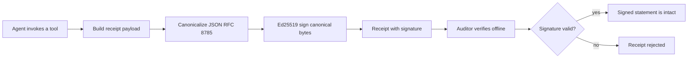
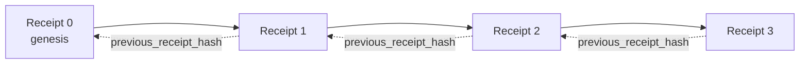

[Tonton video pelajaran: Mengamankan Agen AI dengan Tanda Terima Kriptografi](https://youtu.be/PLACEHOLDER_VIDEO_ID)

> _(Video pelajaran dan thumbnail akan ditambahkan oleh tim konten Microsoft setelah penggabungan, sesuai pola pelajaran 14 / 15.)_

# Mengamankan Agen AI dengan Tanda Terima Kriptografi

## Pendahuluan

Pelajaran ini akan membahas:

- Mengapa jejak audit untuk agen AI penting untuk kepatuhan, debugging, dan kepercayaan.
- Apa itu tanda terima kriptografi dan bagaimana bedanya dengan baris log tanpa tanda tangan.
- Cara membuat tanda terima bertanda tangan untuk panggilan alat agen dalam Python biasa.
- Cara memverifikasi tanda terima secara offline dan mendeteksi perubahan.
- Cara menghubungkan tanda terima sehingga penghapusan atau pengurutan ulang satu tanda terima memutus rantai.
- Apa yang dibuktikan oleh tanda terima dan apa yang secara eksplisit tidak mereka buktikan.

## Tujuan Pembelajaran

Setelah menyelesaikan pelajaran ini, Anda akan mengetahui cara:

- Mengidentifikasi mode kegagalan yang memotivasi asal-usul kriptografi untuk tindakan agen.
- Membuat tanda terima bertanda tangan Ed25519 atas payload JSON kanonik.
- Memverifikasi tanda terima secara independen hanya dengan menggunakan kunci publik penandatangan.
- Mendeteksi perubahan dengan menjalankan kembali verifikasi pada tanda terima yang dimodifikasi.
- Membangun urutan tanda terima yang terhubung secara hash dan menjelaskan mengapa rantai itu penting.
- Mengenali batas antara apa yang dibuktikan oleh tanda terima (atribusi, integritas, pengurutan) dan apa yang tidak (kebenaran tindakan, kekuatan kebijakan).

## Masalah: Jejak Audit Agen Anda

Bayangkan Anda telah menyebarkan agen AI untuk Contoso Travel. Agen ini membaca permintaan pelanggan, memanggil API penerbangan untuk mencari opsi, dan memesan kursi atas nama pelanggan. Kuartal lalu, agen tersebut memproses 50.000 pemesanan.

Hari ini seorang auditor datang. Mereka mengajukan pertanyaan sederhana: "Tunjukkan apa yang dilakukan agen Anda."

Anda menyerahkan file log Anda. Auditor melihatnya dan mengajukan pertanyaan yang lebih sulit: "Bagaimana saya tahu log ini tidak diedit?"

Inilah masalah jejak audit. Kebanyakan penyebaran agen hari ini mengandalkan:

- **Log aplikasi**: ditulis oleh agen itu sendiri, dapat diedit oleh siapa saja yang memiliki akses ke sistem berkas.
- **Layanan logging cloud**: tampak aman dari perubahan di tingkat platform tetapi hanya jika auditor mempercayai operator platform.
- **Log transaksi basis data**: cocok untuk perubahan basis data tapi tidak untuk panggilan alat sembarangan.

Tidak ada dari ini yang dapat menjawab pertanyaan auditor tanpa mengharuskan auditor mempercayai seseorang (Anda, penyedia cloud Anda, vendor basis data Anda). Untuk penggunaan internal, kepercayaan ini sering diterima. Untuk beban kerja yang diatur (keuangan, kesehatan, apa pun yang tunduk pada UU AI UE), ini tidak boleh.

Tanda terima kriptografi mempersempit masalah ini dengan membuat pernyataan bertanda tangan yang dapat diverifikasi secara mandiri. Auditor masih membutuhkan alasan di luar saluran untuk mempercayai kunci penandatangan dan
komponen yang membuat pernyataan tersebut. Kunci tertanam membuktikan konsistensi diri,
bukan identitas penerbit atau penempatan penegakan.


## Apa itu Tanda Terima Kriptografi?

Tanda terima adalah objek JSON yang merekam apa yang dilakukan agen, ditandatangani dengan tanda tangan digital.



Sebuah kwitansi minimal terlihat seperti ini:

```json
{
  "type": "agent.tool_call.v1",
  "agent_id": "contoso-travel-bot",
  "tool_name": "lookup_flights",
  "tool_args_hash": "sha256:a3f9c1...",
  "result_hash": "sha256:7b2e1d...",
  "policy_id": "contoso-travel-policy-v3",
  "timestamp": "2026-04-25T14:30:00Z",
  "sequence": 47,
  "previous_receipt_hash": "sha256:9d4e6a...",
  "signature": {
    "alg": "EdDSA",
    "sig": "c5af83...",
    "public_key": "8f3b2c..."
  }
}
```

Tiga properti melakukan pekerjaannya:

1. **Tanda tangan**. Kwitansi ditandatangani oleh gerbang agen menggunakan kunci privat Ed25519. Siapa pun dengan kunci publik yang sesuai dapat memverifikasi tanda tangan secara offline. Pihak yang mengandalkan harus menetapkan kunci itu atau menyelesaikannya dari registri terpercaya di luar kwitansi. Memanipulasi bidang yang ditandatangani akan membuat tanda tangan tidak valid.

2. **Pengkodean kanonik**. Sebelum menandatangani, kwitansi diserialisasikan menggunakan Skema Kanonisasi JSON (JCS, RFC 8785). Ini memastikan bahwa dua implementasi yang menghasilkan kwitansi logis yang sama menghasilkan output byte-identik. Tanpa kanonisasi, serializer JSON yang berbeda akan menghasilkan tanda tangan yang berbeda untuk konten yang sama.

3. **Rantai hash**. Bidang `previous_receipt_hash` menghubungkan setiap kwitansi ke yang sebelumnya. Menghapus atau mengubah urutan kwitansi akan merusak urutan yang disajikan. Mendeteksi pemotongan atau penulisan ulang yang dikendalikan penanda tangan juga memerlukan kepala rantai saat ini yang dipasang, checkpoint yang disaksikan secara independen, atau komitmen populasi tertutup yang diautentikasi.

Bersama-sama properti ini memberikan tiga jaminan:

- **Atribusi ke kunci**: kunci ini menandatangani konten ini. Identitas organisasi atau manusia memerlukan pengikatan kunci yang terpercaya.
- **Integritas**: konten tidak berubah sejak ditandatangani.
- **Pengurutan dalam urutan yang diverifikasi**: kwitansi ini terhubung ke pendahulunya.

## Membuat Kwitansi di Python

Anda tidak perlu perpustakaan khusus untuk membuat kwitansi. Primitif kriptografi tersedia luas dan logikanya hanya beberapa puluh baris Python.

Latihan langsung di `code_samples/18-signed-receipts.ipynb` menjelaskan alur lengkap. Kontrol sumber `code_samples/18-signed-receipts.execution-receipt.json` mencatat hash notebook yang tepat, lingkungan Python, jumlah sel, dan pemeriksaan dari eksekusi bersih terakhir tanpa mengubah output pelajaran yang disimpan. Versi ringkas:

```python
import json
import hashlib
import base64
from nacl import signing
from jcs import canonicalize  # RFC 8785 canonical JSON

def b64url_nopad(data: bytes) -> str:
    return base64.urlsafe_b64encode(data).decode("ascii").rstrip("=")

def sha256_canonical(obj) -> str:
    """SHA-256 of a Python object's JCS-canonical JSON form."""
    return f"sha256:{hashlib.sha256(canonicalize(obj)).hexdigest()}"

# Generate or load a signing key (in production, store in a key vault)
signing_key = signing.SigningKey.generate()
verify_key = signing_key.verify_key
TRUSTED_PUBLIC_KEYS = {b64url_nopad(bytes(verify_key))}  # pinned out of band by the verifier

# Build the receipt payload (no signature yet)
tool_args = {"origin": "SYD", "destination": "LAX"}
tool_result = [{"flight": "QF11", "price": 1850, "stops": 0}]

payload = {
    "type": "agent.tool_call.v1",
    "agent_id": "contoso-travel-bot",
    "tool_name": "lookup_flights",
    "tool_args_hash": sha256_canonical(tool_args),
    "result_hash": sha256_canonical(tool_result),
    "policy_id": "contoso-travel-policy-v3",
    "timestamp": "2026-04-25T14:30:00Z",
    "sequence": 0,
    "previous_receipt_hash": None,
}

# Canonicalize and sign the JCS bytes directly. PureEdDSA hashes internally.
canonical_bytes = canonicalize(payload)
signature_bytes = signing_key.sign(canonical_bytes).signature

# Attach a structured signature object.
receipt = {
    **payload,
    "signature": {
        "alg": "EdDSA",
        "sig": b64url_nopad(signature_bytes),
        "public_key": b64url_nopad(bytes(verify_key)),
    },
}
```

Itulah seluruh jalur penandatanganan. Latihan dalam notebook membahas setiap langkah.

## Memverifikasi Kwitansi dan Mendeteksi Pemalsuan

Verifikasi adalah operasi kebalikan:

```python
import base64
import hashlib
from nacl import signing
from nacl.exceptions import CryptoError
from jcs import canonicalize

def b64url_decode(s: str) -> bytes:
    # Strict: Python's decoder skips characters outside the alphabet and also
    # accepts padding, the standard +/ alphabet and non-zero spare bits.
    # Re-encoding and comparing accepts only the one unpadded base64url form.
    padding = "=" * ((4 - len(s) % 4) % 4)
    data = base64.urlsafe_b64decode(s + padding)
    if base64.urlsafe_b64encode(data).decode("ascii").rstrip("=") != s:
        raise ValueError("not canonical unpadded base64url")
    return data

def verify_receipt(receipt: dict, trusted_public_key: str) -> bool:
    # trusted_public_key is the issuer's key, obtained from somewhere other
    # than this receipt. Never use receipt["signature"]["public_key"] here:
    # see "What Receipts Prove (and What They Do Not)" below.
    # Fails closed: anything malformed returns False instead of raising.
    if not isinstance(receipt, dict) or not isinstance(trusted_public_key, str):
        return False
    sig_obj = receipt.get("signature")
    if not isinstance(sig_obj, dict) or sig_obj.get("alg") != "EdDSA":
        return False
    sig_b64 = sig_obj.get("sig")
    if not isinstance(sig_b64, str):
        return False

    try:
        # Reconstruct the payload that was actually signed (everything except signature).
        payload = {k: v for k, v in receipt.items() if k != "signature"}
        canonical_bytes = canonicalize(payload)
        verify_key = signing.VerifyKey(b64url_decode(trusted_public_key))
        verify_key.verify(canonical_bytes, b64url_decode(sig_b64))
        return True
    except (CryptoError, TypeError, ValueError, KeyError, OverflowError):
        return False
    except Exception:
        # An undecodable key or signature, or a payload that cannot be
        # canonicalized: fail closed rather than raise.
        return False
```

Fungsi ini mengambil kwitansi dan kunci publik penerbit, dan mengembalikan `True` jika tanda tangan valid dan `False` jika tidak, termasuk saat input tidak valid. Tidak ada panggilan jaringan dan tidak ada layanan verifikasi: setelah Anda memegang kunci penerbit, verifikasi sepenuhnya lokal dan offline. Apa yang masih dibutuhkan adalah kunci itu, diperoleh dari sumber lain selain kwitansi itu sendiri.

Untuk melihat deteksi pemalsuan dalam aksi, notebook menjelaskan:

1. Membuat kwitansi yang valid dan memastikan itu diverifikasi.
2. Memodifikasi satu byte dari bidang `tool_args_hash`.
3. Menjalankan kembali verifikasi dan melihat kegagalannya.
4. Memanipulasi lagi, tapi kali ini menandatangani ulang dengan kunci yang dibuat penyerang dan menyisipkan kunci itu dalam kwitansi.

Langkah 4 adalah yang patut direnungkan. Kwitansi itu secara internal konsisten: tanda tangannya asli untuk isinya dan untuk kunci yang dibawanya, sehingga diverifikasi terhadap kunci di dalamnya. Ia gagal hanya saat diperiksa terhadap kunci nyata penerbit. Langkah 2 dan 3 menangkap penyerang yang tidak repot menandatangani ulang; langkah 4 menangkap yang melakukannya.

Ini adalah demonstrasi praktis bahwa tanda terima dapat menunjukkan adanya perubahan: setiap perubahan pada bidang yang ditandatangani akan merusak tanda tangan, asalkan Anda memverifikasi dengan kunci yang tidak disediakan oleh penyerang. Objek `signature` sendiri berada di luar byte yang ditandatangani, itulah sebabnya kunci yang Anda verifikasi harus berasal dari sumber lain selain tanda terima.

## Menghubungkan Tanda Terima untuk Agen Multi-Langkah

Satu tanda terima yang ditandatangani melindungi satu aksi. Rangkaian tanda terima melindungi sebuah urutan.



Setiap tanda terima mencatat hash dari tanda terima sebelumnya. Untuk menghapus tanda terima 2 secara diam-diam, penyerang harus:

- Memodifikasi bidang `previous_receipt_hash` tanda terima 3 (merusak tanda tangan tanda terima 3), ATAU
- Memalsukan tanda tangan baru pada tanda terima 3 yang dimodifikasi (memerlukan kunci privat agen).

Jika kunci privat disimpan di dalam hardware key vault dan para verifier memeriksa setiap tanda terima dengan kunci publik penerbit yang diperoleh secara independen (set JWK yang dipublikasikan atau nilai konfigurasi yang dipasang), maka kedua serangan tersebut tidak mungkin tanpa terdeteksi. Mempublikasikan kunci di dalam setiap tanda terima tidak cukup: penyerang dapat menandatangani ulang dengan kunci mereka sendiri dan menyematkan yang itu sebagai gantinya, yang merupakan fixture `04_resigned_receipt.json`.

Notebook ini menerangkan:

1. Membangun rantai tiga tanda terima.
2. Memverifikasi bahwa `previous_receipt_hash` setiap tanda terima cocok dengan hash aktual dari tanda terima sebelumnya.
3. Memanipulasi satu tanda terima di tengah dan melihat rantai terputus tepat di titik tersebut.

Inilah cara membuat jejak audit yang dapat diverifikasi oleh auditor eksternal berdasarkan
kunci penerbitnya sendiri yang dipasang dan checkpoint rantai, tanpa mempercayai penyimpanan log Anda yang dapat berubah.

## Apa yang Dibuktikan oleh Tanda Terima (dan Apa yang Tidak)

Ini adalah bagian paling penting dari pelajaran ini. Tanda terima sangat kuat tetapi kekuatannya terbatas.

**Tanda terima membuktikan tiga hal:**

1. **Atribusi**: sebuah kunci tertentu telah menandatangani sebuah payload tertentu.
2. **Integritas**: payload tidak berubah sejak ditandatangani.
3. **Urutan dalam urutan yang disajikan dan diverifikasi**: tanda terima ini terhubung ke pendahulunya.

**Tanda terima TIDAK membuktikan:**

1. **Kebenaran**: bahwa aksi agen adalah aksi yang benar. Tanda terima dapat ditandatangani untuk jawaban yang salah sama mudahnya seperti untuk jawaban yang benar.
2. **Kepatuhan kebijakan**: bahwa kebijakan yang dirujuk dalam `policy_id` benar-benar dievaluasi, atau bahwa kebijakan itu akan mengizinkan aksi ini jika diperiksa. Tanda terima mencatat apa yang diklaim, bukan apa yang ditegakkan.
3. **Identitas selain kunci**: tanda terima mengatakan "kunci ini menandatangani konten ini." Tidak mengatakan "manusia ini yang mengotorisasi." Menghubungkan kunci dengan orang atau organisasi memerlukan infrastruktur identitas terpisah (direktori, registri kunci publik, dll).
4. **Kejujuran input**: jika agen menerima prompt yang dimanipulasi dan bertindak atasnya, tanda terima mencatat aksi tersebut dengan setia. Tanda terima adalah hasil validasi input, bukan pengganti.
5. **Eksekusi atau efek dunia nyata**: tanda terima pasca-panggilan mencatat apa yang diklaim oleh penerbit. Membuktikan penerimaan atau rekonsiliasi efek eksternal memerlukan bukti dari pelaksana atau batas penyedia yang sebenarnya.
6. **Kelengkapan**: tanda terima yang hilang bisa berarti diblokir, dihilangkan, hilang, atau tidak dikelola. Ketidakhadiran menjadi bukti hanya dalam populasi tertutup yang terautentikasi.
7. **Waktu terpercaya**: cap waktu yang ditandatangani membuktikan penandatangan membawa nilai itu, bukan nilai itu benar. Waktu terpercaya membutuhkan otoritas waktu terpisah atau titik pemeriksaan yang disaksikan.

**Kunci dalam tanda terima bukanlah kunci yang anda verifikasi.** Ini mengikuti dari poin 3, dan ini adalah satu-satunya tempat di mana perbedaan ini harus mengubah kode anda bukan pemahaman anda. `public_key` dalam contoh di atas ada agar contoh ini berdiri sendiri. Seorang verifikator tidak boleh pernah mempercayainya. Siapapun dapat mengambil tanda terima, mengubahnya, menandatanganinya dengan kunci yang mereka buat, dan menyematkan kunci itu; hasilnya terverifikasi dengan sempurna terhadap dirinya sendiri. Itu adalah fixture `04_resigned_receipt.json` dalam `sample_receipts/`, dan itulah mengapa `verify_receipt` di atas mengambil kunci sebagai argumen daripada membacanya dari tanda terima. Dapatkan kunci penerbit secara independen, dari JWK Set dalam Daftar Periksa Produksi di bawah atau jangkar lain yang anda pasang sebelumnya, dan verifikasi terhadap itu. Tanda tangan yang diperiksa dengan kunci yang datang dalam amplop yang sama hanya membuktikan bahwa amplop itu konsisten dengan dirinya sendiri.

Batas ini penting karena dua alasan:

- Ini memberitahu anda untuk apa tanda terima berguna: membuat perilaku agen dapat diaudit dan jelas jika dirusak, bahkan melintasi batas organisasi.
- Ini memberitahu anda lapisan tambahan apa yang masih anda butuhkan: validasi input (Pelajaran 6), penegakan kebijakan (dibahas secara singkat di bawah), dan infrastruktur identitas (di luar cakupan pelajaran ini).

Kesalahan umum adalah mengasumsikan bahwa "kami punya tanda terima" berarti "kami diatur." Itu tidak. Tanda terima adalah fondasi. Tata kelola adalah sistem yang anda bangun di atasnya.

## Mengikat Tanda Tangan Penyetuju ke Tindakan yang Tepat

Item 3 di atas layak mendapat bagian tersendiri: tanda terima tindakan mengatakan "kunci ini menandatangani konten ini," bukan "manusia mengotorisasi ini." Untuk tindakan berisiko tinggi (pengembalian dana, penghapusan, transfer kawat), tanda tangan penyetuju terpisah dapat mengikat tindakan yang tepat. Menghubungkan kunci itu dengan manusia dan memeriksa kehadiran manusia tetap menjadi tanggung jawab terpisah.

Notebook lanjutan `code_samples/human-authorization-receipts.ipynb` menambahkan jenis tanda terima kedua, `human.approval.v1`, dalam bentuk amplop yang sama seperti tanda terima pelajaran ini (muatan bertipe yang ditandatangani oleh Ed25519 di atas byte JCS kanoniknya, dengan objek `signature` di luar byte yang ditandatangani). Kunci penyetuju menandatangani **tindakan kanonik lengkap dan digest-nya**; kunci agen menandatangani klaim yang membawa **digest tindakan yang sama** dan `parent_approval_ref`, `receipt_hash` dari persetujuan, konvensi yang sama seperti `previous_receipt_hash` dalam rantai yang anda buat di atas. Satu `verify_chain` memeriksa kedua artefak di bawah **daftar kunci yang dipasang terpisah** (kunci penyetuju vs kunci agen), sehingga jalur kode dibagi tetapi otoritas tidak pernah sama.

Properti yang dibeli ini, dinyatakan dengan hati-hati: *kunci penyetuju yang dipasang menandatangani tindakan persis ini, dan kunci agen kemudian menandatangani pernyataan yang membawa digest tindakan yang sama.*

Itu adalah bukti yang berguna, tetapi tidak sendiri membuktikan bahwa tindakan dijalankan. Untuk
mengontrol eksekusi, persetujuan yang tepat juga harus dicadangkan dan dikonsumsi sekali di
batas eksekutor aktual; hasil penyedia yang tidak diketahui harus tetap tidak diketahui alih-alih
dicoba lagi secara membabi buta. Fitur penolakan notebook menguji lapisan rantai tanda terima:

- pengrusakan, deputy bingung, kunci palsu di salah satu sisi, dan input yang cacat;
- **otoritas kedaluwarsa**: sebuah tanda tangan yang masih bisa diverifikasi, namun ditolak karena versi kebijakan telah bergeser, kunci pemberi persetujuan telah diganti dari registri yang dipasang, atau persetujuan telah kedaluwarsa sebelum waktu verifikasi yang diberikan;
- **substitusi digest**: sebuah tanda terima aksi yang ditandatangani dengan sah yang mengarah pada persetujuan *nyata* yang mengikat aksi kanonik yang *berbeda*.

Setiap kegagalan menolak dengan alasan yang berbeda, sehingga seorang auditor yang membaca penolakan dapat mengetahui apakah otoritas telah kedaluwarsa atau aksi yang diklaim telah berubah. Verifikasi bersifat baca-saja dan dapat diulang: hal ini tidak mengkonsumsi persetujuan atau memanggil penyedia. Eksekutor terpisah memerlukan perlindungan ulang yang tahan lama dan atomik serta hasil eksplisit berupa keberhasilan, kegagalan, dan ketidakpastian. Tanda terima persetujuan manusia adalah komposisi edukatif yang didefinisikan oleh pelajaran ini, bukan tipe tanda terima yang didefinisikan oleh `draft-farley-acta-signed-receipts`.

## Referensi Produksi

Kode Python dalam pelajaran ini sengaja dibuat minimal sehingga Anda dapat membaca setiap baris dan memahami secara tepat apa yang terjadi. Dalam produksi, Anda memiliki dua opsi:

1. **Membangun langsung di atas primitif kriptografi.** 50 baris kode yang Anda lihat di atas sudah cukup untuk banyak kasus penggunaan. PyNaCl (Ed25519) dan paket `jcs` (JSON kanonik) adalah perpustakaan yang terawat dengan baik dan telah diaudit.

2. **Menggunakan perpustakaan tanda terima produksi.** Beberapa proyek open-source mengimplementasikan pola yang sama dengan fitur tambahan (rotasi kunci, verifikasi batch, distribusi Set JWK, integrasi dengan mesin kebijakan):
   - Jalur penandatanganan menggunakan konvensi JCS dan ruang lingkup tanda tangan dalam sebuah IETF Internet-Draft independen ([`draft-farley-acta-signed-receipts`](https://datatracker.ietf.org/doc/draft-farley-acta-signed-receipts/), revisi 02). Tanda terima edukasi datar dalam pelajaran ini berbeda dari amplop `{payload, signature}` dalam draft tersebut dan tidak disajikan sebagai implementasi yang sesuai. Draft tersebut menerbitkan satu set konformansi bersama ([agent-governance-testvectors](https://github.com/ScopeBlind/agent-governance-testvectors)) untuk implementasi yang menargetkan format wire-nya.
   - Microsoft Agent Governance Toolkit menyusun tanda terima dengan keputusan kebijakan berbasis Cedar; lihat Tutorial 33 dalam repositori itu untuk contoh ujung-ke-ujung.
   - Paket `protect-mcp` (npm) dan `@veritasacta/verify` (npm) menyediakan implementasi Node untuk penandatanganan tanda terima dan verifikasi offline, dimaksudkan untuk membungkus server MCP mana saja dengan jejak audit yang tahan gangguan, termasuk alur tahan-co-sign di mana aksi yang dijeda menghasilkan tanda terima persetujuan yang terkait dengan ringkasan aksi (didukung WebAuthn dalam alur desktop), pola tanda terima persetujuan yang sama seperti pada notebook otorisasi manusia di atas.
   - **[nobulex](https://github.com/arian-gogani/nobulex)** SDK Python (`pip install nobulex`) menyediakan pola penandatanganan Ed25519 + JCS yang sama di Python dengan integrasi LangChain dan CrewAI, termasuk vektor uji validasi silang yang dipublikasikan dan pemetaan kepatuhan yang disumbangkan melalui [OWASP PR #2210](https://github.com/OWASP/CheatSheetSeries/pull/2210).
   - **[EMILIA Protocol](https://github.com/emiliaprotocol/emilia-protocol)** menyediakan lapisan penegakan tindakan-tepat pelengkap: tanda terima persetujuan yang dapat diverifikasi offline, WebAuthn atau otoritas kuorum yang dipin, konsumsi sekali pakai di batas executor, dan jalur hasil tidak pasti yang eksplisit. Adapter kerangka kerjanya menganggap tanda terima sebagai bukti yang diperlukan, bukan bukti bahwa efek eksternal terjadi.

Keputusan antara membuat sendiri dan menggunakan perpustakaan mencerminkan keputusan antara menulis perpustakaan JWT sendiri dan menggunakan yang sudah diuji: keduanya masuk akal; menggunakan perpustakaan menghemat waktu dan mengurangi area audit; pendekatan dari awal memaksa Anda memahami setiap primitif. Pelajaran ini mengajarkan jalur dari nol sehingga Anda memiliki fondasi untuk pilihan mana pun.

## Pemeriksaan Pengetahuan

Uji pemahaman Anda sebelum pindah ke latihan praktik.

**1. Sebuah tanda terima ditandatangani dengan kunci privat Ed25519 agen. Auditor hanya memiliki kunci publik. Apakah auditor dapat memverifikasi tanda terima secara offline?**

<details>
<summary>Jawaban</summary>

Ya, verifikasi kriptografi hanya memerlukan kunci publik dan byte yang ditandatangani. Auditor
masih harus memperoleh dan memin kunci publik yang diterima secara independen dari tanda terima.
Tidak diperlukan panggilan jaringan setelah konfigurasi kepercayaan itu ditetapkan.
</details>

**2. Seorang penyerang mengubah bidang `policy_id` dari sebuah tanda terima untuk mengklaim bahwa itu diatur oleh kebijakan yang lebih permisif. Tanda tangan dibuat atas muatan asli. Apa yang terjadi selama verifikasi?**

<details>
<summary>Jawaban</summary>

Verifikasi gagal. Tanda tangan dihitung atas byte kanonik dari muatan asli; mengubah bidang muatan apa pun mengubah byte tersebut, yang membuat tanda tangan tidak valid. Penyerang membutuhkan kunci privat untuk membuat tanda tangan valid baru, yang tidak mereka miliki.
</details>

**3. Mengapa tanda terima menyertakan `tool_args_hash` dan `result_hash` bukannya argumen mentah dan hasilnya?**

<details>
<summary>Jawaban</summary>

Dua alasan. Pertama, tanda terima mungkin perlu diarsipkan atau ditransmisikan di lingkungan yang membocorkan konten mentah (PII, data bisnis) adalah masalah. Pengacakan menjaga tanda terima kecil dan konten privat; auditor memverifikasi bahwa hash cocok dengan salinan konten aktual yang disimpan terpisah. Kedua, hash memiliki ukuran tetap; tanda terima dengan hash dibatasi ukurannya terlepas dari seberapa besar input dan outputnya.
</details>

**4. Bidang `previous_receipt_hash` menghubungkan setiap tanda terima ke pendahulunya. Jika seorang penyerang diam-diam menghapus satu tanda terima dari tengah rantai, apa yang menjadi tidak valid?**

<details>
<summary>Jawaban</summary>

Setiap tanda terima setelah yang dihapus. Bidang `previous_receipt_hash` mereka tidak lagi cocok dengan rantai aktual (karena tanda terima yang mereka referensikan tidak ada lagi, atau rantai sekarang menunjuk ke pendahulu yang berbeda). Untuk menyembunyikan penghapusan, penyerang harus menandatangani ulang setiap tanda terima berikutnya, yang membutuhkan kunci privat penerbit. Tandatangan ulang dengan kunci lain akan gagal saat diperiksa dengan kunci penerbit.
</details>

**5. Sebuah tanda terima diverifikasi dengan bersih. Apakah itu membuktikan bahwa tindakan agen benar, masuk akal, atau sesuai kebijakan?**

<details>
<summary>Jawaban</summary>

Tidak. Dengan kunci dan konteks rantai yang dipin, tanda terima yang valid membuktikan atribusi tanda tangan,
integritas konten, dan tautan ke pendahulu yang ditampilkan. Itu TIDAK membuktikan bahwa
tindakan benar atau dieksekusi, bahwa kebijakan dievaluasi, bahwa timestamp dapat
dipercaya, atau bahwa set catatan lengkap. Ini adalah batas terpenting dalam pelajaran ini.
</details>

## Latihan Praktik

Buka `code_samples/18-signed-receipts.ipynb` dan lengkapi keempat bagian:

1. **Bagian 1**: Tandatangani tanda terima pertama Anda dan verifikasi itu.
2. **Bagian 2**: Ganggu tanda terima dan amati verifikasi gagal.
3. **Bagian 3**: Bangun rantai tiga tanda terima dan verifikasi integritas rantai tersebut.
4. **Bagian 4**: Terapkan pola pada agen yang dibuat dengan Microsoft Agent Framework: bungkus panggilan alat dalam penandatanganan tanda terima, lalu verifikasi tanda terima secara independen.

**Tantangan tambahan 1:** perluas skema tanda terima dengan satu bidang tambahan pilihan Anda (misalnya, ID permintaan untuk penelusuran), perbarui logika penandatanganan kanonik untuk menyertakannya, dan pastikan tanda terima masih lolos verifikasi bolak-balik. Kemudian ubah bidang setelah penandatanganan dan pastikan verifikasi gagal. Ini memaksa Anda memahami bagaimana setiap byte dari encoding kanonik berkontribusi pada tanda tangan.

**Tantangan lanjutan 2:** SHA-256-hash dua tanda terima Anda bersama-sama (menggabungkan byte kanonik mereka secara deterministik) dan sematkan hasil ringkasan tersebut sebagai bidang baru pada tanda terima ketiga sebelum menandatanganinya. Verifikasi bahwa ketiga tanda terima tersebut masih dapat diproses bolak-balik. Anda baru saja membangun bukti inklusi satu langkah: siapa saja yang memegang tanda terima ketiga dapat membuktikan bahwa dua tanda terima pertama ada pada saat ditandatangani, tanpa perlu mengungkap isinya. Ini adalah pola yang digunakan tanda terima pengungkapan selektif dalam skala besar (komitmen Merkle, RFC 6962).

## Kesimpulan

Tanda terima kriptografi memberikan agen AI jejak audit yang:

- **Dapat diverifikasi secara independen dengan kepercayaan yang dipasang**: pihak dengan kunci publik yang diterima dan byte yang ditandatangani dapat memverifikasi tanpa ketergantungan layanan.
- **Bukti pengubahan yang jelas**: setiap modifikasi membatalkan tanda tangan.
- **Portabel**: tanda terima adalah file JSON kecil; dapat diarsipkan, dikirim, dan diverifikasi di mana saja.
- **Sesuai standar**: dibangun di atas Ed25519 (RFC 8032), JCS (RFC 8785), dan SHA-256, semua primitif yang banyak dipakai.

Mereka bukan pengganti untuk validasi input, penegakan kebijakan, penerimaan pelaksana,
bukti hasil, kontrol kelengkapan, atau infrastruktur identitas. Mereka adalah fondasi
untuk lapisan-lapisan tersebut. Dalam alur kerja yang diatur atau antar organisasi, tanda terima membuat pernyataan penerbit spesifik dapat diperiksa secara independen di bawah konfigurasi kepercayaan auditor sendiri.


## Daftar Periksa Produksi

Saat Anda siap untuk naik kelas dari pelajaran ini ke penerapan agen bertanda terima di lingkungan nyata:

- [ ] **Pindahkan kunci penandatangan dari laptop pengembang.** Gunakan Azure Key Vault, AWS KMS, atau modul keamanan perangkat keras. Kunci privat yang menandatangani tanda terima Anda tidak pernah boleh berada dalam kontrol sumber atau dalam bentuk teks jelas di mesin aplikasi.

- [ ] **Jangkar rantai secara eksternal.** Secara berkala tulis hash kepala rantai terbaru ke log transparansi (Sigstore Rekor, otoritas cap waktu RFC 3161, atau sistem internal kedua) sehingga pihak eksternal dapat mengonfirmasi "rantai ini ada pada waktu ini."

- [ ] **Putuskan kebijakan retensi.** Banyak rejim kepatuhan mengharuskan penyimpanan bertahun-tahun. Rencanakan pertumbuhan tanda terima (setiap tanda terima sekitar 500 byte; agen yang membuat 10 ribu panggilan per hari menghasilkan sekitar 1,8 GB per tahun).
- [ ] **Tetapkan kepercayaan kunci verifikator.** Terbitkan kunci melalui JWK Set atau registri, kemudian biarkan pihak yang bergantung memasang identitas penerbit yang diterima, set kunci, dan kebijakan rotasi di luar tanda terima individu. Kunci inline saja bukanlah jangkar kepercayaan.
- [ ] **Jadikan rantai jangkar secara eksternal.** Secara berkala tulis hash kepala rantai terbaru ke log transparansi (Sigstore Rekor, otoritas cap waktu RFC 3161, atau sistem internal kedua) sehingga pihak eksternal dapat mengonfirmasi "rantai ini ada pada waktu ini."
- [ ] **Simpan tanda terima secara tidak dapat diubah.** Penyimpanan blob yang hanya dapat ditambahkan (Azure Storage dengan kebijakan ketidakberubahan, AWS S3 Object Lock) mencegah orang dalam menulis ulang sejarah di lapisan penyimpanan.
- [ ] **Putuskan retensi.** Banyak rejim kepatuhan mengharuskan retensi multi-tahun. Rencanakan pertumbuhan tanda terima (setiap tanda terima sekitar 500 byte; agen yang melakukan 10K panggilan per hari menghasilkan sekitar 1,8 GB per tahun).
- [ ] **Dokumentasikan apa yang tidak dicakup oleh tanda terima.** Tanda terima membuktikan atribusi, integritas, dan urutan. Buku panduan Anda harus secara eksplisit mencantumkan kontrol tambahan apa saja (validasi input, penegakan kebijakan, pembatasan tingkat, infrastruktur identitas) yang berdampingan dengan tanda terima dalam sikap tata kelola Anda.

### Ada Pertanyaan Lebih Lanjut tentang Mengamankan Agen AI?

Bergabunglah dengan [Microsoft Foundry Discord](https://aka.ms/ai-agents/discord) untuk bertemu dengan pelajar lain, menghadiri jam kantor, dan dapatkan jawaban atas pertanyaan Anda tentang Agen AI.

## Di Luar Pelajaran Ini

Pelajaran ini mencakup penandatanganan tanda terima tunggal dan urutan rantai hash. Primitif yang sama tersusun menjadi beberapa pola lanjutan yang mungkin Anda temui seiring kematangan sikap tata kelola Anda:

- **Pengungkapan selektif.** Ketika bidang tanda terima dikomit secara mandiri (pohon Merkle gaya RFC 6962), Anda dapat mengungkapkan bidang tertentu kepada auditor tertentu dan membuktikan bahwa sisanya tidak berubah tanpa mengeksposnya. Berguna ketika tanda terima yang sama harus memenuhi audit komprehensif (yang menginginkan kelengkapan) dan peraturan minimisasi data seperti GDPR (yang menginginkan auditor melihat sesedikit mungkin).
- **Pencabutan tanda terima.** Jika kunci penandatanganan dikompromikan, Anda memerlukan cara untuk menandai semua tanda terima yang ditandatangani oleh kunci itu sebagai tidak dipercaya dari titik waktu ke depan. Pola standar: kunci penandatanganan berumur pendek plus daftar pencabutan yang dipublikasikan, atau log transparansi dengan entri pencabutan.
- **Tanda terima tanda tangan bilateral / terbagi.** Beberapa implementasi membagi payload yang ditandatangani menjadi dua bagian, pre-eksekusi (`authorization_*`) dan pasca-eksekusi (`result_*`), dengan tanda tangan independen, berguna ketika keputusan otorisasi dan hasil yang diamati diproduksi oleh aktor berbeda atau pada waktu berbeda. Ini tersusun secara tambahan di atas format tanda terima yang diajarkan dalam pelajaran ini.
- **Komposisi payload.** Tanda terima menutup byte apapun yang Anda masukkan ke dalam `result_hash`. Payload dunia nyata seringkali lebih kaya daripada hasil panggilan alat tunggal: alasan pra-keputusan (prediksi model, opsi yang dipertimbangkan, bukti dan kelengkapannya, postur risiko, rantai akuntabilitas, hasil gerbang) semua bisa hidup di dalam payload, ditutup oleh satu tanda terima. Ini menjaga format tanda terima minimal sambil membiarkan skema payload berkembang per domain.
- **Kesesuaian lintas implementasi.** Berbagai implementasi independen dari format tanda terima yang sama (Python, TypeScript, Rust, Go) saling memverifikasi terhadap vektor pengujian bersama. Jika Anda membangun implementasi sendiri, memvalidasi terhadap vektor yang dipublikasikan mengonfirmasi kompatibilitas antarjaringan.
- **Migrasi pasca-kuantum.** Ed25519 banyak digunakan saat ini tetapi tidak tahan kuantum. Label `alg` saja bukan migrasi: sebuah profil harus mendefinisikan encoding kunci ML-DSA, byte yang ditandatangani secara kanonik, verifikasi, kebijakan pihak yang bergantung, ketahanan penurunan kelas, dan semantik transisi. Rencanakan dan uji transisi tanda tangan ganda terhadap vektor bersama sebelum membuat klaim kompatibilitas.

## Sumber Daya Tambahan

- <a href="https://datatracker.ietf.org/doc/draft-farley-acta-signed-receipts/" target="_blank">IETF Internet-Draft: Tanda Terima Keputusan yang Ditandatangani untuk Kontrol Akses Mesin-ke-Mesin</a>
- <a href="https://learn.microsoft.com/azure/ai-studio/responsible-use-of-ai-overview" target="_blank">Ikhtisar AI Bertanggung Jawab (Azure AI)</a>
- <a href="https://datatracker.ietf.org/doc/html/rfc8032" target="_blank">RFC 8032: Algoritma Tanda Tangan Digital Kurva Edwards (EdDSA)</a>
- <a href="https://datatracker.ietf.org/doc/html/rfc8785" target="_blank">RFC 8785: Skema Kanonisasi JSON (JCS)</a>
- <a href="https://datatracker.ietf.org/doc/html/rfc6962" target="_blank">RFC 6962: Transparansi Sertifikat</a> (konstruk pohon Merkle yang digunakan oleh tanda terima pengungkapan selektif)
- <a href="https://github.com/microsoft/agent-governance-toolkit/blob/main/docs/tutorials/33-offline-verifiable-receipts.md" target="_blank">Toolkit Tata Kelola Agen Microsoft, Tutorial 33: Tanda Terima Keputusan yang Dapat Diverifikasi Offline</a>
- <a href="https://github.com/ScopeBlind/agent-governance-testvectors" target="_blank">Vektor uji kesesuaian antar-implementasi</a> untuk format tanda terima yang digunakan dalam pelajaran ini (Apache-2.0)
- <a href="https://pynacl.readthedocs.io/" target="_blank">Dokumentasi PyNaCl</a> (Ed25519 di Python)

## Pelajaran Sebelumnya

[Membuat Agen AI Lokal](../17-creating-local-ai-agents/README.md)

---

<!-- CO-OP TRANSLATOR DISCLAIMER START -->
**Penafian**:
Dokumen ini telah diterjemahkan menggunakan layanan terjemahan AI [Co-op Translator](https://github.com/Azure/co-op-translator). Meskipun kami berupaya untuk mencapai akurasi, harap diketahui bahwa terjemahan otomatis mungkin mengandung kesalahan atau ketidakakuratan. Dokumen asli dalam bahasa aslinya harus dianggap sebagai sumber yang sah. Untuk informasi penting, disarankan menggunakan terjemahan profesional oleh manusia. Kami tidak bertanggung jawab atas kesalahpahaman atau penafsiran yang keliru yang timbul dari penggunaan terjemahan ini.
<!-- CO-OP TRANSLATOR DISCLAIMER END -->