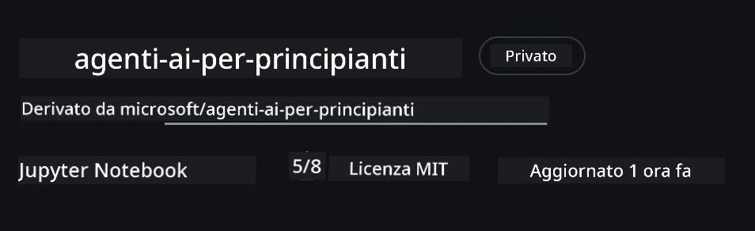
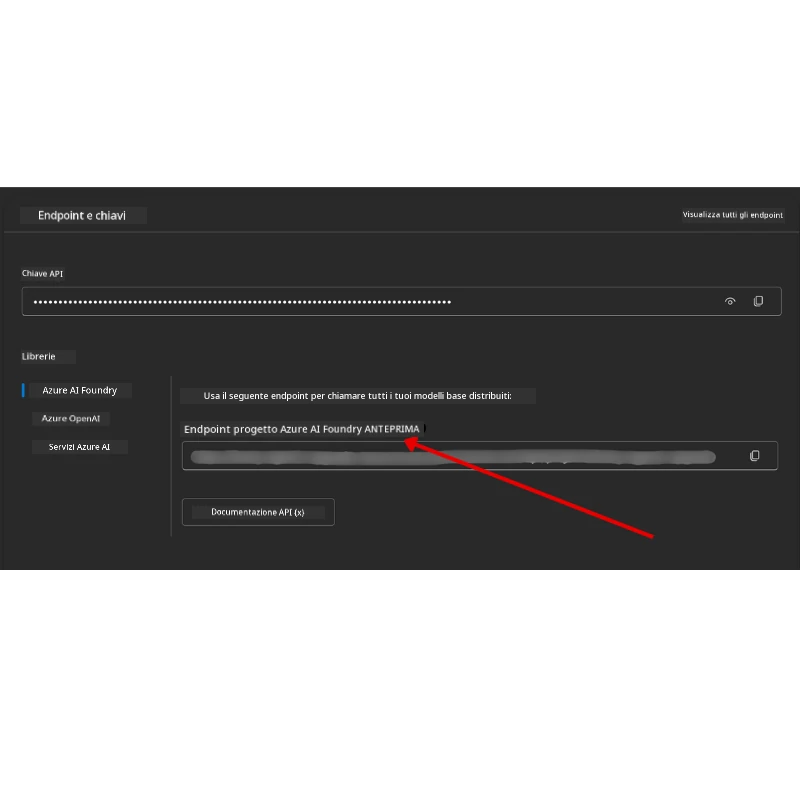

# Configurazione del Corso

## Introduzione

Questa lezione tratterà come eseguire gli esempi di codice di questo corso.

## Unisciti ad Altri Apprendenti e Ricevi Aiuto

Prima di iniziare a clonare il tuo repo, unisciti al [canale Discord AI Agents For Beginners](https://aka.ms/ai-agents/discord) per ricevere aiuto con la configurazione, qualsiasi domanda sul corso o per connetterti con altri apprendenti.

## Clona o Fai Fork di Questo Repo

Per iniziare, per favore clona o fai il fork del repository GitHub. Questo creerà la tua propria versione del materiale del corso così potrai eseguire, testare e modificare il codice!

Questo può essere fatto cliccando il link per <a href="https://github.com/microsoft/ai-agents-for-beginners/fork" target="_blank">fare il fork del repo</a>

Ora dovresti avere la tua versione forkata di questo corso nel seguente link:



### Clonazione Superficiale (consigliata per workshop / Codespaces)

  >Il repository completo può essere grande (~3 GB) quando scarichi tutta la cronologia e tutti i file. Se partecipi solo al workshop o hai bisogno solo di alcune cartelle delle lezioni, una clonazione superficiale (o clonazione sparsa) scarica molto meno.

#### Clonazione superficiale veloce — cronologia minima, tutti i file

Sostituisci `<your-username>` nei comandi sottostanti con l'URL del tuo fork (o l'URL upstream se preferisci).

Per clonare solo la cronologia dell'ultimo commit (scaricamento piccolo):

```bash
git clone --depth 1 https://github.com/<your-username>/ai-agents-for-beginners.git
```

Per clonare un branch specifico:

```bash
git clone --depth 1 --branch <branch-name> https://github.com/<your-username>/ai-agents-for-beginners.git
```

#### Clonazione parziale (sparsa) — blob minimi + solo cartelle selezionate

Questo utilizza la clonazione parziale e sparse-checkout (richiede Git 2.25+ e si consiglia Git moderno con supporto per clonazione parziale):

```bash
git clone --depth 1 --filter=blob:none --sparse https://github.com/<your-username>/ai-agents-for-beginners.git
```

Entra nella cartella del repo:

```bash
cd ai-agents-for-beginners
```

Poi specifica quali cartelle vuoi (l'esempio sotto mostra due cartelle):

```bash
git sparse-checkout set 00-course-setup 01-intro-to-ai-agents
```

Dopo aver clonato e verificato i file, se ti servono solo i file e vuoi liberare spazio (senza cronologia git), elimina i metadati del repository (💀 irreversibile — perderai tutta la funzionalità Git):

```bash
# zsh/bash
rm -rf .git
```

```powershell
# PowerShell
Remove-Item -Recurse -Force .git
```

#### Uso di GitHub Codespaces (consigliato per evitare grandi download locali)

- Crea un nuovo Codespace per questo repo tramite l'[interfaccia GitHub](https://github.com/codespaces).  

- Nel terminale del nuovo codespace creato, esegui uno dei comandi di clonazione superficiale/sparsa sopra per portare solo le cartelle delle lezioni che ti servono nello spazio di lavoro Codespace.
- Facoltativo: dopo la clonazione dentro Codespaces, rimuovi .git per recuperare spazio extra (vedi comandi di rimozione sopra).
- Nota: Se preferisci aprire il repo direttamente in Codespaces (senza clone aggiuntivo), tieni presente che Codespaces costruirà l'ambiente devcontainer e potrebbe ancora fornire più di quanto ti serve.

#### Consigli

- Sostituisci sempre l'URL di clonazione con il tuo fork se vuoi modificare/commitare.
- Se in seguito ti serve più cronologia o file, puoi recuperarli o regolare sparse-checkout per includere cartelle addizionali.

## Esecuzione del Codice

Questo corso offre una serie di Jupyter Notebooks che puoi eseguire per ottenere esperienza pratica nella costruzione di AI Agents.

Gli esempi di codice usano **Microsoft Agent Framework (MAF)** con `FoundryChatClient`, che si collega a **Microsoft Foundry Agent Service V2** (l'API Responses) tramite **Microsoft Foundry**.

Tutti i notebook Python sono etichettati `*-python-agent-framework.ipynb`.

## Requisiti

- Python 3.12+
  - **NOTA**: Se non hai Python3.12 installato, assicurati di installarlo. Poi crea il tuo venv usando python3.12 per garantire che le versioni corrette siano installate dal file requirements.txt.
  
    >Esempio

    Crea la directory del venv Python:

    ```bash
    python -m venv venv
    ```

    Poi attiva l'ambiente venv per:

    ```bash
    # zsh/bash
    source venv/bin/activate
    ```
  
    ```dos
    # Command Prompt for Windows
    venv\Scripts\activate
    ```

- .NET 10+: Per gli esempi di codice che usano .NET, assicurati di aver installato il [.NET 10 SDK](https://dotnet.microsoft.com/download/dotnet/10.0) o successivo. Poi, controlla la versione del tuo SDK .NET installato:

    ```bash
    dotnet --list-sdks
    ```

- **Azure CLI** — Necessario per l'autenticazione. Installa da [aka.ms/installazurecli](https://aka.ms/installazurecli).
- **Sottoscrizione Azure** — Per l'accesso a Microsoft Foundry e Microsoft Foundry Agent Service.
- **Progetto Microsoft Foundry** — Un progetto con un modello distribuito (es., `gpt-5-mini`). Vedi [Passo 1](#step-1-create-a-microsoft-foundry-project) qui sotto.

Abbiamo incluso un file `requirements.txt` nella root di questo repository che contiene tutti i pacchetti Python richiesti per eseguire gli esempi di codice.

Puoi installarli eseguendo il seguente comando nel tuo terminale alla root del repository:

```bash
pip install -r requirements.txt
```

Consigliamo di creare un ambiente virtuale Python per evitare conflitti e problemi.

## Configura VSCode

Assicurati di usare la versione corretta di Python in VSCode.


## Configura Microsoft Foundry e Microsoft Foundry Agent Service

### Passo 1: Crea un Progetto Microsoft Foundry

Hai bisogno di un **hub** Microsoft Foundry e di un **progetto** con un modello distribuito per eseguire i notebook.

1. Vai a [ai.azure.com](https://ai.azure.com) e accedi con il tuo account Azure.
2. Crea un **hub** (o usa uno esistente). Vedi: [Panoramica risorse Hub](https://learn.microsoft.com/azure/ai-foundry/concepts/ai-resources).
3. All'interno dell'hub, crea un **progetto**.
4. Distribuisci un modello (es., `gpt-5-mini`) da **Models + Endpoints** → **Deploy model**.

### Passo 2: Recupera l'Endpoint del Progetto e il Nome della Distribuzione del Modello

Dal tuo progetto nel portale Microsoft Foundry:

- **Project Endpoint** — Vai alla pagina **Overview** e copia l'URL dell'endpoint.



- **Nome della Distribuzione del Modello** — Vai su **Models + Endpoints**, seleziona il tuo modello distribuito, e annota il **Deployment name** (es., `gpt-5-mini`).

### Passo 3: Accedi ad Azure con `az login`

La maggior parte dei notebook si autentica attraverso il tuo **accesso Azure CLI** — usando `AzureCliCredential` o `DefaultAzureCredential` (entrambi rilevano la tua sessione `az login`) dal pacchetto `azure-identity` — quindi non richiedono chiavi API. Alcune lezioni e integrazioni opzionali usano chiavi API; verifica i prerequisiti di ogni lezione per eventuali variabili d'ambiente aggiuntive. Questo richiede che tu sia connesso tramite Azure CLI.

1. **Installa Azure CLI** se non l'hai ancora fatto: [aka.ms/installazurecli](https://aka.ms/installazurecli)

2. **Effettua il login** eseguendo:

    ```bash
    az login
    ```

    Oppure se sei in un ambiente remoto/Codespace senza browser:

    ```bash
    az login --use-device-code
    ```

3. **Seleziona la sottoscrizione** se richiesto — scegli quella contenente il tuo progetto Foundry.

4. **Verifica** di essere connesso:

    ```bash
    az account show
    ```

> **Perché `az login`?** I notebook si autenticano usando `AzureCliCredential` (o `DefaultAzureCredential`, che rileva anche il tuo login Azure CLI) dal pacchetto `azure-identity`. Questo significa che la tua sessione Azure CLI fornisce le credenziali — niente chiavi API o segreti nel file `.env`. Questa è una [best practice di sicurezza](https://learn.microsoft.com/azure/developer/ai/keyless-connections).

### Passo 4: Crea il Tuo File `.env`

Copia il file di esempio:

```bash
# zsh/bash
cp .env.example .env
```

```powershell
# PowerShell
Copy-Item .env.example .env
```

Apri `.env` e compila questi due valori:

```env
AZURE_AI_PROJECT_ENDPOINT=https://<your-project>.services.ai.azure.com/api/projects/<your-project-id>
AZURE_AI_MODEL_DEPLOYMENT_NAME=gpt-5-mini
```

| Variabile | Dove trovarla |
|----------|-----------------|
| `AZURE_AI_PROJECT_ENDPOINT` | Portale Foundry → il tuo progetto → pagina **Overview** |
| `AZURE_AI_MODEL_DEPLOYMENT_NAME` | Portale Foundry → **Models + Endpoints** → nome del modello distribuito |

Questo è tutto per la maggior parte delle lezioni! I notebook si autenticheranno automaticamente tramite la tua sessione `az login`.

### Passo 5: Installa le Dipendenze Python

```bash
pip install -r requirements.txt
```

Consigliamo di eseguire questo dentro l'ambiente virtuale che hai creato prima.

## Configurazione Facoltativa: Azure AI Search (Lezioni 5 e 16)

Le Lezioni 5 (Agentic RAG) e 16 funzionano subito con una **base di conoscenza in memoria** — nessuna risorsa Azure extra necessaria. Se vuoi supportarle con un vero indice **Azure AI Search**, nota che il **notebook della Lezione 16 attualmente usa l'autenticazione basata su chiave**: passa dalla ricerca in memoria ad Azure AI Search solo quando **sia** `AZURE_SEARCH_SERVICE_ENDPOINT` **che** `AZURE_SEARCH_API_KEY` sono impostati, altrimenti rimane sulla ricerca in memoria — quindi per eseguirlo con un indice reale devi impostare anche la chiave admin. L'autenticazione senza chiave con Microsoft Entra ID (RBAC) è l'approccio raccomandato per il tuo codice in produzione, coerente con il flusso `az login` usato ovunque nel corso.

I passaggi RBAC sotto si applicano agli esempi della guida di configurazione e al tuo codice. Non abilitano l'autenticazione senza chiave nel notebook della Lezione 16; la Lezione 16 richiede ancora sia endpoint che chiave admin per usare Azure AI Search.

1. **Abilita l'accesso basato su ruolo** sul tuo servizio di ricerca:

    ```bash
    az search service update --name <service-name> --resource-group <resource-group> --auth-options aadOrApiKey
    ```

2. **Assegna a te stesso i ruoli richiesti** (creare/caricare indici e query):

    ```bash
    az role assignment create --assignee <your-user-or-principal-id> --role "Search Service Contributor" --scope $(az search service show -g <resource-group> -n <service-name> --query id -o tsv)
    az role assignment create --assignee <your-user-or-principal-id> --role "Search Index Data Contributor" --scope $(az search service show -g <resource-group> -n <service-name> --query id -o tsv)
    ```

3. **Aggiungi l'endpoint** al tuo file `.env`:

| Variabile | Dove trovarla |
|----------|-----------------|
| `AZURE_SEARCH_SERVICE_ENDPOINT` | Portale Azure → la tua risorsa **Azure AI Search** → **Overview** → URL |
| `AZURE_SEARCH_API_KEY` | Necessaria (insieme all'endpoint) per abilitare Azure AI Search nel notebook della Lezione 16, che usa autenticazione basata su chiave. Portale Azure → **Settings** → **Keys** → chiave admin primaria |

> **Perché senza chiave?** Le chiavi admin concedono accesso completo in scrittura al tuo servizio di ricerca e possono trapelare tramite i file `.env`. Con RBAC, viene usata la tua identità `az login` — lo stesso pattern senza chiave Entra ID usato nei notebook del corso (tramite `AzureCliCredential` / `DefaultAzureCredential`). Vedi [Connettersi a Azure AI Search usando i ruoli](https://learn.microsoft.com/azure/search/search-security-rbac).

Consulta la [guida alla configurazione di Azure AI Search](./AzureSearch.md) per esempi completi di creazione indici in Python e .NET.

## Configurazione Aggiuntiva per Lezioni che Usano Azure OpenAI Direttamente (Lezioni 6 e 8)

Alcuni notebook nelle lezioni 6 e 8 chiamano **Azure OpenAI** direttamente (usando l'**API Responses**) invece di passare tramite un progetto Microsoft Foundry. Questi esempi usavano precedentemente GitHub Models, ora deprecato e non supporta l'API Responses. Aggiungi queste variabili al tuo file `.env`:

| Variabile | Dove trovarla |
|----------|-----------------|
| `AZURE_OPENAI_ENDPOINT` | Portale Azure → la tua risorsa **Azure OpenAI** → **Keys and Endpoint** → Endpoint (es. `https://<your-resource>.openai.azure.com`) |
| `AZURE_OPENAI_DEPLOYMENT` | Il nome del tuo modello distribuito (es. `gpt-5-mini`) che supporta l'API Responses |
| `AZURE_OPENAI_API_KEY` | Facoltativo — solo se usi autenticazione basata su chiave invece di `az login` / Entra ID |

> L'API Responses usa l'endpoint stabile `/openai/v1/`, quindi non serve `api-version`. Effettua il login con `az login` per usare l'autenticazione senza chiave Entra ID.

## Fornitore Alternativo: MiniMax (Compatibile OpenAI)

[MiniMax](https://platform.minimaxi.com/) fornisce modelli large-context (fino a 204K token) tramite un'API compatibile OpenAI. Poiché il `OpenAIChatClient` di Microsoft Agent Framework funziona con qualsiasi endpoint compatibile OpenAI, puoi usare MiniMax come alternativa integrata per le lezioni che usano `OpenAIChatClient`.

Aggiungi queste variabili al tuo file `.env`:

| Variabile | Dove trovarla |
|----------|-----------------|
| `MINIMAX_API_KEY` | [MiniMax Platform](https://platform.minimaxi.com/) → API Keys |
| `MINIMAX_BASE_URL` | Usa `https://api.minimax.io/v1` (valore predefinito) |
| `MINIMAX_MODEL_ID` | Nome del modello da usare (es., `MiniMax-M3`) |

**Modelli di esempio**: `MiniMax-M3` (consigliato), `MiniMax-M2.7`, `MiniMax-M2.7-highspeed` (risposte più veloci). I nomi e la disponibilità dei modelli possono cambiare nel tempo e l’accesso a un modello specifico può dipendere dal tuo account.

Gli esempi di codice che usano `OpenAIChatClient` (es., flusso di prenotazione hotel nella Lezione 14) rileveranno e useranno automaticamente la tua configurazione MiniMax quando `MINIMAX_API_KEY` è impostato.

## Fornitore Alternativo: Novita AI (Compatibile OpenAI)

[Novita AI](https://novita.ai/llm-api) fornisce un'API compatibile con OpenAI per LLM open-source e all'avanguardia (DeepSeek, Llama, Qwen e altri). Poiché `OpenAIChatClient` del Microsoft Agent Framework funziona con qualsiasi endpoint compatibile con OpenAI, puoi usare Novita AI come alternativa plug-and-play ad Azure OpenAI o OpenAI.

Aggiungi queste variabili al tuo file `.env`:

| Variabile | Dove trovarla |
|----------|-----------------|
| `NOVITA_API_KEY` | [Novita AI Dashboard](https://novita.ai/settings/key-management) → API Keys |
| `NOVITA_BASE_URL` | Usa `https://api.novita.ai/openai/v1` (valore predefinito) |
| `NOVITA_MODEL_ID` | Nome del modello da usare (es. `moonshotai/kimi-k3`) |

**Esempi di modelli**: `moonshotai/kimi-k3`, `zai-org/glm-5.2`, `deepseek/deepseek-v4-flash-0731`. Novita AI ospita anche molte altre famiglie di modelli open-source (Llama, Qwen, GLM e altro) — controlla la [libreria modelli Novita AI](https://novita.ai/llm-api) per l’elenco aggiornato dei modelli disponibili e i loro ID.

Gli esempi attuali non consumano automaticamente variabili `NOVITA_*`. Per usare Novita AI, passa esplicitamente questi valori durante la costruzione di `OpenAIChatClient` nel campione che stai eseguendo.

## Provider Alternativo: Foundry Local (Esegui i Modelli sul Dispositivo)

[Foundry Local](https://foundrylocal.ai) è un runtime leggero che scarica, gestisce e serve modelli linguistici **interamente sulla tua macchina** tramite un’API compatibile OpenAI — nessun cloud richiesto.

Poiché `OpenAIChatClient` del Microsoft Agent Framework funziona con qualsiasi endpoint compatibile OpenAI, Foundry Local è un’alternativa locale plug-and-play ad Azure OpenAI.

**1. Installa Foundry Local**

```bash
# Windows
winget install Microsoft.FoundryLocal

# macOS
brew install foundrylocal
```

**2. Scarica ed esegui un modello** (questo avvia anche il servizio locale):

```bash
foundry model list          # see available models
foundry model run phi-4-mini
```

**3. Installa l’SDK Python** usato per scoprire l'endpoint locale:

```bash
pip install foundry-local-sdk
```

**4. Punta il Microsoft Agent Framework al tuo modello locale:**

```python
from foundry_local import FoundryLocalManager
from agent_framework.openai import OpenAIChatClient

# Downloads (if needed) and serves the model locally, then discovers the endpoint/port.
manager = FoundryLocalManager("phi-4-mini")

chat_client = OpenAIChatClient(
    base_url=manager.endpoint,      # e.g. http://localhost:<port>/v1
    api_key=manager.api_key,        # always "not-required" for Foundry Local
    model_id=manager.get_model_info("phi-4-mini").id,
)

agent = chat_client.as_agent(
    name="LocalAgent",
    instructions="You are a helpful assistant running fully on-device.",
)
```

> **Nota:** Foundry Local espone un endpoint compatibile OpenAI per le **Chat Completions**. Usalo per lo sviluppo locale e scenari offline. Per il set completo di funzionalità **Responses API** (conversazioni con stato, ecc.), usa Azure OpenAI o un progetto Microsoft Foundry.

## Configurazione Aggiuntiva per la Lezione 8 (Workflow di Grounding Bing)

Il notebook del workflow condizionale nella lezione 8 usa **grounding Bing** tramite Microsoft Foundry. Se intendi eseguire quell’esempio, aggiungi questa variabile al tuo file `.env`:

| Variabile | Dove trovarla |
|----------|-----------------|
| `BING_CONNECTION_ID` | Portale Microsoft Foundry → il tuo progetto → **Gestione** → **Risorse collegate** → la tua connessione Bing → copia l’ID della connessione |

## Risoluzione dei Problemi

### Errori di Verifica Certificato SSL su macOS

Se sei su macOS e incontri un errore come:

```plaintext
ssl.SSLCertVerificationError: [SSL: CERTIFICATE_VERIFY_FAILED] certificate verify failed: self-signed certificate in certificate chain
```

Questa è una problematica nota con Python su macOS dove i certificati SSL di sistema non sono automaticamente attendibili. Prova le seguenti soluzioni in ordine:

**Opzione 1: Esegui lo script Install Certificates di Python (consigliato)**

```bash
# Replace 3.XX with your installed Python version (e.g., 3.12 or 3.13):
/Applications/Python\ 3.XX/Install\ Certificates.command
```

**Opzione 2: Usa `connection_verify=False` nel tuo notebook (solo per i notebook GitHub Models)**

Nel notebook della Lezione 6 (`06-building-trustworthy-agents/code_samples/06-system-message-framework.ipynb`), è già incluso un workaround commentato. Decommenta `connection_verify=False` quando incontri errori di certificato:

```python
client = ChatCompletionsClient(
    endpoint=endpoint,
    credential=AzureKeyCredential(token),
    connection_verify=False,  # Disable SSL verification if you encounter certificate errors
)
```

> **⚠️ Attenzione:** Disabilitare la verifica SSL (`connection_verify=False`) riduce la sicurezza saltando la validazione del certificato. Usalo solo come soluzione temporanea in ambienti di sviluppo. Mai in produzione.

**Opzione 3: Installa e usa `truststore`**

```bash
pip install truststore
```

Poi aggiungi quanto segue all’inizio del tuo notebook o script prima di fare chiamate di rete:

```python
import truststore
truststore.inject_into_ssl()
```

## Bloccato da qualche parte?

Se hai problemi con questa configurazione, unisciti al nostro <a href="https://discord.gg/kzRShWzttr" target="_blank">Discord della Community Azure AI</a> o <a href="https://github.com/microsoft/ai-agents-for-beginners/issues?WT.mc_id=academic-105485-koreyst" target="_blank">apri un problema</a>.

## Prossima Lezione

Ora sei pronto per eseguire il codice di questo corso. Buono studio nel mondo degli Agenti IA!

[Introduzione agli Agenti IA e ai casi d’uso degli Agenti](../01-intro-to-ai-agents/README.md)

---

<!-- CO-OP TRANSLATOR DISCLAIMER START -->
**Disclaimer**:
Questo documento è stato tradotto utilizzando il servizio di traduzione AI [Co-op Translator](https://github.com/Azure/co-op-translator). Sebbene ci impegniamo per garantire la precisione, si prega di notare che le traduzioni automatizzate possono contenere errori o imprecisioni. Il documento originale nella sua lingua nativa deve essere considerato la fonte autorevole. Per informazioni critiche, si raccomanda una traduzione professionale effettuata da un essere umano. Non siamo responsabili per eventuali malintesi o interpretazioni errate derivanti dall’uso di questa traduzione.
<!-- CO-OP TRANSLATOR DISCLAIMER END -->