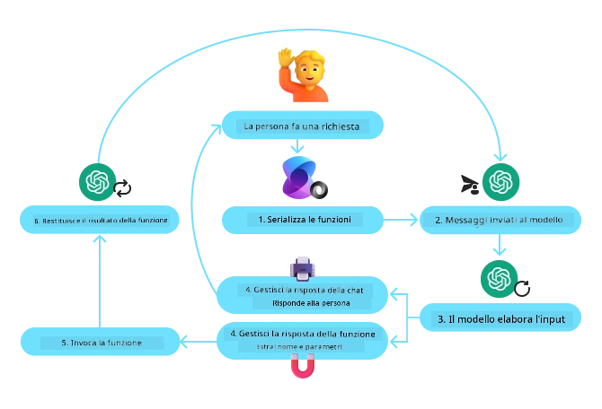
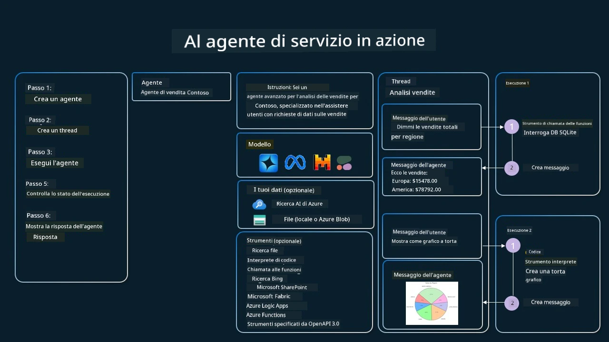

[](https://youtu.be/vieRiPRx-gI?si=cEZ8ApnT6Sus9rhn)

> _(Clicca sull'immagine sopra per vedere il video di questa lezione)_

# Modello di Progettazione per l'Uso degli Strumenti

Gli strumenti sono interessanti perché permettono agli agenti AI di avere una gamma più ampia di capacità. Invece che l'agente abbia un set limitato di azioni che può eseguire, aggiungendo uno strumento, l'agente può ora compiere una vasta gamma di azioni. In questo capitolo, esamineremo il Modello di Progettazione per l'Uso degli Strumenti, che descrive come gli agenti AI possono utilizzare strumenti specifici per raggiungere i loro obiettivi.

## Introduzione

In questa lezione, cercheremo di rispondere alle seguenti domande:

- Cos'è il modello di progettazione per l'uso degli strumenti?
- Quali sono i casi d'uso a cui può essere applicato?
- Quali sono gli elementi/blocchi costitutivi necessari per implementare il modello di progettazione?
- Quali sono le considerazioni speciali per utilizzare il Modello di Progettazione per l'Uso degli Strumenti per costruire agenti AI affidabili?

## Obiettivi di Apprendimento

Al termine di questa lezione, sarai in grado di:

- Definire il Modello di Progettazione per l'Uso degli Strumenti e il suo scopo.
- Identificare i casi d'uso in cui il Modello di Progettazione per l'Uso degli Strumenti è applicabile.
- Comprendere gli elementi chiave necessari per implementare il modello di progettazione.
- Riconoscere le considerazioni per garantire l'affidabilità negli agenti AI che utilizzano questo modello di progettazione.

## Cos'è il Modello di Progettazione per l'Uso degli Strumenti?

Il **Modello di Progettazione per l'Uso degli Strumenti** si concentra sul dare ai LLM la capacità di interagire con strumenti esterni per raggiungere obiettivi specifici. Gli strumenti sono codice che può essere eseguito da un agente per compiere azioni. Uno strumento può essere una semplice funzione come una calcolatrice, o una chiamata API a un servizio di terze parti come la ricerca di prezzi azionari o le previsioni meteo. Nel contesto degli agenti AI, gli strumenti sono progettati per essere eseguiti dagli agenti in risposta a **chiamate di funzione generate dal modello**.

## Quali sono i casi d'uso a cui può essere applicato?

Gli agenti AI possono sfruttare gli strumenti per completare compiti complessi, recuperare informazioni o prendere decisioni. Il modello di progettazione per l'uso degli strumenti è spesso usato in scenari che richiedono un'interazione dinamica con sistemi esterni, come database, servizi web o interpreti di codice. Questa capacità è utile per diversi casi d'uso tra cui:

- **Recupero Dinamico delle Informazioni:** Gli agenti possono interrogare API esterne o database per ottenere dati aggiornati (es. interrogare un database SQLite per analisi dati, recuperare prezzi azionari o informazioni meteo).
- **Esecuzione e Interpretazione del Codice:** Gli agenti possono eseguire codice o script per risolvere problemi matematici, generare report o eseguire simulazioni.
- **Automazione dei Flussi di Lavoro:** Automatizzare flussi di lavoro ripetitivi o multi-step integrando strumenti come scheduler di attività, servizi email o pipeline di dati.
- **Supporto Clienti:** Gli agenti possono interagire con sistemi CRM, piattaforme di ticketing o banche dati per risolvere query degli utenti.
- **Generazione ed Editing di Contenuti:** Gli agenti possono sfruttare strumenti come correttori grammaticali, sintetizzatori di testo o valutatori di sicurezza dei contenuti per assistere nella creazione di contenuti.

## Quali sono gli elementi/blocchi costitutivi necessari per implementare il modello di progettazione per l'uso degli strumenti?

Questi blocchi costitutivi permettono all'agente AI di svolgere una larga gamma di compiti. Diamo un'occhiata agli elementi chiave necessari per implementare il Modello di Progettazione per l'Uso degli Strumenti:

- **Schema Funzione/Strumento**: Definizioni dettagliate degli strumenti disponibili, inclusi nome della funzione, scopo, parametri richiesti e output attesi. Questi schemi permettono al LLM di capire quali strumenti sono disponibili e come costruire richieste valide.

- **Logica di Esecuzione delle Funzioni**: Regola come e quando gli strumenti vengono invocati basandosi sull'intento dell'utente e sul contesto della conversazione. Questo può includere moduli di pianificazione, meccanismi di routing o flussi condizionali che determinano dinamicamente l'uso dello strumento.

- **Sistema di Gestione dei Messaggi**: Componenti che gestiscono il flusso conversazionale tra input utente, risposte LLM, chiamate agli strumenti e output degli strumenti.

- **Framework di Integrazione degli Strumenti**: Infrastruttura che collega l'agente a vari strumenti, siano essi funzioni semplici o servizi esterni complessi.

- **Gestione degli Errori e Validazione**: Meccanismi per gestire errori nell'esecuzione degli strumenti, convalidare parametri e gestire risposte inattese.

- **Gestione dello Stato**: Tiene traccia del contesto della conversazione, delle interazioni precedenti con gli strumenti e dei dati persistenti per garantire coerenza nelle interazioni multi-turno.

Successivamente, vediamo in dettaglio la Chiamata di Funzione/Strumento.
 
### Chiamata di Funzione/Strumento

La chiamata di funzione è il modo principale con cui permettiamo ai Modelli di Linguaggio di Grandi Dimensioni (LLM) di interagire con gli strumenti. Spesso vedrai che 'Funzione' e 'Strumento' sono usati in modo intercambiabile perché le 'funzioni' (blocchi di codice riutilizzabile) sono gli 'strumenti' che gli agenti usano per svolgere compiti. Perché il codice di una funzione venga invocato, un LLM deve confrontare la richiesta dell'utente con la descrizione delle funzioni. A tal fine, uno schema contenente le descrizioni di tutte le funzioni disponibili viene inviato al LLM. Il LLM quindi seleziona la funzione più appropriata per il compito e restituisce il suo nome e i suoi argomenti. La funzione selezionata viene invocata, la sua risposta viene inviata al LLM, che usa le informazioni per rispondere alla richiesta dell'utente.

Per implementare la chiamata di funzione per gli agenti, gli sviluppatori avranno bisogno di:

1. Un modello LLM che supporti la chiamata di funzione
2. Uno schema contenente la descrizione delle funzioni
3. Il codice per ogni funzione descritta

Usiamo l'esempio di ottenere l'ora corrente in una città per illustrare:

1. **Inizializzare un LLM che supporti la chiamata di funzione:**

    Non tutti i modelli supportano la chiamata di funzione, quindi è importante verificare che l'LLM che stai usando lo faccia. <a href="https://learn.microsoft.com/azure/ai-services/openai/how-to/function-calling" target="_blank">Azure OpenAI</a> supporta la chiamata di funzione. Possiamo iniziare istanziando il client OpenAI verso l'**API Risposte** di Azure OpenAI (l'endpoint stabile `/openai/v1/` — non è necessario `api_version`).

    ```python
    # Initialize the OpenAI client for Azure OpenAI (Responses API, v1 endpoint)
    client = OpenAI(
        base_url=f"{os.environ['AZURE_OPENAI_ENDPOINT'].rstrip('/')}/openai/v1/",
        api_key=os.environ["AZURE_OPENAI_API_KEY"],
    )
    deployment_name = os.environ["AZURE_OPENAI_DEPLOYMENT"]
    ```

1. **Creare uno Schema Funzione**:

    Successivamente definiremo uno schema JSON che contiene il nome della funzione, la descrizione di cosa fa la funzione, e i nomi e le descrizioni dei parametri della funzione.
    Passeremo questo schema al client creato precedentemente, insieme alla richiesta dell'utente di trovare l'ora a San Francisco. È importante notare che ciò che viene restituito è una **chiamata a uno strumento**, **non** la risposta finale alla domanda. Come menzionato prima, l'LLM restituisce il nome della funzione che ha selezionato per il compito, e gli argomenti che gli saranno passati.

    ```python
    # Function description for the model to read (Responses API flat tool format)
    tools = [
        {
            "type": "function",
            "name": "get_current_time",
            "description": "Get the current time in a given location",
            "parameters": {
                "type": "object",
                "properties": {
                    "location": {
                        "type": "string",
                        "description": "The city name, e.g. San Francisco",
                    },
                },
                "required": ["location"],
            },
        }
    ]
    ```
   
    ```python
  
    # Initial user message
    messages = [{"role": "user", "content": "What's the current time in San Francisco"}]

    # First API call: Ask the model to use the function
    response = client.responses.create(
        model=deployment_name,
        input=messages,
        tools=tools,
        tool_choice="auto",
        store=False,
    )

    # The Responses API returns tool calls as function_call items in response.output.
    # Append them to the conversation so the model has full context on the next turn.
    messages += response.output

    print("Model's response:")
    print(response.output)
  
    ```

    ```bash
    Model's response:
    [ResponseFunctionToolCall(arguments='{"location":"San Francisco"}', call_id='call_pOsKdUlqvdyttYB67MOj434b', name='get_current_time', type='function_call')]
    ```
  
1. **Il codice della funzione necessario per svolgere il compito:**

    Ora che l'LLM ha scelto quale funzione deve essere eseguita, il codice che svolge il compito deve essere implementato ed eseguito.
    Possiamo implementare il codice per ottenere l'ora corrente in Python. Dovremo anche scrivere il codice per estrarre il nome e gli argomenti dal response_message per ottenere il risultato finale.

    ```python
      def get_current_time(location):
        """Get the current time for a given location"""
        print(f"get_current_time called with location: {location}")  
        location_lower = location.lower()
        
        for key, timezone in TIMEZONE_DATA.items():
            if key in location_lower:
                print(f"Timezone found for {key}")  
                current_time = datetime.now(ZoneInfo(timezone)).strftime("%I:%M %p")
                return json.dumps({
                    "location": location,
                    "current_time": current_time
                })
      
        print(f"No timezone data found for {location_lower}")  
        return json.dumps({"location": location, "current_time": "unknown"})
    ```

     ```python
    # Handle function calls
    tool_calls = [item for item in response.output if item.type == "function_call"]
    if tool_calls:
        for tool_call in tool_calls:
            if tool_call.name == "get_current_time":

                function_args = json.loads(tool_call.arguments)

                time_response = get_current_time(
                    location=function_args.get("location")
                )

                # Return the tool result as a function_call_output item
                messages.append({
                    "type": "function_call_output",
                    "call_id": tool_call.call_id,
                    "output": time_response,
                })
    else:
        print("No tool calls were made by the model.")

    # Second API call: Get the final response from the model
    final_response = client.responses.create(
        model=deployment_name,
        input=messages,
        tools=tools,
        store=False,
    )

    return final_response.output_text
     ```

     ```bash
      get_current_time called with location: San Francisco
      Timezone found for san francisco
      The current time in San Francisco is 09:24 AM.
     ```

La Chiamata di Funzione è al centro della maggior parte, se non di tutta, la progettazione di agenti che usano strumenti, tuttavia implementarla da zero può essere a volte una sfida.
Come abbiamo imparato in [Lezione 2](../../../02-explore-agentic-frameworks) i framework agentici ci forniscono blocchi costitutivi predefiniti per implementare l'uso degli strumenti.
 
## Esempi di Uso degli Strumenti con Framework Agentici

Ecco alcuni esempi di come puoi implementare il Modello di Progettazione per l'Uso degli Strumenti usando diversi framework agentici:

### Microsoft Agent Framework

<a href="https://learn.microsoft.com/azure/ai-services/agents/overview" target="_blank">Microsoft Agent Framework</a> è un framework AI open-source per costruire agenti AI. Semplifica il processo di chiamata di funzione permettendoti di definire gli strumenti come funzioni Python con il decoratore `@tool`. Il framework gestisce la comunicazione tra il modello e il tuo codice. Fornisce inoltre accesso a strumenti predefiniti come Ricerca File e Interprete di Codice tramite `FoundryChatClient`.

Il diagramma seguente illustra il processo di chiamata di funzione con Microsoft Agent Framework:



Nel Microsoft Agent Framework, gli strumenti sono definiti come funzioni decorate. Possiamo convertire la funzione `get_current_time` vista prima in uno strumento usando il decoratore `@tool`. Il framework serializzerà automaticamente la funzione e i suoi parametri, creando lo schema da inviare all'LLM.

```python
import os
from agent_framework import tool
from agent_framework.foundry import FoundryChatClient
from azure.identity import AzureCliCredential

@tool(approval_mode="never_require")
def get_current_time(location: str) -> str:
    """Get the current time for a given location"""
    ...

# Create the client
provider = FoundryChatClient(
    project_endpoint=os.environ["AZURE_AI_PROJECT_ENDPOINT"],
    model=os.environ["AZURE_AI_MODEL_DEPLOYMENT_NAME"],
    credential=AzureCliCredential(),
)

# Create an agent and run with the tool
agent = provider.as_agent(name="TimeAgent", instructions="Use available tools to answer questions.", tools=get_current_time)
response = await agent.run("What time is it?")
```

#### Strumenti da un server MCP

Gli strumenti non devono necessariamente essere funzioni nel tuo codice. Un server che usa il Model Context Protocol (MCP, coperto in [Lezione 11](../11-agentic-protocols/README.md)) pubblica i suoi strumenti insieme ai loro schemi, e il framework può caricarli allo stesso modo in cui serializza una funzione decorata. `MCPStreamableHTTPTool` si connette a tale server via HTTP, legge gli schemi degli strumenti e li offre al modello assieme a qualsiasi strumento locale.

L'esempio seguente usa il server di ricerca web ospitato da <a href="https://keenable.ai" target="_blank">Keenable</a>. È gratuito da usare senza account o chiave API (le richieste sono limitate per IP), quindi le uniche credenziali di cui hai bisogno sono quelle per il tuo modello. Come con qualsiasi strumento remoto, le query scritte dal modello sono inviate a quel server.

```python
from agent_framework import MCPStreamableHTTPTool

web_search = MCPStreamableHTTPTool(
    name="Keenable web search",
    url="https://api.keenable.ai/mcp",
)

# Connecting loads the server's tool schemas; the agent decides when to call them
async with web_search:
    agent = provider.as_agent(
        name="ResearchAgent",
        instructions="Use available tools to answer questions.",
        tools=[web_search],
    )
    response = await agent.run("What is new in the latest Python release?")
    print(response.text)
```

Il server pubblica due strumenti, `search_web_pages` e `fetch_page_content`. Quando una domanda richiede informazioni aggiornate, il modello chiama `search_web_pages`, riceve titoli, URL e frammenti di testo, e scrive la sua risposta partendo da questi, lo stesso ciclo dell'esempio sopra di `get_current_time`.
  
### Microsoft Foundry Agent Service

<a href="https://learn.microsoft.com/azure/ai-services/agents/overview" target="_blank">Microsoft Foundry Agent Service</a> è un framework agentico più recente progettato per permettere agli sviluppatori di costruire, distribuire e scalare agenti AI di alta qualità e estensibili in modo sicuro senza dover gestire le risorse di calcolo e storage sottostanti. È particolarmente utile per applicazioni enterprise poiché è un servizio completamente gestito con sicurezza di livello enterprise.

Rispetto allo sviluppo diretto con l'API LLM, Microsoft Foundry Agent Service offre alcuni vantaggi, tra cui:

- Chiamata automatica degli strumenti – non serve più analizzare una chiamata a uno strumento, invocare lo strumento e gestirne la risposta; tutto questo viene fatto ora lato server
- Dati gestiti in modo sicuro – invece di gestire lo stato della conversazione, puoi affidarti ai thread per conservare tutte le informazioni necessarie
- Strumenti pronti all'uso – Strumenti con cui puoi interagire con le tue fonti di dati, come Bing, Azure AI Search e Azure Functions.

Gli strumenti disponibili in Microsoft Foundry Agent Service possono essere divisi in due categorie:

1. Strumenti di Conoscenza:
    - <a href="https://learn.microsoft.com/azure/ai-services/agents/how-to/tools/bing-grounding?tabs=python&pivots=overview" target="_blank">Grounding con Bing Search</a>
    - <a href="https://learn.microsoft.com/azure/ai-services/agents/how-to/tools/file-search?tabs=python&pivots=overview" target="_blank">Ricerca File</a>
    - <a href="https://learn.microsoft.com/azure/ai-services/agents/how-to/tools/azure-ai-search?tabs=azurecli%2Cpython&pivots=overview-azure-ai-search" target="_blank">Azure AI Search</a>

2. Strumenti di Azione:
    - <a href="https://learn.microsoft.com/azure/ai-services/agents/how-to/tools/function-calling?tabs=python&pivots=overview" target="_blank">Chiamata di Funzione</a>
    - <a href="https://learn.microsoft.com/azure/ai-services/agents/how-to/tools/code-interpreter?tabs=python&pivots=overview" target="_blank">Interprete di Codice</a>
    - <a href="https://learn.microsoft.com/azure/ai-services/agents/how-to/tools/openapi-spec?tabs=python&pivots=overview" target="_blank">Strumenti definiti OpenAPI</a>
    - <a href="https://learn.microsoft.com/azure/ai-services/agents/how-to/tools/azure-functions?pivots=overview" target="_blank">Azure Functions</a>

L'Agent Service ci permette di utilizzare questi strumenti insieme come un `toolset`. Utilizza anche `threads` che tengono traccia della storia dei messaggi di una particolare conversazione.

Immagina di essere un agente commerciale in un'azienda chiamata Contoso. Vuoi sviluppare un agente conversazionale che possa rispondere a domande sui dati di vendita.

L'immagine seguente illustra come potresti usare Microsoft Foundry Agent Service per analizzare i dati di vendita:



Per usare uno di questi strumenti con il servizio, possiamo creare un client e definire uno strumento o un insieme di strumenti. Per implementarlo praticamente possiamo usare il seguente codice Python. L'LLM sarà in grado di guardare l'insieme di strumenti e decidere se usare la funzione creata dall'utente, `fetch_sales_data_using_sqlite_query`, o l'interprete di codice predefinito in base alla richiesta dell'utente.

```python 
import os
from azure.ai.projects import AIProjectClient
from azure.identity import DefaultAzureCredential
from fetch_sales_data_functions import fetch_sales_data_using_sqlite_query # fetch_sales_data_using_sqlite_query function which can be found in a fetch_sales_data_functions.py file.
from azure.ai.projects.models import ToolSet, FunctionTool, CodeInterpreterTool

project_client = AIProjectClient.from_connection_string(
    credential=DefaultAzureCredential(),
    conn_str=os.environ["PROJECT_CONNECTION_STRING"],
)

# Initialize toolset
toolset = ToolSet()

# Initialize function calling agent with the fetch_sales_data_using_sqlite_query function and adding it to the toolset
fetch_data_function = FunctionTool(fetch_sales_data_using_sqlite_query)
toolset.add(fetch_data_function)

# Initialize Code Interpreter tool and adding it to the toolset. 
code_interpreter = CodeInterpreterTool()toolset.add(code_interpreter)

agent = project_client.agents.create_agent(
    model="gpt-5-mini", name="my-agent", instructions="You are helpful agent", 
    toolset=toolset
)
```

## Quali sono le considerazioni speciali per utilizzare il Modello di Progettazione per l'Uso degli Strumenti per costruire agenti AI affidabili?

Una preoccupazione comune con SQL generato dinamicamente da LLM è la sicurezza, in particolare il rischio di SQL injection o azioni maligne, come la cancellazione o manomissione del database. Sebbene queste preoccupazioni siano valide, possono essere efficacemente mitigate configurando correttamente i permessi di accesso al database. Per la maggior parte dei database ciò implica configurare il database come sola lettura. Per servizi di database come PostgreSQL o Azure SQL, l'app dovrebbe essere assegnata a un ruolo di sola lettura (SELECT).

Eseguire l'app in un ambiente sicuro aumenta ulteriormente la protezione. Nei contesti aziendali, i dati sono solitamente estratti e trasformati da sistemi operativi in un database o data warehouse di sola lettura con uno schema user-friendly. Questo approccio garantisce che i dati siano sicuri, ottimizzati per prestazioni e accessibilità, e che l'app abbia accesso limitato e in sola lettura.

## Codici di esempio

- Python: [Agent Framework](./code_samples/04-python-agent-framework.ipynb)
- .NET: [Agent Framework](./code_samples/04-dotnet-agent-framework.md)

## Hai altre domande sui Modelli di Progettazione per l'Uso degli Strumenti?

Unisciti al [Microsoft Foundry Discord](https://discord.com/invite/ATgtXmAS5D) per incontrare altri studenti, partecipare alle ore di assistenza e ottenere risposte alle tue domande sugli Agenti AI.

## Risorse Aggiuntive

- <a href="https://microsoft.github.io/build-your-first-agent-with-azure-ai-agent-service-workshop/" target="_blank">Workshop sul Servizio Azure AI Agents</a>
- <a href="https://github.com/Azure-Samples/contoso-creative-writer/tree/main/docs/workshop" target="_blank">Laboratorio Multi-Agent Scrittore Creativo Contoso</a>
- <a href="https://learn.microsoft.com/azure/ai-services/agents/overview" target="_blank">Panoramica Microsoft Agent Framework</a>

## Test Rapido di questo Agente (Opzionale)

Dopo aver imparato a distribuire agenti in [Lezione 16](../16-deploying-scalable-agents/README.md), puoi fare un test rapido del `TravelToolAgent` di questa lezione (chiama ancora i suoi strumenti e risponde?) con [`tests/lesson-04-smoke-tests.json`](../../../tests/lesson-04-smoke-tests.json). Vedi [`tests/README.md`](../tests/README.md) per come eseguirlo.

## Lezione Precedente

[Comprendere i Pattern di Progettazione Agentica](../03-agentic-design-patterns/README.md)

## Lezione Successiva

[Agentic RAG](../05-agentic-rag/README.md)

---

<!-- CO-OP TRANSLATOR DISCLAIMER START -->
**Disclaimer**:
Questo documento è stato tradotto utilizzando il servizio di traduzione AI [Co-op Translator](https://github.com/Azure/co-op-translator). Sebbene ci impegniamo per garantire la precisione, si prega di notare che le traduzioni automatizzate possono contenere errori o imprecisioni. Il documento originale nella sua lingua nativa deve essere considerato la fonte autorevole. Per informazioni critiche, si raccomanda una traduzione professionale effettuata da un essere umano. Non siamo responsabili per eventuali malintesi o interpretazioni errate derivanti dall’uso di questa traduzione.
<!-- CO-OP TRANSLATOR DISCLAIMER END -->