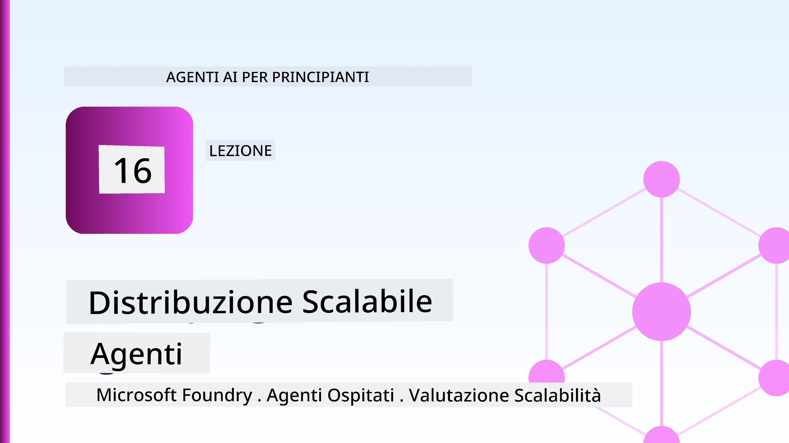
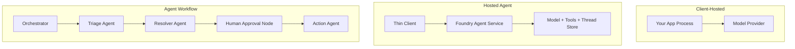
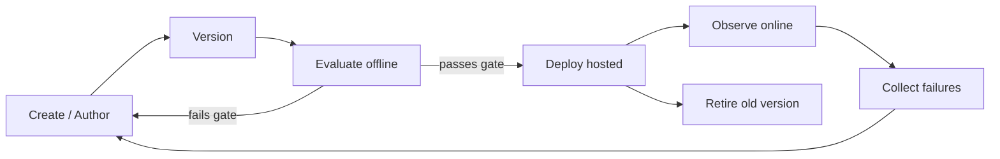
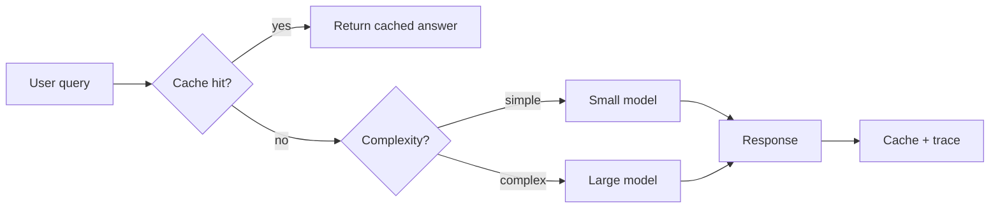
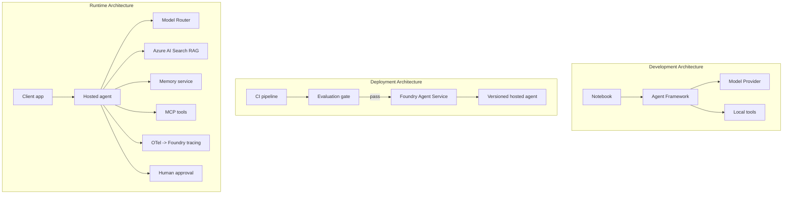

# Distribuire Agenti Scalabili con Microsoft Foundry



Finora nel corso hai costruito agenti che funzionano sul tuo portatile, all'interno di un notebook, guidati da `az login` e da una manciata di variabili d'ambiente. Questo è esattamente il modo giusto per imparare. Non è il modo giusto per eseguire un agente su cui migliaia di clienti fanno affidamento alle 3 del mattino.

Questa lezione riguarda il divario tra "funziona sulla mia macchina" e "funziona, in modo affidabile ed economicamente vantaggioso, in produzione." Colmiamo questo divario usando **Microsoft Foundry** e il **Microsoft Foundry Agent Service**, costruendo un vero agente di supporto clienti che include strumenti, recupero, memoria, valutazione e monitoraggio.

## Introduzione

Questa lezione coprirà:

- La differenza tra un **agente prototipo** e un **agente distribuito**, e perché la transizione riguarda principalmente tutto ciò che *circonda* il modello.
- I **modelli di distribuzione** per agenti: ospitati dal cliente, ospitati come servizio (Hosted Agents), e orchestrati tramite workflow.
- Il **ciclo di vita dell'agente** su Microsoft Foundry — creare, versionare, distribuire, valutare, osservare, ritirare.
- Le **strategie di scalabilità**: instradamento del modello, caching, concorrenza e progettazione senza stato.
- **Osservabilità** con OpenTelemetry e tracciamento Foundry.
- **Ottimizzazione dei costi** attraverso la selezione del modello, l'instradamento e le porte di valutazione.
- **Considerazioni aziendali**: governance, approvazione umana e gestione sicura dei server MCP in produzione.

## Obiettivi di Apprendimento

Dopo aver completato questa lezione, saprai come:

- Scegliere il modello di distribuzione giusto per un dato carico di lavoro dell'agente.
- Distribuire un agente sul Microsoft Foundry Agent Service in modo che sia versionato, governato e osservabile.
- Strumentare un agente per il tracciamento e collegare una pipeline di valutazione che gira prima di ogni rilascio.
- Applicare instradamento del modello e caching per mantenere latenza e costo sotto controllo su larga scala.
- Aggiungere una porta di approvazione umana per azioni ad alto rischio e integrare un server MCP in modo sicuro per la produzione.

## Prerequisiti

Questa lezione presuppone che tu abbia completato le lezioni precedenti e ti senta a tuo agio con:

- Costruire agenti con il [Microsoft Agent Framework](../14-microsoft-agent-framework/README.md) (Lezione 14).
- [Uso degli Strumenti](../04-tool-use/README.md) (Lezione 4) e [Agentic RAG](../05-agentic-rag/README.md) (Lezione 5).
- [Memoria dell'Agente](../13-agent-memory/README.md) (Lezione 13) e [Protocolli Agentic / MCP](../11-agentic-protocols/README.md) (Lezione 11).
- [Osservabilità e Valutazione](../10-ai-agents-production/README.md) (Lezione 10) — questa lezione si basa direttamente su di essa.

Avrai inoltre bisogno di:

- Un **abbonamento Azure** e un **progetto Microsoft Foundry** con almeno un modello chat distribuito.
- L’**Azure CLI** autenticata (`az login`).
- Python 3.12+ e i pacchetti nel repository [`requirements.txt`](../../../requirements.txt).

## Da Prototipo a Produzione: Cosa Cambia Effettivamente

Un agente prototipo e un agente di produzione condividono lo stesso ciclo centrale — ragionare, chiamare strumenti, rispondere. Quello che cambia è tutto ciò che avvolge quel ciclo. Il modello rappresenta forse il 20% di un agente di produzione; l'altro 80% è lo scheletro operativo.

| Aspetto | Prototipo | Produzione |
| --- | --- | --- |
| **Hosting** | Funziona nel tuo notebook | Funziona come servizio ospitato, versionato e distribuito |
| **Identità** | Il tuo token `az login` | Identità gestita con RBAC limitato |
| **Stato** | In memoria, perso al riavvio | Esteriorizzato (thread store, servizio di memoria) |
| **Errore** | Vedi il traceback | Ritenta, fallback, dead-letter, avvisi |
| **Costo** | "Sono pochi centesimi" | Tracciato per richiesta, instradato, memorizzato nella cache, con budget |
| **Qualità** | Controlli l'output a occhio | Valutato automaticamente prima di ogni rilascio |
| **Fiducia** | Approvi ogni azione | Politica + intervento umano per azioni rischiose |

Tieni a mente questa tabella. Ogni sezione qui sotto corrisponde a una di queste righe.

## Modelli di Distribuzione degli Agenti

Esistono tre modelli che userai, spesso in combinazione.

### 1. Agenti Ospitati dal Cliente

L’oggetto agente risiede all'interno del processo della *tua* applicazione. Il tuo codice chiama direttamente il provider del modello; il ciclo di ragionamento gira nel tuo servizio. Questo è ciò che ogni lezione precedente ha fatto.

- **Usalo quando** hai bisogno di controllo totale sul ciclo, middleware personalizzati o stai integrando l'agente all'interno di un backend esistente.
- **Compromesso**: devi gestire tu stesso la scalabilità, lo stato e la resilienza.

### 2. Agenti Ospitati (Foundry Agent Service)

L'agente è *registrato come risorsa* in Microsoft Foundry. Foundry ospita il ciclo di ragionamento, memorizza i thread, impone la sicurezza dei contenuti e RBAC, e rende l'agente visibile nel portale Foundry. La tua app diventa un client leggero che crea thread e legge risposte.

- **Usalo quando** vuoi durabilità, osservabilità integrata, governance e una superficie operativa ridotta.
- **Compromesso**: minor controllo a basso livello in cambio di un runtime gestito.

### 3. Workflow di Agenti

Molti agenti (e strumenti) sono composti in un grafo con flusso di controllo esplicito — passaggi sequenziali, diramazioni, nodi di approvazione umana e checkpoint durevoli che possono mettere in pausa e riprendere. Questa è la funzionalità **Workflows** del Microsoft Agent Framework applicata alla scala della distribuzione.

- **Usalo quando** un singolo compito coinvolge diversi agenti specializzati o richiede un passaggio di approvazione a metà.
- **Compromesso**: più elementi in movimento; necessita osservabilità a livello di orchestrazione.



## Il Ciclo di Vita dell’Agente su Microsoft Foundry

Distribuire un agente non è un’operazione una tantum `push`. È un ciclo, e assomiglia molto a un ciclo di rilascio software perché è proprio questo.



L’idea chiave, derivata da [Lezione 10](../10-ai-agents-production/README.md): **la valutazione offline è una porta, non un ripensamento.** Una nuova versione dell’agente non viene distribuita se non supera le soglie di valutazione. L'osservabilità online poi reinserisce i guasti reali nel set di test offline. Questo è tutto il ciclo.

## Strategie di Scalabilità

Scalare un agente è diverso dal scalare un'API web senza stato, perché ogni richiesta può attivare molteplici chiamate costose a modelli e strumenti. Quattro tecniche gestiscono la maggior parte del carico.

**Gestione senza stato della richiesta.** Non conservare stato per utente nella memoria del tuo processo. Conserva i thread della conversazione nel thread store di Foundry o in un servizio di memoria così ogni istanza può gestire qualsiasi richiesta. Questo ti permette di scalare orizzontalmente — aggiungi istanze, niente sessioni sticky.

**Instradamento del modello.** Non ogni richiesta necessita il modello più potente (e costoso). Instrada richieste semplici — classificazione dell’intento, risposte fattuali brevi — verso un modello piccolo e veloce, e riserva il modello grande per il vero ragionamento. Il **Model Router** di Foundry può fare questo per te, oppure puoi implementare un classificatore leggero da solo. Costruirai la versione fai-da-te nel laboratorio.

**Caching della risposta.** Molte domande di supporto sono quasi duplicati ("come resetto la password?"). Memorizza in cache le risposte alle domande comuni e servile senza chiamare affatto il modello. Anche un modesto tasso di hit in cache riduce significativamente costi e latenza.

**Concorrenza e backpressure.** I provider di modelli hanno limiti di velocità. Limita la concorrenza, usa ritentativi con backoff esponenziale e fallisci in modo elegante (una risposta in coda tipo "stiamo lavorando" è meglio di un 500).



## Osservabilità in Produzione

Non puoi gestire ciò che non puoi vedere. Come mostrato nella Lezione 10, Microsoft Agent Framework emette **tracce OpenTelemetry** nativamente — ogni chiamata modello, invocazione strumento e passaggio di orchestrazione diventa uno span. In produzione esporti quegli span a Microsoft Foundry (o a qualsiasi backend compatibile OTel) così puoi:

- Tracciare un singolo reclamo cliente end-to-end attraverso ogni chiamata modello e strumento.
- Monitorare latenza p50/p95 e costo per richiesta nel tempo.
- Ricevere allarmi su picchi di errori e anomalie di costo prima che li notino gli utenti (o il team finanziario).

```python
from agent_framework.observability import get_tracer

tracer = get_tracer()

with tracer.start_as_current_span("support_request") as span:
    span.set_attribute("customer.tier", "enterprise")
    span.set_attribute("routed.model", "gpt-5-nano")
    # agent execution is traced automatically inside this span
```

Attributi come `customer.tier` e `routed.model` trasformano una montagna di tracce in domande rispondibili ("i clienti enterprise vengono instradati troppo spesso verso il modello piccolo?").

## Ottimizzazione dei Costi

Il costo negli agenti di produzione è dominato dai token. Tre leve, in ordine di impatto:

1. **Dimensionare correttamente il modello.** Un modello piccolo che supera la tua porta di valutazione è quasi sempre più economico di uno grande che supera. Usa la valutazione per *dimostrare* che il modello piccolo è sufficientemente buono invece di defaultare al modello più grande per prudenza.
2. **Instradare per complessità.** Come detto prima — paga il prezzo del modello grande solo per richieste che richiedono ragionamento da modello grande.
3. **Fare caching aggressivo.** La chiamata modello più economica è quella che non fai mai.

Porte di valutazione e controllo dei costi sono la stessa disciplina vista da due angolazioni: la valutazione ti dice il *pavimento qualitativo*, l'instradamento e caching ti mantengono il più vicino possibile al *costo* di quel pavimento.

## Considerazioni Aziendali sulla Distribuzione

**Governance.** Gli Hosted Agents ereditano RBAC, sicurezza dei contenuti e audit logging di Foundry. Dai a ogni agente un'identità gestita con il minimo privilegio necessario — accesso in sola lettura alla knowledge base, accesso limitato all'API ticket, niente di più.

**Intervento umano nel ciclo.** Alcune azioni sono troppo importanti per essere automatizzate completamente — emettere un rimborso, cancellare un account, passare a un team legale. Il Microsoft Agent Framework supporta strumenti che richiedono **approvazione**: l’agente propone l’azione, l’esecuzione si mette in pausa, un umano approva o rifiuta, e il workflow riprende. Hai visto il primitivo nella [Lezione 6](../06-building-trustworthy-agents/README.md); qui lo distribuisci.

**MCP in produzione.** [MCP](../11-agentic-protocols/README.md) permette al tuo agente di usare strumenti esterni tramite un'interfaccia standard. In produzione tratta ogni server MCP come un confine non affidabile: fissa la versione del server, eseguilo con un’identità limitata, convalida l’output e non esporre mai segreti. Un server MCP è una dipendenza, e le dipendenze vanno patchate, controllate e limitate.



Quelli tre diagrammi — sviluppo, distribuzione, runtime — sono lo stesso agente in tre fasi della sua vita. Il laboratorio che segue ti guida nella sua costruzione.

## Laboratorio Pratico: Un Agente di Supporto Clienti Pronto per la Produzione

Apri [`code_samples/16-python-agent-framework.ipynb`](./code_samples/16-python-agent-framework.ipynb) e lavoraci dall'inizio alla fine. Assemblerai un **agente di supporto clienti Contoso** con ogni preoccupazione di produzione integrata:

1. **Chiamata agli strumenti** — cerca lo stato degli ordini e apri ticket di supporto.
2. **RAG** — risponde a domande di policy da una knowledge base (Azure AI Search, con un fallback in memoria per far girare il notebook senza una risorsa Search).
3. **Memoria** — ricorda il cliente durante la conversazione.
4. **Instradamento del modello** — un classificatore di complessità indirizza ogni richiesta a un modello piccolo o grande.
5. **Caching della risposta** — le domande ripetute sono servite dalla cache.
6. **Approvazione umana** — rimborsi sopra una soglia si mettono in pausa per l’approvazione umana.
7. **Pipeline di valutazione** — un piccolo set di test offline valuta l'agente e funge da porta per la release.
8. **Osservabilità** — tracciamenti OpenTelemetry per ogni richiesta.

### Guida Passo-Passo

Il notebook è organizzato in modo che ogni preoccupazione di produzione sia una sezione autonoma e eseguibile. Il cuore è il gestore delle richieste con instradamento e caching:

```python
async def handle_support_request(query: str, customer_id: str) -> str:
    # 1. Serve from cache when we can.
    cached = response_cache.get(normalize(query))
    if cached:
        return cached

    # 2. Route by complexity to control cost.
    model = "gpt-5-nano" if is_simple(query) else "gpt-5-mini"

    # 3. Run the agent inside a trace span for observability.
    with tracer.start_as_current_span("support_request") as span:
        span.set_attribute("routed.model", model)
        span.set_attribute("customer.id", customer_id)
        response = await support_agent.run(query, model=model)

    # 4. Cache and return.
    response_cache.set(normalize(query), response.text)
    return response.text
```

La porta di valutazione che protegge una release appare così:

```python
async def evaluation_gate(agent, test_cases, threshold: float = 0.8) -> bool:
    passed = 0
    for case in test_cases:
        result = await agent.run(case["input"])
        if score_response(result.text, case["expected"]) >= 0.8:
            passed += 1
    pass_rate = passed / len(test_cases)
    print(f"Evaluation pass rate: {pass_rate:.0%} (gate: {threshold:.0%})")
    return pass_rate >= threshold  # only deploy if the gate passes
```

Leggi ogni riga — il notebook mantiene i primitivi volutamente piccoli così nulla è nascosto dietro una chiamata di framework.

## Validare un Agente Distribuito con Smoke Tests

La porta di valutazione sopra funziona *offline* sul tuo oggetto agente. Una volta che l'agente è distribuito come Hosted Agent, serve un controllo ulteriore, ancora più economico: **l’endpoint distribuito risponde effettivamente?**

Distribuire "con successo" dimostra solo che il piano di controllo ha accettato la definizione — non prova che l’agente risponda. Una dipendenza mancante, un errato instradamento modello o una connessione scaduta possono lasciare una distribuzione verde che però non risponde. Un **smoke test** lo rileva in pochi secondi, ad ogni distribuzione, senza il costo di una valutazione completa.

Questo repository include una pipeline di smoke-test pronta all’uso costruita sull’azione GitHub [AI Smoke Test](https://github.com/marketplace/actions/ai-smoke-test):

- **Catalogo** — [`tests/lesson-16-smoke-tests.json`](../../../tests/lesson-16-smoke-tests.json) contiene prompt e asserzioni per l’agente di supporto Contoso (risposte policy fondate, ricerca ordini, mantenere l’argomento, continuità multi-turno). Cataloghi per agenti di altre lezioni vivono accanto — vedi [`tests/README.md`](../tests/README.md).
- **Workflow** — [`.github/workflows/smoke-test.yml`](../../../.github/workflows/smoke-test.yml) si autentica con Azure OIDC e POSTa ogni prompt all’endpoint Risposte dell’agente, fallendo il job su qualsiasi asserzione errata.

```yaml
- name: Smoke-test hosted agent
  uses: JFolberth/ai-smoketest@v1
  with:
    project_endpoint: ${{ inputs.project_endpoint }}
    agent_name: ContosoSupportAgent
    tests_file: tests/lesson-16-smoke-tests.json
```

Eseguilo dalla scheda **Actions** una volta che il tuo agente è distribuito, fornendo il punto di accesso del progetto Foundry e il nome dell'agente. L'identità federata necessita del ruolo **Azure AI User** a livello di ambito del progetto Foundry. Pensa agli strati come a una piramide: i test smoke (raggiungibile e risponde?) vengono eseguiti ad ogni distribuzione, la valutazione offline (abbastanza buona per la distribuzione?) viene eseguita prima della promozione, e la valutazione online (come si comporta in situazioni reali?) viene eseguita continuamente.

## Verifica della Conoscenza

Metti alla prova la tua comprensione prima di passare all'assegnazione.

**1. Approssimativamente, quanto di un agente in produzione è "il modello" e cosa rappresenta il resto?**

<details>
<summary>Risposta</summary>

Il modello rappresenta una minoranza del sistema — spesso stimato intorno al 20%. Il resto è lo scheletro operativo: hosting e versioning, identità e RBAC, stato esternalizzato, gestione dei fallimenti, monitoraggio dei costi, valutazione e controlli con intervento umano. Passare alla produzione significa soprattutto costruire tutto *attorno* al ciclo di ragionamento.
</details>

**2. Quando sceglieresti un Agente Hostato rispetto a un agente ospitato dal client?**

<details>
<summary>Risposta</summary>

Quando desideri un ambiente runtime gestito con durabilità integrata (thread che persistono e possono riprendere), osservabilità, sicurezza dei contenuti e RBAC, e sei disposto a rinunciare a un certo controllo a basso livello del ciclo di ragionamento per avere una minore superficie operativa. L’hosting dal client è preferibile quando è necessario il controllo completo sul ciclo o si sta integrando l’agente in un backend esistente.
</details>

**3. Perché un agente scalabile deve essere senza stato nella propria memoria di processo?**

<details>
<summary>Risposta</summary>

Così ogni istanza può gestire qualsiasi richiesta, il che permette la scalabilità orizzontale senza sessioni sticky. Lo stato della conversazione per utente è esternalizzato in un archivio thread o servizio di memoria. Se lo stato fosse in memoria di processo, lo perderesti al riavvio e non potresti distribuire il carico liberamente.
</details>

**4. Quale problema risolve il routing del modello e come si collega alla valutazione?**

<details>
<summary>Risposta</summary>

Il routing invia richieste semplici a un modello piccolo, economico e veloce e riserva il modello grande per il vero ragionamento, controllando sia la latenza che il costo. È collegato alla valutazione perché è la valutazione che *dimostra* che il modello piccolo è abbastanza buono per una classe di richieste — il routing senza valutazione è una supposizione.
</details>

**5. Cos’è un "evaluation gate" e dove si colloca nel ciclo di vita?**

<details>
<summary>Risposta</summary>

Un evaluation gate esegue un set di test offline contro una nuova versione dell’agente e blocca la distribuzione a meno che il tasso di superamento non superi una soglia. Si colloca tra "versione" e "distribuzione" nel ciclo di vita, rendendo la qualità una precondizione per il rilascio invece di qualcosa da controllare dopo la distribuzione.
</details>

**6. Perché un server MCP deve essere trattato come un confine non affidabile in produzione?**

<details>
<summary>Risposta</summary>

Perché è una dipendenza esterna a cui il tuo agente si collega. Devi fissarne la versione, eseguirlo con un’identità limitata, convalidarne gli output, limitarne la frequenza e non esporre mai segreti — la stessa disciplina applicata a qualsiasi dipendenza di terze parti. I suoi output influenzano il ragionamento dell’agente, quindi la fiducia non convalidata è un rischio per la sicurezza.
</details>

**7. Quale singola modifica ha di solito l’impatto maggiore sul costo di un agente in produzione, e perché?**

<details>
<summary>Risposta</summary>

Dimensionare correttamente il modello — usare il modello più piccolo che supera ancora il tuo evaluation gate. Il costo è dominato dai token, e un modello più piccolo che soddisfa il livello di qualità è quasi sempre più economico di uno più grande. La cache e il routing riducono ulteriormente i costi, ma scegliere il modello base giusto ha l’effetto più grande di primo ordine.
</details>

**8. Che ruolo giocano gli attributi di span come `customer.tier` e `routed.model` nell’osservabilità?**

<details>
<summary>Risposta</summary>

Trasformano le tracce grezze in domande di business a cui è possibile rispondere. Senza attributi hai un muro di span; con essi puoi chiedere "i clienti aziendali vengono indirizzati troppo spesso al modello piccolo?" o "quale modello gestisce le richieste più lente?" Gli attributi sono come analizzi la telemetria secondo le dimensioni che contano per la tua operazione.
</details>

## Assegnazione

Prendi l’agente di supporto clienti dal laboratorio e rafforzalo per uno scenario specifico: **un agente di supporto alla fatturazione per abbonamenti per una società SaaS.**

La tua consegna dovrebbe:

1. **Sostituire gli strumenti** con quelli rilevanti per la fatturazione: `get_subscription_status`, `get_invoice` e `issue_credit` (crediti superiori a $50 richiedono l’approvazione umana).
2. **Aggiungere tre documenti RAG** che coprano la politica di rimborso dell’azienda, il ciclo di fatturazione e la politica di cancellazione.
3. **Estendere il set di valutazione** ad almeno otto casi, includendo almeno due che *dovrebbero* attivare il percorso di approvazione umana, e confermare che il tuo evaluation gate supera o fallisce correttamente.
4. **Aggiungere un report di costo**: dopo aver eseguito dieci query miste tramite l’agente, stampa quante sono andate al modello piccolo, quante al modello grande e quante sono state servite dalla cache.

Scrivi un breve paragrafo (in una cella markdown) spiegando quale regola di routing del modello hai scelto e come la convalideresti con traffico reale. Non esiste una risposta univoca corretta — sarai valutato sulla coerenza con cui i requisiti di produzione sono integrati.

## Riepilogo

In questa lezione hai spostato un agente da prototipo a produzione con Microsoft Foundry:

- Il salto verso la produzione riguarda soprattutto lo **scheletro operativo** attorno al modello — hosting, identità, stato, gestione dei fallimenti, costo, qualità e fiducia.
- Hai imparato i tre **modelli di distribuzione** — client-hosted, Hosted Agents e Agent Workflows — e quando usarli.
- Hai percorso il **ciclo di vita dell’agente**, dove la valutazione offline **agisce come un gate di rilascio** e l’osservabilità online alimenta i fallimenti nel set di test.
- Hai applicato **strategie di scalabilità** — design senza stato, routing del modello, caching e concorrenza limitata — collegandole all’**ottimizzazione dei costi**.
- Hai integrato **controlli aziendali**: RBAC, approvazione umana e integrazione MCP sicura per la produzione.
- Hai costruito un **agente di supporto clienti pronto per la produzione** che lega insieme ciascuna di queste preoccupazioni in codice eseguibile.

La lezione successiva compie il percorso opposto: invece di scalare gli agenti verso il cloud, li porterai *giù* su un singolo computer di sviluppo e li eseguirai interamente localmente.

## Risorse Aggiuntive

- <a href="https://learn.microsoft.com/azure/ai-foundry/what-is-azure-ai-foundry" target="_blank">Documentazione Microsoft Foundry</a>
- <a href="https://learn.microsoft.com/azure/ai-foundry/agents/overview" target="_blank">Panoramica Microsoft Foundry Agent Service</a>
- <a href="https://learn.microsoft.com/en-us/agent-framework/overview/?wt.mc_id=youtube_26688_organicsocial_reactor&pivots=programming-language-python" target="_blank">Microsoft Agent Framework</a>
- <a href="https://learn.microsoft.com/en-us/azure/ai-foundry/openai/concepts/model-router" target="_blank">Model Router in Microsoft Foundry</a>
- <a href="https://learn.microsoft.com/azure/search/search-what-is-azure-search" target="_blank">Azure AI Search</a>
- <a href="https://opentelemetry.io/" target="_blank">OpenTelemetry</a>
- <a href="https://github.com/marketplace/actions/ai-smoke-test" target="_blank">AI Smoke Test GitHub Action</a>
- <a href="https://modelcontextprotocol.io/" target="_blank">Model Context Protocol (MCP)</a>

## Lezione Precedente

[Costruire Agenti per l’Uso del Computer (CUA)](../15-browser-use/README.md)

## Lezione Successiva

[Creare Agenti AI Locali](../17-creating-local-ai-agents/README.md)

---

<!-- CO-OP TRANSLATOR DISCLAIMER START -->
**Disclaimer**:
Questo documento è stato tradotto utilizzando il servizio di traduzione AI [Co-op Translator](https://github.com/Azure/co-op-translator). Sebbene ci impegniamo per garantire la precisione, si prega di notare che le traduzioni automatizzate possono contenere errori o imprecisioni. Il documento originale nella sua lingua nativa deve essere considerato la fonte autorevole. Per informazioni critiche, si raccomanda una traduzione professionale effettuata da un essere umano. Non siamo responsabili per eventuali malintesi o interpretazioni errate derivanti dall’uso di questa traduzione.
<!-- CO-OP TRANSLATOR DISCLAIMER END -->