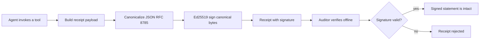
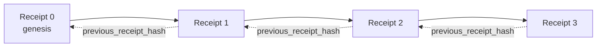

[Guarda il video della lezione: Proteggere gli agenti AI con ricevute crittografiche](https://youtu.be/PLACEHOLDER_VIDEO_ID)

> _(Il video della lezione e la miniatura verranno aggiunti dal team contenuti Microsoft dopo l'unione, seguendo il modello della lezione 14 / 15.)_

# Proteggere gli agenti AI con ricevute crittografiche

## Introduzione

Questa lezione tratterà:

- Perché i registri di controllo per gli agenti AI sono importanti per conformità, debug e fiducia.
- Cos'è una ricevuta crittografica e in cosa differisce da una riga di log non firmata.
- Come produrre una ricevuta firmata per la chiamata a uno strumento da parte di un agente in Python semplice.
- Come verificare una ricevuta offline e rilevare manomissioni.
- Come concatenare le ricevute in modo che la rimozione o la riorganizzazione di una spezzi la catena.
- Cosa provano le ricevute e cosa invece non provano esplicitamente.

## Obiettivi di apprendimento

Dopo aver completato questa lezione, saprai come:

- Identificare le modalità di errore che motivano la provenienza crittografica per le azioni dell'agente.
- Produrre una ricevuta firmata Ed25519 su un payload JSON canonico.
- Verificare una ricevuta in modo indipendente usando solo la chiave pubblica del firmatario.
- Rilevare manomissioni rieseguendo la verifica su una ricevuta modificata.
- Costruire una sequenza di ricevute concatenata tramite hash e spiegare l'importanza della catena.
- Riconoscere il confine tra ciò che le ricevute provano (attribuzione, integrità, ordinamento) e ciò che non provano (correttezza dell'azione, validità della politica).

## Il problema: il registro di controllo del tuo agente

Immagina di aver distribuito un agente AI per Contoso Travel. L'agente legge le richieste dei clienti, chiama un'API per i voli per cercare opzioni e prenota i posti per conto del cliente. Lo scorso trimestre, l'agente ha elaborato 50.000 prenotazioni.

Oggi arriva un revisore. Pone una domanda semplice: "Mostrami cosa ha fatto il tuo agente."

Consegnate i vostri file di log. Il revisore li esamina e formula una domanda più difficile: "Come faccio a sapere che questi log non sono stati modificati?"

Questo è il problema del registro di controllo. La maggior parte delle distribuzioni di agenti oggi si basa su:

- **Log delle applicazioni**: scritti dallo stesso agente, modificabili da chiunque abbia accesso al file system.
- **Servizi di logging cloud**: evidenti in caso di manomissione a livello di piattaforma ma solo se il revisore si fida dell'operatore della piattaforma.
- **Log di transazioni del database**: adatti per i cambiamenti nel database ma non per chiamate arbitrarie a strumenti.

Nessuno di questi può rispondere alla domanda del revisore senza richiedere fiducia in qualcuno (voi, il vostro provider cloud, il vostro fornitore database). Per uso interno, quella fiducia è spesso accettabile. Per carichi di lavoro regolamentati (finanza, sanità, tutto ciò che rientra nell'EU AI Act), non lo è.

Le ricevute crittografiche limitano questo problema rendendo una dichiarazione firmata indipendentemente
verificabile. Il revisore ha comunque bisogno di un motivo esterno al canale per fidarsi della chiave di firma e
del componente che ha prodotto la dichiarazione. Una chiave incorporata dimostra coerenza interna,
non identità dell'emittente o posizionamento dell'applicazione.

## Cos'è una ricevuta crittografica?

Una ricevuta è un oggetto JSON che registra cosa ha fatto un agente, firmato con una firma digitale.



Una ricevuta minimale appare così:

```json
{
  "type": "agent.tool_call.v1",
  "agent_id": "contoso-travel-bot",
  "tool_name": "lookup_flights",
  "tool_args_hash": "sha256:a3f9c1...",
  "result_hash": "sha256:7b2e1d...",
  "policy_id": "contoso-travel-policy-v3",
  "timestamp": "2026-04-25T14:30:00Z",
  "sequence": 47,
  "previous_receipt_hash": "sha256:9d4e6a...",
  "signature": {
    "alg": "EdDSA",
    "sig": "c5af83...",
    "public_key": "8f3b2c..."
  }
}
```

Tre proprietà fanno il lavoro:

1. **La firma**. La ricevuta è firmata dal gateway dell'agente usando una chiave privata Ed25519. Chiunque abbia la corrispondente chiave pubblica può verificare la firma offline. Una parte che si fida deve bloccare quella chiave o ricavarla da un registro affidabile al di fuori della ricevuta. La manomissione di qualsiasi campo firmato invalida la firma.

2. **Codifica canonica**. Prima di firmare, la ricevuta viene serializzata usando JSON Canonicalization Scheme (JCS, RFC 8785). Questo garantisce che due implementazioni che producono la stessa ricevuta logica producano un output byte-identico. Senza canonizzazione, diversi serializzatori JSON produrrebbero firme diverse per lo stesso contenuto.

3. **Concatenazione tramite hash**. Il campo `previous_receipt_hash` collega ogni ricevuta a quella precedente. Rimuovere o riordinare una ricevuta rompe la sequenza presentata. Rilevare troncamenti o riscritture controllate dal firmatario richiede inoltre una testa della catena corrente bloccata, un checkpoint testimoniato indipendente o un impegno autenticato di popolazione chiusa.

Insieme queste proprietà garantiscono tre cose:

- **Attribuzione a una chiave**: questa chiave ha firmato questo contenuto. L'identità organizzativa o umana richiede un binding di chiave affidabile.
- **Integrità**: il contenuto non è stato modificato dopo la firma.
- **Ordinamento nella sequenza verificata**: questa ricevuta si collega a quel predecessore.

## Produrre una ricevuta in Python

Non serve una libreria speciale per produrre una ricevuta. Le primitive crittografiche sono ampiamente disponibili e la logica sono poche dozzine di righe di Python.

Gli esercizi pratici in `code_samples/18-signed-receipts.ipynb` guidano attraverso il flusso completo. Il codice sotto controllo in `code_samples/18-signed-receipts.execution-receipt.json` registra l'hash esatto del notebook, l'ambiente Python, il numero di celle e i controlli dall'ultima esecuzione pulita senza modificare gli output salvati della lezione. La versione riassunta:

```python
import json
import hashlib
import base64
from nacl import signing
from jcs import canonicalize  # RFC 8785 canonical JSON

def b64url_nopad(data: bytes) -> str:
    return base64.urlsafe_b64encode(data).decode("ascii").rstrip("=")

def sha256_canonical(obj) -> str:
    """SHA-256 of a Python object's JCS-canonical JSON form."""
    return f"sha256:{hashlib.sha256(canonicalize(obj)).hexdigest()}"

# Generate or load a signing key (in production, store in a key vault)
signing_key = signing.SigningKey.generate()
verify_key = signing_key.verify_key
TRUSTED_PUBLIC_KEYS = {b64url_nopad(bytes(verify_key))}  # pinned out of band by the verifier

# Build the receipt payload (no signature yet)
tool_args = {"origin": "SYD", "destination": "LAX"}
tool_result = [{"flight": "QF11", "price": 1850, "stops": 0}]

payload = {
    "type": "agent.tool_call.v1",
    "agent_id": "contoso-travel-bot",
    "tool_name": "lookup_flights",
    "tool_args_hash": sha256_canonical(tool_args),
    "result_hash": sha256_canonical(tool_result),
    "policy_id": "contoso-travel-policy-v3",
    "timestamp": "2026-04-25T14:30:00Z",
    "sequence": 0,
    "previous_receipt_hash": None,
}

# Canonicalize and sign the JCS bytes directly. PureEdDSA hashes internally.
canonical_bytes = canonicalize(payload)
signature_bytes = signing_key.sign(canonical_bytes).signature

# Attach a structured signature object.
receipt = {
    **payload,
    "signature": {
        "alg": "EdDSA",
        "sig": b64url_nopad(signature_bytes),
        "public_key": b64url_nopad(bytes(verify_key)),
    },
}
```

Questa è tutta la pipeline di firma. Gli esercizi nel notebook mostrano ogni fase.

## Verificare una ricevuta e rilevare manomissioni

La verifica è l'operazione inversa:

```python
import base64
import hashlib
from nacl import signing
from nacl.exceptions import CryptoError
from jcs import canonicalize

def b64url_decode(s: str) -> bytes:
    # Strict: Python's decoder skips characters outside the alphabet and also
    # accepts padding, the standard +/ alphabet and non-zero spare bits.
    # Re-encoding and comparing accepts only the one unpadded base64url form.
    padding = "=" * ((4 - len(s) % 4) % 4)
    data = base64.urlsafe_b64decode(s + padding)
    if base64.urlsafe_b64encode(data).decode("ascii").rstrip("=") != s:
        raise ValueError("not canonical unpadded base64url")
    return data

def verify_receipt(receipt: dict, trusted_public_key: str) -> bool:
    # trusted_public_key is the issuer's key, obtained from somewhere other
    # than this receipt. Never use receipt["signature"]["public_key"] here:
    # see "What Receipts Prove (and What They Do Not)" below.
    # Fails closed: anything malformed returns False instead of raising.
    if not isinstance(receipt, dict) or not isinstance(trusted_public_key, str):
        return False
    sig_obj = receipt.get("signature")
    if not isinstance(sig_obj, dict) or sig_obj.get("alg") != "EdDSA":
        return False
    sig_b64 = sig_obj.get("sig")
    if not isinstance(sig_b64, str):
        return False

    try:
        # Reconstruct the payload that was actually signed (everything except signature).
        payload = {k: v for k, v in receipt.items() if k != "signature"}
        canonical_bytes = canonicalize(payload)
        verify_key = signing.VerifyKey(b64url_decode(trusted_public_key))
        verify_key.verify(canonical_bytes, b64url_decode(sig_b64))
        return True
    except (CryptoError, TypeError, ValueError, KeyError, OverflowError):
        return False
    except Exception:
        # An undecodable key or signature, or a payload that cannot be
        # canonicalized: fail closed rather than raise.
        return False
```

Questa funzione prende una ricevuta e la chiave pubblica dell'emittente, e restituisce `True` se la firma è valida e `False` altrimenti, incluso quando l'input è malformato. Nessuna chiamata di rete e nessun servizio di verifica: una volta che possiedi la chiave dell'emittente, la verifica è completamente locale e offline. Ciò che serve comunque è quella chiave, ottenuta da qualche altra fonte rispetto alla ricevuta stessa.

Per vedere la rilevazione della manomissione in azione, il notebook passa attraverso:

1. Produrre una ricevuta valida e confermare che si verifica.
2. Modificare un byte del campo `tool_args_hash`.
3. Rieseguire la verifica e vedere che fallisce.
4. Manomettere di nuovo, ma questa volta rifirmare con una chiave generata dall'attaccante e incorporare quella chiave nella ricevuta.

Il passo 4 è quello su cui vale la pena soffermarsi. Quella ricevuta è internamente consistente: la sua firma è genuina per il suo contenuto e per la chiave che contiene, quindi si verifica contro la chiave al suo interno. Fallisce solo quando viene controllata contro la reale chiave dell'emittente. I passi 2 e 3 catturano un attaccante che non si è preso la briga di rifirmare; il passo 4 cattura quello che lo ha fatto.

Questa è la dimostrazione pratica che le ricevute sono evidenti in caso di manomissione: qualsiasi modifica a un campo firmato spezza la firma, a condizione di verificare contro una chiave che l'attaccante non ha fornito. L'oggetto `signature` è fuori dai byte firmati, motivo per cui la chiave contro cui verifichi deve provenire da qualche altra fonte rispetto alla ricevuta.

## Concatenare le ricevute per agenti multi-step

Una singola ricevuta firmata protegge un'azione. Una catena di ricevute protegge una sequenza.



Ogni ricevuta registra l'hash della ricevuta precedente. Per rimuovere silenziosamente la ricevuta 2, un attaccante dovrebbe o:

- Modificare il campo `previous_receipt_hash` della ricevuta 3 (rompe la firma della ricevuta 3), O
- Falsificare una nuova firma su una ricevuta 3 modificata (serve la chiave privata dell'agente).

Se la chiave privata è in un vault hardware e i verificatori controllano ogni ricevuta contro la chiave pubblica dell'emittente, ottenuta indipendentemente (un JWK Set pubblicato o un valore di configurazione bloccato), nessun attacco è possibile senza essere rilevato. Pubblicare la chiave dentro ogni ricevuta non è sufficiente: un attaccante può rifirmare con una propria chiave e incorporarla, come mostrato in `04_resigned_receipt.json`.

Il notebook mostra:

1. Costruire una catena di tre ricevute.
2. Verificare che l'`previous_receipt_hash` di ogni ricevuta corrisponda all'hash reale della ricevuta precedente.
3. Manomettere una ricevuta in mezzo e vedere la catena rompersi esattamente in quel punto.

Ecco come si produce un registro di controllo che un revisore esterno può verificare
sotto chiavi dell'emittente bloccate e checkpoint della catena, senza fidarsi del vostro archivio di log modificabile.

## Cosa provano le ricevute (e cosa non provano)

Questa è la sezione più importante di questa lezione. Le ricevute sono potenti ma il loro potere ha limiti.

**Le ricevute provano tre cose:**

1. **Attribuzione**: una chiave specifica ha firmato un payload specifico.
2. **Integrità**: il payload non è cambiato dalla firma.
3. **Ordinamento in una sequenza presentata e verificata**: questa ricevuta si collega a quel predecessore.

**Le ricevute NON provano:**

1. **Correttezza**: che l'azione dell'agente fosse l'azione giusta. Una ricevuta può essere firmata per una risposta sbagliata tanto facilmente quanto per una risposta giusta.
2. **Conformità alla policy**: che la policy riferita in `policy_id` sia stata effettivamente valutata, o che avrebbe permesso questa azione se controllata. La ricevuta registra ciò che è stato dichiarato, non ciò che è stato applicato.
3. **Identità oltre la chiave**: la ricevuta dice "questa chiave ha firmato questo contenuto." Non dice "questo umano ha autorizzato questo." Collegare una chiave a una persona o organizzazione richiede un'infrastruttura di identità separata (una directory, un registro di chiavi pubbliche, ecc.).
4. **Veridicità degli input**: se l'agente riceve un prompt manipolato e agisce su di esso, la ricevuta registra fedelmente l'azione. Le ricevute sono a valle della validazione dell'input, non un suo sostituto.
5. **Esecuzione o effetto nel mondo reale**: una ricevuta post-chiamata registra ciò che il suo emittente dichiara sia accaduto. Dimostrare l'ammissione o riconciliare un effetto esterno richiede prove dal vero esecutore o confine del fornitore.
6. **Completezza**: una ricevuta mancante può significare bloccata, omessa, persa o non strumentata. L'assenza diventa prova solo all'interno di una popolazione chiusa autenticata.
7. **Tempo attendibile**: un timestamp firmato dimostra che il firmatario ha prodotto quel valore, non che il valore fosse corretto. Il tempo attendibile necessita di una autorità temporale separata o di un checkpoint testimoniato.

**La chiave nella ricevuta non è la chiave con cui verifichi.** Questo deriva dal punto 3, ed è l'unico caso in cui la distinzione deve cambiare il tuo codice piuttosto che la tua comprensione. La `public_key` nell’esempio sopra è lì affinché l’esempio sia autonomo. Un verificatore non deve mai fidarsi di essa. Chiunque può prendere una ricevuta, alterarla, firmarla con una chiave che ha generato, e inserirvi quella chiave; il risultato verifica perfettamente su se stesso. Quella è la fixture `04_resigned_receipt.json` in `sample_receipts/`, ed è per questo che `verify_receipt` sopra prende la chiave come argomento invece di leggerla dalla ricevuta. Ottieni la chiave dell’emittente indipendentemente, dal JWK Set nella Production Checklist qui sotto o da un altro ancoraggio che hai fissato in precedenza, e verifica contro quella. Una firma controllata con una chiave che è arrivata nello stesso involucro prova solo che l’involucro è coerente con se stesso.

Questo confine è importante per due ragioni:

- Ti dice a cosa servono le ricevute: rendere il comportamento dell’agente verificabile e a prova di manomissione, anche oltre i confini organizzativi.
- Ti dice quali ulteriori livelli ti servono ancora: validazione degli input (Lezione 6), applicazione della policy (coperta brevemente sotto), e infrastruttura di identità (fuori dallo scopo di questa lezione).

Un errore comune è assumere che "abbiamo ricevute" significhi "siamo governati." Non è così. Le ricevute sono una base. La governance è il sistema che costruisci sopra.

## Vincolare la Firma di un Approvante all'Azione Esatta

Il punto 3 sopra merita una sezione a parte: una ricevuta di azione dice "questa chiave ha firmato questo contenuto," mai "un umano ha autorizzato questo." Per azioni ad alto rischio (rimborsi, cancellazioni, bonifici), una firma approvante separata può vincolare l’azione esatta. Collegare quella chiave a un umano e verificarne la presenza restano responsabilità separate.

Il notebook seguente `code_samples/human-authorization-receipts.ipynb` aggiunge un secondo tipo di ricevuta, `human.approval.v1`, nella stessa forma di involucro delle ricevute della lezione (un payload tipizzato firmato da Ed25519 sui suoi byte JCS canonici, con l’oggetto `signature` fuori dai byte firmati). Una chiave approvante firma l’**azione canonica completa e il suo digest**; una chiave agente firma una dichiarazione che porta lo **stesso digest di azione** e un `parent_approval_ref`, il `receipt_hash` dell’approvazione, la stessa convenzione di `previous_receipt_hash` nella catena costruita sopra. Un `verify_chain` cammina entrambi gli artefatti sotto **registri di chiavi fissate separati** (chiavi approvanti vs chiavi agenti), così il percorso del codice è condiviso ma le autorità mai.

La proprietà che questo garantisce, detta con attenzione: *la chiave approvante fissata ha firmato questa esatta
azione, e la chiave agente ha poi firmato una dichiarazione portante lo stesso digest d’azione.*
Questa è una prova utile, ma non è di per sé una dimostrazione che l’azione sia stata eseguita. Per
controllare l’esecuzione, l’approvazione esatta deve anche essere riservata e consumata una sola volta al
vero confine esecutore; gli esiti del fornitore sconosciuti devono rimanere sconosciuti piuttosto che
essere riprovati ciecamente. I fixture di rifiuto del notebook testano lo strato di catena di ricevute:

- manomissioni, confused deputy, chiavi falsificate su entrambi i lati, e input malformati;
- **autorità scaduta**: una firma che ancora verifica, rifiutata comunque perché la versione di politica è cambiata, la chiave approvante è stata ruotata fuori dal registro fissato, o l’approvazione è scaduta prima del tempo di verifica fornito;
- **sostituzione del digest**: una ricevuta d'azione valida firmata che punta a un'*vera* approvazione che vincola una *diversa* azione canonica.

Ogni fallimento si rifiuta con una ragione distinta, così un revisore che legge un rifiuto può dire se l’autorità è scaduta o l’azione rivendicata è cambiata. La verifica è in sola lettura e ripetibile: non consuma l’approvazione né invoca un fornitore. Un esecutore separato necessita di protezione al replay durevole e atomica e risultati espliciti di successo, fallimento o indeterminati. La ricevuta di approvazione umana è una composizione educativa definita da questa lezione, non un tipo di ricevuta definito da `draft-farley-acta-signed-receipts`.

## Riferimenti per la Produzione

Il codice Python in questa lezione è volutamente minimo così puoi leggere ogni riga e capire esattamente cosa sta succedendo. In produzione, hai due opzioni:

1. **Costruire direttamente sulle primitive crittografiche.** Le 50 righe viste sopra sono sufficienti per molti casi d'uso. PyNaCl (Ed25519) e il pacchetto `jcs` (JSON canonico) sono librerie ben mantenute e verificate.

2. **Usare una libreria di ricevute per la produzione.** Diversi progetti open-source implementano lo stesso schema con funzionalità aggiuntive (rotazione delle chiavi, verifica batch, distribuzione JWK Set, integrazione con motori di policy):
   - La pipeline di firma usa le convenzioni JCS e signature-scope in un Internet-Draft IETF indipendente ([`draft-farley-acta-signed-receipts`](https://datatracker.ietf.org/doc/draft-farley-acta-signed-receipts/), revisione 02). La ricevuta piatta e didattica di questa lezione differisce dall'involucro `{payload, signature}` del draft e non viene presentata come un'implementazione conforme. Il draft pubblica una suite di conformità condivisa ([agent-governance-testvectors](https://github.com/ScopeBlind/agent-governance-testvectors)) per implementazioni che puntano al suo formato wire.
   - Il Microsoft Agent Governance Toolkit compone ricevute con decisioni di policy basate su Cedar; vedi il Tutorial 33 in quel repository per un esempio end-to-end.
   - I pacchetti `protect-mcp` (npm) e `@veritasacta/verify` (npm) offrono un'implementazione Node della firma e verifica offline delle ricevute, pensata per avvolgere qualsiasi server MCP con una traccia di controllo a prova di manomissione, includendo un flusso di mantenimento per co-firma in cui un'azione sospesa emette una ricevuta di approvazione vincolata al digest dell'azione (supportata da WebAuthn nel flusso desktop), lo stesso schema di ricevuta di approvazione visto nel notebook di autorizzazione umana sopra.
   - Il **[nobulex](https://github.com/arian-gogani/nobulex)** SDK Python (`pip install nobulex`) fornisce lo stesso schema di firma Ed25519 + JCS in Python con integrazioni LangChain e CrewAI, inclusi test vector di cross-validazione pubblicati e una mappatura di conformità contribuita tramite [OWASP PR #2210](https://github.com/OWASP/CheatSheetSeries/pull/2210).
   - **[EMILIA Protocol](https://github.com/emiliaprotocol/emilia-protocol)** offre un livello complementare di enforcement di azioni esatte: ricevute di approvazione verificabili offline, autorità WebAuthn o quorum fissata, consumo singolo al confine dell'esecutore e un percorso esplicito per esiti indeterminati. I suoi adattatori di framework trattano una ricevuta come evidenza necessaria piuttosto che come prova che un effetto esterno sia avvenuto.

La decisione tra costruire da sé e usare una libreria riflette la scelta tra scrivere da soli una libreria JWT e usare una testata: entrambe sono ragionevoli; la libreria fa risparmiare tempo e riduce la superficie di audit; l'approccio da zero ti forza a capire ogni primitiva. Questa lezione insegna la via da zero così hai la base per entrambe le scelte.

## Verifica delle Conoscenze

Metti alla prova la tua comprensione prima di passare all'esercizio pratico.

**1. Una ricevuta è firmata con la chiave privata Ed25519 dell'agente. L'auditor ha solo la chiave pubblica. L'auditor può verificare la ricevuta offline?**

<details>
<summary>Risposta</summary>

Sì, la verifica crittografica richiede solo la chiave pubblica e i byte firmati. L'
auditor deve comunque ottenere e fissare la chiave pubblica accettata indipendentemente dalla ricevuta.
Non è richiesta alcuna chiamata di rete dopo che questa configurazione di fiducia è stabilita.
</details>

**2. Un attaccante modifica il campo `policy_id` di una ricevuta per affermare che era governata da una policy più permissiva. La firma era sul payload originale. Cosa succede durante la verifica?**

<details>
<summary>Risposta</summary>

La verifica fallisce. La firma è stata calcolata sui byte canonici del payload originale; modificare qualsiasi campo del payload cambia quei byte, rendendo la firma invalida. L'attaccante dovrebbe avere la chiave privata per produrre una firma valida nuova, che non possiede.
</details>

**3. Perché la ricevuta include un `tool_args_hash` e un `result_hash` invece degli argomenti grezzi e del risultato?**

<details>
<summary>Risposta</summary>

Due motivi. Primo, la ricevuta potrebbe dover essere archiviata o trasmessa in ambienti dove la fuga del contenuto grezzo (PII, dati aziendali) è un problema. L'hashing mantiene la ricevuta piccola e il contenuto privato; l'auditor verifica che l'hash corrisponda a una copia conservata separatamente del contenuto effettivo. Secondo, gli hash hanno dimensione fissa; una ricevuta con hash ha una dimensione limitata indipendentemente da quanto grandi erano input e output.
</details>

**4. Il campo `previous_receipt_hash` collega ogni ricevuta al suo predecessore. Se un attaccante elimina silenziosamente una ricevuta dal mezzo di una catena, cosa diventa invalido?**

<details>
<summary>Risposta</summary>

Ogni ricevuta che seguiva quella eliminata. I loro campi `previous_receipt_hash` non corrispondono più alla catena reale (perché la ricevuta a cui facevano riferimento non esiste più, o la catena punta ora a un predecessore diverso). Per nascondere la cancellazione, l'attaccante dovrebbe rifirmare ogni ricevuta successiva, il che richiede la chiave privata dell'emittente. Una rifirma con qualsiasi altra chiave fallisce quando controllata con la chiave dell'emittente.
</details>

**5. Una ricevuta verifica correttamente. Ciò prova che l'azione dell'agente era corretta, valida o conforme alla policy?**

<details>
<summary>Risposta</summary>

No. Sotto una chiave fissata e un contesto di catena, una ricevuta valida dimostra l'attribuzione della firma,
l'integrità del contenuto e il collegamento al predecessore presentato. NON prova che
l'azione fosse corretta o eseguita, che la policy sia stata valutata, che il timestamp sia
affidabile, o che il set di record sia completo. Questo è il confine più importante della lezione.
</details>

## Esercizio Pratico

Apri `code_samples/18-signed-receipts.ipynb` e completa tutte e quattro le sezioni:

1. **Sezione 1**: Firma la tua prima ricevuta e verificane la validità.
2. **Sezione 2**: Manometti la ricevuta e osserva il fallimento della verifica.
3. **Sezione 3**: Costruisci una catena di tre ricevute e verifica l'integrità della catena.
4. **Sezione 4**: Applica lo schema a un agente costruito con il Microsoft Agent Framework: avvolgi una chiamata a uno strumento con la firma della ricevuta, poi verifica la ricevuta indipendentemente.

**Sfida extra 1:** estendi lo schema della ricevuta con un campo aggiuntivo a tua scelta (per esempio, un ID richiesta per il tracciamento), aggiorna la logica canonica di firma per includerlo, e conferma che la ricevuta ancora passa attraverso la verifica. Poi modifica il campo dopo la firma e conferma che la verifica fallisce. Questo ti forza a capire come ogni byte della codifica canonica contribuisce alla firma.

**Sfida extra 2:** Calcola l'hash SHA-256 di due delle tue ricevute insieme (concatena i loro byte canonici in un ordine deterministico) e incorpora il digest risultante come un nuovo campo in una terza ricevuta prima di firmarla. Verifica che tutte e tre le ricevute ancora passino la verifica. Hai appena costruito una prova di inclusione a un passo: chiunque abbia la terza ricevuta può provare che le prime due esistevano al momento della firma, senza dover rivelare i loro contenuti. Questo è lo schema usato dalle ricevute a disclosure selettiva su larga scala (impegni Merkle, RFC 6962).

## Conclusione

Le ricevute crittografiche danno agli agenti AI una traccia di controllo che è:

- **Verificabile indipendentemente sotto fiducia fissata**: una parte con chiavi pubbliche accettate e byte firmati può verificare senza dipendenza dal servizio.
- **A prova di manomissione**: qualsiasi modifica invalida la firma.
- **Portatile**: una ricevuta è un piccolo file JSON; può essere archiviata, trasmessa e verificata ovunque.
- **Allineata agli standard**: basata su Ed25519 (RFC 8032), JCS (RFC 8785) e SHA-256, tutte primitive ampiamente diffuse.

Non sono un sostituto per la validazione di input, enforcement di policy, ammissione all'esecutore,
evidenza degli esiti, controlli di completezza o infrastruttura di identità. Sono una base
per quegli strati. In flussi di lavoro regolati o multi-organizzazione, le ricevute rendono specifiche
dichiarazioni dell'emittente verificabili indipendentemente sotto la configurazione di fiducia dell'auditor.

Il messaggio più importante: le ricevute provano che una particolare chiave ha firmato un contenuto particolare.
Un timestamp trasportato è un'affermazione del firmatario a meno che non sia attestato temporalmente separatamente. Una
ricevuta non prova che il suo contenuto fosse vero, che un'azione sia stata eseguita, o che il
set di record sia completo. Mantieni ben chiara questa distinzione.

## Checklist per la Produzione

Quando sei pronto per passare da questa lezione al deployment di agenti con firme di ricevute in un ambiente reale:

- [ ] **Sposta la chiave di firma fuori dal laptop dello sviluppatore.** Usa Azure Key Vault, AWS KMS o un modulo hardware di sicurezza. La chiave privata che firma le tue ricevute non deve mai vivere nel controllo sorgenti o in chiaro nelle macchine applicative.
- [ ] **Stabilisci la fiducia nella chiave del verificatore.** Pubblica le chiavi tramite un JWK Set o un registro, poi fai fissare alle parti affidanti l'identità dell'emittente accettata, il set di chiavi e la policy di rotazione al di fuori delle singole ricevute. Una chiave inline da sola non è un ancora di fiducia.
- [ ] **Ancora la catena esternamente.** Periodicamente scrivi l'hash della testa della catena più recente in un registro di trasparenza (Sigstore Rekor, autorità di timestamp RFC 3161 o un secondo sistema interno) così una parte esterna può confermare "questa catena esisteva in questo momento."
- [ ] **Conserva le ricevute in modo immutabile.** Lo storage Blob append-only (Azure Storage con policy di immutabilità, AWS S3 Object Lock) previene che un insider riscriva la storia a livello di storage.
- [ ] **Decidi sulla conservazione.** Molti regimi di conformità richiedono conservazione pluriennale. Pianifica la crescita delle ricevute (ogni ricevuta è ~500 byte; un agente che fa 10K chiamate al giorno produce circa 1.8 GB all'anno).
- [ ] **Documenta cosa non coprono le ricevute.** Le ricevute provano attribuzione, integrità e ordinamento. Il tuo runbook dovrebbe elencare esplicitamente quali controlli aggiuntivi (validazione input, enforcement policy, limitazione di velocità, infrastruttura identità) operano insieme alle ricevute nella tua postura di governance.

### Hai altre domande su come mettere in sicurezza gli agenti AI?

Unisciti al [Microsoft Foundry Discord](https://aka.ms/ai-agents/discord) per incontrare altri studenti, partecipare agli orari di ricevimento e ottenere risposte alle tue domande sugli agenti AI.

## Oltre questa Lezione

Questa lezione copre firma di ricevute singole e sequenze a catena di hash. Le stesse primitive compongono diversi schemi più avanzati che potresti incontrare man mano che maturi la tua postura di governance:

- **Disclosure selettivo.** Quando i campi di una ricevuta sono impegnati indipendentemente (albero Merkle stile RFC 6962), puoi rivelare campi specifici a determinati auditor e provare che il resto è invariato senza esporli. Utile quando la stessa ricevuta deve soddisfare sia un audit completo (che vuole la completezza) che regolamenti di minimizzazione dati come GDPR (che vogliono che l'auditor veda il meno possibile).
- **Revoca della ricevuta.** Se una chiave di firma viene compromessa, hai bisogno di un modo per marcare tutte le ricevute firmate da quella chiave come non affidabili da un certo punto in poi. Schemi standard: chiavi di firma a vita breve più una lista di revoca pubblicata, o un registro di trasparenza con voci di revoca.
- **Ricevute bilaterali / con firma divisa.** Alcune implementazioni dividono il payload firmato in metà pre-esecuzione (`authorization_*`) e post-esecuzione (`result_*`) con firme indipendenti, utile quando la decisione di autorizzazione e il risultato osservato sono prodotti da attori o a tempi diversi. Questo si compone additivamente oltre il formato di ricevuta insegnato in questa lezione.
- **Composizione del payload.** Una ricevuta sigilla qualunque byte tu inserisca in `result_hash`. I payload reali spesso sono più ricchi del singolo risultato di chiamata a uno strumento: ragionamenti pre-decisione (predizione modello, opzioni considerate, evidenza e sua completezza, postura di rischio, catena di responsabilità, esito del gate) possono vivere tutti dentro il payload, sigillati da una singola ricevuta. Questo mantiene minimale il formato della ricevuta lasciando evolvere gli schemi payload dominio per dominio.
- **Conformità cross-implementazione.** Multiple implementazioni indipendenti dello stesso formato di ricevuta (Python, TypeScript, Rust, Go) si verificano reciprocamente con test vector condivisi. Se costruisci la tua implementazione, validare contro vector pubblicati conferma la compatibilità wire.
- **Migrazione post-quantistica.** Ed25519 è ampiamente diffuso oggi ma non è resistente ai quantistici. Una semplice etichetta `alg` non è migrazione: un profilo deve definire codifica chiave ML-DSA, byte canonici firmati, verifica, policy per la parte affidante, resistenza al downgrade e semantiche di transizione. Pianifica e testa una transizione a firma doppia contro vector condivisi prima di fare affermazioni sulla compatibilità.

## Risorse Aggiuntive

- <a href="https://datatracker.ietf.org/doc/draft-farley-acta-signed-receipts/" target="_blank">IETF Internet-Draft: Signed Decision Receipts for Machine-to-Machine Access Control</a>
- <a href="https://learn.microsoft.com/azure/ai-studio/responsible-use-of-ai-overview" target="_blank">Panoramica Responsible AI (Azure AI)</a>
- <a href="https://datatracker.ietf.org/doc/html/rfc8032" target="_blank">RFC 8032: Algoritmo di Firma Digitale a Curva Edwards (EdDSA)</a>
- <a href="https://datatracker.ietf.org/doc/html/rfc8785" target="_blank">RFC 8785: JSON Canonicalization Scheme (JCS)</a>
- <a href="https://datatracker.ietf.org/doc/html/rfc6962" target="_blank">RFC 6962: Certificate Transparency</a> (costruzione ad albero Merkle usata dalle ricevute a disclosure selettiva)
- <a href="https://github.com/microsoft/agent-governance-toolkit/blob/main/docs/tutorials/33-offline-verifiable-receipts.md" target="_blank">Microsoft Agent Governance Toolkit, Tutorial 33: Ricevute di Decisione Verificabili Offline</a>
- <a href="https://github.com/ScopeBlind/agent-governance-testvectors" target="_blank">Test vector di conformità cross-implementazione</a> per il formato di ricevuta usato in questa lezione (Apache-2.0)
- <a href="https://pynacl.readthedocs.io/" target="_blank">Documentazione PyNaCl</a> (Ed25519 in Python)

## Lezione Precedente

[Creare agenti AI locali](../17-creating-local-ai-agents/README.md)

---

<!-- CO-OP TRANSLATOR DISCLAIMER START -->
**Disclaimer**:
Questo documento è stato tradotto utilizzando il servizio di traduzione AI [Co-op Translator](https://github.com/Azure/co-op-translator). Sebbene ci impegniamo per garantire la precisione, si prega di notare che le traduzioni automatizzate possono contenere errori o imprecisioni. Il documento originale nella sua lingua nativa deve essere considerato la fonte autorevole. Per informazioni critiche, si raccomanda una traduzione professionale effettuata da un essere umano. Non siamo responsabili per eventuali malintesi o interpretazioni errate derivanti dall’uso di questa traduzione.
<!-- CO-OP TRANSLATOR DISCLAIMER END -->