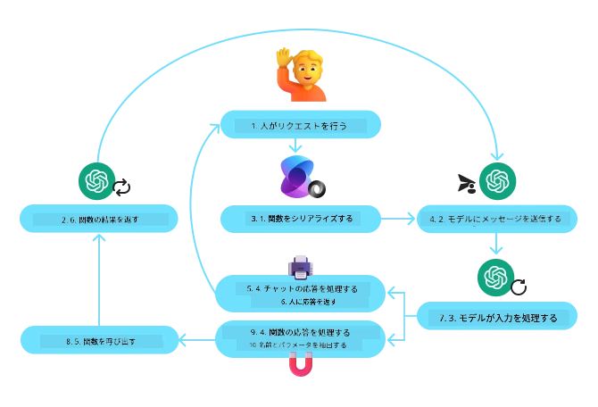
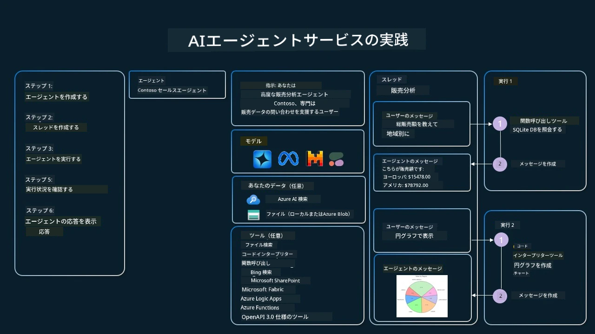

[](https://youtu.be/vieRiPRx-gI?si=cEZ8ApnT6Sus9rhn)

> _(上の画像をクリックすると、このレッスンのビデオが表示されます)_

# ツール使用デザインパターン

ツールは、AIエージェントにより広範な能力を持たせることができるため、興味深いものです。エージェントが実行できるアクションが限られている代わりに、ツールを追加することで、エージェントは幅広いアクションを実行できるようになります。この章では、AIエージェントが特定のツールを利用して目標を達成する方法を説明するツール使用デザインパターンについて見ていきます。

## はじめに

このレッスンでは以下の質問に答えることを目指します:

- ツール使用デザインパターンとは何ですか？
- どのようなユースケースに適用できますか？
- デザインパターンを実装するために必要な要素／構成要素は何ですか？
- 信頼できるAIエージェントを構築するためにツール使用デザインパターンを使う際の特別な考慮事項は何ですか？

## 学習目標

このレッスンを修了すると、以下ができるようになります:

- ツール使用デザインパターンとその目的を定義する。
- ツール使用デザインパターンが適用可能なユースケースを認識する。
- デザインパターンを実装するために必要な主要な要素を理解する。
- このデザインパターンを使用するAIエージェントの信頼性を確保するための考慮事項を認識する。

## ツール使用デザインパターンとは何か？

<strong>ツール使用デザインパターン</strong>は、LLMに外部ツールと連携して特定の目標を達成する能力を与えることに焦点を当てています。ツールとは、エージェントが実行できるアクションを行うために用いるコードのことです。ツールは、計算機のような単純な関数であったり、株価照会や天気予報のようなサードパーティサービスのAPI呼び出しであったりします。AIエージェントの文脈では、ツールは<strong>モデルが生成した関数呼び出し</strong>に応じてエージェントにより実行されるよう設計されています。

## 適用できるユースケースは何か？

AIエージェントはツールを活用して複雑なタスクの完遂、情報の取得、意思決定を行うことができます。ツール使用デザインパターンは、データベース、ウェブサービス、コードインタプリタなどの外部システムと動的にやり取りする必要があるシナリオでよく使われます。この能力は、以下の多様なユースケースで有用です:

- **動的情報取得:** エージェントは外部APIやデータベースに問い合わせて最新データを取得できる（例：SQLiteデータベースへの問い合わせによるデータ解析、株価や天気情報の取得）。
- **コード実行と解釈:** エージェントはコードやスクリプトを実行して数学的問題を解いたり、レポートを生成したり、シミュレーションを行ったりできる。
- **ワークフロー自動化:** タスクスケジューラーやメールサービス、データパイプラインなどのツールと連携して反復的または多段階のワークフローを自動化する。
- **カスタマーサポート:** エージェントはCRMシステム、チケッティングプラットフォーム、ナレッジベースと連携し、ユーザーの問い合わせを解決する。
- **コンテンツ生成と編集:** 文法チェッカー、テキスト要約機、コンテンツ安全評価ツールなどを活用してコンテンツ作成支援を行う。

## ツール使用デザインパターンを実装するために必要な要素／構成要素は何か？

これらの構成要素により、AIエージェントは幅広いタスクを実行できます。ツール使用デザインパターンを実装するために必要な主要な要素を見てみましょう:

- **関数／ツールスキーマ**: 利用可能なツールの詳細な定義。関数名、目的、必要なパラメーター、期待する出力を含みます。これによりLLMが利用可能なツールを理解し、有効なリクエストを構築できるようになります。

- <strong>関数実行ロジック</strong>: ユーザーの意図や会話の文脈に基づき、ツールがどのようにいつ呼び出されるかを制御します。プランナー・モジュール、ルーティング機構、条件付きフローなどが含まれ、動的にツールの使用を決定します。

- <strong>メッセージ処理システム</strong>: ユーザー入力、LLMの応答、ツール呼び出し、ツール出力間の会話の流れを管理するコンポーネント。

- <strong>ツール統合フレームワーク</strong>: エージェントを単純な関数や複雑な外部サービスなど様々なツールと接続するためのインフラ。

- <strong>エラー処理と検証</strong>: ツール実行の失敗を処理し、パラメーターを検証し、予期しない応答に対処する仕組み。

- <strong>状態管理</strong>: 会話の文脈、以前のツールとのやり取り、永続的データを追跡して、多ターンの対話の一貫性を保証します。

次に、関数／ツール呼び出しについて詳しく見てみましょう。
 
### 関数／ツール呼び出し

関数呼び出しは、大規模言語モデル（LLM）がツールと連携するための主な方法です。『関数』と『ツール』はしばしば同義で使われます。なぜなら、『関数』は再利用可能なコードのブロックであり、エージェントがタスクに用いる『ツール』だからです。関数のコードを呼び出すには、LLMがユーザーのリクエストを関数の説明と照合する必要があります。このために、利用可能な全関数の説明を含むスキーマがLLMに送られます。LLMはタスクに最適な関数を選択して、その関数名と引数を返します。選ばれた関数が呼び出され、その応答がLLMに戻され、それをもとにユーザーへの応答が生成されます。

エージェントの関数呼び出しを実装する開発者に必要なものは以下の通りです:

1. 関数呼び出しをサポートするLLMモデル
2. 関数の説明を含むスキーマ
3. 各関数のコード

例として都市の現在時刻を取得する方法を説明しましょう:

1. **関数呼び出しをサポートするLLMを初期化する:**

    すべてのモデルが関数呼び出しをサポートしているわけではないため、利用しているLLMが対応しているか確認が重要です。<a href="https://learn.microsoft.com/azure/ai-services/openai/how-to/function-calling" target="_blank">Azure OpenAI</a>は関数呼び出しをサポートしています。Azure OpenAIの<strong>Responses API</strong>（安定版の`/openai/v1/`エンドポイント、`api_version`は不要）に対してOpenAIクライアントを初期化して始めることができます。 

    ```python
    # Initialize the OpenAI client for Azure OpenAI (Responses API, v1 endpoint)
    client = OpenAI(
        base_url=f"{os.environ['AZURE_OPENAI_ENDPOINT'].rstrip('/')}/openai/v1/",
        api_key=os.environ["AZURE_OPENAI_API_KEY"],
    )
    deployment_name = os.environ["AZURE_OPENAI_DEPLOYMENT"]
    ```

1. **関数スキーマを作成する:**

    次に、関数名、関数の役割、関数パラメーターの名前と説明を含むJSONスキーマを定義します。
    そのスキーマを先に作成したクライアントに、ユーザーの「サンフランシスコの時間を知りたい」というリクエストとともに渡します。重要なのは、<strong>ツール呼び出し</strong>が返されることであり、質問への最終回答ではないことです。先述の通り、LLMはタスクのために選択した関数名と引数を返します。

    ```python
    # Function description for the model to read (Responses API flat tool format)
    tools = [
        {
            "type": "function",
            "name": "get_current_time",
            "description": "Get the current time in a given location",
            "parameters": {
                "type": "object",
                "properties": {
                    "location": {
                        "type": "string",
                        "description": "The city name, e.g. San Francisco",
                    },
                },
                "required": ["location"],
            },
        }
    ]
    ```
   
    ```python
  
    # Initial user message
    messages = [{"role": "user", "content": "What's the current time in San Francisco"}]

    # First API call: Ask the model to use the function
    response = client.responses.create(
        model=deployment_name,
        input=messages,
        tools=tools,
        tool_choice="auto",
        store=False,
    )

    # The Responses API returns tool calls as function_call items in response.output.
    # Append them to the conversation so the model has full context on the next turn.
    messages += response.output

    print("Model's response:")
    print(response.output)
  
    ```

    ```bash
    Model's response:
    [ResponseFunctionToolCall(arguments='{"location":"San Francisco"}', call_id='call_pOsKdUlqvdyttYB67MOj434b', name='get_current_time', type='function_call')]
    ```
  
1. **タスクを実行するための関数コード:**

    LLMがどの関数を実行するか決めたら、そのタスクを実行するためのコードを実装し呼び出す必要があります。
    Pythonで現在時刻を取得するコードを実装します。また、レスポンスメッセージから関数名と引数を抽出して最終結果を得るコードも必要です。

    ```python
      def get_current_time(location):
        """Get the current time for a given location"""
        print(f"get_current_time called with location: {location}")  
        location_lower = location.lower()
        
        for key, timezone in TIMEZONE_DATA.items():
            if key in location_lower:
                print(f"Timezone found for {key}")  
                current_time = datetime.now(ZoneInfo(timezone)).strftime("%I:%M %p")
                return json.dumps({
                    "location": location,
                    "current_time": current_time
                })
      
        print(f"No timezone data found for {location_lower}")  
        return json.dumps({"location": location, "current_time": "unknown"})
    ```

     ```python
    # Handle function calls
    tool_calls = [item for item in response.output if item.type == "function_call"]
    if tool_calls:
        for tool_call in tool_calls:
            if tool_call.name == "get_current_time":

                function_args = json.loads(tool_call.arguments)

                time_response = get_current_time(
                    location=function_args.get("location")
                )

                # Return the tool result as a function_call_output item
                messages.append({
                    "type": "function_call_output",
                    "call_id": tool_call.call_id,
                    "output": time_response,
                })
    else:
        print("No tool calls were made by the model.")

    # Second API call: Get the final response from the model
    final_response = client.responses.create(
        model=deployment_name,
        input=messages,
        tools=tools,
        store=False,
    )

    return final_response.output_text
     ```

     ```bash
      get_current_time called with location: San Francisco
      Timezone found for san francisco
      The current time in San Francisco is 09:24 AM.
     ```

関数呼び出しはほとんど、あるいはすべてのエージェントのツール使用設計の根幹ですが、ゼロから実装するのは時に難しい場合があります。
[レッスン 2](../../../02-explore-agentic-frameworks)で学んだように、エージェントフレームワークはツール使用の実装に役立つ既成の構成要素を提供します。
 
## エージェントフレームワークを使ったツール使用の例

以下は、さまざまなエージェントフレームワークを利用してツール使用デザインパターンを実装する例です:

### Microsoft Agent Framework

<a href="https://learn.microsoft.com/azure/ai-services/agents/overview" target="_blank">Microsoft Agent Framework</a>はAIエージェントを構築するためのオープンソースフレームワークです。`@tool`デコレーターを使ってツールをPython関数として定義することで、関数呼び出しのプロセスを簡素化します。このフレームワークはモデルとコード間の双方向通信を処理し、`FoundryChatClient`を通じてファイル検索やコードインタプリタなどの既成ツールにもアクセス可能です。

以下の図はMicrosoft Agent Frameworkでの関数呼び出しの流れを示しています:



Microsoft Agent Frameworkでは、ツールはデコレートされた関数として定義されます。先に示した`get_current_time`関数を`@tool`デコレーターでラップしてツールに変換できます。フレームワークは関数とパラメーターを自動的にシリアライズし、LLMに送るスキーマを生成します。

```python
import os
from agent_framework import tool
from agent_framework.foundry import FoundryChatClient
from azure.identity import AzureCliCredential

@tool(approval_mode="never_require")
def get_current_time(location: str) -> str:
    """Get the current time for a given location"""
    ...

# Create the client
provider = FoundryChatClient(
    project_endpoint=os.environ["AZURE_AI_PROJECT_ENDPOINT"],
    model=os.environ["AZURE_AI_MODEL_DEPLOYMENT_NAME"],
    credential=AzureCliCredential(),
)

# Create an agent and run with the tool
agent = provider.as_agent(name="TimeAgent", instructions="Use available tools to answer questions.", tools=get_current_time)
response = await agent.run("What time is it?")
```

#### MCPサーバーからのツール

ツールは自分のコードの関数である必要はありません。モデルコンテキストプロトコル（MCP、[レッスン11](../11-agentic-protocols/README.md)で解説）対応のサーバーはツールとスキーマを公開し、フレームワークはデコレート関数のようにシリアライズして読み込めます。`MCPStreamableHTTPTool`はHTTP経由でそのようなサーバーに接続し、ツールスキーマを読み取り、ローカルツールと共にモデルに提供します。

以下の例は<a href="https://keenable.ai" target="_blank">Keenable</a>がホストするウェブ検索サーバーを使用しています。アカウントやAPIキー不要で無料で利用でき（IPごとにリクエスト制限あり）、モデルの認証情報のみ必要です。リモートツールのため、モデルが生成するクエリはサーバーへ送られます。

```python
from agent_framework import MCPStreamableHTTPTool

web_search = MCPStreamableHTTPTool(
    name="Keenable web search",
    url="https://api.keenable.ai/mcp",
)

# Connecting loads the server's tool schemas; the agent decides when to call them
async with web_search:
    agent = provider.as_agent(
        name="ResearchAgent",
        instructions="Use available tools to answer questions.",
        tools=[web_search],
    )
    response = await agent.run("What is new in the latest Python release?")
    print(response.text)
```

サーバーは`search_web_pages`と`fetch_page_content`という2つのツールを公開しています。最新情報が必要な質問にはモデルが`search_web_pages`を呼び出し、タイトル、URL、テキストスニペットを受け取り、回答を作成します。先述の`get_current_time`の例と同様のループです。
  
### Microsoft Foundry Agent Service

<a href="https://learn.microsoft.com/azure/ai-services/agents/overview" target="_blank">Microsoft Foundry Agent Service</a>は、開発者が基盤の計算資源・ストレージ管理を気にせずに、安全に質の高い拡張可能なAIエージェントを構築・展開・スケールできるよう設計された最新のエージェントフレームワークです。特にエンタープライズアプリケーションに適し、企業グレードのセキュリティを備えた完全管理サービスです。

LLM APIを直接使った開発に比べ、Microsoft Foundry Agent Serviceは以下の利点があります:

- 自動ツール呼び出し — ツール呼び出しの解析、実行、応答処理が不要で、サーバー側で自動処理される
- 安全なデータ管理 — 会話状態管理を自前で行う代わりに、スレッドに必要なすべての情報を格納できる
- すぐに使えるツール — Bing、Azure AI Search、Azure Functionsなどのデータソースと連携可能なツールを利用できる

Microsoft Foundry Agent Serviceで利用可能なツールは2つのカテゴリに分かれます:

1. 知識ツール:
    - <a href="https://learn.microsoft.com/azure/ai-services/agents/how-to/tools/bing-grounding?tabs=python&pivots=overview" target="_blank">Bing検索によるグラウンディング</a>
    - <a href="https://learn.microsoft.com/azure/ai-services/agents/how-to/tools/file-search?tabs=python&pivots=overview" target="_blank">ファイル検索</a>
    - <a href="https://learn.microsoft.com/azure/ai-services/agents/how-to/tools/azure-ai-search?tabs=azurecli%2Cpython&pivots=overview-azure-ai-search" target="_blank">Azure AI検索</a>

2. アクションツール:
    - <a href="https://learn.microsoft.com/azure/ai-services/agents/how-to/tools/function-calling?tabs=python&pivots=overview" target="_blank">関数呼び出し</a>
    - <a href="https://learn.microsoft.com/azure/ai-services/agents/how-to/tools/code-interpreter?tabs=python&pivots=overview" target="_blank">コードインタプリタ</a>
    - <a href="https://learn.microsoft.com/azure/ai-services/agents/how-to/tools/openapi-spec?tabs=python&pivots=overview" target="_blank">OpenAPI定義ツール</a>
    - <a href="https://learn.microsoft.com/azure/ai-services/agents/how-to/tools/azure-functions?pivots=overview" target="_blank">Azure Functions</a>

Agent Serviceはこれらのツールを`toolset`としてまとめて利用可能にします。また、特定の会話履歴を追跡する`threads`も活用します。

あなたがContoso社の営業担当者で、販売データに関して質問に答えられる会話型エージェントを開発するとしましょう。

以下の図は、Microsoft Foundry Agent Serviceを使って販売データを分析する方法を示しています:



サービスでこれらのツールを使うには、クライアントの作成とツールまたはツールセットの定義を行います。実装には以下のPythonコードを参考にできます。LLMはツールセットを参照して、ユーザーのリクエストに応じてユーザー作成関数`fetch_sales_data_using_sqlite_query`か、組み込みのコードインタプリタを利用するかを決定します。

```python 
import os
from azure.ai.projects import AIProjectClient
from azure.identity import DefaultAzureCredential
from fetch_sales_data_functions import fetch_sales_data_using_sqlite_query # fetch_sales_data_using_sqlite_query function which can be found in a fetch_sales_data_functions.py file.
from azure.ai.projects.models import ToolSet, FunctionTool, CodeInterpreterTool

project_client = AIProjectClient.from_connection_string(
    credential=DefaultAzureCredential(),
    conn_str=os.environ["PROJECT_CONNECTION_STRING"],
)

# Initialize toolset
toolset = ToolSet()

# Initialize function calling agent with the fetch_sales_data_using_sqlite_query function and adding it to the toolset
fetch_data_function = FunctionTool(fetch_sales_data_using_sqlite_query)
toolset.add(fetch_data_function)

# Initialize Code Interpreter tool and adding it to the toolset. 
code_interpreter = CodeInterpreterTool()toolset.add(code_interpreter)

agent = project_client.agents.create_agent(
    model="gpt-5-mini", name="my-agent", instructions="You are helpful agent", 
    toolset=toolset
)
```

## ツール使用デザインパターンを利用して信頼できるAIエージェントを構築する際の特別な考慮事項は？

LLMによって動的に生成されるSQLに対する一般的な懸念はセキュリティであり、特にSQLインジェクションやデータベースの破壊・改ざんのリスクです。これらの懸念は、データベースアクセス権限を適切に設定することで効果的に軽減できます。多くのデータベースでは読み取り専用に設定することが含まれます。PostgreSQLやAzure SQLなどのデータベースサービスでは、アプリに読み取り専用（SELECT）ロールを割り当てるべきです。

アプリを安全な環境で実行することも保護を強化します。エンタープライズ環境では、通常は運用システムからデータを抽出・変換して、ユーザーフレンドリーなスキーマの読み取り専用データベースまたはデータウェアハウスに格納します。この方法により、データの安全性、性能やアクセス性の最適化、アプリへの制限された読み取り専用アクセスが保証されます。

## サンプルコード

- Python: [Agent Framework](./code_samples/04-python-agent-framework.ipynb)
- .NET: [Agent Framework](./code_samples/04-dotnet-agent-framework.md)

## ツール使用デザインパターンについてさらに質問がありますか？

[Microsoft Foundry Discord](https://discord.com/invite/ATgtXmAS5D)に参加して、他の学習者と交流し、オフィスアワーに参加してAIエージェントの質問を解決しましょう。

## 追加リソース

- <a href="https://microsoft.github.io/build-your-first-agent-with-azure-ai-agent-service-workshop/" target="_blank">Azure AI Agents Service ワークショップ</a>
- <a href="https://github.com/Azure-Samples/contoso-creative-writer/tree/main/docs/workshop" target="_blank">Contoso Creative Writer マルチエージェント ワークショップ</a>
- <a href="https://learn.microsoft.com/azure/ai-services/agents/overview" target="_blank">Microsoft Agent フレームワーク概要</a>

## このエージェントのスモークテスト（任意）

[Lesson 16](../16-deploying-scalable-agents/README.md)でエージェントのデプロイ方法を学習した後、このレッスンの`TravelToolAgent`（まだツールを呼び出し、応答するか？）を [`tests/lesson-04-smoke-tests.json`](../../../tests/lesson-04-smoke-tests.json)でスモークテストできます。実行方法は [`tests/README.md`](../tests/README.md)を参照してください。

## 前のレッスン

[エージェントデザインパターンの理解](../03-agentic-design-patterns/README.md)

## 次のレッスン

[Agentic RAG](../05-agentic-rag/README.md)

---

<!-- CO-OP TRANSLATOR DISCLAIMER START -->
**免責事項**：
本書類は AI 翻訳サービス [Co-op Translator](https://github.com/Azure/co-op-translator) を使用して翻訳されています。正確性を期していますが、自動翻訳には誤りや不正確な部分が含まれる可能性があることをご承知おきください。原文の原語版が正式な情報源とみなされるべきです。重要な情報については、専門の人間による翻訳を推奨します。本翻訳の利用により生じたいかなる誤解や解釈違いについても、当方は責任を負いかねます。
<!-- CO-OP TRANSLATOR DISCLAIMER END -->