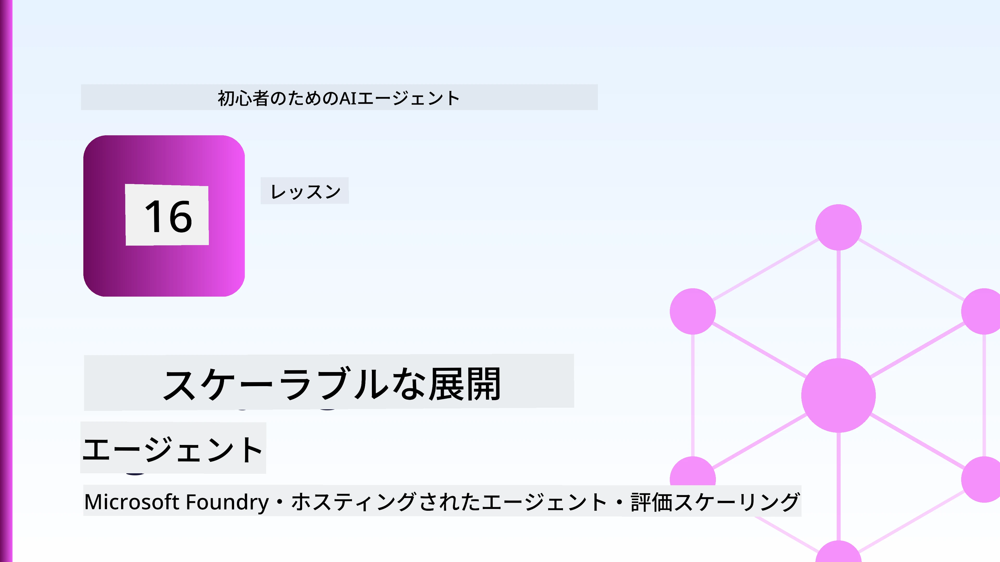
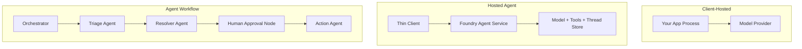
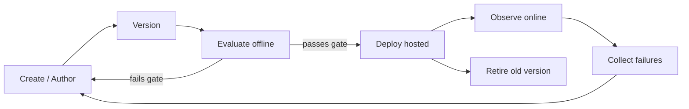
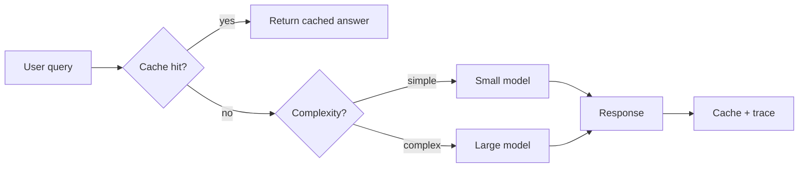
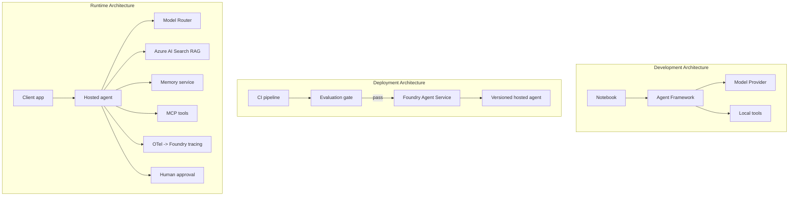

# Microsoft Foundryを使ったスケーラブルエージェントのデプロイ



このコースのここまでで、ノートパソコンやノートブック内で動作し、`az login`やいくつかの環境変数により動作するエージェントを構築してきました。それは学習を進めるうえで正しい方法ですが、何千人もの顧客が午前3時に依存するエージェントを動かす上では正しい方法ではありません。

このレッスンは「私のマシンでは動く」と「本番環境で信頼性とコスト効率を持って動く」とのギャップについての話です。このギャップを<strong>Microsoft Foundry</strong>と<strong>Microsoft Foundry Agent Service</strong>を使って埋め、ツール、検索、メモリ、評価、モニタリングを備えた実際のカスタマーサポートエージェントを構築していきます。

## はじめに

このレッスンで学ぶ内容は次の通りです:

- <strong>プロトタイプエージェント</strong>と<strong>デプロイ済みエージェント</strong>の違い、および移行が主にモデルの<em>周辺</em>に関するものである理由
- エージェントの<strong>デプロイパターン</strong>：クライアントホスト、サービスホスト（Hosted Agents）、およびワークフローオーケストレーション
- Microsoft Foundryにおける<strong>エージェントライフサイクル</strong> — 作成、バージョン管理、デプロイ、評価、観察、廃止
- <strong>スケーリング戦略</strong>：モデルのルーティング、キャッシュ、同時実行、ステートレス設計
- OpenTelemetryとFoundryトレーシングによる<strong>可観測性</strong>
- モデル選択、ルーティング、評価ゲートによる<strong>コスト最適化</strong>
- <strong>エンタープライズの考慮事項</strong>：ガバナンス、人間の承認、MCPサーバを安全に本番運用する方法

## 学習目標

このレッスンを終了すると、以下ができるようになります:

- 特定のエージェントのワークロードに最適なデプロイパターンを選択する
- エージェントをMicrosoft Foundry Agent Serviceにデプロイし、バージョン管理、ガバナンス、可観測性を確保する
- トレーシング用にエージェントに計測を導入し、リリース前に実行される評価パイプラインを接続する
- スケール時の遅延とコストを抑えるためにモデルルーティングとキャッシュを適用する
- リスクの高い操作に対して人間の承認ゲートを追加し、安全にMCPサーバを統合する

## 事前準備

このレッスンは以下を完了し、慣れていることを前提としています:

- [Microsoft Agent Framework](../14-microsoft-agent-framework/README.md)を使ったエージェントの構築（レッスン14）
- [Tool Use](../04-tool-use/README.md)（レッスン4）および[Agentic RAG](../05-agentic-rag/README.md)（レッスン5）
- [Agent Memory](../13-agent-memory/README.md)（レッスン13）および[Agentic Protocols / MCP](../11-agentic-protocols/README.md)（レッスン11）
- [可観測性および評価](../10-ai-agents-production/README.md)（レッスン10）— 本レッスンは直接これに基づいています

さらに以下が必要です:

- <strong>Azureサブスクリプション</strong>と1つ以上のデプロイ済みチャットモデルを持つ<strong>Microsoft Foundryプロジェクト</strong>
- 認証済みの<strong>Azure CLI</strong> (`az login`)
- Python 3.12+とリポジトリ内のパッケージ [`requirements.txt`](../../../requirements.txt)

## プロトタイプから本番へ：何が実際に変わるか

プロトタイプエージェントと本番エージェントは同じコアループ — 推論、ツール呼び出し、応答 — を共有します。変わるのはそのループを取り囲むすべての部分です。モデルは本番エージェントの約20%で、残りの80%は運用の骨組みです。

| 懸念事項 | プロトタイプ | 本番 |
| --- | --- | --- |
| <strong>ホスティング</strong> | ノートブック内で動作 | ホストサービスとして動作し、バージョン管理と展開がされる |
| **ID** | あなたの `az login` トークン | スコープ付きRBACのマネージドID |
| <strong>状態</strong> | メモリ上にあり、再起動で失われる | 外部化（スレッドストア、メモリサービス） |
| <strong>障害</strong> | トレースバックを見られる | リトライ、フォールバック、デッドレター、アラート |
| <strong>コスト</strong> | 「数セント程度」 | リクエストごとに追跡し、ルーティング、キャッシュ、予算管理 |
| <strong>品質</strong> | 出力を目視で確認 | リリース前に自動評価される |
| <strong>信頼</strong> | すべての操作を承認する | ポリシー + リスクの高い操作には人間のインザループ |

この表を覚えておいてください。以下の各セクションはこの表のいずれかの行に対応しています。

## エージェントのデプロイパターン

よく使われるパターンは3つあり、しばしば組み合わせて使います。

### 1. クライアントホストエージェント

エージェントオブジェクトは<em>あなたの</em>アプリケーションプロセス内に存在します。あなたのコードがモデルプロバイダを直接呼び出し、推論ループはあなたのサービス内で動作します。これがこれまでのすべてのレッスンで行ってきたことです。

- <strong>使う場合</strong>：ループを完全に制御したいとき、カスタムミドルウェアが必要なとき、またはエージェントを既存のバックエンドに組み込む場合
- <strong>トレードオフ</strong>：スケーリング、状態管理、復元性を自分で管理する必要がある

### 2. ホステッドエージェント（Foundry Agent Service）

エージェントはMicrosoft Foundry上で「リソースとして登録」されます。Foundryが推論ループをホストし、スレッドを保存し、コンテンツの安全性とRBACを強制し、Foundryポータル上にエージェントを可視化します。あなたのアプリはスレッドを作成し応答を読み取る薄いクライアントになります。

- <strong>使う場合</strong>：耐久性、組み込みの可観測性、ガバナンス、運用の表面積を減らしたいとき
- <strong>トレードオフ</strong>：管理されたランタイムの代わりに低レベルの制御が減る

### 3. エージェントワークフロー

複数のエージェント（およびツール）を明確な制御フローでグラフ状に組み合わせます — 順次ステップ、分岐、人間の承認ノード、途中で一時停止/再開可能な永続的チェックポイント。これはMicrosoft Agent Frameworkの<strong>Workflows</strong>機能をデプロイ規模に応用したものです。

- <strong>使う場合</strong>：単一タスクが複数の専門エージェントをまたがる場合や途中に承認ステップが必要な場合
- <strong>トレードオフ</strong>：構成要素が増え、オーケストレーションレベルの可観測性が必要



## Microsoft Foundryでのエージェントライフサイクル

エージェントのデプロイは一度きりの`push`ではありません。ループであり、ソフトウェアリリースサイクルに非常によく似ています。なぜならまさにそれだからです。



[レッスン10](../10-ai-agents-production/README.md)からの重要な考え方：**オフライン評価は後付けではなくゲートである。** 新しいエージェントバージョンは評価の閾値をクリアしなければ出荷されません。オンライン可観測性は実際の失敗をオフラインテストセットにフィードバックします。これが全体のループです。

## スケーリング戦略

エージェントのスケーリングはステートレスなWeb APIのスケーリングと異なります。各リクエストが複数のコストが高いモデルやツール呼び出しを引き起こす可能性があるためです。主に4つの技術で対応します。

**ステートレスリクエスト処理。** ユーザーごとの状態をプロセスメモリに保持せず、Foundryのスレッドストアやメモリサービスに会話スレッドを保持してどのインスタンスでもリクエストを処理可能にします。これにより水平スケールが可能になり、インスタンス追加とステッキーセッション不要になります。

**モデルルーティング。** すべてのリクエストが最も高機能で高コストなモデルを使う必要はありません。単純なリクエスト（意図分類や短い事実回答）は小さく高速なモデルへ、複雑な推論は大きなモデルへルーティングします。Foundryの<strong>Model Router</strong>がこれをサポートします。実習で軽量の分類器を自作します。

**応答キャッシュ。** 多くのサポート問い合わせはほぼ同じ内容（「パスワードをリセットするには？」）。よくある質問の回答をキャッシュし、モデルを呼ばずに応答します。適度なキャッシュヒット率でもコストと遅延を大きく削減できます。

**同時実行制御とバックプレッシャー。** モデルプロバイダはレート制限を持ちます。同時実行数を制限し、指数的バックオフ付きリトライを使い、優雅に失敗する（キューイングされた「対応中」応答は500エラーより良い）よう設計します。



## 本番環境での可観測性

見えないものは運用できません。レッスン10で説明したようにMicrosoft Agent Frameworkは<strong>OpenTelemetry</strong>トレースをネイティブに出力します。すべてのモデル呼び出し、ツール起動、オーケストレーションステップがスパンになります。本番ではこれらのスパンをMicrosoft Foundry（またはOTel互換のバックエンド）に輸出して以下が可能です:

- 顧客クレーム1件をすべてのモデル、ツール呼び出しに渡って追跡
- 時間経過によるp50/p95遅延とリクエストごとのコストを監視
- 利用者や財務チームが気づく前にエラー率の急増やコスト異常をアラート

```python
from agent_framework.observability import get_tracer

tracer = get_tracer()

with tracer.start_as_current_span("support_request") as span:
    span.set_attribute("customer.tier", "enterprise")
    span.set_attribute("routed.model", "gpt-5-nano")
    # agent execution is traced automatically inside this span
```

`customer.tier`や`routed.model`のような属性は、トレースの山を答えの出る質問に変えます（「企業顧客は小さいモデルに偏りすぎていないか？」など）。

## コスト最適化

本番エージェントのコストはトークン数が主因です。影響の大きい順に3つのレバーがあります:

1. **モデルの適切なサイズ選択。** 評価ゲートを通過する小さいモデルは、通過する大きいモデルよりほぼ常に安価。評価で小さいモデルで十分であることを証明し、最大モデルを安易に選ばない。
2. **複雑さによるルーティング。** 先述の通り、複雑な推論が必要なリクエストだけ大きいモデル料金を支払う。
3. **積極的なキャッシュ。** 呼ばないモデル呼び出しが最も安い。

評価ゲートとコスト管理は2つの視点からみた同じ教訓：評価は<em>品質の底上げ</em>、ルーティングとキャッシュはこの底の<em>コスト</em>をできる限り押さえる。

## エンタープライズデプロイの考慮点

**ガバナンス。** Hosted AgentsはFoundryのRBAC、コンテンツ安全性、監査ログを受け継ぎます。各エージェントに必要最低限の権限のマネージドIDを付与します — ナレッジベースへの読み取り専用アクセス、チケッティングAPIへのスコープ付きアクセスそれ以上は不要。

**人間を介した承認。** 返金発行、アカウント削除、法務チームへのエスカレーションなどは自動化に不向きです。Microsoft Agent Frameworkは<strong>承認必須</strong>ツールをサポート：エージェントが操作を提案し、実行は一時停止、人間が承認または拒否し、ワークフローが継続します。[レッスン6](../06-building-trustworthy-agents/README.md)でプリミティブを見ましたが、ここで実際にデプロイします。

**本番環境のMCP。** [MCP](../11-agentic-protocols/README.md)は標準インターフェースで外部ツール利用を可能にします。本番ではMCPサーバを信頼できない境界として扱い、サーバーバージョンを固定し、スコープ付きIDで実行し、出力を検証し、秘密情報を渡さないようにします。MCPサーバは依存関係であり、パッチ、監査、レート制限がかかります。



これら3つの図 — 開発、デプロイ、ランタイム — は同一エージェントの3つのライフステージを表します。続く実習で構築を案内します。

## ハンズオンラボ: 本番対応のカスタマーサポートエージェント

[`code_samples/16-python-agent-framework.ipynb`](./code_samples/16-python-agent-framework.ipynb)を開き、最初から最後まで取り組んでください。すべての本番課題が組み込まれた<strong>Contosoカスタマーサポートエージェント</strong>を組み立てます:

1. <strong>ツール呼び出し</strong> — 注文状況の照会とサポートチケットの作成
2. **RAG** — ナレッジベースからのポリシー質問への回答（Azure AI Search、メモリ内フォールバック付きでSearchリソースなしでもノートブック動作）
3. <strong>メモリ</strong> — 会話のターンを跨いで顧客を記憶
4. <strong>モデルルーティング</strong> — 複雑度分類器によりリクエストごとに小さいモデルか大きいモデルへルーティング
5. <strong>応答キャッシュ</strong> — 繰り返しの質問にはキャッシュから応答
6. <strong>人間承認</strong> — 閾値を超える返金は人間の承認待ちで一時停止
7. <strong>評価パイプライン</strong> — オフラインの小さなテストセットでエージェントを採点、リリースゲートとして機能
8. <strong>可観測性</strong> — すべてのリクエストに対するOpenTelemetryトレース

### 手順紹介

ノートブックは各本番課題ごとに独立した実行可能セクションとして構成されています。中心となるのはルーティングとキャッシュを組み合わせたリクエストハンドラです:

```python
async def handle_support_request(query: str, customer_id: str) -> str:
    # 1. Serve from cache when we can.
    cached = response_cache.get(normalize(query))
    if cached:
        return cached

    # 2. Route by complexity to control cost.
    model = "gpt-5-nano" if is_simple(query) else "gpt-5-mini"

    # 3. Run the agent inside a trace span for observability.
    with tracer.start_as_current_span("support_request") as span:
        span.set_attribute("routed.model", model)
        span.set_attribute("customer.id", customer_id)
        response = await support_agent.run(query, model=model)

    # 4. Cache and return.
    response_cache.set(normalize(query), response.text)
    return response.text
```

リリースを守る評価ゲートは次のようになっています:

```python
async def evaluation_gate(agent, test_cases, threshold: float = 0.8) -> bool:
    passed = 0
    for case in test_cases:
        result = await agent.run(case["input"])
        if score_response(result.text, case["expected"]) >= 0.8:
            passed += 1
    pass_rate = passed / len(test_cases)
    print(f"Evaluation pass rate: {pass_rate:.0%} (gate: {threshold:.0%})")
    return pass_rate >= threshold  # only deploy if the gate passes
```

すべての行を読むこと — ノートブックはプリミティブをあえて小さくして、フレームワーク呼び出しの背後に何も隠さないようにしています。

## デプロイ済みエージェントのスモークテストによる検証

上の評価ゲートはエージェントオブジェクトに対して<em>オフライン</em>で実行されます。Hosted Agentとしてデプロイされたら、もう一つさらに簡単なチェックが必要です: **デプロイ済みエンドポイントは実際に応答しているか？**

「成功した」デプロイは制御プレーンが定義を受け入れたことを証明するだけであり、エージェントの応答を証明しません。依存関係の欠落、不適切なモデルルーティング、切断済み接続などで、応答なしの成功デプロイが発生することがあります。<strong>スモークテスト</strong>は、数秒で全デプロイ時にこれを検出し、完全な評価のコストなしに保ちます。

このリポジトリには[AI Smoke Test](https://github.com/marketplace/actions/ai-smoke-test) GitHub Action上に構築された使いやすいスモークテストパイプラインが含まれています:

- <strong>カタログ</strong> — [`tests/lesson-16-smoke-tests.json`](../../../tests/lesson-16-smoke-tests.json)にはContosoサポートエージェント用のプロンプトとアサーションが含まれています（根拠ポリシー回答、注文照会、話題遵守、多ターンスレッド連続性）。他のレッスンのエージェント用カタログも横にあります — [`tests/README.md`](../tests/README.md)を参照。
- <strong>ワークフロー</strong> — [`.github/workflows/smoke-test.yml`](../../../.github/workflows/smoke-test.yml)はAzure OIDCでログインし、各プロンプトをエージェントのResponsesエンドポイントにPOSTし、いずれかのアサーション失敗でジョブ失敗にします。

```yaml
- name: Smoke-test hosted agent
  uses: JFolberth/ai-smoketest@v1
  with:
    project_endpoint: ${{ inputs.project_endpoint }}
    agent_name: ContosoSupportAgent
    tests_file: tests/lesson-16-smoke-tests.json
```

エージェントがデプロイされたら、**Actions** タブから実行し、Foundry プロジェクトのエンドポイントとエージェント名を指定します。フェデレーテッド ID には Foundry プロジェクトのスコープで **Azure AI User** ロールが必要です。レイヤーはピラミッドのように考えてください：スモークテスト（到達可能かつ応答中？）はすべてのデプロイで実行され、オフライン評価（出荷して良いか？）は昇格の前に実行され、オンライン評価（実際の環境でどう動いているか？）は継続して実行されます。

## 知識確認

課題に進む前に理解度をテストしましょう。

**1. プロダクションエージェントの「モデル」はおおよそどれくらいの割合で、残りは何ですか？**

<details>
<summary>回答</summary>

モデルはシステムの少数派であり、多くの場合約20％と言われています。残りは運用の骨格で、ホスティングとバージョニング、アイデンティティとRBAC、外部化された状態、障害処理、コスト追跡、評価、ヒューマンインザループの制御です。プロダクションに移行するのは、推論ループの<em>周囲</em>にすべてを構築することが主な仕事です。
</details>

**2. クライアントホストのエージェントよりホステッドエージェントを選ぶのはどんな場合ですか？**

<details>
<summary>回答</summary>

組み込みの耐久性（永続するスレッドや再開可能なスレッド）、可観測性、コンテンツの安全性、およびRBACを備えた管理されたランタイムを求める場合、そして推論ループの低レベルコントロールの一部を減らしてでも運用上の負担を減らしたい場合です。ループを完全に制御する必要があるか、既存のバックエンドにエージェントを埋め込みたい場合はクライアントホストのほうが望ましいです。
</details>

**3. スケーラブルなエージェントが自プロセスメモリでステートレスでなければならないのはなぜですか？**

<details>
<summary>回答</summary>

任意のインスタンスが任意のリクエストを処理できるようにするためです。これによりステッキーセッションなしで水平スケーリングが可能になります。ユーザーごとの会話状態はスレッドストアやメモリサービスに外部化されます。状態がプロセスメモリにあれば、再起動時に状態を失い、負荷分散も自由にできなくなります。
</details>

**4. モデルルーティングはどのような問題を解決し、評価とどう関係していますか？**

<details>
<summary>回答</summary>

単純なリクエストを小さく安価で高速なモデルに振り分け、真に推論が必要な場合に大きなモデルを予約することで、レイテンシとコストの両方を制御します。評価は、小さなモデルが特定のリクエスト群に十分であることを<em>証明</em>する役割を持つため、評価なしのルーティングは推測に過ぎません。
</details>

**5. 「評価ゲート」とは何で、ライフサイクルのどこに位置しますか？**

<details>
<summary>回答</summary>

評価ゲートは、新しいエージェントバージョンに対してオフラインのテストセットを実行し、合格率がしきい値を超えない限りデプロイをブロックします。ライフサイクルの「バージョン」と「デプロイ」の間に位置し、品質をリリースの前提条件とするもので、出荷後にチェックするものではありません。
</details>

**6. なぜMCPサーバーは本番環境で信頼できない境界として扱うべきですか？**

<details>
<summary>回答</summary>

それはエージェントが呼び出す外部依存だからです。バージョンを固定し、スコープ付きIDで実行し、その出力を検証し、レート制限し、秘密情報を決して渡さない、第三者依存に対して行うのと同じ厳格な運用が必要です。出力はエージェントの推論に流れ込むため、未検証の信頼はセキュリティリスクとなります。
</details>

**7. 通常、プロダクションエージェントのコストに最も大きな影響を与える単一の変更は何で、なぜですか？**

<details>
<summary>回答</summary>

モデルの適正サイズ化です — 評価ゲートを通過する最小のモデルを使うこと。コストは主にトークンが支配しており、品質基準を満たす小さなモデルは通常、より大きなモデルより安価です。キャッシュやルーティングはさらにコストを下げますが、適切なベースモデルを選ぶことが最も大きな一次効果を持ちます。
</details>

**8. `customer.tier` や `routed.model` のようなスパン属性は可観測性でどんな役割を果たしますか？**

<details>
<summary>回答</summary>

生のトレースを答えを出せるビジネスの質問に変えます。属性なしだとスパンの壁ですが、属性があれば「企業顧客が小さなモデルに振られすぎているか？」や「どのモデルが一番遅いリクエストを処理しているか？」といった問が可能です。属性は運用に重要な次元でテレメトリを切り分ける方法です。
</details>

## 課題

ラボのカスタマーサポートエージェントを特定のシナリオ用に強化してください：**SaaS企業向けのサブスクリプション請求サポートエージェント。**

提出内容は以下を含みます：

1. 請求関連のツールに<strong>差し替え</strong>：`get_subscription_status`、`get_invoice`、`issue_credit`（50ドル超えのクレジットは人の承認が必要）。
2. 会社の返金ポリシー、請求サイクル、キャンセルポリシーに関する<strong>3つのRAGドキュメントを追加</strong>。
3. <strong>評価セットを少なくとも8件に拡張</strong>し、そのうち最低2件は<em>人間の承認経路をトリガーすべき</em>ケースで、評価ゲートが正しく合否判定することを確認。
4. **1つのコストレポートを追加**：混合した10件のクエリをエージェントに通した後、どれが小さなモデルに行き、どれが大きなモデルに行き、どれがキャッシュから処理されたかを出力。

短い段落（マークダウンセル）で、選んだモデルルーティングルールと実際のトラフィックでの検証方法を説明してください。正解は一つではなく、プロダクションの懸念が一貫しているかどうかで評価します。

## まとめ

このレッスンでは、Microsoft Foundry を使ってエージェントをプロトタイプからプロダクションへ移行しました：

- プロダクション移行とは主にモデルの周囲の<strong>運用の骨格</strong>— ホスティング、アイデンティティ、状態、障害管理、コスト、品質、信頼の構築です。
- ３つの<strong>デプロイパターン</strong>（クライアントホスト、ホステッドエージェント、エージェントワークフロー）とそれぞれの適用場面を学びました。
- <strong>エージェントライフサイクル</strong>をたどり、オフラインの<strong>評価がリリースゲートとなり</strong>、オンラインの可観測性が障害情報をテストセットに戻す役割を果たすことを確認しました。
- <strong>スケーリング戦略</strong>（ステートレス設計、モデルルーティング、キャッシュ、限定的な並行実行）を適用し、<strong>コスト最適化</strong>と結びつけました。
- <strong>企業向け管理機能</strong>（RBAC、ヒューマンインザループ承認、本番対応のMCP統合）を組み込みました。
- これらすべての懸念点をひとつにまとめ、実行可能なコードで<strong>プロダクション対応のカスタマーサポートエージェント</strong>を構築しました。

次のレッスンは逆の旅をたどります：エージェントをクラウドでスケールアップする代わりに、一台の開発者マシンに<em>ダウン</em>させ、完全にローカルで実行します。

## 追加資料

- <a href="https://learn.microsoft.com/azure/ai-foundry/what-is-azure-ai-foundry" target="_blank">Microsoft Foundry ドキュメント</a>
- <a href="https://learn.microsoft.com/azure/ai-foundry/agents/overview" target="_blank">Microsoft Foundry Agent Service 概要</a>
- <a href="https://learn.microsoft.com/en-us/agent-framework/overview/?wt.mc_id=youtube_26688_organicsocial_reactor&pivots=programming-language-python" target="_blank">Microsoft Agent Framework</a>
- <a href="https://learn.microsoft.com/en-us/azure/ai-foundry/openai/concepts/model-router" target="_blank">Microsoft Foundry におけるモデルルーター</a>
- <a href="https://learn.microsoft.com/azure/search/search-what-is-azure-search" target="_blank">Azure AI Search</a>
- <a href="https://opentelemetry.io/" target="_blank">OpenTelemetry</a>
- <a href="https://github.com/marketplace/actions/ai-smoke-test" target="_blank">AI Smoke Test GitHub Action</a>
- <a href="https://modelcontextprotocol.io/" target="_blank">Model Context Protocol (MCP)</a>

## 前のレッスン

[コンピューター利用エージェント（CUA）の構築](../15-browser-use/README.md)

## 次のレッスン

[ローカルAIエージェントの作成](../17-creating-local-ai-agents/README.md)

---

<!-- CO-OP TRANSLATOR DISCLAIMER START -->
**免責事項**：
本書類は AI 翻訳サービス [Co-op Translator](https://github.com/Azure/co-op-translator) を使用して翻訳されています。正確性を期していますが、自動翻訳には誤りや不正確な部分が含まれる可能性があることをご承知おきください。原文の原語版が正式な情報源とみなされるべきです。重要な情報については、専門の人間による翻訳を推奨します。本翻訳の利用により生じたいかなる誤解や解釈違いについても、当方は責任を負いかねます。
<!-- CO-OP TRANSLATOR DISCLAIMER END -->
