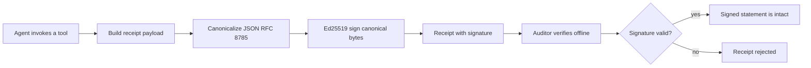
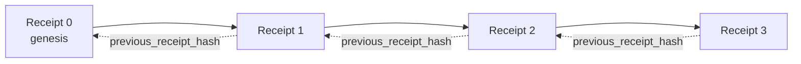

[レッスン動画を視聴する：暗号証明書でAIエージェントを保護する](https://youtu.be/PLACEHOLDER_VIDEO_ID)

> _(レッスン動画とサムネイルは統合後にMicrosoftコンテンツチームが追加します。レッスン14/15のパターンに合わせます。)_

# 暗号証明書でAIエージェントを保護する

## はじめに

このレッスンでは以下を扱います：

- なぜAIエージェントの監査トレイルがコンプライアンス、デバッグ、信頼に重要か。
- 暗号証明書とは何か、署名されていないログ行とどう違うか。
- エージェントのツール呼び出しに対し、プレーンPythonで署名付き証明書を作成する方法。
- オフラインで証明書を検証し、改竄を検出する方法。
- 証明書の連鎖を作り、1つ削除または順序を変えるとチェーンが破綻する仕組み。
- 証明書が証明する内容と明示的に証明しない内容。

## 学習目標

このレッスンを終えると、以下が理解できます：

- エージェントの行動に暗号的由来証明が求められる失敗モードを特定すること。
- Ed25519署名付きの証明書を標準的なJSONペイロードで作成すること。
- 署名者の公開鍵だけで証明書を独立検証すること。
- 改竄があれば、変更した証明書の検証を再実行して検出すること。
- ハッシュ連鎖された証明書列を作り、そのチェーンの意味を説明すること。
- 証明書が証明すること（帰属、完全性、順序）と証明しないこと（アクションの正当性、ポリシーの妥当性）の境界を認識すること。

## 問題：あなたのエージェントの監査トレイル

Contoso TravelのAIエージェントを配備したと想像してください。このエージェントは顧客の要求を読み、フライトAPIを呼び出しながら座席を予約します。前四半期には50,000件の予約を処理しました。

今日、監査人が来て簡単な質問をします：「あなたのエージェントが何をしたか見せてください。」

あなたはログファイルを渡します。監査人はそれを見てより難しい問いをします：「どうやってこれらのログが編集されていないとわかるのですか？」

これが監査トレイル問題です。今日の多くのエージェント配備は以下に依存しています：

- <strong>アプリケーションログ</strong>：エージェント自身が書き込み、ファイルシステムにアクセスできる誰でも編集可能。
- <strong>クラウドロギングサービス</strong>：プラットフォームレベルで改竄検知可能だが、監査人がプラットフォーム運営者を信用しないといけない。
- <strong>データベーストランザクションログ</strong>：データベースの変更には適しているが、任意のツール呼び出しには不向き。

これらはいずれも監査人の質問に答えるのに、監査人が誰か（あなた、クラウドプロバイダー、DBベンダー）を信用しなければならない。内部利用なら許容されがちですが、規制対象のワークロード（金融、ヘルスケア、EU AI法の対象など）では許されません。

暗号学的レシートは、署名された声明を独立して
検証可能にすることでこの問題を絞り込みます。監査人は依然として署名鍵と
声明を作成したコンポーネントを信頼するための帯外の理由が必要です。組み込み鍵は自己整合性を証明し、
発行者の身元や適用箇所を証明するものではありません。

## 暗号証明書とは何か？

証明書は、エージェントがしたことを記録するJSONオブジェクトで、デジタル署名されています。



最小限の証明書はこうなります：

```json
{
  "type": "agent.tool_call.v1",
  "agent_id": "contoso-travel-bot",
  "tool_name": "lookup_flights",
  "tool_args_hash": "sha256:a3f9c1...",
  "result_hash": "sha256:7b2e1d...",
  "policy_id": "contoso-travel-policy-v3",
  "timestamp": "2026-04-25T14:30:00Z",
  "sequence": 47,
  "previous_receipt_hash": "sha256:9d4e6a...",
  "signature": {
    "alg": "EdDSA",
    "sig": "c5af83...",
    "public_key": "8f3b2c..."
  }
}
```

ここで重要なのは三つの特性です：

1. <strong>署名</strong>. 受領書はエージェントのゲートウェイによって Ed25519 の秘密鍵を使用して署名されます。対応する公開鍵を持つ者は誰でもオフラインで署名を検証できます。リライングパーティはその鍵を固定するか、受領書の外にある信頼できるレジストリから解決しなければなりません。署名されたフィールドのいずれかを改ざんすると署名は無効になります。

2. <strong>正規化エンコーディング</strong>。署名前に、JSON正規化スキーム（JCS、RFC 8785）で証明書が直列化されます。これにより、同じ論理的証明書はどの実装でもバイト単位で同一の出力を生成します。正規化なしでは異なるJSONシリアライザーが同じ内容でも異なる署名を作ります。

3. <strong>ハッシュ連鎖</strong>. `previous_receipt_hash` フィールドは各受領書を直前のものに結び付けます。受領書を削除したり順序を入れ替えたりすると、提示された順序が壊れます。切り詰めや署名者による書き換えの検出には、ピン留めされた現在のチェーンヘッド、独立して立証されたチェックポイント、または認証されたクローズド・ポピュレーション・コミットメントが必要です。

これらの特性が三つの保証を提供します：

- <strong>鍵への帰属</strong>: この鍵がこのコンテンツに署名しました。組織や個人の身元には、信頼された鍵の結び付けが必要です。
- <strong>完全性</strong>：署名後に内容が変更されていないこと。
- <strong>検証済みシーケンス内の順序</strong>: このレシートはその先行するものにリンクしています。

## Pythonで証明書を作成する

証明書作成に特別なライブラリは不要です。暗号プリミティブは広く利用可能で、ロジックはPythonで数十行です。

`code_samples/18-signed-receipts.ipynb` のハンズオン演習は全体のフローを通して説明します。ソース管理された `code_samples/18-signed-receipts.execution-receipt.json` は、ノートブックの正確なハッシュ、Python 環境、セル数、および最新のクリーン実行からのチェックを、レッスンの保存された出力を変更することなく記録します。要約版:

```python
import json
import hashlib
import base64
from nacl import signing
from jcs import canonicalize  # RFC 8785 canonical JSON

def b64url_nopad(data: bytes) -> str:
    return base64.urlsafe_b64encode(data).decode("ascii").rstrip("=")

def sha256_canonical(obj) -> str:
    """SHA-256 of a Python object's JCS-canonical JSON form."""
    return f"sha256:{hashlib.sha256(canonicalize(obj)).hexdigest()}"

# Generate or load a signing key (in production, store in a key vault)
signing_key = signing.SigningKey.generate()
verify_key = signing_key.verify_key
TRUSTED_PUBLIC_KEYS = {b64url_nopad(bytes(verify_key))}  # pinned out of band by the verifier

# Build the receipt payload (no signature yet)
tool_args = {"origin": "SYD", "destination": "LAX"}
tool_result = [{"flight": "QF11", "price": 1850, "stops": 0}]

payload = {
    "type": "agent.tool_call.v1",
    "agent_id": "contoso-travel-bot",
    "tool_name": "lookup_flights",
    "tool_args_hash": sha256_canonical(tool_args),
    "result_hash": sha256_canonical(tool_result),
    "policy_id": "contoso-travel-policy-v3",
    "timestamp": "2026-04-25T14:30:00Z",
    "sequence": 0,
    "previous_receipt_hash": None,
}

# Canonicalize and sign the JCS bytes directly. PureEdDSA hashes internally.
canonical_bytes = canonicalize(payload)
signature_bytes = signing_key.sign(canonical_bytes).signature

# Attach a structured signature object.
receipt = {
    **payload,
    "signature": {
        "alg": "EdDSA",
        "sig": b64url_nopad(signature_bytes),
        "public_key": b64url_nopad(bytes(verify_key)),
    },
}
```

これが署名パイプライン全体です。ノートブックの課題は各ステップを解説します。

## 証明書の検証と改竄検出

検証は逆の操作です：

```python
import base64
import hashlib
from nacl import signing
from nacl.exceptions import CryptoError
from jcs import canonicalize

def b64url_decode(s: str) -> bytes:
    padding = "=" * ((4 - len(s) % 4) % 4)
    return base64.b64decode(s + padding, altchars=b"-_", validate=True)

def verify_receipt(receipt: dict, trusted_public_keys: set[str]) -> bool:
    # The signature is a structured object: {"alg", "sig", "public_key"}.
    if not isinstance(receipt, dict):
        return False
    sig_obj = receipt.get("signature")
    if not isinstance(sig_obj, dict) or sig_obj.get("alg") != "EdDSA":
        return False
    try:
        # An inline key proves only self-consistency. Trust is configured out of band.
        public_key = sig_obj.get("public_key")
        signature = sig_obj.get("sig")
        if not isinstance(public_key, str) or not isinstance(signature, str):
            return False
        if public_key not in trusted_public_keys:
            return False
        payload = {k: v for k, v in receipt.items() if k != "signature"}
        canonical_bytes = canonicalize(payload)
        verify_key = signing.VerifyKey(b64url_decode(public_key))
        verify_key.verify(canonical_bytes, b64url_decode(signature))
        return True
    except (CryptoError, TypeError, ValueError, KeyError, OverflowError):
        return False
```

この関数はレシートと依頼先のピン留めされた鍵セットを受け取り、返します
`True` は、署名が受け入れられた鍵で有効な場合にのみ返されます。
検証にはネットワーク呼び出しは不要ですが、鍵の信頼は依然として外部の設定による決定事項です。

改竄検出のデモのため、ノートブックは以下を解説します：

1. 有効な証明書を作成し、検証が成功することを確認。
2. `tool_args_hash` フィールドの1バイトを変更。
3. 検証を再実行し、失敗する様子を観察。

これが証明書が改竄検知可能である実質的な証明です：どんな小さな変更でも署名が破綻します。

## 複数ステップエージェントのための証明書連鎖

単一署名証明書は一つの行動を保護します。証明書のチェーンは複数行動の連続を保護します。



各証明書は前の証明書のハッシュを記録します。証明書2を密かに削除するには攻撃者は以下のいずれかを行う必要があります：

- 証明書3の`previous_receipt_hash`フィールドを変更する（証明書3の署名が破綻する）、または
- 修正した証明書3の新しい署名を偽造する（エージェントの秘密鍵が必要）。

秘密鍵が保護され、検証者が独立して立証されたチェーン
ヘッド、これらの攻撃は検出可能です。各レシート内に鍵を公開することだけでは
十分です: 署名者または攻撃者は別の鍵を提示したり、接尾部を書き換えたり、または
依存当事者が外部の信頼および完全性のアンカーを持っていない限り、チェーンを切り詰めることができます。

ノートブックは以下を解説します：

1. 3つの証明書のチェーンを構築する。
2. 各証明書の`previous_receipt_hash`が前の証明書の実際のハッシュと一致することを検証する。
3. 中間の証明書の一つを改竄し、そこからチェーンが切れる様子を見る。

これが、外部監査人が検証できる監査証跡を生成する方法で、
その検証は監査人自身がピン留めした発行者の鍵とチェーンチェックポイントの下で行われ、あなたの変更可能なログストアを信頼する必要はありません。

## 証明書が証明すること（しないこと）

このセクションはこのレッスンで最も重要です。証明書は強力ですが、その力には限界があります。

**証明書が証明する三つのこと：**

1. <strong>帰属</strong>：特定の鍵が特定のペイロードに署名したこと。
2. <strong>完全性</strong>：署名後にペイロードが変わっていないこと。
3. <strong>提示され検証された連続内の順序</strong>: この領収書はその先行するものにリンクしています。

**証明書が証明しないこと：**

1. <strong>正当性</strong>：エージェントの行動が正しいものだったか。誤った回答でも署名できます。
2. <strong>ポリシー準拠</strong>：`policy_id`で参照されたポリシーが実際に評価されたか、チェックしたらこの行動を許可していたとは限らない。証明書は主張を記録するものであり、実行を記録するものではない。
3. <strong>鍵を超える身元</strong>：証明書は「この鍵がこの内容に署名した」と言うのみで、「この人間が承認した」とは言わない。鍵と人や組織を結びつけるには別途身元基盤（ディレクトリや公開鍵レジストリ）が必要。
4. <strong>入力の真実性</strong>：エージェントが操作されたプロンプトを受けて行動すると、その行動は正確に記録される。証明書は入力検証の後流であり、代替ではない。
5. <strong>実行または現実世界での効果</strong>: 呼び出し後のレシートは、発行者が何が起こったと主張しているかを記録します。受け入れの証明や外部効果の照合には、実際の実行者または提供者の境界からの証拠が必要です。
6. <strong>完全性</strong>: レシートが存在しないことは、ブロックされた、省略された、紛失した、または計測されていないことを意味する可能性があります。欠如は、認証されたクローズドな集団の内部でのみ証拠になります。
7. <strong>信頼できる時刻</strong>: 署名済みタイムスタンプは、署名者がその値を保持していたことを証明するものであり、その値が正しかったことを証明するものではありません。信頼できる時刻には、別個の時刻権威または目撃されたチェックポイントが必要です。

この境界は二つの理由で重要です：

- 証明書が何に役立つかを示す：エージェントの振る舞いを監査可能かつ改竄検知可能にし、組織をまたがる場合でも役立つ。
- まだ必要な追加レイヤーが何かを示す：入力検証（レッスン6）、ポリシー適用（以下で簡単に説明）、身元基盤（このレッスンの範囲外）。

よくある誤解は「証明書がある＝ガバナンスがある」と考えることですがそうではありません。証明書は基盤です。ガバナンスはその上に作るシステムです。

## 承認者の署名を特定のアクションに紐づける

上記の項目3は独立したセクションに値します: アクションの受領書は "この鍵がこのコンテンツに署名した," と記載し、決して "人間がこれを承認した." とは言いません。高リスクのアクション（返金、削除、電信送金）については、別の承認者の署名で正確な行為を拘束することができます。鍵を人間に結びつけることと、人間の存在を確認することは別個の責任として残ります。

続きのノートブック `code_samples/human-authorization-receipts.ipynb` は、レッスンのレシートと同じエンベロープ形状で、2番目のレシートの種類, `human.approval.v1`, を追加します (型付きペイロードがその正規化された JCS バイトに対して Ed25519 で署名され、`signature` オブジェクトが署名されたバイトの外にあります). 承認者キーは<strong>完全な正規化されたアクションとそのダイジェスト</strong>に署名し、エージェントキーは<strong>同じアクションのダイジェスト</strong>と`parent_approval_ref`、承認の`receipt_hash`を含むクレームに署名します。これは上で構築したチェーンの`previous_receipt_hash`と同じ慣例です。 ある `verify_chain` は両方のアーティファクトを<strong>別々のピン留めされたキー・レジストリ</strong> (承認者キー対エージェントキー), したがってコードパスは共有されますが、権限は決して共有されません。

これがもたらす性質を注意深く述べると: *固定された承認者キーがこの正確な
操作に署名し、エージェントキーが後で同じアクションダイジェストを含む声明に署名した。*
それは有用な証拠だが、それだけではその操作が実行されたという証明にはならない。制御するために、
正確な承認はまた予約され、一度だけ実際の実行者の境界で消費されなければならない;
不明なプロバイダーの結果は不明のままであるべきで、盲目的に再試行されるべきではない
ノートブックの拒否フィクスチャはレシートチェーン層をテストする:

- 改ざん、混乱した代理、双方での鍵の偽造、および不正な形式の入力;
- <strong>古くなった権限</strong>: 署名はまだ検証されるが、ポリシーのバージョンが移動したためそれでも拒否される、承認者の鍵がピン留めされたレジストリからローテーションされている、または承認が提供された検証時刻より前に期限切れになっている;
- <strong>ダイジェストすり替え</strong>：異なる正規化行動に結びつく有効署名済行動証明書が真の承認を指す場合。

各失敗は異なる理由で拒否されるため、拒否を読む監査者は権限が失効したのか主張された操作が変更されたのかを判断できます。検証は読み取り専用で再現可能です: それは承認を消費せずプロバイダーを呼び出しません。別個の実行者は永続的で原子的なリプレイ防護と、明示的な成功、失敗、不確定な結果を必要とします。人間承認のレシートはこのレッスンで定義される教育的な構成であり、`draft-farley-acta-signed-receipts`で定義されたレシート型ではありません。

## 本番利用の参考情報

このレッスンのPythonコードは意図的に最小限で、すべての行を読み理解できるようにしています。本番では二つの選択があります：

1. **暗号プリミティブを直接利用する。** 上述の50行は多くの用途で十分です。PyNaCl（Ed25519）と`jcs`パッケージ（正規化JSON）はよく保守され監査済みのライブラリです。

2. **本番用の証明書ライブラリを使う。** 複数のオープンソースプロジェクトは同様のパターンをより多くの機能（鍵ローテーション、一括検証、JWKセット配布、ポリシーエンジン連携）つきで実装しています：
   - 署名パイプラインは独立したIETFインターネットドラフト ([`draft-farley-acta-signed-receipts`](https://datatracker.ietf.org/doc/draft-farley-acta-signed-receipts/)、リビジョン02) のJCSおよび署名スコープ規約を利用します。本レッスンの教育的平坦証明書はドラフトの`{payload, signature}`エンベロープと異なり、準拠実装として提示していません。ドラフトは対応する共通テストスイート ([agent-governance-testvectors](https://github.com/ScopeBlind/agent-governance-testvectors)) を公開し、対応実装ではワイヤフォーマットを標的とします。
   - Microsoft Agent Governance ToolkitはCedarベースのポリシー決定と証明書を合成しています。そのリポジトリのチュートリアル33にはエンドツーエンド例があります。
   - `protect-mcp`(npm) と `@veritasacta/verify`(npm) パッケージはNodeベースの署名とオフライン検証を提供し、不正改ざん監査可能なMCPサーバのラッピングが可能です。停止フローでアクション承認証明を発行し、デスクトップフローでWebAuthn支援を含み、上述の人間承認ノートブックのパターンと同様です。
   - **[nobulex](https://github.com/arian-gogani/nobulex)** Python SDK (`pip install nobulex`) はPythonで同じEd25519 + JCS署名パターンをLangChainとCrewAIとの統合つきで提供し、公開された相互検証テストベクターと[OWASP PR #2210](https://github.com/OWASP/CheatSheetSeries/pull/2210)を通じたコンプライアンスマッピングが含まれます。
- **[EMILIA プロトコル](https://github.com/emiliaprotocol/emilia-protocol)** は補完的な厳密実行強制レイヤーを提供します: オフラインで検証可能な承認レシート、固定された WebAuthn または定足数の権限、実行境界での一度きりの消費、および明示的な不確定な結果の経路。フレームワークアダプタは、レシートを外部効果が発生したことの証明ではなく、必要な証拠として扱います。

自作とライブラリ利用の選択はJWTライブラリを自作するかテスト済みを使うかの選択に似ています。どちらも合理的です。ライブラリは時間を節約し監査面積を減らします。自作はすべてのプリミティブを理解させます。このレッスンはどちらの選択にも足場を提供するため自作ルートを教えます。

## 知識チェック

実習課題に進む前に理解をテストしましょう。

**1. 証明書はエージェントの秘密Ed25519鍵で署名されます。監査人は公開鍵のみを持っています。オフラインで証明書を検証できますか？**

<details>
<summary>回答</summary>

はい、暗号検証には公開鍵と署名済みバイトのみが必要です。
監査人はそれでも受領証とは独立して受け入れられた公開鍵を取得しピン留めする必要があります。
その信頼設定が確立された後はネットワーク呼び出しは不要です。
</details>

**2. 攻撃者が証明書の `policy_id` フィールドをより寛容なポリシーを主張するように改変しました。署名は元のペイロードにかかっています。検証時に何が起こりますか？**

<details>
<summary>回答</summary>


検証に失敗します。署名は元のペイロードの正規化されたバイト列に対して計算されています。フィールドのいずれかを変更するとこれらのバイトが変わるため、署名は無効になります。攻撃者が新しい有効な署名を生成するには秘密鍵が必要ですが、攻撃者はそれを持っていません。
</details>

**3. なぜレシートには生の引数や結果ではなく、`tool_args_hash`と`result_hash`が含まれているのですか？**

<details>
<summary>回答</summary>

理由は2つあります。第一に、レシートは個人情報やビジネスデータなどの生の内容が漏洩すると問題となる環境で保存または送信される場合があります。ハッシュ化によりレシートは小さくなり内容は非公開のままにできます。監査者はハッシュが別に保存された実際の内容と一致していることを検証します。第二に、ハッシュは固定サイズであるため、入力や出力がどれほど大きくても、ハッシュ付きのレシートはサイズが制限されます。
</details>

**4. `previous_receipt_hash`フィールドは各レシートを先行レシートにリンクします。攻撃者がチェーンの途中からレシートをひとつこっそり削除した場合、何が無効になりますか？**

<details>
<summary>回答</summary>

次に提示されたレシートはもはや期待される前任のレシートにリンクしておらず、したがって検証は
その提示されたシーケンスにおいてギャップ以降で失敗します。もし署名者が秘密
鍵を管理している場合、接尾辞を書き換えたり切り詰めたりすることができます。それを検出するにはピン留めされた現在のヘッド、
外部のチェックポイント、または認証された集団コミットメントが必要です。
</details>

**5. レシートの検証が正常に行われた場合、それはエージェントの行動が正しい、妥当である、またはポリシーに準拠していることを証明しますか？**

<details>
<summary>回答</summary>

いいえ。ピン留めされたキーとチェーンのコンテキスト下では、有効なレシートは署名の帰属を証明します、
内容の整合性、および提示された先行者へのリンクを証明します。それは以下のことを証明するものではありません、
アクションが正しかった、または実行されたということ、ポリシーが評価されたということ、タイムスタンプが
信頼できるということ、またはレコードセットが完全であるということを証明するものではありません。これはこのレッスンで最も重要な境界です。
</details>

## 練習問題

`code_samples/18-signed-receipts.ipynb` を開き、以下の4つのセクションを完成させてください：

1. **セクション1**: 最初のレシートに署名して検証する。
2. **セクション2**: レシートを改ざんして検証失敗を確認する。
3. **セクション3**: 3つのレシートのチェーンを構築し、チェーンの整合性を検証する。
4. **セクション4**: Microsoft Agent Frameworkで構築されたエージェントにパターンを適用する：ツール呼び出しをレシート署名でラップし、その後にレシートを独立して検証する。

**追加チャレンジ1:** レシートスキーマに任意の追加フィールド（例えば追跡用のリクエストID）を追加し、正規署名ロジックも更新して、そのフィールドを含むようにします。署名後にレシートが検証に通ることを確認し、署名後にフィールドを変更して検証に失敗することを確かめます。これにより正規のエンコードのすべてのバイトが署名にどう影響するか理解が深まります。

**追加チャレンジ2:** 2つのレシートの正規化されたバイト列を決定論的な順序で連結し、それをSHA-256でハッシュし、そのダイジェストを3つ目のレシートの新しいフィールドに埋め込んでから署名します。3つのレシートすべてが検証に通ることを確認します。これによりワンステップの包含証明を構築できます：3つ目のレシートを持つ任意の者は、最初の2つが署名時点で存在したことを内容を明かさずに証明できます。これは選択的開示レシートが大規模に使うパターンです（Merkleコミットメント、RFC 6962）。

## 結論

暗号化されたレシートはAIエージェントに、以下のような監査履歴を提供します：

- <strong>ピン留めされた信頼の下で独立して検証可能</strong>: 受け入れられた公開鍵と署名済みバイトを持つ当事者は、サービスへの依存なしに検証できます。
- <strong>改ざん検知</strong>：改ざんがあれば署名は無効になる。
- <strong>携帯可能</strong>：レシートは小さなJSONファイルであり、どこでも保管・送信・検証できる。
- <strong>標準準拠</strong>：Ed25519（RFC 8032）、JCS（RFC 8785）、SHA-256といった広く展開されたプリミティブに基づく。

それらは入力検証、ポリシーの施行、実行者の承認、
結果の証拠、完全性管理、またはアイデンティティ基盤の代わりにはなりません。これらは基盤
それらの層のための基盤です。規制された、または複数組織にまたがるワークフローでは、レシートは特定の
発行者のステートメントを監査人自身の信頼設定の下で独立して検証可能にします。

最も重要な結論: レシートは特定の鍵が特定の
コンテンツです。添付されたタイムスタンプは、別途時間が証明されない限り、署名者の主張です。
レシートは、その内容が真実であること、ある行為が実行されたこと、または
記録セットが完全であることを証明しません。これらの区別を厳密に保ってください。

## 本番環境向けチェックリスト

このレッスンを終えてレシート署名エージェントを実環境に展開する準備ができたら：

- [ ] **署名鍵を開発者のラップトップから移動する。** Azure Key Vault、AWS KMS、またはハードウェアセキュリティモジュールを使用してください。レシートの署名に使う秘密鍵はソース管理やアプリケーションマシン上の平文で決して保持してはいけません。
- [ ] **検証者キーの信頼を確立する。** キーを JWK セットまたはレジストリを通じて公開し、依存当事者に受け入れられた発行者の識別子、キーセット、およびローテーションポリシーを個々のレシートの外部でピン留めさせます。インラインキーだけでは信頼のアンカーにはなりません。
- [ ] **チェーンを外部にアンカーする。** 定期的に最新のチェーンヘッドハッシュを透明性ログ（Sigstore Rekor、RFC 3161タイムスタンプ認証局、または別の内部システム）に書き込み、外部者が「この時点でこのチェーンが存在した」ことを確認できるようにします。
- [ ] **レシートを不変で保存する。** 追加のみ可能なBlobストレージ（Azure Storageの不変性ポリシー、AWS S3 Object Lock）により、内部者が保存層で履歴を書き換えられないようにします。
- [ ] **保存期間を決定する。** 多くのコンプライアンス規制は数年の保存を求めます。レシートの増加（1レシート約500バイト、1日1万件呼び出しで年間約1.8GB）を見込んで計画してください。
- [ ] **レシートでカバーされないことを文書化する。** レシートは帰属、完全性、順序を証明します。運用ルールにはレシートと並ぶ追加の制御（入力検証、ポリシー施行、レート制限、IDインフラ）が何か、明示的に書くべきです。

### AIエージェントのセキュリティに関する質問はさらにありますか？

[Microsoft Foundry Discord](https://aka.ms/ai-agents/discord) に参加して、他の学習者と交流し、オフィスアワーに参加してAIエージェントの質問を解決しましょう。

## このレッスンを超えて

このレッスンでは単一レシート署名とハッシュチェーンを扱いました。ガバナンス姿勢が成熟するにつれて遭遇するかもしれない、いくつかのより高度なパターンは以下のようにこれらのプリミティブの組み合わせによって構成されます：

- **選択的開示。** レシートのフィールドが独立してコミット（RFC 6962スタイルのMerkle木）されている場合、特定監査者にのみ特定フィールドを公開し、その他は変更されていないことを証明することができます。包括的監査（完全性を求める）と、GDPRのようなデータ最小化規制（監査者が必要最小限だけ見ることを望む）を両立させる際に有効です。
- **レシートの失効。** 署名鍵が漏洩した場合、その鍵で署名された全レシートをある時点以降は信用できないとマークする方法が必要です。標準的パターンは短期間有効な署名鍵と公開失効リスト、または失効を記録する透明性ログです。
- **双方向 / 分割署名レシート。** 一部の実装では署名済みペイロードを実行前（`authorization_*`）と実行後（`result_*`）の二つに分割し、それぞれ独立して署名します。承認判断と結果観察が別の主体や別の時点で行われる場合に有用です。このパターンは本レッスンで教えたレシート形式に加法的に合成されます。
- **ペイロードの構成。** レシートは`result_hash`に入れたバイト列を封印します。実際のペイロードは単一のツール呼び出し結果よりも豊かであることが多いです：事前判断プロセス（モデル予測、検討中の選択肢、証拠とその完全性、リスク姿勢、説明責任の連鎖、ゲート判定結果）をペイロード内に含めて一つのレシートで封印できます。これによりレシート形式は最小限に保ちつつ、ドメインごとにペイロードスキーマを進化させられます。
- **実装間の整合性。** 同じレシート形式の複数の独立実装（Python, TypeScript, Rust, Go）が共有テストベクターに対して相互検証を行っています。独自実装を作る場合は公開ベクターで検証し、ワイヤーの互換性を確認できます。
- **ポスト量子移行.** Ed25519 は現在広く展開されていますが、量子耐性はありません。`alg` ラベルだけでは移行とは言えません: プロファイルは ML-DSA 鍵エンコーディング、正規化された署名バイト列、検証、リライイングパーティのポリシー、ダウングレード耐性、および移行のセマンティクスを定義する必要があります。互換性を主張する前に、共有テストベクターに対して二重署名による移行を計画し、テストしてください。

## 追加リソース

- <a href="https://datatracker.ietf.org/doc/draft-farley-acta-signed-receipts/" target="_blank">IETFインターネットドラフト：機械間アクセス制御のための署名付き決定レシート</a>
- <a href="https://learn.microsoft.com/azure/ai-studio/responsible-use-of-ai-overview" target="_blank">責任あるAI概要（Azure AI）</a>
- <a href="https://datatracker.ietf.org/doc/html/rfc8032" target="_blank">RFC 8032: Edwards曲線デジタル署名アルゴリズム（EdDSA）</a>
- <a href="https://datatracker.ietf.org/doc/html/rfc8785" target="_blank">RFC 8785: JSON正規化スキーム（JCS）</a>
- <a href="https://datatracker.ietf.org/doc/html/rfc6962" target="_blank">RFC 6962: 証明書透明性</a>（選択的開示レシートで使われるMerkle木構造）
- <a href="https://github.com/microsoft/agent-governance-toolkit/blob/main/docs/tutorials/33-offline-verifiable-receipts.md" target="_blank">Microsoft Agent Governance Toolkit チュートリアル33：オフライン検証可能な決定レシート</a>
- <a href="https://github.com/ScopeBlind/agent-governance-testvectors" target="_blank">本レッスンで使われるレシート形式の実装間整合性テストベクター（Apache-2.0）</a>
- <a href="https://pynacl.readthedocs.io/" target="_blank">PyNaClドキュメント（PythonのEd25519）</a>

## 前のレッスン

[ローカルAIエージェントの作成](../17-creating-local-ai-agents/README.md)

---

<!-- CO-OP TRANSLATOR DISCLAIMER START -->
**免責事項**：
本書類は AI 翻訳サービス [Co-op Translator](https://github.com/Azure/co-op-translator) を使用して翻訳されています。正確性を期していますが、自動翻訳には誤りや不正確な部分が含まれる可能性があることをご承知おきください。原文の原語版が正式な情報源とみなされるべきです。重要な情報については、専門の人間による翻訳を推奨します。本翻訳の利用により生じたいかなる誤解や解釈違いについても、当方は責任を負いかねます。
<!-- CO-OP TRANSLATOR DISCLAIMER END -->
