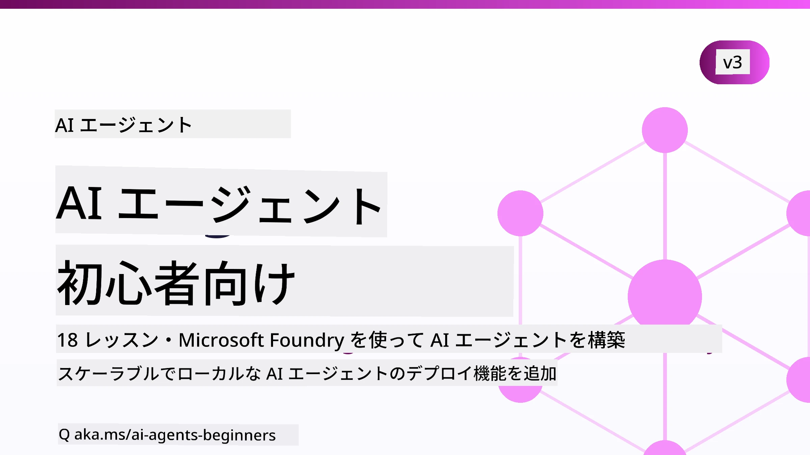

# AIエージェント入門 - コース



## AIエージェント構築を始めるために必要な全てを教えるコース

[](https://github.com/microsoft/ai-agents-for-beginners/blob/master/LICENSE?WT.mc_id=academic-105485-koreyst)
[](https://GitHub.com/microsoft/ai-agents-for-beginners/graphs/contributors/?WT.mc_id=academic-105485-koreyst)
[](https://GitHub.com/microsoft/ai-agents-for-beginners/issues/?WT.mc_id=academic-105485-koreyst)
[](https://GitHub.com/microsoft/ai-agents-for-beginners/pulls/?WT.mc_id=academic-105485-koreyst)
[](http://makeapullrequest.com?WT.mc_id=academic-105485-koreyst)

### 🌐 多言語サポート

#### [Co-op Translator](https://github.com/Azure/co-op-translator) で管理されている翻訳

<!-- CO-OP TRANSLATOR LANGUAGES TABLE START -->
[Arabic](../ar/README.md) | [Bengali](../bn/README.md) | [Bulgarian](../bg/README.md) | [Burmese (Myanmar)](../my/README.md) | [Chinese (Simplified)](../zh-CN/README.md) | [Chinese (Traditional, Hong Kong)](../zh-HK/README.md) | [Chinese (Traditional, Macau)](../zh-MO/README.md) | [Chinese (Traditional, Taiwan)](../zh-TW/README.md) | [Croatian](../hr/README.md) | [Czech](../cs/README.md) | [Danish](../da/README.md) | [Dutch](../nl/README.md) | [Estonian](../et/README.md) | [Finnish](../fi/README.md) | [French](../fr/README.md) | [German](../de/README.md) | [Greek](../el/README.md) | [Hebrew](../he/README.md) | [Hindi](../hi/README.md) | [Hungarian](../hu/README.md) | [Indonesian](../id/README.md) | [Italian](../it/README.md) | [Japanese](./README.md) | [Kannada](../kn/README.md) | [Khmer](../km/README.md) | [Korean](../ko/README.md) | [Lithuanian](../lt/README.md) | [Malay](../ms/README.md) | [Malayalam](../ml/README.md) | [Manipuri (Meitei Mayek)](../mni/README.md) | [Marathi](../mr/README.md) | [Nepali](../ne/README.md) | [Nigerian Pidgin](../pcm/README.md) | [Norwegian](../no/README.md) | [Persian (Farsi)](../fa/README.md) | [Polish](../pl/README.md) | [Portuguese (Brazil)](../pt-BR/README.md) | [Portuguese (Portugal)](../pt-PT/README.md) | [Punjabi (Gurmukhi)](../pa/README.md) | [Romanian](../ro/README.md) | [Russian](../ru/README.md) | [Serbian (Cyrillic)](../sr/README.md) | [Slovak](../sk/README.md) | [Slovenian](../sl/README.md) | [Spanish](../es/README.md) | [Swahili](../sw/README.md) | [Swedish](../sv/README.md) | [Tagalog (Filipino)](../tl/README.md) | [Tamil](../ta/README.md) | [Telugu](../te/README.md) | [Thai](../th/README.md) | [Turkish](../tr/README.md) | [Ukrainian](../uk/README.md) | [Urdu](../ur/README.md) | [Vietnamese](../vi/README.md)

> **ローカルでクローンしたいですか？**
>
> このリポジトリには50以上の言語の翻訳が含まれており、ダウンロードサイズが大幅に大きくなっています。翻訳なしでクローンするには、スパースチェックアウトを使用してください：
>
> **Bash / macOS / Linux：**
> ```bash
> git clone --filter=blob:none --sparse https://github.com/microsoft/ai-agents-for-beginners.git
> cd ai-agents-for-beginners
> git sparse-checkout set --no-cone '/*' '!translations' '!translated_images'
> ```
>
> **CMD (Windows)：**
> ```cmd
> git clone --filter=blob:none --sparse https://github.com/microsoft/ai-agents-for-beginners.git
> cd ai-agents-for-beginners
> git sparse-checkout set --no-cone "/*" "!translations" "!translated_images"
> ```
>
> これにより、はるかに高速なダウンロードでコースを完了するのに必要なすべてのものが手に入ります。
<!-- CO-OP TRANSLATOR LANGUAGES TABLE END -->

**追加の言語オプションについては、[Co-op Translatorの対応言語](https://github.com/Azure/co-op-translator/blob/main/docs/supported-languages.md)をご覧ください。**

[](https://GitHub.com/microsoft/ai-agents-for-beginners/watchers/?WT.mc_id=academic-105485-koreyst)
[](https://GitHub.com/microsoft/ai-agents-for-beginners/network/?WT.mc_id=academic-105485-koreyst)
[](https://GitHub.com/microsoft/ai-agents-for-beginners/stargazers/?WT.mc_id=academic-105485-koreyst)

[](https://discord.com/invite/ATgtXmAS5D)


## 🌱 はじめに

このコースにはAIエージェント構築の基礎をカバーするレッスンがあります。各レッスンは独立したトピックを扱っているので、好きなところから始めてください！

このコースは多言語対応です。私たちの[対応言語一覧はこちら](#-multi-language-support)。

生成AIモデルでの構築が初めての場合は、生成AIでの構築に関する21のレッスンを含む[Generative AI For Beginners](https://aka.ms/genai-beginners)コースをご覧ください。

コードを実行するために[このリポジトリをスター（🌟）する](https://docs.github.com/en/get-started/exploring-projects-on-github/saving-repositories-with-stars?WT.mc_id=academic-105485-koreyst)と[フォークする](https://github.com/microsoft/ai-agents-for-beginners/fork)ことを忘れないでください。

### 他の学習者と交流し質問を解決しよう

AIエージェント構築で行き詰まったり質問がある場合は、[Microsoft Foundry Discord](https://aka.ms/ai-agents/discord)内の専用Discordチャンネルに参加してください。

### 必要なもの 

このコースの各レッスンにはコード例が含まれており、code_samplesフォルダーにあります。あなた自身のコピーを作成するために[このリポジトリをフォーク](https://github.com/microsoft/ai-agents-for-beginners/fork)できます。  

これらの演習でのコード例は、Microsoft Foundry Agent Service V2を用いたMicrosoft Agent Frameworkを利用しています：

- [Microsoft Foundry](https://aka.ms/ai-agents-beginners/ai-foundry) - Azureアカウントが必要

このコースでは、Microsoftの以下のAIエージェントフレームワークおよびサービスを使用します：

- [Microsoft Agent Framework (MAF)](https://learn.microsoft.com/agent-framework/overview/)
- [Microsoft Foundry Agent Service V2](https://aka.ms/ai-agents-beginners/ai-agent-service)

いくつかのコードサンプルは、[MiniMax](https://platform.minimaxi.com/)などの大容量コンテキストモデル（最大204Kトークン）を提供するOpenAI互換の代替プロバイダーもサポートしています。設定詳細は[Course Setup](./00-course-setup/README.md)を参照してください。

このコースのコード実行に関する詳細は、[Course Setup](./00-course-setup/README.md)をご覧ください。

## 🙏 お手伝いしたいですか？

ご提案や綴り、コードの誤りを見つけた場合は、[Issueの報告](https://github.com/microsoft/ai-agents-for-beginners/issues?WT.mc_id=academic-105485-koreyst)または[プルリクエストの作成](https://github.com/microsoft/ai-agents-for-beginners/pulls?WT.mc_id=academic-105485-koreyst)をお願いします。


## 📂 各レッスンに含まれるもの

- READMEにある文章によるレッスンと短いビデオ
- Microsoft Agent FrameworkとMicrosoft Foundryを使用したPythonコードサンプル
- 学習を続けるための追加リソースへのリンク


## 🗃️ レッスン一覧

| <strong>レッスン</strong>                                   | <strong>本文とコード</strong>                                    | <strong>ビデオ</strong>                                                  | <strong>追加の学習リソース</strong>                                                                     |
|----------------------------------------------|----------------------------------------------------|------------------------------------------------------------|----------------------------------------------------------------------------------------|
| AIエージェントとエージェントのユースケース入門       | [Link](./01-intro-to-ai-agents/README.md)          | [Video](https://youtu.be/3zgm60bXmQk?si=z8QygFvYQv-9WtO1)  | [Link](https://aka.ms/ai-agents-beginners/collection?WT.mc_id=academic-105485-koreyst) |
| AIエージェントフレームワークの探求              | [Link](./02-explore-agentic-frameworks/README.md)  | [Video](https://youtu.be/ODwF-EZo_O8?si=Vawth4hzVaHv-u0H)  | [Link](https://aka.ms/ai-agents-beginners/collection?WT.mc_id=academic-105485-koreyst) |
| エージェントデザインパターンの理解     | [Link](./03-agentic-design-patterns/README.md)     | [Video](https://youtu.be/m9lM8qqoOEA?si=BIzHwzstTPL8o9GF)  | [Link](https://aka.ms/ai-agents-beginners/collection?WT.mc_id=academic-105485-koreyst) |
| ツール使用デザインパターン                      | [Link](./04-tool-use/README.md)                    | [Video](https://youtu.be/vieRiPRx-gI?si=2z6O2Xu2cu_Jz46N)  | [Link](https://aka.ms/ai-agents-beginners/collection?WT.mc_id=academic-105485-koreyst) |
| エージェントRAG                                  | [Link](./05-agentic-rag/README.md)                 | [Video](https://youtu.be/WcjAARvdL7I?si=gKPWsQpKiIlDH9A3)  | [Link](https://aka.ms/ai-agents-beginners/collection?WT.mc_id=academic-105485-koreyst) |
| 信頼できるAIエージェントの構築               | [Link](./06-building-trustworthy-agents/README.md) | [Video](https://youtu.be/iZKkMEGBCUQ?si=jZjpiMnGFOE9L8OK ) | [Link](https://aka.ms/ai-agents-beginners/collection?WT.mc_id=academic-105485-koreyst) |
| 計画デザインパターン                      | [Link](./07-planning-design/README.md)             | [Video](https://youtu.be/kPfJ2BrBCMY?si=6SC_iv_E5-mzucnC)  | [Link](https://aka.ms/ai-agents-beginners/collection?WT.mc_id=academic-105485-koreyst) |
| マルチエージェントデザインパターン                   | [Link](./08-multi-agent/README.md)                 | [Video](https://youtu.be/V6HpE9hZEx0?si=rMgDhEu7wXo2uo6g)  | [Link](https://aka.ms/ai-agents-beginners/collection?WT.mc_id=academic-105485-koreyst) |
| メタ認知デザインパターン                 | [Link](./09-metacognition/README.md)               | [Video](https://youtu.be/His9R6gw6Ec?si=8gck6vvdSNCt6OcF)  | [Link](https://aka.ms/ai-agents-beginners/collection?WT.mc_id=academic-105485-koreyst) |
| 生産環境でのAIエージェント                      | [Link](./10-ai-agents-production/README.md)        | [Video](https://youtu.be/l4TP6IyJxmQ?si=31dnhexRo6yLRJDl)  | [Link](https://aka.ms/ai-agents-beginners/collection?WT.mc_id=academic-105485-koreyst) |
| エージェントプロトコルの使用（MCP、A2A、NLWeb） | [Link](./11-agentic-protocols/README.md)           | [Video](https://youtu.be/X-Dh9R3Opn8)                                 | [Link](https://aka.ms/ai-agents-beginners/collection?WT.mc_id=academic-105485-koreyst) |
| AIエージェントのためのコンテキストエンジニアリング            | [Link](./12-context-engineering/README.md)         | [Video](https://youtu.be/F5zqRV7gEag)                                 | [Link](https://aka.ms/ai-agents-beginners/collection?WT.mc_id=academic-105485-koreyst) |
| エージェントメモリ管理                      | [Link](./13-agent-memory/README.md)     |      [Video](https://youtu.be/QrYbHesIxpw?si=vZkVwKrQ4ieCcIPx)                                                      |                                                                                        |
| Microsoft Agent Frameworkの探求                         | [Link](./14-microsoft-agent-framework/README.md)                            |                                                            |                                                                                        |
| コンピュータユースエージェント（CUA）の構築           | [Link](./15-browser-use/README.md)     |                                                            | [Link](https://docs.browser-use.com/examples/templates/playwright-integration)         |
| スケーラブルエージェントの展開                    | [Link](./16-deploying-scalable-agents/README.md) |                                                    | [Link](https://learn.microsoft.com/azure/ai-foundry/agents/overview)                   |
| ローカルAIエージェントの作成                     | [Link](./17-creating-local-ai-agents/README.md)  |                                                    | [Link](https://learn.microsoft.com/azure/ai-foundry/foundry-local/)                    |
| AIエージェントのセキュリティ                           | [Link](./18-securing-ai-agents/README.md)  |                                                            | [Link](https://aka.ms/ai-agents-beginners/collection?WT.mc_id=academic-105485-koreyst) |

## 🎒 その他のコース

私たちのチームは他のコースも制作しています！チェックしてください：

<!-- CO-OP TRANSLATOR OTHER COURSES START -->
### LangChain
[](https://aka.ms/langchain4j-for-beginners)
[](https://aka.ms/langchainjs-for-beginners?WT.mc_id=m365-94501-dwahlin)
[](https://github.com/microsoft/langchain-for-beginners?WT.mc_id=m365-94501-dwahlin)
---

### Azure / Edge / MCP / エージェント
[](https://github.com/microsoft/AZD-for-beginners?WT.mc_id=academic-105485-koreyst)
[](https://github.com/microsoft/edgeai-for-beginners?WT.mc_id=academic-105485-koreyst)
[](https://github.com/microsoft/mcp-for-beginners?WT.mc_id=academic-105485-koreyst)
[](https://github.com/microsoft/ai-agents-for-beginners?WT.mc_id=academic-105485-koreyst)

---
 
### ジェネレーティブAIシリーズ
[](https://github.com/microsoft/generative-ai-for-beginners?WT.mc_id=academic-105485-koreyst)
[-9333EA?style=for-the-badge&labelColor=E5E7EB&color=9333EA)](https://github.com/microsoft/Generative-AI-for-beginners-dotnet?WT.mc_id=academic-105485-koreyst)
[-C084FC?style=for-the-badge&labelColor=E5E7EB&color=C084FC)](https://github.com/microsoft/generative-ai-for-beginners-java?WT.mc_id=academic-105485-koreyst)
[-E879F9?style=for-the-badge&labelColor=E5E7EB&color=E879F9)](https://github.com/microsoft/generative-ai-with-javascript?WT.mc_id=academic-105485-koreyst)

---
 
### コアラーニング
[](https://aka.ms/ml-beginners?WT.mc_id=academic-105485-koreyst)
[](https://aka.ms/datascience-beginners?WT.mc_id=academic-105485-koreyst)
[](https://aka.ms/ai-beginners?WT.mc_id=academic-105485-koreyst)
[](https://github.com/microsoft/Security-101?WT.mc_id=academic-96948-sayoung)
[](https://aka.ms/webdev-beginners?WT.mc_id=academic-105485-koreyst)
[](https://aka.ms/iot-beginners?WT.mc_id=academic-105485-koreyst)
[](https://github.com/microsoft/xr-development-for-beginners?WT.mc_id=academic-105485-koreyst)

---
 
### コパイロットシリーズ
[](https://aka.ms/GitHubCopilotAI?WT.mc_id=academic-105485-koreyst)
[](https://github.com/microsoft/mastering-github-copilot-for-dotnet-csharp-developers?WT.mc_id=academic-105485-koreyst)
[](https://github.com/microsoft/CopilotAdventures?WT.mc_id=academic-105485-koreyst)
<!-- CO-OP TRANSLATOR OTHER COURSES END -->

## 🌟 コミュニティの感謝

[Shivam Goyal](https://www.linkedin.com/in/shivam2003/) に、Agentic RAGを示す重要なコードサンプルを提供していただき感謝します。

## 貢献について

このプロジェクトは貢献と提案を歓迎します。ほとんどの貢献には、
あなたがその権利を持ち、実際に私たちに貢献を使用する権利を与えることを宣言する
Contributor License Agreement (CLA) に同意する必要があります。詳細は <https://cla.opensource.microsoft.com> をご覧ください。

プルリクエストを提出すると、CLAボットが自動的にCLAの提供が必要かどうかを判断し、
PRに適切な装飾（例：ステータスチェック、コメント）を行います。ボットの指示に従ってください。
この操作は私たちのCLAを使用するすべてのリポジトリで一度だけ行えば十分です。

このプロジェクトは [Microsoftオープンソース行動規範](https://opensource.microsoft.com/codeofconduct/) を採用しています。
詳細は [行動規範FAQ](https://opensource.microsoft.com/codeofconduct/faq/) をご覧いただくか、
追加の質問やコメントは [opencode@microsoft.com](mailto:opencode@microsoft.com) までご連絡ください。

## 商標について

このプロジェクトにはプロジェクト、製品、またはサービスの商標やロゴが含まれている場合があります。Microsoftの
商標やロゴの正当な使用は、それに従う必要があります
[Microsoftの商標およびブランドガイドライン](https://www.microsoft.com/legal/intellectualproperty/trademarks/usage/general)。
このプロジェクトの変更版でMicrosoftの商標またはロゴを使用する場合、混乱を引き起こしたりMicrosoftの後援を示唆してはなりません。
第三者の商標またはロゴの使用は、それらの第三者の方針に従うものとします。

## ヘルプを得る


AIアプリの構築で行き詰まったり質問がある場合は、以下にご参加ください：

[](https://aka.ms/foundry/discord)

製品のフィードバックやビルド時のエラーがある場合は以下へアクセスしてください：

[](https://aka.ms/foundry/forum)

---

<!-- CO-OP TRANSLATOR DISCLAIMER START -->
**免責事項**：
本書類は AI 翻訳サービス [Co-op Translator](https://github.com/Azure/co-op-translator) を使用して翻訳されています。正確性を期していますが、自動翻訳には誤りや不正確な部分が含まれる可能性があることをご承知おきください。原文の原語版が正式な情報源とみなされるべきです。重要な情報については、専門の人間による翻訳を推奨します。本翻訳の利用により生じたいかなる誤解や解釈違いについても、当方は責任を負いかねます。
<!-- CO-OP TRANSLATOR DISCLAIMER END -->