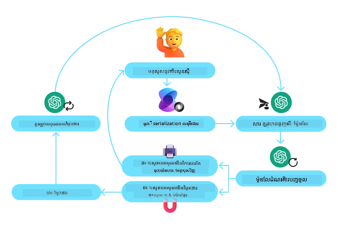
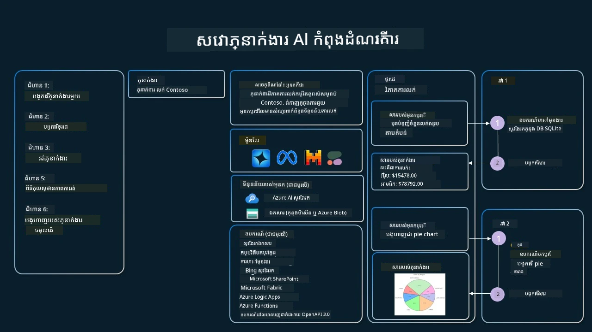

[](https://youtu.be/vieRiPRx-gI?si=cEZ8ApnT6Sus9rhn)

> _(ចុចលើរូបភាពខាងលើដើម្បីមើលវីដេអូមេរៀននេះ)_

# ឧទាហរណ៍រចនាការប្រើឧបករណ៍

ឧបករណ៍គឺគួរឱ្យចាប់អារម្មណ៍ ព្រោះវាអនុញ្ញាតឱ្យជំនួយការជំនួយ AI មានសមត្ថភាពពាសពេញបណ្តុំ។ មិនមែនជំនួយការមានសកម្មភាពកំណត់មួយចំនួនដែលវាអាចបំពេញបានទេ ប៉ុន្តែដោយបន្ថែមឧបករណ៍មួយ ជំនួយការអាចបំពេញសកម្មភាពជាច្រើន។ ក្នុងជំពូកនេះ យើងនឹងមើលឧទាហរណ៍រចនាការប្រើឧបករណ៍ ដែលពិពណ៌នាថាតើជំនួយការជំនួយ AI អាចប្រើឧបករណ៍ជាក់លាក់ដើម្បីសម្រេចគោលបំណងរបស់ពួកគេយ៉ាងដូចម្តេច។

## ការណែនាំ

ក្នុងមេរៀននេះ យើងកំពុងស្វែងរកចម្លើយសំណួរខាងក្រោម៖

- តើឧទាហរណ៍រចនាប្រើឧបករណ៍គឺជាអ្វី?
- តើមានករណីប្រើប្រាស់អ្វីខ្លះដែលវាអាចសម្រេចបាន?
- តើធាតុ/ប្លុកសាងសង់មានអ្វីខ្លះដែលត្រូវការដើម្បីអនុវត្តឧទាហរណ៍រចនានេះ?
- តើមានការពិចារណាពិសេសអ្វីខ្លះសម្រាប់ការប្រើឧទាហរណ៍រចនាប្រើឧបករណ៍ដើម្បីបង្កើតជំនួយការជំនួយ AI ដែលទុកចិត្តបាន?

## គោលដៅការសិក្សា

បន្ទាប់ពីបញ្ចប់មេរៀននេះ អ្នកនឹងអាច៖

- សហការលើឧទាហរណ៍រចនាប្រើឧបករណ៍ និងគោលដៅរបស់វា។
- បញ្ជាក់ករណីប្រើដែលអាចអនុវត្តឧទាហរណ៍រចនាប្រើឧបករណ៍។
- យល់ដឹងអំពីធាតុសំខាន់ៗដែលត្រូវការសម្រាប់អនុវត្តឧទាហរណ៍រចនានេះ។
- យល់ដឹងអំពីការពិចារណានានាសម្រាប់ធានាការទុកចិត្តនៅក្នុងជំនួយការជំនួយ AI ដែលប្រើឧទាហរណ៍រចនានេះ។

## តើឧទាហរណ៍រចនាប្រើឧបករណ៍គឺជាអ្វី?

**ឧទាហរណ៍រចនាប្រើឧបករណ៍** អាចជាមូលដ្ឋានចម្បងសម្រាប់ឱ្យ LLMs មានសមត្ថភាពចូលអនុវត្តឧបករណ៍ខាងក្រៅ ដើម្បីសម្រេចគោលបំណងជាក់លាក់។ ឧបករណ៍គឺជាកូដដែលអាចដំណើរការដោយជំនួយការដើម្បីអនុវត្តសកម្មភាពមួយចំនួន។ ឧបករណ៍អាចជាអនុគមន៍សាមញ្ញមួយដូចជាកាឡេគុឡេ ឬការហៅ API ទៅកាន់សេវាកម្មភាគីទីបីដូចជាការស្វែងរកតម្លៃភាគហ៊ុន ឬការព្យាករណ៍អាកាសធាតុ។ នៅក្នុងបរិបទជំនួយការជំនួយ AI ឧបករណ៍ត្រូវបានរចនាឡើងសម្រាប់ដំណើរការដោយជំនួយការតាមការហៅអនុគមន៍ដែលបានបង្កើតដោយម៉ូឌែល។

## តើមានករណីប្រើប្រាស់អ្វីខ្លះដែលវាអាចអនុវត្តបាន?

ជំនួយការជំនួយ AI អាចប្រើឧបករណ៍ដើម្បីបំពេញភារកិច្ចស្មុគស្មាញ ស្កេនព័ត៌មាន ឬធ្វើការសម្រេចចិត្ត។ ឧទាហរណ៍រចនាប្រើឧបករណ៍ត្រូវបានប្រើជាញឹកញាប់នៅក្នុងស្ថានភាពដែលត្រូវការប្រាស្រ័យទាក់ទងប្រកបដោយភាពប្រែប្រួលជាមួយប្រព័ន្ធខាងក្រៅ ដូចជាឃ្លាំងទិន្នន័យ សេវាកម្មបណ្តាញ ឬកូដបកស្រាយ។ សមត្ថភាពនេះមានប្រយោជន៍ចំពោះករណីប្រើប្រាស់ផ្សេងៗដូចជា៖

- **ការទាញយកព័ត៌មានប្រកបដោយភាពប្រែប្រួល:** ជំនួយការអាចសៀវភៅ API ខាងក្រៅ ឬឃ្លាំងទិន្នន័យដើម្បីយកទិន្នន័យថ្មីៗ (ឧ. ស្វែងរកទិន្នន័យក្នុងឃ្លាំងទិន្នន័យ SQLite សម្រាប់វិភាគទិន្នន័យ ការទាញយកតម្លៃភាគហ៊ុន ឬព័ត៌មានអាកាសធាតុ)។
- **ការប្រតិបត្តិការ និងបកស្រាយកូដ:** ជំនួយការអាចដំណើរការកូដ ឬស្ក្រីបដើម្បីដោះស្រាយបញ្ហាគណិតវិទ្យា បង្កើតរបាយការណ៍ ឬអនុវត្តសមីការ។
- **ស្វ័យប្រវត្តិកម្មធ្វើការងារ:** អូតូម៉ាទឹកមុខម្ដងម្ដាប់ ជាមេឌៀកំណត់ពេលវេលា សេវាកម្មអ៊ីមែល ឬបណ្តាញទិន្នន័យ។
- **ការគាំទ្រអតិថិជន:** ជំនួយការអាចធ្វើការប្រាស្រ័យទាក់ទងជាមួយប្រព័ន្ធ CRM ផ្ទាំងសំបុត្រឬមូលដ្ឋានចំណេះដឹង ដើម្បីដោះស្រាយសំណួរអ្នកប្រើ។
- **ការបង្កើត និងកែប្រែខ្លឹមសារ:** ជំនួយការអាចប្រើឧបករណ៍ដូចជាកម្មវិធីពិនិត្យវេយ្យាករណ៍ សង្ខេបអត្ថបទ ឬកម្មវិធីវាយតម្លៃសុវត្ថិភាពខ្លឹមសារដើម្បីជួយក្នុងការងារបង្កើតខ្លឹមសារ។

## តើធាតុ/ប្លុកសាងសង់អ្វីខ្លះដែលត្រូវការដើម្បីអនុវត្តឧទាហរណ៍រចនាប្រើឧបករណ៍?

ប្លុកសាងសង់ទាំងនេះអនុញ្ញាតឱ្យជំនួយការអាចបំពេញភារកិច្ចជាច្រើន។ មកមើលធាតុសំខាន់ៗដែលត្រូវការដើម្បីអនុវត្តឧទាហរណ៍រចនាប្រើឧបករណ៍៖

- **សុិទិ្ធ/គំរូឧបករណ៍**៖ ការបញ្ជាក់លម្អិតអំពីឧបករណ៍ដែលមាន សូម្បីតែឈ្មោះអនុគមន៍ គោលបំណង ប៉ារ៉ាម៉ែត្រដែលទាមទារ និងលទ្ធផលដែលរំពឹងទុក។ គំរូទាំងនេះអាចអោយ LLM យល់ថា ឧបករណ៍ណាខ្លះមាន និងតើធ្វើដូចម្តេចដើម្បីស្នើសុំត្រឹមត្រូវ។

- **តំណើរការអនុវត្តអនុគមន៍**៖ គ្រប់គ្រងរបៀប និងពេលវេលាដែលឧបករណ៍ត្រូវបានហៅ ដោយផ្អែកលើបំណងអ្នកប្រើ និងបរិបទសន្ទនា។ នេះអាចរួមបញ្ចូលម៉ូឌុលផែនការ ប្រព័ន្ធផ្លូវចរន្ត ឬទ្រង់ទ្រាយលក្ខខណ្ឌដែលកំណត់ការប្រើឧបករណ៍ដោយភាពរអិល។

- **ប្រព័ន្ធគ្រប់គ្រងសារ**៖ រចនាសម្ព័ន្ធដើម្បីគ្រប់គ្រងចរន្តសន្ទនារវាងការបញ្ចូលរបស់អ្នកប្រើ ចម្លើយ LLM ការហៅឧបករណ៍ និងលទ្ធផលឧបករណ៍។

- **សេវាកម្មរចនាសម្ព័ន្ធឧបករណ៍**៖ ផ្នែករចនាសម្ព័ន្ធដែលភ្ជាប់ជាមួយឧបករណ៍នានា មិនថាអនុគមន៍សាមញ្ញ ឬសេវាកម្មខាងក្រៅស្មុគស្មាញ។

- **ការគ្រប់គ្រងកំហុស និងការបញ្ចាក់ភាពត្រឹមត្រូវ**៖ គ្រប់គ្រងករណីបរាជ័យក្នុងការប្រើឧបករណ៍ បញ្ចាក់ប៉ារ៉ាម៉ែត្រ និងគ្រប់គ្រងចម្លើយមិនរំពឹងទុក។

- **ការគ្រប់គ្រងស្ថានភាព**៖ កត់ត្រាបរិបទសន្ទនា ការប្រើឧបករណ៍មុន និងទិន្នន័យដែលមានស្ថិតិ ដើម្បីធានាភាពរឹងមាំក្នុងការប្រាស្រ័យទាក់ទងពហុជំរើ។

បន្ទាប់មក យើងមកមើលការហៅអនុគមន៍/ឧបករណ៍បន្ថែម។
 
### ការហៅអនុគមន៍/ឧបករណ៍

ការហៅអនុគមន៍គឺជាវិធីសម្រាប់ឲ្យម៉ូឌែលភាសាធំដូចជា LLMs អាចធ្វើអន្តរកម្មជាមួយឧបករណ៍។ អ្នកបញ្ជាក់ឃើញថាការប្រើពាក្យ 'អនុគមន៍' និង 'ឧបករណ៍' មានការប្រែប្រួលដោយសារប្រការជាអ្នកប្រើតែងតែយល់ថា 'អនុគមន៍' (ប្លុកកូដដែលអាចប្រើហើយឡើងវិញ) គឺជាឧបករណ៍ដែលជំនួយការប្រើដើម្បីបំពេញភារកិច្ច។ ដើម្បីឲ្យកូដអនុគមន៍ត្រូវបានហៅ យើងត្រូវឲ្យ LLM ប្រៀបធៀបសំណើរបស់អ្នកប្រើជាមួយការពិពណ៌នាអនុគមន៍។ ដើម្បីធ្វើនេះ គេផ្ញើគំរូ JSON ដែលមានការពិពណ៌នាតាំងពីអនុគមន៍ទាំងអស់ជូន LLM។ LLM បន្ទាប់មកជ្រើសអនុគមន៍ដែលសមស្របបំផុតសម្រាប់ភារកិច្ច ហើយត្រឡប់ឈ្មោះនិងអាគុយម៉ង់។ អនុគមន៍ដែលបានជ្រើសត្រូវបានហៅ សារឆ្លើយតបត្រូវបានផ្ញើវិញទៅ LLM ដែលប្រើព័ត៌មាននោះដើម្បីឆ្លើយតបសំណើរអ្នកប្រើ។

សម្រាប់អ្នកអភិវឌ្ឍដើម្បីអនុវត្តការហៅអនុគមន៍សម្រាប់ជំនួយការ អ្នកត្រូវការឲ្យមានៈ

1. ម៉ូឌែល LLM ដែលគាំទ្រការហៅអនុគមន៍
2. គំរូ JSON មានការពិពណ៌នាអនុគមន៍
3. កូដសម្រាប់អនុគមន៍នីមួយៗដែលបានពិពណ៌នា

យើងយកឧទាហរណ៍ការទទួលបានម៉ោងបច្ចុប្បន្ននៅក្នុងទីក្រុងមួយ ដើម្បីបង្ហាញ៖

1. **ចាប់ផ្តើមម៉ូឌែល LLM ដែលគាំទ្រការហៅអនុគមន៍៖**

    មូលដ្ឋានមិនមែនម៉ូឌែលទាំងអស់គាំទ្រការហៅអនុគមន៍នោះទេ ដូច្នេះគួរតែពិនិត្យថាម៉ូឌែលដែលអ្នកប្រើគាំទ្រប្រព័ន្ធនេះឬអត់។ <a href="https://learn.microsoft.com/azure/ai-services/openai/how-to/function-calling" target="_blank">Azure OpenAI</a> គាំទ្រការហៅអនុគមន៍។ យើងអាចចាប់ផ្តើមដោយបង្កើតអតិថិជន OpenAI ដែលទាក់ទងទៅកាន់ Azure OpenAI **Responses API** (ចំណុចចូល `/openai/v1/` ជាក់ស្តែង — មិនត្រូវការប្រើ `api_version`)។

    ```python
    # Initialize the OpenAI client for Azure OpenAI (Responses API, v1 endpoint)
    client = OpenAI(
        base_url=f"{os.environ['AZURE_OPENAI_ENDPOINT'].rstrip('/')}/openai/v1/",
        api_key=os.environ["AZURE_OPENAI_API_KEY"],
    )
    deployment_name = os.environ["AZURE_OPENAI_DEPLOYMENT"]
    ```

1. **បង្កើតគំរូអនុគមន៍**៖

    បន្ទាប់មកយើងនឹងកំណត់គំរូ JSON ដែលមានឈ្មោះអនុគមន៍ ការពិពណ៌នាអំពីអ្វីដែលអនុគមន៍ធ្វើ និងឈ្មោះនិងការពិពណ៌នាប៉ារ៉ាម៉ែត្រ។
    យើងនឹងផ្ញើគំរូនេះទៅអតិថិជនដែលបានបង្កើតពីមុន ជាមួយនឹងសំណើររបស់អ្នកប្រើដើម្បីរកម៉ោងនៅសានបាន់ស៊ីស្កូ។ គួរឲ្យចាប់អារម្មណ៍ថា **ការហៅឧបករណ៍** គឺជាលទ្ធផលដែលត្រូវបានត្រឡប់មកវិញ មិនមែនចម្លើយចុងក្រោយនៃសំណួរនោះទេ។ ដូចដែលបាននិយាយពីមុន LLM ត្រឡប់ឈ្មោះអនុគមន៍ដែលបានជ្រើសសម្រាប់ភារកិច្ចនោះ និងអាគុយម៉ង់ដែលត្រូវផ្ញើជាមួយវា។

    ```python
    # Function description for the model to read (Responses API flat tool format)
    tools = [
        {
            "type": "function",
            "name": "get_current_time",
            "description": "Get the current time in a given location",
            "parameters": {
                "type": "object",
                "properties": {
                    "location": {
                        "type": "string",
                        "description": "The city name, e.g. San Francisco",
                    },
                },
                "required": ["location"],
            },
        }
    ]
    ```
   
    ```python
  
    # Initial user message
    messages = [{"role": "user", "content": "What's the current time in San Francisco"}]

    # First API call: Ask the model to use the function
    response = client.responses.create(
        model=deployment_name,
        input=messages,
        tools=tools,
        tool_choice="auto",
        store=False,
    )

    # The Responses API returns tool calls as function_call items in response.output.
    # Append them to the conversation so the model has full context on the next turn.
    messages += response.output

    print("Model's response:")
    print(response.output)
  
    ```

    ```bash
    Model's response:
    [ResponseFunctionToolCall(arguments='{"location":"San Francisco"}', call_id='call_pOsKdUlqvdyttYB67MOj434b', name='get_current_time', type='function_call')]
    ```
  
1. **កូដអនុគមន៍ដែលត្រូវការសម្រាប់បំពេញភារកិច្ច:** 

    ឥឡូវនេះ LLM បានជ្រើសអ្វីដែលត្រូវដំណើរការហើយ អ្នកត្រូវអនុវត្តហើយដំណើរការកូដនោះ។
    យើងអាចអនុវត្តកូដដើម្បីទទួលម៉ោងបច្ចុប្បន្ននៅ Python។ យើងត្រូវមានកូដដើម្បីដកហូបឈ្មោះនិងអាគុយម៉ង់ពី response_message ដើម្បីទទួលបានលទ្ធផលចុងក្រោយ។

    ```python
      def get_current_time(location):
        """Get the current time for a given location"""
        print(f"get_current_time called with location: {location}")  
        location_lower = location.lower()
        
        for key, timezone in TIMEZONE_DATA.items():
            if key in location_lower:
                print(f"Timezone found for {key}")  
                current_time = datetime.now(ZoneInfo(timezone)).strftime("%I:%M %p")
                return json.dumps({
                    "location": location,
                    "current_time": current_time
                })
      
        print(f"No timezone data found for {location_lower}")  
        return json.dumps({"location": location, "current_time": "unknown"})
    ```

     ```python
    # Handle function calls
    tool_calls = [item for item in response.output if item.type == "function_call"]
    if tool_calls:
        for tool_call in tool_calls:
            if tool_call.name == "get_current_time":

                function_args = json.loads(tool_call.arguments)

                time_response = get_current_time(
                    location=function_args.get("location")
                )

                # Return the tool result as a function_call_output item
                messages.append({
                    "type": "function_call_output",
                    "call_id": tool_call.call_id,
                    "output": time_response,
                })
    else:
        print("No tool calls were made by the model.")

    # Second API call: Get the final response from the model
    final_response = client.responses.create(
        model=deployment_name,
        input=messages,
        tools=tools,
        store=False,
    )

    return final_response.output_text
     ```

     ```bash
      get_current_time called with location: San Francisco
      Timezone found for san francisco
      The current time in San Francisco is 09:24 AM.
     ```

ការហៅអនុគមន៍គឺជាគន្លងស្នូលរបស់ការរចនាប្រើឧបករណ៍ជំនួយការច្រើន ប៉ុន្តែការអនុវត្តវាពីដំបូងអាចមានការលំបាកខ្លះ។
ខណៈដែលយើងបានរៀនពី[មេរៀនទី 2](../../../02-explore-agentic-frameworks) ស៊ុមរាងជំនួយការផ្តល់ឧបករណ៍រួចជាស្រេចសម្រាប់ការអនុវត្តការប្រើឧបករណ៍។
 
## ឧទាហរណ៍ការប្រើឧបករណ៍ជាមួយស៊ុមរាងជំនួយការ

នេះជាឧទាហរណ៍ពីរបៀបអនុវត្តឧទាហរណ៍រចនាប្រើឧបករណ៍ដោយប្រើស៊ុមរាងជំនួយការផ្សេងៗ៖

### ស៊ុមរាងជំនួយ Microsoft

<a href="https://learn.microsoft.com/azure/ai-services/agents/overview" target="_blank">ស៊ុមរាងជំនួយ Microsoft</a> គឺជាស៊ុមរាង AI ផ្ទុកជាស្រេចសម្រាប់បង្កើតជំនួយការជំនួយ AI។ វាសម្រួលដំណើរការនៃការប្រើការហៅអនុគមន៍ដោយអនុញ្ញាតឲ្យអ្នកកំណត់ឧបករណ៍ជាអនុគមន៍ Python ជាមួយគណៈកម្មាធិការរបស់ `@tool`។ ស៊ុមរាងគ្រប់គ្រងការប្រាស្រ័យទាក់ទងរវាងម៉ូឌែល និងកូដរបស់អ្នក។ វាក៏ផ្តល់នូវការចូលដំណើរការទៅឧបករណ៍ដែលបានបង្កើតរួចដូចជា File Search និង Code Interpreter តាមរយៈ `FoundryChatClient`។

រូបភាពខាងក្រោមបង្ហាញដំណើរការនៃការហៅអនុគមន៍ជាមួយស៊ុមរាងជំនួយ Microsoft៖



ក្នុងស៊ុមរាងជំនួយ Microsoft ឧបករណ៍ត្រូវបានកំណត់ជាអនុគមន៍ដែលមានគណៈកម្មាធិការក្រៅ។ យើងអាចបម្លែងអនុគមន៍ `get_current_time` ដែលយើងបានមើលមុននេះទៅឧបករណ៍ដោយប្រើគណៈកម្មាធិការរបស់ `@tool`។ ស៊ុមរាងនឹងបង្កើតសន្ទស្សន៍អនុគមន៍និងប៉ារ៉ាម៉ែត្រដោយស្វ័យប្រវត្តិ បង្កើតគំរូ JSON ដើម្បីផ្ញើទៅរ LLM។

```python
import os
from agent_framework import tool
from agent_framework.foundry import FoundryChatClient
from azure.identity import AzureCliCredential

@tool(approval_mode="never_require")
def get_current_time(location: str) -> str:
    """Get the current time for a given location"""
    ...

# Create the client
provider = FoundryChatClient(
    project_endpoint=os.environ["AZURE_AI_PROJECT_ENDPOINT"],
    model=os.environ["AZURE_AI_MODEL_DEPLOYMENT_NAME"],
    credential=AzureCliCredential(),
)

# Create an agent and run with the tool
agent = provider.as_agent(name="TimeAgent", instructions="Use available tools to answer questions.", tools=get_current_time)
response = await agent.run("What time is it?")
```

#### ឧបករណ៍ពីមេកឆៀ MCP

ឧបករណ៍មិនចាំបាច់ត្រូវជាអនុគមន៍ក្នុងកូដរបស់អ្នកទេ។ ម៉ាស៊ីនមេមួយដែលនិយាយភាសាប្រព័ន្ធទិសដៅម៉ូឌែល (MCP, ដែលបានពិភាក្សានៅ [មេរៀនទី 11](../11-agentic-protocols/README.md)) បង្ហាញឧបករណ៍ជាមួយគំរូរបស់ពួកវា ហើយស៊ុមរាងអាចផ្ទុកមកដដែលដូចការផ្សងព្រេងអនុគមន៍ដែលបានគណនាក្រៅ។ `MCPStreamableHTTPTool` ភ្ជាប់ទៅម៉ាស៊ីនមេដូចនេះតាម HTTP អានគំរូឧបករណ៍ ហើយផ្តល់ឲ្យម៉ូឌែលជាមួយឧបករណ៍ក្នុងតំបន់។

ឧទាហរណ៍ខាងក្រោមប្រើម៉ាស៊ីនមេស្វែងរកតាមអ៊ីនធឺណិតដែលផ្ដល់ដោយ <a href="https://keenable.ai" target="_blank">Keenable</a>។ វាឥតគិតថ្លៃ និងមិនត្រូវការគណនី ឬក៏កូនសោ API (សំណើត្រូវបានកំណត់បរិមាណតាម IP) ហើយគ្រាន់តែត្រូវការតែគណនីម៉ូឌែលរបស់អ្នកតែប៉ុណ្ណោះ។ ដូចជាឧបករណ៍ផ្សេងៗទៅទៀត សំណើសរសេរដោយម៉ូឌែលត្រូវបានផ្ញើទៅម៉ាស៊ីនមេនោះ។

```python
from agent_framework import MCPStreamableHTTPTool

web_search = MCPStreamableHTTPTool(
    name="Keenable web search",
    url="https://api.keenable.ai/mcp",
)

# Connecting loads the server's tool schemas; the agent decides when to call them
async with web_search:
    agent = provider.as_agent(
        name="ResearchAgent",
        instructions="Use available tools to answer questions.",
        tools=[web_search],
    )
    response = await agent.run("What is new in the latest Python release?")
    print(response.text)
```

ម៉ាស៊ីនមេបង្ហាញឧបករណ៍ ២ គឺ `search_web_pages` និង `fetch_page_content`។ នៅពេលមានសំណួរត្រូវការព័ត៌មានបច្ចុប្បន្ន ម៉ូឌែលហៅ `search_web_pages` ទទួលបានចំណងជើង URL និងសេចក្តីសង្ខេប ហើយសរសេរចម្លើយរបស់វាពីពួកវា វាដូចជាល្រើនជាលំនាំដដែលក្នុងឧទាហរណ៍ `get_current_time` ខាងលើ។
  
### សេវាកម្មជំនួយ Microsoft Foundry

<a href="https://learn.microsoft.com/azure/ai-services/agents/overview" target="_blank">សេវាកម្មជំនួយ Microsoft Foundry</a> គឺជាស៊ុមរាងជំនួយ AI ថ្មី ដែលបង្កើតឡើងដើម្បីជួយអ្នកអភិវឌ្ឍក្នុងការបង្កើត ដឹកនាំ និងពង្រីកជំនួយការជំនួយ AI ដោយមានសុវត្ថិភាព ខណៈដែលមិនចាំបាច់គ្រប់គ្រងកំណត់ត្រាកំណត់ដើម និងធនធានផ្ទុកទិន្នន័យនោះទេ។ វាមានប្រយោជន៍ពិសេសសម្រាប់កម្មវិធីសហគ្រាស ព្រោះវាជាសេវាកម្មគ្រប់គ្រងពេញលេញ ជាមួយសុវត្ថិភាពថ្នាក់សហគ្រាស។

เมื่อเปรียบเทียบกับการพัฒนาด้วย API LLM โดยตรง Microsoft Foundry Agent Service ให้ข้อดีบางประการ รวมถึง:

- ការហៅឧបករណ៍ដោយស្វ័យប្រវត្តិ – មិនចាំបាច់វិភាគការហៅឧបករណ៍ ហៅឧបករណ៍ និងគ្រប់គ្រងចម្លើយទៀតទេ; របស់ទាំងនេះចាប់ផ្តើមជាមួយម៉ាស៊ីនមេ
- ទិន្នន័យគ្រប់គ្រងដោយសុវត្ថិភាព – ជំនួសការគ្រប់គ្រងស្ថានភាពសន្ទនារបស់អ្នកដោយខ្លួនឯង អ្នកអាចពឹងផ្អែកលើយ៉ាងត្រឹមត្រូវដើម្បីរក្សាទុកព័ត៌មានទាំងអស់ដែលអ្នកត្រូវការ
- ឧបករណ៍មកពីប្រអប់ – ឧបករណ៍ដែលអ្នកអាចប្រើដើម្បីធ្វើអន្តរកម្មជាមួយប្រភពទិន្នន័យរបស់អ្នក ដូចជា Bing, Azure AI Search និង Azure Functions។

ឧបករណ៍ដែលមាននៅក្នុងសេវាកម្មជំនួយ Microsoft Foundry អាចចែកបួនជាក្រុមពីរ៖

1. ឧបករណ៍ចំណេះដឹង៖
    - <a href="https://learn.microsoft.com/azure/ai-services/agents/how-to/tools/bing-grounding?tabs=python&pivots=overview" target="_blank">ផ្អែកលើការស្វែងរក Bing</a>
    - <a href="https://learn.microsoft.com/azure/ai-services/agents/how-to/tools/file-search?tabs=python&pivots=overview" target="_blank">ការស្វែងរកឯកសារ</a>
    - <a href="https://learn.microsoft.com/azure/ai-services/agents/how-to/tools/azure-ai-search?tabs=azurecli%2Cpython&pivots=overview-azure-ai-search" target="_blank">Azure AI Search</a>

2. ឧបករណ៍សកម្មភាព៖
    - <a href="https://learn.microsoft.com/azure/ai-services/agents/how-to/tools/function-calling?tabs=python&pivots=overview" target="_blank">ការហៅអនុគមន៍</a>
    - <a href="https://learn.microsoft.com/azure/ai-services/agents/how-to/tools/code-interpreter?tabs=python&pivots=overview" target="_blank">អ្នកបកប្រែកូដ</a>
    - <a href="https://learn.microsoft.com/azure/ai-services/agents/how-to/tools/openapi-spec?tabs=python&pivots=overview" target="_blank">ឧបករណ៍ដែលកំណត់ដោយ OpenAPI</a>
    - <a href="https://learn.microsoft.com/azure/ai-services/agents/how-to/tools/azure-functions?pivots=overview" target="_blank">Azure Functions</a>

សេវាកម្មជំនួយអាចអនុញ្ញាតឲ្យយើងប្រើឧបករណ៍ទាំងនេះជា `toolset` តែមួយ។ វាក៏ប្រើ `threads` ដែលរក្សាប្រវត្តិសារពីសន្ទនាមួយជាក់លាក់។

សូមសំឡេងអ្នកជាជំនួយការលក់នៅក្រុមហ៊ុនមួយដែលមានឈ្មោះ Contoso។ អ្នកចង់អភិវឌ្ឍជំនួយការសន្ទនាដែលអាចឆ្លើយសំណួរអំពីទិន្នន័យលក់របស់អ្នក។

រូបភាពខាងក្រោមបង្ហាញពីរបៀបដែលអ្នកអាចប្រើ Microsoft Foundry Agent Service ដើម្បីវិភាគទិន្នន័យលក់របស់អ្នក៖



ដើម្បីប្រើឧបករណ៍ណាមួយជាមួយសេវាកម្មនេះ យើងអាចបង្កើតអតិថិជន និងកំណត់ឧបករណ៍ ឬក្រុមឧបករណ៍មួយ។ ដើម្បីអនុវត្តការអនុវត្តនេះយើងអាចប្រើកូដ Python ខាងក្រោម។ LLM នឹងអាចមើលឃើញក្រុមឧបករណ៍ ហើយសម្រេចចិត្តថាតើត្រូវប្រើអនុគមន៍ដែលអ្នកបង្កើត `fetch_sales_data_using_sqlite_query` ឬអ្នកបកប្រែកូដដែលបានបង្កើតរួចរួមខ្លួនបែបផែនតាមសំណើរអ្នកប្រើ។

```python 
import os
from azure.ai.projects import AIProjectClient
from azure.identity import DefaultAzureCredential
from fetch_sales_data_functions import fetch_sales_data_using_sqlite_query # fetch_sales_data_using_sqlite_query function which can be found in a fetch_sales_data_functions.py file.
from azure.ai.projects.models import ToolSet, FunctionTool, CodeInterpreterTool

project_client = AIProjectClient.from_connection_string(
    credential=DefaultAzureCredential(),
    conn_str=os.environ["PROJECT_CONNECTION_STRING"],
)

# Initialize toolset
toolset = ToolSet()

# Initialize function calling agent with the fetch_sales_data_using_sqlite_query function and adding it to the toolset
fetch_data_function = FunctionTool(fetch_sales_data_using_sqlite_query)
toolset.add(fetch_data_function)

# Initialize Code Interpreter tool and adding it to the toolset. 
code_interpreter = CodeInterpreterTool()toolset.add(code_interpreter)

agent = project_client.agents.create_agent(
    model="gpt-5-mini", name="my-agent", instructions="You are helpful agent", 
    toolset=toolset
)
```

## តើមានការពិចារណាពិសេសអ្វីខ្លះសម្រាប់ការប្រើឧទាហរណ៍រចនាប្រើឧបករណ៍ដើម្បីបង្កើតជំនួយការជំនួយ AI ដែលទុកចិត្តបាន?

ការព្រួយបារម្ភទូទៅនៃ SQL ដែលត្រូវបង្កើតដោយ LLM ដោយស្វ័យប្រវត្តិគឺសុវត្ថិភាព ជាពិសេសហានិភ័យនៃការចាក់បញ្ចូល SQL ឬសកម្មភាពមិនសូវល្អ ដូចជាការលុបឬរំខានឃ្លាំងទិន្នន័យ។ ទោះបីជាការព្រួយបារម្ភនេះមានមูลវា ក៏អាចទប់ស្កាត់បានយ៉ាងមានប្រសិទ្ធភាពដោយកំណត់សិទ្ធិចូលប្រើឃ្លាំងទិន្នន័យយ៉ាងត្រឹមត្រូវ។ សម្រាប់ឃ្លាំងទិន្នន័យភាគច្រើន នេះគឺរួមបញ្ចូលការកំណត់ឃ្លាំងទិន្នន័យជាស្ថានភាពអានតែប៉ុណ្ណោះ។ សម្រាប់សេវាឃ្លាំងទិន្នន័យដូចជា PostgreSQL ឬ Azure SQL សូមផ្ដល់តួនាទីអានតែប៉ុណ្ណោះ (SELECT) ទៅលើកម្មវិធី។

ការប្រើកម្មវិធីនៅក្នុងបរិយាកាសសុវត្ថិភាពបន្ថែមការការពារ នៅក្នុងស្ថានភាពសហគ្រាស ទិន្នន័យភាគច្រើនត្រូវបានដកចេញនិងបម្លែងពីប្រព័ន្ធប្រតិបត្តិការ ទៅឃ្លាំងទិន្នន័យអានតែប៉ុណ្ណោះ ឬឃ្លាំងទិន្នន័យធំដោយមានគំរូបរិយាកាសងាយស្រួលប្រើ។ វាធានាថា ទិន្នន័យមានសុវត្ថិភាព ប្រសិទ្ធភាព និងងាយស្រួលចូលប្រើ ហើយកម្មវិធីមានសិទ្ធិអានតែប៉ុណ្ណោះ។

## កូដឧទាហរណ៍

- Python: [Agent Framework](./code_samples/04-python-agent-framework.ipynb)
- .NET: [Agent Framework](./code_samples/04-dotnet-agent-framework.md)

## មានសំណួរពីឧទាហរណ៍រចនាប្រើឧបករណ៍បន្ថែមទេ?

ចូលរួម [Microsoft Foundry Discord](https://discord.com/invite/ATgtXmAS5D) ដើម្បីជួបជាមួយអ្នករៀនផ្សេងទៀត ចូលរួមម៉ោងការិយាល័យ និងទទួលបានចម្លើយសំណួរអំពីជំនួយការជំនួយ AI របស់អ្នក។

## វត្ថុមានប្រយោជន៍បន្ថែម

- <a href="https://microsoft.github.io/build-your-first-agent-with-azure-ai-agent-service-workshop/" target="_blank">វគ្គសិក្សាសេវាកម្ម AI Agents របស់ Azure</a>
- <a href="https://github.com/Azure-Samples/contoso-creative-writer/tree/main/docs/workshop" target="_blank">សិក្ខាសាលាអាដ្យូជិនអ្នកសរសេរច្នៃប្រឌិត Contoso Multi-Agent</a>
- <a href="https://learn.microsoft.com/azure/ai-services/agents/overview" target="_blank">ទិដ្ឋភាពទូទៅស្តីពី Microsoft Agent Framework</a>

## ការធ្វើតេស្តស្ដីពីអាដ្យូជិននេះ (ជាជម្រើស)

បន្ទាប់ពីអ្នកបានរៀនអំពីការចេញផ្សាយអាដ្យូជិននៅក្នុង [មេរៀនទី ១៦](../16-deploying-scalable-agents/README.md), អ្នកអាចធ្វើតេស្តស្ដីពីមេរៀននេះនៃ `TravelToolAgent` (មើលថាតើវាជួយហៅឧបករណ៍របស់វានិងឆ្លើយតបឬទេ?) ពីរជាមួយ [`tests/lesson-04-smoke-tests.json`](../../../tests/lesson-04-smoke-tests.json)។ មើល [`tests/README.md`](../tests/README.md) សម្រាប់របៀបដំណើរការ។

## មេរៀនមុន

[ការយល់ដឹងអំពីលំនាំរចនាអាដ្យូជិន](../03-agentic-design-patterns/README.md)

## មេរៀនបន្ទាប់

[Agentic RAG](../05-agentic-rag/README.md)

---

<!-- CO-OP TRANSLATOR DISCLAIMER START -->
**ការបដិសេធ**:
ឯកសារនេះត្រូវបានបម្លែងភាសា ដោយប្រើសេវាបម្លែងភាសា AI [Co-op Translator](https://github.com/Azure/co-op-translator)។ ទោះយើងខ្ញុំមានក្តីប្រាថ្នាឱ្យបានច្បាស់លាស់ តែសូមយល់ដឹងថាការបម្លែងដោយស្វ័យប្រវត្តិក៏អាចមានកំហុសឬភាពមិនត្រឹមត្រូវ។ ឯកសារដើមជាភាសាទីតាំងគួរត្រូវបានគេប្រើជាប្រភពច្បាស់លាស់។ សម្រាប់ព័ត៌មានសំខាន់ៗ សូមណែនាំឱ្យប្រើប្រាស់ការប្រែដោយមនុស្សជំនាញ។ យើងខ្ញុំមិនទទួលខុសត្រូវចំពោះការយល់ច្រឡំ ឬការបកស្រាយខុសបន្ទាប់ពីការប្រើប្រាស់ការបម្លែងនេះនោះទេ។
<!-- CO-OP TRANSLATOR DISCLAIMER END -->