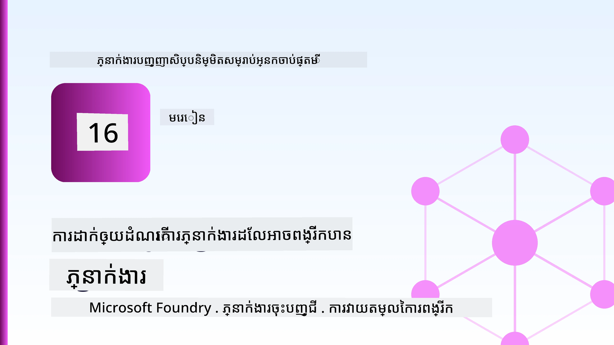
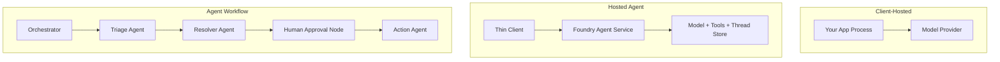
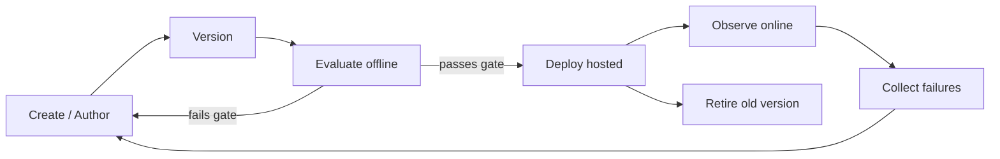
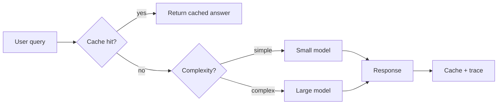
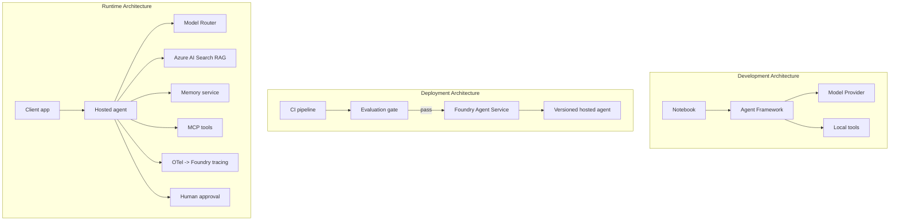

# ការដាក់ឲ្យដំណើរការអ្នកបើកបរ Scalable ជាមួយ Microsoft Foundry



រហូតដល់ពេលនេះក្នុងវគ្គសិក្សា អ្នកបានស្ថាបនាអ្នកបើកបរដែលដំណើរការលើកំព្យូទ័រយួរដៃរបស់អ្នក, នៅក្នុងស្ថិតិៈតែបណ្ណោង, ដែលគ្រប់គ្រងដោយ `az login` និងអថេរបរិស្ថានបន្តិចបន្តួច។ នេះជាវិធីត្រឹមត្រូវក្នុងការរៀន។ វាមិនមែនជាវិធីត្រឹមត្រូវក្នុងការដំណើរការអ្នកបើកបរដែលអតិថិជនរាប់ពាន់នាក់ពឹងផ្អែកយ៉ាងខ្លាំងនៅម៉ោង 3 ព្រឹកនោះទេទេ។

មេរៀននេះជាអំពីចន្លោះចន្លោះរវាង "វាដំណើរការលើម៉ាស៊ីនរបស់ខ្ញុំ" និង "វាដំណើរការយ៉ាងទៀងទាត់ និងមានតម្លៃសមរម្យនៅក្នុងផលិតកម្ម។" យើងបិទចន្លោះនោះដោយប្រើ **Microsoft Foundry** និងសេវាកម្ម **Microsoft Foundry Agent Service** ហើយយើងធ្វើវារួចដោយស្ថាបនាអ្នកបើកបរសេវាកម្មផ្តល់ជំនួយអតិថិជនពិត ដែលមានឧបករណ៍, ការស្វែងរក, ដែនចងចាំ, ការវាយតម្លៃ និងការត្រួតពិនិត្យ។

## អ្វីដែលបង្ហាញ

មេរៀននេះនឹងគ្របដណ្តប់:

- ភាពខុសគ្នារវាង **អ្នកបើកបរគំរូ** និង **អ្នកបើកបរចេញផ្សាយ** ហើយហេតុអ្វីការផ្លាស់ប្តូរជាធំៗគឺអំពីអ្វីគ្រប់គ្រង *ជុំវិញ* ម៉ូឌែល។
- **ទម្រង់ដាក់ចេញផ្សាយ** សម្រាប់អ្នកបើកបរ: ដែលបង្ហោះនៅភ្ញៀវ, សេវាបង្ហោះ (Hosted Agents), និងការគ្រប់គ្រងការងារជាថ្នាក់។
- **វដ្តជីវិតអ្នកបើកបរ** នៅលើ Microsoft Foundry — បង្កើត, កំណែ, ដាក់ចេញ, វាយតម្លៃ, ត្រួតពិនិត្យ, សម្រាកចេញ។
- **យុទ្ធសាស្ត្រការបង្កើតទំហំ**: ការបញ្ជាលម៉ូឌែល, ការផ្ទុកក្នុង Cache, ភាពសហការណ៍, និងការរចនាដែលគ្មានស្តេត។
- **ការមើលឃើញ** ជាមួយ OpenTelemetry និងការតាមដាន Foundry។
- **ការបង្កើនប្រសិទ្ធភាពថ្លៃដើម** តាមរយៈការជ្រើសរើសម៉ូឌែល, ការបញ្ជាល និងកំណត់ការវាយតម្លៃ។
- **កិច្ចការរបស់សហគ្រាស**៖ អភិបាលគ្រប់គ្រង, អនុម័តដោយមនុស្ស និងការរត់ម៉ាស៊ីន MCP នៅក្នុងផលិតកម្មយ៉ាងសុវត្ថិភាព។

## គោលបំណងរៀន

បន្ទាប់ពីបញ្ចប់មេរៀននេះ អ្នកនឹងបានដឹងពីរបៀបដូចតទៅ:

- ជ្រើសរើសទម្រង់ដាក់ចេញផ្សាយដែលត្រឹមត្រូវសម្រាប់កម្មវិធីអ្នកបើកបរដែលបានកំណត់។
- ដាក់ចេញអ្នកបើកបរទៅ Microsoft Foundry Agent Service ដូច្នេះវាមានកំណែ, ការគ្រប់គ្រង និងការមើលឃើញបាន។
- ពង្រីកឧបករណ៍សម្រាប់ការតាមដាន និងភ្ជាប់បណ្តាញវាយតម្លៃមួយដែលដំណើរការមុនពេលចេញផ្សាយរាល់លើក។
- អនុវត្តការបញ្ជាលម៉ូឌែល និងការផ្ទុកក្នុង Cache ដើម្បីរក្សាឲ្យ Latency និងថ្លៃដើមនៅក្រោមកំណត់នៅកម្រិតធំ។
- បន្ថែមចង្កោមអនុម័តដោយមនុស្សសម្រាប់សកម្មភាពមានហានិភ័យខ្ពស់ និងរួមបញ្ចូលម៉ាស៊ីន MCP នៅរបៀបដែលមានសុវត្ថិភាពក្នុងផលិតកម្ម។

## ចំណុចតម្រូវជាមុន

មេរៀននេះគិតថាអ្នកបានបញ្ចប់មេរៀនមុនៗហើយមានភាពស្រួលក្នុង:

- ស្ថាបនាអ្នកបើកបរជាមួយ [Microsoft Agent Framework](../14-microsoft-agent-framework/README.md) (មេរៀន 14)។
- [ការប្រើប្រាស់ឧបករណ៍](../04-tool-use/README.md) (មេរៀន 4) និង [Agentic RAG](../05-agentic-rag/README.md) (មេរៀន 5)។
- [Agent Memory](../13-agent-memory/README.md) (មេរៀន 13) និង [Agentic Protocols / MCP](../11-agentic-protocols/README.md) (មេរៀន 11)។
- [ការមើលឃើញ និងការវាយតម្លៃ](../10-ai-agents-production/README.md) (មេរៀន 10) — មេរៀននេះសាងសង់បន្ថែមលើវា។

អ្នកក៏ត្រូវការយ៉ាងខ្លះផងដែរ:

- មាន **ការជាវ Azure** និង **គម្រោង Microsoft Foundry** ដែលមានម៉ូឌែលជជែកមួយយ៉ាងតិចដែលបានដាក់ចេញ។
- មាន **Azure CLI** ដែលបាន Authenticate (`az login`)។
- Python 3.12+ និងកញ្ចប់នៅក្នុងឃ្លាំងផ្ទុក [`requirements.txt`](../../../requirements.txt)។

## ពីគំរូទៅផលិតកម្ម៖ អ្វីដែលប្រែប្រួលពិតប្រាកដ

អ្នកបើកបរគំរូ និងអ្នកបើកបរផលិតកម្មចែករំលែកពីរលំនាំចម្បងដូចគ្នា — ហេតុផល, ហៅឧបករណ៍, ឆ្លើយតប។ អ្វីដែលប្រែប្រួលគឺអ្វីគ្រប់គ្រងនៅជុំវិញរលំនាំនោះ។ ម៉ូឌែលប្រហែលជា 20% នៃអ្នកបើកបរផលិតកម្ម; 80% ទៀតគឺសាច់ដុំនៃប្រតិបត្តិការ។

| បញ្ហា | គំរូ | ផលិតកម្ម |
| --- | --- | --- |
| **ការបង្ហោះ** | ដំណើរការនៅក្នុងស្ថិតិNotebook របស់អ្នក | ដំណើរការជាសេវាបង្ហោះ, មានកំណែ និងចេញផ្សាយ |
| **អត្តសញ្ញាណ** | តូច��ហុងសារ `az login` របស់អ្នក | អត្តសញ្ញាណដែលគ្រប់គ្រងដោយភាពឯកជនមាន RBAC លំដាប់ |
| **ស្ថានភាព** | នៅក្នុងចងចាំមួយ, បាត់បង់នៅពេលចាប់ផ្តើមឡើងវិញ | ដាក់ចេញក្រៅ (ហាង Thread, សេវាកម្មចងចាំ) |
| **បរាជ័យ** | អ្នកមើលឃើញតាម traceback | ព្យាយាមឡើងវិញ, ជំនួស, សំបុត្រស្លាប់, ការព្រមាន |
| **ថ្លៃដើម** | "វាជារូបិយប័ណ្ណប៉ុន្មានសេន" | តាមដានរាល់សំណើ, បញ្ជាល ដាក់ Cache, គិតថ្លៃត្រៀម |
| **គុណភាព** | អ្នកមើលមើលលទ្ធផល | វាយតម្លៃដោយស្វ័យប្រវត្តិមុនការចេញផ្សាយរាល់លើក |
| **ជឿទុកចិត្ត** | អ្នកអនុម័តរាល់សកម្មភាព | នយោបាយ + មនុស្សក្នុងស្ថានភាពហានិភ័យខ្ពស់ |

ចងចាំតារាងនេះ។ រាយការណ៍រៀងរាល់ផ្នែកខាងក្រោមត្រូវនឹងជួរដូចនេះ។

## ទម្រង់ការដាក់ចេញអ្នកបើកបរ

មានបីទម្រង់ដែលអ្នកនឹងប្រើ ច្រើនពេលជារួមគ្នា។

### 1. អ្នកបើកបរដែលបង្ហោះនៅភ្ញៀវ

វត្ថុអ្នកបើកបររស់នៅក្នុងដំណើរការតម្រូវការនៃ *កម្មវិធីរបស់អ្នក*។ កូដរបស់អ្នកហៅផ្តល់ម៉ូឌែលដោយបន្ទាត់; រលំនាំហេតុផលដំណើរការនៅសេវាកម្មរបស់អ្នក។ នេះជាអ្វីដែលមេរៀនមុនៗបានធ្វើ។

- **ប្រើពេលណា** អ្នកចង់បានការគ្រប់គ្រងពេញលេញលើរលំនាំ, មេឌៀវែរ ផ្ទាល់ខ្លួន ឬអ្នកបញ្ចូលអ្នកបើកបរនៅក្នុង backend មានរួចហើយ។
- **ការប trade-off**: អ្នកជាម្ចាស់កំណើតទំហំ, ស្ថានភាព និងភាពរឹងមាំដោយខ្លួនឯង។

### 2. អ្នកបើកបរបង្ហោះ (Foundry Agent Service)

អ្នកបើកបរត្រូវបាន *ចុះបញ្ជីជាធនធាន* ក្នុង Microsoft Foundry។ Foundry បង្ហោះរលំនាំហេតុផល, រក្សាទុក Thread, បង្ការសុវត្ថិភាពខ្លឹមសារ និង RBAC ហើយធ្វើឲ្យអ្នកបើកបរបង្ហាញនៅក្នុងផតថល Foundry។ កម្មវិធីរបស់អ្នកក្លាយជាភ្ញៀវល្មមមួយដែលបង្កើត Thread និងអានចម្លើយ។

- **ប្រើពេលណា** អ្នកចង់បានភាពចាំបាច់, ការមើលឃើញបញ្ចូលក្នុង, អភិបាលគ្រប់គ្រង និងផ្ទៃការងារថយចុះ។
- **ការប trade-off**: មានការគ្រប់គ្រងជាបន្ទាន់តិចបន្តិចប្ដូរជាមួយរត់កម្មប្រយោគដែលគ្រប់គ្រង។

### 3. ការគ្រប់គ្រងការងារ (Agent Workflows)

អ្នកបើកបរច្រើន (និងឧបករណ៍) ត្រូវបានចងក្រងជាគ្រាប់នៃបណ្តាញជាមួយចលាចរណ៍ត្រឹមត្រូវ - ជំហានថ្នាក់តំលៃ, ប.branching, កំណត់ចំណុចអនុម័តមនុស្ស, និងចំណុចបញ្ឈប់ដែលអាចហើយត្រឡប់វិញបាន។ នេះគឺជាអាជីព Microsoft Agent Framework **Workflows** ដែលអនុវត្តនៅកម្រិតការដាក់ចេញ។

- **ប្រើពេលណា** ការងារតែមួយគ្របដណ្តប់អង្គភាពជំនាញច្រើនឬទាមទារជំហានអនុម័តមួយនៅមធ្យម។
- **ការប trade-off**: ឈ្នុះច្រើន; ត្រូវការមើលឃើញកម្រិតគ្រប់គ្រងការងារ។



## វដ្តជីវិតអ្នកបើកបរនៅលើ Microsoft Foundry

ការដាក់ចេញអ្នកបើកបរមិនមែនជា `push` មួយដងទេទេ។ វាជារលំនាំមួយ ហើយវាគួរត្រឹមត្រូវដូចនឹងវដ្តចេញផ្សាយកម្មវិធី ព្រោះវាជាអ្វីដែលវាពិតជាគឺ។



គំនិតសំខាន់ ដែលយកចេញពី [មេរៀន 10](../10-ai-agents-production/README.md): **ការវាយតម្លៃក្រៅបណ្តាញគឺជាច្រកមួយ មិនមែនគំរាមបោះបង់ក្រោយ**។ កំណែអ្នកបើកបរថ្មីមិនចេញផ្សាយតើមិនឆ្លងកាត់កម្រិតវាយតម្លៃរបស់អ្នកឡើយ។ ការមើលឃើញតាមបណ្តាញបន្ទាប់បន្សល់បរាជ័យពិតប្រាកដត្រឡប់មកក្នុងសំណុំតេស្តក្រៅបណ្តាញរបស់អ្នក។ នេះជារលំនាំទាំងមូល។

## យុទ្ធសាស្ត្រការបង្កើតទំហំ

ការធ្វើឲ្យអ្នកបើកបរកំណត់ទំហំខុសពីការធ្វើអោយតំណើរវេបសាយដែលគ្មានស្ថានភាព ព្រោះសំណើរៗអាចបណ្តាលឲ្យមានការហៅម៉ូឌែល និងឧបករណ៍ដែលថ្លៃថ្នូរច្រើន។ វិធីសាស្ត្រជាចម្បងបួនត្រូវបានប្រើដើម្បីទ្រទ្រង់ការផ្ទុកភារកិច្ចច្រើន។

**ការដំណើរការសំណើឥតរដ្ឋ.** កុំរក្សាអថេររដ្ឋក្នុងចងចាំដំណើរការរបស់អ្នកជាករណីម្នាក់ៗ។ រក្សាទុកភាពស្តាប់សន្ទនានៅក្នុងស្តុកសន្ទនារបស់ Foundry ឬសេវាចងចាំ ដូច្នេះឱ្យអាចដំណើរការសំណើណាមួយដោយរបៀបណាមួយបាន។ នេះជាអ្វីដែលធ្វើឱ្យអ្នកអាចពង្រីកបានផ្នែកទូលំទូលាយ — បន្ថែមការដំឡើងមួយៗ គ្មានសម័យភ្ជាប់ចិត្តទេ។

**ការបញ្ជូនម៉ូដែល។** មិនមែនសំណើរ​ទាំងអស់​ត្រូវការ​ម៉ូដែលដែលមានសមត្ថភាព​ខ្ពស់​បំផុត (និងថ្លៃខ្ពស់បំផុត) របស់អ្នកទេ។ បញ្ជូនសំណើរងាយៗ — ការបែងចែកចេតនា, ចម្លើយកាន់តែខ្លី និងមានភាពពិតប្រាកដ — ទៅម៉ូដែលតូច និងឆាប់រហ័ស ហើយរក្សា​ម៉ូដែល​ធំ​សម្រាប់ការរីករាល់យ៉ាងពិតប្រាកដ។ Foundry អាចធ្វើការបញ្ជូនម៉ូដែលនេះឱ្យអ្នកដោយរបៀប **Model Router** របស់វា ឬអ្នកអាចអនុវត្តក្រុមហ៊ុនជួយផ្លាស់ប្តូរមួយជាប្រភេទឆាប់រហ័សផ្ទាល់ខ្លួន។ អ្នក​នឹង​បង្កើត​វិធី​សាស្ត្រ DIY នៅក្នុងសិក្ខាសាលា។

**ការផ្ទុកចម្លើយក្នុងកាស។** សំណួរជាច្រើនរបស់សេវាគាំទ្រជិតស្មើនឹងមានសំណួរដូចគ្នា ("តើធ្វើម៉េចដើម្បីកំណត់ពាក្យសម្ងាត់ឡើងវិញ?")។ ផ្ទុកចម្លើយទៅសំណួរសាមញ្ញ ហើយផ្គត់ផ្គង់ពួកវាដោយមិនចាំបាច់ចូលដំណើរការម៉ូដែលឡើយ។ ថ្លៃឈ្នួលកាសធ្លាក់តិចបន្តិចកំណត់ការចំណាយ និងពេលវេលាត្រូវបានកាត់បន្ថយយ៉ាងមានអត្ថន័យ។

**ការរត់តភ្ជាប់​និងសំពាធត្រឡប់។** អ្នកផ្តល់ម៉ូដែលមានដែនកំណត់នូវអត្រា។ ដាក់ដែនកំណត់រត់តភ្ជាប់ ការវិលតាមបែបបន្ថយឯកជនភាព (exponential backoff) និងបរាជ័យដោយផ្លាស់ប្តូរយ៉ាងស្រួល (ការឆ្លើយតបដោយជួរតំណើរ “យើងកំពុងដំណើរការ” ល្អជាងកូដ ៥០០)។



## ការសង្កេតមើលក្នុងការផលិត

អ្នកមិនអាចដំណើរការអ្វីដែលអ្នកមិនអាចមើលឃើញបានឡើយ។ ដូចដែលបានគ្របដណ្ដប់ក្នុងមេរៀនទី ១០, ស័ក្តិសមកម្មវិធី Microsoft Agent Emit **OpenTelemetry** traces ដោយធម្មជាតិ — ការហៅម៉ូដែលរាល់ខ្សែក្រវាត់ ឧបករណ៍ និងជំហានសម្របសម្រួលក្លាយទៅជាការត្រួតពិនិត្យមួយ។ ក្នុងបរិយាកាសផលិត អ្នកនាំចេញត្រួតពិនិត្យទាំងនោះទៅ Microsoft Foundry (ឬ backend ដែលគាំទ្រដូច OTel) ដូច្នេះអ្នកអាច:

- តាមដានបញ្ហាការតវ៉ារបស់ទីភ្នាក់ងារមួយចប់ពីដើមដល់ចប់៖ រាល់ការហៅម៉ូដែល និងឧបករណ៍។
- មើលកម្រិតពេលវេលា p50/p95 និងចំណាយរាល់សំណើជាក់លាក់ក្នុងពេលវេលា។
- ព្រមានពីករណីកម្រិតកំហុស និងភាពបម្លែងចំណាយ មុនពួកអ្នកប្រើប្រាស់ (ឬក្រុមហ៊ុនហិរញ្ញវត្ថុ) សង្កេតឃើញ។

```python
from agent_framework.observability import get_tracer

tracer = get_tracer()

with tracer.start_as_current_span("support_request") as span:
    span.set_attribute("customer.tier", "enterprise")
    span.set_attribute("routed.model", "gpt-5-nano")
    # agent execution is traced automatically inside this span
```

លក្ខណៈពិសេសដូចជា `customer.tier` និង `routed.model` ជាអ្វីដែលបម្លែងជញ្ជាំងនៃចំណាំទៅជាសំណួរដែលអាចឆ្លើយបាន ("តើអតិថិជនសហគ្រាសត្រូវបានបញ្ជូនទៅម៉ូដែលតូចជាញឹកញាប់ពេកឬ?");

## ការបញ្ជូនចំណាយឱ្យមានប្រសិទ្ធភាព

ចំណាយនៅក្នុងសេវាកម្មផលិតគឺកើតឡើងពីសញ្ញាទាំងអស់។ មានបីចំណុចក្នុងការគ្រប់គ្រងប្រាក់ចំណាយតាមលំដាប់ផលប៉ះពាល់:

1. **បូកទំហំម៉ូដែលឱ្យត្រឹមត្រូវ។** ម៉ូដែលតូចមួយដែលឆ្លងការវាយតម្លៃរបស់អ្នកគឺស្ទើរតែត្រូវតែថ្លៃថោកជាងម៉ូដែលធំមួយដែលក៏ឆ្លងដែរ។ ប្រើការវាយតម្លៃដើម្បីបញ្ចាក់ទឹកប្រាក់ថាអាចប្រើម៉ូដែលតូចបានជានិច្ច ជួយប្រើម៉ូដែលធំបំផុតដោយប្រយ័ត្នការបង្កហានិភ័យ។
2. **បញ្ជូនតាមកម្រិតស្មុគស្មាញ។** ដូចបានពិពណ៌នាមុន — ចំណាយត្រឹមតែតម្លៃម៉ូដែលធំសម្រាប់សំណើដែលស្មុគស្មាញត្រូវការរំលេចទៅម៉ូដែលធំ។
3. **ផ្ទុកក្នុងកាសយ៉ាងខ្លាំង។** ការហៅម៉ូដែលដែលថ្លៃថោកបំផុតគឺមិនធ្វើឡើយ។

រក្សារកាត់តាយន្តការវាយតម្លៃ និងការគ្រប់គ្រងចំណាយជាវិស័យទំនាក់ទំនងពីរដោយមើលពីមุมខុសៗគ្នា៖ ការវាយតម្លៃប្រាប់អ្នកពីគុណភាពបាតឋម ហើយការបញ្ជូននិងកាសរក្សាអ្នកនៅជិតបាតឋមនៃចំណាយអាចធ្វើទៅបាន។

## ការពិចារណាបង្ហោះសេវាកម្មនៅក្រុមហ៊ុនធំ

**ការគ្រប់គ្រង។** Hosted Agents ទទួលបាន RBAC របស់ Foundry, សុវត្ថិភាពមាតិកា និងកំណត់ហេតុ audit logging។ ផ្ដល់រាល់ភ្នាក់ងារដោយអត្តសញ្ញាណដែលគ្រប់គ្រងដោយមានសិទ្ធិតិចតួចបំផុតដែលវាត្រូវការ — ចូលមើលបានតែសម្រាប់មូលដ្ឋានចំណេះដឹង, ចូលដំណើរការដែលមានដែនកំរិត API សំបុត្រ, គ្មានអ្វីច្រើនជាងនេះទេ។

**មនុស្សនៅក្នុងខ្សែបែបបទ.** សកម្មភាពខ្លះមានលទ្ធផលធំធេងខ្លាំងពេកដែលមិនអាចបញ្ចប់ដោយស្វ័យប្រវត្តិក្នុងភ្លាម — ការផ្ដល់ប្រាក់ត្រឡប់, ការលុបគណនី, ការជម្រាបទៅក្រុមផ្នែកច្បាប់។ Microsoft Agent Framework គាំទ្រឧបករណ៍ **ដែលទាមទារការអនុម័ត**: ភ្នាក់ងារប្រាប់អំពីសកម្មភាព, ការអនុវត្តបានផ្អាក, មនុស្សអនុម័តឬបដិសេធ, ហើយសំណុំបែបបទបន្តដំណើរការ។ អ្នកបានឃើញវិធីសាស្ត្រសាមញ្ញក្នុង [មេរៀន ៦](../06-building-trustworthy-agents/README.md); នៅទីនេះអ្នកបង្ហោះវា។

**MCP ក្នុងផលិតកម្ម។** [MCP](../11-agentic-protocols/README.md) អនុញ្ញាតឱ្យភ្នាក់ងាររបស់អ្នកប្រើឧបករណ៍ខាងក្រៅតាមរយៈចំណុចប្រទាក់ផ្លូវការមួយ។ នៅក្នុងផលិតកម្ម, ប្រើប្រាស់ម្សៅ MCP រាល់ម្យ៉ាងជាដែនកំណត់មិនទុកចិត្ត៖ ចាក់បញ្ចូលកំណែម៉ាស៊ីនបម្រើ, រត់វាជាមួយអត្តសញ្ញាណដែលមានដែនកំណត់, វាយតម្លៃលទ្ធផលរបស់វា, ហើយកុំចាញ់រានប្រាក់សម្ងាត់ទៅវា។ ម៉ាស៊ីនបម្រើ MCP គឺជាការពឹងផ្អែក មិនអាចបៀរអនុវត្តត្រូវបានធ្វើជាការពិនិត្យជាប្រចាំ, ការធ្វើ audit និងកំណត់អត្រា។



រូបភាពបីនេះ — ការអភិវឌ្ឍ, ការបង្ហោះ, និងរត់ពេលដំណើរការ — ជាភ្នាក់ងារដដែលនៅក្នុងជំហានបីនៃជីវិតវា។ សិក្ខាសាលាផ្សេងទៀតនឹងដឹកនាំអ្នកក្នុងការបង្កើតវា។

## សិក្ខាសាលាដៃអាជីព៖ ភ្នាក់ងារគាំទ្រអតិថិជនរួចរាល់សម្រាប់ផលិតកម្ម

បើក [`code_samples/16-python-agent-framework.ipynb`](./code_samples/16-python-agent-framework.ipynb) ហើយធ្វើការងារពីដើមដល់ចប់។ អ្នកនឹងរកស៊ីភ្នាក់ងារគាំទ្រអតិថិជន **Contoso** មានការយកចិត្តទុកដាក់លម្អិតសម្រាប់ផលិតកម្ម។

1. **ការហៅឧបករណ៍** — មើលស្ថានភាពការកម្មង់ និងបើកសំបុត្រគាំទ្រ។
2. **RAG** — បំលែងសំណួរស្បែកជំនួយដោយផ្អែកលើមូលដ្ឋានចំណេះដឹង (Azure AI Search, មាន fallback ក្នុងចងចាំ ដើម្បីឲ្យសៀវភៅកំណត់អាចដំណើរការដោយគ្មានធនធាន Search)។
3. **ចងចាំ** — ចងចាំអតិថិជនក្នុងរង្វង់នៃសន្ទនា។
4. **ការបញ្ជូនម៉ូដែល** — កម្មវិធីចំណាត់ថ្នាក់គ្រប់គ្រងកម្រិតស្មុគស្មាញបញ្ជូនសំណើទៅម៉ូដែលតូច ឬធំ។
5. **ចម្លើយក្នុងកាស** — សំណួរស្ទួនៗត្រូវបានផ្គត់ផ្គង់ពីកាស។
6. **ការអនុម័តដោយមនុស្ស** — ការផ្ទេរប្រាក់លើសកម្រិតបានកំណត់ត្រូវបញ្ឈប់រង់ចាំការចុះហត្ថលេខាមនុស្ស។
7. **ផ្លូវការវាយតម្លៃ** — សំណុំនៃការធ្វើតេស្តមិនត្រូវមានឯកសារដើម្បីវាយតម្លៃភ្នាក់ងារនិងដូចជារបាំងចេញ។
8. **ការសង្កេតមើល** — ការតាមដាន OpenTelemetry ជុំវិញសំណើរ​នីមួយៗ។

### ដំណើរការ

សៀវភៅកំណត់ត្រូវបានរៀបចំឱ្យថាការយកចិត្តទុកដាក់ផលិតកម្មនីមួយៗជាផ្នែកឯករាជ្យដែលអាចរត់បាន។ មូលដ្ឋានរបស់វាគឺការដំណើរការសំណើររួមជាមួយការបញ្ជូននិងការផ្ទុកក្នុងកាស៖

```python
async def handle_support_request(query: str, customer_id: str) -> str:
    # 1. Serve from cache when we can.
    cached = response_cache.get(normalize(query))
    if cached:
        return cached

    # 2. Route by complexity to control cost.
    model = "gpt-5-nano" if is_simple(query) else "gpt-5-mini"

    # 3. Run the agent inside a trace span for observability.
    with tracer.start_as_current_span("support_request") as span:
        span.set_attribute("routed.model", model)
        span.set_attribute("customer.id", customer_id)
        response = await support_agent.run(query, model=model)

    # 4. Cache and return.
    response_cache.set(normalize(query), response.text)
    return response.text
```

ឧបករណ៍ការវាយតម្លៃដែលការពារការចេញផ្សាយមើលទៅដូចជា៖

```python
async def evaluation_gate(agent, test_cases, threshold: float = 0.8) -> bool:
    passed = 0
    for case in test_cases:
        result = await agent.run(case["input"])
        if score_response(result.text, case["expected"]) >= 0.8:
            passed += 1
    pass_rate = passed / len(test_cases)
    print(f"Evaluation pass rate: {pass_rate:.0%} (gate: {threshold:.0%})")
    return pass_rate >= threshold  # only deploy if the gate passes
```

អានរាល់បន្ទាត់ — សៀវភៅកំណត់រក្សាការអនុវត្តន៍តូចៗ ដូច្នេះគ្មានអ្វីត្រូវបានលាក់ក្រោមការហៅ framework ទេ។

## ការសម្រេចថាភ្នាក់ងារដែលបានចេញផ្សាយដោយកម្មវិធីតេស្តផ្សែង

ឧបករណ៍វាយតម្លៃខាងលើដំណើរការនៅក្រៅបណ្ដាញ *offline* ជាមួយវត្ថុភ្នាក់ងាររបស់អ្នក។ បន្ទាប់ពីភ្នាក់ងារត្រូវបានបង្ហោះជា Hosted Agent អ្នកត្រូវការតេស្តតែមួយទៀត ដែលមានអត្រាចំណាយថោកជាងទៀត៖ **តើចំណោមផ្សាយនេះនៅពិតប្រាកដឆ្លើយតប​ដែរឬទេ?**

ការបង្ហោះ "ដោយជោគជ័យ" គ្រាន់តែបញ្ជាក់ថា ផ្នែកគ្រប់គ្រងទទួលយកកំណត់នៃការបង្កើត — វាមិនបញ្ជាក់ថាភ្នាក់ងារឆ្លើយតប។ ការខ្វះការពឹងផ្អែកមួយ ការបញ្ជូនម៉ូដែលខុសឬការតភ្ជាប់ផុតកំណត់អាចទុកឲ្យការបង្ហោះបៃតងមួយដែលមិនបញ្ចេញអ្វី។ **ការតេស្តផ្សែង** ចាប់បានវានៅក្នុងមួយវិនាទី ដោយអ្នកបង្ហោះរាល់ដង ដោយមិនចំណាយថ្លៃធៀបនឹងការវាយតម្លៃពេញលេញ។

ឃ្លាំងនេះផ្ដល់ជូនបណ្ណាល័យតេស្តផ្សែងរួចរាល់ដែលបង្កើតលើដំណើរការ GitHub Action [AI Smoke Test](https://github.com/marketplace/actions/ai-smoke-test):

- **កាតាឡុក** — [`tests/lesson-16-smoke-tests.json`](../../../tests/lesson-16-smoke-tests.json) មានសំណើផ្តោត និងការត្រួតពិនិត្យសម្រាប់ភ្នាក់ងារគាំទ្ររបស់ Contoso (ចម្លើយគោលលេចចំពោះគោលការណ៍, ការស្ដារលក, រក្សាភាពត្រឹមត្រូវនៃប្រធានបទ និងការតភ្ជាប់ក្នុងសន្ទនា​ច្រើនជួរ)។ កាតាឡុកសម្រាប់ភ្នាក់ងារមេរៀនផ្សេងៗដូចជាយើងរស់នៅជាប់មុខវា — មើល [`tests/README.md`](../tests/README.md)។
- **Workflow** — [`.github/workflows/smoke-test.yml`](../../../.github/workflows/smoke-test.yml) ចូលក្នុងដោយ Azure OIDC និង បញ្ចូនសំណើរ POST ទៅថ្ងៃ Responses របស់ភ្នាក់ងារ ជាប្រចាំ បរាជ័យពេលណាដែលអះអាងមិនត្រូវ។

```yaml
- name: Smoke-test hosted agent
  uses: JFolberth/ai-smoketest@v1
  with:
    project_endpoint: ${{ inputs.project_endpoint }}
    agent_name: ContosoSupportAgent
    tests_file: tests/lesson-16-smoke-tests.json
```

បើកវាពីផ្ទាំង **Actions** ក្នុងពេលដែលភ្នាក់ងាររបស់អ្នកត្រូវបានបង្ហោះជាមួយ ដោយផ្ដល់ចំណុចបញ្ចប់គម្រោង Foundry របស់អ្នក និងឈ្មោះភ្នាក់ងារ។ សម្គាល់ផ្ទាល់ខ្លួនសហគ្រិនត្រូវការតួនាទី **Azure AI User** នៅលើដែនកំណត់គម្រោង Foundry។ គិតអំពីស្រទាប់ទាំងនេះដូចជាភាពលំដាប់: ការប្រតាប់ថ្នាំបាញ់ផ្សែង (អាចចូលដំណើរការនិងឆ្លើយតបបានទេ?) រត់នៅលើការបង្ហោះគ្រប់ដំណាក់កាល, ការវាយតម្លៃក្រៅបណ្តាញ (ល្អគ្រប់គ្រាន់ត្រូវដឹកជញ្ជូនរឺទេ?) រត់មុនការលុបបំបាត់, និងការវាយតម្លៃតាមបណ្តាញ (តើវាកំពុងធ្វើការយ៉ាងដូចម្តេចនៅក្នុងពិភពជាក់ស្តែង?) រត់ជាបន្តបន្ទាប់។

## ការត្រួតពិនិត្យចំណេះដឹង

សាកល្បងការយល់ដឹងរបស់អ្នកមុនពេលទៅបន្តការងារ។

**1. បประมาณមុខភ្នាក់ងារផលិតកម្មនៅតើ "ម៉ូដែល" មានចំណែកប៉ុន្មាន ហើយស៊ីជម្រៅមួយវិញ?**

<details>
<summary>ចម្លើយ</summary>

ម៉ូដែលគឺជាគ្រឿងបន្លាស់តិចតួចនៃប្រព័ន្ធ — ជាទូទៅប្រហែល 20%។ អ្វីដែលនៅសល់គឺជាស៊ុមប្រតិបត្តិការ: ការតម្លែងនិងការបញ្ចេញជំនាន់, អត្តសញ្ញាណនិង RBAC, ស្ថានភាពនៃការបំភាយ, ការគ្រប់គ្រងបរាជ័យ, ការតាមដានចំណាយ, ការវាយតម្លៃ និងការគ្រប់គ្រងដោយមនុស្សនៅក្នុងសមុទ្រ។ ការផ្លាស់ប្តូរទៅផលិតកម្មគឺភាគច្រើនស្ដីពីការសាងសង់គ្រប់យ៉ាង *ជុំវិញ* ស្វ័យប្រវត្តិកម្មគំនិត។
</details>

**2. តើពេលណាអ្នកនឹងជ្រើសរើស Hosted Agent ជាងភ្នាក់ងារដែលផ្ទុកនៅលើclient?**

<details>
<summary>ចម្លើយ</summary>

ពេលដែលអ្នកចង់បានruntime ដែលគ្រប់គ្រងដោយមានភាពធន់និងរយៈពេលបញ្ចូល (threads ដែលអាចបន្តបាននិងផ្ទុកទុក), ការគ្រប់គ្រងចំណុចសំខាន់ៗ, សុវត្ថិភាពមាតិការនិង RBAC, ហើយអ្នកពេញចិត្តប្តូរការគ្រប់គ្រងកម្រិតទាបលើស្វ័យប្រវត្តិកម្មគំនិតដើម្បីកាត់បន្ថយផ្ទៃប្រតិបត្តិការ។ Client-hosted គឺល្អបំផុតនៅពេលដែលអ្នកចង់គ្រប់គ្រងការប្រតិបត្តិពេញលេញលើស្វ័យប្រវត្តិកម្ម ឬបញ្ចូលភ្នាក់ងារនៅក្នុងbackend ដែលមានស្រាប់។
</details>

**3. ហេតុអ្វីបានជា agent ដែលអាចពង្រីកត្រូវមានស្ថានភាពគ្មាននៅក្នុងអង្គចងចាំដំណើរការរបស់ខ្លួន?**

<details>
<summary>ចម្លើយ</summary>

ដូច្នេះគ្រប់ instance អាចដោះស្រាយសំណើណាមួយបាន ដែលជាអ្វីដែលអនុញ្ញាតឱ្យពង្រីកដោយផ្លូវដេកដោយគ្មានសម័យរាប់ផ្អែក (sticky sessions)។ ស្ថានភាពសន្ទនា​ត្រូវបានផ្ទុកក្រៅទៅកាន់ការផ្ទុក threads ឬសេវាអង្គចងចាំ។ ប្រសិនបើស្ថានភាពរស់នៅក្នុងអង្គចងចាំដំណើរការ អ្នកនឹងបាត់វាក្នុងពេលបញ្ចប់ហើយមិនអាចចែកចាយផ្ទុកបានដោយសេរីទេ។
</details>

**4. តើបញ្ហាអ្វីដែលចរន្តម៉ូដែលដោះសោរកាត់ ហើយវាភ្ជាប់ទៅនឹងការវាយតម្លៃយ៉ាងដូចម្តេច?**

<details>
<summary>ចម្លើយ</summary>

ចរន្តផ្ញើសំណើសាមញ្ញទៅម៉ូដែលតូចខ្លីទាបឆាប់ និងរក្សាទុកម៉ូដែលធំសម្រាប់ហេតុផលគិតគូរពិត, គ្រប់គ្រងពេលវេលារងចាំនិងចំណាយ។ វាតភ្ជាប់ទៅនឹងការវាយតម្លៃព្រោះការវាយតម្លៃគឺជាការសម្គាល់ថាម៉ូដែលតូចគ្រប់គ្រាន់សម្រាប់ ប្រភេទសំណើណាមួយ — ចរន្តដោយគ្មានការវាយតម្លៃគឺជាការប៉ាន់ស្មាន។
</details>

**5. តើ "ទ្វារវាយតម្លៃ" មួយមានអ្វីខ្លះ ហើយវាស្ថិតនៅនៅណានៅក្នុងអាយុកាល?**

<details>
<summary>ចម្លើយ</summary>

ទ្វារវាយតម្លៃដំណើរការប្រភេទតេស្តក្រៅបណ្តាញមួយប្រឆាំងនឹងកំណែថ្មីនៃភ្នាក់ងារ ហើយឧបសគ្គការបង្ហោះបើអត្រាបញ្ចប់មិនឈានដល់កម្រិត។ វាស្ថិតនៅចន្លោះ "ក្រែ" និង "បង្ហោះ" ក្នុងអាយុកាល ធ្វើឱ្យគុណភាពជាការជាប់លាប់មួយសម្រាប់ការចេញផ្សាយមិនមែនជារឿងដែលអ្នកត្រួតពិនិត្យបន្ទាប់ពីផ្ញើ។
</details>

**6. ហេតុអ្វីបានជា MCP server ត្រូវបានលះបង់ជាអាគារមិនទុកចិត្តបានក្នុងផលិតកម្ម?**

<details>
<summary>ចម្លើយ</summary>

ព្រោះវាជាភារកិច្ចខាងក្រៅដែលភ្នាក់ងាររបស់អ្នកហៅចូល។ អ្នកគួរបញ្ចាក់កំណែវា, រត់វាជាមួយអត្តសញ្ញាណកំណត់, ផ្ទៀងផ្ទាត់លទ្ធផល, កំណត់អត្រា, ហើយមិនចែករំលែកសម្ងាត់អ្វីទៅវា — ការត្រួតពិនិត្យដូចគ្នានេះអនុវត្តចំពោះភារកិច្ចភាគីទីបីទាំងអស់។ លទ្ធផលរបស់វាចូលទៅក្នុងការពិចារណារបស់ភ្នាក់ងារ ដូច្នេះការជឿទុកចិត្តដោយគ្មានការផ្ទៀងផ្ទាត់គឺជាគ្រោះថ្នាក់សុវត្ថិភាព។
</details>

**7. តើការផ្លាស់ប្តូរតែមួយណាដែលជាភាគច្រើនមានឥទ្ធិពលធំបំផុតលើថ្លៃបង់ភ្នាក់ងារផលិតកម្ម ហើយហេតុអ្វី?**

<details>
<summary>ចម្លើយ</summary>

ការប្រើម៉ូដែលដែលមានទំហំសមរម្យ — ប្រើម៉ូដែលតូចបំផុតដែលនៅតែសាកល្បងឈានដល់ទ្វារវាយតម្លៃរបស់អ្នក។ ថ្លៃបង់ត្រូវតែដោយសារតែ token ហើយម៉ូដែលតូចដែលបំពេញគុណភាពមានតម្លៃតិចជាងម៉ូដែលធំជានិច្ច។ ការ cache និងចរន្តបន្ថយថ្លៃបង់ទៀត ប៉ុន្តែការជ្រើសរើសម៉ូដែលមូលដ្ឋានត្រឹមត្រូវគឺមានឥទ្ធិពលធំបំផុតជាលំដាប់ទីមួយ។
</details>

**8. តើតួអក្សរ span ដូចជា `customer.tier` និង `routed.model` ចូលរួមក្នុងការគ្រប់គ្រងនៃការមើលឃើញយ៉ាងដូចម្តេច?**

<details>
<summary>ចម្លើយ</summary>

ពួកវាបំលែងតាមដានដើមទៅជាសំណួរអាជីវកម្មដែលអាចឆ្លើយបាន។ ដោយគ្មាន attributes អ្នកមានជញ្ជាំងនៃ spans; ជាមួយ attributes អ្នកអាចសួរ "តើអតិថិជនសហគ្រាសត្រូវបានចរន្តទៅម៉ូដែលតូចច្រើនពេកទេ?" ឬ "ម៉ូដែលណាដែលដោះស្រាយសំណើយឺតបំផុតរបស់យើង?" Attributes គឺជាវិធីដែលអ្នកចែកចាយ telemetry តាមវិមាត្រដែលសំខាន់សម្រាប់ប្រតិបត្ដិការរបស់អ្នក។
</details>

## ភារកិច្ច

យកភ្នាក់ងារគាំទ្រអតិថិជនពីរោងចក្រ ហើយធ្វើឱ្យវាមានភាពរឹងមាំសម្រាប់ស្ថានការណ៍ជាក់លាក់មួយ៖ **ភ្នាក់ងារគាំទ្រការបង់ប្រាក់ជាវសម្រាប់ក្រុមហ៊ុន SaaS។**

ការដាក់ស្នើរបស់អ្នកគួរតែ៖

1. **ជំនួសឧបករណ៍** ជាមួយឧបករណ៍ពាក់ព័ន្ធនឹងការបង់ប្រាក់៖ `get_subscription_status`, `get_invoice`, និង `issue_credit` (ឥណទានលើស $50 ត្រូវការអនុម័តពីមនុស្ស)។
2. **បន្ថែមឯកសារ RAG បី** ដែលគ្របដណ្តប់គោលនយោបាយផ្ទេរប្រាក់របស់ក្រុមហ៊ុន, វដ្តបង់ប្រាក់ និងគោលការណ៍បោះបង់។
3. **ពង្រីកសំណុំវាយតម្លៃ** ដល់ចំនួនប្រាំបីករណីយ៉ាងហោចណាស់ រួមមានពីរគរណីដែល *គួរត្រូវ* បញ្ចូលផ្លូវនៃការអនុម័តដោយមនុស្ស ហើយបញ្ជាក់ទ្វារវាយតម្លៃរបស់អ្នកឲ្យត្រូវឬថយក្រោម។
4. **បន្ថែមរបាយការណ៍ថ្លៃបង់មួយ**: បន្ទាប់ពីរត់សំណួរលាយផ្សំដប់សំណើរតាមភ្នាក់ងារ បង្ហាញចំនួនសំណើ ដែលទៅម៉ូដែលតូច, ម៉ូដែលធំ និងចំនួនសំណើដែលបម្រើពី cache។

សរសេរបរិច្ឋានខ្លីមួយ (ក្នុងក្រដាស markdown) បញ្ជាក់ពីច្បាប់ចរន្តម៉ូដែលណាមួយដែលអ្នកបានជ្រើសរើស ហើយតើអ្នកនឹងផ្ទៀងផ្ទាត់វាដោយចរាចរណ៍ពិតយ៉ាងដូចម្តេច។ មិនមានចម្លើយត្រឹមត្រូវតែមួយទេ — អ្នកត្រូវបានវាយតម្លៃថាតើបញ្ហាផលិតកម្មត្រូវបានភ្ជាប់ជាមួយគ្នាយ៉ាងសមរម្យ។

## សង្ខេប

នៅមេរៀននេះ អ្នកបានផ្លាស់ប្តូរភ្នាក់ងារពីគំរូទៅផលិតកម្មជាមួយ Microsoft Foundry៖

- ការរំពេចទៅផលិតកម្មជាភាគច្រើនគឺអំពី **ស៊ុមប្រតិបត្តិការ** ជុំវិញម៉ូដែល — ការផ្ដល់ដំណោះស្រាយ, អត្តសញ្ញាណ, ស្ថានភាព, គ្រប់គ្រងបរាជ័យ, ថ្លៃដើម, គុណភាព, និងការជឿទុកចិត្ត។
- អ្នកបានរៀនពី **ម៉ូដែលបង្ហោះនាទីបី** — client-hosted, Hosted Agents, និង Agent Workflows — និងពេលណាដែលសមរម្យសម្រាប់មួយៗ។
- អ្នកបានដើរតាម **ជីវវរណៈភ្នាក់ងារ** ដែលនៅក្នុងនោះ **ការវាយតម្លៃក្រៅបណ្តាញគឺជាទ្វារចេញផ្សាយ** ហើយការមើលឃើញតាមបណ្តាញបញ្ចូនការបរាជ័យត្រឡប់ទៅក្នុងសំណុំតេស្ត។
- អ្នកបានអនុវត្ត **យុទ្ធសាស្ត្រពង្រីក** — ការរចនាគ្មានស្ថានភាព, ចរន្តម៉ូដែល, ការទុកចំពាក់, និងប្រតិបត្តិការត្រឹមត្រូវ — ហើយភ្ជាប់វាទៅនឹង**សម្រួលថ្លៃដើម**។
- អ្នកបានភ្ជាប់ **ការគ្រប់គ្រងសហគ្រាស**: RBAC, អនុម័តដោយមនុស្សនៅក្នុងសមុទ្រ, និងការបញ្ចូល MCP សុវត្ថិភាពក្នុងផលិតកម្ម។
- អ្នកបានសាងសង់ភ្នាក់ងារគាំទ្រអតិថិជនដែលមានភាពនឹងកើតបានក្នុងផលិតកម្ម ដែលភ្ជាប់គ្រប់បញ្ហានេះជាមួយគ្នា។

មេរៀនបន្ទាប់នឹងយកដំណើរការផ្ទុយគ្នា: ផ្ទុយពីការពង្រីកភ្នាក់ងារទៅខ្លួនក្នុងពពក អ្នកនឹងយកពួកគេស្ដាប់ចុះលើម៉ាស៊ីនអភិវឌ្ឍន៍មួយ ហើយរត់ពួកគេចេញដោយសារបច្ចេកទេសនៅក្នុងមូលដ្ឋាន។

## ឯកសារបន្ថែម

- <a href="https://learn.microsoft.com/azure/ai-foundry/what-is-azure-ai-foundry" target="_blank">ឯកសារ Microsoft Foundry</a>
- <a href="https://learn.microsoft.com/azure/ai-foundry/agents/overview" target="_blank">ទិដ្ឋភាពទូទៅសេវាកម្មភ្នាក់ងារ Microsoft Foundry</a>
- <a href="https://learn.microsoft.com/en-us/agent-framework/overview/?wt.mc_id=youtube_26688_organicsocial_reactor&pivots=programming-language-python" target="_blank">Microsoft Agent Framework</a>
- <a href="https://learn.microsoft.com/en-us/azure/ai-foundry/openai/concepts/model-router" target="_blank">ម៉ូឌែលចរន្តនៅ Microsoft Foundry</a>
- <a href="https://learn.microsoft.com/azure/search/search-what-is-azure-search" target="_blank">Azure AI Search</a>
- <a href="https://opentelemetry.io/" target="_blank">OpenTelemetry</a>
- <a href="https://github.com/marketplace/actions/ai-smoke-test" target="_blank">សកម្មភាព GitHub AI Smoke Test</a>
- <a href="https://modelcontextprotocol.io/" target="_blank">Model Context Protocol (MCP)</a>

## មេរៀនមុន

[ការសាងសង់ភ្នាក់ងារប្រើប្រាស់កុំព្យូទ័រ (CUA)](../15-browser-use/README.md)

## មេរៀនបន្ទាប់

[បង្កើតភ្នាក់ងារ AI ទៅកាន់កន្លែងក្នុងស្រុក](../17-creating-local-ai-agents/README.md)

---

<!-- CO-OP TRANSLATOR DISCLAIMER START -->
**ការបដិសេធ**:
ឯកសារនេះត្រូវបានបម្លែងភាសា ដោយប្រើសេវាបម្លែងភាសា AI [Co-op Translator](https://github.com/Azure/co-op-translator)។ ទោះយើងខ្ញុំមានក្តីប្រាថ្នាឱ្យបានច្បាស់លាស់ តែសូមយល់ដឹងថាការបម្លែងដោយស្វ័យប្រវត្តិក៏អាចមានកំហុសឬភាពមិនត្រឹមត្រូវ។ ឯកសារដើមជាភាសាទីតាំងគួរត្រូវបានគេប្រើជាប្រភពច្បាស់លាស់។ សម្រាប់ព័ត៌មានសំខាន់ៗ សូមណែនាំឱ្យប្រើប្រាស់ការប្រែដោយមនុស្សជំនាញ។ យើងខ្ញុំមិនទទួលខុសត្រូវចំពោះការយល់ច្រឡំ ឬការបកស្រាយខុសបន្ទាប់ពីការប្រើប្រាស់ការបម្លែងនេះនោះទេ។
<!-- CO-OP TRANSLATOR DISCLAIMER END -->