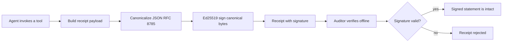
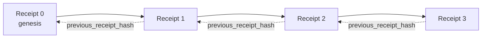

[មើលវីដេអូមេរៀន៖ ការពារតំណាង AI ជាមួយវិញ្ញាបនបត្រអ៊ីធ័រគ្រីបតូក្រាហ្វី](https://youtu.be/PLACEHOLDER_VIDEO_ID)

> _(វីដេអូមេរៀន និងរូបតំណាងនឹងត្រូវបានបន្ថែមដោយក្រុមមាតិកា Microsoft បន្ទាប់ពីការរួមបញ្ចូល ដែលស្របទៅនឹងបំណ៉ាត់មេរៀន ១៤ / ១៥)_

# ការពារតំណាង AI ជាមួយវិញ្ញាបនបត្រអ៊ីធ័រគ្រីបតូក្រាហ្វី

## ការណែនាំ

មេរៀននេះនឹងពិពណ៌នាអំពី៖

- ហេតុអ្វីបានជាមជ្ឈមណ្ឌល បំពេញ​audit សម្រាប់តំណាង AI មានសារៈសំខាន់សម្រាប់ការអនុលោម បញ្ជាក់កំហុស និងការជឿទុកចិត្ត។
- វិញ្ញាបនបត្រអ៊ីធ័រគ្រីបតូក្រាហ្វីជាអ្វី និងវាផ្សេងពីបន្ទាត់កំណត់ហេតុនៅខាងក្រៅហត្ថលេខាយ៉ាងដូចម្តេច។
- របៀបបង្កើតវិញ្ញាបនបត្រដែលមានហត្ថលេខាដើម្បីអះអាងការហៅឧបករណ៍នៃតំណាងជាភាសា Python ធម្មតា។
- របៀបធ្វើតេស្តវិញ្ញាបនបត្រនៅក្រៅបណ្តាញ និងរកឃើញការលួចលាក់។
- របៀបចងខ្សែគ្រវីវិញ្ញាបនបត្រដើម្បីឲ្យការដក ឬបម្លែងលំដាប់មួយក្នុងខ្សែ វាខូចខាតខ្សែដោយស្វ័យប្រវត្តិ។
- វិញ្ញាបនបត្របានបង្ហាញអ្វី និងអ្វីដែលវាមិនបង្ហាញពិតប្រាកដ។

## គោលបំណងការសិក្សា

បន្ទាប់ពីបញ្ចប់មេរៀននេះ អ្នកនឹងធ្វើបាន៖

- កំណត់សភាពបរាជ័យដែលជំរុញការប្រើប្រាស់វិញ្ញាបនបត្រអ៊ីធ័រគ្រីបតូសម្រាប់សកម្មភាពរបស់តំណាង។
- បង្កើតវិញ្ញាបនបត្រដែលមានហត្ថលេខា Ed25519 លើទិន្នន័យ JSON ដែលមានសណ្ឋានត្រឹមត្រូវ។
- ធ្វើតេស្តវិញ្ញាបនបត្របានដោយឯករាជ្យ ដោយប្រើកូនសោសាធារណៈរបស់អ្នកហត្ថលេខា។
- រកឃើញការលួចលាក់ដោយការធ្វើតេស្តវិញ្ញាប់បន្ដិចម្ដងទៀតលើវិញ្ញាបនបត្រដែលបានកែប្រែ។
- កសាងខ្សែហាសបន្ត និងពន្យល់ហេតុអ្វីខ្សែទំនាក់ទំនងសំខាន់។
- ស្គាល់កំរិតកំណត់រវាងអ្វីដែលវិញ្ញាបនបត្របញ្ជាក់ (ការចាត់ទុក ទំនុកចិត្ត លំដាប់) និងអ្វីដែលវាមិនបញ្ជាក់ (ការត្រឹមត្រូវនៃសកម្មភាព សមត្ថភាពនៃគោលនយោបាយ)។

## បញ្ហា៖ តំណាងរបស់អ្នកនិងទីតាំង audit trail របស់វា

សូមស្រមៃថាអ្នកបានដាក់តំណាង AI មួយសម្រាប់ Contoso Travel។ តំណាងនេះអានសំណើរបស់អតិថិជន ហៅ API នៃពាណិជ្ជកម្មជើងហោះហើរ ដើម្បីស្វែងរកជម្រើស ហើយកក់កាសែតជំនួសអតិថិជន។ នៅត្រីមាសមុន តំណាងនេះបានដំណើរការការកក់ ៥០,០០០ ករណី។

ថ្ងៃនេះ អ្នកត្រួតពិនិត្យមកដល់។ គាត់សួរបញ្ហាងាយៗថា៖ "បង្ហាញអ្វីដែលតំណាងរបស់អ្នកបានធ្វើ។"

អ្នកដាក់ឲ្យគាត់ឯកសារកំណត់ហេតុ។ អ្នកត្រួតពិនិត្យមើលវា ហើយសួរបញ្ហាយ៉ាងលំបាក៖ "តើយ៉ាងណាខ្ញុំដឹងថាកំណត់ហេតុទាំងនេះមិនបានកែប្រែ?"

នេះជាបញ្ហាaudit-trail។ ការដាក់តំណាងភាគច្រើនជាក់ស្តែង សព្វថ្ងៃពឹងពាក់លើ៖

- **កំណត់ហេតុកម្មវិធី**៖ ត្រូវបានសរសេរដោយតំណាងផ្ទាល់ អាចកែប្រែដោយអ្នកណាមួយមានសិទ្ធិចូលប្រព័ន្ធហាងឯកសារ។
- **សេវាកម្មកំណត់ហេតុខ្ទង់ពពក**៖ ទទួលបានការពារការលួចលាក់នៅកម្រិតវេទិកា តែត្រូវការជឿលើអ្នកបើកវេទិកានោះ។
- **កំណត់ហេតុប្រតិបត្ដិការពហុឃ្លាំងទិន្នន័យ**៖ សមស្របសម្រាប់បំលែងទិន្នន័យឃ្លាំងទិន្នន័យ តែមិនសមរម្យសម្រាប់ការហៅឧបករណ៍ដោយចៃដន្យ។

គ្មានអ្វីក្នុងចំណោមនេះអាចឆ្លើយសំណួរអ្នកត្រួតពិនិត្យដោយគ្មានការជឿលើនរណាម្នាក់ (អ្នក អ្នកផ្គត់ផ្គង់ពពក រឺអ្នកផ្គត់ផ្គង់ឃ្លាំងទិន្នន័យ)។ សម្រាប់ការប្រើប្រាស់ក្នុងសហគ្រាស ការជឿនេះគឺទទួលយកបាន។ សម្រាប់ការងារដែលមានបទបន្ទាប់ (ហិរញ្ញវត្ថុ សុខាភិបាល អ្វីៗដែលក្រោមច្បាប់ EU AI Act) វាត្រូវបានតម្រូវឱ្យមានយ៉ាងតឹងរឹង។

វិញ្ញាបនបត្រអ៊ីធ័រគ្រីបតូជួយដោះស្រាយបញ្ហានេះដោយធ្វើឱ្យសេចក្តីថ្លែងការណ៍ដែលមានហត្ថលេខាអាចត្រួតពិនិត្យបានដោយឯករាជ្យ។
អ្នកត្រួតពិនិត្យនៅតែត្រូវមានមូលហេតុនៅក្រៅបណ្ដាញដើម្បីជឿលើកូនសោហត្ថលេខា និង
ធាតុដែលបង្កើតសេចក្តីថ្លែងការណ៍។ កូនសោក្នុងធាតុបញ្ចូលបញ្ចាក់ទំនងឯករាជ្យ មិនបញ្ជាក់អត្តសញ្ញាណអ្នកចេញ ហៅប្រព័ន្ធអនុវត្តន៍ឡើយ។


## វិញ្ញាបនបត្រអ៊ីធ័រគ្រីបតូក្រាហ្វីជាអ្វី?

វិញ្ញាបនបត្រគឺជាឧបករណ៍ JSON ដែលកត់ត្រាអំពីអ្វីដែលតំណាងបានធ្វើ ហើយមានហត្ថលេខាឌីជីថល។



វិញ្ញាបនបត្រមានរូបរាងតិចបំផុតដូចខាងក្រោម៖

```json
{
  "type": "agent.tool_call.v1",
  "agent_id": "contoso-travel-bot",
  "tool_name": "lookup_flights",
  "tool_args_hash": "sha256:a3f9c1...",
  "result_hash": "sha256:7b2e1d...",
  "policy_id": "contoso-travel-policy-v3",
  "timestamp": "2026-04-25T14:30:00Z",
  "sequence": 47,
  "previous_receipt_hash": "sha256:9d4e6a...",
  "signature": {
    "alg": "EdDSA",
    "sig": "c5af83...",
    "public_key": "8f3b2c..."
  }
}
```

គុណលក្ខណ៍បីនេះគឺជាមូលហេតុធ្វើការងារ៖

1. **ហត្ថលេខា**។ វិញ្ញាបនបត្រត្រូវបានហត្ថលេខាដោយទ្វារតំណាងប្រើកូនសោឯកជន Ed25519។ អ្នកណាមានកូនសោសាធារណៈដែលផ្គូផ្គងអាចធ្វើតេស្តហត្ថលេខានៅក្រៅបណ្ដាញបាន។ ពាណិជ្ជករត្រូវតែចាក់បិទនូវកូនសោនោះ ឬរកវាពីកំណត់ត្រាជឿទុកចិត្តនៅក្រៅវិញ្ញាបនបត្រ។ ការលួចលាក់នៅក្នុងវាលណាមួយមានហត្ថលេខាអោយខូចហត្ថលេខា។

2. **ការផ្ទុកសញ្ញាទ្រង់ទ្រាយត្រឹមត្រូវ**។ មុនហត្ថលេខា វិញ្ញាបនបត្រត្រូវបានបំលែងតាម JSON Canonicalization Scheme (JCS, RFC 8785)។ របៀបនេះធានាថាការអនុវត្តពីរប្រភេទដែលផលិតវិញ្ញាបនបត្រដូចគ្នា នឹងបានលទ្ធផលតែមួយគត់។ បើគ្មាន JCS អ្នកបំលែង JSON ក៏នឹងផលិតហត្ថលេខាផ្សេងគ្នាសម្រាប់មាតិកាដូចគ្នា។

3. **ការចងខ្សែហាស**។ វាល `previous_receipt_hash` ដំណាងឲ្យការតភ្ជាប់វិញ្ញាបនបត្រពីមួយទៅមួយផ្សេងទៀតខាងមុន។ ការដក ឬលំដាប់វិញ្ញាបនបត្រលួចលាក់នឹងបំផ្លាញលំដាប់វានៅក្នុងខ្សែ។ ការរកឃើញការដកចេញ ឬការផ្លាស់ប្តូរដោយអ្នកហត្ថលេខានៅត្រូវការក្បាលខ្សែបច្ចុប្បន្នកាន់ខ្នែង ការត្រួតពិនិត្យដោយអ្នកឃ្លាំមើលឯករាជ្យ ឬការបញ្ជាក់តាមប្រជាជនដែលបានផ្តល់អនុញ្ញាតិ។

គុណលក្ខណ៍ទាំងនេះផ្ដល់អ្នកឲ្យមានការធានា៣យ៉ាង៖

- **ការចាត់ទុកទៅកាន់កូនសោ**៖ កូនសោនេះបានហត្ថលេខាលើមាតិកានេះ។ អត្តសញ្ញាណស្ថាប័នឬមនុស្សត្រូវការការគាំទ្រពីការតភ្ជាប់កូនសោជឿទុកចិត្ត។
- **ភាពស្មោះត្រង់**៖ មាតិកាមិនបានផ្លាស់ប្តូរពីពេលធ្វើហត្ថលេខា។
- **លំដាប់ក្នុងលំដាប់ដែលបានត្រួតពិនិត្យ**៖ វិញ្ញាបនបត្រនេះតភ្ជាប់ទៅវិញ្ញាបនបត្រមុន។

## ការបង្កើតវិញ្ញាបនបត្រនៅក្នុង Python

អ្នកមិនចាំបាច់មានបណ្ណាល័យពិសេសសម្រាប់បង្កើតវិញ្ញាបនបត្រទេ។ ប្រដាប់គ្រឹះអ៊ីធ័រគ្រីបតូមានស្រាប់ ហើយល្បិចវត្ថុមានតែបន្តិចក្នុងភាសា Python។

ការហាត់ប្រាណនៅក្នុង `code_samples/18-signed-receipts.ipynb` បង្ហាញពីដំណើរការ ពេញលេញ។ កំណត់ត្រាកូដនាដ្រូចសម្រាប់ `code_samples/18-signed-receipts.execution-receipt.json` រក្សារតំលៃ hash ទម្រង់ notebook ពិសេស បរិយាកាស Python ចំនួនសែល និងការត្រួតពិនិត្យ ពីការប្រតិបត្តិល្អចុងក្រោយដោយគ្មានការផ្លាស់ប្តូរចាក់ទិន្នន័យដែលរក្សា។ សេចក្តីសង្ខេបរបស់វា៖

```python
import json
import hashlib
import base64
from nacl import signing
from jcs import canonicalize  # RFC 8785 canonical JSON

def b64url_nopad(data: bytes) -> str:
    return base64.urlsafe_b64encode(data).decode("ascii").rstrip("=")

def sha256_canonical(obj) -> str:
    """SHA-256 of a Python object's JCS-canonical JSON form."""
    return f"sha256:{hashlib.sha256(canonicalize(obj)).hexdigest()}"

# Generate or load a signing key (in production, store in a key vault)
signing_key = signing.SigningKey.generate()
verify_key = signing_key.verify_key
TRUSTED_PUBLIC_KEYS = {b64url_nopad(bytes(verify_key))}  # pinned out of band by the verifier

# Build the receipt payload (no signature yet)
tool_args = {"origin": "SYD", "destination": "LAX"}
tool_result = [{"flight": "QF11", "price": 1850, "stops": 0}]

payload = {
    "type": "agent.tool_call.v1",
    "agent_id": "contoso-travel-bot",
    "tool_name": "lookup_flights",
    "tool_args_hash": sha256_canonical(tool_args),
    "result_hash": sha256_canonical(tool_result),
    "policy_id": "contoso-travel-policy-v3",
    "timestamp": "2026-04-25T14:30:00Z",
    "sequence": 0,
    "previous_receipt_hash": None,
}

# Canonicalize and sign the JCS bytes directly. PureEdDSA hashes internally.
canonical_bytes = canonicalize(payload)
signature_bytes = signing_key.sign(canonical_bytes).signature

# Attach a structured signature object.
receipt = {
    **payload,
    "signature": {
        "alg": "EdDSA",
        "sig": b64url_nopad(signature_bytes),
        "public_key": b64url_nopad(bytes(verify_key)),
    },
}
```

នេះជាច្រកចេញហត្ថលេខាទាំងមូល។ ការហាត់នៅក្នុង notebook នាំមកអោយបានដំណើរការជំហានមួយៗ។

## ការត្រួតពិនិត្យវិញ្ញាបនបត្រ និងការស្វែងរកការលួចលាក់

ការត្រួតពិនិត្យគឺជាដំណើរការងារផ្ទុយ៖

```python
import base64
import hashlib
from nacl import signing
from nacl.exceptions import CryptoError
from jcs import canonicalize

def b64url_decode(s: str) -> bytes:
    # Strict: Python's decoder skips characters outside the alphabet and also
    # accepts padding, the standard +/ alphabet and non-zero spare bits.
    # Re-encoding and comparing accepts only the one unpadded base64url form.
    padding = "=" * ((4 - len(s) % 4) % 4)
    data = base64.urlsafe_b64decode(s + padding)
    if base64.urlsafe_b64encode(data).decode("ascii").rstrip("=") != s:
        raise ValueError("not canonical unpadded base64url")
    return data

def verify_receipt(receipt: dict, trusted_public_key: str) -> bool:
    # trusted_public_key is the issuer's key, obtained from somewhere other
    # than this receipt. Never use receipt["signature"]["public_key"] here:
    # see "What Receipts Prove (and What They Do Not)" below.
    # Fails closed: anything malformed returns False instead of raising.
    if not isinstance(receipt, dict) or not isinstance(trusted_public_key, str):
        return False
    sig_obj = receipt.get("signature")
    if not isinstance(sig_obj, dict) or sig_obj.get("alg") != "EdDSA":
        return False
    sig_b64 = sig_obj.get("sig")
    if not isinstance(sig_b64, str):
        return False

    try:
        # Reconstruct the payload that was actually signed (everything except signature).
        payload = {k: v for k, v in receipt.items() if k != "signature"}
        canonical_bytes = canonicalize(payload)
        verify_key = signing.VerifyKey(b64url_decode(trusted_public_key))
        verify_key.verify(canonical_bytes, b64url_decode(sig_b64))
        return True
    except (CryptoError, TypeError, ValueError, KeyError, OverflowError):
        return False
    except Exception:
        # An undecodable key or signature, or a payload that cannot be
        # canonicalized: fail closed rather than raise.
        return False
```

មុខងារនេះទទួលយកវិញ្ញាបនបត្រនិងកូនសោសាធារណៈរបស់អ្នកចេញ ហើយត្រឡប់មក`True` ប្រសិនបើហត្ថលេខាមានសុពលភាព និង`False` បើមិនមាន សម្រាប់ពេលដែលទិន្នន័យក្នុងវាជាប្រភេទខុស។ គ្មានការហៅបណ្ដាញណាមួយ និងគ្មានសេវាកម្មត្រួតពិនិត្យ៖ បន្ទាប់ពីអ្នកកាន់កូនសោអ្នកចេញ ការត្រួតពិនិត្យជាប្រតិបត្តិការផ្ទាល់ខ្លួននិងក្រៅបណ្ដាញ។ អ្វីដែលវាត្រូវការនោះគឺកូនសោនេះ មានប្រភពពីកន្លែងផ្សេងពីវិញ្ញាបនបត្រ។

ដើម្បីមើលការស្វែងរកការលួចលាក់នេះនៅក្នុងឡើងវិញ ដែល notebook នាំមកនូវ៖

1. បង្កើតវិញ្ញាបនបត្រដែលមានសុពលភាព និងបញ្ជាក់ថាវាត្រួតពិនិត្យបាន។
2. កែប្រែបៃមួយក្នុងវាល `tool_args_hash`។
3. ធ្វើតេស្តម្តងទៀត និងឃើញថាវាច្រានចេញខុស។
4. លួចលាក់ម្ដងទៀត តែដ្បិតព្រឹត្តិការណ៍ជំរុញធ្វើហត្ថលេខាថ្មីជាមួយកូនសោដែលអ្នកវាយប្រហារបង្កើត ហើយបញ្ចូលចូលក្នុងវិញ្ញាបនបត្រ។

ជំហាន 4 គឺជារឿងដែលគួរយកចិត្តទុកដាក់ យល់ថាវិញ្ញាបនបត្រនេះមានភាពជាក់លាក់ផ្ទៃក្នុង៖ ហត្ថលេខានេះពិតជាត្រឹមត្រូវសម្រាប់មាតិការបស់វា ហើយសម្រាប់កូនសោដែលវាអាចស្នាក់នៅក្នុង វាពិតប្រាកដត្រួតពិនិត្យទៅកូនសោនៅខាងក្នុងវា។ វាខកខានតែពេលដែលបានត្រួតពិនិត្យទៅកាន់កូនសោពិតប្រាកដរបស់អ្នកចេញវិញ។ ជំហាន 2 និង 3 ត្រូវរកឃើញអ្នកវាយប្រហារ ដែលមិនបានធ្វើហត្ថលេខាថ្មី; ជំហាន 4 រកឃើញអ្នកដែលបានធ្វើហត្ថលេខាថ្មី។

នេះជាការបង្ហាញជាក់ស្តែងថាវិញ្ញាបនបត្រមានលក្ខណៈបង្ហាញការលួចលាក់៖ ការផ្លាស់ប្តូរណាមួយទៅវាលដែលបានហត្ថលេខា នឹងខូចហត្ថលេខា បើអ្នកត្រួតពិនិត្យប្រសិនបើប្រើកូនសោដែលអ្នកវាយប្រហារមិនបានផ្គត់ផ្គង់។ វត្ថុ `signature` ដែលខ្លួនវាមិនស្ថិតក្នុងឯកតាហត្ថលេខា ដូច្នេះហេតុអ្វីដែលអ្នកត្រូវតាមដានយ៉ាងតឹងរឹង ធៀបត្រួតពិនិត្យកូនសោត្រូវតែមកពីកន្លែងផ្សេងពីវិញ្ញាបនបត្រ។

## ការចងខ្សែវិញ្ញាបនបត្រសម្រាប់តំណាងជាច្រើនជំហាន

វិញ្ញាបនបត្រមួយដែលមានហត្ថលេខារក្សារសកម្មភាពមួយ។ ខ្សែវិញ្ញាបនបត្ររក្សារតំណើរការដាំតេស្ដ។



កំណត់វិញ្ញាបនបត្រតែមួយត្រូវកត់ត្រាហាសវិញ្ញាបនបត្រមុនពេលនោះ។ ដើម្បីដកវិញ្ញាបនបត្រលេខ ២ ចេញដោយមិនអោយដឹង ត្រូវមានឫកខ្វះដូចខាងក្រោម៖

- កែប្រែវាល `previous_receipt_hash` នៃវិញ្ញាបនបត្រលេខ ៣ (អំណះអំណាងដល់ហត្ថលេខាវិញ្ញាបនបត្រលេខ ៣ ខូចទៅ) ឬ
- បង្កើតហត្ថលេខាថ្មីទៅវិញលើវិញ្ញាបនបត្រលេខ ៣ ដែលបានកែប្រែ (តម្រូវកូនសោឯកជនរបស់តំណាង)។

ប្រសិនបើកូនសោឯកជនត្រូវបានរក្សាទុកក្នុង hardware key vault ហើយអ្នកផ្ទៀងផ្ទាត់ធៀបវិញ្ញាបនបត្រនីមួយៗទៅកាន់កូនសោសាធារណៈរបស់អ្នកចេញ ដែលទទួលបានដោយឯករាជ្យ (បណ្ដុំ JWK បានបោះពុម្ពផ្សាយ ឬតំលៃ config ដែលបានចាក់បិទ) គ្មានការវាយប្រហារណាមួយអាចកើតឡើងដោយគ្មានការបង្ហាញពីកំហុស។ ការ​បោះពុម្ពផ្សាយកូនសោក្នុងវិញ្ញាបនបត្រនីមួយៗគឺមិនគ្រប់គ្រាន់ឡើយ៖ អ្នកវាយប្រហារអាចធ្វើហត្ថលេខាថ្មីដោយកូនសោរបស់ខ្លួន ហើយបញ្ចូលកូនសោនោះជំនួស វាជារឿងធម្មតា `04_resigned_receipt.json`។

កំណត់ត្រាដែលនៅក្នុង notebook នាំមក៖

1. កសាងខ្សែវិញ្ញាបនបត្រចំនួនបី។
2. ប្រើការត្រួតពិនិត្យថាវាល `previous_receipt_hash` នៃវិញ្ញាបនបត្រនីមួយៗត្រូវគ្នានឹងហាសពិតប្រាកដរបស់វិញ្ញាបនបត្រមុន។
3. លួចលាក់វិញ្ញាបនបត្រជាមួយនៅចន្លោះ ហើយឃើញខ្សែខូចច្រឡំក្នុងចំណុចនោះ។

នេះជារបៀបបង្កើត audit trail ដែលអ្នកត្រួតពិនិត្យខាងក្រៅអាចត្រួតពិនិត្យតាមកូនសោអ្នកចេញ និងចំណុចត្រួតពិនិត្យខ្សែដោយឡែកដោយមិនអាចជឿលើហាងបញ្ជីលើកំណត់ហេតុដែលអាចផ្លាស់ប្តូរ។


2. **ភាពស្មោះត្រង់**៖ ទិន្នន័យមិនបានផ្លាស់ប្តូរតាំងពីពេលហត្ថលេខា។
3. **លំដាប់នៅក្នុងលំដាប់ដែលបានបង្ហាញ និងត្រួតពិនិត្យ**៖ វិញ្ញាបនបត្រនេះតភ្ជាប់ទៅវិញ្ញាបនបត្រមុន។


1. **ភាពត្រឹមត្រូវ**: ថាមនុស្សប្រតិបត្តិការនោះបានធ្វើសកម្មភាពដែលត្រឹមត្រូវ។ អ្នកទទួលបានវិក្កយបត្រអាចចុះហត្ថលេខាក្នុងចម្លើយខុសបាន ស្រួលដូចជាក្នុងចម្លើយត្រឹមត្រូវ។
2. **ការអនុវត្តគោលនយោបាយ**: ថា​គោលនយោបាយដែលបានយោងនៅក្នុង `policy_id` ត្រូវបានប៉ាន់ប្រមាណពិតប្រាកដ ឬថាវានឹងអនុញ្ញាតឱ្យសកម្មភាពនេះប្រសិនបើបានពិនិត្យ។ វិក្កយបត្រកំណត់អ្វីដែលបានអះអាង មិនមែនអ្វីដែលត្រូវបានអនុវត្តន៍ឡើយ។
3. **អត្តសញ្ញាណក្រៅពីកូនសោ**: វិក្កយបត្រនេះថា "កូនសោនេះបានចុះហត្ថលេខាលើមាតិកានេះ។" វាមិនថា "មនុស្សនេះបានអនុញ្ញាត" ទេ។ ការតភ្ជាប់កូនសោមួយទៅមនុស្ស ឬអង្គការមួយ ត្រូវការរចនាសម្ព័ន្ធអត្តសញ្ញាណផ្តាច់មុខ (ក្នុងថតតារាង ការ​ចុះបញ្ជីកូនសោ​សាធារណៈ ជាដើម)។
4. **ការសុចរិតនៃបញ្ចូល**: ប្រសិនបើអ្នកប្រតិបត្តិបានទទួលប្រភពបញ្ចូលមួយដែលត្រូវបានកែប្រែ ហើយបានប្រតិបត្ដិយោងទៅលើយ៉ាងហោចណាស់។ វិក្កយបត្រកំណត់សកម្មភាពនោះយ៉ាងត្រឹមត្រូវ។ វិក្កយបត្រនៅក្រោមកម្រិតផ្ទៀងផ្ទាត់បញ្ចូល មិនមែនជាផ្លូវជំនួសនោះទេ។
5. **ការអនុវត្ត ឬផលប៉ះពាល់ពិតប្រាកដនៅលើពិភពលោក**: វិក្កយបត្រ​បន្ទាប់ហៅថាកម្មវិធីកក់បញ្ជាក់អ្វីដែលអ្នកចេញវិក្កយបត្រអះអាងថាបានកើតឡើង។ ការបញ្ជាក់ទទួលយកឬសម្របសម្រួលផលប៉ះពាល់ខាងក្រៅ តម្រូវឲ្យមានភស្តុតាងពីអ្នកប្រតិបត្តិករ ឬព្រំដែនអ្នកផ្តល់សេវាកម្មជាក់ស្តែង។
6. **ភាពពេញលេញ**: វិក្កយបត្រដែលខ្វះអាចមានន័យថាត្រូវបានរារាំង ថតសំគាល់គ្មាន ឬបានបាត់បង់។ ការខ្វះបាត់គឺក្លាយជាភស្តុតាងបានតែខណៈនៅក្នុងសំណុំប្រជាជនដែលត្រូវបានផ្ទៀងផ្ទាត់។
7. **ពេលវេលាដែលអាចទុកចិត្តបាន**: ម៉ោងដែលបានចុះហត្ថលេខា បង្ហាញថាអ្នកចុះហត្ថលេខាបានយកតម្លៃនោះមក មិនមែនថាតម្លៃនោះត្រឹមត្រូវឡើយ។ ពេលវេលាដែលអាចទុកចិត្តបាន ត្រូវការអាជ្ញាធរពេលវេលាដាច់ដោយឡែក ឬចំណុច​ពិនិត្យ​ដែលមានភាគីឃ្លាំមើល។

**កូនសោក្នុងវិក្កយបត្រ មិនមែនជាកូនសោដែលអ្នកផ្ទៀងផ្ទាត់នោះទេ។** វាដើរតាមចំណុចលេខ 3 ហើយវាជាកន្លែងតែមួយដែលភាពខុសគ្នាអាចបញ្ជូនឲ្យកូដរបស់អ្នកផ្លាស់ប្ដូរប្រសិនបើមិនមែនចំណេះដឹងរបស់អ្នក។ `public_key` ក្នុងឧទាហរណ៍ខាងលើ គឺខ្វះខាតដើម្បីឲ្យឧទាហរណ៍មានភាពចម្រុះ។ អ្នកផ្ទៀងផ្ទាត់មិនដែលគួរទុកចិត្តវាឡើយ។ មនុស្សណាអាចយកវិក្កយបត្រមួយ កែប្រែវា ចុះហត្ថលេខាជាមួយកូនសោដែលគាត់បង្កើតឡើង ហើយដាក់បញ្ចូលកូនសោនោះឡើងវិញ; លទ្ធផលនោះផ្ទៀងផ្ទាត់បានល្អឥតខ្ចោះទៅលើខ្លួនវាទៅវិញទៅមក។ នោះគឺជាឧបករណ៍ `04_resigned_receipt.json` នៅក្នុង `sample_receipts/` ហើយវាជាមូលហេតុដែល `verify_receipt` ខាងលើទទួលកូនសោជាអាគុយម៉ង់ មិនមែនអានវាចេញពីវិក្កយបត្រទេ។ ទទួលបានកូនសោនៃអ្នកចេញវិក្កយបត្រដោយបញ្ញវន្ត ពី JWK Set ក្នុង តារាងចុះបញ្ជីផលិតផលខាងក្រោម ឬក៏ពីចំណុចតាំងជាស្រេច មុន រួចផ្ទៀងផ្ទាត់វា។ ហត្ថលេខាដែលបានផ្ទៀងផ្ទាត់ជាមួយកូនសោដែលបានមកជាមួយតំបន់ដូចគ្នា បង្ហាញតែតំបន់នោះផ្ទាល់ចំហុយនៅក្នុងខ្លួនវាអាថ៌កំបាំង។

ព្រំដែននេះមានសារៈសំខាន់ពីមូលហេតុពីរ:

- វាប្រាប់អ្នកថាវិក្កយបត្រអាចមានប្រយោជន៍សម្រាប់អ្វី៖ ធ្វើឲ្យឥរិយាបថរបស់ភ្នាក់ងារមានភាពអាចត្រួតពិនិត្យ និងមានភាពជាក់ស្តែងថាមានការផ្លាស់ប្ដូរជាសាធារណៈ ។
- វាប្រាប់អ្នកថាតើថាស្រទាប់បន្ថែមអ្វីដែលអ្នកនៅតែត្រូវការប្រតិបត្តិ៖ ការផ្ទៀងផ្ទាត់បញ្ចូល (មេរៀនទី 6), ការអនុវត្តគោលនយោបាយ (បានគ្របដណ្តប់ខ្លះខាងក្រោម), និងរចនាសម្ព័ន្ធអត្តសញ្ញាណ (ក្រៅបរិបទសម្រាប់មេរៀននេះ)។

កំហុសធម្មតាមួយគឺការសន្មតថា "យើងមានវិក្កយបត្រ" មានន័យថា "យើងត្រូវបានគ្រប់គ្រង។" មិនមែនដូច្នោះទេ។ វិក្កយបត្រជាគ្រឹះ។ ការគ្រប់គ្រងគឺជាបទបញ្ជាដែលអ្នកកសាងនៅលើវា។

## ការចងក្រងហត្ថលេខារបស់អ្នកអនុម័តទៅនឹងសកម្មភាពជាក់លាក់

មុខទំនិញលេខ 3 ខាងលើគឺតម្លៃសម្រាប់ផ្នែកផ្ទាល់ខ្លួន៖ វិក្កយបត្រសកម្មភាពថា "កូនសោនេះបានចុះហត្ថលេខាលើមាតិកានេះ," មិនដែលថា "មនុស្សល្បីល្បាញនោះបានអនុម័ត។" សម្រាប់សកម្មភាពដែលមានហានិភ័យខ្ពស់ (បង្វិលប្រាក់ថវិកា ការលុបចោល ផ្ទេរប្រាក់ទិន្នន័យ), ហត្ថលេខាអ្នកអនុម័តផ្សេងទៀតអាចចងសកម្មភាពជាក់លាក់។ ការតភ្ជាប់កូនសោនោះទៅមនុស្ស និងការត្រួតពិនិត្យវត្តមានមនុស្សនៅតែជាការទទួលខុសត្រូវផ្សេងៗគ្នា។

សៀវភៅកំណត់ត្រាដែលបន្ត `code_samples/human-authorization-receipts.ipynb` បន្ថែមប្រភេទបង្កាន់ដៃទីពីរ `human.approval.v1` ក្នុងរាងកង្ហារតែមួយដូចនឹងបង្កាន់ដៃនៃមេរៀន (ផ្ទុកទិន្នន័យប្រភេទដែលចុះហត្ថលេខាជាមួយ Ed25519 លើអក្សរ JCS canonical របស់វា ដែលមានវត្ថុ `signature` ក្រៅពីអក្សរចុះហត្ថលេខា)។ សោ អនុម័តអ្នកចុះហត្ថលេខានៅលើ **សកម្មភាព canonical ពេញលេញ និង digest របស់វា**; សោភ្នាក់ងារចុះហត្ថលេខាលើការស្នើសុំដែលមាន **digest សកម្មភាពដូចគ្នា** និង `parent_approval_ref` ដែលជាផ្នែកបញ្ចូល `receipt_hash` នៃការអនុម័ត ដូច្នេះវាជាការប្រារព្ធដូចជាអត្ថបទ `previous_receipt_hash` ក្នុងខ្សែដែលអ្នកបានបង្កើតខាងលើ។ មួយ `verify_chain` ដើរតាមស្បែកឆ្លងទាំងពីរនៅក្រោម **បណ្ណាល័យសោចម្រាស់ផ្សេងគ្នា** (សោអនុម័ត ខុសពីសាភ្នាក់ងារ) ដូច្នេះផ្លូវកូដត្រូវបានចែករំលែក ប៉ុន្តាអំណាចមិនដែលចែករំលែកគ្នា។

វិស័យនេះបានទិញ, បញ្ជាក់យ៉ាងហ្មត់ចត់: *សោអនុម័តដែលបានចម្រាស់បានចុះហត្ថលេខាលើសកម្មភាព
ដូចម្តេចដោយពិតៗ ហើយសោភ្នាក់ងារបន្តបន្ទាប់បានចុះហត្ថលេខាលើសេចក្តីថ្លែងការណ៍ដែលមាន digest សកម្មភាពដូចគ្នា។*
នេះជាសម្រង់ភស្តុតាងមានប្រយោជន៍ ប៉ុន្តែមិនមែនជាភស្តុតាងនៃការប្រតិបត្ដិបានសកម្មភាពនោះដោយខ្លួនឯងទេ។ ដើម្បី
គ្រប់គ្រងការប្រតិបត្ដិការ សំណុំអនុម័តត្រឹមត្រូវក៏ត្រូវតែរក្សាទុកហើយប្រើប្រាស់ម្តងនៅព្រំដែនអ្នកប្រតិបត្ដិពិតប្រាកដ; លទ្ធផលអ្នកផ្គត់ផ្គង់មិនស្គាល់ គួរតែស្ថិតនៅមិនស្គាល់ជាមួយមិនត្រូវបាន
ព្យាយាមម្ដងទៀតដោយមិនគិតទុកផងដែរ។ ការកំណត់ការមិនយល់ព្រមរបស់សៀវភៅកំណត់ត្រាសាកល្បងស្រទាប់ខ្សែបង្កាន់ដៃ៖


- ការវាយប្រហារ, អនុវិទ្យាស្រុកស្លេកស្លោ, កូនសោបានចម្លងពីភាគីណាមួយ, និងការបញ្ចូលដែលមិនមានរចនាសម្ព័ន្ធត្រឹមត្រូវ;
- **អំណាចចាស់**៖ ហត្ថលេខាដែលនៅតែអាចផ្ទៀងផ្ទាត់បាន បើមិនទទួលយកឡើយ ព្រោះកំណែគោលនយោបាយផ្លាស់ប្តូរ កូនសោអ្នកអនុម័តត្រូវបានបង្វិលចេញពីការចុះបញ្ជីដែលបាននៅជាប់ ឬការអនុម័តផុតកំណត់មុនពេលផ្តល់ពេលវេលាបញ្ជាក់;
- **ការប្តូរតំណាងរាង**៖ ច្បាប់អនុញ្ញាតដែលបានហត្ថលេខាដោយត្រឹមត្រូវបញ្ជាក់អំពីការអនុម័តពិតប្រាកដដែលភ្ជាប់នឹងសកម្មភាពកំណត់លំដាប់ផ្សេងទៀត។

ការបរាជ័យនីមួយៗបដិសេធដោយមានហេតុផលច្បាស់លាស់ ដូច្នេះអ្នកត្រួតពិនិត្យដែលអានការបដិសេធអាចប្រាប់ថាតើអំណាចបានចាស់ ឬសកម្មភាពដែលបានអះអាងបានផ្លាស់ប្តូរ។ ការផ្ទៀងផ្ទាត់គឺអានតែប៉ុណ្ណោះ ហើយអាចធ្វើយ៉ាងម្តងម្កាលបាន: វាមិនប្រើប្រាស់ការអនុម័តឬហៅអ្នកផ្គត់ផ្គង់ទេ។ អ្នកបំពេញមុខងារផ្សេងទៀតត្រូវការការការពារត្រលប់ម្តងម្កាលដែលរឹងមាំ និងសម្រេចលទ្ធផលជាក់លាក់សម្រាប់ជោគជ័យ បរាជ័យ និងអតិផរណា។ ការទទូលបានការអនុម័តដោយមនុស្សគឺជាការរចនាសម្ព័ន្ធចំណេះដឹងដែលបានកំណត់ដោយមេរៀននេះ មិនមែនជាប្រភេទបង្កាន់ដៃដែលបានកំណត់ដោយ `draft-farley-acta-signed-receipts` ទេ។

## ឯកសារយោងផលិតកម្ម

កូដ Python ក្នុងមេរៀននេះត្រូវបានធ្វើឱ្យខ្លីបំផុតដោយមានគោលបំណងឱ្យអ្នកអាចអានមាត់ចួរប្រជុំគ្នា និងយល់បានច្បាស់ពីអ្វីកំពុងកើតឡើង។ នៅក្នុងបរិបទផលិតកម្ម អ្នកមានជម្រើសពីរយ៉ាង៖

1. **សាងសង់ដោយផ្ទាល់លើគ្រឹះក្រមកូដគ្រឿងចក្រចង្អុល cryptographic primitives។** បន្ទាត់ 50 នៃកូដដែលអ្នកបានមើលខាងលើគឺគ្រប់គ្រាន់សម្រាប់ករណីប្រើជាច្រើន។ PyNaCl (Ed25519) និងកញ្ចប់ `jcs` (canonical JSON) គឺជាឧបករណ៍បណ្ណាល័យដែលបានថែទាំយ៉ាងល្អ និងបានត្រួតពិនិត្យ។

2. **ប្រើបណ្ណាល័យ receipt សម្រាប់ផលិតកម្ម។** គម្រោងបើកចំហជាច្រើនបានអនុវត្តលំនាំដូចគ្នានេះជាមួយនឹងមុខងារបន្ថែម (ស្ដារសោ, លទ្ធភាពបញ្ជាក់តាមកញ្ចប់, ការចែកចាយ JWK Set, ការរួមបញ្ចូលជាមួយម៉ាស៊ីនគោលនយោបាយ)៖
   - លំហូរការនីតិវិធី signing ប្រើ JCS និងលំនាំបរិបទស្នាមហត្ថលេខា signature-scope នៅក្នុងសេចក្តីព្រាង IETF Internet-Draft ដាច់ដោយឡែក ([`draft-farley-acta-signed-receipts`](https://datatracker.ietf.org/doc/draft-farley-acta-signed-receipts/), កំណែ 02)។ ការអប់រំនៃreceipt តម្រាមមេរៀននេះខុសពីរ៉ាក់ខ្មែរ `{payload, signature}` នៃសេចក្តីព្រាង និងមិនត្រូវបានបង្ហាញជា implementation ត្រឹមត្រូវ។ សេចក្តីព្រាងចេញផ្សាយបញ្ជីតេស្តគោលការណ៍ខាងត្បូង ([agent-governance-testvectors](https://github.com/ScopeBlind/agent-governance-testvectors)) សម្រាប់ការអនុវត្តដែលមានគោលដៅលើទ្រង់ទ្រាយខ្សែរបស់វា។
   - Microsoft Agent Governance Toolkit បង្កើត receipt ជាមួយនឹងការសម្រេចចិត្តនយោបាយដែលផ្អែកលើ Cedar; សូមមើលមេរៀនទី 33 ក្នុងឃ្លាំងនេះសម្រាប់ឧទាហរណ៍ចុងក្រោយពីដើមដល់ចប់។
   - កញ្ចប់ `protect-mcp` (npm) និង `@veritasacta/verify` (npm) ផ្តល់នូវកម្មវិធី Node ហើយដាក់បញ្ចូលការចុះហត្ថលេខា receipt និងការផ្ទៀងផ្ទាត់ក្រៅបណ្តាញដែលមានគោលបំណងសម្រាប់ធ្វើទ្រង់ទ្រាយ MCP មួយដែលមាន audit trail បង្ហាញការបំភ័យ, រួមទាំងលំហូរជាក់ស្តែងដែលកំពុងរង់ចាំអនុម័តមួយដែលបញ្ចេញ receipt អនុម័តភ្ជាប់ទៅនឹង digest សកម្មភាព (WebAuthn-backed ក្នុងលំហ desktop), លំនាំ receipt អនុម័តដូចក្នុងសៀវភៅសេចក្តីអនុញ្ញាតមនុស្សខាងលើ។
   - **[nobulex](https://github.com/arian-gogani/nobulex)** Python SDK (`pip install nobulex`) ផ្តល់លំនាំ signing Ed25519 + JCS ដូចគ្នានៅ Python ជាមួយនឹងការរួមបញ្ចូលជាមួយ LangChain និង CrewAI រួមទាំងឧបករណ៍តេស្ត cross-validation ដែលបានចេញផ្សាយ និងផែនទីគោលការណ៍ដែលបានចូលរួមតាមរយៈ [OWASP PR #2210](https://github.com/OWASP/CheatSheetSeries/pull/2210)។
   - **[EMILIA Protocol](https://github.com/emiliaprotocol/emilia-protocol)** ផ្តល់កំណត់ហេតុ enforcement ជាកំណត់ហេតុនៃសកម្មភាពដែលត្រូវធ្វើជា: receipt អនុម័តដែលអាចផ្ទៀងផ្ទាត់ក្រៅបណ្តាញបាន, WebAuthn ឬអាជ្ញាធរជាច្រើន quorum ដែលបានដាក់ភ្ជាប់, ការប្រើម្តងតែម្ដងនៅចុងក្រោយហ្វ្រេមវើក, និងផ្លូវអត្រាផលប៉ះពាល់ដែលមិនច្បាស់លាស់។ អាផែតរបស់ស៊ុមវើកទាំងនេះវាស់ receipt ជាភស្តុតាងចាំបាច់មិនមែនជាភស្តុតាងថាអត្រាប៉ះពាល់ខាងក្រៅបានកើតឡើងទេ។

ជម្រើសរវាងការបង្កើតផ្ទាល់ដោយខ្លួនឯងនិងការប្រើបណ្ណាល័យយូនិយឺស្យាលនឹងដូចជាជម្រើសរវាងការសរសេរបណ្ណាល័យ JWT ផ្ទាល់របស់អ្នកនិងការប្រើបណ្ណាល័យដែលបានសាកល្បង: ទាំងពីរត្រូវបានទទួលយក។ បណ្ណាល័យជួយអោយសន្សំសំចៃពេលវេលា និងកាត់បន្ថយភាពស្មុគស្មាញរបស់ការត្រួតពិនិត្យ; វិធីសាស្ត្រពីដើមបង្ហាញឱ្យអ្នកយល់ពីគ្រឹះគ្រឿងគ្រប់យ៉ាង។ មេរៀននេះបង្រៀនវិធីសាស្ត្រពីដើម ដើម្បីឱ្យអ្នកមានមូលដ្ឋានសម្រាប់ជម្រើសណាមួយ។

## ការត្រួតពិនិត្យចំណេះដឹង

សាកល្បងការយល់ដឹងរបស់អ្នកមុនចូលទៅការអនុវត្ត។

**1. Receipt ត្រូវបានចុះហត្ថលេខាជាមួយកូនសោឯកជន Ed25519 របស់ភ្នាក់ងារ។ អ្នកត្រួតពិនិត្យមានតែកូនសារសាធារណៈតែប៉ុណ្ណោះ។ តើអ្នកត្រួតពិនិត្យអាចផ្ទៀងផ្ទាត់ receipt ក្រៅបណ្តាញបានទេ?**

<details>
<summary>ចម្លើយ</summary>

បាន, ការផ្ទៀងផ្ទាត់ cryptographic តម្រូវអោយមានតែកូនសោសាធារណៈ និងប៊ីតដែលបានចុះហត្ថលេខា។ 
អ្នកត្រួតពិនិត្យត្រូវព្យាយាមទទួលបាន និងដាក់តំណរភ្ជាប់កូនសោ​សាធារណៈដែលទទួលស្គាល់ដោយឯករាជ្យពី receipt។
មិនចាំបាច់ហៅរឿងបណ្តាញបន្ទាប់ពីការកំណត់ទំនុកចិត្តនោះបានកើតឡើងទេ។
</details>

**2. អ្នកឆក់បានកែប្រែ `policy_id` វាលនៃបង្កាន់ដៃដើម្បីអះអាងថាវាត្រូវបានគ្រប់គ្រងដោយគោលការណ៍ដែលមានអំណាចច្រើនជាង។ កំណត់ហត់ត្រូវបានធ្វើឡើងលើបន្ទុកដើម។ តើមានអ្វីកើតឡើងក្នុងអំឡុងពេលផ្ទៀងផ្ទាត់?**

<details>
<summary>ចម្លើយ</summary>

ការផ្ទៀងផ្ទាត់បរាជ័យ។ កំណត់ហត់ត្រូវបានគណនាលើបាយតេប៊ីជាកាណូនិចនៃបន្ទុកដើម; ការកែប្រែវាលបន្ទុកណាមួយប្ដូរបាយតេប៊ីទាំងនោះ ដែលធ្វើអោយកំណត់ហត់មិនមានសុពលភាពទេ។ អ្នកឆក់នោះត្រូវការលេខសម្ងាត់ឯកជនដើម្បីបង្កើតកំណត់ហត់ថ្មីដែលមានសុពលភាព ដែលពួកគេមិនមាននោះទេ។
</details>

**3. ហេតុអ្វីបានជា​បង្កាន់ដៃមាន `tool_args_hash` និង `result_hash` ជំនួសឱ្យអត្ថាធិប្បាយឌីរ៉េត និងលទ្ធផលដើម?**

<details>
<summary>ចម្លើយ</summary>

មានពីហេតុផល។ ទីមួយ បង្កាន់ដៃអាចត្រូវបានបម្រុងឬបញ្ជូនក្នុងបរិបទដែលការលេចបញ្ចេញអត្ថាធិប្បាយដើម (PII, ទិន្នន័យអាជីវកម្ម) គឺជាបញ្ហា។ ការប្រើប្រាស់ហាសសუსង់បង្កាន់ដៃឲ្យតូច និងឲ្យអត្ថាធិប្បាយមានភាពឯកជន; អ្នកត្រួតពិនិត្យពិតប្រាកដថាហាសស៊ុមសម្រាប់ចម្លើយត្រូវគ្នាជាមួយចំណុចដែលរក្សាទុកសម្រាប់អត្ថាធិប្បាយជាក់លាក់ដើម។ ទីពីរ ហាសមានទំហំកំណត់; បង្កាន់ដៃដែលមានហាសមានទំហំចំនុចកំណត់ មិនគិតថាតើបញ្ចូលឬលទ្ធផលធំយ៉ាងណាទេ។
</details>

**4. វាល `previous_receipt_hash` ភ្ជាប់បង្កាន់ដៃរាល់មួយទៅបង្កាន់ដៃមុនរបស់វា។ ប្រសិនបើអ្នកឆក់លុបបង្កាន់ដៃមួយនៅចុងខ្សែដោយស្ងាត់ លទ្ធផលណាដែលមានសុពលភាព?**

<details>
<summary>ចម្លើយ</summary>

រាល់វិក្កយបត្រដែលបានមកបន្ទាប់ពីវិក្កយបត្រដែលបានលុប។ វាល `previous_receipt_hash` របស់ពួកវាមិនផ្គូផ្គងនឹងខ្សែខ្សែក្រវ៉ាត់ពិតទៀតទេ (ដោយសារវិក្កយបត្រដែលពួកវាបង្ហាញទៅមិនមានទៀត ឬខ្សែខ្សែក្រវ៉ាត់ឥឡូវនេះបង្ហាញទៅកាន់មនុស្សមុនផ្សេងទៀត)។ ដើម្បីលាក់ការលុបនេះ អ្នកវាយប្រហារត្រូវតែធ្វើការកត់ហត្ថលេខាឡើងវិញលើវិក្កយបត្របន្ទាប់រាល់វិក្កយបត្រ ដែលត្រូវការរ៉ូប៊ីតប្រាក់សម្ងាត់របស់អ្នកចេញផ្សាយ។ ការកត់ហត្ថលេខាឡើងវិញជាមួយកូនសោផ្សេងទៀតនឹងបរាជ័យនៅពេលផ្ទៀងផ្ទាត់ជាមួយកូនសោអ្នកចេញផ្សាយ។
</details>

**5. វិក្កយបត្រ​មួយបានផ្ទៀងផ្ទាត់បានស្អាត។ តើនេះបង្ហញថាការអនុវត្ត​របស់ភ្នាក់ងារត្រឹមត្រូវ បើករលោង ឬគោរពទៅតាមគោលការណ៍មែនទេ?**

<details>
<summary>ចម្លើយ</summary>

ទេ។ នៅក្រោមកូនសោដែលបានដាក់សោ និងបរិបទខ្សែខ្សែក្រវ៉ាត់ ខ្សែខ្សែក្រវ៉ាត់ត្រឹមត្រូវបង្ហាញការផ្គុំហត្ថលេខា,
ទំនុកចិត្តមាតិកា និងតំណភ្ជាប់ទៅមនុស្សមុនដែលបានបង្ហាញ។ វាមិនបង្ហាញថា
សកម្មភាព​ត្រឹមត្រូវ ឬបានអនុវត្តន៍ទេ ថាគោលការណ៍ត្រូវបានវាយតម្លៃ ហើយម៉ោងពេលវេលាត្រូវបាន
ជឿជាក់ ឬកំណត់ត្រានៅក្នុងជួរបានគ្រប់គ្រាន់ឡើយ។ នេះគឺជាគំនុំដែនសំខាន់បំផុតនៅក្នុងមេរៀន។
</details>

## ការអនុវត្តប្រាក់រៀន

បើក `code_samples/18-signed-receipts.ipynb` ហើយបំពេញចំណុចទាំងបួន៖

1. **ផ្នែកទី១**៖ ចុះហត្ថលេខា​វិក្កយបត្រដំបូងរបស់អ្នក ហើយផ្ទៀងផ្ទាត់វា។
2. **ផ្នែកទី២**៖ បំភ្លេចវិក្កយបត្រហើយសង្កេតការបរាជ័យនៅពេលផ្ទៀងផ្ទាត់។
3. **ផ្នែកទី៣**៖ បង្កើត​ច្រកវិក្កយបត្របីក្នុងខ្សែ មួយ ហើយផ្ទៀងផ្ទាត់ភាពរឹងមាំនៃខ្សែខ្សែក្រវ៉ាត់។
4. **ផ្នែកទី៤**៖ អនុវត្តលំនាំនេះលើភ្នាក់ងារដែលបានបង្កើតជាមួយ Microsoft Agent Framework៖ ជំរុញការហៅ​ឧបករណ៍ក្នុងការចុះហត្ថលេខាវិក្កយបត្រ បន្ទាប់មកផ្ទៀងផ្ទាត់វិក្កយបត្រជាបរទេស។

**តេស្តបញ្ហាកម្រិតខ្ពស់ 1៖** ពង្រីកស្កីម៉ានៃបង្កាន់ដៃជាមួយវាលបន្ថែមមួយដែលអ្នកជ្រើសរើសដោយខ្លួនឯង (ឧទាហរណ៍ ID សំណើសម្រាប់ការតាមដាន), ផ្លាស់ប្តូរសមាធិការចុះហត្ថលេខាគណនីដើម្បីបញ្ចូលវា និងបញ្ជាក់ថាបង្កាន់ដៃនៅតែបញ្ចប់ដំណើរការផ្ទៀងផ្ទាត់បានម្តងទៀត។ បន្ទាប់មកកែប្រែវាលបន្ទាប់ពីចុះហត្ថលេខា និងបញ្ជាក់ថាការផ្ទៀងផ្ទាត់បរាជ័យ។ នេះបង្ខំឱ្យអ្នកយល់ពីរបៀបដែលមួយព្រិលទី byte នៃការអ៊ិនកូដគណនីបានរួមចំណែកចំពោះហត្ថលេខា។

**តេស្តបញ្ហាកម្រិតខ្ពស់ 2៖** អ្នកត្រូវធ្វើ SHA-256 លើបង្កាន់ដៃពីររបស់អ្នកជាមួយគ្នា (ភ្ជាប់ byte គណនីរបស់ពួកវាតាមលំដាប់កំណត់) ហើយបញ្ចូល digest ផលិតជា​វាលថ្មីលើបង្កាន់ដៃទីបីមុនចុះហត្ថលេខាវា។ ផ្ទៀងផ្ទាត់ថាបង្កាន់ដៃទាំងបីនៅតែបញ្ចប់ដំណើរការផ្ទៀងផ្ទាត់បាន។ អ្នកទើបបានបង្កើតភស្តុតាងបញ្ចូលក្នុងជំហានមួយ៖ អ្នកណាដែលកាន់បង្កាន់ដៃទីបីអាចបញ្ជាក់ថាពីរបណ្ដាបង្កាន់ដៃដើមមានវត្តមាននៅពេលវាចុះហត្ថលេខា ដោយមិនចាំបាច់បង្ហាញខ្លឹមសាររបស់ពួកវាទេ។ នេះជាគំរូដែលបង្កាន់ដៃបញ្ចេញជម្រើសប្រើនៅមាត្រដ្ឋានឆ្លាតវៃ (ការប្តេជ្ញា Merkle, RFC 6962)។

## ចប់ការពិភាក្សា

បង្កាន់ដៃគ្រប់គ្រាន់មានជាចំណងជើងសម្រាប់ភ្នាក់ងារ AI ដែលមានសារៈសំខាន់ដូចជា៖

- **អាចផ្ទៀងផ្ទាត់ដោយឯករាជ្យក្រោមការជឿទុកចិត្តដែលបានដាក់ចំណាំ**៖ គ្រប់គ្នាដែលមានសោសាធារណៈទទួលស្គាល់និង byte ចុះហត្ថលេខា អាចផ្ទៀងផ្ទាត់ដោយមិនពឹងផ្អែកលើសេវាកម្មណាមួយ។
- **ព្រឹត្តិការណ៍បង្ហាញករណីកែប្រែ**៖ ការផ្លាស់ប្តូរណាមួយនៃព័ត៌មាននាំឱ្យហត្ថលេខាមិនមានតម្លៃ។
- **អាចផ្ទុកបានងាយស្រួល**៖ បង្កាន់ដៃជាឯកសារ JSON តូចមួយ ដែលអាចរក្សាទុក បញ្ជូន និងផ្ទៀងផ្ទាត់បានកន្លែងណាៗក៏បាន។
- **ទាន់សម័យគោលការណ៍ស្តង់ដារ**៖ បង្កើតលើក្បាល Ed25519 (RFC 8032), JCS (RFC 8785), ហើយ SHA-256, ជាសមាសធាតុដែលមានការប្រើប្រាស់ទូទាំងពិភពលោក។

ពួកវាមិនបានជំនួសការត្រួតពិនិត្យបញ្ចូល ការរៀបចំគោលការណ៍ ការអនុញ្ញាតអ្នកអនុវត្ត,
សក្ខីប័ត្រវិលតបនៃលទ្ធផល ការគ្រប់គ្រងលទ្ធភាពគ្រប់គ្រង ភាពពេញលេញ ឬហេដ្ឋារចនាសម្ព័ន្ធអត្តសញ្ញាណឡើយ។ ពួកវាជាមូលដ្ឋាន
សម្រាប់ស្រទាប់ទាំងនោះ។ នៅក្នុងដំណើរការងារដែលត្រូវបានត្រួតពិនិត្យ ឬមានអង្គការច្រើនReceiptធ្វើឲ្យការបញ្ជាក់អ្នកចេញផ្សាយជាក់លាក់អាចត្រួតពិនិត្យដោយឯករាជ្យនៅក្រោមការកំណត់ទុកចិត្តរបស់អ្នកត្រួតពិនិត្យដោយខ្លួនឯង។


## បញ្ជីពិនិត្យផលិតកម្ម

នៅពេលអ្នករួចរាល់ក្នុងការជាន់ស្នាប់ពីមេរៀននេះទៅការដាក់បញ្ចូលលេខសម្គាល់ចុះហត្ថលេខាថ្មីនៅក្នុងបរិបទពិត៖

- [ ] **ផ្លាស់ប្តូរកូនសោចុះហត្ថលេខាចេញពីកុំព្យូទ័រអភិវឌ្ឍន៍។** ប្រើ Azure Key Vault, AWS KMS, ឬឧបករណ៍សុវត្ថិភាពរថយន្ត។ កូនសោឯកជនដែលចុះហត្ថលេខា receipts របស់អ្នកមិនត្រូវមាននៅក្នុងការគ្រប់គ្រងមូលដ្ឋានកូដ ឬជាអត្ថបទសាមញ្ញនៅលើម៉ាស៊ីនកម្មវិធីទេ។

- [ ] **ចងខ្សែដោងខាងក្រៅ។** ជាប្រចាំសរសេរបណ្ដុំខ្សែចុងក្រោយទៅកាន់កំណត់ហេតុភាពច្បាស់លាស់ (Sigstore Rekor, អំណាចពេលវេលា RFC 3161 ឬប្រព័ន្ធខាងក្នុងទីពីរ) ដើម្បីឲ្យភាគីខាងក្រៅអាចបញ្ជាក់ថា "ខ្សែនេះមាននៅពេលនេះ។"

- [ ] **ផ្ទេរជូនកូនសោរការចុះហត្ថលេខាទៅចក្រេកលើកុំព្យូទ័រអ្នកអwickvើប.** ប្រើ Azure Key Vault, AWS KMS, ឬម៉ូឌុលសុវត្ថិភាពឧបករណ៍។ គន្លងឯកជនដែលចុះហត្ថលេខាការទទួលរបស់អ្នកមិនគួររៀបចំក្នុងការត្រួតពិនិត្យប្រភព ឬក្នុងអក្សរត្រឹមតែសម្ងាត់លើម៉ាស៊ីនកម្មវិធីឡើយ។
- [ ] **ស្ថាបនាភាពទុកចិត្តសម្រាប់កូនសោរកម្មវិធីផ្ទៀងផ្ទាត់។** បោះពុម្ពកូនសោរតាមរយៈ JWK Set ឬកន្លែងផ្ទុក រួចឲ្យភាគីពឹងផ្អែកបង្ខំនិយមភាពអ្នកបញ្ចេញ, សំណុំកូនសោ, និងគោលនយោបាយប្តូរប្រែ យ៉ាងខាងក្រៅឯកសារទទួលប្រាក់ក្នុងមួយៗ។ កូនសោរក្នុងបន្ទាត់តែមួយមិនមែនជាគន្លងទុកចិត្តទេ។
- [ ] **ភ្ជាប់ខ្សែសង្វាក់ពីខាងខាងក្រៅ។** ជាប្រចាំសរសេរប្រអប់មួកក្បាលខ្សែសង្វាក់ចុងក្រោយទៅកាន់កំណត់ហេតុភាពថ្លាអំពើ (Sigstore Rekor, អ្នកអភិបាលពេលវេលា RFC 3161 ឬប្រព័ន្ធផ្នែកក្នុងទីពីរ) ដល់ភាគីខាងក្រៅអាចបញ្ជាក់ "ខ្សែសង្វាក់នេះមាននៅពេលនេះ។"
- [ ] **រក្សាទុកការទទួលបានដោយមិនអាចផ្លាស់ប្តូរ។** ការផ្ទុកប្លុកបន្ថែមប៉ុណ្ណោះ (Azure Storage ជាមួយនាយដ្ឋានមិនអាចផ្លាស់ប្តូរ, AWS S3 Object Lock) នាំឲ្យអ្នកក្នុងស្ថាប័នមិនអាចសរសេរប្រវត្តិសាស្រ្តឡើងវិញនៅស្រទាប់ផ្ទុកទិន្នន័យឡើយ។
- [ ] **សម្រេចចិត្តលើការរក្សាទុក។** ច្បាប់គ្រប់គ្រងជាច្រើនទាមទារឲ្យរក្សាទុករយៈពេលបួនឆ្នាំឬច្រើនជាង។ ផែនការសម្រាប់ការកើនឡើងនៃវិក្កយបត្រ (វិក្កយបត្រនីមួយៗមានប្រហាក់ប្រហែល ៥០០ បៃ; អ្នកប្រតិបត្តិការដែលទូរសព្ទ ១០,០០០ ចំនួនក្នុងមួយថ្ងៃបង្កើតប្រហែល ១.៨ ជីកាបៃក្នុងមួយឆ្នាំ)។
- [ ] **ឯកសារអ្វីដែលបង្កប់ដោយបំណត់ប្រាក់មិនគ្របដណ្តប់។** បំណត់ប្រាក់បញ្ជាក់ពីការចាត់តាំង, ភាពគ្មានបរិមាណប្រាក់ និងលំដាប់។ ប្រតិបត្តិការរបស់អ្នកគួរតែបញ្ជាក់យ៉ាងច្បាស់ថាមានការត្រួតពិនិត្យបន្ថែម (ការត្រួតពិនិត្យបញ្ចូលទិន្នន័យ, ការអនុវត្តគោលការណ៍, ការកំណត់អត្រា, មូលដ្ឋានរៀបចំអត្តសញ្ញាណ) ជាមួយបំណត់ប្រាក់នៅជាប់ក្នុងទ្រឹស្តីគ្រប់គ្រងរបស់អ្នក។

### មានសំណួរបន្ថែមអំពីការពារ AI Agents មែនទេ?

ចូលរួមក្នុង [Microsoft Foundry Discord](https://aka.ms/ai-agents/discord) ដើម្បីជួបជាមួយអ្នករៀនផ្សេងទៀត, ចូលរួមក្នុងម៉ោងបុរីសាលា, និងទទួលបានចម្លើយចំពោះសំណួរអំពី AI Agents របស់អ្នក។

## ក្រៅពីមេរៀននេះ

មេរៀននេះគ្របដណ្តប់ពីការចុះហត្ថលេខាបំណត់ប្រាក់មួយ និងលំដាប់នៃខ្សែឈរហាប់។ តំណាងដដែលគេបង្កើតបានជារូបមន្តច្រើនទៀតដែលអ្នកអាចជួបប្រទៈនៅពេលទ្រឹស្តីគ្រប់គ្រងរបស់អ្នកមានការរីកចម្រើន៖

- **ការបង្ហាញជាជ្រើសរើស។** នៅពេលត្រង់វាលនៃបំណត់ប្រាក់ត្រូវបានប្រកាសដោយឡែក (ដូចក្នុង RFC 6962 រចនាសម្ព័ន្ធរុក្ខជាតិ Merkle) អ្នកអាចបង្ហាញវាលជាក់លាក់ទៅអ្នកត្រួតពិនិត្យជាក់លាក់ ហើយបញ្ជាក់ថាផ្សេងទៀតមិនបានផ្លាស់ប្តូរដោយគ្មានការបង្ហាញពួកវា។ ប្រយោជន៍នៅពេលដែលបំណត់ប្រាក់ដដែលត្រូវមានសម្រាប់ការត្រួតពិនិត្យអត្រាពេញលេញ (ដែលចង់បានភាពពេញលេញ) និងបទបញ្ជាការពារទិន្នន័យដូចជា GDPR (ដែលចង់ឲ្យអ្នកត្រួតពិនិត្យមើលតិចតួចបំផុត)។
- **ការលុបបំណត់ប្រាក់។** ប្រសិនបើកូនសោចុះហត្ថលេខាត្រូវបានបំភ័យ, អ្នកពិតជាត្រូវការបំពានដើម្បីសម្គាល់បំណត់ប្រាក់ទាំងអស់ដែលបានចុះហត្ថលេខា ដោយកូនសោនោះថាមិនទុកចិត្តបានចាប់ពីពេលណាមួយមុខមក។ របៀបស្តង់ដារ៖ កូនសោចុះហត្ថលេខាអាយុកាលខ្លីរួមជាមួយបញ្ជីលុបបញ្ជាក់ដែលបានផ្សព្វផ្សាយ, ឬកំណត់ហេតុភាពច្បាស់លាស់ជាមួយបញ្ចូលការលុបបំណត់ប្រាក់។
- **បំណត់ប្រាក់ហត្ថលេខាគូ / បំបែក។** ការអនុវត្តខ្លះបំបែកផ្ទុកទិន្នន័យដែលបានចុះហត្ថលេខាជាផ្នែកមុនការអនុវត្ត (`authorization_*`) និងក្រោយការអនុវត្ត (`result_*`) មានហត្ថលេខាផ្សេងៗគ្នា, ប្រយោជន៍នៅពេលសេចក្តីសម្រេចចិត្តអនុម័ត និងលទ្ធផលដែលបានកត់សម្គាល់ត្រូវបានបង្កើតដោយអ្នកដទៃ ឬនៅពេលខុសគ្នា។ វាអាចបន្ថែមលើប្រភេទបំណត់ប្រាក់ដែលបានបង្រៀននៅក្នុងមេរៀននេះ។
- **ការសម្របសម្រួលផ្ទុកទិន្នន័យ។** បំណត់ប្រាក់មួយបិទនូវបៃណាមួយដែលអ្នកដាក់នៅក្នុង `result_hash`។ ផ្ទុកទិន្នន័យពិតប្រាកដជាច្រើនជាងលទ្ធផលការហៅឧបករណ៍មួយ៖ ការត្រៀមចិត្តមុនសម្រេចចិត្ត (ការប៉ានមើលម៉ូដែល, ជម្រើសដែលបានពិចារណា, ភស្តុតាង និងភាពពេញលេញរបស់វា, ទ្រឹស្តីការប្រឈមមុខ, ខ្សែសង្ស័យកាលវិភាគ, លទ្ធផលទ្វារច្រក) ទាំងអស់អាចមាននៅក្នុងផ្ទុកទិន្នន័យ ហើយបិទដោយបំណត់ប្រាក់មួយ។ វាគាំទ្រដល់ទ្រង់ទ្រាយបំណត់ប្រាក់ឲ្យមានភាពតិច តែអនុញ្ញាតឲ្យរចនាសម្ព័ន្ធផ្ទុកទិន្នន័យរីកចម្រើនទៅតាមដែន។
- **ការផ្ទៀងផ្ទាត់ភាពស្របគ្នាផ្ទាល់ពីកម្មវិធីជាច្រើន។** ការអនុវត្តឯករាជ្យច្រើននៃទ្រង់ទ្រាយបំណត់ប្រាក់ដូចគ្នា (Python, TypeScript, Rust, Go) ផ្ទៀងផ្ទាត់នឹងវ៉ិចទ័រតេស្តរួម។ ប្រសិនបើអ្នកបង្កើតការអនុវត្តផ្ទាល់ខ្លួន ពិនិត្យនឹងវ៉ិចទ័រដែលបានផ្សព្វផ្សាយបញ្ជាក់ពីភាពសមរម្យនៃខ្សែយោង។
- **ការផ្លាស់ប្តូរចាកចេញពីគណនាត្រេកព្យូ។** Ed25519 ត្រូវបានប្រើយ៉ាងទូលំទូលាយឥឡូវនេះ ប៉ុន្តែមិនប្រឆាំងនឹងគណនាត្រេកព្យូបានទេ។ លិខិត `alg` តែមួយមិនមែនជាការផ្លាស់ប្តូរទេ៖ គម្រោងត្រូវកំណត់ការតភ្ជាប់កូនសោ ML-DSA, បៃទាំងមូលដែលបានចុះហត្ថលេខារចនាសម្ព័ន្ធ, ការកំណត់, នយោបាយអ្នកពឹងផ្អែក, ការរឹតត្បិតការធ្លាក់ចុះ, និងអត្ថន័យបម្លែង។ រៀបចំ និងធ្វើតេស្តការផ្លាស់ប្តូរហត្ថលេខាគូប្រឆាំងនឹងវ៉ិចទ័ររួមមុនពេលធ្វើការអះអាងសមរម្យភាព។

## អ្នកធនធានបន្ថែម

- <a href="https://datatracker.ietf.org/doc/draft-farley-acta-signed-receipts/" target="_blank">IETF Internet-Draft: របាយការណ៍សម្រេចចិត្តបានចុះហត្ថលេខាសម្រាប់ការគ្រប់គ្រងចូលម៉ាស៊ីនទៅម៉ាស៊ីន</a>
- <a href="https://learn.microsoft.com/azure/ai-studio/responsible-use-of-ai-overview" target="_blank">ទិដ្ឋភាព AI ដែលមានកិត្ដិមាស (Azure AI)</a>
- <a href="https://datatracker.ietf.org/doc/html/rfc8032" target="_blank">RFC 8032: អាល់ហ្គរីធម៍ហត្ថលេខាឌីជីថល Edwards-Curve (EdDSA)</a>
- <a href="https://datatracker.ietf.org/doc/html/rfc8785" target="_blank">RFC 8785: ផែនការតំរៀប JSON រចនាសម្ព័ន្ធស្តង់ដារ (JCS)</a>
- <a href="https://datatracker.ietf.org/doc/html/rfc6962" target="_blank">RFC 6962: Transparency Certificate</a> (ការបង្កើតរុក្ខជាតិ Merkle ដែលបានប្រើសម្រាប់បំណត់ប្រាក់បង្ហាញជាជ្រើសរើស)
- <a href="https://github.com/microsoft/agent-governance-toolkit/blob/main/docs/tutorials/33-offline-verifiable-receipts.md" target="_blank">ឧបករណ៍គ្រប់គ្រងភ្នាក់ងារមៃក្រូសូហ្វ, មេរៀន 33: បំណត់ប្រាក់សម្រេចចិត្តដែលអាចផ្ទៀងផ្ទាត់បានក្រៅបណ្តាញ</a>
- <a href="https://github.com/ScopeBlind/agent-governance-testvectors" target="_blank">វ៉ិចទ័រតេស្តភាពស្របគ្នាពីកម្មវិធីផ្សេងៗ</a> សម្រាប់ទ្រង់ទ្រាយបំណត់ប្រាក់ដែលបានប្រើនៅក្នុងមេរៀននេះ (Apache-2.0)
- <a href="https://pynacl.readthedocs.io/" target="_blank">ឯកសារព័ត៌មាន PyNaCl</a> (Ed25519 ក្នុង Python)

## មេរៀនមុន

[ការបង្កើតភ្នាក់ងារត្រូវឲ្យ AI នៅក្នុងតំបន់](../17-creating-local-ai-agents/README.md)

---

<!-- CO-OP TRANSLATOR DISCLAIMER START -->
**ការបដិសេធ**:
ឯកសារនេះត្រូវបានបម្លែងភាសា ដោយប្រើសេវាបម្លែងភាសា AI [Co-op Translator](https://github.com/Azure/co-op-translator)។ ទោះយើងខ្ញុំមានក្តីប្រាថ្នាឱ្យបានច្បាស់លាស់ តែសូមយល់ដឹងថាការបម្លែងដោយស្វ័យប្រវត្តិក៏អាចមានកំហុសឬភាពមិនត្រឹមត្រូវ។ ឯកសារដើមជាភាសាទីតាំងគួរត្រូវបានគេប្រើជាប្រភពច្បាស់លាស់។ សម្រាប់ព័ត៌មានសំខាន់ៗ សូមណែនាំឱ្យប្រើប្រាស់ការប្រែដោយមនុស្សជំនាញ។ យើងខ្ញុំមិនទទួលខុសត្រូវចំពោះការយល់ច្រឡំ ឬការបកស្រាយខុសបន្ទាប់ពីការប្រើប្រាស់ការបម្លែងនេះនោះទេ។
<!-- CO-OP TRANSLATOR DISCLAIMER END -->