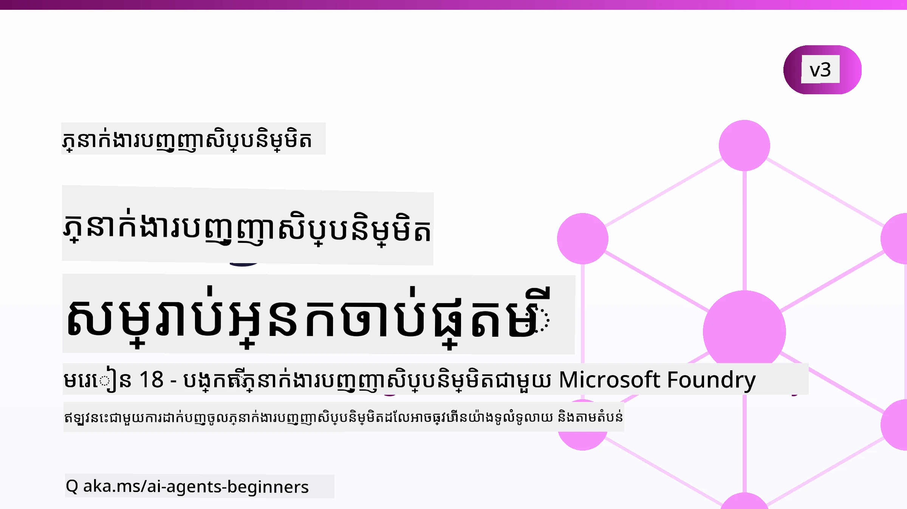

# ប្រតិទិន AI សម្រាប់អ្នកចាប់ផ្តើម - មុខវិជ្ជាមួយ



## មុខវិជ្ជា សូមបង្រៀនអ្វីៗទាំងអស់ដែលអ្នកត្រូវការដើម្បីចាប់ផ្តើមបង្កើតប្រតិទិន AI

[](https://github.com/microsoft/ai-agents-for-beginners/blob/master/LICENSE?WT.mc_id=academic-105485-koreyst)
[](https://GitHub.com/microsoft/ai-agents-for-beginners/graphs/contributors/?WT.mc_id=academic-105485-koreyst)
[](https://GitHub.com/microsoft/ai-agents-for-beginners/issues/?WT.mc_id=academic-105485-koreyst)
[](https://GitHub.com/microsoft/ai-agents-for-beginners/pulls/?WT.mc_id=academic-105485-koreyst)
[](http://makeapullrequest.com?WT.mc_id=academic-105485-koreyst)

### 🌐 គាំទ្រភាសាច្រើន

#### ការបម្លែងភាសាលើកដាក់ទុកដោយ [Co-op Translator](https://github.com/Azure/co-op-translator)

<!-- CO-OP TRANSLATOR LANGUAGES TABLE START -->
[Arabic](../ar/README.md) | [Bengali](../bn/README.md) | [Bulgarian](../bg/README.md) | [Burmese (Myanmar)](../my/README.md) | [Chinese (Simplified)](../zh-CN/README.md) | [Chinese (Traditional, Hong Kong)](../zh-HK/README.md) | [Chinese (Traditional, Macau)](../zh-MO/README.md) | [Chinese (Traditional, Taiwan)](../zh-TW/README.md) | [Croatian](../hr/README.md) | [Czech](../cs/README.md) | [Danish](../da/README.md) | [Dutch](../nl/README.md) | [Estonian](../et/README.md) | [Finnish](../fi/README.md) | [French](../fr/README.md) | [German](../de/README.md) | [Greek](../el/README.md) | [Hebrew](../he/README.md) | [Hindi](../hi/README.md) | [Hungarian](../hu/README.md) | [Indonesian](../id/README.md) | [Italian](../it/README.md) | [Japanese](../ja/README.md) | [Kannada](../kn/README.md) | [Khmer](./README.md) | [Korean](../ko/README.md) | [Lithuanian](../lt/README.md) | [Malay](../ms/README.md) | [Malayalam](../ml/README.md) | [Manipuri (Meitei Mayek)](../mni/README.md) | [Marathi](../mr/README.md) | [Nepali](../ne/README.md) | [Nigerian Pidgin](../pcm/README.md) | [Norwegian](../no/README.md) | [Persian (Farsi)](../fa/README.md) | [Polish](../pl/README.md) | [Portuguese (Brazil)](../pt-BR/README.md) | [Portuguese (Portugal)](../pt-PT/README.md) | [Punjabi (Gurmukhi)](../pa/README.md) | [Romanian](../ro/README.md) | [Russian](../ru/README.md) | [Serbian (Cyrillic)](../sr/README.md) | [Slovak](../sk/README.md) | [Slovenian](../sl/README.md) | [Spanish](../es/README.md) | [Swahili](../sw/README.md) | [Swedish](../sv/README.md) | [Tagalog (Filipino)](../tl/README.md) | [Tamil](../ta/README.md) | [Telugu](../te/README.md) | [Thai](../th/README.md) | [Turkish](../tr/README.md) | [Ukrainian](../uk/README.md) | [Urdu](../ur/README.md) | [Vietnamese](../vi/README.md)

> **ចូលចិត្តចម្លងមកក្នុងម៉ាស៊ីនរបស់អ្នក?**
>
> ទីគ្រប់ព្រាប់នេះមានការបម្លែងជាភាសា ៥០+ ដែលបង្កើនទំហំការទាញយកយ៉ាងខ្លាំង។ ដើម្បីចម្លងគ្មានការបម្លែងភាសា សូមប្រើ sparse checkout:
>
> **Bash / macOS / Linux:**
> ```bash
> git clone --filter=blob:none --sparse https://github.com/microsoft/ai-agents-for-beginners.git
> cd ai-agents-for-beginners
> git sparse-checkout set --no-cone '/*' '!translations' '!translated_images'
> ```
>
> **CMD (Windows):**
> ```cmd
> git clone --filter=blob:none --sparse https://github.com/microsoft/ai-agents-for-beginners.git
> cd ai-agents-for-beginners
> git sparse-checkout set --no-cone "/*" "!translations" "!translated_images"
> ```
>
> វានាំឲ្យអ្នកមានអ្វីដែលចាំបាច់ទាំងអស់ដើម្បីបញ្ចប់មុខវិជ្ជាមួយការទាញយកបានលឿនជាងមុន។
<!-- CO-OP TRANSLATOR LANGUAGES TABLE END -->

**សម្រាប់ជម្រើសភាសា​បន្ថែម សូមមើល [ភាសាដែល Co-op Translator គាំទ្រ](https://github.com/Azure/co-op-translator/blob/main/docs/supported-languages.md)។**

[](https://GitHub.com/microsoft/ai-agents-for-beginners/watchers/?WT.mc_id=academic-105485-koreyst)
[](https://GitHub.com/microsoft/ai-agents-for-beginners/network/?WT.mc_id=academic-105485-koreyst)
[](https://GitHub.com/microsoft/ai-agents-for-beginners/stargazers/?WT.mc_id=academic-105485-koreyst)

[](https://discord.com/invite/ATgtXmAS5D)


## 🌱 ចាប់ផ្តើម

មុខវិជ្ជានេះមានមេរៀនស្តីពីមូលដ្ឋាននៃការបង្កើតប្រតិទិន AI។ មេរៀននីមួយៗនិយាយពីប្រធានបទ របស់ខ្លួន ដូច្នេះចាប់ផ្តើមណាមួយដែលអ្នកចូលចិត្ត!

គាំទ្រភាសាច្រើនសម្រាប់មុខវិជ្ជានេះ។ ចូលទៅកាន់ [ភាសាដែលមាននៅទីនេះ](#-multi-language-support)។

ប្រសិនបើនេះជាលើកដំបូងរបស់អ្នកក្នុងការបង្កើតជាមួយម៉ូដែល generative AI សូមពិនិត្យមើលមុខវិជ្ជា [Generative AI For Beginners](https://aka.ms/genai-beginners) របស់យើង ដែលមាន ២១ មេរៀនស្តីពីការបង្កើតជាមួយ GenAI។

កុំភ្លេច [ផ្តល់ ផ្កាយ (🌟) លើ repo នេះ](https://docs.github.com/en/get-started/exploring-projects-on-github/saving-repositories-with-stars?WT.mc_id=academic-105485-koreyst) និង [សែល fork repo នេះ](https://github.com/microsoft/ai-agents-for-beginners/fork) ដើម្បីប្រតិបត្តិការ code។

### ជួបជាមួយអ្នករៀនផ្សេងទៀត សួរចម្លើយសំណួររបស់អ្នក

បើអ្នកមានក្តីចង់សួរឬមានសំណួរអំពីការបង្កើតប្រតិទិន AI សូមចូលរួមក្នុងប៊ូរី Discord ផ្តោតលេខខ្លួនក្នុង [Microsoft Foundry Discord](https://aka.ms/ai-agents/discord)។

### អ្វីដែលអ្នកត្រូវការ

មេរៀននីមួយៗក្នុងមុខវិជ្ជានេះមានឧទាហរណ៍កូដ ដែលអាចរកបាននៅក្នុងថត code_samples។ អ្នកអាច [fork repo នេះ](https://github.com/microsoft/ai-agents-for-beginners/fork) ដើម្បីបង្កើតច្បាប់ផ្ទាល់ខ្លួន។

ឧទាហរណ៍កូដក្នុងលំហាត់ទាំងនេះប្រើ Microsoft Agent Framework ជាមួយ Microsoft Foundry Agent Service V2៖

- [Microsoft Foundry](https://aka.ms/ai-agents-beginners/ai-foundry) - ត្រូវការគណនី Azure

មុខវិជ្ជានេះប្រើ Framework និងសេវាកម្ម AI Agent ដូចខាងក្រោមពី Microsoft៖

- [Microsoft Agent Framework (MAF)](https://learn.microsoft.com/agent-framework/overview/)
- [Microsoft Foundry Agent Service V2](https://aka.ms/ai-agents-beginners/ai-agent-service)

ឧទាហរណ៍កូដខ្លះៗគាំទ្រអ្នកផ្គត់ផ្គង់ជំនួសដែលស្របគ្នាជាមួយ OpenAI ដូចជា [MiniMax](https://platform.minimaxi.com/) ដែលផ្តល់ម៉ូដែល context ធំនៅរហូតដល់ ២០៤,០០០ tokens។ សូមមើល [Course Setup](./00-course-setup/README.md) សម្រាប់ព័ត៌មានកំណត់រចនា។

សម្រាប់ព័ត៌មានបន្ថែមអំពីរបៀបរត់កូដសម្រាប់មុខវិជ្ជានេះ ចូលទៅកាន់ [Course Setup](./00-course-setup/README.md)។

## 🙏 ចង់ជួយដែរឬទេ?

តើអ្នកមានយោបល់ ឬបានឃើញកំហុសសម្គាល់អក្សរ ឬកូដមែនទេ? សូម [បង្កើតបញ្ហា](https://github.com/microsoft/ai-agents-for-beginners/issues?WT.mc_id=academic-105485-koreyst) ឬ [បង្កើត pull request](https://github.com/microsoft/ai-agents-for-beginners/pulls?WT.mc_id=academic-105485-koreyst)


## 📂 មេរៀននីមួយៗមាន

- មេរៀនសរសេរនៅក្នុង README និងវីដេអូខ្លី
- ឧទាហរណ៍កូដ Python ប្រើ Microsoft Agent Framework ជាមួយ Microsoft Foundry
- តំណភ្ជាប់ទៅធនធានបន្ថែមសម្រាប់បន្តរៀន


## 🗃️ មេរៀន

| **មេរៀន**                                   | **អត្ថបទ និងកូដ**                                    | **វីដេអូ**                                                  | **ការរៀនបន្ថែម**                                                                     |
|----------------------------------------------|----------------------------------------------------|------------------------------------------------------------|----------------------------------------------------------------------------------------|
| ទិដ្ឋភាពទូទៅអំពី AI Agents និងករណីប្រើប្រាស់ | [Link](./01-intro-to-ai-agents/README.md)          | [Video](https://youtu.be/3zgm60bXmQk?si=z8QygFvYQv-9WtO1)  | [Link](https://aka.ms/ai-agents-beginners/collection?WT.mc_id=academic-105485-koreyst) |
| ស្វែងយល់អំពី AI Agentic Frameworks         | [Link](./02-explore-agentic-frameworks/README.md)  | [Video](https://youtu.be/ODwF-EZo_O8?si=Vawth4hzVaHv-u0H)  | [Link](https://aka.ms/ai-agents-beginners/collection?WT.mc_id=academic-105485-koreyst) |
| យល់ដឹងអំពីលំនាំរចនារបស់ AI Agentic       | [Link](./03-agentic-design-patterns/README.md)     | [Video](https://youtu.be/m9lM8qqoOEA?si=BIzHwzstTPL8o9GF)  | [Link](https://aka.ms/ai-agents-beginners/collection?WT.mc_id=academic-105485-koreyst) |
| លំនាំរចនាការប្រើប្រាស់ឧបករណ៍               | [Link](./04-tool-use/README.md)                    | [Video](https://youtu.be/vieRiPRx-gI?si=2z6O2Xu2cu_Jz46N)  | [Link](https://aka.ms/ai-agents-beginners/collection?WT.mc_id=academic-105485-koreyst) |
| Agentic RAG                                  | [Link](./05-agentic-rag/README.md)                 | [Video](https://youtu.be/WcjAARvdL7I?si=gKPWsQpKiIlDH9A3)  | [Link](https://aka.ms/ai-agents-beginners/collection?WT.mc_id=academic-105485-koreyst) |
| ការបង្កើតប្រតិទិន AI ដែលទុកចិត្តបាន      | [Link](./06-building-trustworthy-agents/README.md) | [Video](https://youtu.be/iZKkMEGBCUQ?si=jZjpiMnGFOE9L8OK ) | [Link](https://aka.ms/ai-agents-beginners/collection?WT.mc_id=academic-105485-koreyst) |
| លំនាំរចនាការរៀបចំផែនការណ៍               | [Link](./07-planning-design/README.md)             | [Video](https://youtu.be/kPfJ2BrBCMY?si=6SC_iv_E5-mzucnC)  | [Link](https://aka.ms/ai-agents-beginners/collection?WT.mc_id=academic-105485-koreyst) |
| លំនាំរចនាប្រតិទិនច្រើន                    | [Link](./08-multi-agent/README.md)                 | [Video](https://youtu.be/V6HpE9hZEx0?si=rMgDhEu7wXo2uo6g)  | [Link](https://aka.ms/ai-agents-beginners/collection?WT.mc_id=academic-105485-koreyst) |
| លំនាំរចនាការគិតគូរ                      | [Link](./09-metacognition/README.md)               | [Video](https://youtu.be/His9R6gw6Ec?si=8gck6vvdSNCt6OcF)  | [Link](https://aka.ms/ai-agents-beginners/collection?WT.mc_id=academic-105485-koreyst) |
| ប្រតិទិន AI នៅក្នុងផលិតកម្ម                  | [Link](./10-ai-agents-production/README.md)        | [Video](https://youtu.be/l4TP6IyJxmQ?si=31dnhexRo6yLRJDl)  | [Link](https://aka.ms/ai-agents-beginners/collection?WT.mc_id=academic-105485-koreyst) |
| ការប្រើប្រាស់ Agentic Protocols (MCP, A2A និង NLWeb) | [Link](./11-agentic-protocols/README.md)           | [Video](https://youtu.be/X-Dh9R3Opn8)                                 | [Link](https://aka.ms/ai-agents-beginners/collection?WT.mc_id=academic-105485-koreyst) |
| វិស្វកម្ម context សម្រាប់ AI Agents            | [Link](./12-context-engineering/README.md)         | [Video](https://youtu.be/F5zqRV7gEag)                                 | [Link](https://aka.ms/ai-agents-beginners/collection?WT.mc_id=academic-105485-koreyst) |
| ការគ្រប់គ្រងអង្គចងចាំ Agentic               | [Link](./13-agent-memory/README.md)     |      [Video](https://youtu.be/QrYbHesIxpw?si=vZkVwKrQ4ieCcIPx)                                                      |                                                                                        |
| ស្វែងយល់ Microsoft Agent Framework          | [Link](./14-microsoft-agent-framework/README.md)                            |                                                            |                                                                                        |
| បង្កើតប្រតិទិនប្រើកុំព្យូទ័រ (CUA)          | [Link](./15-browser-use/README.md)     |                                                            | [Link](https://docs.browser-use.com/examples/templates/playwright-integration)         |
| ចាក់បញ្ចូនប្រតិទិនជំរឿន                  | [Link](./16-deploying-scalable-agents/README.md) |                                                    | [Link](https://learn.microsoft.com/azure/ai-foundry/agents/overview)                   |
| បង្កើតប្រតិទិន AI មូលដ្ឋាន                | [Link](./17-creating-local-ai-agents/README.md)  |                                                    | [Link](https://learn.microsoft.com/azure/ai-foundry/foundry-local/)                    |
| ការពារប្រតិទិន AI                           | [Link](./18-securing-ai-agents/README.md)  |                                                            | [Link](https://aka.ms/ai-agents-beginners/collection?WT.mc_id=academic-105485-koreyst) |

## 🎒 មុខវិជ្ជាផ្សេងទៀត

ក្រុមរបស់យើងបង្កើតមុខវិជ្ជាផ្សេងទៀត! សូមមើល:

<!-- CO-OP TRANSLATOR OTHER COURSES START -->
### LangChain
[](https://aka.ms/langchain4j-for-beginners)
[](https://aka.ms/langchainjs-for-beginners?WT.mc_id=m365-94501-dwahlin)
[](https://github.com/microsoft/langchain-for-beginners?WT.mc_id=m365-94501-dwahlin)
---

### Azure / Edge / MCP / Agents
[](https://github.com/microsoft/AZD-for-beginners?WT.mc_id=academic-105485-koreyst)
[](https://github.com/microsoft/edgeai-for-beginners?WT.mc_id=academic-105485-koreyst)
[](https://github.com/microsoft/mcp-for-beginners?WT.mc_id=academic-105485-koreyst)
[](https://github.com/microsoft/ai-agents-for-beginners?WT.mc_id=academic-105485-koreyst)

---
 
### Generative AI Series
[](https://github.com/microsoft/generative-ai-for-beginners?WT.mc_id=academic-105485-koreyst)
[-9333EA?style=for-the-badge&labelColor=E5E7EB&color=9333EA)](https://github.com/microsoft/Generative-AI-for-beginners-dotnet?WT.mc_id=academic-105485-koreyst)
[-C084FC?style=for-the-badge&labelColor=E5E7EB&color=C084FC)](https://github.com/microsoft/generative-ai-for-beginners-java?WT.mc_id=academic-105485-koreyst)
[-E879F9?style=for-the-badge&labelColor=E5E7EB&color=E879F9)](https://github.com/microsoft/generative-ai-with-javascript?WT.mc_id=academic-105485-koreyst)

---
 
### ការសិក្សាមេរៀនស្នូល
[](https://aka.ms/ml-beginners?WT.mc_id=academic-105485-koreyst)
[](https://aka.ms/datascience-beginners?WT.mc_id=academic-105485-koreyst)
[](https://aka.ms/ai-beginners?WT.mc_id=academic-105485-koreyst)
[](https://github.com/microsoft/Security-101?WT.mc_id=academic-96948-sayoung)
[](https://aka.ms/webdev-beginners?WT.mc_id=academic-105485-koreyst)
[](https://aka.ms/iot-beginners?WT.mc_id=academic-105485-koreyst)
[](https://github.com/microsoft/xr-development-for-beginners?WT.mc_id=academic-105485-koreyst)

---
 
### ស៊េរី Copilot
[](https://aka.ms/GitHubCopilotAI?WT.mc_id=academic-105485-koreyst)
[](https://github.com/microsoft/mastering-github-copilot-for-dotnet-csharp-developers?WT.mc_id=academic-105485-koreyst)
[](https://github.com/microsoft/CopilotAdventures?WT.mc_id=academic-105485-koreyst)
<!-- CO-OP TRANSLATOR OTHER COURSES END -->

## 🌟 អរគុណសហគមន៍

អរគុណ [Shivam Goyal](https://www.linkedin.com/in/shivam2003/) ចំពោះការរួមចំណែកគំរូកូដសំខាន់ៗ ដែលបង្ហាញអំពី Agentic RAG។ 

## ការរួមចំណែក

គម្រោងនេះស្វាគមន៍ការរួមចំណែក និងអនុសាសន៍។ ការរួមចំណែកភាគច្រើនត្រូវការឱ្យអ្នកយល់ព្រមនឹង
កិច្ចព្រមព្រៀងអាជ្ញាបណ្ណអ្នករួមចំណែក (CLA) ដែលប្រកាសថា អ្នកមានសិទ្ធិ និងពិតជាមានសិទ្ធិ
ផ្តល់សិទ្ធិដល់យើងក្នុងការប្រើប្រាស់ការរួមចំណែករបស់អ្នក។ សម្រាប់ព័ត៌មានលម្អិត សូមទៅកាន់ <https://cla.opensource.microsoft.com>។

ពេលអ្នកដាក់សំណើទាញយក (pull request) ម្ចាស់ CLA bot នឹងកំណត់ដោយស្វ័យប្រវត្តិថាតើអ្នកត្រូវការផ្តល់
CLA ឬទេ ហើយតាងសញ្ញារបស់ PR ឲ្យសមរម្យ (ឧ. ពិនិត្យស្ថានភាព ការបញ្ចេញមតិ)។ គ្រាន់តែអនុវត្តតាមការណែនាំដែល
បញ្ជាក់ដោយ bot។ អ្នកត្រូវធ្វើរួចតែម្តងតែម្ដងសម្រាប់រាល់ repo ទាំងអស់ដែលប្រើ CLA របស់យើង។

គម្រោងនេះមានការអនុម័ត [កូដអធិប្បាយចេញពី Microsoft](https://opensource.microsoft.com/codeofconduct/)។
សម្រាប់ព័ត៌មានបន្ថែម សូមមើល [សំណួរញឹកញាប់អំពីកូដអធិប្បាយ](https://opensource.microsoft.com/codeofconduct/faq/) ឬ
ទំនាក់ទំនង [opencode@microsoft.com](mailto:opencode@microsoft.com) ប្រសិនបើមានសំណួរឬមតិយោបល់បន្ថែម។

## ម៉ាកពាណិជ្ជកម្ម

គម្រោងនេះអាចមានម៉ាកពាណិជ្ជកម្មឬរូបសញ្ញាសម្រាប់គម្រោង ផលិតផល ឬសេវាកម្ម។ ការប្រើប្រាស់បានអនុញ្ញាត
នៃម៉ាក Microsoft ឬរូបសញ្ញា ត្រូវបានគ្រប់គ្រង និងត្រូវអនុវត្តប្រាប់បញ្ជាក់ក្នុង
[មគ្គុទេសក៍ម៉ាកនិងម៉ាកពាណិជ្ជកម្ម Microsoft](https://www.microsoft.com/legal/intellectualproperty/trademarks/usage/general)។
ការប្រើប្រាស់ម៉ាក Microsoft ឬរូបសញ្ញា នៅក្នុងកំណែបានកែប្រែកម្មវិធីនេះ មិនគួរបង្កការភាន់ច្រឡំឬស្មើការឧបត្ថម្ភជាផ្លូវការពី Microsoft។
ការប្រើប្រាស់ម៉ាកឬរូបសញ្ញាជាភាគីទីបី គឺត្រូវ​មានគោលការណ៍ពីភាគីទីបីនោះ។

## ការទទួលបានជំនួយ


ប្រសិនបើអ្នកស្ទាក់ឬមានសំណួរអំពីការបង្កើតកម្មវិធី AI សូមចូលរួម៖

[](https://aka.ms/foundry/discord)

ប្រសិនបើអ្នកមានមតិយោបល់ផលិតផល ឬកំហុសខណៈបង្កើត សូមទៅកាន់៖

[](https://aka.ms/foundry/forum)

---

<!-- CO-OP TRANSLATOR DISCLAIMER START -->
**ការបដិសេធ**:
ឯកសារនេះត្រូវបានបម្លែងភាសា ដោយប្រើសេវាបម្លែងភាសា AI [Co-op Translator](https://github.com/Azure/co-op-translator)។ ទោះយើងខ្ញុំមានក្តីប្រាថ្នាឱ្យបានច្បាស់លាស់ តែសូមយល់ដឹងថាការបម្លែងដោយស្វ័យប្រវត្តិក៏អាចមានកំហុសឬភាពមិនត្រឹមត្រូវ។ ឯកសារដើមជាភាសាទីតាំងគួរត្រូវបានគេប្រើជាប្រភពច្បាស់លាស់។ សម្រាប់ព័ត៌មានសំខាន់ៗ សូមណែនាំឱ្យប្រើប្រាស់ការប្រែដោយមនុស្សជំនាញ។ យើងខ្ញុំមិនទទួលខុសត្រូវចំពោះការយល់ច្រឡំ ឬការបកស្រាយខុសបន្ទាប់ពីការប្រើប្រាស់ការបម្លែងនេះនោះទេ។
<!-- CO-OP TRANSLATOR DISCLAIMER END -->