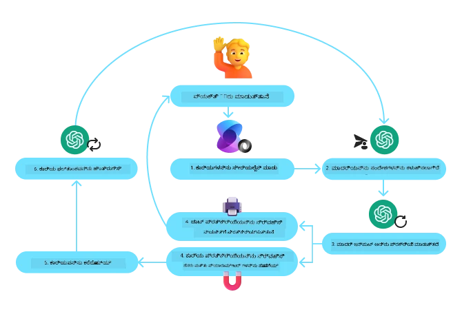
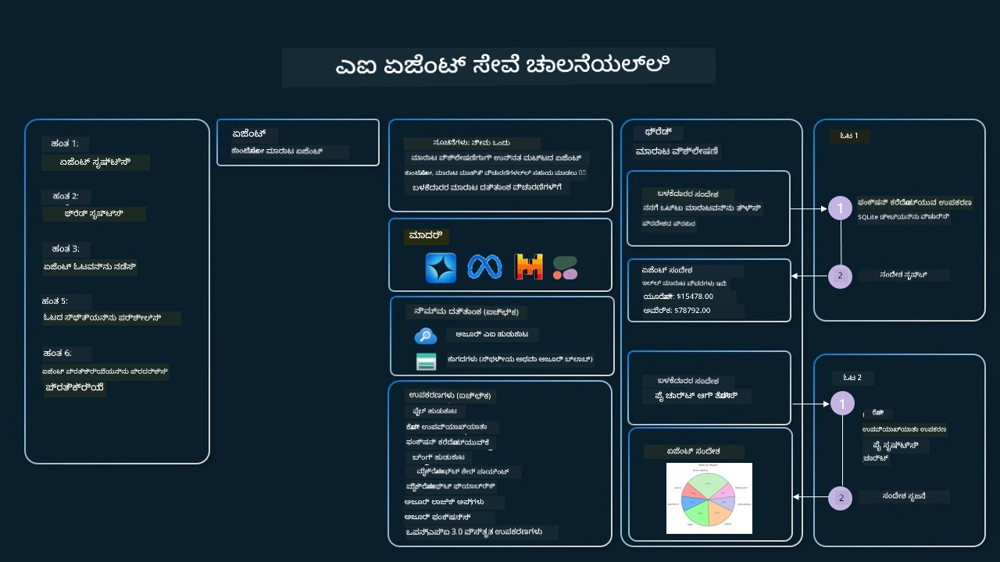

[](https://youtu.be/vieRiPRx-gI?si=cEZ8ApnT6Sus9rhn)

> _(ಈ ಪಾಠದ വീഡിയോವನ್ನು ನೋಡಲು ಮೇಲಿನ ಚಿತ್ರವನ್ನು ಕ್ಲಿಕ್ ಮಾಡಿ)_

# ಟೂಲ್ ಬಳಕೆ ವಿನ್ಯಾಸ ಮಾದರಿ

ಟೂಲ್‌ಗಳು ಆಸಕ್ತಿದಾಯಕವಾಗಿವೆ ಏಕೆಂದರೆ ಅವು AI ಏಜೆಂಟ್‌ಗಳಿಗೆ ವ್ಯಾಪಕ ಶಕ್ತಿಗಳನ್ನು ನೀಡುತ್ತವೆ. ಏಜೆಂಟ್ ಬಳಿ ನಿರ್ದಿಷ್ಟ ಕಾರ್ಯಗಳ ಸೀಮಿತ ಕಡತವಿರುವಿಕೆ ಬದಲಿಗೆ, ಒಂದು ಟೂಲ್‌ನ್ನು ಸೇರಿಸುವ ಮೂಲಕ, ಏಜೆಂಟ್ ಇದೀಗ ವ್ಯಾಪಕ ಚಟುವಟಿಕೆಗಳನ್ನು ನಡೆಸಬಹುದು. ಈ ಅಧ್ಯಾಯದಲ್ಲಿ, ನಾವು ಟೂಲ್ ಬಳಕೆ ವಿನ್ಯಾಸ ಮಾದರಿಯನ್ನು ನೋಡೋಣ, ಇದು AI ಏಜೆಂಟ್‌ಗಳು ತಮ್ಮ ಗುರಿಗಳಿಗೆ ತಲುಪಲು ವಿಶೇಷ ಟೂಲ್‌ಗಳನ್ನು ಹೇಗೆ ಬಳಸಬಹುದು ಎಂಬುದನ್ನು ವಿವರಿಸುತ್ತದೆ.

## ಪರಿಚಯ

ಈ ಪಾಠದಲ್ಲಿ, ನಾವು ಕೆಳಗಿನ ಪ್ರಶ್ನೆಗಳಿಗೆ ಉತ್ತರವನ್ನು ಹುಡುಕುತ್ತಿದ್ದೇವೆ:

- ಟೂಲ್ ಬಳಕೆ ವಿನ್ಯಾಸ ಮಾದರಿ ಎಂದರೆ ಏನು?
- ಇದನ್ನು ಬಳಸಬಹುದಾದ ಉಪಯೋಗಿಕೆಯುಗಳು ಯಾವುವು?
- ವಿನ್ಯಾಸ ಮಾದರಿಯನ್ನು ಜಾರಿ ಮಾಡಲು ಅಗತ್ಯವಿರುವ ಅಂಶಗಳು/ನಿರ್ಮಾಣ ಘಟಕಗಳು ಯಾವುವು?
- ನಂಬಿಕೆಮಯ AI ಏಜೆಂಟ್‌ಗಳನ್ನು ಕಟ್ಟಲು ಟೂಲ್ ಬಳಕೆ ವಿನ್ಯಾಸ ಮಾದರಿಯನ್ನು ಬಳಸುವಾಗ ವಿಶೇಷ ಪರಿಗಣನೆಗಳು ಯಾವುವು?

## ಕಲಿಕೆಯ ಗುರಿಗಳು

ಈ ಪಾಠವನ್ನು ಪೂರ್ಣಗೊಳಿಸಿದ ಬಳಿಕ, ನೀವು ಯೋಗ್ಯವಾಗಿರುತ್ತೀರಿ:

- ಟೂಲ್ ಬಳಕೆ ವಿನ್ಯಾಸ ಮಾದರಿಯನ್ನು ಮತ್ತು ಅದರ ಉದ್ದೇಶವನ್ನು ವಿವರಣೆ ಮಾಡುವುದು.
- ಟೂಲ್ ಬಳಕೆ ವಿನ್ಯಾಸ ಮಾದರಿ ಅನ್ವಯಿಸಬಹುದಾದ ಉಪಯೋಗಾಂತರಗಳನ್ನು ಗುರುತಿಸುವುದು.
- ವಿನ್ಯಾಸ ಮಾದರಿಯನ್ನು ಜಾರಿ ಮಾಡಲು ಅಗತ್ಯವಿದ್ದ ಮುಖ್ಯ ಅಂಶಗಳನ್ನು ಅರ್ಥಮಾಡಿಕೊಳ್ಳುವುದು.
- ಈ ವಿನ್ಯಾಸ ಮಾದರಿಯನ್ನು ಬಳಸಿ ನಂಬಿಕೆಮಯತೆಯನ್ನು ಖಚಿತಪಡಿಸುವ ಪರಿಗಣನೆಗಳನ್ನ ಗುರುತಿಸುವುದು.

## ಟೂಲ್ ಬಳಕೆ ವಿನ್ಯಾಸ ಮಾದರಿ ಎಂದರೆ ಏನು?

**ಟೂಲ್ ಬಳಕೆ ವಿನ್ಯಾಸ ಮಾದರಿ** LLM ಗಳು ನಿರ್ದಿಷ್ಟ ಗುರಿಗಳನ್ನು ಸಾಧಿಸಲು ಬಾಹ್ಯ ಸಾಧನಗಳೊಂದಿಗೆ ಸಂವಹನ ನಡೆಸುವ ಸಾಮರ್ಥ್ಯವನ್ನು ನೀಡುತ್ತದೆ. ಟೂಲ್ ಎಂದರೆ ಏಜೆಂಟ್ ಕಾರ್ಯಗಳನ್ನು ನೆರವೇರಿಸಲು ಕಾರ್ಯಗತಗೊಳಿಸಬಹುದಾದ ಕೋಡ್. ಟೂಲ್ ಸರಳ ಕಾರ್ಯವಾಗಿರಬಹುದು, ಉದಾಹರಣೆಗೆ ಕ್ಯಾಲ್ಕುಲೇಟರ್, ಅಥವಾ ಥರ್ಡ್-ಪಾರ್ಟಿ ಸೇವೆಗೆ API ಕರೆ, ಉದಾಹರಣೆಗೆ ಷೇರು ಬೆಲೆLookup ಅಥವಾ ಹವಾಮಾನ ಭವಿಷ್ಯವಾಣಿ. AI ಏಜೆಂಟ್‌ಗಳ ಪ್ರಪಂಚದಲ್ಲಿ, ಟೂಲ್‌ಗಳು **ಮಾದರಿ-ತಯಾರಿಸಿದ ಕಾರ್ಯ ಕರೆಗಳಿಗೆ** ಪ್ರತಿಕ್ರಿಯೆ ನೀಡಲು ಏಜೆಂಟ್‌ಗಳು ಕಾರ್ಯಗತಗೊಳಿಸುವಂತೆ ವಿನ್ಯಾಸಗೊಳಿಸಲ್ಪಟ್ಟಿವೆ.

## ಇದನ್ನು ಯಾವ ಉಪಯೋಗಿಕೆಗಳಿಗೆ ಅನ್ವಯಿಸಬಹುದು?

AI ಏಜೆಂಟ್‌ಗಳು ಸಂಕೀರ್ಣ ಕಾರ್ಯಗಳನ್ನು ಪೂರ್ಣಗೊಳಿಸಲು, ಮಾಹಿತಿಯನ್ನು ಪಡೆದುಕೊಳ್ಳಲು ಅಥವಾ ನಿರ್ಣಯಗಳನ್ನು ಮಾಡಲು ಟೂಲ್‌ಗಳನ್ನು ಬಳಸಬಹುದು. ಟೂಲ್ ಬಳಕೆ ವಿನ್ಯಾಸ ಮಾದರಿ ಸಾಮಾನ್ಯವಾಗಿ ಬಾಹ್ಯ ವ್ಯವಸ್ಥೆಗಳೊಂದಿಗೆ ಡೈನಮಿಕ್ ಸಂವಹನ ಬೇಕಾಗುವ ಸಂದರ್ಭಗಳಲ್ಲಿ ಬಳಸಲಾಗುತ್ತದೆ, ಉದಾಹರಣೆಗಾಗಿ ಡೇಟಾಬೇಸ್‌ಗಳು, ವೆಬ್ ಸೇವೆಗಳು, ಅಥವಾ ಕೋಡ್ ಇಂಟರ್ಪ್ರೆಟರ್‌ಗಳು. ಈ ಸಾಮರ್ಥ್ಯ ಹಲವು ಉಪಯೋಗಿಕೆಗಳಿಗೆ ಪ್ರಯುಕ್ತವಾಗಿದೆ, ಉದಾಹರಣೆಗಾಗಿ:

- **ಡೈನಮಿಕ್ ಮಾಹಿತಿ ಪಡೆದು ಕೊಳ್ಳುವಿಕೆ:** ಏಜೆಂಟ್‌ಗಳು ಬಾಹ್ಯ API ಗಳು ಅಥವಾ ಡೇಟಾಬೇಸ್‌ಗಳನ್ನು ಕೇಳಲು ನಿಯತಾಂಕಿತ ಡೇಟಾವನ್ನು ತರಲು (ಉದಾ: SQLite ಡೇಟಾಬೇಸ್‌ನಲ್ಲಿ ಡೇಟಾ ವಿಶ್ಲೇಷಣೆ, ಷೇರು ಬೆಲೆ ಅಥವಾ ಹವಾಮಾನ ಮಾಹಿತಿಯನ್ನು ಪಡೆಯಲು).
- **ಕೋಡ್ ಕಾರ್ಯಗತಗೊಳ್ಳಿಸುವಿಕೆ ಮತ್ತು ವ್ಯಾಖ್ಯಾನ:** ಏಜೆಂಟ್‌ಗಳು ಗಣಿತ ಸಮಸ್ಯೆಗಳನ್ನು ಬಗೆಹರಿಸಲು, ವರದಿಗಳನ್ನು ತಯಾರಿಸಲು ಅಥವಾ ಅನುಕರಣೆ ನಡೆಸಲು ಕೋಡ್ ಅಥವಾ ಸ್ಕ್ರಿಪ್ಟ್ಗಳನ್ನು ಕಾರ್ಯಗತಗೊಳಿಸಬಹುದು.
- **ಕಾರ್ಯಪ್ರವಾಹ ಸ್ವಯಂಚಾಲನೆ:** ಕಾರ್ಯ ನಿರ್ವಾಹಕರ, ಇಮೇಲ್ ಸೇವೆಗಳು, ಡೇಟಾ ಪೈಪ್‌ಲೈನ್‌ಗಳು ಮುಂತಾದವುಗಳನ್ನು ಸಮನ್ವಯಗೊಳಿಸಿ ಪುನರಾವರ್ತನೆಯ ಕಾರ್ಯಪ್ರವಾಹಗಳನ್ನು ಸ್ವಯಂಚಾಲಿತಗೊಳಿಸುವುದು.
- **ಗ್ರಾಹಕ ಬೆಂಬಲ:** CRM ವ್ಯವಸ್ಥೆಗಳು, ಟಿಕೆಟ್‌ ಪ್ಲಾಟ್‌ಫಾರ್ಮ್‌ಗಳು, ಅಥವಾ ಜ್ಞಾನ ಆಧಾರಗಳೊಂದಿಗೆ ಸಂವಹನ ನಡೆಸಿ ಬಳಕೆದಾರ ಪ್ರಶ್ನೆಗಳಿಗೆ ಉತ್ತರಿಸುವುದು.
- **ವಿಷಯ ನಿರ್ಮಾಣ ಮತ್ತು ಸಂಪಾದನೆ:** ವ್ಯಾಕರಣ ತಪಾಸಕರು, ಪಠ್ಯ ಸರಂಕ್ಷೇಪಕರು ಅಥವಾ ವಿಷಯ ಭದ್ರತೆ ಮೌಲ್ಯಮಾಪಕಗಳನ್ನು ಬಳಸಿಕೊಂಡು ವಿಷಯ ಸೃಷ್ಟಿ ಕಾರ್ಯಗಳಲ್ಲಿ ಸಹಾಯ ಮಾಡುವುದು.

## ಟೂಲ್ ಬಳಕೆ ವಿನ್ಯಾಸ ಮಾದರಿಯನ್ನು ಜಾರಿ ಮಾಡಲು ಅಗತ್ಯವಿರುವ ಅಂಶಗಳು/ನಿರ್ಮಾಣ ಘಟಕಗಳು ಯಾವುವು?

ಈ ನಿರ್ಮಾಣ ಘಟಕಗಳು AI ಏಜೆಂಟ್‌ಗೆ ವ್ಯಾಪಕ ಕಾರ್ಯಗಳನ್ನು ನೆರවೇರಿಸಲು ಸಹಾಯ ಮಾಡುತ್ತವೆ. ಟೂಲ್ ಬಳಕೆ ವಿನ್ಯಾಸ ಮಾದರಿಯನ್ನು ಜಾರಿ ಮಾಡಲು ಅಗತ್ಯವಿರುವ ಮುಖ್ಯ ಅಂಶಗಳನ್ನು ತಿಳಿಯೋಣ:

- **ಕಾರ್ಯ/ಟೂಲ್ ಸ್ಕೀಮಾಗಳು**: ಲಭ್ಯವಿರುವ ಟೂಲ್ಸ್‌ಗಳ ವಿವರವಾದ ವ್ಯಾಖ್ಯಾನಗಳು, ಪರಿಣಾಮಕಾರಿಯಾಗಿರುವ ಕಾರ್ಯ ಹೆಸರು, ಉದ್ದೇಶ, ಅಗತ್ಯವಿರುವ ನಿಯತಾಂಕಗಳು ಮತ್ತು ನಿರೀಕ್ಷಿತ ಉತ್ಪನ್ನಗಳು. ಈ ಸ್ಕೀಮಾಗಳು LLM ಗೆ ಯಾವ ಟೋಲ್‌ಗಳು ಲಭ್ಯವಿವೆ ಮತ್ತು ಮಾನ್ಯ ವಿನಂತಿಗಳನ್ನು ಹೇಗೆ ರಚಿಸುವುದೆಂದು ಅರ್ಥಮಾಡಿಕೊಳ್ಳಲು ಸಹಾಯ ಮಾಡುತ್ತವೆ.

- **ಕಾರ್ಯ ಕಾರ್ಯಗತಗೊಳಿಸುವಿಕೆ ತಂತ್ರಜ್ಞಾನ:** ಬಳಕೆದಾರ ಉದ್ದೇಶ ಮತ್ತು ಸಂಭಾಷಣೆ ಸನ್ನಿವೇಶವನ್ನು ಆಧರಿಸಿ ಟೂಲ್ಸ್ ಅನ್ನು ಯಾವಾಗ ಮತ್ತು ಹೇಗೆ ಕರೆಸಬೇಕು ಎಂಬುದನ್ನು ನಿಯಂತ್ರಿಸುತ್ತದೆ. ಇದರಲ್ಲಿ ಯೋಜಕ ಘಟಕಗಳು, ಮಾರ್ಗ ನಿರ್ಧಾರ ವಿಧಾನಗಳು ಅಥವಾ ಷರತ್ತು ಪ್ರತಿಭಟನಾಪಂಥಗಳು ಸೇರಬಹುದು.

- **ಸಂದೇಶ ನಿರ್ವಹಣಾ ವ್ಯವಸ್ಥೆ:** ಬಳಕೆದಾರ ಇನ್ಪುಟ್, LLM ಪ್ರತಿಕ್ರಿಯೆಗಳು, ಟೂಲ್ ಕರೆಗಳು ಮತ್ತು ಟೂಲ್ ಫಲಿತಾಂಶಗಳ ನಡುವಿನ ಸಂಭಾಷಣಾ ಹರಿವನ್ನು ನಿರ್ವಹಿಸುವ ಘಟಕಗಳು.

- **ಟೂಲ್ ಸಮಗ್ರಣೆ ಆಯ್ಕೆಮಾಡುವಿಕೆ:** ಏಜೆಂಟ್ ಅನ್ನು ವಿವಿಧ ಟೂಲ್ಸ್‌ಗಳಿಗೆ ಸಂಪರ್ಕಿಸುವ ಮೂಲಸೌಕರ್ಯ, ಆಗಾಗಿ ಸರಳ ಕಾರ್ಯಗಳಾಗಲಿ ಅಥವಾ ಸಂಕೀರ್ಣ ಬಾಹ್ಯ ಸೇವೆಗಳಾಗಲಿ.

- **ದೋಷ ನಿರ್ವಹಣೆ ಮತ್ತು ಪರಿಶೀಲನೆ:** ಟೂಲ್ ಕಾರ್ಯಗತಗೊಳಿಸುವಿಕೆ ವೈಫಲ್ಯಗಳ ಸಂಭಾಳನೆ, ನಿಯತಾಂಕಗಳನ್ನು ಪರಿಶೀಲಿಸುವುದು ಮತ್ತು ಅನಪೇಕ್ಷಿತ ಪ್ರತಿಕ್ರಿಯೆಗಳನ್ನು ನಿಭಾಯಿಸುವ ವ್ಯವಸ್ಥೆಗಳು.

- **ಸ್ಥಿತಿ ನಿರ್ವಹಣೆ:** ಸಂಭಾಷಣೆ ಸನ್ನಿವೇಶ, ಹಿಂದಿನ ಟೂಲ್ ಸಂವಹನಗಳು ಮತ್ತು ಸತತ ಡೇಟಾವನ್ನು ಟ್ರ್ಯಾಕ್ ಮಾಡಿ ಬಹು-ತಿರುವು ಸಂವಹನಗಳಲ್ಲಿ ಸಾಂದರ್ಭಿಕತೆಯನ್ನು ಖಚಿತಪಡಿಸುವುದು.

ಮುಂದಾಗಿ, ಕಾರ್ಯ/ಟೂಲ್ ಕರೆ ಮಾಡುವಿಕೆ ಬಗ್ಗೆ ಇನ್ನು ವಿವರವಾಗಿ ನೋಡೋಣ.
 
### ಕಾರ್ಯ/ಟೂಲ್ ಕರೆ ಮಾಡುವಿಕೆ

ಕಾರ್ಯ ಕರೆ ಮಾಡುವಿಕೆ LLM ಗಳು ಟೂಲ್ಸ್ ಜೊತೆ ಸಂವಹನ ಮಾಡುವ ಪ್ರಧಾನ ವಿಧಾನವಾಗಿದೆ. 'ಕಾರ್ಯ' ಮತ್ತು 'ಟೂಲ್' ಎಂಬ ಪದಗಳು ಸಾಮಾನ್ಯವಾಗಿ ಪರಸ್ಪರ ಬಳಕೆಯಲ್ಲಿರುತ್ತವೆ ಏಕೆಂದರೆ 'ಕಾರ್ಯಗಳು' (ಮರುಬಳಸಬಹುದಾದ ಕೋಡ್ ವಿಭಾಗಗಳು) 'ಟೂಲ್ಸ್' ಆಗಿರುತ್ತವೆ ಏಜೆಂಟ್‌ಗಳು ಕಾರ್ಯಗಳನ್ನು ನೆರವೇರಿಸಲು ಬಳಸುವవి. ಕಾರ್ಯದ ಕೋಡ್ ಅನ್ನು ಕಾರ್ಯಗತಗೊಳಿಸಲು, LLM ಬಳಕೆದಾರರ ವಿನಂತಿಯನ್ನು ಕಾರ್ಯದ ವಿವರಣೆಯ ವಿರುದ್ಧ ಹೋಲಿಸಬೇಕು. ಇದಕ್ಕಾಗಿ ಎಲ್ಲಾ ಲಭ್ಯವಿರುವ ಕಾರ್ಯಗಳ ವಿವರಣೆಗಳು ಇದ್ದೊಂದಿ schemas LLM ಗೆ ಕಳುಹಿಸಲಾಗುತ್ತದೆ. ನಂತರ LLM ಕಾರ್ಯವೈಶಿಷ್ಟ್ಯಗಳಿಗೆ ತಕ್ಕಂತೆ ಅತ್ಯುತ್ತಮ ಕಾರ್ಯವನ್ನು ಆಯ್ಕೆಮಾಡಿ ಅದರ ಹೆಸರು ಮತ್ತು ನಿರ್ವಹಣಾಂಶಗಳನ್ನು ಆಮದ್ದಾಗಿಸುತ್ತದೆ. ಆಯ್ಕೆ ಮಾಡಿದ ಕಾರ್ಯ ಕಾರ್ಯಗತಗೊಳಿಸುವಾಗ, ಅದರ ಪ್ರತಿಕ್ರಿಯೆಯನ್ನು LLM ಗೆ ಹಿಂತಿರುಗಿಸಲಾಗುತ್ತದೆ, ಇದು ಆ ಮಾಹಿತಿಯನ್ನು ಬಳಸಿ ಬಳಕೆದಾರ ವಿನಂತಿಗೆ ಪ್ರತಿಕ್ರಿಯಿಸುತ್ತದೆ.

ಏಜೆಂಟ್‌ಗಳಿಗೆ ಕಾರ್ಯಕಾಲಿಂಗ್ ಜಾರಿಮಾಡಲು ಡೆವಲಪರ್‌ಗಳು ಈ ಕೆಳಗಿನವುಗಳನ್ನು ಅಗತ್ಯಪಡಿಸುತ್ತಾರೆ:

1. ಕಾರ್ಯಕಾಲಿಂಗ್‌ಗೆ ಬೆಂಬಲ ನೀಡುವ LLM ಮಾದರಿ
2. ಕಾರ್ಯ ವಿವರಣೆಗಳಿರುವ schema
3. ಪ್ರತಿ ಕಾರ್ಯಕ್ಕಾಗಿ ಬೇಕಾದ ಕೋಡ್

ನಗರದಲ್ಲಿ ಪ್ರಸ್ತುತ ಸಮಯ ಪಡೆಯುವ ಉದಾಹರಣೆಯನ್ನು ಬಳಸೋಣ:

1. **ಕಾರ್ಯಕಾಲಿಂಗ್ ಬೆಂಬಲದ LLM ಅನ್ನು ಪ್ರಾರಂಭಿಸಿ:**

    ಎಲ್ಲಾ ಮಾದರಿಗಳು ಕಾರ್ಯಕಾಲಿಂಗ್‌ನ್ನು ಬೆಂಬಲಿಸುವುದಿಲ್ಲ, ಆದ್ದರಿಂದ ನೀವು ಬಳಸುತ್ತಿರುವ LLM ಇದನ್ನು ಬೆಂಬಲಿಸುವುದೇ ಎಂಬುದನ್ನು ಪರಿಶೀಲಿಸುವುದು ಮಹತ್ವದ್ದು. <a href="https://learn.microsoft.com/azure/ai-services/openai/how-to/function-calling" target="_blank">Azure OpenAI</a> ಕಾರ್ಯಕಾಲಿಂಗ್ ಅನ್ನು ಬೆಂಬಲಿಸುತ್ತದೆ. ನಾವು ಮಂಗಳೂರು OpenAI ಕ್ಲೈಂಟ್ ಅನ್ನು Azure OpenAI **ಪ್ರತಿಕ್ರಿಯಾ API** ವಿರುದ್ಧ ಪ್ರಾರಂಭಿಸಬಹುದು (ಸ್ಥಿರ `/openai/v1/` ಎಂಡ್‌ಪಾಯಿಂಟ್ — ಯಾವುದೇ `api_version` ಅಗತ್ಯವಿಲ್ಲ).

    ```python
    # Initialize the OpenAI client for Azure OpenAI (Responses API, v1 endpoint)
    client = OpenAI(
        base_url=f"{os.environ['AZURE_OPENAI_ENDPOINT'].rstrip('/')}/openai/v1/",
        api_key=os.environ["AZURE_OPENAI_API_KEY"],
    )
    deployment_name = os.environ["AZURE_OPENAI_DEPLOYMENT"]
    ```

1. **ಕಾರ್ಯ schema ರಚಿಸಿ**:

    ಮುಂದಾಗಿ ನಾವು JSON schema ಅನ್ನು ವ್ಯಾಖ್ಯಾನಿಸುವೆವು, ಇದು ಕಾರ್ಯದ ಹೆಸರು, ಮುಂದೆ ಕಾರ್ಯ ಮಾಡೋದೇನು ಎಂಬ ವಿವರಣೆ ಮತ್ತು ಕಾರ್ಯ ನಿಯತಾಂಕಗಳ ಹೆಸರು ಮತ್ತು ವಿವರಣೆಗಳನ್ನು ಒಳಗೊಳ್ಳುತ್ತದೆ.
    ನಂತರ ಈ schema ಅನ್ನು ಮತ್ತು ಬಳಕೆದಾರರ ವಿನಂತಿಯನ್ನು ಒಳಗೊಂಡಂತೆ ಹಿಂದಿನದಾಗಿ ರಚಿಸಿದ್ದ ಕ್ಲೈಂಟ್‌ಗೆ ಕಳುಹಿಸೋಣ, ಉದಾಹರಣೆಗೆ ಸ್ಯಾನ್ ಫ್ರಾನ್ಸಿಸ್ಕೋದಲ್ಲಿ ಕಾಲಾವಧಿ ಕಂಡುಹಿಡಿಯಲು. ಮುಖ್ಯವಾಗಿ ಗಮನಿಸಲು ಬೇಕಾದ್ದೆಂದರೆ **ಟೂಲ್ ಕರೆ** ಮಾತ್ರ ಹಿಂತಿರುಗಿಸಲಾಗುತ್ತದೆ, **ಪ್ರಶ್ನೆಯ ಅಂತಿಮ ಉತ್ತರ** ಅಲ್ಲ. ಹೆಸರಿಸಿದಂತೆ, LLM ಆಯ್ಕೆ ಮಾಡಿದ ಕಾರ್ಯದ ಹೆಸರು ಮತ್ತು ಅದಕ್ಕೆ ನೀಡಬೇಕಾದ ನಿಲ್ದಾಣಗಳು ಹಿಂತಿರುಗಿಸಲಾಗುತ್ತದೆ.

    ```python
    # Function description for the model to read (Responses API flat tool format)
    tools = [
        {
            "type": "function",
            "name": "get_current_time",
            "description": "Get the current time in a given location",
            "parameters": {
                "type": "object",
                "properties": {
                    "location": {
                        "type": "string",
                        "description": "The city name, e.g. San Francisco",
                    },
                },
                "required": ["location"],
            },
        }
    ]
    ```
   
    ```python
  
    # Initial user message
    messages = [{"role": "user", "content": "What's the current time in San Francisco"}]

    # First API call: Ask the model to use the function
    response = client.responses.create(
        model=deployment_name,
        input=messages,
        tools=tools,
        tool_choice="auto",
        store=False,
    )

    # The Responses API returns tool calls as function_call items in response.output.
    # Append them to the conversation so the model has full context on the next turn.
    messages += response.output

    print("Model's response:")
    print(response.output)
  
    ```

    ```bash
    Model's response:
    [ResponseFunctionToolCall(arguments='{"location":"San Francisco"}', call_id='call_pOsKdUlqvdyttYB67MOj434b', name='get_current_time', type='function_call')]
    ```
  
1. **ಕಾರ್ಯವನ್ನು ನೆರವೇರಿಸಲು ಅಗತ್ಯವಿರುವ ಕೋಡ್:**

    ಹೀಗಾಗಿ LLM ಆಯ್ಕೆ ಮಾಡಿದ ಕಾರ್ಯವನ್ನು ನಡೆಸುವ ಕೋಡ್ ನಡಿಸಲು ಮತ್ತು ಜಾರಿಗೆ ತರಬೇಕಾಗುತ್ತದೆ.
    ನಾವು Python ನಲ್ಲಿ ಪ್ರಸ್ತುತ ಸಮಯ ಪಡೆಯುವ ಕೋಡ್ ಜಾರಿ ಮಾಡಬಹುದು. ಹಿಂದಿನ ಸಂದೇಶದಿಂದ ಹೆಸರು ಮತ್ತು ತರ್ಕಗಳನ್ನು ಹೊರತೆಗೆಯಲು ಬೇಕಾದ ಕೋಡ್ ಅನ್ನು ಸಹ ಬರೆಯಬೇಕಾಗುತ್ತದೆ.

    ```python
      def get_current_time(location):
        """Get the current time for a given location"""
        print(f"get_current_time called with location: {location}")  
        location_lower = location.lower()
        
        for key, timezone in TIMEZONE_DATA.items():
            if key in location_lower:
                print(f"Timezone found for {key}")  
                current_time = datetime.now(ZoneInfo(timezone)).strftime("%I:%M %p")
                return json.dumps({
                    "location": location,
                    "current_time": current_time
                })
      
        print(f"No timezone data found for {location_lower}")  
        return json.dumps({"location": location, "current_time": "unknown"})
    ```

     ```python
    # Handle function calls
    tool_calls = [item for item in response.output if item.type == "function_call"]
    if tool_calls:
        for tool_call in tool_calls:
            if tool_call.name == "get_current_time":

                function_args = json.loads(tool_call.arguments)

                time_response = get_current_time(
                    location=function_args.get("location")
                )

                # Return the tool result as a function_call_output item
                messages.append({
                    "type": "function_call_output",
                    "call_id": tool_call.call_id,
                    "output": time_response,
                })
    else:
        print("No tool calls were made by the model.")

    # Second API call: Get the final response from the model
    final_response = client.responses.create(
        model=deployment_name,
        input=messages,
        tools=tools,
        store=False,
    )

    return final_response.output_text
     ```

     ```bash
      get_current_time called with location: San Francisco
      Timezone found for san francisco
      The current time in San Francisco is 09:24 AM.
     ```

ಕಾರ್ಯ ಕರೆ ಮಾಡುವಿಕೆ ಬಹುತೆಕ, ಬಹುಮಟ್ಟಿಗೆ ಏಜೆಂಟ್ ಟೂಲ್ ಬಳಕೆ ವಿನ್ಯಾಸದ ಹೃದಯವಾಗಿದೆ; ಆದರೆ ಇದನ್ನು ಹೊಸದಾಗಿ ಜಾರಿ ಮಾಡುವುದು ಕೆಲವೊಮ್ಮೆ ಕಷ್ಟಕರವಾಗಬಹುದು.
ನಾವು [ಪಾಠ 2](../../../02-explore-agentic-frameworks) ನಲ್ಲಿ ಕಲಿತಂತೆ, ಏಜೆಂಟಿಕ್ ಫ್ರೇಮ್ವರ್ಕ್‌ಗಳು ಟೂಲ ಬಳಕೆಯನ್ನು ಜಾರಿ ಮಾಡಲು ಪೂರ್ವನಿರ್ಮಿತ ನಿರ್ಮಾಣ ಘಟಕಗಳನ್ನು ನಮ್ಮಿಗೆ ಒದಗಿಸುತ್ತವೆ.
 
## ಏಜೆಂಟಿಕ್ ಫ್ರೇಮ್ವರ್ಕ್‌ಗಳೊಂದಿಗೆ ಟೂಲ್ ಬಳಕೆ ಉದಾಹರಣೆಗಳು

ವಿಭಿನ್ನ ಏಜೆಂಟಿಕ್ ಫ್ರೇಮ್ವರ್ಕ್‌ಗಳನ್ನು ಉಪಯೋಗಿಸಿ ಟೂಲ್ ಬಳಕೆ ವಿನ್ಯಾಸ ಮಾದರಿಯನ್ನು ನೀವು ಹೇಗೆ ಜಾರಿ ಮಾಡಬಹುದು ಎಂಬ ಕೆಲವು ಉದಾಹರಣೆಗಳು ಇಲ್ಲಿವೆ:

### ಮೈಕ್ರೋಸಾಫ್ಟ್ ಏಜೆಂಟ್ ಫ್ರೇಮ್ವರ್ಕ್

<a href="https://learn.microsoft.com/azure/ai-services/agents/overview" target="_blank">Microsoft Agent Framework</a> AI ಏಜೆಂಟ್‌ಗಳನ್ನು ನಿರ್ಮಿಸಲು ಮುಕ್ತ ಮೂಲದ ಫ್ರೇಮ್ವರ್ಕ್. ಇದು ಕಾರ್ಯ ಕರೆ ಮಾಡುವಿಕೆಯನ್ನು ಸರಳಗೊಳಿಸುತ್ತದೆ, ನೀವು Python ಕಾರ್ಯಗಳನ್ನು `@tool` ಅಲಂಕರಣೆ (ಡೆಕರೇಟರ್) ಬಳಸಿಕೊಂಡು ಟೂಲ್ಸ್ ಆಗಿ ವ್ಯಾಖ್ಯಾನಿಸಬಹುದು. ಫ್ರೇಮ್ವರ್ಕ್ ಮಾದರಿ ಮತ್ತು ನಿಮ್ಮ ಕೋಡ್ ನಡುವಿನ ಸಂವಹನವನ್ನು ನಿರ್ವಹಿಸುತ್ತದೆ. ಇದರಲ್ಲಿ File Search ಮತ್ತು Code Interpreter ಮುಂತಾದ ಪೂರ್ವನಿರ್ಮಿತ ಟೂಲ್ಗಳಿಗೂ ಪ್ರವೇಶ ನೀಡಲಾಗಿದೆ `FoundryChatClient` ಮೂಲಕ.

ಕೆಳಗಿನ ಚಿತ್ರ Microsoft Agent Framework ಬಳಸಿ ಕಾರ್ಯ ಕರೆ ಮಾಡುವಿಕೆಯ ಪ್ರಕ್ರಿಯೆಯನ್ನು ತೋರಿಸುತ್ತದೆ:



Microsoft Agent Framework ನಲ್ಲಿ ಟೂಲ್ಸ್ ಡೆಕರೇಟಡ್ ಕಾರ್ಯಗಳಾಗಿ ವ್ಯಾಖ್ಯಾನಿಸಲ್ಪಟ್ಟಿವೆ. ನಾವು ಮೊದಲಿಗೆ ನೋಡಿದ `get_current_time` ಕಾರ್ಯವನ್ನು `@tool` ಅಲಂಕರಣೆ ಬಳಸಿ ಟೂಲಾಗಿ ಪರಿವರ್ತಿಸಬಹುದು. ಫ್ರೇಮ್ವರ್ಕ್ ಸ್ವಯಂಚಾಲಿತವಾಗಿ ಕಾರ್ಯ ಮತ್ತು ಅದರ ನಿಯತಾಂಕಗಳನ್ನು ಸರಣಿಬದ್ಧಗೊಳಿಸುತ್ತದೆ, LLM ಗೆ ಕಳುಹಿಸಲು schema ರಚಿಸುತ್ತದೆ.

```python
import os
from agent_framework import tool
from agent_framework.foundry import FoundryChatClient
from azure.identity import AzureCliCredential

@tool(approval_mode="never_require")
def get_current_time(location: str) -> str:
    """Get the current time for a given location"""
    ...

# Create the client
provider = FoundryChatClient(
    project_endpoint=os.environ["AZURE_AI_PROJECT_ENDPOINT"],
    model=os.environ["AZURE_AI_MODEL_DEPLOYMENT_NAME"],
    credential=AzureCliCredential(),
)

# Create an agent and run with the tool
agent = provider.as_agent(name="TimeAgent", instructions="Use available tools to answer questions.", tools=get_current_time)
response = await agent.run("What time is it?")
```

#### MCP ಸರ್ವರಿನಿಂದ ಟೂಲ್ಸ್

ಟೂಲ್ಸ್ ನಿಮ್ಮ ಸ್ವಂತ ಕೋಡ್‌ನ ಕಾರ್ಯವಾಗಿರಬೇಕಿಲ್ಲ. Model Context Protocol (MCP, [ಪಾಠ 11](../11-agentic-protocols/README.md)) ಒದಗಿಸುವ ಸರ್ವರ್ ತನ್ನ ಟೂಲ್ಸ್ ಅನ್ನು schema ಜತೆ ಪಬ್ಲಿಷ್ ಮಾಡುತ್ತದೆ, ಮತ್ತು ಫ್ರೇಮ್ವರ್ಕ್ ಅದನ್ನು ಕೂಡ ಡೆಕರೇಟ್ಡ್ ಕಾರ್ಯಗಳಂತೆ ಸರಣಿಬದ್ಧಗೊಳಿಸಲು ಸಹಾಯ ಮಾಡುತ್ತದೆ. `MCPStreamableHTTPTool` ಹೀಗೆ HTTP ಮೇಲ್ಪಡಿ ಆ ಸರ್ವರ್‌ಗೆ ಸಂಪರ್ಕ ಸಾಧಿಸಿ ಟೂಲ್ schema ಗಳನ್ನು ಓದಿ, ಸ್ಥಳೀಯ ಟೂಲ್ಸ್ ಜೊತೆಗೆ ಮಾದರಿಗೆ ಒದಗಿಸುತ್ತದೆ.

ಕೆಳಗಿನ ಉದಾಹರಣೆಯಲ್ಲಿ ವೆಬ್ ಶೋಧನಾ ಸರ್ವರ್ ಅನ್ನು <a href="https://keenable.ai" target="_blank">Keenable</a> ನಡೆಸುತ್ತಿದೆ. ಗಣಕೆ ಅಥವಾ API ಪರವಾನಗಿ ಇಲ್ಲದ ಉಚಿತ ಸೇವೆ (ಪ್ರತಿಯೊಬ್ಬ IP ಗೆ ದರ ನಿಯಂತ್ರಣ), ಆದ್ದರಿಂದ ನೀವು ಬೇಕಾದ ಪ್ರಮಾಣಪತ್ರಗಳು ನಿಮ್ಮ ಮಾದರಿ ಸೇವೆಗಾಗಿ ಮಾತ್ರ. ಯಾವುದೇ ದೂರದ ಟೂಲ್ ಹೋಲಿದಂತೆ, ಮಾದರಿ ಬರೆದ ವಿಚಾರಣೆಗಳು ಆ ಸರ್ವರ್ ಗೆ ಕಳುಹಿಸಲಾಗುತ್ತದೆ.

```python
from agent_framework import MCPStreamableHTTPTool

web_search = MCPStreamableHTTPTool(
    name="Keenable web search",
    url="https://api.keenable.ai/mcp",
)

# Connecting loads the server's tool schemas; the agent decides when to call them
async with web_search:
    agent = provider.as_agent(
        name="ResearchAgent",
        instructions="Use available tools to answer questions.",
        tools=[web_search],
    )
    response = await agent.run("What is new in the latest Python release?")
    print(response.text)
```

ಸರ್ವರ್ ಎರಡು ಟೂಲ್ಸ್, `search_web_pages` ಮತ್ತು `fetch_page_content`, ಪ್ರಕಟಿಸುತ್ತದೆ. ಪ್ರಸ್ತುತ ಮಾಹಿತಿ ಬೇಕಾದಾಗ, ಮಾದರಿ `search_web_pages` ಕರೆ ಮಾಡಿ, ಶೀರ್ಷಿಕೆಗಳು, URL ಗಳು ಮತ್ತು ಪಠ್ಯ ಸ್ನಿಪೆಟ್‌ಗಳನ್ನು ಪಡೆಯುತ್ತದೆ ಮತ್ತು ಅಲ್ಲಿ ಇರುವಂತೆ ಉತ್ತರವನ್ನು ಬರೆಯುತ್ತದೆ, ಮೇಲಿನ `get_current_time` ಉದಾಹರಣೆಯಂತೆ.
  
### Microsoft Foundry Agent Service

<a href="https://learn.microsoft.com/azure/ai-services/agents/overview" target="_blank">Microsoft Foundry Agent Service</a> ಹೊಸ ಏಜೆಂಟಿಕ್ ಫ್ರೇಮ್ವರ್ಕ್, ಇದು ಡೆವಲಪರ್‌ಗಳಿಗೆ ಭದ್ರತೆಯುಳ್ಳ, ಬೆಂಬಲಿತ, ವಿಸ್ತರಿಸಲಾದ AI ಏಜೆಂಟ್‌ಗಳನ್ನು ಸುರಕ್ಷಿತವಾಗಿ ಕಟ್ಟಲು, ಜಾರಿಗೆ ತರಲು ಮತ್ತು ವಿಸ್ತರಿಸಲು ಸಹಾಯ ಮಾಡುತ್ತದೆ, ತಳಹದಿಯಲ್ಲಿ ಇರುವ ಗಣನೆ ಮತ್ತು ಸಂಗ್ರಹಣೆ ಸಂಪನ್ಮೂಲಗಳನ್ನು ನಿರ್ವಹಿಸುವ ಅಗತ್ಯವಿಲ್ಲದೆ. ಇದು ವಿಶೇಷವಾಗಿ ಎಂಟರ್‌ಪ್ರೈಸ್ ಅನ್ವಯಿಕೆಗಳಿಗೆ ಉಪಯುಕ್ತ, ಏಕೆಂದರೆ ಇದು ಸಂಪೂರ್ಣ ನಿರ್ವಹಿತ ಸೇವೆಯಾಗಿ ಉದ್ಯಮ ಮಟ್ಟದ ಭದ್ರತೆಯನ್ನು ಹೊಂದಿದೆ.

ನೇರವಾಗಿ LLM API ಬಳಸಿ ಅಭಿವೃದ್ಧಿಪಡಿಸುವುದನ್ನೊಂದಿಗೆ ಹೋಲಿಸಿದಾಗ, Microsoft Foundry Agent Service ಕೆಲವು ಲಾಭಗಳನ್ನು ಒದಗಿಸುತ್ತದೆ:

- ಸ್ವಯಂಚಾಲಿತ ಟೂಲ್ ಕರೆ ಮಾಡುವಿಕೆ – ಟೂಲ್ ಕರೆ ವಿವರಣೆ, ಕರೆಯುವಿಕೆ, ಪ್ರತಿಕ್ರಿಯೆ ನಿರ್ವಹಣೆ ಇವನ್ನು ಸರ್ವರ್ ಬದಿಯಲ್ಲಿ ನಡಿಸುತ್ತದೆ
- ಸುರಕ್ಷಿತವಾಗಿ ನಿರ್ವಹಿಸಲಾದ ಡೇಟಾ – ನಿಮ್ಮ ಸ್ವಂತ ಸಂಭಾಷಣ ಸ್ಥಿತಿಯನ್ನು ನಿರ್ವಹಿಸುವ ಬದಲು, ಎಲ್ಲಾ ಮಾಹಿತಿಯನ್ನು ತಂತುಗಳಲ್ಲಿ ಸಂಗ್ರಹಿಸಲು ನಿರ্ভರಿಸಬಹುದು
- ಮೂರ್ನಾಲ್ಕರಾಗಿ ಸಿದ್ಧವಾದ ಟೂಲ್ಸ್ – Bing, Azure AI Search ಮತ್ತು Azure Functions ಮುಂತಾದ ನಿಮ್ಮ ಡೇಟಾ ಮೂಲಗಳೊಂದಿಗೆ ಸಂವಹಿಸಲು ಬಳಸದ ಟೂಲ್ಸ್.

Microsoft Foundry Agent Service ನಲ್ಲಿ ಲಭ್ಯವಿರುವ ಟೂಲ್ಗಳು ಎರಡು ವರ್ಗಗಳಿಗೆ ವಿಭಜಿಸಲಾಗಿದೆ:

1. ಜ್ಞಾನ ಟೂಲ್ಸ್:
    - <a href="https://learn.microsoft.com/azure/ai-services/agents/how-to/tools/bing-grounding?tabs=python&pivots=overview" target="_blank">ಬಿಂಗ್ ಶೋಧನೊಂದಿಗೆ ಗುಂಡಿ ಹಿಡಿತ</a>
    - <a href="https://learn.microsoft.com/azure/ai-services/agents/how-to/tools/file-search?tabs=python&pivots=overview" target="_blank">ಫೈಲ್ ಶೋಧನೆ</a>
    - <a href="https://learn.microsoft.com/azure/ai-services/agents/how-to/tools/azure-ai-search?tabs=azurecli%2Cpython&pivots=overview-azure-ai-search" target="_blank">ಅಜೂರ್ AI ಶೋಧನೆ</a>

2. ಕ್ರಿಯಾ ಟೂಲ್ಸ್:
    - <a href="https://learn.microsoft.com/azure/ai-services/agents/how-to/tools/function-calling?tabs=python&pivots=overview" target="_blank">ಕಾರ್ಯ ಕರೆಿಸುವಿಕೆ</a>
    - <a href="https://learn.microsoft.com/azure/ai-services/agents/how-to/tools/code-interpreter?tabs=python&pivots=overview" target="_blank">ಕೋಡ್ ವ್ಯಾಖ್ಯಾನಕ</a>
    - <a href="https://learn.microsoft.com/azure/ai-services/agents/how-to/tools/openapi-spec?tabs=python&pivots=overview" target="_blank">ಒಪನ್ API ನಿರ್ದಿಷ್ಟ ಟೂಲ್ಸ್</a>
    - <a href="https://learn.microsoft.com/azure/ai-services/agents/how-to/tools/azure-functions?pivots=overview" target="_blank">ಅಜೂರ್ ಕಾರ್ಯಗಳು</a>

ಏಜೆಂಟ್ ಸೇವೆ ನಮಗೆ ಈ ಟೂಲ್ಸ್ ಅನ್ನು `toolset` ರೂಪದಲ್ಲಿ ಬಳಸಲು ಅವಕಾಶ ನೀಡುತ್ತದೆ. ಇದು ಕೂಡಾ ಇತಿಹಾಸ ಬರೆದ ಸಂದೇಶಗಳನ್ನು ಕಂಪ್ಯೂಟರ್ ಮಾಡಲಾಗುವ `threads` ಬಳಕೆ ಮಾಡುತ್ತದೆ.

ನಿಮ್ಮ ಕಂಪನಿ ಕಂಟೋಸೋದಲ್ಲಿ ನೀವು ಮಾರಾಟ ಏಜೆಂಟ್ ಎಂದು ಕಲ್ಪಿಸಿ. ನೀವು ನಿಮ್ಮ ಮಾರಾಟ ಡೇಟಾ ಬಗ್ಗೆ ಪ್ರಶ್ನೆಗಳಿಗೆ ಉತ್ತರಿಸಬಹುದಾದ ಸಂಭಾಷಣಾ ಏಜೆಂಟ್ ಅನ್ನು ಅಭಿವೃದ್ಧಿಪಡಿಸಲು ಬಯಸುತ್ತೀರಿ.

ಕೆಳಗಿನ ಚಿತ್ರ Microsoft Foundry Agent Service ಬಳಸಿ ನಿಮ್ಮ ಮಾರಾಟ ಡೇಟಾ ವಿಶ್ಲೇಷಣೆಯನ್ನು ಹೇಗೆ ಮಾಡಬಹುದು ಎಂದು ತೋರಿಸುತ್ತದೆ:



ಈ ಸೇವೆಯೊಂದಿಗೆ ಯಾವಾಗಲೂ ಟೂಲ್ಸ್ ಬಳಸಲು ನಾವು ಕ್ಲೈಂಟ್ ಸೃಷ್ಟಿಸಿ ಟೂಲ್ ಅಥವಾ ಟೂಲ್‌ಸೆಟ್ ಅನ್ನು ವ್ಯಾಖ್ಯಾನಿಸಬಹುದು. ಇದನ್ನು ಪ್ರಾಯೋಗಿಕವಾಗಿ ಜಾರಿ ಮಾಡಲು ನಾವು ಕೆಳಗಿನ Python ಕೋಡ್ ಬಳಸಬಹುದು. LLM ಟೂಲ್ ಸೆಟ್ ಅನ್ನು ಗಮನಿಸಿ ಬಳಕೆದಾರರ ವಿನಂತಿಯ ಆಧಾರದ ಮೇಲೆ ಬಳಕೆದಾರರ ಸೃಷ್ಟಿಸಿದ Function, `fetch_sales_data_using_sqlite_query` ಅಥವಾ ಪೂರ್ವನಿರ್ಮಿತ Code Interpreter ಅನ್ನು ಆಯ್ಕೆಮಾಡುತ್ತದೆ.

```python 
import os
from azure.ai.projects import AIProjectClient
from azure.identity import DefaultAzureCredential
from fetch_sales_data_functions import fetch_sales_data_using_sqlite_query # fetch_sales_data_using_sqlite_query function which can be found in a fetch_sales_data_functions.py file.
from azure.ai.projects.models import ToolSet, FunctionTool, CodeInterpreterTool

project_client = AIProjectClient.from_connection_string(
    credential=DefaultAzureCredential(),
    conn_str=os.environ["PROJECT_CONNECTION_STRING"],
)

# Initialize toolset
toolset = ToolSet()

# Initialize function calling agent with the fetch_sales_data_using_sqlite_query function and adding it to the toolset
fetch_data_function = FunctionTool(fetch_sales_data_using_sqlite_query)
toolset.add(fetch_data_function)

# Initialize Code Interpreter tool and adding it to the toolset. 
code_interpreter = CodeInterpreterTool()toolset.add(code_interpreter)

agent = project_client.agents.create_agent(
    model="gpt-5-mini", name="my-agent", instructions="You are helpful agent", 
    toolset=toolset
)
```

## ನಂಬಿಕೆಮಯ AI ಏಜೆಂಟ್‌ಗಳನ್ನು ಕಟ್ಟಲು ಟೂಲ್ ಬಳಕೆ ವಿನ್ಯಾಸ ಮಾದರಿಯನ್ನು ಬಳಸುವಾಗ ವಿಶೇಷ ಪರಿಗಣನೆಗಳು ಯಾವುವು?

LLM ಗಳು ಚಲಾಯಿಸುವಡೊಳುವ SQL ಸಹಜವಾಗಿ ಸುರಕ್ಷತೆ ವಿಷಯವಾಗಿರುತ್ತದೆ, ವಿಶೇಷವಾಗಿ SQL ಇಂಜೆಕ್ಷನ್ ಅಥವಾ database.drop ಅಥವಾ ಮರುಪರಿಗಣನಾತ್ಮಕ ಕೃತ್ಯಗಳ ಅಪಾಯ. ಈ ಸಮಸ್ಯೆಗಳು ಸರಿ ಆಗಿವು ಪ್ರಾರಂಭಿಸಿದರು, ಸರಿಯಾದ database ಪ್ರವೇಶ ಅನುಮತಿಗಳನ್ನು ವಿನ್ಯಾಸಗೊಳಿಸುವ ಮೂಲಕ ಪರಿಣಾಮಕಾರಿಯಾಗಿ ನಿಯಂತ್ರಿಸಬಹುದು. ಬಹುತೇಕ database ಗಳಗೆ ಇದು ಓದು-ಮಾತ್ರ (read-only) ಅನುಮತಿ ಹೊಂದಿಸುವುದರೊಂದಿಗೆ انجام ಮಾಡಬಹುದು. PostgreSQL ಅಥವಾ Azure SQL ಮುಂತಾದ ಸೇವೆಗಳ ಅಗತ್ಯವಿರುವ ಅಪ್ಲಿಕೇಶನ್‌ಗೆ ಓದು-ಮಾತ್ರ (SELECT) ಪಾತ್ರವಿಡಬೇಕು.

ಅಪ್ಲಿಕೇಶನ್ ಅನ್ನು ಸುರಕ್ಷಿತ ಪರಿಸರದಲ್ಲಿ ಕಾರ್ಯಗತಗೊಳಿಸುವುದು ರಕ್ಷಣೆಯನ್ನು ಇನ್ನಷ್ಟು ಎನ್ಬರುತ್ತದೆ. ಉದ್ಯಮ ಕೇಸ್‌ಗಳಲ್ಲಿ, ಡೇಟಾವನ್ನು ಸಾಮಾನ್ಯವಾಗಿ ಕಾರ್ಯಾಚರಣೆ ವ್ಯವಸ್ಥೆಗಳಿಂದ ಓದು-ಮಾತ್ರದ ಡೇಟಾಬೇಸ್ ಅಥವಾ ಡೇಟಾ ವೇರ್‌ಹೌಸ್‌ಗೆ ತೆಗೆಯಲಾಗುತ್ತದೆ ಮತ್ತು ಬಳಕೆದಾರ ಸ್ನೇಹಿ ಸ್ಕೀಮಾ ಇರುವಂತೆ ಪರಿವರ್ತಿಸಲಾಗುತ್ತದೆ. ಈ ವಿಧಾನದ ಮೂಲಕ, ಡೇಟಾ ಸುರಕ್ಷಿತವಾಗಿದ್ದು, ಕಾರ್ಯಕ್ಷಮತೆ ಮತ್ತು ಲಭ್ಯತೆಯಿಗಾಗಿ ಸುಧಾರಿತವಾಗಿದ್ದು, ಅಪ್ಲಿಕೇಶನ್‌ಗೆ ನಿಯಂತ್ರಿತ, ಓದು-ಮಾತ್ರ ಪ್ರವೇಶವನ್ನು ಭದ್ರಪಡಿಸುತ್ತದೆ.

## ಮಾದರಿ ಕೋಡ್‌ಗಳು

- ಪೈಥಾನ್: [ಏಜೆಂಟ್ ಫ್ರೇಮ್ವರ್ಕ್](./code_samples/04-python-agent-framework.ipynb)
- .NET: [ಏಜೆಂಟ್ ಫ್ರೇಮ್ವರ್ಕ್](./code_samples/04-dotnet-agent-framework.md)

## ಟೂಲ್ ಬಳಕೆ ವಿನ್ಯಾಸ ಮಾದರಿಗಳನ್ನು ಕುರಿತು ಇನ್ನಷ್ಟು ಪ್ರಶ್ನೆಗಳಿವೆಯೇ?

[Microsoft Foundry Discord](https://discord.com/invite/ATgtXmAS5D) ಗೆ ಸೇರಿ ಇತರೆ ಕಲಿಯುವವರೊಂದಿಗೆ ಭೇಟಿ ಮಾಡಿ, ოფೀಸ್ ಗಂಟೆಗಳಿಗೆ ಹಾಜರಾದಿ ಮತ್ತು ನಿಮ್ಮ AI ಏಜೆಂಟ್ ಪ್ರಶ್ನೆಗಳಿಗೆ ಉತ್ತರಗಳನ್ನು ಪಡೆಯಿರಿ.

## ಹೆಚ್ಚುವರಿ ಸಂಪನ್ಮೂಲಗಳು

- <a href="https://microsoft.github.io/build-your-first-agent-with-azure-ai-agent-service-workshop/" target="_blank">Azure AI ಏಜೆಂಟ್ ಸೇವಾ ಕಾರ್ಯಾಗಾರ</a>
- <a href="https://github.com/Azure-Samples/contoso-creative-writer/tree/main/docs/workshop" target="_blank">ಕಾಂಟೋಸೋ ಕ್ರಿಯೇಟಿವ್ ರೈಟರ್ ಮಲ್ಟಿ-ಏಜೆಂಟ್ ವರ್ಕ್‌ಶಾಪ್</a>
- <a href="https://learn.microsoft.com/azure/ai-services/agents/overview" target="_blank">ಮೈಕ್ರೋಸಾಫ್ಟ್ ಏಜೆಂಟ್ ಫ್ರೇಮ್ವರ್ಕ್ ಅವಲೋಕನ</a>

## ಈ ಏಜೆಂಟ್ ಅನ್ನು ಸ್ಮೋಕ್-ಟೆಸ್ಟ್ ಮಾಡುವುದು (ಐಚ್ಛಿಕ)

ನೀವು [ಪಾಠ 16](../16-deploying-scalable-agents/README.md) ನಲ್ಲಿ ಏಜೆಂಟ್‌ಗಳನ್ನು ಹೇರಳಿಸುವುದನ್ನು ಕಲಿತ ನಂತರ, ನೀವು ಈ ಪಾಠದ `TravelToolAgent` (ಇದೀಗವೂ ತನ್ನ ಸಾಧನಗಳನ್ನು ಕರೆಸುತ್ತದೆಯೇ ಮತ್ತು ಉತ್ತರಿಸುತ್ತದೆಯೇ?) ಅನ್ನು [`tests/lesson-04-smoke-tests.json`](../../../tests/lesson-04-smoke-tests.json) ಬಳಸಿ ಸ್ಮೋಕ್-ಟೆಸ್ಟ್ ಮಾಡಬಹುದು. ಅದನ್ನು ಹೇಗೆ ನೆಡತೊಳೆಯಬೇಕೆಂದು [`tests/README.md`](../tests/README.md) ಅನ್ನು ನೋಡಿ.

## ಹಿಂದಿನ ಪಾಠ

[ಏಜೆಂಟಿಕ್ ವಿನ್ಯಾಸ ಮಾದರಿಗಳನ್ನು ಅರ್ಥಮಾಡಿಕೊಳ್ಳುವುದು](../03-agentic-design-patterns/README.md)

## ಮುಂದೆ ಪಾಠ

[ಏಜೆಂಟಿಕ್ RAG](../05-agentic-rag/README.md)

---

<!-- CO-OP TRANSLATOR DISCLAIMER START -->
**ಅಸ್ವೀಕಾರ**:
ಈ ದಸ್ತಾವೇಜು AI ಅನುವಾದ ಸೇವೆ [Co-op Translator](https://github.com/Azure/co-op-translator) ಬಳಸಿ ಅನುವಾದಿಸಲಾಗಿದೆ. ನಾವು ನಿಖರತೆಯನ್ನು ಸಾಧಿಸಲು ಪ್ರಯತ್ನಿಸುತ್ತಿದ್ದರೂ, ದಯವಿಟ್ಟು ಗಮನಿಸಿ, ಸ್ವಯಂಚಾಲಿತ ಅನುವಾದಗಳಲ್ಲಿ ದೋಷಗಳು ಅಥವಾ ಅಸಡ್ಡೆಗಳು ಇರಬಹುದು. ಮೂಲ ಭಾಷೆಯಲ್ಲಿರುವ ಮೂಲ ದಸ್ತಾವೇಜು ಪ್ರಾಮಾಣಿಕ ಮೂಲವೆಂದು ಪರಿಗಣಿಸಬೇಕು. ಪ್ರಮುಖ ಮಾಹಿತಿಗಾಗಿ, ವೃತ್ತಿಪರ ಮಾನವ ಅನುವಾದವನ್ನು ಶಿಫಾರಸು ಮಾಡಲಾಗುತ್ತದೆ. ಈ ಅನುವಾದವನ್ನು ಬಳಸುವ ಮೂಲಕ ಉಂಟಾಗುವ ಯಾವುದೇ ತಪ್ಪು ಅರ್ಥಗಳ ಅಥವಾ ತಪ್ಪು ವ್ಯಾಖ್ಯಾನಗಳ ಬಗ್ಗೆ ನಾವು ಹೊಣೆಗಾರರಲ್ಲ.
<!-- CO-OP TRANSLATOR DISCLAIMER END -->