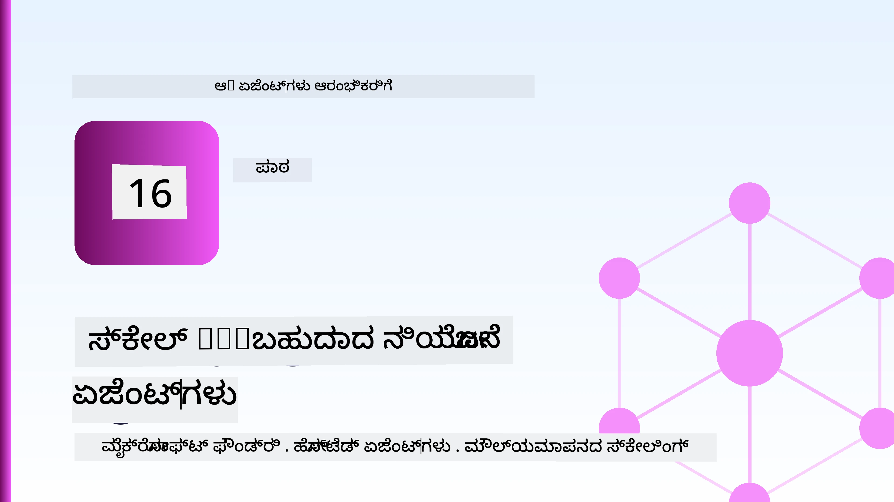
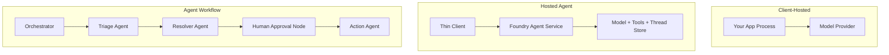
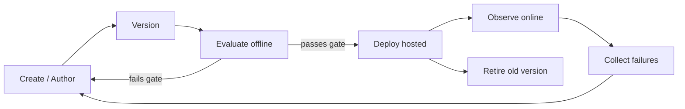
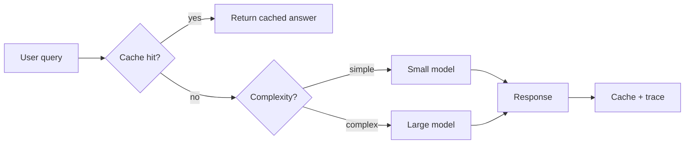
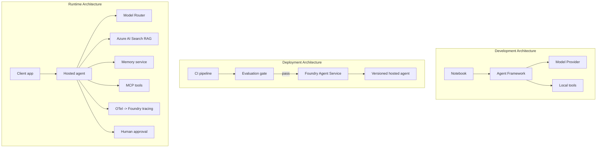

# ಮೈಕ್ರೋಸಾಫ್ಟ್ ಫೌಂಡ್ರಿಯೊಂದಿಗೆ ಮಧ್ಯಸ್ಥ ಏಜೆಂಟ್‌ಗಳನ್ನು ನಿಯೋಜಿಸುವುದು



ಈ ವೇಳೆಯವರೆಗೆ ನೀವು ಲ್ಯಾಪ್‌ಟಾಪ್‌ನಲ್ಲಿ, ನೋಟ್ಬುಕ್‌ ಒಳಗೆ, `az login` ಮತ್ತು ಕೆಲವು ಪರಿಸರಚರಗಳನ್ನು ಚಾಲನೆಯಲ್ಲಿಟ್ಟುಕೊಂಡು ಏಜೆಂಟ್‌ಗಳನ್ನು ರಚಿಸಿದ್ದೀರಿ. ಇದು ಕಲಿಕೆಯ ಸರಿಯಾದ ಮಾರ್ಗವೇ. ಆದರೆ ಸಾವಿರಾರು ಗ್ರಾಹಕರು 3 ಗಂಟೆ ಬೆಳಿಗ್ಗೆ ಅವಲಂಬಿಸುವ ಏಜೆಂಟ್‌ನ್ನು ಈ ರೀತಿಯು ನಿಯೋಜಿಸುವುದು ಸರಿಯಲ್ಲ.

ಈ ಪಾಠವು "ನನ್ನ ಯಂತ್ರದಲ್ಲಿ ಇದು ಕೆಲಸ ಮಾಡುತ್ತದೆ" ಮತ್ತು "ಉತ್ಪಾದನೆಯಲ್ಲಿ ಶ್ರದ್ಧೆಯುತವಾಗಿ ಮತ್ತು ಕನಿಷ್ಠ ವೆಚ್ಚದಲ್ಲಿ ಇದು ಕೆಲಸ ಮಾಡುತ್ತದೆ" ಎನ್ನುವ ನಡುವಿನ ಅಂತರವನ್ನು ಕುರಿತಿದೆ. ನಾವು ಆ ಅಂತರವನ್ನು **ಮೈಕ್ರೋಸಾಫ್ಟ್ ಫೌಂಡ್ರಿ** ಮತ್ತು **ಮೈಕ್ರೋಸಾಫ್ಟ್ ಫೌಂಡ್ರಿ ಏಜೆಂಟ್ ಸೇವೆ** ಬಳಸಿ ಮುಚ್ಚುತ್ತೇವೆ, ಮತ್ತು ಅನುಭವದಿಂದ, ಮರುಪಡೆಯುವಿಕೆ, ಸ್ಮರಣೆ, ಮೌಲ್ಯಮಾಪನ ಮತ್ತು ಮೇಲ್ವಿಚಾರಣೆಯೊಂದಿಗೆ ನೈಜ ಗ್ರಾಹಕ ಬೆಂಬಲ ಏಜೆಂಟ್ ಅನ್ನು ನಿರ್ಮಿಸುತ್ತೇವೆ.

## ಪರಿಚಯ

ಈ ಪಾಠವು ಕೆಳಗಿನ ವಿಷಯಗಳನ್ನು ಒಳಗೊಂಡಿದೆ:

- **ಪ್ರೋಟೋಟೈಪ್ ಏಜೆಂಟ್** ಮತ್ತು **ನಿಯೋಜಿತ ಏಜೆಂಟ್** ನಡುವಿನ ವ್ಯತ್ಯಾಸ, ಮತ್ತು ಈ ಹಂತಕ್ಕೆ ಬರುವಲ್ಲದೆ ರಚನೆಯ ಸುತ್ತಲೂ ಇರುವ ಎಲ್ಲಾ ಸಂಗತಿಗಳ ಬಗ್ಗೆ.
- ಏಜೆಂಟ್‌ಗಳಿಗೆ **ನಿಯೋಜನೆ ಮಾದರಿಗಳು**: ಕ್ಲೈಂಟ್-ಹೊಸ್ಟ್ ಆಗಿರುವುದು, ಸೇವೆ-ಹೊಸ್ಟ್ ಆಗಿರುವುದು (ಹೊಸ್ಟ್ ಆಗಿರುವ ಏಜೆಂಟ್‌ಗಳು), ಮತ್ತು ವರ್ಕ್‌ಫ್ಲೋ-ಆಯೋಜಿತ.
- ಮೈಕ್ರೋಸಾಫ್ಟ್ ಫೌಂಡ್ರಿಯಲ್ಲಿ **ಏಜೆಂಟ್ ಬದುಕುಚಕ್ರ** — ರಚನೆ, ಆವೃತ್ತಿ, ನಿಯೋಜನೆ, ಮೌಲ್ಯಮಾಪನ, ಅವಲೋಕನ, ನಿವೃತ್ತಿ.
- **ಸ್ಕೇಲಿಂಗ್ ತಂತ್ರಗಳು**: ಮಾದರಿ ಮಾರ್ಗಸೂಚಿ, ಕ್ಯಾಶೇಯಿಂಗ್, ಗಣনায়ೂಕ್ತತೆ, ಮತ್ತು ಸ್ಥಿತಿ ರಹಿತ ವಿನ್ಯಾಸ.
- OpenTelemetry ಮತ್ತು Foundry ಟ್ರೇಸಿಂಗ್ ಮೂಲಕ **ಮೇಲ್ವಿಚಾರಣೆ**.
- ಮಾದರಿ ಆಯ್ಕೆ, ಮಾರ್ಗಸೂಚಿ, ಮತ್ತು ಮೌಲ್ಯಮಾಪನ ಮಂಜೂರಾತಿ ಮೂಲಕ ** ವೆಚ್ಚದ ಹೊರತಾಗಿಸುವಿಕೆ**.
- **ಕೊಳಿಗೆ ಸಂಬಂಧಿಸಿದ ವಿಚಾರಗಳು**: ಸರ್ಕಾರ, ಮಾನವ ಮನ್ವಯ, ಮತ್ತು MCP ಸರ್ವರ್‌ಗಳನ್ನು ಉತ್ಪಾದನೆಯಲ್ಲಿ ಸುರಕ್ಷಿತವಾಗಿ ನಡೆಸುವುದು.

## ಕಲಿಕೆಯ ಗುರಿಗಳು

ಈ ಪಾಠ ಪೂರ್ಣಗೊಳ್ಳುವ ನಂತರ, ನೀವು ಹೇಗೆ ತಿಳಿದುಕೊಳ್ಳುತ್ತೀರಿ:

- ನಿರ್ದಿಷ್ಟ ಏಜೆಂಟ್ ಕೆಲಸ ಭಾರಕ್ಕೆ ಸರಿಯಾದ ನಿಯೋಜನೆ ಮಾದರಿಯನ್ನು ಆರಿಸುವುದು.
- ಏಜೆಂಟ್ ಅನ್ನು ಮೈಕ್ರೋಸಾಫ್ಟ್ ಫೌಂಡ್ರಿ ಏಜೆಂಟ್ ಸೇವೆಗೆ ನಿಯೋಜಿಸುವುದು, ಆಗ ಅದು ಆವೃತ್ತಿಗೊಳಿಸಲಾಗಿದೆ, ಆಡಳಿತಾರ್ಹ ಮತ್ತು ಮೇಲ್ವಿಚಾರಣೀಯವಾಗುತ್ತದೆ.
- ಟ್ರೇಸಿಂಗ್ ಗಾಗಿ ಏಜೆಂಟ್ ಅನ್ನು ಸಾಧನಗೊಳಿಸುವುದು ಮತ್ತು ಪ್ರತಿ ಬಿಡುಗಡೆಯಿಂದ ಮೊದಲು ನಡೆಯುವ ಮೌಲ್ಯಮಾಪನ ಪೈಪ್‌ಲೈನ್ ಅನ್ನು ಅಳವಡಿಸುವುದು.
- ಮಾದರಿ ಮಾರ್ಗಸೂಚಿ ಮತ್ತು ಕ್ಯಾಶೇಯಿಂಗ್ ಅನ್ನು ಅನ್ವಯಿಸಿ, ಸ್ಕೇಲ್‌ನಲ್ಲಿ ವಿಳಂಬ ಮತ್ತು ವೆಚ್ಚವನ್ನು ನಿಯಂತ್ರಿಸುವುದು.
- ಅಪಾಯಕಾರಿ ಕ್ರಿಯೆಗಳಿಗೆ ಮಾನವ ಮಂಜೂರಾತಿ ಗೇಟ್ ಸೇರಿಸುವುದು ಮತ್ತು MCP ಸರ್ವರ್ ಅನ್ನು ಉತ್ಪಾದನಾ ಸುರಕ್ಷಿತವಾಗಿ ಏಕರೂಪಗೊಳಿಸುವುದು.

## ಪೂರ್ವಾಪೇಕ್ಷಿತಗಳು

ಈ ಪಾಠವು ಹಿಂದಿನ ಪಾಠಗಳನ್ನು ಮುಗಿಸಿಕೊಂಡಿರುವ ಮತ್ತು ಸೌಕರ್ಯವಿರಲಿರುವವರು ಮುಂದೆ ಸಾಗುತ್ತಾರೆ ಎಂದು assumptions ಮಾಡಿಕೊಂಡಿದೆ:

- [Microsoft Agent Framework](../14-microsoft-agent-framework/README.md) ಬಳಸಿ ಏಜೆಂಟ್‌ಗಳನ್ನು ನಿರ್ಮಿಸುವುದು (ಪಾಠ 14).
- [ಟೂಲ್ ಬಳಕೆ](../04-tool-use/README.md) (ಪಾಠ 4) ಮತ್ತು [Agentic RAG](../05-agentic-rag/README.md) (ಪಾಠ 5).
- [Agent Memory](../13-agent-memory/README.md) (ಪಾಠ 13) ಮತ್ತು [Agentic Protocols / MCP](../11-agentic-protocols/README.md) (ಪಾಠ 11).
- [ಮೇಲ್ವಿಚಾರಣೆ ಮತ್ತು ಮೌಲ್ಯಮಾಪನ](../10-ai-agents-production/README.md) (ಪಾಠ 10) — ಈ ಪಾಠ ನೇರವಾಗಿ ಅದಕ್ಕೆ ಆಧಾರಿತವಾಗಿದೆ.

ನಿಮಗೆ ನಂತರವೂ ಬೇಕಾಗುವುದು:

- ಕನಿಷ್ಠ ಒಂದು ನಿಯೋಜಿತ ಚಾಟ್ ಮಾದರಿಯೊಂದಿಗೆ **ಆಜುರ್ ಚಂದಾದಾರಿಕೆ** ಮತ್ತು **ಮೈಕ್ರೋಸಾಫ್ಟ್ ಫೌಂಡ್ರಿ ಪ್ರಾಜೆಕ್ಟ್**.
- ಪ್ರಾಮಾಣೀಕೃತ **ಆಜುರ್ CLI** (`az login`).
- Python 3.12+ ಮತ್ತು ಸಂಗ್ರಹಣೆಯಲ್ಲಿರುವ ಪ್ಯಾಕೇಜುಗಳು [`requirements.txt`](../../../requirements.txt).

## ಪ್ರೋಟೋಟೈಪ್ನಿಂದ ಉತ್ಪಾದನೆಗೆ: ನಿಜವಾಗಿಯೂ ಏನು ಬದಲಾಗುತ್ತದೆ

ಪ್ರೋಟೋಟೈಪ್ ಏಜೆಂಟ್ ಮತ್ತು ಉತ್ಪಾದನಾ ಏಜೆಂಟ್ ಒಂದೇ ಮೂಲ ಲೂಪ್ ಹಂಚಿಕೊಳ್ಳುತ್ತಾರೆ — ಯೋಚನೆ ಮಾಡುವುದು, ಸಾಧನಗಳನ್ನು ಕರೆಸುವುದು, ಪ್ರತಿಕ್ರಿಯಿಸುವುದು. ಬದಲಾಗುವುದು ಆ ಲೂಪ್‌ನ ಸುತ್ತಲಿನ ಪದಾರ್ಥಗಳು. ಮಾದರಿ ದೇಶ ಪ್ರಾಕಾರದ 20% ಆಗಿರಬಹುದು; ಉಳಿದ 80% ಕಾರ್ಯಾಚರಣಾತ್ಮಕ ಅಸ್ಥಿ.

| ವಿಚಾರ | ಪ್ರೋಟೋಟೈಪ್ | ಉತ್ಪಾದನೆ |
| --- | --- | --- |
| **ಹೋಸ್ಟ್ ಮಾಡುವುದು** | ನಿಮ್ಮ ನೋಟ್ಬುಕ್‌ನಲ್ಲಿ ಕಾರ್ಯ ನಿರ್ವಹಿಸುತ್ತವೆ | ನಿಗದಿತ ಸೇವೆಯಾಗಿ ಕಾರ್ಯನಿರ್ವಹಣೆ, ಆವೃತ್ತಿಗೊಳಿಸಲಾಗುತ್ತದೆ ಮತ್ತು ಹರಿತವಾಗಿ ಬಿಡುಗಡೆ ಮಾಡಲ್ಪಡುತ್ತದೆ |
| **ಗುರುತು** | ನಿಮ್ಮ `az login` ಟೋಕನ್ | ಪರಿಧಿಯ RBACೊಂದಿಗೆ ನಿರ್ವಹಿತ ಗುರುತು |
| **ಸ್ಥಿತಿ** | ಸ್ಮರಣೆಯಲ್ಲಿ, ಮರುಪ್ರಾರಂಭಿಸಿದಾಗ ಕಳೆದುಹೋಗುತ್ತದೆ | ಹೊರಗಿನ (ಥ್ರೆಡ್ ಸ್ಟೋರ್, ಸ್ಮರಣೆ ಸೇವೆ) |
| **ವಿಫಲತೆ** | ನೀವು ಟ್ರೇಸ್‌ಬ್ಯಾಕ್ ನೋಡುತ್ತೀರಿ | ಪುನಃಪ್ರಯತ್ನ, ಬ್ಯಾಕ್ಅಪ್, ಡೆಡ್-ಲೇಟರ್, ಎಚ್ಚರಿಕೆಗಳು |
| **ವೆಚ್ಚ** | "ಕೆಲವು ಸೆಂಟುಗಳು" | ಪ್ರತಿ ವಿನಂತಿಗೆ ಹೋಲಿದ್ದು, ಮಾರ್ಗಿಸಲಾಗುತ್ತಿದೆ, ಕ್ಯಾಶೇ ಮಾಡಲಾಗಿದೆ, ಬಜೆಟ್ ಮಾಡಲಾಗಿದೆ |
| **ಗुणಮಟ್ಟ** | ನೀವು ಉತ್ಪನ್ನವನ್ನು ದೃಷ್ಟಿಸುತ್ತೀರಿ | ಪ್ರತಿ ಬಿಡುಗಡೆಗೂ ಮುನ್ನ ಸ್ವಯಂಚಾಲಿತವಾಗಿ ಮೌಲ್ಯಮಾಪನ |
| **ನಂಬಿಕೆ** | ನೀವು ಪ್ರತಿ ಕ್ರಿಯೆಗೆ ಅನುಮತಿಸುತ್ತೀರಿ | ಧೋರಣೆ + ಅಪಾಯಕಾರಿ ಕ್ರಿಯೆಗಳಿಗಾಗಿ ಮಾನವ-ನಿರ್ವಹಣೆ |

ಈ ಪಟ್ಟಿ ಮನಸ್ಸಿನಲ್ಲಿ ಇಡಿ. ಕೆಳಗಿನ ಪ್ರತಿ ಭಾಗವು ಈ ಸಾಲುಗಳೊಂದಿಗೇ ಸಂಬಂಧಿಸಿದೆ.

## ಏಜೆಂಟ್ ನಿಯೋಜನೆ ಮಾದರಿಗಳು

ಮೂರು ಮಾದರಿಗಳನ್ನು ನೀವು ಒಮ್ಮೆಗೂ ಹೆಚ್ಚು ಸಂಯೋಜನೆಯೊಂದಿಗೆ ಬಳಸಬಹುದು.

### 1. ಕ್ಲೈಂಟ್-ಹೋಸ್ಟ್ ಆಗಿರುವ ಏಜೆಂಟ್‌ಗಳು

ಏಜೆಂಟ್ ವಸ್ತು ನಿಮ್ಮ ಅಪ್ಲಿಕೇಶನ್ ಪ್ರಕ್ರಿಯೆ ಒಳಗೆ ಇರುತ್ತದೆ. ನಿಮ್ಮ ಕೋಡ್ ನೇರವಾಗಿ ಮಾದರಿ ಪೂರೈಕೆದಾರನನ್ನು ಕರೆಸುತ್ತದೆ; ಯೋಚನಾ ಲೂಪ್ ನಿಮ್ಮ ಸೇವೆಯಲ್ಲಿ ನಡೆಯುತ್ತದೆ. ಇದೇ ಹಿಂದಿನ ಪಾಠಗಳಲ್ಲಿ ನಡೆದದ್ದು.

- **ಇದನ್ನು ಬಳಸುವುದು ಎಂದಾಗ** ನೀವು ಲೂಪ್ ನ ಪೂರ್ಣ ನಿಯಂತ್ರಣ, ಕಸ್ಟಮ್ ಮಧ್ಯಸ್ಥಿಕೆ, ಅಥವಾ ಏಜೆಂಟ್ ಅನ್ನು ಇತ್ತೀಚೆಗೆ ಇವೆ backend ಒಳಗೆ ಸೇರಿಸಲು ಅಗತ್ಯವಿದ್ದಾಗ.
- **ರಿಸ್ಕ್**: ಸ್ಕೇಲಿಂಗ್, ಸ್ಥಿತಿಗತಿ ಮತ್ತು ಸ್ಥೈರ್ಯವನ್ನು ನೀವು ಸ್ವತಃ ನಿರ್ವಹಿಸುತ್ತೀರಿ.

### 2. ಹೋಸ್ಟ್ ಆಗಿರುವ ಏಜೆಂಟ್‌ಗಳು (Foundry Agent Service)

ಏಜೆಂಟ್ ಮೈಕ್ರೋಸಾಫ್ಟ್ ಫೌಂಡ್ರಿಯಲ್ಲಿ ಸಂಪನ್ಮೂಲವಾಗಿಯೇ ನೋಂದಾಯಿಸಲಾಗಿದೆ. ಫೌಂಡ್ರಿ ಯೋಚನಾ ಲೂಪ್ ಅನ್ನು ಹೋಸ್ಟ್ ಮಾಡುತ್ತದೆ, ಥ್ರೆಡ್ಗಳನ್ನು ಸಂಗ್ರಹಿಸುತ್ತದೆ, ವಿಷಯ ಸುರಕ್ಷತೆ ಮತ್ತು RBAC ಅನ್ನು ಜಾರಿಗೆ ತರಲಿದೆ, ಮತ್ತು ಏಜೆಂಟ್ ಅನ್ನು ಫೌಂಡ್ರಿ ಪೋರ್ಟಲ್‌ನಲ್ಲಿ দৃಶ್ಯಮಾನ ಮಾಡುತ್ತದೆ. ನಿಮ್ಮ ಅಪ್ಲಿಕೇಶನ್ ಒಂದು ಸಣ್ಣ ಕ್ಲೈಂಟ್ ಆಗಿ ಥ್ರೆಡ್ಗಳನ್ನು ಸೃಷ್ಟಿಸಿ ಪ್ರತಿಕ್ರಿಯೆಗಳನ್ನು ಓದುತ್ತದೆ.

- **ಇದನ್ನು ಬಳಸುವುದು ಎಂದಾಗ** ನೀವು ದೀರ್ಘಕಾಲಿಕತೆ, ಅನುಕೂಲವಾದ ಮೇಲ್ವಿಚಾರಣೆ, ಆಡಳಿತ ಮತ್ತು ಕಡಿಮೆ ಕಾರ್ಯಾಚರಣಾತ್ಮಕ ಭಾಗ ಮೊದಲಾದವುಗಳನ್ನು ಬಯಸುವಾಗ.
- **ರಿಸ್ಕ್**: ನಿರ್ವಹಿತ ರನ್‌ಟೈಮ್‌ಗೆ ಬದಲಿಗೆ ಕಡಿಮೆ ಮಟ್ಟದ ನಿಯಂತ್ರಣ.

### 3. ಏಜೆಂಟ್ ವರ್ಕ್‌ಫ್ಲೋಗಳು

ಹಲವಾರು ಏಜೆಂಟ್‌ಗಳು (ಮತ್ತು ಸಾಧನಗಳು) ನಿಖರ ನಿಯಂತ್ರಣ ಪ್ರವಾಹದೊಂದಿಗೆ ಗ್ರಾಫ್‌ಗಳಾಗಿ ರೂಪುಗೊಂಡಿವೆ — ಕ್ರಮ ಕ್ರಮ, ಶಾಖಾಕಾರ ಸಂಬಂಧಗಳು, ಮಾನವ ರಜತಿ ನೋಡ್‌ಗಳು ಮತ್ತು ನಿಲ್ಲಿಸಿ ಮತ್ತೆ ಪ್ರಾರಂಭಿಸಬಹುದಾದ ದೀರ್ಘಕಾಲಿಕ ತಪಾಸಣಾ ಸ್ತಂಭಗಳು. ಇದು ಮೈಕ್ರೋಸಾಫ್ಟ್ ಏಜೆಂಟ್ ಫ್ರೇಮ್ವರ್ಕ್ **ವರ್ಕ್‌ಫ್ಲೋಗಳು** ಸಾಮರ್ಥ್ಯವನ್ನು ನಿಯೋಜನೆ ಸ್ತರದಲ್ಲಿ ಅನ್ವಯಿಸಿದೆ.

- **ಇದನ್ನು ಬಳಸುವುದು ಎಂದಾಗ** ಒಂದು ಕಾರ್ಯದಲ್ಲಿ ವಿವಿಧ ವಿಶೇಷ ಏಜೆಂಟ್‌ಗಳು ಭಾಗವಹಿಸಬೇಕಾಗಿರುವಾಗ ಅಥವಾ ಮಧ್ಯದಲ್ಲಿ ಅನುಮತಿ ಹಂತ ಬೇಕಾಗಿದ್ದಾಗ.
- **ರಿಸ್ಕ್**: ಹೆಚ್ಚಿನ ಸಕ್ರಿಯ ಆಯಾಮ; ಆಯೋಜನೆ ಮಟ್ಟದ ಮೇಲ್ವಿಚಾರಣೆ ಬೇಕಾಗುತ್ತದೆ.



## ಮೈಕ್ರೋಸಾಫ್ಟ್ ಫೌಂಡ್ರಿಯಲ್ಲಿನ ಏಜೆಂಟ್ ಬದುಕುಚಕ್ರ

ಏಜೆಂಟ್ ನಿಯೋಜಿಸುವುದು ಒಂದೇ ಬಾರಿಗೆ ಮಾಡುವ ಕೆಲಸವಲ್ಲ `push`. ಇದು ಒಂದು ಲೂಪ್ ಆಗಿದ್ದು, ಸಾಫ್ಟ್‌ವೇರ್ ಬಿಡುಗಡೆ ಚಕ್ರದಂತೆ ಕಾಣುತ್ತದೆ ಏಕೆಂದರೆ ಅದು ಅಷ್ಟೇ ಆಗಿದ್ದು.



ಮುಖ್ಯ ಧಾರಣೆ, [ಪಾಠ 10](../10-ai-agents-production/README.md) ನಿಂದ: **ಆಫ್‌ಲೈನ್ ಮೌಲ್ಯಮಾಪನವು ಒಂದು ಗೇಟ್, ನಂತರದ ವಿಚಾರವಲ್ಲ.** ಹೊಸ ಏಜೆಂಟ್ ಆವೃತ್ತಿ ನಿಮ್ಮ ಮೌಲ್ಯಮಾಪನ ಮಾನದಂಡಗಳನ್ನು ಪೂರೈಸದಿದ್ದರೆ ಬಿಡುಗಡೆ ಆಗುವುದಿಲ್ಲ. ಆನ್‌ಲೈನ್ ಮೇಲ್ವಿಚಾರಣೆ ನಿಜವಾದ ವಿಫಲತೆಗಳನ್ನು ನಿಮ್ಮ ಆಫ್‌ಲೈನ್ ಪರೀಕ್ಷಾ ಸೆಟ್‌ಗೆ ಹಿಂತಿರುಗಿಸುತ್ತದೆ. ಅದೇ ಲೂಪ್.

## ಸ್ಕೇಲಿಂಗ್ ತಂತ್ರಗಳು

ಏಜೆಂಟ್ ಸ್ಕೇಲ್ ಮಾಡುವುದು ಸ್ಥಿತಿ ರಹಿತ ವೆಬ್ API ಸ್ಕೇಲಿಂಗ್ ನಿಂದ ವಿಭಿನ್ನ, ಏಕೆಂದರೆ ಪ್ರತಿ ವಿನಂತಿಯು ಹಲವು ದುಬಾರಿ ಮಾದರಿ ಮತ್ತು ಸಾಧನ ಕರೆಗಳನ್ನು ಹುಟ್ಟಿಸುತ್ತದೆ. ನಾಲ್ಕು ತಂತ್ರಗಳು ಶ್ರೇಯಸ್ಸಾಗಿ ದರವನ್ನು ಹೊರುವಂತೆ ಇವೆ.

**ಸ್ಥಿತಿ ರಹಿತ ವಿನಂತಿ ನಿರ್ವಹಣೆ.** ಪ್ರತಿ ಬಳಕೆದಾರನ ಸ್ಥಿತಿಯನ್ನು ನಿಮ್ಮ ಪ್ರಕ್ರಿಯೆಯ ಸ್ಮರಣೆಯಲ್ಲಿ ಇಟ್ಟುಕೊಳ್ಳಬೇಡಿ. ಸಂಭಾಷಣಾ ಥ್ರೆಡ್‌ಗಳನ್ನು ಫೌಂಡ್ರಿ ಥ್ರೆಡ್ ಸ್ಟೋರ್ ಅಥವಾ ಸ್ಮರಣೆ ಸೇವೆಯಲ್ಲಿ ಉಳಿಸುವ ಮೂಲಕ ಯಾವುದೇ ಉದಾಹರಣೆ ಯಾವುದೇ ವಿನಂತಿಯನ್ನು ನಿರ್ವಹಿಸಬಹುದು. ಇದರಿಂದ ನಿಮಗೆ ಹಾರಿಜಂಟಲ್ ಸ್ಕೇಲಿಂಗ್ ಸಿಗುತ್ತದೆ — ಉದಾಹರಣೆಗಳನ್ನು ಹೆಚ್ಚಿಸಿ, ಸ್ಟಿಕಿ ಸೆಶನ್‌ಗಳಿಲ್ಲ.

**ಮಾದರಿ ಮಾರ್ಗಸೂಚಿ.** ಎಲ್ಲಾ ವಿನಂತಿಗಳಿಗೆ ನಿಮ್ಮ ಅತ್ಯಂತ ಶಕ್ತಿಶಾಲಿ (ಮತ್ತು ದುಬಾರಿ) ಮಾದರಿ ಬೇಕಾಗಿಲ್ಲ. ಸರಳ ವಿನಂತಿಗಳನ್ನು — ಉದ್ದೇಶ ವರ್ಗೀಕರಣ, ಸಣ್ಣ ವಾಸ್ತವಿಕ ಉತ್ತರಗಳು — ಸಣ್ಣ ಮತ್ತು ವೇಗದ ಮಾದರಿಗೆ ಮಾರ್ಗಸೂಚಿ ನೀಡಿ, ನಿಜವಾದ ಯೋಚನೆಗೆ ದೊಡ್ಡ ಮಾದರಿಯನ್ನು ಮೀಸಲಿಡಿ. ಫೌಂಡ್ರಿಯ **ಮಾದರಿ ಮಾರ್ಗದರ್ಶಕ** ಈ ಕಾರ್ಯವನ್ನು ನಿಮಗಾಗಿ ಮಾಡಬಹುದು, ಅಥವಾ ನೀವು ಸ್ವಂತವಾಗಿ ಹಗುರವಾದ ವರ್ಗೀಕರಣ ಸಾಧನವನ್ನು ನಿರ್ಮಿಸಬಹುದು. ನೀವು ಪ್ರಯೋಗಶಾಲೆಯಲ್ಲಿ DIY ಆವೃತ್ತಿ ನಿರ್ಮಿಸುವಿರಿ.

**ಪ್ರತಿಕ್ರಿಯೆ ಕ್ಯಾಶೇಯಿಂಗ್.** ಅನೇಕ ಬೆಂಬಲ ಪ್ರಶ್ನೆಗಳು ಹತ್ತಿರದ ನಕಲುವುಗಳು ("ನಾನು ನನ್ನ ಪಾಸ್‌ವರ್ಡ್ ಅನ್ನು ಹೇಗೆ ರಿಸೆಟ್ ಮಾಡಬಹುದು?"). ಸಾಮಾನ್ಯ ಪ್ರಶ್ನೆಗಳಿಗೆ ಉತ್ತರಗಳನ್ನು ಕ್ಯಾಶೆ ಮಾಡಿ ಮತ್ತು ಅದನ್ನು ಮಾದರಿ ತಲುಪದೆ ಸೇವೆಮಾಡಿ. ಸಣ್ಣ ಕ್ಯಾಶೇಹಿಟ್ ದರವೂ ವೆಚ್ಚ ಮತ್ತು ವಿಳಂಬವನ್ನು ಅರ್ಥಪೂರ್ಣವಾಗಿ ಕಡಿಮೆಯನ್ನಾಗಿಸುತ್ತದೆ.

**ಸಹಕಾರ ಮತ್ತು ಬ್ಯಾಕ்ப்ப್ರೆಶರ್.** ಮಾದರಿ ಪೂರೈಕೆದಾರರಿಗೆ ದರ ಮೀಮಿತಿಗಳು ಇವೆ. ನಿಮ್ಮ ಸಹಕಾರವನ್ನು ಗಡಿಬಿಡಿಸಿ, ಪ್ರಮಾಣಿತ ಪುನಃಪ್ರಯತ್ನಗಳನ್ನು ಉಪಯೋಗಿಸಿ, ಮತ್ತು ಸೌಮ್ಯವಾಗಿ ವಿಫಲವಾಗಿರಿ (ನಿರೀಕ್ಷಿತ "ನಾವು ಅದರಲ್ಲಿ ಇದ್ದೇವೆ" ಪ್ರತಿಕ್ರಿಯೆ 500ಕ್ಕಿಂತ ಉತ್ತಮ).



## ಉತ್ಪಾದನೆಯಲ್ಲಿ ಮೇಲ್ವಿಚಾರಣೆ

ನೀವು ಕಾಣದಿದ್ದೀರಾ, ಅದನ್ನು ಕಾರ್ಯಗತಗೊಳಿಸಲು ಸಾಧ್ಯವಿಲ್ಲ. ಪಾಠ 10 ರಲ್ಲಿ ವಿವರಿಸಿದಂತೆ, ಮೈಕ್ರೋಸಾಫ್ಟ್ ಏಜೆಂಟ್ ಫ್ರೇಮ್ವರ್ಕ್ ಮೂಲತಃ **OpenTelemetry** ಟ್ರೇಸ್‌ಗಳನ್ನು ಹೊರಹೊಮ್ಮಿಸುತ್ತದೆ — ಪ್ರತಿ ಮಾದರಿ ಕರೆ, ಸಾಧನ ಕರೆದಿರಿ, ಮತ್ತು ಆಯೋಜನೆ ಹೆಜ್ಜೆ ಒಂದು ಸ್ಪಾನ್ ಆಗಿ. ಉತ್ಪಾದನೆಯಲ್ಲಿ ನೀವು ಆ ಸ್ಪಾನ್‌ಗಳನ್ನು ಮೈಕ್ರೋಸಾಫ್ಟ್ ಫೌಂಡ್ರಿ (ಅಥವಾ ಯಾವುದೇ OTel ಹೊಂದಾಣಿಕೆ ಬ್ಯಾಕ್‌ಎಂಡ್) ಗೆ ರಫ್ತು ಮಾಡುತ್ತೀರಿ, ಇದರಿಂದ ನೀವು:

- ಪ್ರತಿ ಮಾದರಿ ಮತ್ತು ಸಾಧನವಿನ ಕರೆಯಾದ ಗ್ರಾಹಕ ದೂರಿನ ಸಂಬಂದಿಸಿ ಟ್ರೇಸಿಂಗ್ ಮಾಡುವಿರಿ.
- ಕಾಲಘಟಕದಲ್ಲಿ p50/p95 ವಿಳಂಬ ಮತ್ತು ವೆಚ್ಚವನ್ನು ನೋಡುತ್ತೀರಿ.
- ದೋಷ ದರ ಹೆಚ್ಚಳ ಮತ್ತು ವೆಚ್ಚ ಅಸಾಮಾನ್ಯತೆಯ ಮೇಲೆ ಎಚ್ಚರಿಕೆ ನೀಡುತ್ತೀರಿ, ಬಳಕೆದಾರರು (ಅಥವಾ ನಿಮ್ಮ ಹಣಕಾಸು ತಂಡ) ಗಮನಿಸುವುದಕ್ಕೂ ಮುನ್ನ.

```python
from agent_framework.observability import get_tracer

tracer = get_tracer()

with tracer.start_as_current_span("support_request") as span:
    span.set_attribute("customer.tier", "enterprise")
    span.set_attribute("routed.model", "gpt-5-nano")
    # agent execution is traced automatically inside this span
```

`customer.tier` ಮತ್ತು `routed.model` ಮುಂತಾದ ಲಕ್ಷಣಗಳು ಟ್ರೇಸಿನ ಗೋಡೆಯನ್ನು ಉತ್ತರ ನೀಡಬಹುದಾದ ಪ್ರಶ್ನೆಯಾಗಿ ಮರುಪ್ರತಿಕ್ರಿಯೆ ಮಾಡುತ್ತವೆ ("ಎಂಟರ್‌ಪ್ರೈಸ್ ಗ್ರಾಹಕರು ಸಣ್ಣ ಮಾದರಿಗೆ ಹೆಚ್ಚು ಬಾರಿ ಮಾರ್ಗಸೂಚಿಯಾಗುತ್ತಾರಾ?").

## ವೆಚ್ಚದ ಹೊರತಾಗಿಸುವಿಕೆ

ಉತ್ಪಾದನಾ ಏಜೆಂಟ್‌ಗಳ ವೆಚ್ಚವನ್ನು ಟೋಕನ್‌ಗಳು ಹೇರಳಿಸುತ್ತವೆ. ಪರಿಣಾಮಮಟ್ಟದಲ್ಲಿ ಮೂರು ನಿಯಂತ್ರಣೆಗಳಿವೆ:

1. **ಮಾದರಿಯ ಸರಿಯಾದ ಗಾತ್ರವನ್ನು ಆರಿಸಿಕೊಳ್ಳಿ.** ಆಲೋಚನೆಯ ಗೇಟು ಕಳೆಯುವ ಸಣ್ಣ ಮಾದರಿ ಎಂದಿನಿಗಿಂತಲೂ ತುಲನೆಯಾಗಿ ಕಡಿಮೆ ವೆಚ್ಚದಾಗಿರುತ್ತದೆ. ಎಚ್ಚರಿಕೆಯಿಂದ ದೊಡ್ಡ ಮಾದರಿಯನ್ನು_Default_ಗಾಗಿಟ್ಟುಬಿಡುವ ಬದಲು, ಮೌಲ್ಯಮಾಪನದೊಂದಿಗೆ ಸಣ್ಣ ಮಾದರಿ ಸಾಕಷ್ಟೆಂದು ಸಾಬೀತುಪಡಿಸಿ.
2. **ಸಂಕೀರ್ಣತೆಯ ಆಧಾರದಲ್ಲಿ ಮಾರ್ಗಸೂಚಿ.** ಹೀಗೆಯೇ — ದೊಡ್ಡ ಮಾದರಿ ಯೋಚನೆಗೆ ಮಾತ್ರ ದೊಡ್ಡ ಮಾದರಿ ಬೆಲೆ ಪಾವತಿಸಿ.
3. **ತೀವ್ರವಾಗಿ ಕ್ಯಾಶೇ ಮಾಡಿ.** ನೀವು ಯಾವಾಗಲೂ ಮಾಡದ ಮಾದರಿ ಕರೆವೇ ಅತ್ಯಂತ ಕಡಿಮೆ ವೆಚ್ಚದ.

ಮೌಲ್ಯಮಾಪನ ಗೇಟುಗಳು ಮತ್ತು ವೆಚ್ಚ ನಿಯಂತ್ರಣವು ಎರಡು ದೃಷ್ಟಿಕೋನಗಳಿಂದ ವೀಕ್ಷಿಸಿರುವ ಒಂದೇ ಶಿಸ್ತು: ಮೌಲ್ಯಮಾಪನವು *ಗುಣಮಟ್ಟದ ಮೆಟ್ಟಿಲಿನ* ಬಗ್ಗೆ ತಿಳಿಸುವುದು, ಮಾರ್ಗಸೂಚಿ ಮತ್ತು ಕ್ಯಾಶೇ ಅದೇ ಮೆಟ್ಟಿಲಿನ *ವೆಚ್ಚ* ಗೆ ಹತ್ತಿರವಾಗಿರುತ್ತವೆ.

## ಎಂಟರ್ಪ್ರೈಸ್ ನಿಯೋಜನೆ ಪರಿಗಣನೆಗಳು

**ಸರ್ಕಾರ.** ಹೋಸ್ಟ್ ಆಗಿರುವ ಏಜೆಂಟ್‌ಗಳು ಫೌಂಡ್ರಿಯ RBAC, ವಿಷಯ ಸುರಕ್ಷತೆ ಮತ್ತು ಲಾಗಿಂಗ್ ಅನ್ನು ಪೈಕಿ ಪಡೆಯುತ್ತವೆ. ಪ್ರತಿ ಏಜೆಂಟ್‌ಗೆ ಅದು ಬೇಕಾದ ಕಡಿಮೆ ಹಕ್ಕು ಹೊಂದಿರುವ ನಿರ್ವಹಿತ ಗುರುತನ್ನು ನೀಡಿ — ಜ್ಞಾನ ಸಂಗ್ರಹಕ್ಕೆ ಓದಿ ಮಾತ್ರ ಹಕ್ಕು, ಟಿಕೆಟ್ API ಗೆ ಪರಿಧಿತ ಹಕ್ಕು, ಹೆಚ್ಚಾಗಿ ಬೇಡ.

**ಮಾನವ-ನಿರ್ವಹಣೆ.** ಕೆಲ ಕ್ರಿಯೆಗಳು ಸಂಪೂರ್ಣ ಸ್ವಯಂಚಾಲಿತಗೊಳಿಸಲು ಅತ್ಯಂತ ಪರಿಣಾಮಕಾರಿ ಅಲ್ಲ — ಹಣ ವಾಪಾಸು ಮಾಡುವುದು, ಖಾತೆಯನ್ನು ಅಳಿಸುವುದು, ಕಾನೂನು ತಂಡಕ್ಕೆ ಹಕ್ಕು ನೀಡುವುದು. ಮೈಕ್ರೋಸಾಫ್ಟ್ ಏಜೆಂಟ್ ಫ್ರೇಮ್ವರ್ಕ್ **ಅನುಮತಿ ಬೇಕಾದ** ಸಾಧನಗಳನ್ನು ಬೆಂಬಲಿಸುತ್ತದೆ: ಏಜೆಂಟ್ ಕ್ರಿಯೆಯನ್ನು ಪ್ರಸ್ತಾಪಿಸುತ್ತದೆ, ಕಾರ್ಯನಿರ್ವಹಣೆಯನ್ನು ನಿಲ್ಲಿಸುತ್ತದೆ, ಮಾನವ ಅನುಮತಿಸುತ್ತದೆ ಅಥವಾ ನಿರಾಕರಿಸುತ್ತದೆ, ಮತ್ತು ವರ್ಕ್‌ಫ್ಲೋ ಪುನರಾರಂಭವಾಗುತ್ತದೆ. ನೀವು [ಪಾಠ 6](../06-building-trustworthy-agents/README.md) ನಲ್ಲಿ ಮೂಲಭೂತವನ್ನು ನೋಡಿದ್ದಿರಿ; ಇಲ್ಲಿ ಅದನ್ನು ನಿಯೋಜಿಸುತ್ತೀರಿ.

**MCP ಉತ್ಪಾದನೆಯಲ್ಲಿ.** [MCP](../11-agentic-protocols/README.md) ನಿಮ್ಮ ಏಜೆಂಟ್ ಅನ್ನು ಮಾನಕ ಇಂಟರ್ಫೇಸ್ ಮೂಲಕ ಹೊರಗಿನ ಸಾಧನಗಳನ್ನು ಬಳಕೆ ಮಾಡಲೋಗಿಸುತ್ತದೆ. ಉತ್ಪಾದನೆಯಲ್ಲಿ ಪ್ರತಿಯೊಂದು MCP ಸರ್ವರ್ ಅನ್ನು ಅಚರಿತ್ರ ರೀತಿಯಲ್ಲಿ ವೀಕ್ಷಿಸಿ: ಸರ್ವರ್ ಆವೃತ್ತಿಯನ್ನು ನಿರ್ದಿಷ್ಟ ಮಾಡಿ, ಪರಿಧಿಯ ಗುರುತಿನೊಂದಿಗೆ ನಡಿಸಿ, ಅದರ ಔಟ್‌ಪುಟ್ ಗಳನ್ನು ತಪಾಸಿಸಿ, ಮತ್ತು ಅದರ ಬಳಿ ದ್ವಿತೀಯರಹಿತ ಗುಪ್ತಪಡಿಸದಿರಿ. MCP ಸರ್ವರ್ ಒಂದು ಅವಲಂಬನೆಯನ್ನು ಪ್ರತಿನಿಧಿಸುತ್ತದೆ, ಮತ್ತು ಅವಲಂಬನೆಗಳನ್ನು ಪ್ಯಾಚ್ ಮಾಡಲಾಗುತ್ತದೆ, ಪರಿಶೀಲಿಸಲಾಗುತ್ತದೆ ಮತ್ತು ಪ್ರಮಾಣಿತಗೊಳಿಸಲಾಗುತ್ತದೆ.



ಆ ಮೂರು ಚಿತ್ರಗಳು — ಅಭಿವೃದ್ಧಿ, ನಿಯೋಜನೆ, ರನ್‌ಟೈಮ್ — ಬಳಕೆಯ ಮೂರು ಹಂತಗಳಲ್ಲಿ ಒಂದೇ ಏಜೆಂಟ್. ಮುಂದಿನ ಪ್ರಯೋಗಶಾಲೆ ಅದನ್ನು ನಿರ್ಮಿಸುವಲ್ಲಿ ನಿಮ್ಮನ್ನು ಮಾರ್ಗದರ್ಶಿಸುತ್ತದೆ.

## ಕೈಯಿಂದ ಮಾಡಿಕೊಳ್ಳುವ ಪ್ರಯೋಗಶಾಲೆ: ಉತ್ಪಾದನೆಗೆ ತಯಾರಾದ ಗ್ರಾಹಕ ಬೆಂಬಲ ಏಜೆಂಟ್

[`code_samples/16-python-agent-framework.ipynb`](./code_samples/16-python-agent-framework.ipynb) ಅನ್ನು ತೆರೆಯಿರಿ ಮತ್ತು ಸಕಲವಾಗಿ ಅನುಸರಿಸಿ. ನೀವು **Contoso ಗ್ರಾಹಕ ಬೆಂಬಲ ಏಜೆಂಟ್** ಅನ್ನು ಪ್ರತಿಯೊಂದು ಉತ್ಪಾದನಾ ವಿಚಾರವನ್ನು ಒಳಗೊಂಡಂತೆ ಸಂಯೋಜಿಸುವಿರಿ:

1. **ಸಾಧನಗಳು ಕರೆಮಾಡುವುದು** — ಆರ್ಡರ್ ಸ್ಥಿತಿ ಪರಿಶೀಲನೆ ಮತ್ತು ಬೆಂಬಲ ಟಿಕೆಟ್ ತೆರೆಯುವುದು.
2. **RAG** — ಜ್ಞಾನ ಆಧಾರದಿಂದ ಧೋರಣಾ ಪ್ರಶ್ನೆಗಳಿಗೆ ಉತ್ತರಿಸುವುದು (ಆಜುರ್ AI ಶೋಧನೆ, ನೋಟ್ಬುಕ್ ಅನ್ನು ಶೋಧನೆ ಸಂಪನ್ಮೂಲವಿಲ್ಲದೆ ಕಾರ್ಯಗತಗೊಳಿಸುವ ಸ್ಮರಣೆಯಲ್ಲಿ ಬ್ಯಾಕ್ಅಪ್ ಹೊಂದಿರುವ).
3. **ಸ್ಮರಣೆ** — ಸಂಭಾಷಣೆಯ ತಿರುವಿನಲ್ಲಿ ಗ್ರಾಹಕನನ್ನು ನೆನಪು ಮಾಡುವುದು.
4. **ಮಾದರಿ ಮಾರ್ಗಸೂಚಿ** — ಸಂಕೀರ್ಣತೆಯ ವರ್ಗೀಕಾರಕವು ಪ್ರತಿಯೊಂದು ವಿನಂತಿಯನ್ನು ಸಣ್ಣ ಅಥವಾ ದೊಡ್ಡ ಮಾದರಿಗೆ ಮಾರ್ಗಸೂಚಿ ಮಾಡುತ್ತದೆ.
5. **ಪ್ರತಿಕ್ರಿಯೆ ಕ್ಯಾಶೇ** — ಪುನರಾವೃತ್ತಿ ಪ್ರಶ್ನೆಗಳಿಗೆ ಕ್ಯಾಶೆಯಲ್ಲಿ ಉತ್ತರ ನೀಡಲಾಗುತ್ತದೆ.
6. **ಮಾನವ ಅನುಮತಿ** — ನಿರ್ದಿಷ್ಟ ಮಟ್ಟದ ಮೇರೆಗೆ ಹಣ ವಾಪಾಸುಗಳಿಗೆ ಮಾನವ ಸಹಿ ತೆಗೆದುಕೊಳ್ಳುವುದು.
7. **ಮೌಲ್ಯಮಾಪನ ಪೈಪ್‌ಲೈನ್** — ಸಣ್ಣ ಆಫ್‌ಲೈನ್ ಪರೀಕ್ಷಾ ಸೆಟ್ ಏಜೆಂಟ್ ಅಂಕಗಳನ್ನು ನೀಡುತ್ತದೆ ಮತ್ತು ಬಿಡುಗಡೆಗಾಗಿ ಗೇಟ್ ಆಗಿ ಕಾರ್ಯನಿರ್ವಹಿಸುತ್ತದೆ.
8. **ಮೇಲ್ವಿಚಾರಣೆ** — ಪ್ರತಿಯೊಂದು ವಿನಂತಿಗೂ ಸುತ್ತಲೂ OpenTelemetry ಟ್ರೇಸಿಂಗ್.

### ನಡೆಸುವುದು

ನೋಟ್ಬುಕ್ ಪ್ರತಿ ಉತ್ಪಾದನಾ ವಿಚಾರವನ್ನು ಸ್ವತಂತ್ರ, ಚಾಲನೆ ಮಾಡಬಹುದಾದ ವಿಭಾಗವಾಗಿ ಆಯೋಜಿಸಲಾಗಿದೆ. ಮುಖ್ಯ ಭಾಗ маршрутизация-ಪ್ಲಸ್-ಕ್ಯಾಸಿಂಗ್ ವಿನಂತಿ ನಿರ್ವಾಹಕವಾಗಿದೆ:

```python
async def handle_support_request(query: str, customer_id: str) -> str:
    # 1. Serve from cache when we can.
    cached = response_cache.get(normalize(query))
    if cached:
        return cached

    # 2. Route by complexity to control cost.
    model = "gpt-5-nano" if is_simple(query) else "gpt-5-mini"

    # 3. Run the agent inside a trace span for observability.
    with tracer.start_as_current_span("support_request") as span:
        span.set_attribute("routed.model", model)
        span.set_attribute("customer.id", customer_id)
        response = await support_agent.run(query, model=model)

    # 4. Cache and return.
    response_cache.set(normalize(query), response.text)
    return response.text
```

ಬಿಡುಗಡೆ ನಿಲಹಾಕುವ ಮೌಲ್ಯಮಾಪನ ಗೇಟ್ ಹೀಗೆ ಕಾಣುತ್ತದೆ:

```python
async def evaluation_gate(agent, test_cases, threshold: float = 0.8) -> bool:
    passed = 0
    for case in test_cases:
        result = await agent.run(case["input"])
        if score_response(result.text, case["expected"]) >= 0.8:
            passed += 1
    pass_rate = passed / len(test_cases)
    print(f"Evaluation pass rate: {pass_rate:.0%} (gate: {threshold:.0%})")
    return pass_rate >= threshold  # only deploy if the gate passes
```

ಪ್ರತಿ ಸಾಲನ್ನು ಓದಿ — ನೋಟ್ಬುಕ್ ಮೂಲಭೂತಗಳನ್ನು ಉದ್ದೇಶಿಸಿದಂತೆ ಚಿಕ್ಕದಾಗಿ ಇಟ್ಟುಕೊಂಡಿದೆ, ಯಾವುದೇ ಭಾಗ ಡೌನ್‍ಸ್ಟ್ರೀಮ್ ಫ್ರೇಮ್‌ವರ್ಕ್ ಕಾಲ್ನೆಡೆಯಲ್ಲಿ ಮುಚ್ಚಲಾಗಿಲ್ಲ.

## ನಿಯೋಜಿತ ಏಜೆಂಟ್ ಅನ್ನು ಧೂಮಪಾನ ಪರೀಕ್ಷೆಗಳೊಂದಿಗೆ ಮಾನ್ಯಗೊಳಿಸುವುದು

ಮೇಲಿನ ಮೌಲ್ಯಮಾಪನ ಗೇಟ್ ನಿಮ್ಮ ಏಜೆಂಟ್ ವಸ್ತುವಿನ ವಿರುದ್ಧ *ಆಫ್‌ಲೈನ್* ಆಗಿ ನಡೆಯುತ್ತದೆ. ಏಜೆಂಟ್ ಹೊಸ್ಟ್ ಆಗಿರುವ ಏಜೆಂಟ್ ಆಗಿ ನಿಯೋಜಿಸಿದ ನಂತರ, ನಿಮಗೆ ಇನ್ನೊಂದು, ಇನ್ನೂ ಕಡಿಮೆ ವೆಚ್ಚದ ಪರಿಶೀಲನೆ ಬೇಕು: **ನಿಯೋಜಿತ ಕೊನೆಯಲ್ಲಿ ನಿಜವಾಗಿಯೂ ಉತ್ತರ ನೀಡುತ್ತಿದೆಯೇ?**

"ಯಶಸ್ವಿಯಾಗಿ" ನಿಯೋಜಿಸುವುದು ನಿಯಂತ್ರಣ ಪ್ಲೇನ್ ವ್ಯಾಖ್ಯಾನವನ್ನು ಸ್ವೀಕರಿಸಿದ್ದನ್ನು ಮಾತ್ರ ಸಾಬೀತುಪಡಿಸುತ್ತದೆ — ಅದು ಏಜೆಂಟ್ ಪ್ರತಿಕ್ರಿಯಿಸುವುದನ್ನು ಸಾಬೇತಾಗಿಸುವುದಿಲ್ಲ. ನಷ್ಟದ ಅವಲಂಬನೆ, ಕೆಟ್ಟ ಮಾದರಿ ಮಾರ್ಗಸೂಚಿ, ಅಥವಾ ಅವಧಿ ಮುಕ್ತಾಯವಾದ ಸಂಪರ್ಕ ಹಸಿರು ನಿಯೋಜನೆಯನ್ನು ಬಿಟ್ಟುದೆ ಮನೆಯಿಂದ ಏನೂ ಹಿಂದಿರುಗಿಸುವುದಿಲ್ಲ. **ಧೂಮಪಾನ ಪರೀಕ್ಷೆ** ಅದನ್ನು ಸೆಕೆಂಡುಗಳಲ್ಲಿ ಹಿಡಿಯುತ್ತಾ, ಪ್ರತಿ ನಿಯೋಜನೆಗಿಂತಲೂ ಪೂರ್ವದಲ್ಲಿ, ಪೂರ್ಣ ಮೌಲ್ಯಮಾಪನ ವೆಚ್ಚವಿಲ್ಲದೆ.

ಈ ಸಂಗ್ರಹಣೆಯು [AI Smoke Test](https://github.com/marketplace/actions/ai-smoke-test) GitHub ಕ್ರಿಯೆಯ ಮೇಲೆ ನಿರ್ಮಿಸಿದ ಉಪಯೋಗಕ್ಕೆ ಸಿದ್ಧ ಧೂಮಪಾನ ಪರಿಶೀಲನೆ ಪೈಪ್‌ಲೈನ್ ಅನ್ನು ಸಾಗಿಸುತ್ತದೆ:

- **ಕ್ಯಾಟಲಾಗ್** — [`tests/lesson-16-smoke-tests.json`](../../../tests/lesson-16-smoke-tests.json) ನಲ್ಲಿ Contoso ಬೆಂಬಲ ಏಜೆಂಟ್‌ಗೆ ಮುನ್ನೆಚ್ಚರಿಕೆಗಳು ಮತ್ತು ದೃಢೀಕರಣಗಳನ್ನು ಒಳಗೊಂಡಿದೆ (ಪರಿಗಣಿತ ಧೋರಣಾ ಉತ್ತರಗಳು, ಆರ್ಡರ್ ಪರಿಶೀಲನೆ, ವಿಷಯ ಮಕ್ಕಳಿಕೆ, ಮತ್ತು ಬಹು-ತಿರುವು ಥ್ರೆಡ್ ಸತತತೆ). ಇತರ ಪಾಠಗಳ ಏಜೆಂಟ್‌ಗಳ ಕ್ಯಾಟಲಾಗ್ ಜೊತೆಗೆ ಇರುತ್ತವೆ — ನೋಡಿ [`tests/README.md`](../tests/README.md).
- **ವರ್ಕ್‌ಫ್ಲೋ** — [`.github/workflows/smoke-test.yml`](../../../.github/workflows/smoke-test.yml) ಆಜುರ್ OIDC ನೊಂದಿಗೆ ಲಾಗಿನ್ ಆಗಿ ಮತ್ತು ಪ್ರತಿ ಮುಂದಿನ ಕರೆಗಳಿಗೆ ಏಜೆಂಟ್ Responses ಕೊನೆಯ ಬಿಂದುವಿಗೆ POST ಮಾಡುತ್ತದೆ, ಯಾವುದೇ ದೃಢೀಕರಣ ತಪ್ಪಿದರೆ ಕೆಲಸ ವಿಫಲಗೊಳಿಸುತ್ತದೆ.

```yaml
- name: Smoke-test hosted agent
  uses: JFolberth/ai-smoketest@v1
  with:
    project_endpoint: ${{ inputs.project_endpoint }}
    agent_name: ContosoSupportAgent
    tests_file: tests/lesson-16-smoke-tests.json
```

ನಿಮ್ಮ ಏಜೆಂಟ್ ನಿಯೋಜಿಸಿದ ನಂತರ, ನಿಮ್ಮ ಫೌಂಡ್ರಿ ಪ್ರಾಜೆಕ್ಟ್ ಎಂಡ್‌ಪಾಯಿಂಟ್ ಮತ್ತು ಏಜೆಂಟ್ ಹೆಸರನ್ನು ಒದಗಿಸಿ, **ಆಕ್ಷನ್ಸ್** ಟ್ಯಾಬ್‌ನಿಂದ ಅದನ್ನು ಚಲಾಯಿಸಿ. ಫೆಡೆರೆಟೆಡ್ ಐಡೆಂಟಿಟಿಗೆ ಫೌಂಡ್ರಿ ಪ್ರಾಜೆಕ್ಟ್ ವ್ಯಾಪ್ತಿಯಲ್ಲಿ **Azure AI User** ಪಾತ್ರ ಬೇಕಾಗುತ್ತದೆ. ಪದರಗಳನ್ನು ಒಂದು ಪಿರಮಿಡ್ ಎಂದುಕೊಳ್ಳಿ: ಸ್ಮೋಕ್ ಟೆಸ್ಟ್‌ಗಳು (ಸಂಪರ್ಕವಾಗುತ್ತಿದೆಯೇ ಮತ್ತು ಪ್ರತ್ಯುತ್ತರ ಕೊಡುತ್ತಿದೆಯೇ?) ಪ್ರತಿ ನಿಯೋಜನೆ ವೇಳೆ ಚಲಾಯಿಸಲಾಗುತ್ತದೆ, ಆಫ್‌ಲೈನ್ ಮೌಲ್ಯಮಾಪನ (ಗಾರ್ಮಿಗೆ ತಯಾರಾಗುವಷ್ಟು ಉತ್ತಮವೇ?) ಉತ್ತರ್ಜಾಯಿಗೆ ಮುನ್ನ ನಡೆಯುತ್ತದೆ, ಮತ್ತು ಆನ್ಲೈನ್ ಮೌಲ್ಯಮಾಪನವು (ನವೀಕರಿಸಿದ ಪರಿಸರದಲ್ಲಿ ಅದು ಹೇಗಿದೆ?) ನಿರಂತರವಾಗಿ ನಡೆಯುತ್ತದೆ.

## ಜ್ಞಾನ ಪರಿಶೀಲನೆ

ನಿಯೋಜನೆಗೆ ಮುನ್ನ ನಿಮ್ಮ ಅರ್ಥವನ್ನು ಪರೀಕ್ಷಿಸಿ.

**1. ಉತ್ಪಾದನಾ ಏಜೆಂಟ್‌ನಲ್ಲಿ "ಮಾದರಿ" ಯಾವ ಮೊತ್ತದಷ್ಟು ಪ್ರಮಾಣದಲ್ಲಿ ಇದೆ ಮತ್ತು ಉಳಿದದ್ದು ಏನು?**

<details>
<summary>ಉತ್ತರ</summary>

ಮಾದರಿ ವ್ಯವಸ್ಥೆಯ ಸಣ್ಣ ಭಾಗವಾಗಿದ್ದು — ಸಾಮಾನ್ಯವಾಗಿ 20% ಚುತ್ತಿಗೆ ಹೇಳಲಾಗುತ್ತದೆ. ಉಳಿದದ್ದು ಕಾರ್ಯಾಚರಣಾತ್ಮಕ ರಚನೆಯಾಗಿದೆ: ಹೋಸ್ಟಿಂಗ್ ಮತ್ತು ವರೋಟಿಂಗ್, ಗುರುತಿಯ ಮತ್ತು ರೂಬಿಎಸಿಸಿ, ಹೊರಗಿನ ಸ್ಥಿತಿ, ವೈಫಲ್ಯ ನಿರ್ವಹಣೆ, ವೆಚ್ಚದ ಹಂತ, ಮೌಲ್ಯಮಾಪನ, ಮತ್ತು ಮಾನವ-ನಿಯಂತ್ರಣ ಹೊಂದಿರುವ ನಿಯಂತ್ರಣಗಳು. ಉತ್ಪಾದನಕ್ಕೆ ಬರುವುದಾದರೆ ಸಂಗತಿವನಕ್ಕಾಗಿ ನಿರ್ಧಾರ ಚಕ್ರದ ಸುತ್ತಲೂ ಎಲ್ಲವನ್ನೂ ನಿರ್ಮಿಸುವುದು ಮುಖ್ಯವಾಗಿದೆ.
</details>

**2. ನೀವು ಯಾವಾಗ ಕ್ಲೈಂಟ್-ಹೋಸ್ಟ್ ಆಗಿರುವ ಏಜೆಂಟ್‌ಗಿಂತ ಹೋಸ್ಟೆಡ್ ಏಜೆಂಟ್ ಆಯ್ಕೆ ಮಾಡುತ್ತೀರಿ?**

<details>
<summary>ಉತ್ತರ</summary>

ನೀವು ನಿರ್ವಹಿಸಲ್ಪಟ್ಟ ರಂಟೈಮ್ ಬೇಕಾದರೆ, ಅಂದರೆ ಸ್ಥಿತಿಶೀಲತೆ ಹೊಂದಿರುವ (ಥ್ರೆಡ್‌ಗಳು ಉಳಿದುಕೊಂಡು ಪೂನರಾರಂಭಿಸಬಹುದು), ಪರಿಶೀಲನೆ, ವಿಷಯದ ಸುರಕ್ಷತೆ, ಮತ್ತು ರೂಬಿಎಸಿಸಿ, ಹಾಗೆಯೇ reasoning ಲೂಪ್ನಲ್ಲಿ ಕೆಲವು ಕಡಿಮೆ ಮಟ್ಟದ ನಿಯಂತ್ರಣ ಇನ್ನೂ ತ್ಯಜಿಸುವುದು ಹೊಂದಿದ್ದರೆ. ಕ್ಲೈಂಟ್-ಹೋಸ್ಟ್ ಆಗಿರುವುದು ಪರಿಪೂರ್ಣ ನಿಯಂತ್ರಣ ಬೇಕಾದಾಗ ಅಥವಾ ಏಜೆಂಟ್ ಅನ್ನು ಇಮ್ಮರ್ತ ವBackend ಗೆ ಸೇರಿಸುವಾಗ ಉತ್ತಮ.
</details>

**3. ಏಕೆ ಸ್ಕೇಲಬಲ್ ಏಜೆಂಟ್ ತನ್ನ ಸ್ವಂತ ಪ್ರಕ್ರಿಯೆಯ ಮೆಯ್ಮರಿಯಲ್ಲಿ ಸ್ಥಿತಿಹೀನವಾಗಿರಬೇಕು?**

<details>
<summary>ಉತ್ತರ</summary>

ಯಾವುದೇ ಮಾದರಿ ವಿನಂತಿಯನ್ನು ಯಾವುದೇ ಇನ್‌ಸ್ಟಾನ್ಸ್ ನಿರ್ವಹಿಸಲು ಸಾಧ್ಯವಾಗುತ್ತದೆ, ಇದು ಹೋರಿಜಾಂಟಲ್ ಸ್ಕೆಲಿಂಗ್ ಅನ್ನು ಅನಸ್ಟ್‌ಕ ಚಟುವಟಿಕೆಗಳಿಲ್ಲದೆ ಸಾಧ್ಯಮಾಡುತ್ತದೆ. ಪ್ರತಿಯೊಬ್ಬ ಬಳಕೆದಾರರ ಸಂಭಾಷಣೆಯ ಸ್ಥಿತಿಯನ್ನು ಥ್ರೆಡ್ ಸ್ಟೋರ್ ಅಥವಾ ಮೆಮೊರಿ ಸೇವೆಗೆ ಹೊರಗಡೆ ಇಡಲಾಗುತ್ತದೆ. ಪ್ರಕ್ರಿಯೆಯ ಸ್ಮರಣೆಯಲ್ಲಿ ಸ್ಥಿತಿ ಇದ್ದರೆ, ಮರುಾರಂಭಿಸುವಾಗ ಅದನ್ನು ಕಳೆದುಕೊಳ್ಳುತ್ತೀರಿ ಮತ್ತು ಲೋಡ್ ವಿತರಿಸಲು ಸಾಧ್ಯವಿರಲಾರದು.
</details>

**4. ಮಾದರಿ ಮಾರ್ಗಿಸಲಿಕೆ ಏನು ಸಮಸ್ಯೆಯನ್ನು ಪರಿಹರಿಸುತ್ತದೆ ಮತ್ತು ಅದು ಮೌಲ್ಯಮಾಪನಕ್ಕೆ ಹೇಗೆ ಸಂಬಂಧಿಸಿದೆ?**

<details>
<summary>ಉತ್ತರ</summary>

ಮಾರ್ಗಿಸಲಿಕೆ ಸಾದಾರಣ ವಿನಂತಿಗಳನ್ನು ಸಣ್ಣ, ಸತತ, ಮತ್ತು ವೇಗದ ಮಾದರಿಗೆ ಕಳುಹಿಸುತ್ತದೆ ಮತ್ತು ದೊಡ್ಡ ಮಾದರಿಯನ್ನು ನಿಜವಾದ ನಿರ್ಣಯಕ್ಕಾಗಿ ಕಾಯ್ದು ಇಡುತ್ತದೆ, ಇದು ದೈರ್ಯ ಮತ್ತು ವೆಚ್ಚವನ್ನು ನಿಯಂತ್ರಿಸುತ್ತದೆ. ಇದು ಮೌಲ್ಯಮಾಪನಕ್ಕೆ ಸಂಬಂಧಿಸಿದೆ ಏಕೆಂದರೆ ಮೌಲ್ಯಮಾಪನವೇ ಸಣ್ಣ ಮಾದರಿ ನಿರ್ದಿಷ್ಟ ವರ್ಗದ ವಿನಂತಿಗಳಿಗೆ ಸಾಕಷ್ಟು ಎಂದು *ನಿರೂಪಿಸುತ್ತದೆ* — ಮೌಲ್ಯಮಾಪನವಿಲ್ಲದೆ ಮಾರ್ಗಿಸಲಿಕೆ ಊಹೆಯಷ್ಟೇ.
</details>

**5. "ಮೌಲ್ಯಮಾಪನ ಗೇಟ್" ಎಂದರೇನು ಮತ್ತು ಅದು ಜೀವನಚರಿತ್ರೆಯ ಯಾವುದರಲ್ಲಿ ಇರುತ್ತದೆ?**

<details>
<summary>ಉತ್ತರ</summary>

ಮೌಲ್ಯಮಾಪನ ಗೇಟ್ ಹೊಸ ಏಜೆಂಟ್ ಆವೃತ್ತಿಗೆ ವಿರುದ್ಧವಾಗಿ ಆಫ್‌ಲೈನ್ ಪರೀಕ್ಷಾ ಸೆಟ್ ರನ್ ಮಾಡುತ್ತದೆ ಮತ್ತು ಪಾಸ್ ದರವು ಗಡಿಮೇಳವನ್ನು ಮೀರುತ್ತಿಲ್ಲದಿದ್ದರೆ ನಿಯೋಜನೆಯನ್ನು ತಡೆಯುತ್ತದೆ. ಅದು ಜೀವನಚರಿತ್ರೆಯಲ್ಲಿ "ಆವೃತ್ತಿ" ಮತ್ತು "ನಿಯೋಜನೆ" ನಡುವೆ ಇರುತ್ತದೆ, ಚೆಕ್ ಮಾಡಲು ಅಲ್ಲ, ಬಿಡುಗಡೆಗೆ ಗುಣಮಟ್ಟವನ್ನು ಪೂರ್ವನೇಡೆರಿತ ಶರತಾಗಿ ಮಾಡುತ್ತದೆ.
</details>

**6. ಉತ್ಪಾದನೆಯಲ್ಲಿ MCP ಸರ್ವರ್ ಅನ್ನು ಏಕೆ ಅಂಬಲವಿಲ್ಲದ ಸೀಮೆಯಾಗಿ ಪರಿಗಣಿಸಬೇಕು?**

<details>
<summary>ಉತ್ತರ</summary>

ಏಕೆಂದರೆ ಅದು ನೀವು ಕರೆಮಾಡುವ ಹೊರಗಿನ ಅವಲಂಬನೆ ಆಗಿದೆ. ನೀವು ಅದರ ಆವೃತ್ತಿಯನ್ನು ಪಿನ್ ಮಾಡಬೇಕು, ಸೀಮಿತ ಗುರುತಿನೊಂದಿಗೆ ಅದನ್ನು ಓಡಿಸಬೇಕು, ಅದರ ಫಲಿತಾಂಶಗಳನ್ನು ಪರಿಶೀಲಿಸಬೇಕು, ದರಮಿತಿಗೆ ಒಳಪಡಿಸಬೇಕು, ಮತ್ತು ಅದಕ್ಕೆ ಗುಪ್ತ ಮಾಹಿತಿಯನ್ನು ಎಂದಿಗೂ ನೀಡಬಾರದು — ಅದು ನೀವು ಯಾವ ತೃತೀಯ-ಪಕ್ಷದ ಅವಲಂಬನೆಯನ್ನು ಮಾಡುತ್ತೀರೋ ಅದೇ ಕಠಿಣತೆ. ಅದರ ಫಲಿತಾಂಶಗಳು ನಿಮ್ಮ ಏಜೆಂಟ್ ನಿರ್ಣಯಕ್ಕೆ ಹರಿಯುವುದರಿಂದ, যাচಾಯಿಸಲ್ಪಟ್ಟಿಲ್ಲದ ವಿಶ್ವಾಸ ಭದ್ರತೆ ಅಪಾಯವಾಗಿದೆ.
</details>

**7. ಸಾಮಾನ್ಯವಾಗಿ ಉತ್ಪಾದನಾ ಏಜೆಂಟ್ ವೆಚ್ಚದ ಮೇಲೆ ದೊಡ್ಡ ಪ್ರಭಾವ ಬೀರುವ ಏಕ ಏನೋ ಬದಲಾವಣೆ ಏನು ಮತ್ತು ಏಕೆ?**

<details>
<summary>ಉತ್ತರ</summary>

ಮಾದರಿಯನ್ನು ಸರಿಯಾದ ಗಾತ್ರದಲ್ಲಿ ಇಡುವುದು — ನಿಮ್ಮ ಮೌಲ್ಯಮಾಪನ ಗೇಟನ್ನು ಪಾಸ್ ಮಾಡುವ ಸಣ್ಣ ಮಾದರಿಯನ್ನು ಬಳಸುವುದು. ವೆಚ್ಚಕ್ಕೆ ಟೋಕನ್ಗಳೂ ಮೊದಲ ಸ್ಥಾನದಲ್ಲಿ ಇರುತ್ತವೆ, ಮತ್ತು ಗುಣಮಟ್ಟದ ಮಟ್ಟಕ್ಕೆ ತಕ್ಕಂತೆ ಸಣ್ಣ ಮಾದರಿ ದೊಡ್ಡ ಮಾದರಿಗಿಂತ ಬಹುತೆಕ್ ಕಡಿಮೆ ವೆಚ್ಚ. ನಂತರ ಕ್ಯಾಶಿಂಗ್ ಮತ್ತು ಮಾರ್ಗಿಸುವಿಕೆ ವೆಚ್ಚವನ್ನು ಇನ್ನು ತಗ್ಗಿಸಲಿವೆ, ಆದಾಗ್ಯೂ ಸರಿಯಾದ ಮೂಲ ಮಾದರಿಯನ್ನು ಆಯ್ಕೆ ಮಾಡುವುದು ಮೊದಲನೇ ಆದ್ಯತೆಯ ಪರಿಣಾಮವನ್ನು ಹೊಂದಿದೆ.
</details>

**8. `customer.tier` ಮತ್ತು `routed.model` ಮುಂತಾದ ಸ್ಪಾನ್ ಗುಣಲಕ್ಷಣಗಳು ಪರಿಶೀಲನೆಲ್ಲಿ ಯಾವ ಧರ್ಮವನ್ನು ವಹಿಸುತ್ತವೆ?**

<details>
<summary>ಉತ್ತರ</summary>

ಅವು ಕಚ್ಚಾ ಟ್ರೇಸ್‌ಗಳನ್ನು ಉತ್ತರ ನೀಡಬಹುದಾದ ವ್ಯವಹಾರ ಪ್ರಶ್ನೆಗಳಲ್ಲಿ ಪರಿವರ್ತಿಸುತ್ತದೆ. ಗುಣಲಕ್ಷಣಗಳಿಲ್ಲದೆ, ನಿಮಗೆ સ્પಾನ್‌ಗಳ ಒಂದು ಗೋಡೆಯಿರುತ್ತದೆ; ಗುಣಲಕ್ಷಣಗಳೊಂದಿಗೆ ನೀವು "ಕೆರಪೋರೇಟ್ ಗ್ರಾಹಕರು ತುಂಬಾ ಅದೇ ಸಣ್ಣ ಮಾದರಿಗೆ ಮಾರ್ಗಿಸಲ್ಪಡುತ್ತಿದ್ದಾರೆವೇ?" ಅಥವಾ "ನಮ್ಮ ಮೇಲಿನ ವಿನಂತಿಗಳಲ್ಲಿ ಯಾವ ಮಾದರಿ ನಿರ್ವಹಿಸುತ್ತಿದೆ?" ಎಂದು ಪ್ರಶ್ನೆ ಮಾಡಬಹುದು. ಗುಣಲಕ್ಷಣಗಳು ನಿಮ್ಮ ಕಾರ್ಯಾಚರಣೆಗೆ ಪ್ರಾಮುಖ್ಯತೆಯಾದ ಆಯಾಮಗಳ ಮೂಲಕ ಟೆಲೆಮೆಟ್ರಿಯನ್ನು ವಿಭಜಿಸುವ ಮಾರ್ಗವಾಗಿದೆ.
</details>

## ನಿಯೋಜನೆ

ಪ್ರಯೋಗಾಲಯದಿಂದ ಗ್ರಾಹಕ ಬೆಂಬಲ ಏಜೆಂಟ್ ತೆಗೆದುಕೊಂಡು ಅದನ್ನು ನಿರ್ದಿಷ್ಟ ಸ್ಥಿತಿಗೆ ಕಠಿಣಗೊಳಿಸಿ: **SaaS ಕಂಪನಿಗಾಗಿ ಚಂದಾದಾರಿಕೆ ಬಿಲ್ಲಿಂಗ್ ಬೆಂಬಲ ಏಜೆಂಟ್.**

ನಿಮ್ಮ ಸಲ್ಲಿಕೆ ಇವುಗಳನ್ನು ಒಳಗೊಂಡಿರಬೇಕು:

1. **ಬಿಲ್ಲಿಂಗ್ ಸಂಬಂಧಿತ ಸಾಧನಗಳನ್ನು** ವಿನಿಮಯ ಮಾಡಿಕೊಳ್ಳಿ: `get_subscription_status`, `get_invoice`, ಮತ್ತು `issue_credit` ($50 ಗಿಂತ ಮೇಲ್ಪಟ್ಟ ಕ್ರೆಡಿಟ್‌ಗಳಿಗೆ ಮಾನವ ಅನುಮೋದನೆ ಅಗತ್ಯ).
2. **ತಿರುಚುವ ನೀತಿ, ಬಿಲ್ಲಿಂಗ್ ಚಕ್ರ, ಮತ್ತು ರದ್ದುಗೊಳಿಸುವ ನೀತಿ** ಒಳಗೊಂಡ ಮೂರು RAG ದಾಖಲೆಗಳನ್ನು ಸೇರಿಸಿ.
3. **ಮೌಲ್ಯಮಾಪನ ಸೆಟ್ ಅನ್ನು ಕನಿಷ್ಠ ಏಂಟು ಪ್ರಕರಣಗಳಿಗೆ ವಿಸ್ತರಿಸಿ**, ಕನಿಷ್ಠ ಎರಡು ಮಾನವ ಅನುಮೋದನೆ ಮಾರ್ಗವನ್ನು ಪ್ರೇರೇಪಿಸುವಂತಹವುಗಳೋಡ and verdachte mushroom slash shaggy.
4. **ಒಂದು ವೆಚ್ಚ ವರದಿ ಸೇರಿಸಿ**: ಏಜೆಂಟ್ ಮೂಲಕ ಹತ್ತು ಮಿಶ್ರಿತ ಪ್ರಶ್ನೆಗಳನ್ನು ಚಲಿಸಿದ ನಂತರ, ಸಣ್ಣ ಮಾದರಿಗೂ ಎಷ್ಟು ಹೋಗಿತು, ದೊಡ್ಡ ಮಾದರಿಗೂ ಎಷ್ಟು, ಹಾಗೂ ಕ್ಯಾಶೆಯಿಂದ ಎಷ್ಟು ಸೇವೆ ನೀಡಲಾಯಿತೋ ಮುದ್ರಿಸಿ.

ಷಾರ್ಟ್ ಪ್ಯಾರಾಗ್ರಾಫ್ ಅನ್ನು (ಒಂದು ಮಾರ್ಕ್‌ಡೌನ್ ಸೆಲ್‌ನಲ್ಲಿ) ಬರೆಯಿರಿ, ನೀವು ಆಯ್ಕೆಮಾಡಿದ ಮಾದರಿ-ಮಾರ್ಗಸೂಚಿ ನಿಯಮವನ್ನು ವಿವರಿಸಿ ಮತ್ತು ನೀವು ಅದನ್ನು ನಿಜವಾದ ಸಾರಿಗೆ ಮೂಲಕ ಹೇಗೆ ಪರಿಶೀಲಿಸುವಿರಿ ಎಂದು ವಿವರಿಸಿ. ಯಾವುದೇ ಏಕೈಕ ಸರಿಯಾದ ಉತ್ತರವಿಲ್ಲ — ನಿಮಗೆ ಉತ್ಪಾದನಾ ವಿಚಾರಗಳು ಸೂಪರ್ ನೇಣುಬರಿಸಿಕೊಂಡಂತೆ ಜೊತೆಯಾಗಿ ಮೂಡುವುದಾಗಿ ಮೌಲ್ಯಮಾಪನ ಮಾಡಲಾಗುತ್ತಿದೆ.

## ಸಾರಾಂಶ

ಈ ಪಾಠದಲ್ಲಿ ನೀವು ಮೈಕ್ರೋಸಾಫ್ಟ್ ಫೌಂಡ್ರಿಯಿಂದ ಪ್ರೋಟೋಟೈಪ್‌ನಿಂದ ಉತ್ಪಾದನಕ್ಕೆ ಏಜೆಂಟ್ ಅನ್ನು ತರುತ್ತೀರಿ:

- ಉತ್ಪಾದನಕ್ಕೆ ಹಾರಾಟವು ಮಾದರಿಯ ಸುತ್ತಲಿನ **ಕಾರ್ಯಾಚರಣೆ ಸಂಕೇತ** ಬಗ್ಗೆ ಮುಖ್ಯ — ಹೋಸ್ಟಿಂಗ್, ಗುರುತು, ಸ್ಥಿತಿ, ವೈಫಲ್ಯ ನಿರ್ವಹಣೆ, ವೆಚ್ಚ, ಗುಣಮಟ್ಟ ಮತ್ತು ನಂಬಿಕೆ.
- ನೀವು ಮೂರು **ನಿಯೋಜನೆ ಮಾದರಿಗಳನ್ನು** ಕಲಿತಿರಿ — ಕ್ಲೈಂಟ್-ಹೋಸ್ಟ್, ಹೋस्टೆಡ್ ಏಜೆಂಟ್‌ಗಳು ಮತ್ತು ಏಜೆಂಟ್ ಕೆಲಸಪ್ರವಾಹಗಳು — ಮತ್ತು ಯಾವುದು ಎಲ್ಲಿ ಹೊಂದಿಕೆಯಾಗುತ್ತದೆ ಎಂದು.
- ನೀವು **ಏಜೆಂಟ್ ಜೀವನಚರಿತ್ರೆ** ನೋಡಿದಿರಿ, ಇದರಲ್ಲಿ ಆಫ್‌ಲೈನ್ **ಮೌಲ್ಯಮಾಪನ ಬಿಡುಗಡೆ ಗೇಟ್ ಆಗಿ ಕಾರ್ಯನಿರ್ವಹಿಸುತ್ತದೆ** ಮತ್ತು ಆನ್ಲೈನ್ ಪರಿಶೀಲನೆ ವೈಫಲ್ಯಗಳನ್ನು ಪರೀಕ್ಷಾ ಸೆಟ್‌ಗೆ ಹಿಂತಿರುಗಿಸಿರುತ್ತದೆ.
- ನೀವು **ಸ್ಕೇಲಿಂಗ್ ತಂತ್ರಗಳನ್ನು** ಅನ್ವಯಿಸಿದಿರಿ — ಸ್ಥಿತಿಹೀನ ವಿನ್ಯಾಸ, ಮಾದರಿ ಮಾರ್ಗಸೂಚಿ, ಕ್ಯಾಶಿಂಗ್ ಮತ್ತು ಮಿತಿತConcurrency — ಮತ್ತು ಅವುಗಳನ್ನು **ವೆಚ್ಚದ ಅಪ್ಟಿಮೈಸೇಶನ್** ಗೆ ಸಂಬಂಧಿಸಿದಿರಿ.
- ನೀವು **ಉದ್ಯಮ ನಿಯಂತ್ರಣಗಳನ್ನು** ಜೋಡಿಸಿದಿರಿ: ರೂಬಿಎಸಿಸಿ, ಮಾನವ-ನಿಯಂತ್ರಣ ಅನುಮೋದನೆ, ಮತ್ತು ಉತ್ಪಾದನಾ-ಸುರಕ್ಷಿತ MCP ಇಂಟಿಗ್ರೇಶನ್.
- ನೀವು ಒಂದು **ಉತ್ಪಾದನಾ-ಸಿದ್ಧ ಗ್ರಾಹಕ ಬೆಂಬಲ ಏಜೆಂಟ್** ನಿರ್ಮಿಸಿದ್ದೀರಿ, ಇದು ಈ ಎಲ್ಲ ವಿಚಾರಗಳನ್ನು runnable ಕೋಡಿನಲ್ಲಿ ಒಟ್ಟಿಗೆ ಬಾಧಿಸಲ್ಪಡುತ್ತದೆಯೆಂದು ತೋರಿಸುತ್ತದೆ.

ಮುಂದಿನ ಪಾಠವು ವಿರುದ್ಧ ದಾರಿಯನ್ನು ತಳೆಯುತ್ತದೆ: ಏಜೆಂಟ್‌ಗಳನ್ನು ಮೋಘದಲ್ಲಿ ಸ್ಕೇಲ್ ಮಾಡಲು ಬದಲು, ನೀವು ಅವುಗಳನ್ನು ಒಂದೇ ಡೆವಲಪರ್ ಯಂತ್ರಕ್ಕೆ ಕೆಳಗೆ ತರಬಹುದು ಮತ್ತು ಸಂಪೂರ್ಣವಾಗಿ ಸ್ಥಳೀಯವಾಗಿ ಓಡಿಸಬಹುದು.

## ಹೆಚ್ಚುವರಿ ಸಂಪನ್ಮೂಲಗಳು

- <a href="https://learn.microsoft.com/azure/ai-foundry/what-is-azure-ai-foundry" target="_blank">Microsoft Foundry ಡಾಕ್ಯುಮೆಂಟೇಷನ್</a>
- <a href="https://learn.microsoft.com/azure/ai-foundry/agents/overview" target="_blank">Microsoft Foundry ಏಜೆಂಟ್ ಸೇವೆ ಒವರ್‌ವ್ಯೂ</a>
- <a href="https://learn.microsoft.com/en-us/agent-framework/overview/?wt.mc_id=youtube_26688_organicsocial_reactor&pivots=programming-language-python" target="_blank">Microsoft ಏಜೆಂಟ್ ಫ್ರೆಮ್ವರ್ಕ್</a>
- <a href="https://learn.microsoft.com/en-us/azure/ai-foundry/openai/concepts/model-router" target="_blank">Microsoft Foundry ನಲ್ಲಿ ಮಾದರಿ ರೂಟರ್</a>
- <a href="https://learn.microsoft.com/azure/search/search-what-is-azure-search" target="_blank">Azure AI ಹುಡುಕಾಟ</a>
- <a href="https://opentelemetry.io/" target="_blank">OpenTelemetry</a>
- <a href="https://github.com/marketplace/actions/ai-smoke-test" target="_blank">AI ಸ್ಮೋಕ್ ಟೆಸ್ಟ್ GitHub ಆಕ್ಷನ್</a>
- <a href="https://modelcontextprotocol.io/" target="_blank">ಮಾದರಿ ಪ್ರ_CONTEXT_ ಪ್ರೋಟೋಕಾಲ್ (MCP)</a>

## ಹಿಂದಿನ ಪಾಠ

[ಕಂಪ್ಯೂಟರ್ ಬಳಕೆ ಏಜೆಂಟ್‌ಗಳನ್ನು ನಿರ್ಮಿಸುವುದು (CUA)](../15-browser-use/README.md)

## ಮುಂದಿನ ಪಾಠ

[ಸ್ಥಳೀಯ AI ಏಜೆಂಟ್‌ಗಳನ್ನು ರಚಿಸುವುದು](../17-creating-local-ai-agents/README.md)

---

<!-- CO-OP TRANSLATOR DISCLAIMER START -->
**ಅಸ್ವೀಕಾರ**:
ಈ ದಸ್ತಾವೇಜು AI ಅನುವಾದ ಸೇವೆ [Co-op Translator](https://github.com/Azure/co-op-translator) ಬಳಸಿ ಅನುವಾದಿಸಲಾಗಿದೆ. ನಾವು ನಿಖರತೆಯನ್ನು ಸಾಧಿಸಲು ಪ್ರಯತ್ನಿಸುತ್ತಿದ್ದರೂ, ದಯವಿಟ್ಟು ಗಮನಿಸಿ, ಸ್ವಯಂಚಾಲಿತ ಅನುವಾದಗಳಲ್ಲಿ ದೋಷಗಳು ಅಥವಾ ಅಸಡ್ಡೆಗಳು ಇರಬಹುದು. ಮೂಲ ಭಾಷೆಯಲ್ಲಿರುವ ಮೂಲ ದಸ್ತಾವೇಜು ಪ್ರಾಮಾಣಿಕ ಮೂಲವೆಂದು ಪರಿಗಣಿಸಬೇಕು. ಪ್ರಮುಖ ಮಾಹಿತಿಗಾಗಿ, ವೃತ್ತಿಪರ ಮಾನವ ಅನುವಾದವನ್ನು ಶಿಫಾರಸು ಮಾಡಲಾಗುತ್ತದೆ. ಈ ಅನುವಾದವನ್ನು ಬಳಸುವ ಮೂಲಕ ಉಂಟಾಗುವ ಯಾವುದೇ ತಪ್ಪು ಅರ್ಥಗಳ ಅಥವಾ ತಪ್ಪು ವ್ಯಾಖ್ಯಾನಗಳ ಬಗ್ಗೆ ನಾವು ಹೊಣೆಗಾರರಲ್ಲ.
<!-- CO-OP TRANSLATOR DISCLAIMER END -->