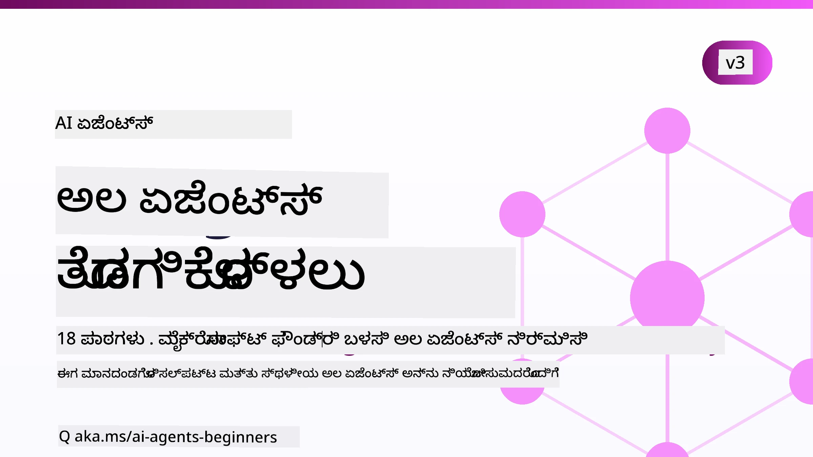

# ಶೈಶವಿಕರಿಗಾಗಿ AI ಏಜೆಂಟ್ಗಳು - ಒಂದು ಪಾಠ್ಯಕ್ರಮ



## AI ಏಜೆಂಟ್ಗಳನ್ನು ನಿರ್ಮಾಣವನ್ನು ಪ್ರಾರಂಭಿಸಲು ನಿಮಗೆ ತಿಳಿಯಬೇಕಾಗಿರುವ ಎಲ್ಲವನ್ನೂ ಕಲಿಸುವ ಪಾಠ್ಯಕ್ರಮ

[](https://github.com/microsoft/ai-agents-for-beginners/blob/master/LICENSE?WT.mc_id=academic-105485-koreyst)
[](https://GitHub.com/microsoft/ai-agents-for-beginners/graphs/contributors/?WT.mc_id=academic-105485-koreyst)
[](https://GitHub.com/microsoft/ai-agents-for-beginners/issues/?WT.mc_id=academic-105485-koreyst)
[](https://GitHub.com/microsoft/ai-agents-for-beginners/pulls/?WT.mc_id=academic-105485-koreyst)
[](http://makeapullrequest.com?WT.mc_id=academic-105485-koreyst)

### 🌐 ಬಹುಭಾಷಾ ಬೆಂಬಲ

#### [Co-op Translator](https://github.com/Azure/co-op-translator) ಮೂಲಕ ನಿರ್ವಹಿಸುವ ಭಾಷಾಂತರಗಳು

<!-- CO-OP TRANSLATOR LANGUAGES TABLE START -->
[ಅರೇಬಿಕ್](../ar/README.md) | [ಬೆಂಗಾಳಿ](../bn/README.md) | [ಬಲ್ಗೇರಿಯನ್](../bg/README.md) | [ಬರ್ಮೀಸ್ (ಮಿಯಾನ್ಮಾರ್)](../my/README.md) | [ಚೀನೀಸ್ (ಸರಳೀಕರಿಸಿದ)](../zh-CN/README.md) | [ಚೀನೀಸ್ (ಪಾರಂಪರಿಕ, ಹಾಂಗ್ ಕಾಂಗ್)](../zh-HK/README.md) | [ಚೀನೀಸ್ (ಪಾರಂಪರಿಕ, ಮಕಾವು)](../zh-MO/README.md) | [ಚೀನೀಸ್ (ಪಾರಂಪರಿಕ, ತೈವಾನ್ಲ)](../zh-TW/README.md) | [ಕ್ರೊಯೇಶಿಯನ್](../hr/README.md) | [ಜೆಕ್](../cs/README.md) | [ಡೆನಿಷ್](../da/README.md) | [ಡಚ್](../nl/README.md) | [ಎಸ್ಟೋನಿಯನ್](../et/README.md) | [ಫಿನ್ನಿಷ್](../fi/README.md) | [ಫ್ರೆಂಚ್](../fr/README.md) | [ಜರ್ಮನ್](../de/README.md) | [ಗ್ರೀಕ್](../el/README.md) | [ಹೇಬ್ರೂ](../he/README.md) | [ಹಿಂದಿ](../hi/README.md) | [ಹಂಗೇರಿಯನ್](../hu/README.md) | [ಇಂಡೋನೇಶಿಯನ್](../id/README.md) | [ಇಟಾಲಿಯನ್](../it/README.md) | [ಜಾಪಾನೀಸ್](../ja/README.md) | [ಕನ್ನಡ](./README.md) | [ಖ್ಮೇರ್](../km/README.md) | [ಕೊರಿಯನ್](../ko/README.md) | [ಲಿಥುವೇನಿಯನ್](../lt/README.md) | [ಮಲಯ್](../ms/README.md) | [ಮಲಯಾಳಂ](../ml/README.md) | [ಮಣಿಪುರಿ (ಮೈತೈ ಮ್ಯಯೇಕ್)](../mni/README.md) | [ಮರಾಠಿ](../mr/README.md) | [ನೆಪಾಳಿ](../ne/README.md) | [ನೈಜೀರಿಯನ್ ಪიჯಿನ್](../pcm/README.md) | [ನಾರ್ವೀಜಿಯನ್](../no/README.md) | [ಪರ್ಶಿಯನ್ (ಫಾರ್ಸಿ)](../fa/README.md) | [ಪೋಲಿಶ್](../pl/README.md) | [ಪୋರ್ಚುಗೀಸ್ (ಬ್ರೆಜಿಲ್)](../pt-BR/README.md) | [ಪೋರ್ಚುಗೀಸ್ (ಪೋರ್ಚುಗಲ್)](../pt-PT/README.md) | [ಪಂಜಾಬಿ (ಗುರುಮುಖಿ)](../pa/README.md) | [ರೊಮೇನಿಯನ್](../ro/README.md) | [ರಷ್ಯನ್](../ru/README.md) | [ಸರ್ಬಿಯನ್ (ಸಿರಿಲಿಕ್)](../sr/README.md) | [ಸ್ಲೋವಾಕ್](../sk/README.md) | [ಸ್ಲೋವೇನಿಯನ್](../sl/README.md) | [ಸ್ಪ್ಯಾನಿಷ್](../es/README.md) | [ಸ್ವಾಹಿಲಿ](../sw/README.md) | [ಸ್ವೀಡಿಷ್](../sv/README.md) | [ಟಗಲೋಗ್ (ಫಿಲಿಪಿನೋ)](../tl/README.md) | [ತಮಿಳು](../ta/README.md) | [ತೆಲುಗು](../te/README.md) | [ಥಾಯ್](../th/README.md) | [ತುರ್ಕಿಶ್](../tr/README.md) | [ಉಕ್ರೇನಿಯನ್](../uk/README.md) | [ಉರ್ದು](../ur/README.md) | [ವಿಯಟ್ನಾಮೀಸ್](../vi/README.md)

> **ಸ್ಥಳೀಯವಾಗಿ ಕ್ಲೋನ್ ಮಾಡಲು ಇಚ್ಛಿಸುತ್ತೀರಾ?**
>
> ಈ ಸಂಗ್ರಹಾಲಯವು 50+ ಭಾಷಾ ಭಾಷಾಂತರಗಳನ್ನು ಒಳಗೊಂಡಿರುತ್ತದೆ, ಇದು ಡೌನ್‌ಲೋಡ್ ಗಾತ್ರವನ್ನು ದ್ರುಷ್ಟಿಗೋಚರವಾಗಿ ಹೆಚ್ಚಿಸುತ್ತದೆ. ಭಾಷಾಂತರಗಳು ಇಲ್ಲದೆ ಕ್ಲೋನ್ ಮಾಡಲು, ಸ್ಫರ್ಸ್ ಚೆಕೌಟ್ ಬಳಸಿ:
>
> **ಬ್ಯಾಷ್ / macOS / ಲಿನಕ್ಸ್:**
> ```bash
> git clone --filter=blob:none --sparse https://github.com/microsoft/ai-agents-for-beginners.git
> cd ai-agents-for-beginners
> git sparse-checkout set --no-cone '/*' '!translations' '!translated_images'
> ```
>
> **CMD (ವಿಂಡೋಸ್):**
> ```cmd
> git clone --filter=blob:none --sparse https://github.com/microsoft/ai-agents-for-beginners.git
> cd ai-agents-for-beginners
> git sparse-checkout set --no-cone "/*" "!translations" "!translated_images"
> ```
>
> ಇದು ನಿಮಗೆ ಪಾಠ್ಯಕ್ರಮವನ್ನು ಪೂರ್ಣಗೊಳಿಸಲು ಬೇಕಾದ ಎಲ್ಲವನ್ನೂ ನೀಡುತ್ತದೆ, ಬಹಳ ವೇಗವಾದ ಡೌನ್‌ಲೋಡ್ ಜೊತೆಗೆ.
<!-- CO-OP TRANSLATOR LANGUAGES TABLE END -->

**ಹೆಚ್ಚು ಭಾಷಾ ಆಯ್ಕೆಗಳಿಗೆ, [Co-op Translator ಸ್ವೀಕೃತ ಭಾಷೆಗಳು](https://github.com/Azure/co-op-translator/blob/main/docs/supported-languages.md) ನೋಡಿ.**

[](https://GitHub.com/microsoft/ai-agents-for-beginners/watchers/?WT.mc_id=academic-105485-koreyst)
[](https://GitHub.com/microsoft/ai-agents-for-beginners/network/?WT.mc_id=academic-105485-koreyst)
[](https://GitHub.com/microsoft/ai-agents-for-beginners/stargazers/?WT.mc_id=academic-105485-koreyst)

[](https://discord.com/invite/ATgtXmAS5D)


## 🌱 ಪ್ರಾರಂಭ

ಈ ಪಾಠ್ಯಕ್ರಮದಲ್ಲಿ AI ಏಜೆಂಟ್ಗಳನ್ನು ನಿರ್ಮಿಸುವ ಮೂಲಭೂತ ವಿಷಯಗಳು ಒಳಗೊಂಡಿವೆ. ಪ್ರತಿ ಪಾಠ್ಯವು ತನ್ನದೇ ವಿಷಯವನ್ನು ಒಳಗೊಂಡಿದೆ, ಆದ್ದರಿಂದ ನೀವು ಇಚ್ಛಿಸುವ ಸ್ಥಳದಿಂದ ಪ್ರಾರಂಭಿಸಬಹುದು!

ಈ ಪಾಠ್ಯಕ್ರಮಕ್ಕೆ ಬಹುಭಾಷಾ ಬೆಂಬಲವಿದೆ. ನಮ್ಮ [ಲಭ್ಯವಿರುವ ಭಾಷೆಗಳು ಇಲ್ಲಿ](#-multi-language-support) ನೋಡಿ.

ನೀವು ಮೊದಲ ಬಾರಿಗೆ ಜನರೆಟಿವ್ AI ಮಾದರಿಗಳೊಂದಿಗೆ ನಿರ್ಮಿಸುವಾಗ, ನಮ್ಮ [ಶೈಶವಿಕರಿಗಾಗಿ ಜನರೆಟಿವ್ AI](https://aka.ms/genai-beginners) ಪಾಠ್ಯಕ್ರಮವನ್ನು ನೋಡಿ, ಇದು GenAI ಬಳಸಿ ನಿರ್ಮಾಣದ 21 ಪಾಠ್ಯಗಳನ್ನು ಒಳಗೊಂಡಿದೆ.

ಈ ಸಂಗ್ರಹಾಲಯವನ್ನು [ನಕ್ಷತ್ರ (🌟) ದಯವಿಟ್ಟು ನೀಡಿ](https://docs.github.com/en/get-started/exploring-projects-on-github/saving-repositories-with-stars?WT.mc_id=academic-105485-koreyst) ಮತ್ತು [ಫಾರ್ಕ್ ಮಾಡಿ](https://github.com/microsoft/ai-agents-for-beginners/fork) ಕೋಡ್ ನಡೆಸಲು.

### ಇತರ ಕಲಿಕೆದಾರರನ್ನು ಭೇಟಿ ಮಾಡಿ, ನಿಮ್ಮ ಪ್ರಶ್ನೆಗಳಿಗೆ ಉತ್ತರ ಪಡೆಯಿರಿ

ನೀವು ಅಡ್ಡಿಪಡಿಸಿದರೆ ಅಥವಾ AI ಏಜೆಂಟ್ಗಳ ನಿರ್ಮಾಣದ ಬಗ್ಗೆ ಯಾವುದೇ ಪ್ರಶ್ನೆಗಳಿದ್ದರೆ, ನಮ್ಮ ಮೀಸಲಾದ ಡಿಸ್ಕೋರ್ಡ್ ಚಾನೆಲ್ಲಿ ಸೇರಿಕೊಳ್ಳಿ [Microsoft Foundry Discord](https://aka.ms/ai-agents/discord).

### ನಿಮಗೆ ಬೇಕಾದವು

ಈ ಪಾಠ್ಯಕ್ರಮದ ಪ್ರತಿಯೊಂದು ಪಾಠ್ಯದಲ್ಲಿ ಕೋಡ್ ಉದಾಹರಣೆಗಳು ಇವೆ, ಅವುಗಳನ್ನು code_samples ಫೋಲ್ಡರ್‌ನಲ್ಲಿ ಕಾಣಬಹುದು. ನೀವು [ಈ ಸಂಗ್ರಹಾಲಯವನ್ನು ಫಾರ್ಕ್ ಮಾಡಿ](https://github.com/microsoft/ai-agents-for-beginners/fork) ನಿಮ್ಮ ಸೀಮಿತ ನಕಲನ್ನು ರಚಿಸಬಹುದು.

ಈ ವ್ಯಾಯಾಮಗಳಲ್ಲಿ ಕೋಡ್ ಉದಾಹರಣೆಗಳು Microsoft Agent Framework ಅನ್ನು Microsoft Foundry Agent Service V2 ಜೊತೆಗೆ ಬಳಸುತ್ತವೆ:

- [Microsoft Foundry](https://aka.ms/ai-agents-beginners/ai-foundry) - ಆಸುರೆ ಖಾತೆ ಅಗತ್ಯವಿದೆ

ಈ ಪಾಠ್ಯಕ್ರಮವು ಕೆಳಗಿನ Microsoft AI ಏಜೆಂಟ್ ಪರಿಕಲ್ಪನೆಗಳು ಮತ್ತು ಸೇವೆಗಳನ್ನು ಬಳಸುತ್ತದೆ:

- [Microsoft Agent Framework (MAF)](https://learn.microsoft.com/agent-framework/overview/)
- [Microsoft Foundry Agent Service V2](https://aka.ms/ai-agents-beginners/ai-agent-service)

ಕೆಲವು ಕೋಡ್ ಉದಾಹರಣೆಗಳು ಮಿನಿಮ್ಯಾಕ್ಸ್ (https://platform.minimaxi.com/) ಮುಂತಾದ OpenAI-ಸಮ<|vq_clip_5572|><|vq_clip_3736|><|vq_clip_13271|><|vq_clip_12029|><|vq_clip_11889|><|vq_clip_4814|><|vq_clip_15196|><|vq_clip_3367|><|vq_clip_7099|><|vq_clip_7633|><|vq_clip_10291|><|vq_clip_11450|><|vq_clip_4425|><|vq_clip_3168|><|vq_clip_186|><|vq_clip_13452|><|vq_clip_2674|><|vq_clip_7902|><|vq_clip_15531|><|vq_clip_10787|><|vq_clip_13436|><|vq_clip_12141|><|vq_clip_2926|><|vq_clip_13814|><|vq_clip_1557|><|vq_clip_13283|><|vq_clip_1715|><|vq_clip_12239|><|vq_clip_94|><|vq_clip_10252|><|vq_clip_12468|><|vq_clip_15143|><|vq_clip_10338|><|vq_clip_12028|><|vq_clip_9053|><|vq_clip_6458|><|vq_clip_5819|><|vq_clip_4630|><|vq_clip_14325|><|vq_clip_8744|><|vq_clip_10727|><|vq_clip_4565|><|vq_clip_8826|><|vq_clip_11731|><|vq_clip_1581|><|vq_clip_8837|><|vq_clip_5997|><|vq_clip_99|><|vq_clip_13294|><|vq_clip_1956|><|vq_clip_5869|><|vq_clip_6206|><|vq_clip_3834|><|vq_clip_12528|><|vq_clip_7128|><|vq_clip_10360|><|vq_clip_13522|><|vq_clip_11725|><|vq_clip_3524|><|vq_clip_6036|><|vq_clip_689|><|vq_clip_988|><|vq_clip_3240|><|vq_clip_10736|> rolite ಮಾಡುತ್ತಿರುವ ಮಿನಿಮ್ಯಾಕ್ಸ್ (204K ಟೋಕನ್‌ಗಳ ವರೆಗಿನ ದೊಡ್ಡ ಕಾಂಟೆಕ್ಸ್ಟ್ ಮಾದರಿಗಳನ್ನು ನೀಡುತ್ತದೆ) ಮುಂತಾದ ಪರಿವರ್ಗಗಳನ್ನು ಸಹ ಬೆಂಬಲಿಸುತ್ತದೆ. ಸಂರಚನಾ ವಿವರಗಳಿಗಾಗಿ [ಪಾಠ್ಯಕ್ರಮದ ಸೆಟ್‌ಅಪ್](./00-course-setup/README.md) ನೋಡಿ.

ಈ ಪಾಠ್ಯಕ್ರಮಕ್ಕಾಗಿರುವ ಕೋಡ್ ಅನ್ನು ನಿರ್ವಹಿಸುವ ಹೆಚ್ಚುವರಿ ಮಾಹಿತಿಗಾಗಿ, [ಪಾಠ್ಯಕ್ರಮದ ಸೆಟ್‌ಅಪ್](./00-course-setup/README.md) ಗೆ ಭೇಟಿ ನೀಡಿ.

## 🙏 ಸಹಾಯ ಮಾಡಲು ಇಚ್ಛಿಸುತ್ತೀರಾ?

ನಿಮ್ಮ ಬಳಿ ಸಲಹೆಗಳಿವೆಯೇ ಅಥವಾ ವ್ಯಾಕರಣ ಅಥವಾ ಕೋಡ್ ದೋಷಗಳನ್ನು ಕಂಡುಹಿಡಿದಿದ್ದೀರಾ? ದಯವಿಟ್ಟು [ಸಮಸ್ಯೆ ಏರಿಸಿ](https://github.com/microsoft/ai-agents-for-beginners/issues?WT.mc_id=academic-105485-koreyst) ಅಥವಾ [ಪುಲ್ ಕೋರಿಕೆ ಸೃಷ್ಟಿಸಿ](https://github.com/microsoft/ai-agents-for-beginners/pulls?WT.mc_id=academic-105485-koreyst)


## 📂 ಪ್ರತಿಯೊಂದು ಪಾಠ್ಯದಲ್ಲಿ ಇದೆ

- README ನಲ್ಲಿ ತರುವುದಾದ ಒಂದು ಬರಹ ಪಾಠ ಮತ್ತು ಒಂದು ಚಿಕ್ಕ ವೀಡಿಯೊ
- Microsoft Agent Framework ಮತ್ತು Microsoft Foundry ಬಳಸಿ ಪೈಥಾನ್ ಕೋಡ್ ಉದಾಹರಣೆಗಳು
- ನಿಮ್ಮ ಕಲಿಕೆಯನ್ನು ಮುಂದುವರಿಸಲು ಹೆಚ್ಚುವರಿ ಸಂಪನ್ಮೂಲಗಳಿಗೆ ಲಿಂಕ್ಸ್


## 🗃️ ಪಾಠ್ಯಗಳು

| **ಪಾಠ್ಯ**                                   | **ಬರಹ ಮತ್ತು ಕೋಡ್**                                    | **ವೀಡಿಯೋ**                                                  | **ಹೆಚ್ಚುವರಿ ಕಲಿಕೆ**                                                                     |
|----------------------------------------------|----------------------------------------------------|------------------------------------------------------------|----------------------------------------------------------------------------------------|
| AI ಏಜೆಂಟ್ಗಳು ಮತ್ತು ಏಜೆಂಟ್ ಬಳಕೆ ಪ್ರಕರಣಗಳಿಗೆ ಪರಿಚಯ       | [ಲಿಂಕ್](./01-intro-to-ai-agents/README.md)          | [ವೀಡಿಯೋ](https://youtu.be/3zgm60bXmQk?si=z8QygFvYQv-9WtO1)  | [ಲಿಂಕ್](https://aka.ms/ai-agents-beginners/collection?WT.mc_id=academic-105485-koreyst) |
| AI ಏಜೆಂಟಿ ಪರಿಕಲ್ಪನೆಗಳನ್ನು ಅನ್ವೇಷಿಸುವುದು              | [ಲಿಂಕ್](./02-explore-agentic-frameworks/README.md)  | [ವೀಡಿಯೋ](https://youtu.be/ODwF-EZo_O8?si=Vawth4hzVaHv-u0H)  | [ಲಿಂಕ್](https://aka.ms/ai-agents-beginners/collection?WT.mc_id=academic-105485-koreyst) |
| AI ಏಜೆಂಟಿ ವಿನ್ಯಾಸ نمونಾಗಳನ್ನು ಅರ್ಥಮಾಡಿಕೊಳ್ಳುವುದು     | [ಲಿಂಕ್](./03-agentic-design-patterns/README.md)     | [ವೀಡಿಯೋ](https://youtu.be/m9lM8qqoOEA?si=BIzHwzstTPL8o9GF)  | [ಲಿಂಕ್](https://aka.ms/ai-agents-beginners/collection?WT.mc_id=academic-105485-koreyst) |
| ಉಪಕರಣ ವಿನ್ಯಾಸ نمೂನೆ                      | [ಲಿಂಕ್](./04-tool-use/README.md)                    | [ವೀಡಿಯೋ](https://youtu.be/vieRiPRx-gI?si=2z6O2Xu2cu_Jz46N)  | [ಲಿಂಕ್](https://aka.ms/ai-agents-beginners/collection?WT.mc_id=academic-105485-koreyst) |
| ಏಜೆಂಟಿ RAG                                  | [ಲಿಂಕ್](./05-agentic-rag/README.md)                 | [ವೀಡಿಯೋ](https://youtu.be/WcjAARvdL7I?si=gKPWsQpKiIlDH9A3)  | [ಲಿಂಕ್](https://aka.ms/ai-agents-beginners/collection?WT.mc_id=academic-105485-koreyst) |
| ವಿಶ್ವಾಸಾರ್ಹ AI ಏಜೆಂಟ್ಗಳನ್ನು ನಿರ್ಮಿಸುವುದು               | [ಲಿಂಕ್](./06-building-trustworthy-agents/README.md) | [ವೀಡಿಯೋ](https://youtu.be/iZKkMEGBCUQ?si=jZjpiMnGFOE9L8OK ) | [ಲಿಂಕ್](https://aka.ms/ai-agents-beginners/collection?WT.mc_id=academic-105485-koreyst) |
| ಯೋಜನೆ ವಿನ್ಯಾಸ نمೂನೆ                      | [ಲಿಂಕ್](./07-planning-design/README.md)             | [ವೀಡಿಯೋ](https://youtu.be/kPfJ2BrBCMY?si=6SC_iv_E5-mzucnC)  | [ಲಿಂಕ್](https://aka.ms/ai-agents-beginners/collection?WT.mc_id=academic-105485-koreyst) |
| ಬಹು ಏಜೆಂಟ್ ವಿನ್ಯಾಸ نمೂನೆ                   | [ಲಿಂಕ್](./08-multi-agent/README.md)                 | [ವೀಡಿಯೋ](https://youtu.be/V6HpE9hZEx0?si=rMgDhEu7wXo2uo6g)  | [ಲಿಂಕ್](https://aka.ms/ai-agents-beginners/collection?WT.mc_id=academic-105485-koreyst) |
| ಮೆಟಾಕಾಗ್ನಿಷನ್ ವಿನ್ಯಾಸ نمೂನೆ                 | [ಲಿಂಕ್](./09-metacognition/README.md)               | [ವೀಡಿಯೋ](https://youtu.be/His9R6gw6Ec?si=8gck6vvdSNCt6OcF)  | [ಲಿಂಕ್](https://aka.ms/ai-agents-beginners/collection?WT.mc_id=academic-105485-koreyst) |
| ಉತ್ಪಾದನೆಯಲ್ಲಿ AI ಏಜೆಂಟ್‌ಗಳು                      | [ಲಿಂಕ್](./10-ai-agents-production/README.md)        | [ವೀಡಿಯೋ](https://youtu.be/l4TP6IyJxmQ?si=31dnhexRo6yLRJDl)  | [ಲಿಂಕ್](https://aka.ms/ai-agents-beginners/collection?WT.mc_id=academic-105485-koreyst) |
| ಏಜೆಂಟಿ ಪ್ರೋಟೋಕಾಲ್‌ಗಳನ್ನು ಬಳಸುವುದು (MCP, A2A ಮತ್ತು NLWeb) | [ಲಿಂಕ್](./11-agentic-protocols/README.md)           | [ವೀಡಿಯೋ](https://youtu.be/X-Dh9R3Opn8)                                 | [ಲಿಂಕ್](https://aka.ms/ai-agents-beginners/collection?WT.mc_id=academic-105485-koreyst) |
| AI ಏಜೆಂಟ್‌ಗಳಿಗೆ ಸಂಧರ್ಭ ಇಂಜಿನಿಯರಿಂಗ್            | [ಲಿಂಕ್](./12-context-engineering/README.md)         | [ವೀಡಿಯೋ](https://youtu.be/F5zqRV7gEag)                                 | [ಲಿಂಕ್](https://aka.ms/ai-agents-beginners/collection?WT.mc_id=academic-105485-koreyst) |
| ಏಜೆಂಟಿ ಮೆಮೊರಿಯನ್ನು ನಿರ್ವಹಿಸುವುದು                      | [ಲಿಂಕ್](./13-agent-memory/README.md)     |      [ವೀಡಿಯೋ](https://youtu.be/QrYbHesIxpw?si=vZkVwKrQ4ieCcIPx)                                                      |                                                                                        |
| Microsoft Agent Framework ಅನ್ನು ಅನ್ವೇಷಿಸುವುದು                         | [ಲಿಂಕ್](./14-microsoft-agent-framework/README.md)                            |                                                            |                                                                                        |
| ಕಂಪ್ಯೂಟರ್ ಬಳಕೆದಾರ ಏಜೆಂಟ್‌ಗಳು (CUA) ನಿರ್ಮಿಸುವುದು           | [ಲಿಂಕ್](./15-browser-use/README.md)     |                                                            | [ಲಿಂಕ್](https://docs.browser-use.com/examples/templates/playwright-integration)         |
| ವ್ಯಾಪಕ ಏಜೆಂಟ್‌ಗಳನ್ನು ನಿಯೋಜಿಸುವುದು                    | [ಲಿಂಕ್](./16-deploying-scalable-agents/README.md) |                                                    | [ಲಿಂಕ್](https://learn.microsoft.com/azure/ai-foundry/agents/overview)                   |
| ಸ್ಥಳೀಯ AI ಏಜೆಂಟ್‌ಗಳನ್ನು ರಚಿಸುವುದು                     | [ಲಿಂಕ್](./17-creating-local-ai-agents/README.md)  |                                                    | [ಲಿಂಕ್](https://learn.microsoft.com/azure/ai-foundry/foundry-local/)                    |
| AI ಏಜೆಂಟ್ಗಳನ್ನು ಭದ್ರಗೊಳಿಸುವುದು                           | [ಲಿಂಕ್](./18-securing-ai-agents/README.md)  |                                                            | [ಲಿಂಕ್](https://aka.ms/ai-agents-beginners/collection?WT.mc_id=academic-105485-koreyst) |

## 🎒 ಇತರ ಪಾಠ್ಯಕ್ರಮಗಳು

ನಮ್ಮ ತಂಡ ಇತರ ಪಾಠ್ಯಕ್ರಮಗಳನ್ನು ನಿರ್ಮಿಸುತ್ತದೆ! ನೋಡಿ:

<!-- CO-OP TRANSLATOR OTHER COURSES START -->
### ಲಾಂಗ್‌ಚೈನ್
[](https://aka.ms/langchain4j-for-beginners)
[](https://aka.ms/langchainjs-for-beginners?WT.mc_id=m365-94501-dwahlin)
[](https://github.com/microsoft/langchain-for-beginners?WT.mc_id=m365-94501-dwahlin)
---

### ಅಝೂರ್ / ಎಡ್ಜ್ / MCP / ಏಜೆಂಟ್ಗಳು
[](https://github.com/microsoft/AZD-for-beginners?WT.mc_id=academic-105485-koreyst)
[](https://github.com/microsoft/edgeai-for-beginners?WT.mc_id=academic-105485-koreyst)
[](https://github.com/microsoft/mcp-for-beginners?WT.mc_id=academic-105485-koreyst)
[](https://github.com/microsoft/ai-agents-for-beginners?WT.mc_id=academic-105485-koreyst)

---
 
### ಜನರೆಟಿವ್ AI ಸರಣಿ
[](https://github.com/microsoft/generative-ai-for-beginners?WT.mc_id=academic-105485-koreyst)
[-9333EA?style=for-the-badge&labelColor=E5E7EB&color=9333EA)](https://github.com/microsoft/Generative-AI-for-beginners-dotnet?WT.mc_id=academic-105485-koreyst)
[-C084FC?style=for-the-badge&labelColor=E5E7EB&color=C084FC)](https://github.com/microsoft/generative-ai-for-beginners-java?WT.mc_id=academic-105485-koreyst)
[-E879F9?style=for-the-badge&labelColor=E5E7EB&color=E879F9)](https://github.com/microsoft/generative-ai-with-javascript?WT.mc_id=academic-105485-koreyst)

---
 
### ಮೂಲ ಕಲಿಕೆ
[](https://aka.ms/ml-beginners?WT.mc_id=academic-105485-koreyst)
[](https://aka.ms/datascience-beginners?WT.mc_id=academic-105485-koreyst)
[](https://aka.ms/ai-beginners?WT.mc_id=academic-105485-koreyst)
[](https://github.com/microsoft/Security-101?WT.mc_id=academic-96948-sayoung)
[](https://aka.ms/webdev-beginners?WT.mc_id=academic-105485-koreyst)
[](https://aka.ms/iot-beginners?WT.mc_id=academic-105485-koreyst)
[](https://github.com/microsoft/xr-development-for-beginners?WT.mc_id=academic-105485-koreyst)

---
 
### ಕೋಪೈಲಟ್ ಸರಣಿ
[](https://aka.ms/GitHubCopilotAI?WT.mc_id=academic-105485-koreyst)
[](https://github.com/microsoft/mastering-github-copilot-for-dotnet-csharp-developers?WT.mc_id=academic-105485-koreyst)
[](https://github.com/microsoft/CopilotAdventures?WT.mc_id=academic-105485-koreyst)
<!-- CO-OP TRANSLATOR OTHER COURSES END -->

## 🌟 ಸಮುದಾಯ ಧನ್ಯವಾದಗಳು

ಏಜೆಂಟಿಕ್ RAG ಅನ್ನು ತೋರಿಸುವ ಪ್ರಮುಖ ಕೋಡ್ ಉದಾಹರಣೆಗಳನ್ನು ಕೊಟ್ಟ [ಶಿವಂ ಗೋಯಲ್](https://www.linkedin.com/in/shivam2003/) ಅವರಿಗೆ ಧನ್ಯವಾದಗಳು.

## ಭಾಗವಹಿಸುವುದು

ಈ ಯೋಜನೆ ಕೊಡುಗೆಗಳು ಮತ್ತು ಸೂಚನೆಗಳನ್ನು ಸ್ವಾಗತಿಸುತ್ತದೆ. ಬಹು بولಿಸುತ್ತದೆ ನೀವು ಒಪ್ಪಿಗೆ ನೀಡುವ 
ಕೊಡುಗೆದಾರರ ಪರವಾನಗಿ ಒಪ್ಪಂದ (CLA) ಇದನ್ನು ನೀವು ನೀಡಬೇಕಾಗುತ್ತದೆ ಮತ್ತು ನಿಜವಾಗಿಯೂ ಕೊಡಲು ಹಕ್ಕು ಹೊಂದಿದ್ದು
ನಮಗೆ ನೀಡುವುದು ಎಂದು ಭರವಸೆ ನೀಡಬೇಕು. ವಿವರಗಳಿಗೆ ಭೇಟಿ ನೀಡಿ <https://cla.opensource.microsoft.com>.

ನೀವು ಪುಲ್ ವಿನಂತಿ ಸಲ್ಲಿಸಿದಾಗ, CLA ಬಾಟ್ ಸ್ವಯಂಚಾಲಿತವಾಗಿ ನಿಮ್ಮಿಂದ CLA ಬೇಕೋ ಇಲ್ಲವೋ ನಿರ್ಧರಿಸಿ
PR ಅನ್ನು ಸೂಕ್ತವಾಗಿ ಅಲಂಕರಿಸುತ್ತದೆ (ಉದಾ., ಸ್ಥಿತಿ ಪರಿಶೀಲನೆ, ಕಾಮೆಂಟ್). ಕೇವಲ ಬಾಟ್ ನೀಡಿದ ಸೂಚನೆಗಳನ್ನು ಅನುಸರಿಸಿ.
ನೀವು ಎಲ್ಲ ರೆಪೋಗಳಲ್ಲಿಯೂ ಒಂದು ಬಾರಿ ಇದನ್ನು ಮಾಡಬೇಕು.

ಈ ಯೋಜನೆ [ಮೈಕ್ರೋಸಾಫ್ಟ್ ಓಪನ್ ಸೋರ್ಸ್ ಕೋಡ್ ಆಫ್ ಕೊಂಡಕ್ಟ್](https://opensource.microsoft.com/codeofconduct/)ನ್ನು ಅಳವಡಿಸಿಕೊಂಡಿದೆ.
ಹೆಚ್ಚಿನ ಮಾಹಿತಿಗಾಗಿ [ಕೋಡ್ ಆಫ್ ಕೊಂಡಕ್ಟ್ FAQ](https://opensource.microsoft.com/codeofconduct/faq/) ನೋಡಿ ಅಥವಾ
ಕಿತ್ತಳೆಗಳು ಅಥವಾ ಪ್ರಶ್ನೆಗಳಿಗೆ [opencode@microsoft.com](mailto:opencode@microsoft.com) ಸಂಪರ್ಕಿಸಿ.

## ಟ್ರೇಡ್‌ಮಾರ್ಕ್‌ಗಳು

ಈ ಯೋಜನೆದಲ್ಲಿ ಯೋಜನೆಗಳು, ಉತ್ಪನ್ನಗಳು ಅಥವಾ ಸೇವೆಗಳ ಟ್ರೇಡ್‌ಮಾರ್ಕ್‌ಗಳು ಅಥವಾ ಲೋಗೋಗಳಿರಬಹುದು. ಮೈಕ್ರೋಸಾಫ್ಟ್‌ನ
ಅನುಮತಿಪತ್ರ ಹೊಂದಿದ ಟ್ರೇಡ್‌ಮಾರ್ಕ್ ಅಥವಾ ಲೋಗೋಗಳ ಬಳಕೆ
[ಮೈಕ್ರೋಸಾಫ್ಟ್ ಟ್ರೇಡ್‌ಮಾರ್ಕ್ & ಬ್ರಾಂಡ್ ಮಾರ್ಗಸೂಚಿಗಳು](https://www.microsoft.com/legal/intellectualproperty/trademarks/usage/general) ಅನುಸರಿಸಬೇಕು.
ಈ ಯೋಜನೆಯ ಬದಲಾವಣೆಯುಳ್ಳ ಆವೃತ್ತಿಗಳಲ್ಲಿ ಮೈಕ್ರೋಸಾಫ್ಟ್ ಟ್ರೇಡ್‌ಮಾರ್ಕ್ ಅಥವಾ ಲೋಗೋಗಳ ಬಳಕೆ ಗೊಂದಲ ಉಂಟುಮಾಡಬಾರದೆಂದು ಅಥವಾ ಮೈಕ್ರೋಸಾಫ್ಟ್ ಪ್ರಾಯೋಜನೆಯನ್ನು ಸೂಚಿಸಬಾರದೆಂದು ಖಚಿತಪಡಿಸಿಕೊಳ್ಳಿ.
ತೃತೀಯ ಪಕ್ಷದ ಟ್ರೇಡ್‌ಮಾರ್ಕ್‌ಗಳ ಅಥವಾ ಲೋಗೋಗಳ ಬಳಕೆ ಆ ತೃತೀಯಪಕ್ಷದ ನಿಯಮಗಳಿಗೆ ಒಳಪಟ್ಟಿದೆ.

## ಸಹಾಯ ಪಡೆಯುವುದು


ನೀವು ಅಡಕೆಯಾಗಿದರೆ ಅಥವಾ AI ಅಪ್ಲಿಕೇಶನ್ ನಿರ್ಮಿಸುವ ಬಗ್ಗೆ ಪ್ರಶ್ನೆಗಳಿದ್ದರೆ, ಸೇರಿ:

[](https://aka.ms/foundry/discord)

ಉತ್ಪನ್ನ ಪ್ರತಿಕ್ರಿಯೆ ಅಥವಾ ದೋಷಗಳಿದ್ದರೆ, ತೆರೆಯಿರಿ:

[](https://aka.ms/foundry/forum)

---

<!-- CO-OP TRANSLATOR DISCLAIMER START -->
**ಅಸ್ವೀಕಾರ**:
ಈ ದಸ್ತಾವೇಜು AI ಅನುವಾದ ಸೇವೆ [Co-op Translator](https://github.com/Azure/co-op-translator) ಬಳಸಿ ಅನುವಾದಿಸಲಾಗಿದೆ. ನಾವು ನಿಖರತೆಯನ್ನು ಸಾಧಿಸಲು ಪ್ರಯತ್ನಿಸುತ್ತಿದ್ದರೂ, ದಯವಿಟ್ಟು ಗಮನಿಸಿ, ಸ್ವಯಂಚಾಲಿತ ಅನುವಾದಗಳಲ್ಲಿ ದೋಷಗಳು ಅಥವಾ ಅಸಡ್ಡೆಗಳು ಇರಬಹುದು. ಮೂಲ ಭಾಷೆಯಲ್ಲಿರುವ ಮೂಲ ದಸ್ತಾವೇಜು ಪ್ರಾಮಾಣಿಕ ಮೂಲವೆಂದು ಪರಿಗಣಿಸಬೇಕು. ಪ್ರಮುಖ ಮಾಹಿತಿಗಾಗಿ, ವೃತ್ತಿಪರ ಮಾನವ ಅನುವಾದವನ್ನು ಶಿಫಾರಸು ಮಾಡಲಾಗುತ್ತದೆ. ಈ ಅನುವಾದವನ್ನು ಬಳಸುವ ಮೂಲಕ ಉಂಟಾಗುವ ಯಾವುದೇ ತಪ್ಪು ಅರ್ಥಗಳ ಅಥವಾ ತಪ್ಪು ವ್ಯಾಖ್ಯಾನಗಳ ಬಗ್ಗೆ ನಾವು ಹೊಣೆಗಾರರಲ್ಲ.
<!-- CO-OP TRANSLATOR DISCLAIMER END -->