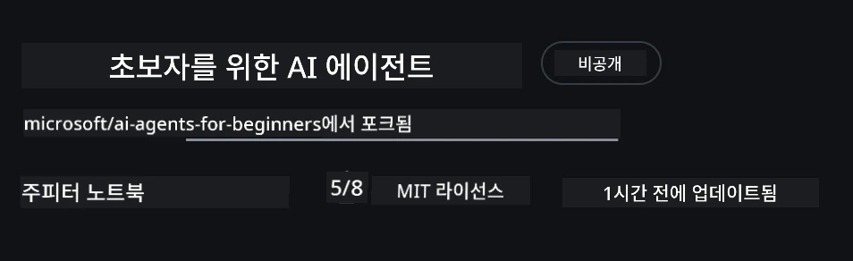
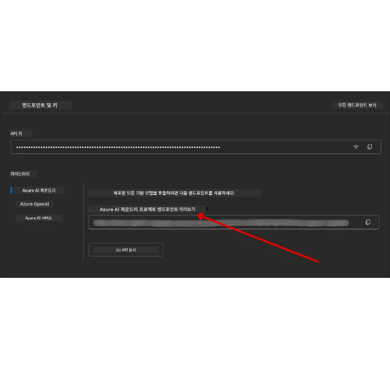

# 강의 설정

## 소개

이 강의에서는 이 코스의 코드 샘플을 실행하는 방법을 다룹니다.

## 다른 학습자와 참여하고 도움 받기

레포지토리를 클론하기 전에, 설정 도움, 코스 관련 질문, 또는 다른 학습자와 교류를 위해 [AI Agents For Beginners Discord 채널](https://aka.ms/ai-agents/discord)에 참여하세요.

## 이 레포지토리를 클론하거나 포크하기

시작하려면 GitHub 저장소를 클론하거나 포크하세요. 이렇게 하면 코드 실행, 테스트, 수정할 수 있는 자신만의 버전이 만들어집니다!

다음 링크에서 <a href="https://github.com/microsoft/ai-agents-for-beginners/fork" target="_blank">레포를 포크</a>하는 것으로 할 수 있습니다.

이제 다음 링크에서 이 코스의 포크된 버전을 가지게 됩니다:



### 얕은 클론 (워크숍/코드스페이스에 추천)

> 전체 저장소는 전체 기록과 모든 파일을 다운받을 경우 크기가 클 수 있습니다 (~3 GB). 워크숍 참석만 하거나 일부 강의 폴더만 필요할 경우, 얕은 클론(또는 스파스 클론)은 훨씬 적게 다운받습니다.

#### 빠른 얕은 클론 — 최소 기록, 모든 파일

아래 명령어의 `<your-username>` 부분을 포크 URL(또는 원본 URL)로 바꾸세요.

최신 커밋 기록만 클론하려면:

```bash
git clone --depth 1 https://github.com/<your-username>/ai-agents-for-beginners.git
```

특정 브랜치를 클론하려면:

```bash
git clone --depth 1 --branch <branch-name> https://github.com/<your-username>/ai-agents-for-beginners.git
```

#### 부분 (스파스) 클론 — 최소 블롭 + 선택된 폴더만

이는 부분 클론과 스파스 체크아웃을 사용합니다 (Git 2.25+ 필요하며, 부분 클론 지원이 있는 최신 Git 권장):

```bash
git clone --depth 1 --filter=blob:none --sparse https://github.com/<your-username>/ai-agents-for-beginners.git
```

레포 폴더로 이동:

```bash
cd ai-agents-for-beginners
```

원하는 폴더를 지정하세요 (아래 예시는 두 폴더):

```bash
git sparse-checkout set 00-course-setup 01-intro-to-ai-agents
```

클론 후 파일을 확인하고, 파일만 필요하고 공간을 확보하려면 (git 기록 없이), 저장소 메타데이터를 삭제하세요 (💀 되돌릴 수 없으며 Git 기능을 모두 잃습니다):

```bash
# zsh/bash
rm -rf .git
```

```powershell
# PowerShell
Remove-Item -Recurse -Force .git
```

#### GitHub Codespaces 사용 (로컬 대용량 다운로드를 피하는 추천 방법)

- [GitHub UI](https://github.com/codespaces)에서 이 레포지토리에 대한 새 Codespace를 생성하세요.

- 새로 생성된 Codespace 터미널에서 위의 얕은/스파스 클론 명령 중 하나를 실행해 필요한 강의 폴더만 Codespace 작업 공간으로 가져옵니다.
- 선택사항: Codespace 내에서 클론 후 .git을 제거해 추가 공간을 확보하세요 (위 제거 명령 참고).
- 참고: 레포를 추가 클론 없이 직접 Codespace에서 열 경우, Codespace는 개발 컨테이너 환경을 구성하며 필요 이상을 프로비저닝할 수 있습니다.

#### 팁

- 편집/커밋하려면 항상 클론 URL을 자신의 포크로 바꾸세요.
- 나중에 더 많은 기록이나 파일이 필요하면, 요청하거나 sparse-checkout을 조정해 추가 폴더를 포함할 수 있습니다.

## 코드 실행하기

이 강의는 AI 에이전트를 직접 만들어보는 Jupyter 노트북 시리즈를 제공합니다.

코드 샘플은 `FoundryChatClient`과 함께 Microsoft Agent Framework (MAF)를 사용하며, Microsoft Foundry를 통해 Microsoft Foundry Agent Service V2 (Responses API)에 연결됩니다.

모든 파이썬 노트북은 `*-python-agent-framework.ipynb`로 표시되어 있습니다.

## 요구 사항

- Python 3.12 이상
  - <strong>참고</strong>: Python3.12가 설치되지 않은 경우 설치하세요. 그런 다음 requirements.txt에서 올바른 버전이 설치되도록 python3.12로 가상환경(venv)을 만드세요.
  
    >예시

    Python 가상환경 생성:

    ```bash
    python -m venv venv
    ```

    그리고 venv 환경을 활성화:

    ```bash
    # zsh/bash
    source venv/bin/activate
    ```
  
    ```dos
    # Command Prompt for Windows
    venv\Scripts\activate
    ```

- .NET 10 이상: .NET을 사용하는 샘플 코드의 경우 [.NET 10 SDK](https://dotnet.microsoft.com/download/dotnet/10.0) 이상을 설치하세요. 설치된 .NET SDK 버전 확인:

    ```bash
    dotnet --list-sdks
    ```

- **Azure CLI** — 인증에 필요하며 [aka.ms/installazurecli](https://aka.ms/installazurecli)에서 설치하세요.
- **Azure 구독** — Microsoft Foundry 및 Foundry Agent Service 접근용.
- **Microsoft Foundry 프로젝트** — 배포된 모델이 포함된 프로젝트(e.g., `gpt-5-mini`). [1단계](#step-1-create-a-microsoft-foundry-project) 참고.

이 저장소 루트에 코드 샘플 실행에 필요한 모든 파이썬 패키지를 포함한 `requirements.txt` 파일이 있습니다.

터미널에서 다음 명령어를 실행해 설치할 수 있습니다:

```bash
pip install -r requirements.txt
```

충돌과 문제를 피하려면 파이썬 가상환경에서 실행하는 것을 추천합니다.

## VSCode 설정하기

VSCode에서 올바른 파이썬 버전을 사용하고 있는지 확인하세요.


## Microsoft Foundry 및 Microsoft Foundry Agent Service 설정하기

### 1단계: Microsoft Foundry 프로젝트 생성

노트북 실행을 위해 모델이 배포된 Microsoft Foundry <strong>허브</strong>와 <strong>프로젝트</strong>가 필요합니다.

1. [ai.azure.com](https://ai.azure.com)으로 가서 Azure 계정으로 로그인하세요.
2. <strong>허브</strong>를 생성하거나 기존 허브를 사용하세요. 참고: [Hub 리소스 개요](https://learn.microsoft.com/azure/ai-foundry/concepts/ai-resources).
3. 허브 내에 <strong>프로젝트</strong>를 생성하세요.
4. **모델 + 엔드포인트** → <strong>모델 배포</strong>에서 모델을 배포하세요 (e.g., `gpt-5-mini`).

### 2단계: 프로젝트 엔드포인트와 모델 배포 이름 확인하기

Microsoft Foundry 포털의 프로젝트에서:

- **프로젝트 엔드포인트** — <strong>개요</strong> 페이지에서 엔드포인트 URL을 복사하세요.



- **모델 배포 이름** — <strong>모델 + 엔드포인트</strong>에서 배포한 모델을 선택하고 <strong>배포 이름</strong>을 확인하세요 (예: `gpt-5-mini`).

### 3단계: `az login`로 Azure 로그인하기

대부분 노트북은 <strong>Azure CLI 로그인</strong>을 통해 인증합니다 — `AzureCliCredential` 또는 `DefaultAzureCredential` 사용 (두 방법 모두 `az login` 세션을 `azure-identity` 패키지에서 가져옴) — API 키가 필요 없습니다. 일부 강의와 선택적 통합은 API 키 사용이 필요하며, 각 강의 필수 사항을 확인하세요. Azure CLI로 로그인해야 합니다.

1. 아직 설치하지 않았다면 **Azure CLI 설치**: [aka.ms/installazurecli](https://aka.ms/installazurecli)

2. 다음 명령어로 <strong>로그인</strong>하세요:

    ```bash
    az login
    ```

    브라우저 없는 원격/Codespace 환경이라면:

    ```bash
    az login --use-device-code
    ```

3. 프롬프트가 뜨면 **구독 선택** — Foundry 프로젝트가 있는 구독 선택.

4. 로그인 상태 확인:

    ```bash
    az account show
    ```

> **왜 `az login`?** 노트북들은 `AzureCliCredential` (또는 이렇게 인증 가능한 `DefaultAzureCredential`도 포함, Azure CLI 로그인 정보를 가져옴)을 사용해 인증합니다. 이는 `azure-identity` 패키지에서 제공하며, Azure CLI 세션이 자격증명을 제공합니다 — API 키나 비밀키를 `.env` 파일에 넣지 않아도 됩니다. 이는 [보안 모범 사례](https://learn.microsoft.com/azure/developer/ai/keyless-connections)입니다.

### 4단계: `.env` 파일 생성하기

예제 파일 복사:

```bash
# zsh/bash
cp .env.example .env
```

```powershell
# PowerShell
Copy-Item .env.example .env
```

`.env` 파일을 열어 아래 두 값을 입력하세요:

```env
AZURE_AI_PROJECT_ENDPOINT=https://<your-project>.services.ai.azure.com/api/projects/<your-project-id>
AZURE_AI_MODEL_DEPLOYMENT_NAME=gpt-5-mini
```

| 변수 | 위치 |
|----------|-----------------|
| `AZURE_AI_PROJECT_ENDPOINT` | Foundry 포털 → 프로젝트 → <strong>개요</strong> 페이지 |
| `AZURE_AI_MODEL_DEPLOYMENT_NAME` | Foundry 포털 → **모델 + 엔드포인트** → 배포된 모델 이름 |

대부분 강의는 여기까지입니다! 노트북은 자동으로 `az login` 세션으로 인증합니다.

### 5단계: 파이썬 의존성 설치하기

```bash
pip install -r requirements.txt
```

앞서 만든 가상환경에서 실행할 것을 권장합니다.

## 선택 설정: Azure AI Search (5, 16강)

5강 (Agentic RAG)과 16강 노트북은 기본적으로 <strong>인메모리 지식 베이스</strong>로 실행되므로 추가 Azure 리소스가 필요 없습니다. 실제 **Azure AI Search** 인덱스를 연결하려면, 16강 노트북은 현재 <strong>키 기반 인증</strong>을 사용합니다: `AZURE_SEARCH_SERVICE_ENDPOINT` <strong>및</strong> `AZURE_SEARCH_API_KEY` 가 모두 설정되어야 Azure AI Search로 전환하고, 그렇지 않으면 인메모리 검색을 사용합니다 — 실제 인덱스 실행 시 관리자 키도 설정해야 합니다. 키 없는 인증(Microsoft Entra ID 기반 RBAC)이 추천되며, 이 코스의 다른 전반적인 `az login` 흐름과 일치합니다.

아래 RBAC 단계는 설치 안내 샘플 및 자신의 코드에 적용되며, 16강 노트북에서 키 없는 인증을 활성화하지 않습니다; 16강은 여전히 엔드포인트와 관리자 키 둘 다 필요합니다.

1. 검색 서비스에서 **역할 기반 액세스 활성화**:

    ```bash
    az search service update --name <service-name> --resource-group <resource-group> --auth-options aadOrApiKey
    ```

2. 필요한 역할 할당 (인덱스 생성/로드 및 쿼리):

    ```bash
    az role assignment create --assignee <your-user-or-principal-id> --role "Search Service Contributor" --scope $(az search service show -g <resource-group> -n <service-name> --query id -o tsv)
    az role assignment create --assignee <your-user-or-principal-id> --role "Search Index Data Contributor" --scope $(az search service show -g <resource-group> -n <service-name> --query id -o tsv)
    ```

3. `.env` 파일에 엔드포인트 추가:

| 변수 | 위치 |
|----------|-----------------|
| `AZURE_SEARCH_SERVICE_ENDPOINT` | Azure 포털 → **Azure AI Search** 리소스 → <strong>개요</strong> → URL |
| `AZURE_SEARCH_API_KEY` | 16강 노트북에서 키 기반 인증을 위해 필요. Azure 포털 → <strong>설정</strong> → <strong>키</strong> → 기본 관리자 키 |

> **왜 키 없는 인증인가?** 관리자 키는 검색 서비스에 완전한 쓰기 권한을 주며 `.env` 파일을 통해 노출될 수 있습니다. RBAC는 `az login` 신원을 사용합니다 — 이는 노트북이 사용하는 키 없는 Entra ID 패턴(`AzureCliCredential` / `DefaultAzureCredential`)과 동일합니다. 자세한 내용은 [역할 사용하여 Azure AI Search 연결하기](https://learn.microsoft.com/azure/search/search-security-rbac)를 참고하세요.

[Azure AI Search 설정 안내](./AzureSearch.md)에서 Python과 .NET 인덱스 생성 전체 샘플을 확인하세요.

## Azure OpenAI 직접 호출하는 강의 추가 설정 (6, 8강)

6, 8강 일부 노트북은 Microsoft Foundry 프로젝트를 거치지 않고 (Responses API를 사용하는) <strong>Azure OpenAI</strong>를 직접 호출합니다. 이전에 GitHub Models를 사용하였으나 폐기되어 Responses API를 지원하지 않습니다. 다음 변수를 `.env` 파일에 추가하세요:

| 변수 | 위치 |
|----------|-----------------|
| `AZURE_OPENAI_ENDPOINT` | Azure 포털 → **Azure OpenAI** 리소스 → **키와 엔드포인트** → 엔드포인트 (예: `https://<your-resource>.openai.azure.com`) |
| `AZURE_OPENAI_DEPLOYMENT` | Responses API를 지원하는 배포 모델 이름 (예: `gpt-5-mini`) |
| `AZURE_OPENAI_API_KEY` | 선택사항 — 키 기반 인증 대신 Entra ID (`az login`)를 사용하지 않는 경우만 필요 |

> Responses API는 안정적인 `/openai/v1/` 엔드포인트를 사용하므로 `api-version`는 필요 없습니다. 키 없는 Entra ID 인증 사용 시 `az login`로 로그인하세요.

## 대체 공급자: MiniMax (OpenAI 호환)

[MiniMax](https://platform.minimaxi.com/)는 최대 204K 토큰의 대규모 컨텍스트 모델을 OpenAI 호환 API를 통해 제공합니다. Microsoft Agent Framework의 `OpenAIChatClient`는 OpenAI 호환 엔드포인트에서 작동하므로 `OpenAIChatClient`를 사용하는 강의에서 MiniMax를 드롭인 대체제로 사용할 수 있습니다.

`.env` 파일에 다음 변수를 추가하세요:

| 변수 | 위치 |
|----------|-----------------|
| `MINIMAX_API_KEY` | [MiniMax 플랫폼](https://platform.minimaxi.com/) → API 키 |
| `MINIMAX_BASE_URL` | 기본값인 `https://api.minimax.io/v1` 사용 |
| `MINIMAX_MODEL_ID` | 사용할 모델 이름 (예: `MiniMax-M3`) |

**예시 모델들**: `MiniMax-M3` (추천), `MiniMax-M2.7`, `MiniMax-M2.7-highspeed` (더 빠른 응답). 모델 이름과 제공 가능 여부는 시간이 지남에 따라 변할 수 있으며, 특정 모델 접근은 계정에 따라 다를 수 있습니다.

`OpenAIChatClient`를 사용하는 코드 샘플(e.g., 14강 호텔 예약 워크플로)은 `MINIMAX_API_KEY`가 설정되면 자동으로 MiniMax 구성을 감지해 사용합니다.

## 대체 공급자: Novita AI (OpenAI 호환)

[Novita AI](https://novita.ai/llm-api)는 오픈 소스 및 최첨단 LLM(DeepSeek, Llama, Qwen 등)을 위한 OpenAI 호환 API를 제공합니다. Microsoft Agent Framework의 `OpenAIChatClient`는 모든 OpenAI 호환 엔드포인트와 작동하므로, Novita AI를 Azure OpenAI 또는 OpenAI의 대체품으로 바로 사용할 수 있습니다.

다음 변수들을 `.env` 파일에 추가하세요:

| 변수 | 위치 |
|----------|-----------------|
| `NOVITA_API_KEY` | [Novita AI 대시보드](https://novita.ai/settings/key-management) → API 키 |
| `NOVITA_BASE_URL` | `https://api.novita.ai/openai/v1` 사용 (기본값) |
| `NOVITA_MODEL_ID` | 사용할 모델 이름 (예: `moonshotai/kimi-k3`) |

**예시 모델**: `moonshotai/kimi-k3`, `zai-org/glm-5.2`, `deepseek/deepseek-v4-flash-0731`. Novita AI는 또한 Llama, Qwen, GLM 등 다양한 오픈 소스 모델 패밀리를 호스팅합니다 — 사용 가능한 모델 목록과 모델 ID는 [Novita AI 모델 라이브러리](https://novita.ai/llm-api)에서 확인하세요.

현재 샘플들은 `NOVITA_*` 변수를 자동으로 사용하지 않습니다. Novita AI를 사용하려면, 실행 중인 샘플에서 `OpenAIChatClient`를 구축할 때 이 값들을 명시적으로 전달하세요.

## 대체 제공자: Foundry Local (기기 내 모델 실행)

[Foundry Local](https://foundrylocal.ai)는 lightweight 런타임으로, 오픈AI 호환 API를 통해 **완전히 사용자의 기기 내에서** 언어 모델을 다운로드, 관리, 서빙합니다 — 클라우드를 사용할 필요가 없습니다.

Microsoft Agent Framework의 `OpenAIChatClient`가 모든 OpenAI 호환 엔드포인트와 작동하기 때문에, Foundry Local은 Azure OpenAI의 로컬 대체품으로 바로 사용할 수 있습니다.

**1. Foundry Local 설치하기**

```bash
# Windows
winget install Microsoft.FoundryLocal

# macOS
brew install foundrylocal
```

**2. 모델 다운로드 및 실행** (로컬 서비스도 시작됩니다):

```bash
foundry model list          # see available models
foundry model run phi-4-mini
```

**3. 로컬 엔드포인트를 찾는 데 사용하는 Python SDK 설치:**

```bash
pip install foundry-local-sdk
```

**4. Microsoft Agent Framework의 대상 엔드포인트를 로컬 모델로 지정:**

```python
from foundry_local import FoundryLocalManager
from agent_framework.openai import OpenAIChatClient

# Downloads (if needed) and serves the model locally, then discovers the endpoint/port.
manager = FoundryLocalManager("phi-4-mini")

chat_client = OpenAIChatClient(
    base_url=manager.endpoint,      # e.g. http://localhost:<port>/v1
    api_key=manager.api_key,        # always "not-required" for Foundry Local
    model_id=manager.get_model_info("phi-4-mini").id,
)

agent = chat_client.as_agent(
    name="LocalAgent",
    instructions="You are a helpful assistant running fully on-device.",
)
```

> **참고:** Foundry Local은 OpenAI 호환 **챗 완성(Chat Completions)** 엔드포인트를 제공합니다. 로컬 개발 및 오프라인 시나리오에 사용하세요. 전체 **Responses API** 기능 셋(상태 저장 대화 등)을 원한다면 Azure OpenAI 또는 Microsoft Foundry 프로젝트를 사용하세요.

## 8과 보조 설정 (Bing 기반 워크플로우)

8과의 조건부 워크플로우 노트북은 Microsoft Foundry를 통해 <strong>Bing 기반</strong>을 사용합니다. 해당 샘플을 실행할 계획이라면 다음 변수를 `.env` 파일에 추가하세요:

| 변수 | 위치 |
|----------|-----------------|
| `BING_CONNECTION_ID` | Microsoft Foundry 포털 → 프로젝트 → <strong>관리</strong> → **연결된 리소스** → Bing 연결 → 연결 ID 복사 |

## 문제 해결

### macOS에서 SSL 인증서 검증 오류

macOS에서 다음과 같은 오류가 발생하면:

```plaintext
ssl.SSLCertVerificationError: [SSL: CERTIFICATE_VERIFY_FAILED] certificate verify failed: self-signed certificate in certificate chain
```

이는 macOS에서 Python이 시스템 SSL 인증서를 자동으로 신뢰하지 않는 알려진 문제입니다. 다음 해결책들을 순서대로 시도하세요:

**옵션 1: Python의 인증서 설치 스크립트 실행 (권장)**

```bash
# Replace 3.XX with your installed Python version (e.g., 3.12 or 3.13):
/Applications/Python\ 3.XX/Install\ Certificates.command
```

**옵션 2: 노트북에서 `connection_verify=False` 사용 (GitHub Models 노트북 전용)**

6과 노트북(`06-building-trustworthy-agents/code_samples/06-system-message-framework.ipynb`)에 주석 처리된 해결책이 포함되어 있습니다. 인증서 오류 발생 시 `connection_verify=False`의 주석을 해제하세요:

```python
client = ChatCompletionsClient(
    endpoint=endpoint,
    credential=AzureKeyCredential(token),
    connection_verify=False,  # Disable SSL verification if you encounter certificate errors
)
```

> **⚠️ 경고:** SSL 검증 비활성화(`connection_verify=False`)는 인증서 검증을 생략하여 보안을 저하시킵니다. 개발 환경에서 임시 해결책으로만 사용하세요. 절대 운영 환경에서는 사용하지 마세요.

**옵션 3: `truststore` 설치 및 사용**

```bash
pip install truststore
```

그런 다음 노트북이나 스크립트 상단에 네트워크 호출 전에 다음을 추가하세요:

```python
import truststore
truststore.inject_into_ssl()
```

## 어디서 막히셨나요?

이 설정 실행에 문제가 있으면 <a href="https://discord.gg/kzRShWzttr" target="_blank">Azure AI 커뮤니티 Discord</a>에서 도움을 받거나 <a href="https://github.com/microsoft/ai-agents-for-beginners/issues?WT.mc_id=academic-105485-koreyst" target="_blank">이슈를 등록</a>하세요.

## 다음 강의

이제 이 강좌의 코드를 실행할 준비가 되었습니다. AI 에이전트의 세계에 대해 더 많이 배우세요!

[AI 에이전트 소개 및 에이전트 사용 사례](../01-intro-to-ai-agents/README.md)

---

<!-- CO-OP TRANSLATOR DISCLAIMER START -->
**면책 조항**:
이 문서는 AI 번역 서비스 [Co-op Translator](https://github.com/Azure/co-op-translator)를 사용하여 번역되었습니다. 정확성을 기하기 위해 노력하고 있으나, 자동 번역은 오류나 부정확한 부분이 있을 수 있음을 유의하시기 바랍니다. 원본 문서의 원어본이 권위 있는 자료로 간주되어야 합니다. 중요한 정보의 경우, 전문가의 인간 번역을 권장합니다. 이 번역 사용으로 인해 발생하는 오해나 잘못된 해석에 대해 당사는 책임을 지지 않습니다.
<!-- CO-OP TRANSLATOR DISCLAIMER END -->