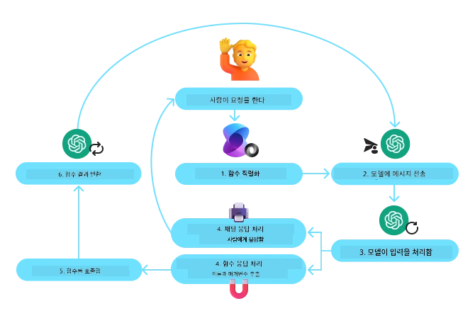
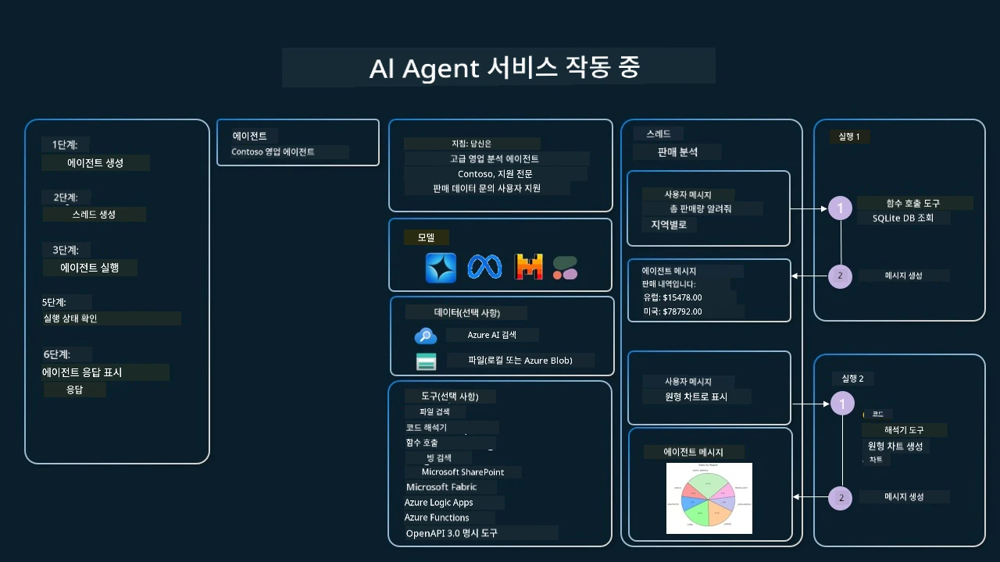

[](https://youtu.be/vieRiPRx-gI?si=cEZ8ApnT6Sus9rhn)

> _(위 이미지를 클릭하면 이 수업의 동영상을 볼 수 있습니다)_

# 도구 사용 설계 패턴

도구는 AI 에이전트가 더 광범위한 기능을 갖도록 해주기 때문에 흥미롭습니다. 에이전트가 수행할 수 있는 동작이 제한된 집합에 머무는 대신 도구를 추가함으로써, 에이전트는 이제 다양한 동작을 수행할 수 있습니다. 이 장에서는 AI 에이전트가 목표를 달성하기 위해 특정 도구를 사용하는 방법을 설명하는 도구 사용 설계 패턴에 대해 살펴보겠습니다.

## 소개

이 수업에서 다음 질문에 답하고자 합니다:

- 도구 사용 설계 패턴이란 무엇인가?
- 적용할 수 있는 사용 사례는 무엇인가?
- 설계 패턴을 구현하는 데 필요한 요소/구성 블록은 무엇인가?
- 신뢰할 수 있는 AI 에이전트를 구축하기 위해 도구 사용 설계 패턴을 사용할 때의 특별 고려사항은 무엇인가?

## 학습 목표

이 수업을 마친 후, 여러분은 다음을 할 수 있습니다:

- 도구 사용 설계 패턴과 그 목적 정의하기
- 도구 사용 설계 패턴을 적용할 수 있는 사용 사례 식별하기
- 설계 패턴 구현에 필요한 주요 요소 이해하기
- 이 설계 패턴을 사용하는 AI 에이전트의 신뢰성을 보장하기 위한 고려사항 인식하기

## 도구 사용 설계 패턴이란 무엇인가?

<strong>도구 사용 설계 패턴</strong>은 LLM(대규모 언어 모델)이 특정 목표를 달성하기 위해 외부 도구와 상호 작용할 수 있는 능력을 부여하는 것에 중점을 둡니다. 도구는 에이전트가 실행할 수 있는 코드로, 특정 작업을 수행합니다. 도구는 계산기 같은 간단한 함수이거나 주식 가격 조회나 일기 예보 같은 서드파티 서비스에 API 호출일 수 있습니다. AI 에이전트의 맥락에서는, 도구는 <strong>모델이 생성한 함수 호출</strong>에 응답하여 에이전트가 실행하도록 설계됩니다.

## 적용 가능한 사용 사례는 무엇인가?

AI 에이전트는 도구를 활용해 복잡한 작업을 수행하거나 정보를 검색하거나 의사 결정을 내릴 수 있습니다. 도구 사용 설계 패턴은 데이터베이스, 웹 서비스 또는 코드 인터프리터와 같은 외부 시스템과 역동적으로 상호작용해야 하는 시나리오에서 자주 사용됩니다. 이러한 기능은 다음과 같은 다양한 사용 사례에 유용합니다:

- **동적 정보 검색:** 에이전트가 외부 API나 데이터베이스를 쿼리하여 최신 데이터를 가져옵니다(예: SQLite 데이터베이스 쿼리, 주식 가격 또는 날씨 정보 가져오기).
- **코드 실행 및 해석:** 수학 문제 해결, 보고서 생성, 시뮬레이션 수행을 위해 코드나 스크립트를 실행합니다.
- **워크플로우 자동화:** 작업 스케줄러, 이메일 서비스 또는 데이터 파이프라인과 같은 도구를 통합해 반복적이거나 다단계 워크플로우를 자동화합니다.
- **고객 지원:** CRM 시스템, 티켓 플랫폼 또는 지식 베이스와 상호 작용하여 사용자 문의를 해결합니다.
- **콘텐츠 생성 및 편집:** 문법 검사기, 텍스트 요약기, 콘텐츠 안전 평가기 같은 도구를 활용하여 콘텐츠 제작 작업을 지원합니다.

## 도구 사용 설계 패턴 구현에 필요한 요소/구성 블록은 무엇인가?

이러한 구성 블록들은 AI 에이전트가 광범위한 작업을 수행할 수 있도록 합니다. 도구 사용 설계 패턴 구현에 필요한 주요 요소를 살펴보겠습니다:

- **함수/도구 스키마:** 함수명, 목적, 필수 파라미터, 예상 출력 등 사용 가능한 도구의 상세 정의. 이 스키마는 LLM이 어떤 도구가 있는지, 올바른 요청을 어떻게 구성할지 이해하도록 돕습니다.

- **함수 실행 로직:** 사용자 의도와 대화 컨텍스트에 따라 도구가 어떻게, 언제 호출되는지 관리합니다. 플래너 모듈, 라우팅 메커니즘, 조건 흐름 등이 포함되어 도구 사용을 동적으로 결정합니다.

- **메시지 처리 시스템:** 사용자 입력, LLM 응답, 도구 호출, 도구 출력 간의 대화 흐름을 관리하는 구성 요소.

- **도구 통합 프레임워크:** 간단한 함수든 복잡한 외부 서비스든 에이전트를 다양한 도구와 연결하는 인프라.

- **오류 처리 및 검증:** 도구 실행 실패 처리, 파라미터 검증, 예기치 않은 응답 관리 메커니즘.

- **상태 관리:** 대화 컨텍스트, 이전 도구 상호작용, 지속 데이터 추적을 통해 다중 턴 상호작용에서 일관성 유지.

다음으로 함수/도구 호출에 관해 자세히 살펴보겠습니다.
 
### 함수/도구 호출

함수 호출은 대규모 언어 모델(LLM)이 도구와 상호작용할 수 있도록 하는 기본 방법입니다. '함수'와 '도구'는 종종 같은 의미로 사용되는데, '함수'(재사용 가능한 코드 블록)가 에이전트가 작업을 수행하는 데 사용하는 '도구'이기 때문입니다. 함수 코드를 호출하려면 LLM이 사용자의 요청과 함수 설명을 비교해야 합니다. 이를 위해 모든 사용 가능한 함수에 대한 설명이 포함된 스키마가 LLM에 전송됩니다. LLM은 작업에 가장 적절한 함수를 선택해 이름과 인수를 반환합니다. 선택된 함수가 호출되고, 응답이 다시 LLM으로 전송되어 이를 사용해 사용자 요청에 답합니다.

개발자가 에이전트용 함수 호출을 구현하기 위해 필요한 것은:

1. 함수 호출을 지원하는 LLM 모델
2. 함수 설명을 담은 스키마
3. 설명된 각 함수에 대한 코드

도시의 현재 시간을 가져오는 예시를 들어 보겠습니다:

1. **함수 호출을 지원하는 LLM 초기화하기:**

    모든 모델이 함수 호출을 지원하는 것은 아니므로, 사용하는 LLM이 지원하는지를 확인하는 것이 중요합니다. <a href="https://learn.microsoft.com/azure/ai-services/openai/how-to/function-calling" target="_blank">Azure OpenAI</a>는 함수 호출을 지원합니다. Azure OpenAI **Responses API**(안정적인 `/openai/v1/` 엔드포인트 — `api_version` 불필요)를 사용해 OpenAI 클라이언트를 시작할 수 있습니다.

    ```python
    # Initialize the OpenAI client for Azure OpenAI (Responses API, v1 endpoint)
    client = OpenAI(
        base_url=f"{os.environ['AZURE_OPENAI_ENDPOINT'].rstrip('/')}/openai/v1/",
        api_key=os.environ["AZURE_OPENAI_API_KEY"],
    )
    deployment_name = os.environ["AZURE_OPENAI_DEPLOYMENT"]
    ```

1. **함수 스키마 생성하기**:

    다음으로 함수명, 함수가 수행하는 작업 설명, 함수 파라미터 이름 및 설명을 포함하는 JSON 스키마를 정의합니다.
    그런 다음 사용자가 샌프란시스코 시간을 요청하는 것과 함께 이 스키마를 앞서 생성한 클라이언트에 전달합니다. 중요한 점은 <strong>도구 호출이 반환된다는 것이며, 질문에 대한 최종 답변이 아니라는 것</strong>입니다. 앞서 언급했듯이 LLM은 작업에 선택된 함수명과 전달할 인수를 반환합니다.

    ```python
    # Function description for the model to read (Responses API flat tool format)
    tools = [
        {
            "type": "function",
            "name": "get_current_time",
            "description": "Get the current time in a given location",
            "parameters": {
                "type": "object",
                "properties": {
                    "location": {
                        "type": "string",
                        "description": "The city name, e.g. San Francisco",
                    },
                },
                "required": ["location"],
            },
        }
    ]
    ```
   
    ```python
  
    # Initial user message
    messages = [{"role": "user", "content": "What's the current time in San Francisco"}]

    # First API call: Ask the model to use the function
    response = client.responses.create(
        model=deployment_name,
        input=messages,
        tools=tools,
        tool_choice="auto",
        store=False,
    )

    # The Responses API returns tool calls as function_call items in response.output.
    # Append them to the conversation so the model has full context on the next turn.
    messages += response.output

    print("Model's response:")
    print(response.output)
  
    ```

    ```bash
    Model's response:
    [ResponseFunctionToolCall(arguments='{"location":"San Francisco"}', call_id='call_pOsKdUlqvdyttYB67MOj434b', name='get_current_time', type='function_call')]
    ```
  
1. **작업 수행에 필요한 함수 코드:**

    이제 LLM이 실행할 함수를 선택했으므로, 작업을 수행하는 코드를 구현하고 실행해야 합니다.
    Python으로 현재 시간을 가져오는 코드를 구현할 수 있습니다. 또한 최종 결과를 얻기 위해 응답 메시지에서 함수 이름과 인수를 추출하는 코드도 작성해야 합니다.

    ```python
      def get_current_time(location):
        """Get the current time for a given location"""
        print(f"get_current_time called with location: {location}")  
        location_lower = location.lower()
        
        for key, timezone in TIMEZONE_DATA.items():
            if key in location_lower:
                print(f"Timezone found for {key}")  
                current_time = datetime.now(ZoneInfo(timezone)).strftime("%I:%M %p")
                return json.dumps({
                    "location": location,
                    "current_time": current_time
                })
      
        print(f"No timezone data found for {location_lower}")  
        return json.dumps({"location": location, "current_time": "unknown"})
    ```

     ```python
    # Handle function calls
    tool_calls = [item for item in response.output if item.type == "function_call"]
    if tool_calls:
        for tool_call in tool_calls:
            if tool_call.name == "get_current_time":

                function_args = json.loads(tool_call.arguments)

                time_response = get_current_time(
                    location=function_args.get("location")
                )

                # Return the tool result as a function_call_output item
                messages.append({
                    "type": "function_call_output",
                    "call_id": tool_call.call_id,
                    "output": time_response,
                })
    else:
        print("No tool calls were made by the model.")

    # Second API call: Get the final response from the model
    final_response = client.responses.create(
        model=deployment_name,
        input=messages,
        tools=tools,
        store=False,
    )

    return final_response.output_text
     ```

     ```bash
      get_current_time called with location: San Francisco
      Timezone found for san francisco
      The current time in San Francisco is 09:24 AM.
     ```

함수 호출은 대부분, 아니면 모든 에이전트 도구 사용 설계의 핵심이지만, 처음부터 구현하는 데 어려움이 따르기도 합니다.
[Lesson 2](../../../02-explore-agentic-frameworks)에서 배운 바와 같이, 에이전트 프레임워크는 도구 사용 구현에 필요한 사전 제작된 구성 블록을 제공합니다.
 
## 에이전트 프레임워크로 구현한 도구 사용 예제

다음은 다양한 에이전트 프레임워크를 사용해 도구 사용 설계 패턴을 구현하는 방법 예제입니다:

### Microsoft 에이전트 프레임워크

<a href="https://learn.microsoft.com/azure/ai-services/agents/overview" target="_blank">Microsoft 에이전트 프레임워크</a>는 AI 에이전트 구축을 위한 오픈 소스 AI 프레임워크입니다. `@tool` 데코레이터를 사용하여 도구를 Python 함수로 정의할 수 있게 하여 함수 호출 사용을 간소화합니다. 프레임워크는 모델과 코드 간의 상호작용을 처리합니다. 또한 `FoundryChatClient`를 통해 파일 검색, 코드 인터프리터와 같은 사전 제작 도구를 제공합니다.

다음 다이어그램은 Microsoft 에이전트 프레임워크에서 함수 호출 프로세스를 보여줍니다:



Microsoft 에이전트 프레임워크에서 도구는 데코레이션된 함수로 정의됩니다. 앞서 본 `get_current_time` 함수를 `@tool` 데코레이터를 사용해 도구로 변환할 수 있습니다. 프레임워크가 자동으로 함수와 파라미터를 직렬화하여 LLM에 보낼 스키마를 생성합니다.

```python
import os
from agent_framework import tool
from agent_framework.foundry import FoundryChatClient
from azure.identity import AzureCliCredential

@tool(approval_mode="never_require")
def get_current_time(location: str) -> str:
    """Get the current time for a given location"""
    ...

# Create the client
provider = FoundryChatClient(
    project_endpoint=os.environ["AZURE_AI_PROJECT_ENDPOINT"],
    model=os.environ["AZURE_AI_MODEL_DEPLOYMENT_NAME"],
    credential=AzureCliCredential(),
)

# Create an agent and run with the tool
agent = provider.as_agent(name="TimeAgent", instructions="Use available tools to answer questions.", tools=get_current_time)
response = await agent.run("What time is it?")
```

#### MCP 서버에서 제공하는 도구

도구는 반드시 자신의 코드 함수일 필요는 없습니다. 모델 컨텍스트 프로토콜(MCP, [Lesson 11](../11-agentic-protocols/README.md)에서 다룸)를 지원하는 서버는 도구와 그 스키마를 발행하며, 프레임워크는 이를 데코레이션된 함수와 같은 방식으로 로드할 수 있습니다. `MCPStreamableHTTPTool`는 HTTP를 통해 해당 서버에 연결해 도구 스키마를 읽고 로컬 도구 옆에 모델에 제공합니다.

아래 예제는 <a href="https://keenable.ai" target="_blank">Keenable</a>가 호스팅하는 웹 검색 서버를 사용합니다. 이 서버는 계정이나 API 키 없이 무료로 사용할 수 있으며(요청은 IP별로 속도 제한됨), 모델 자격 증명만 있으면 됩니다. 원격 도구인 만큼 모델이 쓰는 쿼리가 서버로 전송됩니다.

```python
from agent_framework import MCPStreamableHTTPTool

web_search = MCPStreamableHTTPTool(
    name="Keenable web search",
    url="https://api.keenable.ai/mcp",
)

# Connecting loads the server's tool schemas; the agent decides when to call them
async with web_search:
    agent = provider.as_agent(
        name="ResearchAgent",
        instructions="Use available tools to answer questions.",
        tools=[web_search],
    )
    response = await agent.run("What is new in the latest Python release?")
    print(response.text)
```

서버는 두 개의 도구 `search_web_pages` 과 `fetch_page_content`를 발행합니다. 질문이 최신 정보를 필요로 하면 모델이 `search_web_pages`를 호출하고, 제목, URL, 텍스트 스니펫을 받아 이를 바탕으로 답변을 작성합니다. 이는 위 `get_current_time` 예제와 동일한 루프입니다.
  
### Microsoft Foundry 에이전트 서비스

<a href="https://learn.microsoft.com/azure/ai-services/agents/overview" target="_blank">Microsoft Foundry 에이전트 서비스</a>는 개발자가 기본 컴퓨팅 및 스토리지 리소스를 관리할 필요 없이 안정적이고 확장 가능한 고품질 AI 에이전트를 안전하게 구축, 배포 및 확장할 수 있도록 설계된 최신 에이전트 프레임워크입니다. 특히 기업용 애플리케이션에 유용하며, 엔터프라이즈급 보안을 갖춘 완전 관리형 서비스입니다.

LLM API를 직접 개발하는 것과 비교했을 때 Microsoft Foundry 에이전트 서비스가 제공하는 장점은 다음과 같습니다:

- 자동 도구 호출 – 도구 호출 분석, 도구 실행, 응답 처리 없이, 모든 과정이 서버 측에서 처리됩니다.
- 안전하게 관리되는 데이터 – 자체 대화 상태를 관리하는 대신 스레드를 통해 필요한 모든 정보를 저장할 수 있습니다.
- 기본 제공 도구 – Bing, Azure AI Search, Azure Functions 등 데이터 소스와 상호작용할 수 있는 도구 제공.

Microsoft Foundry 에이전트 서비스에서 제공하는 도구는 다음 두 가지 범주로 나눌 수 있습니다:

1. 지식 도구:
    - <a href="https://learn.microsoft.com/azure/ai-services/agents/how-to/tools/bing-grounding?tabs=python&pivots=overview" target="_blank">Bing 검색 기반</a>
    - <a href="https://learn.microsoft.com/azure/ai-services/agents/how-to/tools/file-search?tabs=python&pivots=overview" target="_blank">파일 검색</a>
    - <a href="https://learn.microsoft.com/azure/ai-services/agents/how-to/tools/azure-ai-search?tabs=azurecli%2Cpython&pivots=overview-azure-ai-search" target="_blank">Azure AI 검색</a>

2. 실행 도구:
    - <a href="https://learn.microsoft.com/azure/ai-services/agents/how-to/tools/function-calling?tabs=python&pivots=overview" target="_blank">함수 호출</a>
    - <a href="https://learn.microsoft.com/azure/ai-services/agents/how-to/tools/code-interpreter?tabs=python&pivots=overview" target="_blank">코드 인터프리터</a>
    - <a href="https://learn.microsoft.com/azure/ai-services/agents/how-to/tools/openapi-spec?tabs=python&pivots=overview" target="_blank">OpenAPI 정의 도구</a>
    - <a href="https://learn.microsoft.com/azure/ai-services/agents/how-to/tools/azure-functions?pivots=overview" target="_blank">Azure Functions</a>

에이전트 서비스는 `toolset`로 이러한 도구들을 함께 사용할 수 있도록 지원합니다. 또한 특정 대화의 메시지 기록을 추적하는 `threads`도 활용합니다.

여러분이 Contoso라는 회사의 영업 담당자라고 가정해 보겠습니다. 영업 데이터에 관한 질문에 답할 수 있는 대화형 에이전트를 개발하려고 합니다.

다음 이미지는 Microsoft Foundry 에이전트 서비스를 사용해 영업 데이터를 분석하는 방법을 보여줍니다:



이 서비스에서 도구를 사용하려면 클라이언트를 생성하고 도구 또는 도구 모음을 정의할 수 있습니다. 이를 실제로 구현하려면 다음 Python 코드를 사용할 수 있습니다. LLM은 도구 모음을 보고 사용자 요청에 따라 직접 만든 함수 `fetch_sales_data_using_sqlite_query`나 사전 제작된 코드 인터프리터를 사용할지 판단할 수 있습니다.

```python 
import os
from azure.ai.projects import AIProjectClient
from azure.identity import DefaultAzureCredential
from fetch_sales_data_functions import fetch_sales_data_using_sqlite_query # fetch_sales_data_using_sqlite_query function which can be found in a fetch_sales_data_functions.py file.
from azure.ai.projects.models import ToolSet, FunctionTool, CodeInterpreterTool

project_client = AIProjectClient.from_connection_string(
    credential=DefaultAzureCredential(),
    conn_str=os.environ["PROJECT_CONNECTION_STRING"],
)

# Initialize toolset
toolset = ToolSet()

# Initialize function calling agent with the fetch_sales_data_using_sqlite_query function and adding it to the toolset
fetch_data_function = FunctionTool(fetch_sales_data_using_sqlite_query)
toolset.add(fetch_data_function)

# Initialize Code Interpreter tool and adding it to the toolset. 
code_interpreter = CodeInterpreterTool()toolset.add(code_interpreter)

agent = project_client.agents.create_agent(
    model="gpt-5-mini", name="my-agent", instructions="You are helpful agent", 
    toolset=toolset
)
```

## 신뢰할 수 있는 AI 에이전트 구축을 위해 도구 사용 설계 패턴을 사용할 때의 특별 고려사항은 무엇인가?

LLM이 동적으로 생성하는 SQL에 대한 일반적인 우려는 보안 문제, 특히 SQL 인젝션이나 데이터베이스 삭제 및 변조 같은 악성 행동 위험입니다. 이러한 우려는 적절한 데이터베이스 접근 권한 설정으로 효과적으로 완화할 수 있습니다. 대부분의 데이터베이스에서 데이터베이스를 읽기 전용으로 설정하는 것이 이에 해당합니다. PostgreSQL이나 Azure SQL 같은 데이터베이스 서비스에서는 앱에 읽기 전용(SELECT) 권한이 할당되어야 합니다.

앱을 안전한 환경에서 실행하는 것도 보호 강화를 돕습니다. 기업 환경에서는 보통 운영 시스템에서 데이터를 추출하여 읽기 전용 데이터베이스 또는 데이터 웨어하우스로 변환하며, 사용하기 쉬운 스키마를 제공합니다. 이 방식은 데이터 보안과 성능·접근성 최적화를 동시에 보장하며 앱에 제한적이고 읽기 전용 접근 권한만을 부여합니다.

## 샘플 코드

- Python: [Agent Framework](./code_samples/04-python-agent-framework.ipynb)
- .NET: [Agent Framework](./code_samples/04-dotnet-agent-framework.md)

## 도구 사용 설계 패턴에 대해 더 궁금한 점이 있나요?

[Microsoft Foundry Discord](https://discord.com/invite/ATgtXmAS5D)에 참여하여 다른 학습자와 만나고 오피스 아워에 참석하며 AI 에이전트 관련 질문에 답을 받아보세요.

## 추가 자료

- <a href="https://microsoft.github.io/build-your-first-agent-with-azure-ai-agent-service-workshop/" target="_blank">Azure AI 에이전트 서비스 워크숍</a>
- <a href="https://github.com/Azure-Samples/contoso-creative-writer/tree/main/docs/workshop" target="_blank">Contoso 크리에이티브 라이터 멀티 에이전트 워크숍</a>
- <a href="https://learn.microsoft.com/azure/ai-services/agents/overview" target="_blank">Microsoft 에이전트 프레임워크 개요</a>

## 이 에이전트 스모크 테스트하기 (선택 사항)

[Lesson 16](../16-deploying-scalable-agents/README.md)에서 에이전트를 배포하는 방법을 배운 후, 이 수업의 `TravelToolAgent` (여전히 도구를 호출하고 응답하는지?)을 [`tests/lesson-04-smoke-tests.json`](../../../tests/lesson-04-smoke-tests.json)로 스모크 테스트할 수 있습니다. 실행 방법은 [`tests/README.md`](../tests/README.md)를 참조하세요.

## 이전 수업

[에이전틱 디자인 패턴 이해하기](../03-agentic-design-patterns/README.md)

## 다음 수업

[에이전틱 RAG](../05-agentic-rag/README.md)

---

<!-- CO-OP TRANSLATOR DISCLAIMER START -->
**면책 조항**:
이 문서는 AI 번역 서비스 [Co-op Translator](https://github.com/Azure/co-op-translator)를 사용하여 번역되었습니다. 정확성을 기하기 위해 노력하고 있으나, 자동 번역은 오류나 부정확한 부분이 있을 수 있음을 유의하시기 바랍니다. 원본 문서의 원어본이 권위 있는 자료로 간주되어야 합니다. 중요한 정보의 경우, 전문가의 인간 번역을 권장합니다. 이 번역 사용으로 인해 발생하는 오해나 잘못된 해석에 대해 당사는 책임을 지지 않습니다.
<!-- CO-OP TRANSLATOR DISCLAIMER END -->