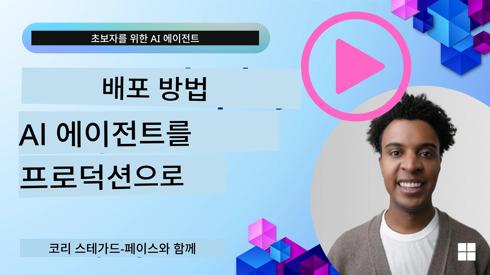

# 프로덕션에서의 AI 에이전트: 관측 가능성 및 평가

[](https://youtu.be/l4TP6IyJxmQ?si=reGOyeqjxFevyDq9)

AI 에이전트가 실험용 프로토타입에서 실제 세계의 응용 프로그램으로 이동함에 따라, 그들의 행동을 이해하고, 성능을 모니터링하며, 출력물을 체계적으로 평가하는 능력이 중요해지고 있습니다.

## 학습 목표

이 수업을 완료한 후, 다음을 알거나 이해하게 될 것입니다:
- 에이전트 관측 가능성과 평가의 핵심 개념
- 에이전트의 성능, 비용, 효과를 개선하는 기술
- AI 에이전트를 체계적으로 평가하는 방법과 무엇을 평가해야 하는지
- 프로덕션에 AI 에이전트를 배포할 때 비용 관리 방법
- Microsoft Agent Framework로 구축된 에이전트에 계측하는 방법

목표는 여러분이 "블랙 박스" 에이전트를 투명하고 관리 가능하며 신뢰할 수 있는 시스템으로 변환할 수 있는 지식을 갖추도록 하는 것입니다.

_**참고:** 안전하고 신뢰할 수 있는 AI 에이전트를 배포하는 것이 중요합니다. 또한 [신뢰할 수 있는 AI 에이전트 구축하기](../06-building-trustworthy-agents/README.md) 수업을 확인하세요._

## 트레이스와 스팬

[Langfuse](https://langfuse.com/) 또는 [Microsoft Foundry](https://learn.microsoft.com/en-us/azure/ai-foundry/what-is-azure-ai-foundry) 같은 관측 가능성 도구는 보통 에이전트 실행을 트레이스와 스팬으로 나타냅니다.

- <strong>트레이스</strong>는 시작부터 끝까지 완전한 에이전트 작업(예: 사용자 쿼리 처리)을 나타냅니다.
- <strong>스팬</strong>은 트레이스 내 개별 단계(예: 언어 모델 호출 또는 데이터 검색)입니다.


<!-- 이미지 URL은 설명 목적으로 유지됨 -->

관측 가능성이 없으면 AI 에이전트는 "블랙 박스"처럼 느껴질 수 있습니다 - 내부 상태와 추론이 불투명하여 문제를 진단하거나 성능을 최적화하기 어렵습니다. 관측 가능성이 있으면 에이전트는 "유리 상자"가 되어 신뢰를 구축하고 의도대로 작동하는 것을 보장하는 데 필수적인 투명성을 제공합니다.

## 프로덕션 환경에서 관측 가능성이 중요한 이유

AI 에이전트를 프로덕션 환경에 전환하면 새로운 도전과 요구 사항이 발생합니다. 관측 가능성은 더 이상 "있으면 좋은 것"이 아니라 중요한 역량입니다:

*   **디버깅 및 근본 원인 분석**: 에이전트가 실패하거나 예상치 못한 출력을 생성할 때, 관측 가능성 도구는 오류 원인을 정확히 찾는 데 필요한 트레이스를 제공합니다. 이는 여러 LLM 호출, 도구 상호 작용, 조건부 논리가 포함된 복잡한 에이전트에 특히 중요합니다.
*   **지연 시간 및 비용 관리**: AI 에이전트는 종종 토큰이나 호출당 요금이 부과되는 LLM 및 기타 외부 API를 사용합니다. 관측 가능성은 이 호출을 정확히 추적하여 과도하게 느리거나 비용이 많이 드는 작업을 식별하는 데 도움을 줍니다. 이를 통해 팀은 프롬프트를 최적화하거나 더 효율적인 모델을 선택하거나 워크플로를 재설계하여 운영 비용을 관리하고 좋은 사용자 경험을 보장할 수 있습니다.
*   **신뢰, 안전 및 규정 준수**: 많은 응용 사례에서 에이전트가 안전하고 윤리적으로 행동하는지 확인하는 것이 중요합니다. 관측 가능성은 에이전트 행동 및 결정에 대한 감사 추적을 제공합니다. 이는 프롬프트 인젝션, 유해 콘텐츠 생성 또는 개인 식별 정보(PII) 처리 오류 같은 문제를 감지하고 완화하는 데 사용할 수 있습니다. 예를 들어, 특정 응답을 제공한 이유나 특정 도구를 사용한 이유를 이해하기 위해 트레이스를 검토할 수 있습니다.
*   **지속적인 개선 루프**: 관측 가능성 데이터는 반복 개발 프로세스의 기초입니다. 실제 세계에서 에이전트가 어떻게 작동하는지 모니터링함으로써 팀은 개선이 필요한 영역을 식별하고 모델 미세 조정에 사용할 데이터를 수집하며 변경의 영향을 검증할 수 있습니다. 이는 온라인 평가의 프로덕션 통찰력이 오프라인 실험과 정제에 반영되어 점진적으로 더 나은 에이전트 성능으로 이어지는 피드백 루프를 만듭니다.

## 추적할 주요 지표

에이전트의 행동을 모니터링하고 이해하기 위해 다양한 지표와 신호를 추적해야 합니다. 특정 지표는 에이전트의 목적에 따라 다를 수 있지만, 일부는 보편적으로 중요합니다.

관측 가능성 도구가 모니터링하는 가장 일반적인 지표는 다음과 같습니다:

**지연 시간:** 에이전트가 얼마나 빨리 응답합니까? 긴 대기 시간은 사용자 경험에 부정적인 영향을 끼칩니다. 에이전트 실행을 추적하여 작업과 개별 단계의 지연 시간을 측정해야 합니다. 예를 들어, 모든 모델 호출에 20초가 걸리는 에이전트는 더 빠른 모델을 사용하거나 모델 호출을 병렬로 실행하여 가속할 수 있습니다.

**비용:** 에이전트 실행당 비용은 얼마입니까? AI 에이전트는 토큰당 청구되는 LLM 호출이나 외부 API에 의존합니다. 도구 사용이 잦거나 여러 프롬프트가 있으면 비용이 빠르게 증가할 수 있습니다. 예를 들어, 에이전트가 품질 개선을 위해 LLM을 다섯 번 호출하면 비용이 타당한지 평가하거나 호출 수를 줄이거나 저렴한 모델을 사용해야 합니다. 실시간 모니터링은 버그로 인해 과도한 API 루프가 발생하는 등 예기치 않은 비용 급증을 식별하는 데 도움이 됩니다.

**요청 오류:** 에이전트가 실패한 요청 수는 얼마입니까? 이는 API 오류나 도구 호출 실패를 포함할 수 있습니다. 프로덕션에서 에이전트를 더 견고하게 만들려면 폴백 또는 재시도를 설정할 수 있습니다. 예를 들어, LLM 공급자 A가 중단되면 백업으로 공급자 B로 전환할 수 있습니다.

**사용자 피드백:** 직접적인 사용자 평가를 구현하면 귀중한 통찰을 제공합니다. 여기에는 명시적 평가(👍좋음/👎나쁨, ⭐1-5점) 또는 텍스트 코멘트가 포함될 수 있습니다. 지속적인 부정적 피드백은 에이전트가 예상대로 작동하지 않는다는 신호입니다.

**암묵적 사용자 피드백:** 사용자의 행동은 명시적 평가 없이도 간접적인 피드백을 제공합니다. 여기에는 즉각적인 질문 재구성, 반복된 쿼리, 재시도 버튼 클릭 등이 포함됩니다. 예를 들어, 사용자가 같은 질문을 반복하는 경우 이는 에이전트가 예상대로 작동하지 않는 신호입니다.

**정확도:** 에이전트가 올바르거나 원하는 출력을 얼마나 자주 생성합니까? 정확도의 정의는 다양하며(예: 문제 해결 정확도, 정보 검색 정확도, 사용자 만족도) 먼저 에이전트 성공의 기준을 정의해야 합니다. 자동화된 검사, 평가 점수 또는 작업 완료 레이블을 통해 정확도를 추적할 수 있습니다. 예를 들어, 트레이스를 "성공" 또는 "실패"로 표시할 수 있습니다.

**자동 평가 지표:** 자동 평가도 설정할 수 있습니다. 예를 들어, LLM을 사용해 에이전트 출력을 평가할 수 있습니다(도움이 되는지, 정확한지 여부). 에이전트의 다양한 측면을 점수화하는 데 도움이 되는 여러 오픈 소스 라이브러리가 있습니다. 예: RAG 에이전트를 위한 [RAGAS](https://docs.ragas.io/), 유해 언어 또는 프롬프트 인젝션 탐지를 위한 [LLM Guard](https://github.com/protectai/llm-guard).

실제로 이 지표들의 조합이 AI 에이전트 상태를 가장 잘 포괄합니다. 이 장의 [예제 노트북](./code_samples/10-expense_claim-demo.ipynb)에서 이러한 지표가 실제 예에서 어떻게 나타나는지 보여드리겠지만, 먼저 일반적인 평가 워크플로가 어떻게 구성되는지 학습하겠습니다.

## 에이전트 계측

추적 데이터를 수집하려면 코드를 계측해야 합니다. 목표는 에이전트 코드를 계측하여 관측 가능성 플랫폼에서 캡처, 처리 및 시각화할 수 있는 트레이스와 지표를 생성하는 것입니다.

**OpenTelemetry (OTel):** [OpenTelemetry](https://opentelemetry.io/)는 LLM 관측 가능성의 업계 표준으로 부상하고 있습니다. 이는 원격 측정 데이터를 생성, 수집 및 내보내기 위한 API, SDK 및 도구 세트를 제공합니다.

기존 에이전트 프레임워크를 래핑하고 OpenTelemetry 스팬을 관측 가능성 도구로 쉽게 내보내는 다양한 계측 라이브러리가 있습니다. Microsoft Agent Framework는 OpenTelemetry와 네이티브 통합됩니다. 아래는 MAF 에이전트 계측 예제입니다:

```python
from agent_framework.observability import get_tracer, get_meter

tracer = get_tracer()
meter = get_meter()

with tracer.start_as_current_span("agent_run"):
    # Agent execution is traced automatically
    pass
```

이 장의 [예제 노트북](./code_samples/10-expense_claim-demo.ipynb)은 MAF 에이전트를 계측하는 방법을 보여줍니다.

**수동 스팬 생성:** 계측 라이브러리가 기본 기준을 제공하지만, 더 상세하거나 맞춤 정보가 필요한 경우가 종종 있습니다. 수동으로 스팬을 생성하여 맞춤 애플리케이션 로직을 추가할 수 있습니다. 더 중요한 것은 자동 또는 수동으로 생성된 스팬을 비즈니스 관련 데이터, 중간 계산 값 또는 디버깅 및 분석에 유용할 수 있는 컨텍스트(예: `user_id`, `session_id`, `model_version` 같은)를 포함한 맞춤 속성(태그 또는 메타데이터라고도 함)으로 풍부하게 할 수 있다는 점입니다.

[Langfuse Python SDK](https://langfuse.com/docs/sdk/python/sdk-v3)로 수동으로 트레이스와 스팬을 생성하는 예:

```python
from langfuse import get_client
 
langfuse = get_client()
 
span = langfuse.start_span(name="my-span")
 
span.end()
```

## 에이전트 평가

관측 가능성은 지표를 제공하지만, 평가는 그 데이터를 분석(및 테스트 수행)하여 AI 에이전트가 얼마나 잘 작동하는지, 어떻게 개선할 수 있는지를 판단하는 프로세스입니다. 즉, 트레이스와 지표를 얻은 후, 이를 활용해 에이전트를 판단하고 의사결정하는 방법입니다.

정기 평가는 중요합니다. AI 에이전트는 비결정적이며(업데이트 또는 모델 동작 변화에 따라) 진화할 수 있기 때문입니다 – 평가 없이는 “스마트 에이전트”가 실제로 자신의 역할을 잘 수행하는지, 아니면 퇴보했는지 알 수 없습니다.

AI 에이전트 평가에는 두 가지 범주가 있습니다: <strong>온라인 평가</strong>와 **오프라인 평가**. 두 가지 모두 가치가 있으며 서로 보완합니다. 보통 에이전트 배포 전 최소한으로 필요한 단계인 오프라인 평가부터 시작합니다.

### 오프라인 평가


이는 통제된 환경에서 평가를 수행하는 것으로, 일반적으로 테스트 데이터셋을 사용하며 실제 사용자 쿼리는 아니고, 기대되는 출력이나 올바른 행동을 아는 큐레이트된 데이터셋을 이용해 에이전트를 실행하는 것입니다.

예를 들어, 수학 문제 해결 에이전트를 만들었다면 알려진 답을 가진 100문제의 [테스트 데이터셋](https://huggingface.co/datasets/openai/gsm8k)이 있을 수 있습니다. 오프라인 평가는 개발 중 수행되며(CI/CD 파이프라인 일부로) 개선 사항을 확인하거나 회귀를 막는 데 사용됩니다. 이 점의 장점은 <strong>반복 가능하고 기준 진실이 있어 명확한 정확도 지표를 얻을 수 있다는 것</strong>입니다. 또한 사용자 쿼리를 시뮬레이션하여 에이전트의 응답을 이상적인 답변과 비교하거나 위에서 설명한 자동 지표를 사용할 수 있습니다.

오프라인 평가의 주요 과제는 테스트 데이터셋이 포괄적이고 관련성을 유지하는 것입니다 – 에이전트는 고정된 테스트 집합에서는 잘 작동해도 프로덕션에서 매우 다른 쿼리를 만날 수 있습니다. 따라서 실제 시나리오를 반영하는 새로운 엣지 케이스와 예제로 테스트 세트를 계속 업데이트해야 합니다. 작은 "스모크 테스트" 케이스와 더 광범위한 평가 세트를 혼합하여 사용하는 것이 유용합니다: 작은 세트는 빠른 확인용, 큰 세트는 더 넓은 성능 지표용입니다.

### 온라인 평가


이는 실시간, 실제 환경에서 에이전트를 평가하는 것으로, 즉 프로덕션에서 실제 사용 중일 때의 평가입니다. 온라인 평가는 실제 사용자 상호작용에서 에이전트 성능을 모니터링하고 결과를 지속적으로 분석합니다.

예를 들어, 실시간 트래픽에서 성공률, 사용자 만족도 점수 또는 기타 지표를 추적할 수 있습니다. 온라인 평가의 장점은 <strong>랩 환경에서는 예상하지 못한 상황을 포착할 수 있다는 것</strong>입니다 – 모델 드리프트를 관찰할 수 있고(입력 패턴 변화에 따라 에이전트 효율이 저하될 경우) 테스트 데이터에 없던 예기치 않은 쿼리나 상황을 잡아낼 수 있습니다. 실제 환경에서 에이전트가 어떻게 행동하는지 진정한 모습을 제공합니다.

온라인 평가는 암묵적 및 명시적 사용자 피드백 수집, 그림자 테스트 또는 A/B 테스트 실행(새 버전 에이전트가 구 버전과 병렬로 실행되어 비교됨)을 포함할 수 있습니다. 문제는 실시간 상호작용에 대한 신뢰할 수 있는 라벨이나 점수를 얻기 어렵다는 것입니다 – 사용자 피드백 또는 사용자 클릭과 같은 하위 지표에 의존할 수 있습니다.

### 두 가지 평가 방법 결합하기

온라인과 오프라인 평가는 상호 배타적이지 않고 매우 보완적입니다. 온라인 모니터링에서의 인사이트(예: 에이전트가 부진한 새로운 유형의 사용자 쿼리)는 오프라인 테스트 데이터셋을 보강 및 개선하는 데 사용될 수 있습니다. 반대로, 오프라인 테스트에서 잘 수행된 에이전트는 온라인에서 자신 있게 배포 및 모니터링할 수 있습니다.

사실 많은 팀이 다음과 같은 루프를 채택합니다:

_오프라인 평가 -> 배포 -> 온라인 모니터링 -> 새로운 실패 사례 수집 -> 오프라인 데이터셋에 추가 -> 에이전트 개선 -> 반복_.

## 일반적인 문제점

AI 에이전트를 프로덕션에 배포하면 다양한 도전과 만날 수 있습니다. 다음은 흔한 문제와 가능한 해결책입니다:

| <strong>문제</strong>    | **가능한 해결책**   |
| ------------- | ------------------ |
| AI 에이전트가 일관되게 작업을 수행하지 못함 | - AI 에이전트에 제공하는 프롬프트를 명확히 하여 목표를 분명히 하세요.<br>- 작업을 하위 작업으로 나누어 여러 에이전트에게 처리하도록 하는 것이 도움이 되는지 확인하세요. |
| AI 에이전트가 연속 루프에 빠짐 | - 프로세스를 언제 종료해야 하는지 명확한 종료 조건을 설정하여 에이전트가 종료를 알도록 하세요.<br>- 추론과 계획이 필요한 복잡한 작업에는 추론 작업에 특화된 더 큰 모델을 사용하세요. |
| AI 에이전트 도구 호출이 잘 작동하지 않음 | - 에이전트 시스템 외부에서 도구의 출력을 테스트하고 검증하세요.<br>- 도구의 정의된 매개변수, 프롬프트, 명칭을 수정하세요.  |
| 다중 에이전트 시스템이 일관되게 작동하지 않음 | - 각 에이전트에 제공되는 프롬프트를 구체적이고 서로 구분되게 다듬으세요.<br>- "라우팅" 또는 컨트롤러 역할의 에이전트를 사용하여 올바른 에이전트를 결정하는 계층적 시스템을 구축하세요. |

이러한 문제 중 상당수는 관측 가능성을 갖추면 더 효과적으로 식별할 수 있습니다. 앞서 논의한 트레이스와 지표는 에이전트 워크플로 내 어디서 문제가 발생하는지 정확히 찾아내 디버깅 및 최적화를 훨씬 효율적으로 만듭니다.

## 비용 관리

AI 에이전트를 프로덕션에 배포할 때 비용을 관리하는 몇 가지 전략은 다음과 같습니다:

**더 작은 모델 사용하기:** 소형 언어 모델(SLM)은 특정 에이전트 사용 사례에서 좋은 성능을 발휘할 수 있으며 비용을 크게 절감할 수 있습니다. 앞서 언급한 것처럼, 성능을 평가하고 대규모 모델과 비교할 수 있는 평가 시스템을 구축하는 것이 SLM이 사용 사례에서 얼마나 잘 작동할지 이해하는 가장 좋은 방법입니다. 의도 분류나 매개변수 추출과 같은 더 단순한 작업에는 SLM을 사용하고, 복잡한 추론에는 더 큰 모델을 사용하는 것을 고려하세요.

**라우터 모델 사용하기:** 유사한 전략으로 다양한 모델과 크기를 사용하는 방법이 있습니다. 복잡성에 따라 최적 모델로 요청을 라우팅하기 위해 LLM/SLM 또는 서버리스 함수 를 사용할 수 있습니다. 이렇게 하면 비용을 절감하면서도 적합한 작업에서 성능을 보장할 수 있습니다. 예를 들어, 간단한 쿼리는 더 작고 빠른 모델로 라우팅하고, 복잡한 추론 작업에만 비용이 큰 대형 모델을 사용하는 것입니다.

**응답 캐싱하기:** 자주 요청되는 작업과 요청을 식별하고, 에이전트 시스템을 거치기 전에 응답을 제공하는 것은 유사한 요청의 양을 줄이는 좋은 방법입니다. 간단한 AI 모델을 사용하여 요청이 캐시된 요청과 얼마나 유사한지 식별하는 플로우를 구현할 수도 있습니다. 이 전략은 자주 묻는 질문이나 일반 워크플로우의 비용을 크게 줄일 수 있습니다.

## 실제로 어떻게 작동하는지 살펴보겠습니다

[이 섹션의 예제 노트북](./code_samples/10-expense_claim-demo.ipynb)에서는 관찰 도구를 사용하여 에이전트를 모니터링하고 평가하는 방법의 예시를 볼 수 있습니다.


### 운영 중인 AI 에이전트에 대해 더 궁금한 점 있으신가요?

[Microsoft Foundry Discord](https://discord.com/invite/ATgtXmAS5D)에 참여하여 다른 학습자들과 만나고, 오피스 아워에 참석하며 AI 에이전트 관련 질문에 대한 답변을 받아보세요.

## 이전 강의

[메타인지 디자인 패턴](../09-metacognition/README.md)

## 다음 강의

[에이전트 프로토콜](../11-agentic-protocols/README.md)

---

<!-- CO-OP TRANSLATOR DISCLAIMER START -->
**면책 조항**:
이 문서는 AI 번역 서비스 [Co-op Translator](https://github.com/Azure/co-op-translator)를 사용하여 번역되었습니다. 정확성을 기하기 위해 노력하고 있으나, 자동 번역은 오류나 부정확한 부분이 있을 수 있음을 유의하시기 바랍니다. 원본 문서의 원어본이 권위 있는 자료로 간주되어야 합니다. 중요한 정보의 경우, 전문가의 인간 번역을 권장합니다. 이 번역 사용으로 인해 발생하는 오해나 잘못된 해석에 대해 당사는 책임을 지지 않습니다.
<!-- CO-OP TRANSLATOR DISCLAIMER END -->